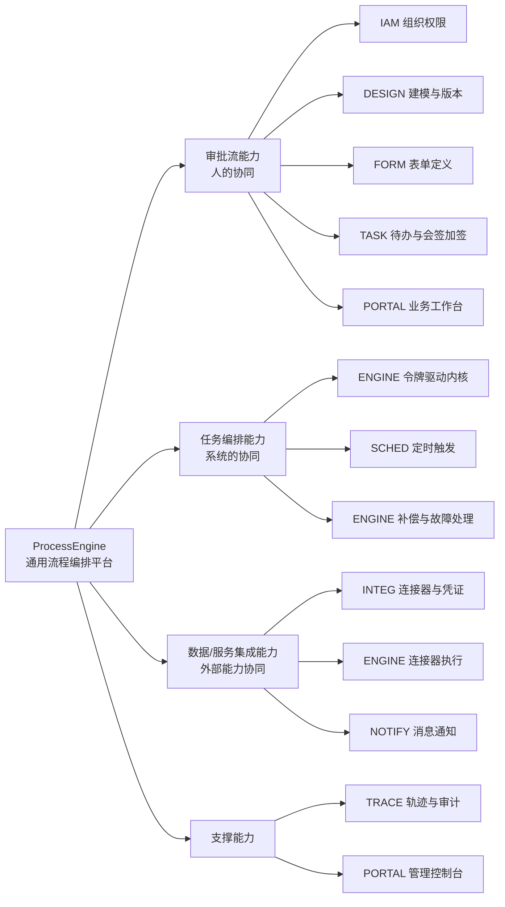

# ProcessEngine 流程编排平台 · 需求规格说明书

> 本文是 ProcessEngine 项目文档体系的第 2 份文档（`docs/01-需求规格说明书.md`）。
> 全文的术语、服务名、实体名、节点类型、状态枚举、候选人策略、需求编号规则与非功能指标，**全部以 `docs/00-设计基线.md` 为准**；本文不新增任何与基线冲突的服务、组件或概念。

| 项 | 值 |
| --- | --- |
| 项目名称 | ProcessEngine 流程编排平台 |
| 文档名称 | 需求规格说明书（Software Requirements Specification，SRS） |
| 文档编号 | `docs/01-需求规格说明书.md` |
| 对应基线版本 | v1.0（基线冻结） |
| 文档状态 | 待评审 |
| 需求编号规范 | `FR-{DOMAIN}-{三位序号}` / `NFR-{分类}-{三位序号}`（见基线第 8 节） |
| 目标读者 | 产品、研发、测试、运维、安全审计、外部集成方 |

---

## 1. 文档说明

### 1.1 编写目的

本文定义 ProcessEngine 流程编排平台 v1.0 的**可验收需求全集**，用于：

1. 作为产品、研发、测试三方对「做什么、做到什么程度、怎么算做完」的唯一共同认知；
2. 作为 `docs/02-系统设计方案.md` 的设计输入与 `docs/05-迭代计划与项目骨架.md` 的排期输入；
3. 作为验收测试用例（含 E2E）的追溯源头：每条 `FR` 均带可执行、可观测的验收标准；
4. 作为范围管理依据：本文第 7 章的「不做清单」即为需求变更的判定基线。

### 1.2 文档范围

**包含**：

- 产品定位、价值主张、与周边类产品的差异与边界；
- 用户角色、权限诉求与用例总览；
- 4 个端到端典型业务场景的编号步骤描述；
- 10 个需求域（IAM / DESIGN / FORM / ENGINE / TASK / SCHED / INTEG / NOTIFY / TRACE / PORTAL）的功能需求；
- 7 类非功能需求（PERF / AVAIL / SEC / OBS / COMPAT / USAB / MAINT）；
- 范围边界与不做清单、依赖与假设、需求追溯矩阵、优先级与版本规划建议。

**不包含**：

- 架构设计、部署拓扑、模块分层实现（见 `docs/02-系统设计方案.md`）；
- 建表 DDL、索引与容量规划（见 `docs/03-数据库设计.md`）；
- 接口路径、请求/响应字段、消息契约、错误码表（见 `docs/04-API契约.md`）；
- 具体代码实现、类图、算法伪码；
- 真实报价、商务条款与交付验收合同条款。

### 1.3 读者对象与阅读指引

| 读者对象 | 关注章节 | 阅读目的 |
| --- | --- | --- |
| 产品经理 / 需求分析师 | 2、3、4、5、7、10 | 确认范围、优先级与版本规划 |
| 后端研发（引擎 / 业务服务） | 3、5.4、5.5、6、9 | 明确业务规则、状态机与验收口径 |
| 前端研发（控制台 / 工作台） | 3、5.10、6 | 明确页面信息架构与交互要求 |
| 测试与 QA | 4、5、6、9 | 提取测试点与验收用例 |
| 运维 / SRE | 5.7、5.9、6 | 明确调度、监控、告警、容量指标 |
| 安全与审计 | 5.1、5.8、5.9、6 | 明确鉴权、凭证、审计与合规要求 |
| 外部集成方 / API 接入方 | 3、5.4、5.8、6 | 明确调用方式、幂等、限额与错误语义 |

### 1.4 引用文档

| 编号 | 文档 | 路径 | 引用方式 |
| --- | --- | --- | --- |
| [R1] | 设计基线 | `docs/00-设计基线.md` | **强制一致**：术语（第 1 节）、选型（第 2 节）、服务拆分（第 3 节）、实体清单（第 4 节）、节点类型全集（5.1）、候选人策略（5.2）、扩展点（5.3）、全局规范（第 6 节）、非功能基线指标（第 7 节）、编号规范（第 8 节） |
| [R2] | 系统设计方案 | `docs/02-系统设计方案.md` | 下游设计文档（本文为其输入） |
| [R3] | 数据库设计 | `docs/03-数据库设计.md` | 下游设计文档（本文为其输入） |
| [R4] | API 契约 | `docs/04-API契约.md` | 下游设计文档（本文为其输入） |
| [R5] | 迭代计划与项目骨架 | `docs/05-迭代计划与项目骨架.md` | 下游计划文档（本文为其输入） |
| [R6] | BPMN 2.0 规范 | OMG BPMN 2.0.2 | 仅用于导入导出适配层语义对齐（基线 5.1 节点映射） |

### 1.5 术语引用基线

本文使用的术语**不做二次定义**，一律引用基线第 1 节术语表，包括但不限于：流程定义、流程版本、流程模型、流程实例、令牌、节点实例、人任务、自动化节点、连接器、连接器操作、网关闭环、会签 / 或签、加签、转办 / 委托、撤回、补偿、事件订阅、故障事件（Incident）、触发作业、租户、命令、发件箱。

补充约定（不新增概念，仅明确本文的书写口径）：

| 书写口径 | 含义 |
| --- | --- |
| 「引擎」 | 指服务 `process-engine`（基线第 3 节，端口 8083，库 `pe_engine`） |
| 「设计态」 | 指 `process-design` 管理的 `pf_process_def` / `pf_process_version` / `pf_form_def` / `pf_form_version` |
| 「运行态」 | 指 `process-engine` 的 `rt_*` 系列实体 |
| 「实例状态」 | 严格取值 `RUNNING` / `SUSPENDED` / `COMPLETED` / `TERMINATED`（基线 4.3） |
| 「任务状态」 | 严格取值 `CREATED` / `CLAIMED` / `COMPLETED` / `DELEGATED` / `TRANSFERRED` / `CANCELED` / `TIMEOUT`（基线 4.3） |
| 「节点类型」 | 严格引用基线 5.1 的 `NodeType` 全集：**5 组共 26 类**（事件 7 + 边界 3 + 自动化 11 + 人工 1 + 网关 4），不新增类型 |
| 「候选人策略」 | 严格引用基线 5.2 的 9 种 `assigneeStrategy` + 3 条去重/跳过规则 |
| 本文中的「场景 Sx」 | 指第 4 章的端到端场景编号（S1~S4） |
| 本文中的「用例 UC-」 | 指第 3.3 节用例总览图中的用例编号（`UC-{DOMAIN}-{三位序号}`） |

### 1.6 需求书写规则

1. 每条功能需求必须包含：编号、需求名称、需求描述（含关键规则与约束）、优先级（P0/P1/P2）、验收标准（可验证、可测试）；不满足者视为文档缺陷。
2. P0 = 首个可上线版本必须交付；P1 = 次版本交付；P2 = 远期规划（与基线第 8 节一致）。
3. 验收标准**禁止使用不可度量的形容词**（如「高效」「友好」「强大」「尽可能」）；必须给定输入、动作、可观测结果（含具体数值、状态枚举值或实体落库结果）。
4. 需求描述中出现的状态、枚举、字段名，一律使用基线中的英文标识（如 `SUSPENDED`、`PERCENT`、`misfire_policy`），并与基线 4.x 实体清单逐字一致。
5. 需求之间若存在依赖，在描述中以 `FR-xx-xxx` 形式显式引用。
6. 本文**不自创节点类型**。若基线 5.1 表格未列出但基线其他章节提到的类型标识，一律按「基线待确认项」处理，见 1.7。

### 1.7 基线待确认项（后续维护者行动项）

本节列出基线中出现、但**未列入基线 5.1 `NodeType` 表格**的标识。本文引用它们时已同时给出基线原文依据，并**不计入 26 类节点类型**。以下为**待办行动项**，须由基线维护者在后续基线修订中明确结论，并在结论落库后回写本文对应 FR：

| # | 待确认标识 | 基线出处（现状） | 本文当前口径 | 需执行的行动项 | 责任方与目标版本 |
| --- | --- | --- | --- | --- | --- |
| A1 | `COMPENSATION_BOUNDARY` | 基线 5.1 表 `COMPENSATION_HANDLER` 行「行为要点」列提到「被 `COMPENSATION_BOUNDARY` 触发」；但该标识未出现在 5.1 表的「节点类型」列（边界组仅列 `TIMER_BOUNDARY_EVENT` / `ERROR_BOUNDARY_EVENT` / `MESSAGE_BOUNDARY_EVENT`） | 按「已定义但归类待确认」引用；若该标识不成立，补偿触发改由 `ERROR_BOUNDARY_EVENT` 承载，FR-ENGINE-018~020 行为要求不变 | 在基线 v1.0.2 中确认是否将 `COMPENSATION_BOUNDARY` **提升为边界组独立节点类型**（则 5.1 表节点类型数由 26 增至 27，须同步更新基线 5.1、本文 1.5/2.3/7.1 的「26 类」表述与 FR-PORTAL-003）；若不予提升，则须在基线 5.1 的 `COMPENSATION_HANDLER` 行补注「触发方式：由 `ERROR_BOUNDARY_EVENT`（`error_code` 匹配）承载」 | 基线维护者 / v1.0.2 |
| A2 | `MQ_CONSUME_TASK` | 基线 5.1 表自动化组该行仅列 `HTTP_TASK / SQL_TASK / MQ_PRODUCE_TASK / SCRIPT_TASK / GRPC_TASK`，**未单列** `MQ_CONSUME_TASK`；自动化组按表格计 11 类 | **以基线 5.1 表格的 26 类为准**，本文不为 `MQ_CONSUME_TASK` 编写独立需求；MQ 消费由 FR-ENGINE-027（事件订阅 / 消息捕获事件）与 FR-ENGINE-032（MQ 事件总线消费）承载 | 在基线 v1.0.2 中确认 MQ 消费是否作为**独立节点类型**引入；若引入，须同步更新基线 5.1 自动化组（由 11 类增至 12 类、总计 27 类）、本文 FR-ENGINE-013 的节点归属表述与 FR-PORTAL-003 的「26 类」表述，并新增对应节点行为需求；若不引入，须在基线 5.1 补注「MQ 消费统一由事件订阅语义承载」以消除歧义 | 基线维护者 / v1.0.2 |
| A3 | `int_call_log` 状态字段语义 | 基线已于 v1.0.1 将 `int_call_log.success`（布尔）修正为 `call_status`，取值 `RUNNING` / `SUCCESS` / `FAILED` / `UNKNOWN`（用于识别「请求已发出但结果丢失」的失联执行） | 本文 FR-INTEG-010 已按 `call_status` 编写，并补充「`RUNNING` → `UNKNOWN` 巡检兜底 + 产生故障事件」的验收标准 | **已对齐，无需行动**；仅需在基线冻结版发布时确认 4.5 表字段名与取值未再次变更，并据此回归核对 FR-INTEG-010 | 需求维护者 / 随基线发布回归 |
| A4 | 大对象外置阈值口径 | 基线 4.3 `rt_variable` 说明大值经 `value_ref` 外置 MinIO，未给出具体阈值；《系统设计方案》5.6、20.3 节定为「序列化后 > 64KB 外置」 | 本文 FR-ENGINE-023 已与设计文档对齐为**默认 64KB 且可配置** | 在基线 v1.0.2 的 `rt_variable` 行或新增全局参数表中**固化默认阈值 64KB**（含配置项名），避免阈值只存在于设计文档而与基线脱节 | 基线维护者 / v1.0.2 |

---

## 2. 产品定位与核心价值

### 2.1 一句话定位

ProcessEngine 是**通用型流程编排平台**：把「审批流（人的协同）」「任务编排（系统的协同）」「数据/服务集成（与外部能力的协同）」三种能力收敛到**一套模型、一个引擎、一个控制台**上，用自研轻量令牌驱动引擎按 BPMN 风格 JSON 模型驱动执行。

### 2.2 要解决的业务问题

| # | 业务问题 | 现状痛点 | ProcessEngine 的应对 |
| --- | --- | --- | --- |
| P1 | 审批流程散落在业务代码与工单系统里 | 每次流程变更都要改代码、发版、回归，变更周期以周计 | 流程以版本化模型承载，设计态与运行态分离，改流程 = 发新版本（`FR-DESIGN`） |
| P2 | 跨系统作业靠定时脚本 + 人工搬运 | 无状态、无重试、无补偿、失败靠人肉发现 | 编排 + 自动化节点 + 故障事件 + 补偿反向执行（`FR-ENGINE`） |
| P3 | 审批和数据处理是两套系统 | 同一业务单据跨两套系统对账，口径不一致 | 统一 `rt_process_instance` + `rt_variable`，人和系统节点在同一令牌流上（`FR-ENGINE` / `FR-TASK`） |
| P4 | 集成点硬编码凭证与地址 | 凭证明文、无法审计、改一次全量发版 | 连接器定义 / 操作 / 数据源 / 凭证集中管理并加密（`FR-INTEG`） |
| P5 | 流程异常无处可查、无法复现 | 日志散落，出问题只能猜 | 执行轨迹事件 + 时间线回放 + 流程图高亮（`FR-TRACE`） |
| P6 | 多业务线混用一套流程，互相干扰 | 权限与数据无隔离 | 多租户逻辑隔离 + RBAC + 数据权限（`FR-IAM`） |
| P7 | 待办散落在邮件/IM/各系统 | 漏办、重复办、超时无人管 | 统一待办中心 + 候选人解析 + 超时催办 + 多渠道路由（`FR-TASK` / `FR-NOTIFY` / `FR-PORTAL`） |

### 2.3 核心价值主张

| 价值 | 可度量的落点 |
| --- | --- |
| 变更快 | 流程调整不需改业务代码：设计态改动 → 发布新版本 → 新实例按新版本运行，运行中实例不受影响（`FR-ENGINE-031`） |
| 可编排 | 5 组共 26 类节点类型覆盖事件（7）、边界（3）、自动化（11）、人工（1）、网关（4）（基线 5.1），单模型内可组合 |
| 可兜底 | 自动化节点失败有重试 → 故障事件 → 控制台人工重试/跳过 → 补偿反向回滚（`FR-ENGINE-013`、`FR-ENGINE-014`） |
| 可观测 | 每个节点实例都有 `input_json` / `output_json` / `duration_ms`，轨迹可检索、可回放、可高亮 |
| 可集成 | 连接器与操作可视化定义，凭证 AES-256-GCM 加密，禁明文落库 |
| 可隔离 | 多租户逻辑隔离为默认，租户级配额限流 |
| 可扩展 | 10 个 SPI 扩展点（基线 5.3）：`NodeBehavior` / `ExpressionEvaluator` / `AssigneeResolver` / `ConnectorExecutor` / `TaskListener` / `ExecutionListener` / `ProcessListener` / `VariableSerializer` / `MisfirePolicy` / `NotifyProvider` |

### 2.4 与相邻产品的差异与边界

| 对比对象 | 它的强项 | ProcessEngine 的差异 | 明确边界（不追求） |
| --- | --- | --- | --- |
| **Flowable / Camunda / Activiti** | 成熟 BPMN 2.0 完整实现，社区与生态完善 | 自研轻量令牌驱动引擎，模型以 JSON 为主（BPMN XML 仅作导入导出适配）；把「审批 + 编排 + 集成」放在同一引擎，连接器执行内嵌 SDK，不走网络跳转；扩展点用 Java SPI + Spring Bean 双重注册 | 不实现 BPMN 2.0 全量规范（如复杂事件子流程、事务子流程、泳道语义的完整支持）；不兼容 Flowable 运行期数据库与 API |
| **低代码 / 零代码平台（表单+流程一体）** | 面向业务人员的免编码搭建，页面/表单/报表一体化 | 面向「流程 + 集成 + 数据」的工程化平台：有版本、有环境、有 API、有 SDK、有对账与补偿；表单只做定义与版本（`pf_form_def`）与渲染，不做通用页面搭建 | 不做拖拽式数据大屏、不做通用 CRUD 页面生成器、不做移动端原生 App 搭建器 |
| **ETL / 调度工具（如 DataX + XXL-JOB / DolphinScheduler）** | 面向数据管道的大批量抽取与工作流调度 | 调度只是平台的一个域（`process-scheduler`）：调度可触发流程实例，流程内可做人工审批等待，数据同步只是自动化节点的一种组合 | 不做列式大数据计算引擎、不做数据血缘图与数据集市、不替代数仓建模工具 |
| **iPaaS / ESB** | 面向接口编排与协议转换的集成中枢 | 连接器「定义/配置/凭证」在 `process-integration`、**执行在 `process-engine` 内嵌 SDK**（基线第 3 节归属裁决），减少一跳 RPC；集成服务于流程，而非独立主产品 | 不做全量协议适配矩阵（v1.0 连接器类型固定为 `HTTP/SQL/MQ/SCRIPT/GRPC/BEAN`）、不做 ESB 级服务注册治理 |
| **分布式事务框架（Seata 等）** | 强一致跨库事务 | **明确不引入**（基线 2.3）；跨服务一致性走「本地事务 + Outbox + 幂等消费 + 补偿」 | 不提供全局锁、不做跨库强一致事务编排 |
| **规则引擎（Drools 等）** | 复杂规则推理与规则库治理 | **明确不引入**（基线 2.3）；v1.0 用 Aviator 表达式 + 决策表节点替代 | 不做 RETE 网络、不做规则版本库与规则测试套件 |

### 2.5 产品能力地图（三大能力 × 需求域）

---

## 3. 用户角色与画像

### 3.1 角色画像表

| 角色 | 典型用户 | 主要诉求 | 关键权限（RBAC 权限点 + 数据权限 `data_scope`） |
| --- | --- | --- | --- |
| **平台超级管理员** | 平台运维团队负责人 | 开租户、控配额、管平台级参数、处理跨租户故障与升级 | `sys_tenant` 全量 CRUD；跨租户统计（`@IgnoreTenant` 白名单）；平台级配置；`data_scope = ALL`（平台级资源） |
| **租户管理员** | 某租户 IT 管理员 / 流程 Owner | 管本租户组织架构、角色、菜单、流程分类、模板与配额 | 本租户 `sys_user` / `sys_dept` / `sys_role` / `sys_permission` / `sys_user_group` CRUD；`pf_category` 管理；`data_scope = ALL`（限本租户） |
| **流程设计者** | 业务分析师 / 实施顾问 | 用设计器建模、配表单、调试、发布与下线、版本回滚 | `pf_process_def` / `pf_process_version` / `pf_form_def` / `pf_form_version` / `pf_template` CRUD；发布 / 下线 / 回滚；导入导出；模型校验；不可查看全租户运行数据，仅本人/本部门流程的运行数据 |
| **流程发起人** | 普通业务员工 | 发起申请、查看进度、撤回、催办、看我发起 | 发起点使用（按流程配置的发起权限）；`rt_process_instance` 本人实例只读；撤回 / 催办（受 `settings.allowWithdraw` / `withdrawScope` 约束）；`data_scope = SELF` |
| **审批办理人** | 主管 / 部门负责人 / 财务 | 看我的待办、认领、加签、转办、委托、驳回、填意见与附件 | `rt_task` 候选范围内操作；认领 / 释放 / 完成 / 驳回 / 加签 / 转办 / 委托 / 催办；`data_scope = SELF` + 组织范围（`DEPT_AND_CHILD` 视角色而定） |
| **运维 / SRE** | 运维工程师 | 看大盘、看实例积压、处理故障事件、重试/跳过、控调度、限流降级 | `rt_incident` 处理与人工重试/跳过；实例挂起/恢复/终止（需二次确认）；`sch_job` 启停与手动执行；监控大盘与告警规则；连接器连通性测试；**不可修改流程模型** |
| **审计员** | 内控 / 合规 / 安全审计 | 查谁在什么时候对什么做了什么、导出审计证据、查凭证配置变更 | `tr_oper_log` / `tr_exec_trace` 只读检索与导出；`rt_task_oper_log` 只读；登录日志只读；**无任何写权限**（含不可修改流程与任务）；`data_scope = ALL`（只读） |
| **集成开发者** | 后端 / 中台工程师 | 建连接器与操作、配数据源与凭证、调 schema 映射、在线调试、看调用日志 | `int_connector` / `int_connector_operation` / `int_datasource` / `int_credential` CRUD；连通性测试；在线调试；`int_call_log` 只读；**无凭证明文读取权限**（只能"覆盖式"更新） |
| **外部系统 API 接入方** | 第三方系统 / 上游业务系统 | 用 API 发起流程、提交任务、投递消息/信号、查实例状态 | 仅持有 API 客户端凭证（`X-Internal-Token` 或网关签发的客户端凭据）；可调用的接口按「API 范围授权」白名单收敛；必须携带 `Idempotency-Key`（基线 6.10）；无控制台登录能力（可选只读查询账号） |

### 3.2 角色与用例对应矩阵

| 角色 \ 用例域 | IAM | DESIGN | FORM | ENGINE | TASK | SCHED | INTEG | NOTIFY | TRACE | PORTAL |
| --- | --- | --- | --- | --- | --- | --- | --- | --- | --- | --- |
| 平台超级管理员 | ✔ 全 | — | — | ✔ 只读 | — | ✔ 只读 | — | — | ✔ 只读 | ✔ 平台控制台 |
| 租户管理员 | ✔ 本租户 | ✔ 分类/模板 | ✔ 只读 | ✔ 只读 | — | ✔ 只读 | ✔ 只读 | ✔ 配置 | ✔ 只读 | ✔ 租户控制台 |
| 流程设计者 | — | ✔ 全 | ✔ 全 | ✔ 调试 | — | — | ✔ 只读引用 | — | ✔ 本人范围 | ✔ 设计器 |
| 流程发起人 | — | — | ✔ 填单 | ✔ 发起/撤回 | ✔ 抄送/催办 | — | — | ✔ 订阅 | ✔ 本人实例 | ✔ 业务工作台 |
| 审批办理人 | — | — | ✔ 填单 | — | ✔ 办理 | — | — | ✔ 订阅 | ✔ 本人任务 | ✔ 业务工作台 |
| 运维 / SRE | ✔ 只读 | — | — | ✔ 运维动作 | ✔ 只读 | ✔ 全 | ✔ 测试 | ✔ 只读 | ✔ 全 | ✔ 监控大盘 |
| 审计员 | ✔ 只读 | ✔ 只读 | ✔ 只读 | ✔ 只读 | ✔ 只读 | ✔ 只读 | ✔ 只读（脱敏） | ✔ 只读 | ✔ 全只读 | ✔ 审计查询 |
| 集成开发者 | — | — | — | ✔ 调试 | — | — | ✔ 全 | — | ✔ 调用日志 | ✔ 集成管理页 |
| 外部系统 API 接入方 | — | — | — | ✔ 受限 API | ✔ 受限 API | — | — | — | — | — |

### 3.3 用例总览图

```mermaid
graph TB
    subgraph Actors["参与角色"]
        SA["平台超级管理员"]
        TA["租户管理员"]
        DE["流程设计者"]
        ST["流程发起人"]
        AP["审批办理人"]
        OP["运维 / SRE"]
        AU["审计员"]
        ID["集成开发者"]
        EX["外部系统 API 接入方"]
    end

    subgraph IAM["IAM 身份与权限"]
        U1["UC-IAM-001 管理租户与配额"]
        U2["UC-IAM-002 管理用户/部门/用户组"]
        U3["UC-IAM-003 管理角色/权限/菜单"]
        U4["UC-IAM-004 配置数据权限"]
        U5["UC-IAM-005 登录认证与在线会话"]
    end

    subgraph DESIGN["DESIGN 建模"]
        D1["UC-DESIGN-001 设计流程模型"]
        D2["UC-DESIGN-002 校验并发布版本"]
        D3["UC-DESIGN-003 下线与回滚版本"]
        D4["UC-DESIGN-004 导入导出模型"]
        D5["UC-DESIGN-005 管理分类与模板"]
        D6["UC-DESIGN-006 配置表单定义"]
    end

    subgraph ENGINE["ENGINE 执行内核"]
        E1["UC-ENGINE-001 发起流程实例"]
        E2["UC-ENGINE-002 挂起/恢复/终止实例"]
        E3["UC-ENGINE-003 处理故障事件"]
        E4["UC-ENGINE-004 执行连接器节点"]
        E5["UC-ENGINE-005 执行补偿回滚"]
        E6["UC-ENGINE-006 投递消息/信号"]
    end

    subgraph TASK["TASK 人任务"]
        T1["UC-TASK-001 查看待办/已办/抄送"]
        T2["UC-TASK-002 认领与释放"]
        T3["UC-TASK-003 会签/或签/比例签办理"]
        T4["UC-TASK-004 加签/转办/委托"]
        T5["UC-TASK-005 驳回/撤回"]
        T6["UC-TASK-006 催办与超时处理"]
    end

    subgraph SCHED["SCHED 调度"]
        S1["UC-SCHED-001 配置调度作业"]
        S2["UC-SCHED-002 手动执行与补跑"]
        S3["UC-SCHED-003 查看执行记录"]
    end

    subgraph INTEG["INTEG 集成"]
        I1["UC-INTEG-001 定义连接器与操作"]
        I2["UC-INTEG-002 管理数据源"]
        I3["UC-INTEG-003 管理凭证"]
        I4["UC-INTEG-004 连通性测试与在线调试"]
        I5["UC-INTEG-005 查看调用日志"]
    end

    subgraph NOTIFY["NOTIFY 通知"]
        N1["UC-NOTIFY-001 管理模板"]
        N2["UC-NOTIFY-002 配置渠道"]
        N3["UC-NOTIFY-003 配置订阅规则"]
        N4["UC-NOTIFY-004 查看消息记录"]
    end

    subgraph TRACE["TRACE 轨迹与审计"]
        R1["UC-TRACE-001 查询操作审计"]
        R2["UC-TRACE-002 检索与回放轨迹"]
        R3["UC-TRACE-003 查看实例大盘"]
        R4["UC-TRACE-004 配置告警规则"]
    end

    subgraph PORTAL["PORTAL 前端应用"]
        P1["UC-PORTAL-001 管理控制台"]
        P2["UC-PORTAL-002 业务工作台"]
        P3["UC-PORTAL-003 流程设计器"]
        P4["UC-PORTAL-004 表单设计器"]
        P5["UC-PORTAL-005 实例监控页"]
    end

    SA --> U1
    SA --> P1
    TA --> U2
    TA --> U3
    TA --> U4
    TA --> D5
    DE --> D1
    DE --> D2
    DE --> D3
    DE --> D4
    DE --> D6
    DE --> P3
    DE --> P4
    ST --> E1
    ST --> T5
    ST --> P2
    AP --> T1
    AP --> T2
    AP --> T3
    AP --> T4
    AP --> T6
    AP --> P2
    OP --> E2
    OP --> E3
    OP --> S1
    OP --> S2
    OP --> S3
    OP --> R3
    OP --> R4
    OP --> P5
    AU --> R1
    AU --> R2
    ID --> I1
    ID --> I2
    ID --> I3
    ID --> I4
    ID --> I5
    ID --> N1
    ID --> N2
    ID --> N3
    ID --> N4
    EX --> E1
    EX --> E6
    EX --> T3
    U5 --> TA
    U5 --> DE
    U5 --> ST
    U5 --> AP
```

**用例清单（30 个主用例）**

| 用例编号 | 用例名称 | 主要角色 | 关联需求域 |
| --- | --- | --- | --- |
| UC-IAM-001 | 管理租户与配额 | 平台超级管理员 | IAM |
| UC-IAM-002 | 管理用户 / 部门 / 用户组 | 租户管理员 | IAM |
| UC-IAM-003 | 管理角色 / 权限 / 菜单 | 租户管理员 | IAM |
| UC-IAM-004 | 配置数据权限 | 租户管理员 | IAM |
| UC-IAM-005 | 登录认证与在线会话 | 全角色 | IAM |
| UC-DESIGN-001 | 设计流程模型 | 流程设计者 | DESIGN |
| UC-DESIGN-002 | 校验并发布版本 | 流程设计者 | DESIGN |
| UC-DESIGN-003 | 下线与回滚版本 | 流程设计者 | DESIGN |
| UC-DESIGN-004 | 导入导出模型 | 流程设计者 | DESIGN |
| UC-DESIGN-005 | 管理分类与模板 | 租户管理员 / 流程设计者 | DESIGN |
| UC-DESIGN-006 | 配置表单定义 | 流程设计者 | FORM |
| UC-ENGINE-001 | 发起流程实例 | 流程发起人 / 外部 API 接入方 | ENGINE |
| UC-ENGINE-002 | 挂起 / 恢复 / 终止实例 | 运维 / SRE | ENGINE |
| UC-ENGINE-003 | 处理故障事件 | 运维 / SRE | ENGINE |
| UC-ENGINE-004 | 执行连接器节点 | 引擎（自动化） | ENGINE / INTEG |
| UC-ENGINE-005 | 执行补偿回滚 | 引擎（自动化） | ENGINE |
| UC-ENGINE-006 | 投递消息 / 信号 | 外部 API 接入方 | ENGINE |
| UC-TASK-001 | 查看待办 / 已办 / 抄送 | 审批办理人 | TASK |
| UC-TASK-002 | 认领与释放 | 审批办理人 | TASK |
| UC-TASK-003 | 会签 / 或签 / 比例签办理 | 审批办理人 | TASK |
| UC-TASK-004 | 加签 / 转办 / 委托 | 审批办理人 | TASK |
| UC-TASK-005 | 驳回 / 撤回 | 审批办理人 / 流程发起人 | TASK |
| UC-TASK-006 | 催办与超时处理 | 审批办理人 / 引擎 | TASK |
| UC-SCHED-001 | 配置调度作业 | 运维 / SRE | SCHED |
| UC-SCHED-002 | 手动执行与补跑 | 运维 / SRE | SCHED |
| UC-SCHED-003 | 查看执行记录 | 运维 / SRE | SCHED |
| UC-INTEG-001 | 定义连接器与操作 | 集成开发者 | INTEG |
| UC-INTEG-002 | 管理数据源 | 集成开发者 | INTEG |
| UC-INTEG-003 | 管理凭证 | 集成开发者 | INTEG |
| UC-INTEG-004 | 连通性测试与在线调试 | 集成开发者 / 运维 | INTEG |
| UC-INTEG-005 | 查看调用日志 | 集成开发者 / 审计员 | INTEG |
| UC-NOTIFY-001 | 管理通知模板 | 集成开发者 / 租户管理员 | NOTIFY |
| UC-NOTIFY-002 | 配置通知渠道 | 集成开发者 | NOTIFY |
| UC-NOTIFY-003 | 配置订阅规则 | 集成开发者 | NOTIFY |
| UC-NOTIFY-004 | 查看消息记录 | 集成开发者 / 审计员 | NOTIFY |
| UC-TRACE-001 | 查询操作审计 | 审计员 | TRACE |
| UC-TRACE-002 | 检索与回放执行轨迹 | 审计员 / 运维 | TRACE |
| UC-TRACE-003 | 查看实例统计大盘 | 运维 / SRE | TRACE |
| UC-TRACE-004 | 配置告警规则 | 运维 / SRE | TRACE |
| UC-PORTAL-001 | 使用管理控制台 | 租户管理员 / 设计者 / 运维 | PORTAL |
| UC-PORTAL-002 | 使用业务工作台 | 发起人 / 办理人 | PORTAL |
| UC-PORTAL-003 | 使用流程设计器 | 流程设计者 | PORTAL / DESIGN |
| UC-PORTAL-004 | 使用表单设计器 | 流程设计者 | PORTAL / FORM |
| UC-PORTAL-005 | 使用实例监控页 | 运维 / SRE | PORTAL / TRACE |

---

## 4. 典型端到端业务场景

> 场景用于验证「需求是否构成闭环」。每个场景给出编号步骤、涉及角色、涉及需求（FR 编号）与场景级验收口径。

### 4.1 场景 S1：多级请假审批（含会签、加签、撤回、超时催办）

**背景**：员工提交请假申请，经直属主管会签（主管 + 部门 HR 代表）→ 部门负责人审批 → 超 3 天再经 HR 归档；任一环节超时按 `settings.timeoutPolicy` 催办；中途员工可撤回。

**主流程模型**：`START_EVENT`（表单发起）→ `USER_TASK`（主管会签，`multiMode = ALL`）→ `EXCLUSIVE_GATEWAY`（判断 `days > 3`）→ `USER_TASK`（部门负责人）/ 直连 → `USER_TASK`（HR 归档，`ANY`）→ `END_EVENT`。

| 步骤 | 角色 | 动作 | 系统行为与关键规则 | 关联需求 |
| --- | --- | --- | --- | --- |
| S1-1 | 流程设计者 | 在设计器中建模并配置表单、候选人策略、超时策略 | 模型校验通过（唯一开始节点、路径可达、网关默认流、表达式语法正确、表单引用有效）后发布版本 | FR-DESIGN-003、FR-DESIGN-008、FR-DESIGN-009、FR-DESIGN-014、FR-FORM-001、FR-FORM-002、FR-PORTAL-003 |
| S1-2 | 流程发起人 | 在工作台填写请假单并提交 | 引擎创建 `rt_process_instance`（`status = RUNNING`），绑定该 `version_id`，写 `business_key` 与 `title`；同步推进到第一个等待态，`initiator_id` 记录发起人 | FR-ENGINE-001、FR-ENGINE-002、FR-ENGINE-024、FR-FORM-004 |
| S1-3 | 引擎 | 解析主管会签候选人 | 按 `assigneeStrategy = INITIATOR_LEADER` 解析直属上级，叠加 `ROLE`（`dept_hr`）候选人；执行 `dedupe` 去重；命中 `autoSkipSameApprover` 时自动通过 | FR-TASK-005、FR-TASK-006、FR-TASK-007、FR-TASK-029、FR-TASK-030 |
| S1-4 | 审批办理人 | 主管与 HR 代表分别办理（会签） | 创建 1 个 `rt_task`（`task_type = MULTI`，`multi_mode = ALL`），每人的办理记入 `rt_task_oper_log`；全部 `APPROVE` 后令牌才推进；任一 `REJECT` 按驳回策略处理 | FR-TASK-009、FR-TASK-010、FR-TASK-012 |
| S1-5 | 审批办理人 | 主管前加签给技术负责人 | 在自己之前插入办理人，生成子 `rt_task`（`parent_task_id` 指向原任务），写入 `ADD_SIGN_BEFORE` 操作日志；新任务先办，办完回到原任务 | FR-TASK-015、FR-TASK-026 |
| S1-6 | 引擎 | 超时催办 | `due_minutes` 到期未办则触发 `TIMER_BOUNDARY_EVENT`；按 `timeoutPolicy`（`REMIND`，`intervalMin = 60`，`maxTimes = 3`）发送提醒，并写 `URGE` 操作日志；到达上限按配置升级为 `TIMEOUT` 状态或转办 | FR-ENGINE-011、FR-TASK-022、FR-TASK-023、FR-NOTIFY-006 |
| S1-7 | 流程发起人 | 撤回已推进的任务 | 在 `allowWithdraw = true` 且 `withdrawScope = FIRST_TASK` 范围内撤回：下游未办结任务置 `CANCELED`，令牌回退到发起人节点，`tr_exec_trace` 记录 `WITHDRAW` | FR-TASK-019、FR-TASK-020、FR-TASK-027 |
| S1-8 | 引擎 | 分支判断与结束 | `EXCLUSIVE_GATEWAY` 按表达式求值选分支（含默认流兜底），最终 `END_EVENT` 消费最后一个令牌，实例置 `COMPLETED` 并写 `duration_ms` | FR-ENGINE-004、FR-ENGINE-009、FR-ENGINE-012、FR-ENGINE-025、FR-TRACE-004 |

**场景验收口径**：从提交到进入「主管会签」等待态，P99 < 300ms；会签 2 人全部办理后实例进入下一节点；催办消息在到期后 60s 内可查询到 `nt_message` 记录；撤回后原下游任务状态为 `CANCELED` 且发起人可重新提交同 `business_key`。

### 4.2 场景 S2：订单履约服务编排（HTTP 调库存/支付 + 条件分支 + 补偿回滚 + 故障人工介入）

**背景**：订单系统通过 API 发起履约流程，流程依次调用库存锁定、优惠券核销、支付扣款，任一环节失败则触发人工介入；确认为不可恢复时执行 Saga 反向补偿。

**主流程模型**：`START_EVENT`（API 发起）→ `HTTP_TASK`（锁库存，挂 `COMPENSATION_HANDLER`，其触发边界事件命名见 1.7）→ `HTTP_TASK`（核销券，同挂补偿）→ `EXCLUSIVE_GATEWAY`（金额 > 0）→ `HTTP_TASK`（支付扣款，同挂补偿）→ `MQ_PRODUCE_TASK`（发货指令）→ `END_EVENT`。

| 步骤 | 角色 | 动作 | 系统行为与关键规则 | 关联需求 |
| --- | --- | --- | --- | --- |
| S2-1 | 集成开发者 | 定义 3 个 HTTP 连接器操作并配 schema 映射与凭证 | 操作为 `POST /inventory/lock`、`POST /coupon/consume`、`POST /pay/charge`；输入 schema 校验、`transform_json` 做入出参映射；凭证 AES-256-GCM 加密存储 | FR-INTEG-001、FR-INTEG-002、FR-INTEG-004、FR-INTEG-005、FR-INTEG-007、FR-INTEG-010 |
| S2-2 | 外部系统 | 调用发起接口创建实例 | 携带 `Idempotency-Key`；重复键返回首次结果（落 `rt_idempotent`）；实例 `business_key = 订单号` | FR-ENGINE-001、FR-ENGINE-031、FR-ENGINE-032 |
| S2-3 | 引擎 | 执行锁库存节点 | 节点实例 `status = ACTIVE` → 调连接器 → 成功写 `output_json`、`duration_ms`，令牌推进；失败按重试策略退避重试 | FR-ENGINE-010、FR-ENGINE-013、FR-ENGINE-019、FR-INTEG-013 |
| S2-4 | 引擎 | 网关条件分支 | `EXCLUSIVE_GATEWAY` 按「条件优先级 + 默认流」选唯一分支；表达式异常产生 `EXPRESSION_ERROR` 故障而非静默走默认流 | FR-ENGINE-005、FR-ENGINE-009、FR-ENGINE-014 |
| S2-5 | 引擎 | 支付重试耗尽 → 故障事件 | 重试次数达上限生成 `rt_incident`（`incident_type = RETRY_EXHAUSTED`），令牌置 `WAITING`，实例保持 `RUNNING` 不悬挂，同时发告警 | FR-ENGINE-014、FR-ENGINE-015、FR-ENGINE-016、FR-TRACE-008、FR-NOTIFY-006 |
| S2-6 | 运维 / SRE | 在控制台处理故障 | 查看节点输入输出与错误堆栈摘要；选择「人工重试」（在办节点重新执行）或「跳过该节点」；填写 `resolve_remark`，`rt_incident.status = RESOLVED` | FR-ENGINE-017、FR-TRACE-002、FR-TRACE-003、FR-PORTAL-005 |
| S2-7 | 运维 / SRE | 判定业务不可继续，触发补偿 | 按 `rt_compensation.seq_no` 逆序执行补偿处理器：退支付 → 返券 → 解锁库存；每条补偿记录 `PENDING → DONE/FAILED`，失败再生成故障 | FR-ENGINE-018、FR-ENGINE-019、FR-ENGINE-020、FR-ENGINE-021 |
| S2-8 | 引擎 / 外部系统 | 成功路径与通知 | 全链路成功后 `MQ_PRODUCE_TASK` 投递发货指令（Outbox 最终一致）；实例 `COMPLETED`；履约结果通过 Webhook 通知订单系统 | FR-ENGINE-003、FR-ENGINE-022、FR-ENGINE-030、FR-NOTIFY-006、FR-NOTIFY-007 |

**场景验收口径**：任一自动化节点失败后可在控制台看到 `rt_incident` 记录并执行人工重试/跳过；触发补偿后 3 个 `rt_compensation` 记录按 `seq_no` 逆序变为 `DONE`（或 `FAILED` 且生成新故障）；同一 `Idempotency-Key` 重复发起不产生第二个实例。

### 4.3 场景 S3：每日定时数据同步（调度触发 + SQL 抽取 + MQ 投递 + 失败重试）

**背景**：每日 02:00 从业务库抽取增量订单数据，转换后投递到 MQ 供下游消费；失败需重试并有补跑能力。

**主流程模型**：`sch_job`（`cron_expr = 0 0 2 * * ?`，`target_type = PROCESS`）→ 触发流程实例 → `SQL_TASK`（增量抽取）→ `SCRIPT_TASK`（字段转换与脱敏）→ `MQ_PRODUCE_TASK`（分批投递）→ `END_EVENT`。

| 步骤 | 角色 | 动作 | 系统行为与关键规则 | 关联需求 |
| --- | --- | --- | --- | --- |
| S3-1 | 集成开发者 | 配置数据源与 SQL 操作 | 数据源密码加密存 `int_datasource.password_cipher`；SQL 操作入参支持分页游标与增量水位参数；连通性测试通过 | FR-INTEG-008、FR-INTEG-009、FR-INTEG-006 |
| S3-2 | 运维 / SRE | 创建调度作业 | 选择 `target_type = PROCESS` 并绑定流程定义；配置 `misfire_policy = CATCH_UP`、`concurrency_policy = FORBID`、`timeout_sec`、`retry_policy_json`、失败告警接收人 | FR-SCHED-001、FR-SCHED-002、FR-SCHED-003、FR-SCHED-004、FR-SCHED-005、FR-SCHED-006 |
| S3-3 | 调度器 | 到点触发并抢占 | 集群内仅一个节点抢到该次触发（`sch_lock` 兜底），写入 `sch_job_execution`（`trigger_type = CRON`，`status = RUNNING`），并携带 `params_json` 触发流程实例 | FR-SCHED-010、FR-ENGINE-001、FR-ENGINE-031 |
| S3-4 | 引擎 | SQL 抽取节点执行 | 按水位参数抽取增量；返回行数写入 `output_json`；结果集超阈值时大对象走 MinIO 外置并只记引用 | FR-ENGINE-023、FR-ENGINE-024、FR-ENGINE-029 |
| S3-5 | 引擎 | 转换与投递 | `SCRIPT_TASK` 在 GraalVM JS 沙箱内执行（禁 IO/线程/反射，超时 3s）；`MQ_PRODUCE_TASK` 分批投递，批次失败按节点重试策略重试 | FR-ENGINE-029、FR-ENGINE-013、FR-ENGINE-030 |
| S3-6 | 调度器 / 引擎 | 失败重试 | 节点级重试耗尽生成 `rt_incident` 并告警；作业级按 `retry_policy_json` 触发 `trigger_type = RETRY` 的执行记录 | FR-ENGINE-014、FR-SCHED-007、FR-SCHED-008、FR-TRACE-008 |
| S3-7 | 运维 / SRE | 补跑历史区间 | 指定日期区间手动补跑，逐日生成 `trigger_type = MANUAL` 的执行记录；已被 `FORBID` 拦截的并发触发记为跳过原因可见 | FR-SCHED-005、FR-SCHED-008、FR-SCHED-009、FR-SCHED-010 |
| S3-8 | 运维 / SRE | 查看执行结果与日志 | 每次执行可查 `status`（`SUCCESS/FAILED/RUNNING/TIMEOUT`）、`cost_ms`、`result_json`、`error_msg`，并可下钻到对应流程实例 | FR-SCHED-011、FR-SCHED-012、FR-TRACE-004 |

**场景验收口径**：02:00 触发的执行记录在 60s 内可查询到；`concurrency_policy = FORBID` 时重叠触发不产生第二个并发执行（记录为跳过并可见原因）；手工补跑 7 天区间产生 7 条 `MANUAL` 执行记录；单次执行超 `timeout_sec` 时状态置 `TIMEOUT`。

### 4.4 场景 S4：流程版本升级与运行中实例的兼容策略

**背景**：请假流程从 v3 调整为 v4（新增「HR 归档」节点、修改表单字段）。新旧实例必须并存，互不干扰。

| 步骤 | 角色 | 动作 | 系统行为与关键规则 | 关联需求 |
| --- | --- | --- | --- | --- |
| S4-1 | 流程设计者 | 基于 v3 复制为新草稿 | 生成 `version = 4` 且 `status = DRAFT` 的新 `pf_process_version`；v3 保持 `PUBLISHED` 不可改；模型差异可对比 | FR-DESIGN-004、FR-DESIGN-005、FR-DESIGN-012、FR-DESIGN-017 |
| S4-2 | 流程设计者 | 修改模型并校验 | 校验：唯一开始节点、路径可达、网关分支条件完备且有默认流、无孤立节点、节点 ID 唯一、表达式语法、连接器引用有效、表单引用有效 | FR-DESIGN-008、FR-DESIGN-009、FR-DESIGN-010 |
| S4-3 | 流程设计者 | 发布 v4 | v4 置 `PUBLISHED`，`pf_process_def.latest_version = 4`、`published_version = 4`；写 `pf_deploy_log`（`action = PUBLISH`） | FR-DESIGN-011、FR-DESIGN-014 |
| S4-4 | 引擎 | 运行中实例继续走 v3 | 实例启动时即绑定 `version_id`，运行期不再变版本；v3 已被后续版本替代仍可读取其 `model_json` 完成推进 | FR-ENGINE-024、FR-ENGINE-031、FR-DESIGN-006 |
| S4-5 | 流程发起人 | 新建实例走 v4 | 新实例绑定 `version_id = v4`，按「新实例走新版本」策略执行 | FR-ENGINE-031、FR-ENGINE-001 |
| S4-6 | 运维 / SRE | 存量实例的兼容处置 | 提供「存量实例保持不变 / 指定实例迁移到新版本」两种策略：默认不变；迁移仅在实例处于等待态且新旧模型节点可映射时允许，迁移动作落 `pf_deploy_log` 与轨迹 | FR-ENGINE-031、FR-DESIGN-015、FR-TRACE-002 |
| S4-7 | 流程设计者 | 回滚 v4 | 回滚到 v3：`published_version = 3`，v4 置 `OFFLINE`；**已按 v4 启动的运行中实例不受影响**，仅新实例不再绑定 v4 | FR-DESIGN-007、FR-DESIGN-013、FR-DESIGN-016 |
| S4-8 | 流程设计者 | 表单版本兼容 | 表单引用支持 `version = LATEST` 与固定版本两种模式；固定版本保证运行中实例渲染不变 | FR-FORM-003、FR-FORM-006、FR-DESIGN-010 |

**场景验收口径**：发布 v4 后，v3 上处于等待态的实例继续正常推进至 `COMPLETED`；回滚到 v3 后，新建实例 `version = 3`；v4 上已运行的实例状态与待办不发生变化；`pf_deploy_log` 完整记录 `PUBLISH` / `ROLLBACK` 的时间与操作人。

---

## 5. 功能需求

> 编号规则：`FR-{DOMAIN}-{三位序号}`（基线第 8 节）。优先级：P0 = 首个上线版本必交付；P1 = 次版本；P2 = 远期。
> DOMAIN 全集：IAM / DESIGN / FORM / ENGINE / TASK / SCHED / INTEG / NOTIFY / TRACE / PORTAL。

### 5.1 IAM —— 身份与权限（服务 `process-iam`，库 `pe_iam`）

#### 5.1.1 功能模块概览

| 模块 | 覆盖实体 | 核心能力 | 需求编号区间 |
| --- | --- | --- | --- |
| 租户管理 | `sys_tenant` | 租户 CRUD、停用/到期、配额与隔离模式 | FR-IAM-001 ~ 003 |
| 组织与用户 | `sys_user`、`sys_dept`、`sys_user_group`、`sys_user_group_member` | 部门树、用户生命周期、用户组（候选人计算用） | FR-IAM-004 ~ 010 |
| 角色与权限 | `sys_role`、`sys_permission`、`sys_role_permission`、`sys_user_role` | RBAC、菜单/按钮/API 权限、数据权限 | FR-IAM-011 ~ 014 |
| 认证与会话 | `sys_login_log` | 登录、令牌、会话与黑名单 | FR-IAM-015 ~ 017 |
| 访问控制与开放接入 | `sys_permission`（API 型）、`sys_login_log` | 服务间内部令牌、API 范围授权、鉴权判定 | FR-IAM-018 ~ 020 |

#### 5.1.2 需求明细

| 编号 | 需求名称 | 需求描述（含关键规则与约束） | 优先级 | 验收标准 |
| --- | --- | --- | --- | --- |
| FR-IAM-001 | 租户创建与租户编码唯一性 | 平台超级管理员可创建租户，落 `sys_tenant`；`tenant_code` 全局唯一、仅允许小写字母/数字/下划线，长度 3~32；`tenant_name` 必填；`status` 取值启用/停用；创建时自动初始化该租户的默认管理员角色与默认流程分类根节点 | P0 | 用已存在的 `tenant_code` 再次创建返回 `IAM_30011` 且不产生新记录；创建成功后查询 `sys_role` 存在该租户的默认管理员角色，其 `tenant_id` 为新租户 ID |
| FR-IAM-002 | 租户资源配额与限流 | 租户可按维度配置配额并生效限流：最大用户数（`max_user_num`）、最大活跃实例数、最大并发任务数、最大连接器调用量；超配额时对应操作返回明确错误码而非静默失败；配额变更 60s 内生效 | P0 | 将 `max_user_num` 设为 5，创建第 6 个用户返回配额类错误码且用户未落库；将最大活跃实例数设为 N，第 N+1 次发起实例被拒绝并返回可读原因 |
| FR-IAM-003 | 租户停用与到期处理 | `expire_time` 到期或 `status` 置停用后：该租户登录被拒绝（返回明确错误码）、已签发的 Access Token 在 Redis 黑名单中失效、运行中实例按「暂停新任务产生、存量任务仍可办理」策略处理；释放停用不影响数据留存 | P0 | 停用租户后，用该租户用户登录返回租户停用错误码；已发放的 Access Token 再次调用接口返回 401；该租户运行中实例的待办仍可被原有办理人办理成功 |
| FR-IAM-004 | 部门树管理 | 维护 `sys_dept` 树：`parent_id`、`ancestors`（祖级路径）、`dept_name`、`leader_user_id`、`sort_no`；禁止将节点移动到自身或其后代下；删除含子节点或含在职用户的部门被拒绝；`dept_name` 在同级内唯一 | P0 | 把父节点拖到自身子节点下返回 `IAM_10004`；删除有子部门的部门返回 `IAM_30006` 且数据未删除；新增同父下重名部门被拒绝（`IAM_30003`） |
| FR-IAM-005 | 用户生命周期管理 | 新建/编辑/停用用户，落 `sys_user`（`tenant_id`、`username`、`password`、`nickname`、`email`、`mobile`、`dept_id`、`status`、`user_type`）；`username` 租户内唯一；密码以 BCrypt 哈希存储，禁止任何接口返回密码或哈希；停用用户不可登录但历史任务操作人显示不变 | P0 | 创建重复 `username` 返回 `IAM_30001`；查询用户详情响应中不含 `password` 字段；停用用户登录失败，其历史已办列表仍可查到记录且操作人姓名正常显示 |
| FR-IAM-006 | 用户与组织关系维护 | 支持用户归属部门调整、用户与角色绑定/解绑、用户组加入/移出；批量操作须返回逐条成功/失败结果而非整体失败 | P0 | 批量给 10 个用户分配角色（其中 1 个用户 ID 不存在），返回结果包含 9 成功 + 1 失败明细；用户角色变更后其待办候选即时按新角色生效（≤5s 内完成） |
| FR-IAM-007 | 静态用户组管理 | 维护 `sys_user_group`（`type = STATIC`）及其成员 `sys_user_group_member`；组删除前若被流程模型候选人策略引用，须阻断删除并给出引用清单 | P1 | 删除被流程模型引用的静态用户组返回阻断性错误码，且响应体列出引用的流程 `process_key` 与版本号 |
| FR-IAM-008 | 动态用户组规则 | 维护 `sys_user_group`（`type = DYNAMIC`）与 `rule_json`，规则基于部门/角色/用户属性等已授权条件组合；解析结果在候选人计算时实时求值；规则语法错误在保存时即被拒绝 | P1 | 保存含非法字段名的动态组规则被拒绝并指出非法字段；修改用户部门后，调用该动态组解析接口返回的成员列表相应变化 |
| FR-IAM-009 | 用户批量导入与导出 | 支持按模板批量导入用户/部门（列：`username`、`nickname`、`dept_name`、`mobile`、`email`、角色编码）；导入做全量预校验，任一行不合法时整批回滚并返回行号错误；导出受数据权限约束 | P1 | 导入 100 行含 1 行部门不存在时，返回该行行号与原因且库中无新增用户；导出结果条数等于当前用户数据权限范围内的用户总数 |
| FR-IAM-010 | 用户组作为候选人来源 | `sys_user_group` 可作为流程 `assigneeStrategy = USER_GROUP` 的解析来源，解析结果仅返回启用状态用户；组内用户停用后不再出现在新任务候选人中 | P1 | 用户组含 3 人（1 人停用）时，新建任务的 `candidate_users` 仅包含 2 个启用用户 |
| FR-IAM-011 | 角色与权限点管理 | 维护 `sys_role`（`role_code`、`role_name`、`data_scope`、`role_type`）与 `sys_permission` 树（`perm_type ∈ MENU/BUTTON/API`）；`role_code` 租户内唯一；权限点支持菜单树结构化配置（`route_path`、`component`、`icon`）；内置角色不可删除 | P0 | 创建重复 `role_code` 返回 `IAM_30002`；尝试删除 `role_type` 为内置的角色返回拒绝错误码；为角色勾选 API 型权限后，前端菜单接口返回的菜单树不含未授权节点 |
| FR-IAM-012 | 角色-权限与用户-角色授权 | 支持 `sys_role_permission` 与 `sys_user_role` 的授权、回收；权限变更即时生效（≤5s），用户无需重新登录即获得/失去权限；支持一个用户多角色，权限取并集 | P0 | 回收用户角色后，其调用该角色专属接口返回 403（≤5s 内）；为用户叠加第二角色后，两个角色权限均可访问 |
| FR-IAM-013 | 数据权限规则 | 按基线 `data_scope` 五档实现：`ALL` / `DEPT_AND_CHILD` / `DEPT` / `SELF` / `CUSTOM`；作用于实例列表、任务列表、日志与统计查询；`CUSTOM` 支持按指定部门集合或用户集合配置；多角色时按最宽范围生效并可在响应中说明来源角色 | P0 | 配置 `SELF` 的用户查询实例列表，仅返回 `initiator_id` 为其本人的实例；配置 `DEPT_AND_CHILD` 的用户可查询本部门及全部子部门数据；`CUSTOM` 指定 2 个部门时返回结果集仅属于这 2 个部门 |
| FR-IAM-014 | 菜单与路由权限下发 | 登录后按当前用户权限返回菜单树与前端动态路由（`route_path` / `component`），未授权路由不返回；前端直输未授权 URL 由路由守卫拦截并跳转 403 页 | P1 | 未授权 `sys_permission` 节点的 `route_path` 不出现在菜单接口响应中；直接访问该路径时前端跳转 403 页且不发业务接口请求 |
| FR-IAM-015 | 登录认证与令牌签发 | 支持账号密码登录（BCrypt 校验）与刷新令牌；签发 JWT（RS256），Access Token 有效期 2h、Refresh Token 7d；JWT 载荷含 `tenantId`、`userId`、`username`、角色与权限版本号；登录失败次数达阈值触发账号锁定或验证码策略 | P0 | 正确账号密码登录返回 Access/Refresh Token，且解析 JWT 载荷可读出 `tenantId` 与 `userId`；连续 5 次密码错误后第 6 次登录被锁定并返回明确错误码 |
| FR-IAM-016 | 会话管理与令牌吊销 | Redis 维护在线会话与令牌黑名单；支持登出、管理员强制下线、改密后全端下线；被吊销的 Access Token 立即（≤1s）不可用 | P0 | 登出后携带原 Access Token 调用任一业务接口返回 401；管理员强制下线后该用户 1s 内调用接口返回 401 |
| FR-IAM-017 | 登录日志与异常登录记录 | 记录 `sys_login_log`（`user_id`、`ip`、`ua`、`result`、`msg`）；成功与失败均记录；支持按用户、时间区间、结果检索；日志只读不可修改删除（除按保留期归档） | P1 | 一次成功登录与一次失败登录后，`sys_login_log` 新增 2 条记录且 `result` 分别为成功/失败；通过接口尝试修改登录日志返回 403 或 405 |
| FR-IAM-018 | 服务间内部令牌校验 | 非网关入口的内部调用必须携带 `X-Internal-Token`，服务侧校验签发者与有效期；缺失或非法直接拒绝并记录审计；外部流量不得直连业务服务端口 | P0 | 直接请求某业务服务内部接口且不带 `X-Internal-Token` 返回 401；携带过期内部令牌返回 401 并产生一条操作审计记录 |
| FR-IAM-019 | 外部 API 接入凭据与范围授权 | 为外部系统 API 接入方签发独立凭据，并在网关侧按「接口 + 方法 + 租户」维度做范围白名单；范围外的接口调用返回 403 且不计入业务日志；凭据可设置有效期与速率上限 | P0 | 用仅授权「发起流程」的客户端凭据调用「终止实例」接口返回 403；凭据过期后调用任一接口返回 401 |
| FR-IAM-020 | 鉴权判定与拒绝审计 | 所有受保护接口在网关与服务双层校验「认证 + 接口权限 + 数据权限」；拒绝时返回统一错误结构与 HTTP 403/401，并写入操作审计（含 `operator_id`、`target_type`、`target_id`、`request_uri`） | P0 | 无权限用户调用某写接口返回 403 且响应 `code` 属 `IAM` 域；`tr_oper_log` 中可查到该次拒绝记录（`success = 0`） |

### 5.2 DESIGN —— 流程与表单建模（服务 `process-design`，库 `pe_design`）

#### 5.2.1 功能模块概览

| 模块 | 覆盖实体 | 核心能力 | 需求编号区间 |
| --- | --- | --- | --- |
| 流程定义 | `pf_process_def` | 定义 CRUD、启用/停用、分类归属、发起权限 | FR-DESIGN-001 ~ 003 |
| 版本管理 | `pf_process_version`、`pf_deploy_log` | 草稿、发布、下线、回滚、历史只读、发布记录 | FR-DESIGN-004 ~ 007 |
| 模型校验 | `pf_process_version.model_json` | 结构与语义校验规则集 | FR-DESIGN-008 ~ 010 |
| 发布与运行时契约 | `pf_process_def`、`pf_process_version` | 发布门禁、版本绑定策略、导入导出 | FR-DESIGN-011 ~ 015 |
| 模板、分类与对比 | `pf_template`、`pf_category` | 模板复用、分类树、模型差异对比 | FR-DESIGN-016 ~ 018 |

#### 5.2.2 需求明细

| 编号 | 需求名称 | 需求描述（含关键规则与约束） | 优先级 | 验收标准 |
| --- | --- | --- | --- | --- |
| FR-DESIGN-001 | 流程定义创建与维护 | 创建 `pf_process_def`：`process_key`（租户内唯一、小写字母数字下划线、3~64）、`process_name`、`category_id`、`icon`、`description`、`status ∈ {ENABLED, DISABLED}`；支持编辑名称/分类/描述/图标；已存在运行中实例的定义不可删除（仅可置 `DISABLED`） | P0 | 创建重复 `process_key` 返回 `DESIGN_30001` 且不落库；对存在运行中实例的定义调用删除接口被拒绝（`DESIGN_30005`）并提示存在运行中实例数 |
| FR-DESIGN-002 | 流程定义启停用 | `status = DISABLED` 后禁止新建实例（发起接口返回明确错误码），存量实例继续正常运行与办理；重新置 `ENABLED` 后恢复发起能力 | P0 | 置 `DISABLED` 后调起发起接口返回定义已停用错误码；已运行实例的待办仍可正常办理成功 |
| FR-DESIGN-003 | 发起权限配置 | 流程定义可配置谁可发起：按角色、按部门（含是否递归）、按用户、按用户组；未配置时默认租户内全部启用用户可发起；发起权限在发起接口与工作台可发起列表两处一致生效 | P0 | 将发起权限限定为角色 A，则仅拥有角色 A 的用户可在工作台看到并可发起；其他用户调用发起接口返回 403 |
| FR-DESIGN-004 | 版本创建与草稿编辑 | 每个定义下 `version` 自增且唯一；新版本初始 `status = DRAFT`，可反复保存 `model_json` / `settings_json` / `bpmn_xml`；草稿保存记录 `model_hash`；草稿不影响运行态 | P0 | 连续保存草稿 3 次，`pf_process_version` 仍只有 1 条该版本记录且 `model_json` 为最后一次内容；运行中实例推进不受草稿改动影响 |
| FR-DESIGN-005 | 基于既有版本复制/另存 | 支持「复制为新版本」与「另存为模板」：复制保留节点/连线/配置，`version` 取当前 `latest_version + 1`，`status = DRAFT`；复制动作不修改源版本任何字段 | P0 | 从 v3 复制生成 v4，v4 的节点数与连线数与 v3 一致且 `status = DRAFT`；操作后 v3 的 `model_hash` 与 `update_time` 未变化 |
| FR-DESIGN-006 | 历史版本只读 | `status = PUBLISHED` 或 `OFFLINE` 的版本 `model_json` 只读，任何修改接口返回拒绝错误码；历史版本可查看、可导出、可被运行中实例继续加载 | P0 | 对 `PUBLISHED` 版本调用保存模型接口返回拒绝错误码且 `model_hash` 不变；绑定该版本的运行中实例仍可推进到下一节点 |
| FR-DESIGN-007 | 版本下线 | 将 `PUBLISHED` 版本置 `OFFLINE`：新实例不可再绑定该版本；已绑定该版本的运行中实例继续正常推进；下线须填写备注并写 `pf_deploy_log`（`action = OFFLINE`） | P0 | 下线 v3 后新建实例绑定到 `published_version` 指向的版本而非 v3；v3 上的运行中实例推进成功；`pf_deploy_log` 新增 `OFFLINE` 记录含操作人与备注 |
| FR-DESIGN-008 | 模型结构校验 | 保存/发布前校验：有且仅有一个 `START_EVENT`；所有节点（除结束类）至少有一条出边、`START_EVENT` 无入边；无孤立节点（从开始节点不可达）；节点 ID 与连线 ID 全局唯一；连线 `source`/`target` 必须指向存在的节点；节点 `type` 必须属于基线 5.1 `NodeType` 全集 | P0 | 构造双开始节点模型调用校验接口，返回错误项含错误码与节点 ID；构造孤立节点模型校验失败并指出孤立节点 ID；使用基线 5.1 之外的 `type` 值校验失败 |
| FR-DESIGN-009 | 模型语义校验 | 校验：排他/包容网关每条分支条件表达式语法合法且至少存在一条默认流（`isDefault = true`）；并行网关分支不得配置条件；路径可达性满足「每个非结束节点均可到达某个结束节点」；边界事件必须挂载在受支持的活动节点上；`CALL_ACTIVITY` 目标定义必须存在且未停用 | P0 | 排他网关 3 条分支均无默认流时校验失败并指出该网关 ID；并行网关分支配条件时校验失败；`CALL_ACTIVITY` 指向不存在定义的模型校验失败 |
| FR-DESIGN-010 | 引用有效性校验 | 校验：连接器引用（`int_connector.connector_code` + `operation_code`）存在且 `status = ENABLED`；表单引用（`formKey` + 版本模式）存在且已发布（当指定固定版本时）；数据源引用存在；候选人策略所需的角色/部门/用户组存在；变量名在 `settings.vars` 中已声明或为系统内置 | P0 | 引用已停用连接器操作的模型校验失败并指出节点 ID；引用不存在的 `formKey` 校验失败；引用不存在的角色编码校验失败 |
| FR-DESIGN-011 | 版本发布与发布门禁 | 发布时须通过 FR-DESIGN-008/009/010 全部校验；发布成功后 `status = PUBLISHED`、`publish_time`/`publish_by` 落库、`pf_process_def.latest_version` 与 `published_version` 同步更新、写 `pf_deploy_log`（`action = PUBLISH`）；校验未通过的版本一律不可发布 | P0 | 存在校验错误的草稿调用发布接口返回校验明细且版本仍为 `DRAFT`；校验通过的草稿发布后 `status = PUBLISHED` 且 `pf_deploy_log` 新增 `PUBLISH` 记录 |
| FR-DESIGN-012 | 模型差异对比 | 支持选择同一定义下的任意两个版本进行差异对比，输出节点/连线/属性级别的「新增 / 删除 / 修改」清单（含属性旧值与新值）；对比结果可导出 | P1 | 在 v3 与 v4 间新增 1 个节点、修改 1 个节点属性，对比结果中新增项为 1、修改项为 1 且列出被修改属性名与新旧值 |
| FR-DESIGN-013 | 版本回滚 | 支持将 `published_version` 回滚到历史的某个已发布版本：目标版本重新置 `PUBLISHED`，被替代版本置 `OFFLINE`，写 `pf_deploy_log`（`action = ROLLBACK`）；回滚不改变任何已运行实例的版本绑定 | P1 | 从 v4 回滚到 v3 后，新建实例 `version = 3`；回滚前已按 v4 启动的实例在回滚后仍能正常推进并最终 `COMPLETED` |
| FR-DESIGN-014 | 流程模型 JSON 导入导出 | 导出为 JSON（含 `key`、`name`、`version`、`settings`、`nodes`、`edges`，与基线第 5 节结构一致）；导入时对 `key` 冲突提供「新建为副本（改 key）/ 覆盖为新版本」两种策略；导入必须走 FR-DESIGN-008/009/010 校验 | P0 | 导出再导入同一模型（覆盖策略）后，节点数/连线数/`settings` 关键字段一致且校验通过；导入非法 JSON 返回解析错误码且不产生版本记录 |
| FR-DESIGN-015 | BPMN 2.0 XML 导入导出 | 支持导出为 BPMN 2.0 XML 与从 BPMN 2.0 XML 导入；映射仅覆盖基线 5.1 的节点类型，未映射元素在导入时以警告清单返回并在导出时省略；导入结果必须可再次校验通过 | P2 | 导入含 `EXCLUSIVE_GATEWAY` 与 `USER_TASK` 的 BPMN 文件后生成草稿，节点类型与连线关系正确；导入含未支持元素（如事务子流程）的文件返回警告清单且不阻断已支持节点的导入 |
| FR-DESIGN-016 | 流程模板管理 | 维护 `pf_template`（`template_key`、`template_name`、`type`、`content_json`、`tags`、`use_count`）；模板可被「基于模板创建流程」使用，使用后 `use_count` 递增；模板内容为快照，实例化后与模板解耦 | P1 | 基于「三级审批」模板创建流程后新定义节点数与模板一致，且模板 `use_count` 增加 1；此后修改模板不影响已创建的定义 |
| FR-DESIGN-017 | 流程分类树管理 | 维护 `pf_category` 树（`parent_id`、`category_name`、`sort_no`）；同级 `category_name` 唯一；删除含子分类或有流程定义归属的分类被拒绝；分类支持拖拽调整层级与排序 | P0 | 同级重名分类创建失败；删除仍挂有流程定义的分类被拒绝并返回该分类下定义数量 |
| FR-DESIGN-018 | 定义列表检索与详情 | 按关键词（名称/key）、分类、状态、是否有运行中实例分页检索流程定义；定义详情返回 `latest_version`、`published_version`、版本列表、最近发布时间与发布人；深分页超阈值时走游标模式 | P1 | 按状态筛选返回结果与库中该状态定义数一致；`pageNum * pageSize > 10000` 时接口返回游标分页结构（`lastId`）而非超大 `offset` |

### 5.3 FORM —— 表单定义与渲染（服务 `process-design`，渲染在前端 `@pe/form-renderer`）

#### 5.3.1 功能模块概览

| 模块 | 覆盖实体 | 核心能力 | 需求编号区间 |
| --- | --- | --- | --- |
| 表单定义与版本 | `pf_form_def`、`pf_form_version` | 定义 CRUD、版本发布、`schema_json` 管理 | FR-FORM-001 ~ 003 |
| 表单与流程/任务绑定 | `pf_form_def`、`rt_task.form_def_id` | 创建/审批/查看模式绑定、版本模式 | FR-FORM-004 ~ 005 |
| 渲染与回写 | `pf_form_version.schema_json`、`rt_task.form_data_json` | 渲染、校验、数据回写与查看 | FR-FORM-006 ~ 008 |
| 变量联动与附件 | `rt_variable`、MinIO | 字段与流程变量映射、附件上传 | FR-FORM-009 ~ 010 |

#### 5.3.2 需求明细

| 编号 | 需求名称 | 需求描述（含关键规则与约束） | 优先级 | 验收标准 |
| --- | --- | --- | --- | --- |
| FR-FORM-001 | 表单定义管理 | 创建维护 `pf_form_def`：`form_key`（租户内唯一）、`form_name`、`form_type ∈ {CREATE, APPROVE, VIEW}`、`status`、`latest_version`；同一 `form_key` 可同时存在三种 `form_type` 的定义且互不覆盖 | P0 | 以相同 `form_key` 分别创建 `CREATE` 与 `APPROVE` 两个定义均成功，列表中按 `form_type` 可区分且字段 schema 独立 |
| FR-FORM-002 | 表单版本与发布 | 维护 `pf_form_version`（`form_def_id`、`version`、`schema_json`、`status`、`publish_time`）；`schema_json` 必须为合法 JSON 且通过表单 schema 校验（字段名唯一、字段类型在支持集内、必填与校验规则可解析）；发布后该版本只读 | P0 | 保存含重复字段名的 schema 返回校验失败并指出字段名；发布后的表单版本调用保存接口返回拒绝错误码 |
| FR-FORM-003 | 表单版本引用模式 | 流程节点引用表单时支持两种模式：`LATEST`（运行时取该 `form_key` 下最新已发布版本）与固定版本（锁定具体 `version`）；引用信息落 `formRef = { formKey, version, mode }`；固定版本保证运行中实例渲染内容不随新发布而改变 | P0 | 节点引用固定版本 v2 后发布 v3，该节点新产生的任务表单字段与 v2 一致；引用 `LATEST` 的节点新任务使用 v3 字段 |
| FR-FORM-004 | 表单数据落库与回读 | 任务提交时表单数据写入 `rt_task.form_data_json`；同时按映射规则写 `rt_variable`；再次打开已办任务详情可回读与提交时一致的字段值（含多选顺序与数值精度） | P0 | 提交含 5 个字段（含多选列表与 2 位小数数值）的表单后，重新查询任务详情返回的字段值与提交值逐字段一致 |
| FR-FORM-005 | 表单与节点模式绑定 | `CREATE` 表单用于 `START_EVENT`（发起），`APPROVE` 表单用于 `USER_TASK`（审批），`VIEW` 表单用于只读查看（已办、抄送、实例详情）；模型校验时校验绑定模式与节点用途匹配 | P0 | 在 `USER_TASK` 上绑定 `CREATE` 型表单时模型校验失败并指出模式不匹配；正确绑定后审批页以可编辑态渲染，已办详情以只读态渲染 |
| FR-FORM-006 | 表单渲染与实时校验 | 前端 `@pe/form-renderer` 按 `schema_json` 渲染；渲染必须遵循 schema 的必填、长度、正则、数值范围、日期范围规则，校验不通过阻止提交并逐字段提示；联动规则（字段显隐、只读、动态必填）按配置生效 | P0 | 提交缺失必填字段的表单被阻止且对应字段显示错误提示；联动规则配置为「A 选是则 B 必填」，A 选是且 B 空时提交被阻止 |
| FR-FORM-007 | 表单权限与数据掩码 | 表单字段可配置「可见 / 只读 / 可编辑 / 隐藏」四级权限，支持按角色与节点配置；配置为掩码的字段（如身份证、银行卡）在列表与详情中按规则脱敏展示，且不可通过导出接口获取明文 | P1 | 配置某字段对角色 A 只读，角色 A 用户在审批页该字段不可编辑；配置掩码字段在详情中显示为脱敏格式且导出文件内容同为脱敏值 |
| FR-FORM-008 | 表单草稿与暂存 | 发起页与审批页支持保存草稿（仅本人可见，落草稿存储）；草稿不产生任务与实例；提交后草稿自动清除；草稿仅保留本人最近一份 | P1 | 保存草稿后未提交则实例表无新增记录；重新进入页面可回显草稿内容；提交成功后再次进入页面草稿为空 |
| FR-FORM-009 | 字段与流程变量映射 | `schema_json` 字段可声明映射到流程变量名与类型；映射字段在提交时同步写入 `rt_variable`（`var_type` 与声明一致）；类型不匹配时提交被拒绝并指出字段 | P0 | 声明 `days` 字段映射为 `NUMBER` 类型变量，提交字符串值被拒绝；提交合法数字后 `rt_variable` 中出现该实例的 `days` 记录且类型正确 |
| FR-FORM-010 | 附件上传与校验 | 支持表单附件上传（落 MinIO）：单文件大小上限、允许扩展名白名单、单表单附件数量上限可配置；上传后返回可访问引用并在表单与任务详情中可预览/下载；删除附件需记录操作痕迹 | P1 | 上传超出大小上限的文件被拒绝并返回明确错误码；上传白名单外扩展名被拒绝；上传成功后任务详情可下载且文件名与大小一致 |

### 5.4 ENGINE —— 执行内核（服务 `process-engine`，库 `pe_engine`）

> 本节是平台的核心。节点类型的命名与行为要点严格遵守基线 5.1（5 组共 26 类），不得新增节点类型；扩展点遵守基线 5.3（10 个 SPI）。

#### 5.4.1 功能模块概览

| 模块 | 覆盖实体 | 核心能力 | 需求编号区间 |
| --- | --- | --- | --- |
| 实例生命周期 | `rt_process_instance` | 启动、挂起、恢复、终止、完成、查询 | FR-ENGINE-001 ~ 005 |
| 令牌推进与网关 | `rt_token` | 令牌状态机、四类网关分叉/汇聚语义 | FR-ENGINE-006 ~ 012 |
| 节点行为与故障 | `rt_node_instance`、`rt_incident` | 基线 5.1 全部节点类型的行为（含 6 类连接器型自动化节点的异步执行与回调）、重试策略、故障事件与人工处置 | FR-ENGINE-013 ~ 020 |
| 流程变量 | `rt_variable` | 作用域、类型、大对象外置、序列化 SPI | FR-ENGINE-021 ~ 023 |
| 定时器与事件订阅 | `rt_timer_job`、`rt_event_sub` | DATE/DURATION/CYCLE/CRON 定时器、边界事件、message/signal 订阅、错误捕获 | FR-ENGINE-024 ~ 028 |
| 子流程与多实例 | `rt_token.scope_id`、`rt_node_instance.loop_index` | 内嵌子流程、调用活动、循环/多实例 | FR-ENGINE-029 ~ 030 |
| 补偿（Saga） | `rt_compensation` | 补偿处理器定义、逆序执行、自动/人工触发 | FR-ENGINE-018 ~ 020 |
| 版本绑定与一致性 | `rt_process_instance`、`rt_idempotent`、`rt_outbox` | 版本绑定策略、实例级串行、幂等与最终一致 | FR-ENGINE-031 ~ 032 |

#### 5.4.2 需求明细

**A. 流程实例生命周期**

| 编号 | 需求名称 | 需求描述（含关键规则与约束） | 优先级 | 验收标准 |
| --- | --- | --- | --- | --- |
| FR-ENGINE-001 | 流程实例启动 | 支持四种发起方式：表单发起、API 发起、定时发起（由 `process-scheduler` 触发）、消息发起；启动时校验定义 `status = ENABLED`、发起人具备发起权限（FR-DESIGN-003）、必填变量齐全（`settings.vars` 中 `required = true`）；落 `rt_process_instance`（`instance_no`、`def_id`、`version_id`、`process_key`、`version`、`business_key`、`title`、`status = RUNNING`、`initiator_id`、`initiator_dept_id`、`start_time`）；同步推进至第一个等待态后返回 | P0 | 分别用表单、API、调度、消息四种方式发起均生成 `status = RUNNING` 的实例且 `version_id` 非空；缺少必填变量时启动失败并返回变量名；发起权限不足返回 403 |
| FR-ENGINE-002 | 实例业务键与幂等启动 | `business_key` 在同一 `process_key` 下可按定义配置唯一约束；配置唯一时，重复 `business_key` 启动返回冲突错误码并返回已存在实例的 `instance_no`；不配置唯一时允许多实例并存 | P0 | 定义开唯一键后用相同 `business_key` 两次启动，第二次返回冲突错误码且库中仅 1 条实例；关闭唯一键后两次启动产生 2 条实例 |
| FR-ENGINE-003 | 实例完成 | 当实例不再有 `ACTIVE` 或 `WAITING` 令牌时，实例置 `COMPLETED`，写 `end_time` 与 `duration_ms`；完成时清理未触发的定时器与未使用的事件订阅；完成事件经 Outbox 投递并可由订阅方消费 | P0 | 单线流程走完后实例 `status = COMPLETED` 且 `duration_ms ≥ 0`；完成后查询 `rt_timer_job` 中该实例的 PENDING 定时器状态为 `CANCELED` |
| FR-ENGINE-004 | 实例挂起与恢复 | 挂起：`status = RUNNING → SUSPENDED`，被挂起实例中到期的自动化节点不执行、定时器不触发、已有待办不可办理（办理接口返回明确错误码）；恢复：`SUSPENDED → RUNNING`，挂起期间积压的到期定时器在恢复后按策略补触发或跳过（默认补触发一次）；挂起/恢复动作写入轨迹 | P0 | 挂起后提交待办返回实例已挂起错误码；挂起期间到期的定时器在恢复后 5s 内触发一次；恢复后待办可正常提交 |
| FR-ENGINE-005 | 实例终止与级联清理 | 终止：任何状态（非 `COMPLETED`/`TERMINATED`）均可终止，置 `TERMINATED` 并写 `end_time`；级联处理：全部活跃令牌置 `DEAD`、未办任务置 `CANCELED`、未触发定时器置 `CANCELED`、未触发事件订阅置 `CANCELED`；终止需操作人、原因并写审计；终止不触发补偿（补偿需显式走 FR-ENGINE-020） | P0 | 终止含 2 个待办的实例后，`rt_token` 全部为 `DEAD`、2 个 `rt_task.status = CANCELED`、`rt_timer_job` 为 `CANCELED`；`rt_process_instance.status = TERMINATED` 且审计含操作人与原因 |

**B. 令牌推进与网关语义**

| 编号 | 需求名称 | 需求描述（含关键规则与约束） | 优先级 | 验收标准 |
| --- | --- | --- | --- | --- |
| FR-ENGINE-006 | 令牌状态机 | 令牌状态严格取 `ACTIVE` / `WAITING` / `CONSUMED` / `DEAD`；节点执行前置 `ACTIVE`，遇等待态（人任务、定时器、事件订阅）转 `WAITING`，节点完成推进后原令牌置 `CONSUMED` 并按分叉规则创建新令牌，被终止/中断则置 `DEAD`；非法状态跃迁必须被拒绝并记录告警 | P0 | 走完一条「开始→用户任务→结束」的实例后，可查询到原令牌为 `CONSUMED`、任务等待期间为 `WAITING`；人为触发非法跃迁的接口调用被拒绝 |
| FR-ENGINE-007 | 手工任务节点的令牌推进 | `USER_TASK` 创建任务时令牌置 `WAITING` 并绑定 `node_instance_id`；任务按多实例模式满足推进条件后令牌恢复推进；令牌与节点实例一一对应关系可查询（`rt_token.node_instance_id`） | P0 | 任一等待态实例均可用 `instance_id` 查到 `WAITING` 令牌且其 `node_instance_id` 指向当前活动节点实例 |
| FR-ENGINE-008 | 排他网关（`EXCLUSIVE_GATEWAY`） | 单令牌通过：按分支条件求值，多条命中时按分支优先级取第一条，无条件命中时走默认流；默认流缺失且无命中分支时产生故障事件（不静默走任意分支） | P0 | 网关配 2 条条件分支（条件 A 命中、条件 B 命中）时按优先级只走其一，`rt_token` 数量不增加；条件均不命中且无默认流时产生 `rt_incident` |
| FR-ENGINE-009 | 并行网关（`PARALLEL_GATEWAY`） | fork 为每条出边创建 1 个新令牌（原令牌 `CONSUMED`）；join 等待该网关所有入边的令牌到达（基于令牌计数 + `gateway_join_key` 汇聚），全部到达后合并为 1 个令牌继续；join 不等待未激活的分支（并行网关所有分支都视为激活） | P0 | fork 出 3 条分支后 `rt_token` 有 3 个 `ACTIVE/WAITING` 令牌；3 条分支全部到达 join 后汇合为 1 个令牌继续推进 |
| FR-ENGINE-010 | 包容网关（`INCLUSIVE_GATEWAY`） | fork 按条件求值激活**所有**命中分支（至少一条，命中为空时走默认流），每条激活分支创建 1 个令牌；join 只等待**实际被激活**的分支数量，未激活分支不阻塞汇聚；激活分支数在 fork 时固化并写入 join 键，避免重复到达导致提前汇聚 | P0 | 包容网关 3 条分支仅 2 条命中时创建 2 个令牌，2 条到达 join 即汇聚继续（不等待第 3 条）；重复投递同一分支令牌不会导致重复汇聚 |
| FR-ENGINE-011 | 事件网关（`EVENT_GATEWAY`） | 后接多个捕获事件（`TIMER_CATCH_EVENT` / `MESSAGE_CATCH_EVENT` / `SIGNAL_CATCH_EVENT`）竞争等待：先到者胜出并推进，其余竞争分支的定时器与订阅立即置 `CANCELED`；网关后不得接非捕获事件节点（模型校验拦截，见 FR-DESIGN-009） | P0 | 事件网关后配「定时 10 分钟」与「消息 M」两个捕获事件，投递消息 M 后实例沿消息分支推进，且定时器状态为 `CANCELED`（未在 10 分钟后二次触发） |
| FR-ENGINE-012 | 令牌推进串行与并发保护 | 同一 `instance_id` 的推进必须串行：使用 Redis 锁 `engine:inst:{instanceId}`（看门狗续期）+ DB 行锁双保险，锁超时 30s，获取失败则消息重投退避；`rt_token` / `rt_node_instance` / `rt_process_instance` 带乐观锁 `version`，冲突抛出可重试异常并由引擎重投，重投不产生重复推进 | P0 | 对同一实例并发投递 20 条推进指令，最终节点实例数、令牌数与单线程执行一致（无重复节点实例、无重复任务）；获取锁失败的指令在退避后成功重投且实例只推进一次 |

**C. 节点行为（基线 5.1 全集）**

| 编号 | 需求名称 | 需求描述（含关键规则与约束） | 优先级 | 验收标准 |
| --- | --- | --- | --- | --- |
| FR-ENGINE-013 | 自动化节点异步执行与回调恢复 | 基线 5.1 自动化组中 6 类**连接器型节点**——`SERVICE_TASK` / `HTTP_TASK` / `SQL_TASK` / `MQ_PRODUCE_TASK` / `SCRIPT_TASK` / `GRPC_TASK`——均异步执行：token 转 `WAITING`，节点实例 `status = ACTIVE`，执行完成后通过内部指令回调恢复令牌；执行记录 `input_json` / `output_json` / `start_time` / `end_time` / `duration_ms` / `retry_count`；`SERVICE_TASK` 可绑定连接器操作或 Spring Bean。同组其余节点（`DELAY_TASK`、`LOOP_TASK`、`SUB_PROCESS`、`CALL_ACTIVITY`、`COMPENSATION_HANDLER`）的行为分别见 FR-ENGINE-024、FR-ENGINE-030、FR-ENGINE-029、FR-ENGINE-018。MQ 消费语义由事件订阅（FR-ENGINE-027）与 MQ 事件总线消费（FR-ENGINE-032）承载，不单列 `MQ_CONSUME_TASK`（见 1.7） | P0 | 上述 6 类连接器型节点各执行一次成功用例，均能完成并推进到结束；每条 `rt_node_instance` 的 `input_json`/`output_json` 非空且 `duration_ms ≥ 0`；`MQ_PRODUCE_TASK` 成功投递后消息可被下游消费者接收一次 |
| FR-ENGINE-014 | 节点重试策略 | 自动化节点可配置重试：最大次数、间隔（固定/指数退避）、可重试错误类型（网络超时、5xx、连接拒绝等）；每次重试递增 `retry_count` 并写轨迹；重试期间令牌保持 `WAITING`，实例保持 `RUNNING`；重试耗尽生成 `rt_incident`（`incident_type = RETRY_EXHAUSTED`） | P0 | 配置最大重试 2 次且目标持续返回 500，最终 `rt_node_instance.retry_count = 3`（首次 + 2 次重试）且生成 `RETRY_EXHAUSTED` 故障；配置「4xx 不重试」时返回 400 立即生成故障且 `retry_count` 不增长 |
| FR-ENGINE-015 | 故障事件生成与状态约束 | 触发故障的场景：重试耗尽（`RETRY_EXHAUSTED`）、表达式求值异常（`EXPRESSION_ERROR`）、连接器不可恢复错误（`CONNECTOR_ERROR`）、其他未归类异常（`UNKNOWN`）；落 `rt_incident`（`incident_type`、`error_code`、`error_msg`、`stack_digest`、`retry_count`、`status = OPEN`）；约束：产生故障的实例**不得**出现「有活跃令牌但无待办/无定时器/无故障」的悬挂态，故障期间实例保持可查询可处理 | P0 | 四类故障各构造一次，`incident_type` 取值与预期一致；对每个故障实例，用对账规则「活跃令牌数 = 待办数 + 定时器数 + 事件订阅数 + 故障数」校验成立 |
| FR-ENGINE-016 | 故障事件查询与定位 | 支持按实例、节点、`incident_type`、`status`、时间区间检索故障；详情返回 `error_code`、`error_msg`、`stack_digest`、节点 `input_json`/`output_json`、`retry_count`、关联 `trace_id`，并可跳转到轨迹回放 | P0 | 按 `incident_type = CONNECTOR_ERROR` 检索，返回结果条数与库中一致；故障详情可通过 `trace_id` 在轨迹检索中定位到同一次执行的轨迹记录 |
| FR-ENGINE-017 | 故障人工处理：重试 / 跳过 / 取消 | 控制台支持三种处理：**人工重试**（在办节点重新执行，`retry_count` 继续累加，成功后令牌恢复推进）、**跳过**（节点实例置 `SKIPPED`，按出边条件正常推进，跳过动作落审计与轨迹）、**取消故障**（`status = CANCELED`，实例仍处于故障等待，需另行选择重试或终止）；三种处理均须填写 `resolve_remark` 并记录操作人 | P0 | 重试成功后实例推进到下一节点且 `rt_incident.status = RESOLVED`；跳过成功后 `rt_node_instance.status = SKIPPED` 且实例推进；三种处理均可在轨迹中查到操作人与备注 |
| FR-ENGINE-018 | 补偿处理器（`COMPENSATION_HANDLER`）定义 | 补偿处理器通过边界事件挂载在可补偿活动上，该边界事件在基线 5.1 表 `COMPENSATION_HANDLER` 行中以 `COMPENSATION_BOUNDARY` 命名（其节点类型归类见 1.7「基线待确认项」）；每个可补偿活动最多挂 1 个补偿处理器；补偿处理器仅在被补偿活动**已成功完成**时才有执行意义；模型校验拦截无宿主活动的补偿处理器 | P0 | 合法挂载的补偿处理器在模型校验通过；将补偿处理器挂到无宿主活动时模型校验失败并指出节点 ID |
| FR-ENGINE-019 | 补偿记录与执行顺序 | 每个可补偿活动成功完成时写入 `rt_compensation`（`instance_id`、`node_instance_id`、`compensate_node_id`、`seq_no`、`status = PENDING`、`payload_json`）；补偿按 `seq_no` **逆序**执行（后完成的先补偿）；每条记录状态 `PENDING → DONE`，执行失败置 `FAILED` 并生成故障；补偿执行记录完整轨迹 | P0 | 依次成功执行 A、B、C 三个可补偿活动后触发补偿，`rt_compensation` 执行顺序为 C→B→A；全部补偿成功后 3 条记录均为 `DONE` |
| FR-ENGINE-020 | 补偿触发方式与幂等 | 支持两种触发：**自动**（流程内由挂载在可补偿活动上的补偿边界事件或错误边界事件 `ERROR_BOUNDARY_EVENT` 触发，边界事件命名见 FR-ENGINE-018 与 1.7）与**人工**（运维在控制台对实例触发补偿，须二次确认并填写原因）；同一条 `rt_compensation` 不重复执行（幂等键含 `instance_id + node_instance_id + seq_no`）；已 `DONE` 的记录不可再次执行 | P0 | 对同一实例连续两次触发人工补偿，第二次不产生重复的外部调用（连接器调用日志数不增加）；对单条 `DONE` 记录再次触发返回已执行错误码 |

**D. 流程变量**

| 编号 | 需求名称 | 需求描述（含关键规则与约束） | 优先级 | 验收标准 |
| --- | --- | --- | --- | --- |
| FR-ENGINE-021 | 变量作用域模型 | 变量支持三种作用域：实例级（`scope_id = 实例根`）、子流程/多实例级（`scope_id = 对应作用域`）、节点级本地变量（`is_local = true`，仅当前节点可见）；查找规则为「本地 → 作用域 → 实例」逐级向上；同名变量在近端作用域写入不覆盖外层值；作用域销毁时其变量按配置保留或清理 | P0 | 子流程内写入与外层同名变量后，子流程内读到新值、子流程结束后外层仍为原值；设置 `is_local = true` 的变量在后续节点不可见 |
| FR-ENGINE-022 | 变量类型与序列化 | 支持类型：`STRING` / `NUMBER` / `BOOLEAN` / `DATE` / `JSON` / `LIST`；写入时校验类型，类型不匹配写入被拒绝并指出变量名与期望类型；序列化/反序列化统一走 `VariableSerializer` SPI，保证读写对称；对外 JSON 中 Long 型 ID 序列化为字符串 | P0 | 声明 `NUMBER` 的变量写入字符串 "abc" 被拒绝并提示类型错误；写入 `JSON` 类型变量后读回结构完全一致；实例查询响应中的 `id`、`instance_no` 外的 Long 字段为字符串型 |
| FR-ENGINE-023 | 大对象外置与历史快照 | 单个变量序列化后超过阈值时走外置：**阈值可配置，默认 64KB**；超阈值时 `value_text` 不存正文、正文落 MinIO 并在 `value_ref` 记录对象路径（与《系统设计方案》5.6、20.3 节口径一致）；节点实例保留输入输出快照（`input_json` / `output_json`），大快照同样走外置引用；外置对象随实例归档策略回收 | P0 | 将阈值保持默认 64KB 时，写入 1MB 的 `JSON` 变量后 `rt_variable.value_ref` 非空且 `value_text` 不含正文；写入 32KB 的 `JSON` 变量时仍在 `value_text` 内存放、不产生外置对象；读取该变量返回内容与写入一致；`rt_node_instance.input_json` 中大数据以引用形式出现 |

**E. 定时器与事件订阅**

| 编号 | 需求名称 | 需求描述（含关键规则与约束） | 优先级 | 验收标准 |
| --- | --- | --- | --- | --- |
| FR-ENGINE-024 | 定时器类型与登记 | 支持 `DATE`（指定时刻）、`DURATION`（相对时长，如 `PT2H`）、`CYCLE`（周期，含 `repeat_interval` 与 `repeat_limit` / `repeat_count`）、`CRON`（cron 表达式）四类，落 `rt_timer_job`（`instance_id`、`node_instance_id`、`scope_id`、`timer_type`、`due_time`、`status = PENDING`、`payload_json`）；`TIMER_CATCH_EVENT`、`TIMER_BOUNDARY_EVENT`、`DELAY_TASK` 均写定时器而非阻塞线程 | P0 | 四类定时器各配置一次，到期均能触发且 `status` 由 `PENDING` 转 `FIRED`；`DELAY_TASK` 执行期间引擎线程数与执行前一致（无阻塞） |
| FR-ENGINE-025 | 定时器精度与触发 | 定时器到期偏差 P99 < 2s（10 万级待触发定时器条件下）；到期触发按先到先处理顺序推进，触发过程写轨迹；定时器取消（实例终止、事件网关注销竞争分支、活动完成取消边界定时器）后不得再触发 | P0 | 压测 10 万 PENDING 定时器，实测到期与 `due_time` 偏差 P99 < 2s；取消后的定时器到原定时刻不产生任何节点执行记录 |
| FR-ENGINE-026 | 边界事件打断与非打断语义 | `TIMER_BOUNDARY_EVENT` / `ERROR_BOUNDARY_EVENT` / `MESSAGE_BOUNDARY_EVENT` 均支持打断（`cancelActivity = true`）与非打断（`false`）两种语义：打断时宿主活动实例置 `SKIPPED` 或 `CANCELED` 并取消其待办、沿边界出边推进；非打断时宿主活动继续等待，边界分支并行推进 | P0 | 非打断定时边界事件触发后，原 `USER_TASK` 待办仍存在且可办理；打断式触发后原待办为 `CANCELED` 且实例沿边界分支推进 |
| FR-ENGINE-027 | 消息与信号事件订阅 | `MESSAGE_CATCH_EVENT` / `MESSAGE_BOUNDARY_EVENT` 按 `event_name` 定向订阅（一条消息仅投递给匹配的订阅）；`SIGNAL_CATCH_EVENT` 为广播语义（一个信号触发所有匹配订阅）；订阅落 `rt_event_sub`（`event_type ∈ {MESSAGE, SIGNAL, ERROR, CONDITION}`、`event_name`、`activity_id`、`status = OPEN`）；触发后状态 `OPEN → TRIGGERED`，未触发而被取消的置 `CANCELED` | P0 | 同时存在 2 个同名消息订阅与 1 个不同名订阅，投递该消息后仅 2 个同名订阅被触发（`TRIGGERED`）；投递同名信号后所有同名 signal 订阅均被触发 |
| FR-ENGINE-028 | 错误捕获事件与错误传播 | 子流程/调用活动抛出的错误按 `error_code` 匹配 `ERROR_CATCH_EVENT`（或 `ERROR_BOUNDARY_EVENT`）捕获；未匹配到捕获器的错误向上冒泡到父作用域，最终无捕获器时生成 `rt_incident`（`incident_type = UNKNOWN` 或 `CONNECTOR_ERROR`）；捕获后按捕获节点出边推进，原活动实例状态可查 | P0 | 子流程抛 `error_code = E_PAY_FAIL` 且父作用域有匹配 `ERROR_CATCH_EVENT` 时沿捕获节点推进且无故障记录；无匹配捕获器时生成故障记录且 `error_code` 一致 |

**F. 子流程、调用活动与多实例**

| 编号 | 需求名称 | 需求描述（含关键规则与约束） | 优先级 | 验收标准 |
| --- | --- | --- | --- | --- |
| FR-ENGINE-029 | 子流程与调用活动 | `SUB_PROCESS` 内嵌子流程：子流程内令牌使用独立 `scope_id`，子流程内全部令牌结束后父令牌恢复推进；`CALL_ACTIVITY` 调用其他流程定义，支持同步（父实例等待子实例执行完）与异步（触发后父实例立即推进或等待信号）两种模式；同步模式下子实例通过 `parent_instance_id` / `root_instance_id` 关联，子实例状态可下钻，子实例终止时父实例收到明确结果（成功/失败/终止）并据此推进 | P0 | 内嵌子流程中 2 个并行任务全部完成后父令牌推进；同步 `CALL_ACTIVITY` 场景下父实例等待期间存在子实例且 `parent_instance_id` 指向父；子实例终止后父实例按配置走向错误分支并记录原因 |
| FR-ENGINE-030 | 循环与多实例 | `LOOP_TASK` 支持集合遍历（按集合元素数生成实例）与次数循环（按次数生成实例）；每次迭代生成独立 `rt_node_instance` 并以 `loop_index` 区分，`scope_id` 标识同一循环作用域；支持配置并发度与「全部成功才继续 / 允许部分失败继续」策略；循环体产出可按 `loop_index` 聚合为集合变量 | P0 | 对含 5 个元素的集合执行循环，产生 5 条 `rt_node_instance` 且 `loop_index` 为 0~4；配置「部分失败继续」时 1 次失败不影响其余 4 次完成，实例继续推进并记录失败明细 |

**G. 版本绑定与一致性**

| 编号 | 需求名称 | 需求描述（含关键规则与约束） | 优先级 | 验收标准 |
| --- | --- | --- | --- | --- |
| FR-ENGINE-031 | 版本绑定与「新实例走新版本」 | 实例启动时一次性绑定 `version_id` 与 `version`，运行期**不再变版本**；新建实例一律绑定 `pf_process_def.published_version` 指向的版本（「新实例走新版本」）；已绑定版本的模型在版本被下线/回滚后仍可加载以完成推进；如需让存量实例改用新版本，须通过显式迁移动作（仅允许在等待态且新旧模型节点可映射时执行），迁移落 `pf_deploy_log` 与轨迹 | P0 | 发布 v4 后新建实例 `version = 4`；v3 上处于等待态的实例在 v4 发布与回滚后均能继续推进至 `COMPLETED`；执行迁移后实例 `version_id` 变为新版本且轨迹中有迁移记录 |
| FR-ENGINE-032 | 实例级幂等与 Outbox 最终一致 | 外部写接口要求 `Idempotency-Key` 头并落 `rt_idempotent`（`biz_key` 唯一、`biz_type`、`result_json`、`expire_time`），重复键返回首次结果而非重复执行；内部消费幂等键 = `{instanceId}:{nodeInstanceId}:{attempt}`；跨服务事件在本地事务内写 `rt_outbox`，提交后由中继投递 MQ（至少一次），消费端按幂等去重；MQ 消费失败重试 3 次后入死信 Topic | P0 | 相同 `Idempotency-Key` 重复发起 5 次仅产生 1 个实例且 5 次响应体一致；相同幂等键重复消费同一节点完成指令不产生第二个节点实例；消费持续失败的消息在 3 次重试后出现在死信 Topic |

### 5.5 TASK —— 人任务（归属服务 `process-engine`，实体 `rt_task` / `rt_task_oper_log`）

#### 5.5.1 功能模块概览

| 模块 | 覆盖实体 | 核心能力 | 需求编号区间 |
| --- | --- | --- | --- |
| 待办视图 | `rt_task` | 待办/已办/抄送、查询与排序、时效标记 | FR-TASK-001 ~ 004 |
| 候选人解析 | `rt_task`（`candidate_*`）、`sys_user_group` | 基线 5.2 全部 9 种策略 + 去重/跳过/兜底 | FR-TASK-005 ~ 008 |
| 认领与办理 | `rt_task`、`rt_task_oper_log` | 认领/释放、办理、意见与附件、操作日志 | FR-TASK-009 ~ 011 |
| 多人任务 | `rt_task.task_type` / `multi_mode` | 会签（`ALL`）/ 或签（`ANY`）/ 比例签（`PERCENT`） | FR-TASK-012 ~ 014 |
| 加签、转办与委托 | `rt_task`（`parent_task_id`/`root_task_id`） | 前加签/后加签、转办、委托与委托确认 | FR-TASK-015 ~ 018 |
| 驳回、撤回与重提 | `rt_task`、`rt_token` | 驳回指定节点/发起人、发起人撤回、办理人撤回、重提 | FR-TASK-019 ~ 021 |
| 催办与超时 | `rt_task.due_time`、`rt_timer_job` | 催办、超时策略与升级 | FR-TASK-022 ~ 025 |
| 批量与代理 | `rt_task` | 批量审批、代理设置、空候选人兜底 | FR-TASK-026 ~ 029 |
| 意见、附件与闭环 | `rt_task.form_data_json`、MinIO、`rt_task_oper_log` | 意见模板、附件、重复审批人跳过、任务通知 | FR-TASK-030 ~ 032 |

#### 5.5.2 需求明细

| 编号 | 需求名称 | 需求描述（含关键规则与约束） | 优先级 | 验收标准 |
| --- | --- | --- | --- | --- |
| FR-TASK-001 | 我的待办查询 | 查询当前用户可办理的任务，来源包含：`assignee_id` 为本人、当前用户命中 `candidate_users`/`candidate_roles`/`candidate_depts`/`candidate_groups` 的未认领任务；仅返回 `status ∈ {CREATED, CLAIMED}` 且实例未挂起的任务；支持按流程名称/key、任务名称、发起人、优先级、时间区间、是否超时筛选与分页；默认按「超时优先 → 优先级 → 创建时间倒序」排序 | P0 | 用户命中角色候选人的未认领任务出现在其待办中；实例被挂起后该任务不出现在待办列表；按「超时」筛选返回结果的任务 `due_time` 均早于当前时间 |
| FR-TASK-002 | 我的已办查询 | 查询本人已办理的历史任务（含 `COMPLETED`、`TRANSFERRED`、`DELEGATED` 产生的记录），返回办理结果（`result = APPROVE/REJECT`）、意见、办理时间与所属实例；支持按流程、时间区间、结果筛选；已办数据受数据权限与最长保留期约束 | P0 | 办理 3 个任务后已办列表返回 3 条且 `complete_time` 与办理时间一致；按 `result = REJECT` 筛选仅返回驳回记录 |
| FR-TASK-003 | 抄送任务 | 支持在节点配置抄送人（按用户/角色/部门/用户组/发起人表达式的候选人策略），抄送产生只读记录：抄送人可在「抄送我的」中查看内容与流转意见，但**不可办理、不阻塞流程推进**；抄送任务不计入待办数量 | P0 | 配置 2 个抄送人后，2 人在「抄送我的」中可见该记录；抄送人的待办数量不变；被抄送节点无需等待即正常推进 |
| FR-TASK-004 | 待办时效标记与排序 | 任务按 `due_time` 计算时效标记：未到期、临期、已超时三档；标记在列表与详情可见；列表排序可切换为按时效标记优先级排序；已超时任务不可被系统自动通过（除非模型显式配置了超时自动通过策略） | P0 | `due_time` 已过的任务标记为已超时且排序时排在未到期任务之前；未配置超时自动通过的流程中，超时任务 `status` 保持 `CREATED` 不变 |
| FR-TASK-005 | 候选人策略：`USER` / `ROLE` / `DEPT` | 支持三种基础策略：`USER`（指定用户 ID 列表）、`ROLE`（角色编码，解析为该角色全部启用用户）、`DEPT`（部门，支持 `deptRecursive = true` 递归包含子部门）；解析结果写入 `candidate_users` / `candidate_roles` / `candidate_depts` 并可查询解析明细 | P0 | `ROLE` 策略下角色含 4 个启用用户时任务的候选人为这 4 人；`DEPT` 开启递归时子部门用户进入候选人，关闭时不进入 |
| FR-TASK-006 | 候选人策略：`USER_GROUP` / `EXPRESSION` | `USER_GROUP`：按 `sys_user_group.group_code` 解析成员（`DYNAMIC` 组实时求值）；`EXPRESSION`：用 Aviator 表达式返回用户 ID 列表，表达式在沙箱内求值（禁反射），可访问流程变量与发起人信息；表达式求值异常产生 `rt_incident`（`EXPRESSION_ERROR`）而非空候选人 | P0 | 静态组含 3 人时候选人 3 人；动态组规则变更后新任务候选人随之变化；表达式抛异常时产生 `EXPRESSION_ERROR` 故障记录 |
| FR-TASK-007 | 候选人策略：`INITIATOR` / `INITIATOR_LEADER` / `PREV_APPROVER` | `INITIATOR`：发起人本人；`INITIATOR_LEADER`：发起人所在部门的 `leader_user_id`（若直属上级为空则按 `ancestors` 逐级向上取最近有负责人的部门，仍无则按空候选人兜底策略处理）；`PREV_APPROVER`：上一节点实际办理人（会签场景返回全部办理人） | P0 | 发起人部门有负责人时 `INITIATOR_LEADER` 解析为该负责人；部门无负责人且上级有负责人时解析为上级负责人；会签节点后使用 `PREV_APPROVER` 时候选人等于该会签节点全部实际办理人 |
| FR-TASK-008 | 候选人策略：`FORM_FIELD` 与去重跳过 | `FORM_FIELD`：候选人取自表单字段值（字段须声明为人员类型，支持单选与多选）；同时实现基线 5.2 的 `dedupe`（候选人去重，含跨策略去重）与 `autoSkipSameApprover`（同一审批人连续节点自动通过：命中时该节点自动 `COMPLETED` 且结果为通过，并写轨迹说明自动通过原因） | P0 | 表单人员字段选 3 人（含 1 人重复）时候选人去重后为 2 人；配置 `autoSkipSameApprover = true` 且连续两节点为同一审批人时，第二个节点无待办产生且轨迹含自动通过说明 |
| FR-TASK-009 | 任务认领与释放 | 候选任务初始 `status = CREATED`；候选人可认领，认领后 `status = CLAIMED` 且 `assignee_id` = 认领人、`claim_time` 落库；同一任务**只能被一人认领**，并发认领仅 1 次成功，其余返回任务已被认领错误码；允许释放（`CLAIMED → CREATED`，清空 `assignee_id` 与 `claim_time`），释放需写 `CLAIM` 日志 | P0 | 两名候选人并发认领同一任务，1 次成功 1 次返回已被认领错误码，任务 `assignee_id` 为成功者；释放后任务回到未认领状态且可在他人待办中看到 |
| FR-TASK-010 | 任务办理与结果提交 | 办理需提交 `result ∈ {APPROVE, REJECT}`、`opinion`（意见，长度上限可配置）；提交成功后 `status = COMPLETED`、`complete_time` 落库、按表单模式写 `form_data_json`；办理前置校验：任务属于当前用户可办理范围、实例未挂起、任务未超时锁定；重复提交（相同任务）返回冲突错误码且不产生第二次推进 | P0 | 非候选人提交任务返回 403 且任务状态不变；同一任务连续提交两次，第二次返回冲突错误码且节点实例只推进一次 |
| FR-TASK-011 | 任务操作日志 | 所有任务操作写 `rt_task_oper_log`：`oper_type ∈ {CLAIM, COMPLETE, REJECT, DELEGATE, TRANSFER, ADD_SIGN_BEFORE, ADD_SIGN_AFTER, WITHDRAW, URGE, CANCEL}`，含 `task_id`、`operator_id`、`target_user_id`、`opinion`、`oper_time`；日志只读、按时间正序展示于任务详情时间线 | P0 | 依次执行认领、加签、办理后，任务详情时间线有 3 条日志且 `oper_type` 顺序正确；尝试删除任务操作日志的接口不存在或返回拒绝 |
| FR-TASK-012 | 会签（`multiMode = ALL`） | 创建 `task_type = MULTI`、`multi_mode = ALL` 的任务组，按候选人逐人生成子任务；每个子任务的办理结果独立记录；**全部**子任务完成后节点才推进：全部 `APPROVE` 则通过；出现 `REJECT` 时按模型配置的会签否决策略处理（一票否决立即驳回 / 待全部办完再按结果驳回，默认一票否决）；子任务可并行办理互不阻塞 | P0 | 3 人会签中 2 人通过、1 人未办时节点未推进；全部通过后节点推进；配置一票否决时任一驳回立即触发驳回并取消其余子任务 |
| FR-TASK-013 | 或签（`multiMode = ANY`） | `multi_mode = ANY`：任一子任务办理完成即推进节点，其余子任务立即置 `CANCELED` 并从他人待办中消失；若首个结果为 `REJECT` 则按驳回处理；推进结果取首个完成者的 `result`；被取消子任务的办理人可看到「已被他人办理」的记录 | P0 | 3 人或签中 1 人通过后节点立即推进，其余 2 个任务状态为 `CANCELED` 且不再出现在待办；首个办理为驳回时按驳回路径处理 |
| FR-TASK-014 | 比例签（`multiMode = PERCENT`） | `multi_mode = PERCENT`：按配置通过比例（如 60%）判定推进；已办理数达到所需人数即推进（无需等待全部）；比例以「候选人总数」或「已办理数」为基数由模型明确配置；达到通过比例即通过并取消剩余任务，未达通过比例且剩余未办人数不足以翻盘时按驳回处理 | P0 | 5 人比例签配置 60%（需 3 人通过）：前 3 人通过后立即推进并取消剩余 2 个任务；若前 3 人中有 2 人驳回（需 3 通过已不可能）时立即按驳回处理 |
| FR-TASK-015 | 前加签与后加签 | **前加签**：在当前审批人办理之前插入办理人，新任务以 `parent_task_id` 指向当前任务、`root_task_id` 指向任务组根；加签任务先办完才回到原任务；**后加签**：在当前审批人办理之后追加办理人，原任务完结后生成加签任务再推进；两种加签均写对应 `oper_type` 日志并记录 `target_user_id`；加签深度上限可配置（默认 5 层），超限拒绝 | P0 | 前加签后原任务不可办理直至加签任务办完（原任务办理返回依赖未完成错误码）；后加签后节点在原任务办完仍不推进，待加签任务办完才推进；连续加签超过上限时被拒绝 |
| FR-TASK-016 | 转办（`TRANSFER`） | 将自己的任务**彻底移交**给指定用户：任务 `assignee_id` 变更为目标用户，`status = TRANSFERRED` 后按目标用户重新进入待办；转办后原办理人不再拥有该任务，操作日志记录 `TRANSFER`、`operator_id`（原办理人）、`target_user_id`；转办目标必须在有效用户范围内且不可为已停用用户 | P0 | 转办后原办理人待办中无该任务，目标用户待办中出现该任务；转办给已停用用户返回校验错误 |
| FR-TASK-017 | 委托（`DELEGATE`）与委托确认 | 委托为「办理后回退给委托人确认」：委托人指定被委托人后任务 `status = DELEGATED`，被委托人办理完成后任务回到委托人处（`status` 回到待办态）由其**确认**（确认通过/退回）；被委托人的办理意见与结果作为参考记录保留；确认动作写 `DELEGATE` 日志；委托关系不改变流程节点归属 | P0 | 被委托人办理后任务回到委托人待办且状态为可办理；委托人确认通过后节点才推进；确认退回后被委托人重新获得任务且历史办理意见仍可查 |
| FR-TASK-018 | 代理设置 | 用户可配置代理规则（代理时间段、代理范围：全部流程或指定流程/分类、代理人），代理生效期间代理人的待办中按规则展示被代理人的任务并代为办理；办理记录明确区分「本人办理」与「代理办理」（`operator_id` 为代理人，任务归属人可追溯）；代理规则过期自动失效 | P1 | 配置代理时间段后，代理人在期内可见被代理人任务且办理成功；期外该任务不再出现在代理人待办；办理日志中可区分代理人与任务归属人 |
| FR-TASK-019 | 发起人撤回 | 在 `settings.allowWithdraw = true` 时，发起人可撤回实例：撤回范围由 `withdrawScope` 控制（如 `FIRST_TASK` 仅撤回第一个任务、`ALL` 撤回至发起节点）；撤回时下游未办结任务置 `CANCELED`、令牌回退、已办记录保留可查；已办结的任务不可被撤回撤销（除非模型显式允许撤销，撤销须生成补偿轨迹）；撤回写 `WITHDRAW` 日志与轨迹 | P0 | `withdrawScope = FIRST_TASK` 时仅第一级未办任务被取消并回到发起人；撤回后可重新提交且新实例与旧实例可通过 `business_key` 关联；已办任务记录在撤回后仍可查询 |
| FR-TASK-020 | 办理人撤回 | 办理人可在下游**尚未办结**时撤回自己已提交的办理结果，使流程回退到本人节点重新办理：前提为下游无任何已办结任务、且实例未终止；撤回后本人任务重新可办理、原提交结果作废并记录 `WITHDRAW`；下游已办结或已进入自动化执行阶段时撤回被拒绝并给出原因 | P1 | 下游未办理时撤回成功、本人任务重新出现在待办；下游已有办理记录时撤回被拒绝并返回明确错误码 |
| FR-TASK-021 | 驳回策略：指定节点与发起人 | 支持两种驳回目标：**驳回到指定节点**（模型配置允许的驳回节点集合，可为前序任意人工节点）、**驳回到发起人**（回到 `START_EVENT` 对应的发起人修改任务）；驳回时目标任务重新生成待办、中间节点产生的任务与记录按配置保留为历史；驳回需填写原因并写 `REJECT` 日志；驳回次数可按模型限制上限，超限时只允许驳回到发起人或终止 | P0 | 驳回到指定前序节点后该节点重新产生待办且实例状态仍为 `RUNNING`；驳回到发起人后发起人可修改并重新提交；超过配置驳回上限时驳回接口返回拒绝并提示可选动作 |
| FR-TASK-022 | 超时策略配置 | 节点可配置超时策略：`settings.timeoutPolicy` 支持类型 `REMIND`（按 `intervalMin` 与 `maxTimes` 周期提醒）与升级动作（超时后转办至指定人/角色、自动通过、自动驳回、仅告警）；超时基于 `due_time` 与 `rt_timer_job` 实现，不使用阻塞线程；策略变更仅对新产生的任务生效 | P0 | 配置 `REMIND`（`intervalMin = 60`，`maxTimes = 3`）后，任务在到期后 60 分钟内收到首次提醒且最多提醒 3 次；配置超时自动转办时，超时后任务 `assignee_id` 变为指定人 |
| FR-TASK-023 | 催办与提醒记录 | 支持两类催办：**系统自动催办**（按超时策略）与**人工催办**（发起人或有权用户对待办任务发起催办）；催办按渠道投递（站内信/邮件/IM 等，见 NOTIFY 域），催办记录写 `URGE` 操作日志（含催办人、被催办人、时间）；同一任务的人工催办存在最小间隔限制（默认 10 分钟），间隔内重复催办被拒绝 | P0 | 人工催办后产生 `URGE` 日志且被催办人收到对应渠道消息记录；10 分钟内第二次人工催办被拒绝并返回剩余可催办时间 |
| FR-TASK-024 | 任务超时状态与到期时间来源 | 任务的 `due_time` 来源优先级：节点 `dueMinutes` 配置 → 流程 `settings.timeoutPolicy` 计算 → 无配置则该任务无 `due_time`（不计算时效标记）；超时到升级动作执行前的中间态任务 `status` 保持 `CREATED`/`CLAIMED`，升级动作执行后按动作置 `TIMEOUT`（并将任务从待办移出）或转办；`TIMEOUT` 为终态之一，被超时终结的任务不可再办理 | P0 | 配置 `dueMinutes = 60` 的任务在创建 60 分钟后 `due_time` 标记为超时；执行超时终结动作后任务 `status = TIMEOUT` 且办理接口返回任务已终结错误码 |
| FR-TASK-025 | 超时任务的运维处置 | 运维/有权用户可对已超时或长期未办结的任务执行：重新指派（指定办理人）、重置到期时间、强制办结（需填写原因，结果为通过或驳回）、取消任务（须说明原因并生成后续推进决策）；所有处置写审计与轨迹，强制办结与取消为高危操作需二次确认 | P1 | 重新指派后任务出现在新办理人待办且原办理人不可再办理；强制办结后节点按结果推进且审计含原因与操作人；未经二次确认的高危处置调用被拒绝 |
| FR-TASK-026 | 批量审批 | 支持在待办列表勾选多条任务一次性办理：仅允许同一操作（同一 `result` 与同一意见模板）批量提交；批量提交逐条返回结果（成功/失败原因），部分失败不回滚已成功项；批量操作每条均写独立操作日志与轨迹；单次批量条数上限可配置（默认 100） | P0 | 勾选 10 条同构任务批量通过，返回 10 条成功明细且 10 条任务 `status = COMPLETED`；其中 1 条已被他人办理时该条返回失败原因而其余 9 条成功 |
| FR-TASK-027 | 批量操作与实例级串行的兼容 | 批量审批涉及多实例时必须按实例粒度串行处理：同实例的多条任务在批量中按创建时间顺序处理，避免同实例并发推进；单个实例处理失败不影响其他实例；批量操作的幂等由各任务自身幂等保证（重复批量提交不会重复推进同一任务） | P1 | 批量提交同一实例的 2 条任务时按顺序处理并均成功；重复提交同一批量请求，任务与节点实例无重复推进 |
| FR-TASK-028 | 空候选人兜底策略 | 候选人解析结果为空时按 `emptyStrategy` 处理：`ADMIN`（兜底指派给租户管理员角色）、`SKIP`（节点自动通过并写轨迹说明跳过原因）、`EXCEPTION`（产生 `rt_incident`，`incident_type = UNKNOWN`，实例等待人工处理）；默认策略为 `EXCEPTION`；兜底动作（指派/跳过/异常）均写轨迹 | P0 | 三种策略各构造一次空候选人：`ADMIN` 产生指派给管理员的待办；`SKIP` 不产生待办且节点自动完成并有轨迹说明；`EXCEPTION` 产生故障记录且实例无待办 |
| FR-TASK-029 | 任务优先级与加急 | 任务支持优先级（高/中/低）用于排序与提醒；支持「加急」标记，加急任务在通知与列表中置顶，并可触发一次性即时提醒；优先级与加急的操作写 `rt_task_oper_log`（复用 `URGE`/`CANCEL` 之外的自定义说明字段不允许新增枚举值，优先级变更记录在审计中） | P2 | 将任务标记加急后该任务在待办列表排序中位于非加急任务之前并产生一次即时提醒记录 |
| FR-TASK-030 | 审批意见模板 | 维护常用意见模板（按租户与流程分类维度），办理时可选择模板并允许编辑；使用模板提交后意见按编辑后内容落库；模板支持启用停用与排序 | P1 | 选择模板并编辑后提交，任务 `opinion` 与编辑后内容一致；停用的模板不再出现在选择列表 |
| FR-TASK-031 | 任务附件管理 | 任务办理支持上传附件（落 MinIO），附件与任务及 `rt_task_oper_log` 关联；可在任务详情与实例详情中下载/预览；附件删除需记录操作人与时间；对附件类型与大小做白名单校验 | P1 | 办理时上传 1 个附件后任务详情可下载且文件名与大小一致；上传白名单外类型被拒绝并返回明确错误码 |
| FR-TASK-032 | 任务通知触发 | 任务生命周期事件触发通知：任务创建（产生待办）、认领、加签、转办、委托、催办、超时、驳回、撤回、被他人抢先办理（或签取消）；通知按 NOTIFY 域的订阅规则与模板路由到渠道，通知失败按重试策略重试并记录 `nt_message` | P0 | 任务创建后办理人收到站内信记录且 `nt_message.status = SENT`；或签中任务被取消时原候选人收到「已被他人办理」通知记录 |

### 5.6 SCHED —— 调度（服务 `process-scheduler`，库 `pe_scheduler`）

#### 5.6.1 功能模块概览

| 模块 | 覆盖实体 | 核心能力 | 需求编号区间 |
| --- | --- | --- | --- |
| 作业定义 | `sch_job` | 作业 CRUD、触发方式、目标类型、启停 | FR-SCHED-001 ~ 002 |
| 触发规则 | `sch_job` | cron / 固定频率 / 一次性、misfire 策略 | FR-SCHED-003 ~ 004 |
| 并发与超时 | `sch_job` | ALLOW / FORBID / REPLACE、超时终止 | FR-SCHED-005 ~ 006 |
| 重试与补跑 | `sch_job`、`sch_job_execution` | 失败重试、区间补跑、手动执行 | FR-SCHED-007 ~ 008 |
| 执行与高可用 | `sch_job_execution`、`sch_lock` | 执行记录、日志、分布式抢占、高可用 | FR-SCHED-009 ~ 012 |

#### 5.6.2 需求明细

| 编号 | 需求名称 | 需求描述（含关键规则与约束） | 优先级 | 验收标准 |
| --- | --- | --- | --- | --- |
| FR-SCHED-001 | 调度作业维护 | 创建维护 `sch_job`：`job_code`（租户内唯一）、`job_name`、`job_group`、`target_type ∈ {PROCESS, CONNECTOR, BEAN}`、`target_ref`（流程定义 key / 连接器操作编码 / Bean 名称）、`params_json`、`status ∈ {RUNNING, PAUSED}`；`target_type = PROCESS` 时 `target_ref` 必须指向存在且 `ENABLED` 的流程定义；作业可复制、可删除（保留执行记录） | P0 | 创建 `job_code` 重复的作业返回冲突错误码；`target_type = PROCESS` 且 `target_ref` 指向不存在定义时保存被拒绝；复制作业后新作业参数与原作业一致且 `next_fire_time` 重新计算 |
| FR-SCHED-002 | 作业启停与状态 | 暂停后作业不再产生新触发，正在执行的实例不受影响；恢复后按 `next_fire_time` 正常触发；暂停期间错过的触发按 `misfire_policy` 处理；启停动作写审计 | P0 | 暂停作业后到点无新 `sch_job_execution` 记录；恢复后下一次触发按 `next_fire_time` 正常产生记录 |
| FR-SCHED-003 | 触发方式：cron / 固定频率 / 一次性 | 支持三种触发方式：`cron_expr`（6 位 cron，秒级精度）、`fixed_rate`（固定频率，秒级）、一次性（指定 `fire_time`）；三者互斥，同时配置时保存被拒绝；保存时校验 cron 表达式语法与最小间隔限制（默认不小于 10s）；`next_fire_time` 在保存与每次触发后重新计算并与实际触发时刻一致 | P0 | 配置 `0 0 2 * * ?` 后 `next_fire_time` 为次日 02:00:00；配置非法 cron 表达式保存被拒绝；同时配置 cron 与固定频率保存被拒绝 |
| FR-SCHED-004 | misfire 策略 | 作业可配置 `misfire_policy ∈ {SKIP, FIRE_ONCE, CATCH_UP}`：`SKIP` 跳过错过的触发；`FIRE_ONCE` 对错过的多次触发只补触发一次；`CATCH_UP` 逐次补触发全部错过的次数；misfire 判定窗口（错过多久算 misfire）可配置；每次 misfire 处理均写执行记录并在 `trigger_type` 或备注中可识别 | P0 | 将 `next_fire_time` 人为置于 3 小时前且 `misfire_policy = CATCH_UP`（频率 1 小时），重启后产生 3 条补触发记录；`FIRE_ONCE` 策略下仅产生 1 条；`SKIP` 策略下不产生补触发记录 |
| FR-SCHED-005 | 并发策略 | 作业可配置 `concurrency_policy ∈ {ALLOW, FORBID, REPLACE}`：`ALLOW` 允许同一作业多次执行并发；`FORBID` 上一次未结束时本次触发被跳过并记录跳过原因；`REPLACE` 上一次未结束时先终止上一次执行再启动本次；执行实例的互斥判定以 `sch_job_execution.status = RUNNING` 为依据 | P0 | `FORBID` 下构造上一执行未结束的场景，本次触发不产生并行执行且记录跳过原因；`REPLACE` 下上一次执行记录 `status` 变为 `TIMEOUT` 或终止态，新执行正常启动 |
| FR-SCHED-006 | 执行超时 | 作业可配置 `timeout_sec`；执行超过该时长后调度侧将 `sch_job_execution.status` 置 `TIMEOUT`，并按作业配置决定是否连带终止其触发的流程实例（默认仅标记超时并告警，不自动终止实例）；超时事件可触发通知 | P0 | 配置 `timeout_sec = 5` 且目标执行 10s，执行记录 `status = TIMEOUT`、`cost_ms ≥ 5000`；默认配置下对应流程实例状态仍为 `RUNNING` |
| FR-SCHED-007 | 执行失败重试 | 作业可配置 `retry_policy_json`（最大次数、间隔、退避策略）；执行结果为 `FAILED` 或 `TIMEOUT` 时按策略重试，重试产生新的 `sch_job_execution` 且 `trigger_type = RETRY`；重试耗尽后按配置发送失败告警通知；重试不改变 `next_fire_time` 的正常调度 | P0 | 配置最多重试 2 次且目标持续失败时，产生 1 条 `CRON` + 2 条 `RETRY` 执行记录且最终发送告警；重试期间正常的下一次调度仍按时产生记录 |
| FR-SCHED-008 | 手动执行与区间补跑 | 支持**手动执行**（立即触发一次，`trigger_type = MANUAL`，需指定 `params_json`，可覆盖默认参数）与**区间补跑**（指定日期区间与粒度，逐次生成 `trigger_type = MANUAL` 的执行记录，支持限制最大补跑次数与并发度）；补跑与手动执行均须记录操作人与原因 | P0 | 手动执行后立即产生 1 条 `MANUAL` 记录并触发目标；指定 7 天区间（日粒度）补跑产生 7 条记录；补跑超过最大次数限制时被拒绝并提示上限 |
| FR-SCHED-009 | 作业与流程实例的关联追踪 | `sch_job_execution.instance_id` 记录本次触发产生的流程实例；支持从执行记录下钻到实例详情、从实例详情回溯触发来源（作业编码、触发时间、触发类型）；触发的流程实例 `business_key` 默认携带作业编码与触发时刻以保证可追溯 | P0 | 从执行记录可跳转到实例详情且 `instance_id` 一致；实例详情可显示来源作业 `job_code` 与 `trigger_type`；同一作业两次触发产生不同 `business_key` 的两个实例 |
| FR-SCHED-010 | 分布式抢占与高可用 | 调度器集群部署时同一作业同一触发时刻**仅一个节点**执行：抢占基于 Redis 原子操作并以 `sch_lock` 作为兜底；节点宕机后其待执行作业在 60s 内被其他节点接管并继续触发；时钟以服务端统一时间为准，避免多节点时间偏差导致重复或漏触发 | P0 | 3 节点集群运行同一作业，100 次触发产生恰好 100 条执行记录（无重复）；kill 持有待触发作业的节点后，该作业在 60s 内由其他节点接管触发 |
| FR-SCHED-011 | 执行记录与检索 | 记录 `sch_job_execution`：`job_id`、`fire_time`、`start_time`、`end_time`、`status ∈ {SUCCESS, FAILED, RUNNING, TIMEOUT}`、`result_json`、`error_msg`、`cost_ms`、`trigger_type ∈ {CRON, MANUAL, RETRY}`、`instance_id`；支持按作业、状态、触发类型、时间区间分页检索；记录保留期可配置（默认 ≥ 90 天）并按期归档 | P0 | 执行 10 次（含成功与失败）后按状态筛选返回条数正确；记录中 `cost_ms`、`trigger_type`、`instance_id` 均非空且与实际情况一致 |
| FR-SCHED-012 | 执行日志与结果查看 | 执行记录详情可查看本次执行的入参（`params_json`）、结果摘要（`result_json`）、错误信息（`error_msg`）、耗时与关联 `trace_id`，并可跳转到轨迹详情；调度侧自身异常（抢占失败、目标不存在）也须落记录且原因可读 | P1 | 目标流程定义被下线后触发一次，执行记录 `status = FAILED` 且 `error_msg` 明确指出目标不可用；通过 `trace_id` 可在轨迹检索中定位该次执行 |

### 5.7 INTEG —— 集成与连接器（服务 `process-integration`，库 `pe_integration`）

> 边界约束（基线第 3 节归属裁决）：连接器的**定义 / 配置 / 凭证 / 数据源**在 `process-integration`；连接器的**执行**在 `process-engine` 内嵌 SDK 完成。本节只定义前者的需求，执行侧见 FR-ENGINE-013。

#### 5.7.1 功能模块概览

| 模块 | 覆盖实体 | 核心能力 | 需求编号区间 |
| --- | --- | --- | --- |
| 连接器与操作定义 | `int_connector`、`int_connector_operation` | 可视化定义、schema、映射转换 | FR-INTEG-001 ~ 002 |
| 数据源与凭证 | `int_datasource`、`int_credential` | 数据源管理、凭证加密与轮换 | FR-INTEG-003 ~ 005 |
| 连通性测试与调试验证 | `int_connector`、`int_connector_operation` | 连通性测试、在线调试、发布与版本 | FR-INTEG-006 ~ 007 |
| 限额、熔断与日志 | `int_call_log` | 调用限额、熔断降级、调用日志 | FR-INTEG-008 ~ 010 |

#### 5.7.2 需求明细

| 编号 | 需求名称 | 需求描述（含关键规则与约束） | 优先级 | 验收标准 |
| --- | --- | --- | --- | --- |
| FR-INTEG-001 | 连接器定义 | 创建维护 `int_connector`：`connector_code`（租户内唯一）、`connector_name`、`connector_type ∈ {HTTP, SQL, MQ, SCRIPT, GRPC, BEAN}`、`icon`、`config_schema_json`、`version`、`status ∈ {ENABLED, DISABLED}`、`builtin`；内置连接器（`builtin = true`）不可删除、其类型不可变更，仅可调整配置项与停用；HTTP 类型必须配置目标域名白名单（SSRF 防护，与基线 6.8 一致） | P0 | 删除内置连接器被拒绝；`connector_code` 重复创建返回冲突错误码；新增未在域名白名单内的 HTTP 目标域时保存被拒绝 |
| FR-INTEG-002 | 连接器操作与可视化定义 | 在连接器下定义操作 `int_connector_operation`：`operation_code`（连接器内唯一）、`operation_name`、`http_method`、`path_template`、`input_schema_json`、`output_schema_json`、`timeout_ms`、`retry_json`、`transform_json`；支持通过表单/可视化方式配置入参与出参映射（字段映射、常量、表达式、类型转换、默认值、数组展开）；`path_template` 中的路径参数必须在 `input_schema_json` 中声明；保存时校验 schema 为合法 JSON Schema 且映射表达式语法可解析 | P0 | 未声明路径参数的 `path_template` 保存被拒绝并指出缺失参数名；配置「入参字段 A 映射到请求体 B、出参 C 映射到变量 D」后调试可看到实际映射结果；非法 JSON Schema 保存被拒绝 |
| FR-INTEG-003 | 操作发布与版本 | 连接器操作支持草稿与发布状态：草稿可编辑，发布后生成新 `version`；流程节点引用的是已发布版本的操作；发布操作时校验引用完整性（schema 完整、映射表达式可解析、必要凭证已绑定）；已发布版本可被新版本替代，旧版本在存在引用它的流程版本时不可物理删除 | P0 | 未发布的操作不可被流程节点引用（模型校验失败）；发布新版本后引用旧版本的已发布流程仍可运行；删除被引用的操作版本被拒绝并列出引用流程 |
| FR-INTEG-004 | 数据源管理 | 创建维护 `int_datasource`：`ds_code`（租户内唯一）、`ds_name`、`ds_type ∈ {MYSQL, POSTGRES, ORACLE, CLICKHOUSE}`、`jdbc_url`、`username`、`password_cipher`、`pool_config_json`、`status`；密码必须经 AES-256-GCM 加密后写入 `password_cipher`，任何查询接口不得返回明文或密文（只返回是否已配置）；连接池参数的合法性在保存时校验（最大连接数 ≥ 最小连接数等） | P0 | 直接查询数据源详情接口，响应中密码字段仅返回「已配置/未配置」标志，不含明文或密文；保存 `maxPoolSize < minPoolSize` 的配置被拒绝 |
| FR-INTEG-005 | 凭证管理与加密 | 创建维护 `int_credential`：`cred_name`、`cred_type ∈ {BASIC, BEARER, AK_SK, OAuth2}`、`content_cipher`、`expire_time`、`status`；内容整体 AES-256-GCM 加密，密钥经 KMS/环境变量注入，禁止硬编码与明文落库；支持凭证**覆盖式更新**（不提供读取明文接口）、到期提醒（`expire_time` 前 N 天告警）、停用；`OAuth2` 类型支持令牌自动刷新与刷新失败告警；凭证被连接的连接器引用时删除需二次确认并阻断（存在启用引用时拒绝删除） | P0 | 库中 `content_cipher` 为密文且不包含原文子串；调用任何接口均无法取得凭证明文；凭证到期前按配置天数产生告警记录；删除被启用连接器引用的凭证被拒绝 |
| FR-INTEG-006 | 连通性测试 | 连接器、操作、数据源、凭证均支持连通性测试：测试使用真实配置但在沙箱内执行（不产生业务副作用），返回成功/失败、耗时、错误码与可读错误说明（区分 DNS/连接超时/认证失败/权限不足/证书问题）；HTTP 类型只允许访问白名单域名；测试结果不写入业务数据，但写审计 | P0 | 对可用数据源测试返回成功与耗时；对错误密码的数据源测试返回认证失败且错误码可区分于网络超时；对白名单外域名测试被拒绝；测试过程不产生业务实例或调用日志中的业务记录 |
| FR-INTEG-007 | 在线调试 | 支持在集成管理页发起操作在线调试：手工填写 `input_schema_json` 对应的入参样例，实时查看实际请求摘要（脱敏后）、响应状态、响应耗时、响应体（按阈值截断，超阈值以摘要+引用的形式返回）；调试可指定使用其他凭证与数据源但不落库；调试记录写审计并标注为调试调用，与生产调用的调用日志可区分 | P1 | 在线调试返回请求摘要、响应状态与响应耗时；响应体超过截断阈值时返回摘要与引用而非全量内容；调试请求中出现的凭证信息在响应与日志中均为脱敏形式 |
| FR-INTEG-008 | 调用限额 | 支持按「连接器 / 操作 / 租户 / 租户+操作」维度配置调用限额（QPS 与日累计次数）；超限时调用被拒绝并返回明确错误码与建议重试时间，且不产生对目标系统的实际请求；限额配置变更 60s 内生效；限额触发后可产生告警 | P0 | 将某操作 QPS 限额设为 1，连续发起 3 次调用（间隔 < 1s），第 2、3 次被拒绝且目标系统仅收到 1 次请求；限额配置修改后 60s 内新限额生效 |
| FR-INTEG-009 | 熔断与降级 | 按连接器或操作维度配置熔断：统计窗口内错误率或连续失败次数达阈值时进入熔断态，熔断期间调用快速失败（不再请求目标系统）并返回熔断错误码；熔断半开探测成功后恢复正常；熔断与恢复事件写审计并可触发告警；引擎侧对熔断错误按节点重试策略处理（可配置为不重试直接生成故障） | P0 | 目标持续失败达阈值后进入熔断态，后续调用耗时显著降低且不产生对目标的请求；半开探测成功后调用恢复正常；熔断状态变化可在审计中查询 |
| FR-INTEG-010 | 调用日志与检索 | 记录 `int_call_log`：`connector_id`、`operation_code`、`instance_id`、`node_instance_id`、`request_digest`、`response_digest`、`http_status`、`cost_ms`、`call_status`、`error_msg`、`trace_id`；`call_status` 取值 `RUNNING` / `SUCCESS` / `FAILED` / `UNKNOWN`（与基线 v1.0.1 一致）：worker 执行前先写入 `RUNNING`，正常结束后按结果置 `SUCCESS` 或 `FAILED`，宕机遗留的 `RUNNING` 由对账巡检任务在巡检周期内标记为 `UNKNOWN` 以识别「请求已发出但结果丢失」的失联执行；请求与响应仅存摘要（脱敏 + 截断），不落敏感明文；支持按连接器/操作/实例/时间区间/`call_status` 检索；近期热数据保留在 MySQL，历史数据按策略归档到轨迹存储 | P0 | 一次成功与一次失败的调用后，可按实例检索到 2 条日志且 `call_status` 取值分别为 `SUCCESS` 与 `FAILED`；worker 执行中被强制终止后，该条 `int_call_log` 在巡检周期内由 `RUNNING` 变为 `UNKNOWN`，且对应实例产生故障事件（与 FR-ENGINE-014/015 联动）；日志中请求/响应内容为摘要形式，不含凭证与敏感字段明文；按 `trace_id` 可在轨迹检索中定位对应节点执行 |

### 5.8 NOTIFY —— 通知（服务 `process-notify`，库 `pe_notify`）

#### 5.8.1 功能模块概览

| 模块 | 覆盖实体 | 核心能力 | 需求编号区间 |
| --- | --- | --- | --- |
| 消息模板 | `nt_template` | 模板 CRUD、变量占位、多语言 | FR-NOTIFY-001 ~ 002 |
| 渠道配置 | `nt_channel` | 站内信/邮件/短信/Webhook/钉钉/企微/飞书、限流 | FR-NOTIFY-003 ~ 004 |
| 订阅与路由 | `nt_subscription` | 事件-渠道-模板路由、接收人表达式 | FR-NOTIFY-005 ~ 007 |
| 消息记录与重试 | `nt_message` | 发送、重试、状态与已读、实时推送 | FR-NOTIFY-008 ~ 010 |

#### 5.8.2 需求明细

| 编号 | 需求名称 | 需求描述（含关键规则与约束） | 优先级 | 验收标准 |
| --- | --- | --- | --- | --- |
| FR-NOTIFY-001 | 消息模板管理 | 维护 `nt_template`：`template_code`（租户内唯一）、`template_name`、`channel`、`title_tpl`、`content_tpl`、`vars_json`、`status`；模板支持变量占位符（如待办标题、流程名称、发起人、到期时间），保存时校验占位符在 `vars_json` 中已声明；模板支持草稿编辑与启用停用；同一 `template_code` 不可跨 `channel` 复用 | P0 | 模板中使用未声明占位符保存被拒绝并指出占位符名；启用模板后按模板渲染的消息内容正确替换占位符；`template_code` 重复创建返回冲突错误码 |
| FR-NOTIFY-002 | 模板预览与多语言 | 支持模板预览：选择样例变量渲染标题与内容；支持按语言维护模板内容并按请求方语言选择渲染版本，缺失语言时回退默认语言；预览与真实发送共用同一渲染逻辑 | P1 | 预览结果与真实发送的消息标题/内容一致（同一变量集）；请求语言为英文且存在英文模板时渲染英文内容，缺失时回退默认语言内容 |
| FR-NOTIFY-003 | 渠道配置 | 维护 `nt_channel`：`channel ∈ {INBOX, EMAIL, SMS, WEBHOOK, DINGTALK, WECOM, FEISHU}`、`channel_name`、`config_cipher`、`rate_limit`、`status`；渠道配置（含密钥）加密存储，编辑页只显示是否已配置；支持渠道级连通性测试；支持多渠道同时启用与单渠道停用；停用渠道不影响历史消息记录 | P0 | 渠道详情接口不返回配置明文；渠道连通性测试返回成功或明确失败原因；停用渠道后新消息不再投递该渠道且 `nt_message` 中历史记录可查 |
| FR-NOTIFY-004 | 渠道限流与配额 | 每个渠道可配置发送速率上限（`rate_limit`）与租户级日发送量上限；超限时消息进入排队或标记失败并按配置告警，不丢弃记录；限流按渠道维度隔离（一个渠道限流不影响其他渠道） | P1 | 将渠道速率设为 1 条/秒后连续提交 5 条消息，实际发送间隔不小于 1s 且无消息丢失；单渠道限流生效时另一渠道消息正常发送 |
| FR-NOTIFY-005 | 订阅规则路由 | 维护 `nt_subscription`：`event_type`、`biz_scope`（流程定义/分类/全部）、`channel`、`template_code`、`receiver_expr`、`enabled`；事件到达时按「事件类型 + 业务范围」匹配订阅，`receiver_expr`（Aviator 表达式）解析接收人列表；未匹配到订阅时不发送且不报错（记录跳过痕迹）；同一事件可匹配多条订阅并按渠道分别发送 | P0 | 为 `TASK_CREATED` 事件配置「站内信 + 邮件」两条订阅后，任务创建产生 2 条不同渠道的消息记录；`receiver_expr` 解析为空时不产生消息记录且不报错 |
| FR-NOTIFY-006 | 引擎与任务事件的订阅范围 | 至少覆盖以下事件类型：实例启动/完成/终止/挂起、任务创建/认领/办理/驳回/撤回/催办/超时、加签/转办/委托、故障事件（incident）产生与恢复、调度作业执行失败、连接器熔断；每条事件的订阅可按流程定义或分类收敛范围 | P0 | 分别构造任务创建、驳回、故障产生、调度失败四类事件，均有对应 `nt_message` 记录产生；将订阅范围限定为单流程定义时，其他流程的事件不产生消息 |
| FR-NOTIFY-007 | 站内信与实时推送 | `INBOX` 渠道消息落 `nt_message`（`status = PENDING → SENT → READ`），并支持实时推送（WebSocket/SSE）到在线用户；支持已读标记（单条与批量）、未读计数、按类型与时间检索；推送失败不影响消息持久化与已读状态 | P0 | 在线用户在一次任务创建后 2s 内收到实时推送；消息详情可检索到该 `nt_message` 记录；标记已读后未读数减 1 且 `status = READ` |
| FR-NOTIFY-008 | 消息发送与失败重试 | 消息发送失败（渠道异常、网络错误、目标不可达）时按 `retry_count` 与退避策略重试（默认最多 3 次），重试耗尽置 `status = FAILED` 并记录 `error_msg`；失败消息支持人工重发（保留原始记录并新增重发记录或更新状态，二者择一但须可追溯）；同一条消息不重复发送给同一接收人（发送幂等键含 `msg_no + receiver + channel`） | P0 | 构造渠道持续异常，消息在 3 次重试后 `status = FAILED` 且 `error_msg` 可读；人工重发成功后消息记录状态更新且可查到重发痕迹；同一 `msg_no` 重复投递不产生重复发送 |
| FR-NOTIFY-009 | 消息记录检索与导出 | 记录 `nt_message`：`msg_no`、`channel`、`template_code`、`receiver`、`title`、`content`、`biz_type`、`biz_id`、`status ∈ {PENDING, SENT, FAILED, READ}`、`retry_count`、`send_time`、`error_msg`；支持按渠道、模板、状态、业务对象（流程实例/任务）、时间区间与接收人检索；支持导出（脱敏，不含敏感字段明文）；记录保留期可配置（默认 ≥ 90 天） | P1 | 按 `biz_id`（任务 ID）检索可查到该任务产生的全部通知记录；导出文件中的手机号/邮箱按脱敏规则输出；按 `status = FAILED` 筛选结果与库中一致 |
| FR-NOTIFY-010 | 通知渠道扩展与降级 | 支持通过 `NotifyProvider` SPI 扩展新渠道；当首选渠道不可用时按订阅配置的降级顺序尝试备用渠道，降级动作在消息记录中可识别；降级后仍失败则按 FR-NOTIFY-008 处理 | P2 | 注册一个自定义 `NotifyProvider` 后该渠道可用于订阅配置并成功发送；首选渠道失败时消息改由备用渠道发送且记录中标注降级来源 |

### 5.9 TRACE —— 轨迹与审计（服务 `process-trace`，库 `pe_trace` + ClickHouse）

> 边界约束（基线第 3 节）：`process-trace` 只做**只读检索与推送**，不写业务库；引擎与各服务通过 MQ 单向投递轨迹事件。

#### 5.9.1 功能模块概览

| 模块 | 覆盖实体 | 核心能力 | 需求编号区间 |
| --- | --- | --- | --- |
| 操作审计 | `tr_oper_log` | 写操作与关键读操作审计、检索与导出 | FR-TRACE-001 ~ 002 |
| 执行轨迹 | `tr_exec_trace` | 轨迹事件采集、检索、时间线回放 | FR-TRACE-003 ~ 004 |
| 可视化分析 | `tr_exec_trace` | 流程图活动高亮、耗时热力、瓶颈识别 | FR-TRACE-005 ~ 006 |
| 统计大盘与告警 | `tr_instance_stat` | 实例统计、实时看板、告警规则与通知 | FR-TRACE-007 ~ 010 |

#### 5.9.2 需求明细

| 编号 | 需求名称 | 需求描述（含关键规则与约束） | 优先级 | 验收标准 |
| --- | --- | --- | --- | --- |
| FR-TRACE-001 | 操作审计记录 | 所有写操作与关键读操作投递 `tr_oper_log`：`tenant_id`、`operator_id`、`operator_name`、`module`、`action`、`target_type`、`target_id`、`request_uri`、`http_method`、`params_digest`、`ip`、`ua`、`success`、`cost_ms`、`trace_id`；请求参数以摘要形式记录（敏感字段脱敏、超长截断）；审计记录保留 ≥ 180 天且只读不可篡改（无修改与删除接口） | P0 | 执行一次流程发布、一次任务办理后，`tr_oper_log` 新增对应记录且 `target_id`、`success`、`trace_id` 非空；对敏感字段（密码、凭证内容）不出现在 `params_digest` 中；尝试调用删除审计记录的接口返回不存在或 403 |
| FR-TRACE-002 | 审计检索与导出 | 支持按操作人、模块、动作、目标类型/ID、时间区间、成功与否、`trace_id` 检索；支持导出为文件（导出动作本身写审计）；审计查询受数据权限与角色约束（审计员全量只读，其他角色限本租户/本人范围）；导出大数据量时走异步任务并提供下载 | P1 | 按 `target_id`（某实例 ID）检索返回该实例全部相关审计记录；导出 1 万条记录时以异步任务方式生成文件且导出动作本身产生一条审计记录 |
| FR-TRACE-003 | 执行轨迹记录与检索 | 通过 MQ 采集引擎与各服务的执行轨迹事件，落 `tr_exec_trace`（`tenant_id`、`instance_id`、`node_instance_id`、`token_id`、`event_type`、`node_id`、`node_type`、`payload`、`ts`、`trace_id`）；事件覆盖令牌创建/推进/等待/消费、节点开始/完成/失败/跳过/补偿、任务创建/认领/完成/驳回/撤回/加签/转办、定时器登记/触发/取消、事件订阅登记/触发/取消、故障产生/解决、变量写入；按 `toYYYYMM(ts)` 分区、`instance_id` 排序键；轨迹写入为最终一致（允许秒级延迟），不阻塞引擎推进 | P0 | 走完一条含用户任务与 HTTP 节点的实例后，按 `instance_id` 检索到的轨迹事件覆盖令牌、节点、任务三类事件；轨迹投递失败不影响实例继续推进（实例仍可达 `COMPLETED`） |
| FR-TRACE-004 | 实例时间线回放 | 按时间正序展示实例的轨迹时间线：每条包含时间、事件类型、节点名称与类型、操作人、耗时、关键 payload 摘要；支持按事件类型与节点过滤、按时间区间定位、逐步播放（可调速度）与关键节点跳转；时间线与流程图活动状态联动（点击时间线项高亮对应节点） | P0 | 打开已完成实例的时间线，事件顺序与 `ts` 正序一致，且节点事件数与 `rt_node_instance` 计数一致；点击某条时间线记录后流程图对应节点高亮 |
| FR-TRACE-005 | 流程图活动高亮 | 在实例详情中以流程图形式呈现当前状态：已完成节点、当前活动节点（含等待态与故障态）、未到达节点、已取消/跳过的分支用不同视觉样式区分；网关分支高亮实际走过的连线；悬停节点显示名称、类型、办理人、开始/结束时间与耗时 | P0 | 处于会签等待态的实例图中，当前节点以活动态样式显示且未到达分支不显示为已走过；悬停已完成节点显示其办理人与耗时数值 |
| FR-TRACE-006 | 耗时热力与瓶颈识别 | 在流程图与节点列表上按节点耗时（含均值与最大值）呈现热力着色（分级阈值可配置）；实例内提供「耗时 TOP N 节点」列表；多实例维度提供按节点聚合的耗时统计（均值、P95、最大），用于定位瓶颈节点 | P1 | 构造一个耗时明显偏高的节点，其在实例图中热力等级高于其他节点并出现在 TOP N 列表；按流程定义聚合的节点耗时统计中该节点 P95 明显高于其他节点且与轨迹计算一致 |
| FR-TRACE-007 | 实例统计与大盘 | 基于 `tr_instance_stat`（`stat_date`、`tenant_id`、`process_key`、`started_cnt`、`completed_cnt`、`terminated_cnt`、`avg_duration_ms`、`p95_duration_ms`）提供日粒度统计；大盘展示：实例启动数趋势、完成率、终止数、平均与 P95 耗时、待办积压数、故障事件数、定时器触发延迟、自动化节点 TPS、MQ 堆积、连接器调用成功率与熔断次数；支持按租户、流程定义、时间区间与粒度（日/周/月）筛选；统计延迟不超过 10 分钟（T+0 近似实时） | P0 | 指定日期与流程定义后，大盘 `started_cnt` 与按实例表统计的实际启动数一致；数据延迟不超过 10 分钟；大盘同时展示故障事件数与定时器延迟两项指标且可下钻 |
| FR-TRACE-008 | 告警规则配置 | 支持配置告警规则：指标（待办积压、故障事件数、实例失败率、定时器延迟、调度执行失败、连接器熔断、MQ 堆积、实例悬挂态巡检结果）× 比较符 × 阈值 × 持续时间 × 告警级别；规则支持启停、静默期（避免重复告警）、通知渠道与接收人；规则变更写审计 | P0 | 配置「故障事件数 > 0 持续 1 分钟」规则后，产生故障事件时在阈值满足后产生 1 条告警并在静默期内不重复告警；停用规则后不再产生告警 |
| FR-TRACE-009 | 告警通知与处置 | 告警触发后按规则通知渠道发送（复用 NOTIFY 域渠道与模板）；告警支持查看详情（触发指标、阈值、对象、`trace_id`）、认领、标记已处理与关闭；告警状态变更记录操作人与时间；同一告警在未关闭前不重复生成新告警记录（可累加触发次数） | P1 | 告警触发后接收人收到通知且告警列表中可查；将告警标记已处理后状态与操作人可查；同一指标在告警未关闭期间再次超阈值时触发次数累加而不新增告警记录 |
| FR-TRACE-010 | 悬挂态对账巡检 | 按基线第 7 节「数据一致性」要求实现巡检任务：每 5 分钟扫描运行中实例，校验对账规则「活跃令牌数 = 待办数 + 定时器数 + 事件订阅数 + 故障数」，不一致的实例判定为悬挂态并产生告警（含实例 ID、差值明细）；巡检结果可查询历史记录；巡检任务自身异常也产生告警 | P0 | 人为制造「有活跃令牌无待办无定时器」的实例后，5 分钟内产生悬挂态告警且告警详情列出该实例 ID 与各计数差值；正常实例不产生告警 |

### 5.10 PORTAL —— 前端应用（管理控制台 + 业务工作台）

> 前端技术栈与包名遵守基线 2.2 与 6.1（Vue 3 + TypeScript + Vite + Element Plus + AntV X6 + Pinia + Vue Router；包名 `@pe/{包名}`；组件 `PascalCase.vue`）。

#### 5.10.1 功能模块概览

| 应用 / 模块 | 关键页面或包 | 核心能力 | 需求编号区间 |
| --- | --- | --- | --- |
| 管理控制台框架 | 控制台主框架 | 登录、动态路由、菜单、主题、错误处理 | FR-PORTAL-001 ~ 002 |
| 业务流程设计器 | `@pe/flow-designer`、`FlowDesigner.vue` | 画布建模、属性面板、实时校验 | FR-PORTAL-003 ~ 004 |
| 表单设计器 | `@pe/form-designer` | 字段拖拽设计、联动与校验规则 | FR-PORTAL-005 |
| 实例监控与运维台 | 控制台监控页 | 实例检索、轨迹回放、故障处置 | FR-PORTAL-006 ~ 007 |
| 业务工作台 | 工作台主框架 | 发起中心、待办中心、我的申请、抄送 | FR-PORTAL-008 ~ 010 |

#### 5.10.2 需求明细

| 编号 | 需求名称 | 需求描述（含关键规则与约束） | 优先级 | 验收标准 |
| --- | --- | --- | --- | --- |
| FR-PORTAL-001 | 管理控制台信息架构与导航 | 管理控制台（面向租户管理员、流程设计者、运维、审计员、集成开发者）导航分组固定为：**建模中心**（流程定义、流程设计器、表单设计、模板与分类）、**运行中心**（实例监控、任务管理、故障处理、调度作业）、**集成中心**（连接器、数据源、凭证、调用日志）、**通知中心**（模板、渠道、订阅、消息记录）、**轨迹中心**（审计、轨迹检索、统计大盘、告警）、**系统管理**（租户、用户、部门、角色、权限、菜单、用户组、登录日志、系统参数）；菜单按权限动态渲染；支持面包屑与多标签页工作区 | P0 | 以不同角色登录后菜单项与角色权限矩阵一致（未授权分组不可见）；多标签页可同时打开建模与监控页面且切换不丢失未保存的表单内容（设计器草稿）；面包屑路径与实际导航层级一致 |
| FR-PORTAL-002 | 控制台统一交互与错误处理 | 统一：请求拦截器注入认证与 `traceId`，响应按统一结构 `{code, message, data, traceId}` 处理；非 `code = 0` 时以错误提示展示 `message` 并提供「复制 traceId」入口；401 自动跳登录并保留原路径，403 展示无权限页；列表统一分页（`pageNum`/`pageSize`，默认 20，最大 200）与排序；危险操作（终止实例、强制办结、删除、发布）二次确认并显示影响范围 | P0 | 触发一个 `code != 0` 的响应时页面展示服务端 `message` 且可复制 `traceId`；Access Token 失效后自动跳转登录页并在登录后回到原路径；终止实例前弹出确认框且提示受影响待办数量 |
| FR-PORTAL-003 | 流程设计器画布 | 基于 AntV X6 自研画布：支持基线 5.1 全部 5 组共 26 类节点类型的拖拽创建；节点连线、删除、复制粘贴、撤销重做、对齐与自动布局、缩放与框选；支持泳道/分组的可视化组织（不改变模型语义）；画布操作在无网络时给出明确提示且不丢失编辑内容；大模型（≥ 300 节点）下画布操作无可感知卡顿（拖动/缩放帧率 ≥ 30fps） | P0 | 逐一拖入 5 组共 26 类节点类型并连线后可保存成功；撤销 10 步后画布回到 10 步前状态；300 节点模型下拖动节点与缩放画布实测帧率 ≥ 30fps |
| FR-PORTAL-004 | 流程设计器属性面板与实时校验 | 选中节点/连线后在属性面板按节点类型展示专属配置项（人任务：多实例模式、候选人策略、表单引用、超时；自动化节点：连接器操作、重试、超时；网关：分支条件与默认流；事件：事件名与定时器配置）；表达式编辑使用 Monaco Editor 并提供变量提示；编辑过程实时执行 FR-DESIGN-008/009/010 校验并在节点上以错误标记展示，点击可定位到问题节点；保存前给出校验汇总 | P0 | 选中 `USER_TASK` 时属性面板展示多实例模式与 9 种候选人策略选项；表达式语法错误时对应节点出现错误标记且点击可定位；存在校验错误时保存按钮展示错误数量并阻止发布 |
| FR-PORTAL-005 | 表单设计器 | 支持拖拽设计表单：字段类型（单行文本、多行文本、数字、日期时间、单选、多选、下拉、人员选择、部门选择、附件、金额、富文本、明细表）；字段属性（必填、默认值、校验规则、占位提示、隐藏/只读/掩码、变量映射）；联动规则可视化配置（显隐、必填、只读、赋值）；支持表单预览与试填；设计结果保存为 `schema_json` 且通过 FR-FORM-002 校验；支持复制表单与版本发布 | P0 | 设计一个含 8 个字段与 2 条联动规则的表单，预览时联动按规则生效；试填不产生实例与任务；保存后 `schema_json` 通过 FR-FORM-002 校验且字段数与设计一致 |
| FR-PORTAL-006 | 实例监控页 | 实例列表支持关键词（`instance_no`/`business_key`/标题/发起人）、流程定义、状态（`RUNNING`/`SUSPENDED`/`COMPLETED`/`TERMINATED`）、时间区间、是否含故障筛选；列表展示关键列与操作（详情、挂起/恢复、终止、查看轨迹、处理故障）；实例详情以「流程模型图 + 时间线 + 变量 + 任务 + 故障 + 审计」多视图呈现；列表深分页超阈值时自动切换游标模式并保持滚动加载体验 | P0 | 按 `business_key` 精确检索返回唯一定位结果；实例详情六个视图均可加载且数据与库中一致；含故障实例在列表中有明确标记并可一键进入故障处理 |
| FR-PORTAL-007 | 运维操作台 | 提供运维专用聚合页：待处理故障列表（按实例/类型/时间排序，支持批量重试与跳过并逐条返回结果）、悬挂态巡检告警列表、调度作业状态与执行记录、定时器延迟与堆积监控、待办积压监控；所有高危操作（终止实例、批量重试、跳过节点、触发补偿、强制办结）需二次确认、填写原因并展示影响范围；操作结果即时反馈并可在审计中追溯 | P0 | 批量重试 5 条故障返回逐条结果且故障状态相应变化；终止实例需填写原因，未填写时确认按钮不可用；操作后可在审计中按 `trace_id` 查到该次操作 |
| FR-PORTAL-008 | 业务工作台框架与发起中心 | 业务工作台（面向流程发起人、审批办理人）导航固定为：**发起中心**（可发起流程按分类展示、支持搜索与常用/最近发起）、**待办中心**、**我的申请**、**抄送我的**、**我的已办**、**消息中心**、**个人设置**（代理设置、通知偏好）；工作台支持移动端自适应布局（≥ 375px 宽度可用）；首页展示待办数量、超时数量与最近消息 | P0 | 无发起权限的流程不出现在发起中心；首页待办数量与待办中心列表总数一致；在 375px 宽度视口下待办列表可正常浏览与办理 |
| FR-PORTAL-009 | 待办中心页面 | 待办列表展示任务名称、流程名称、发起人、到达时间、到期时间与时效标记、优先级；支持认领、办理（弹窗内嵌表单渲染）、加签、转办、委托、驳回、催办、批量审批；批量审批提供统一意见输入并逐条展示提交结果；列表支持按流程、时间、时效、优先级筛选与排序；办理弹窗内可查看流转历史与流程图定位 | P0 | 在待办中心完成一次认领、办理、加签、驳回各一次且流程状态相应变化；批量审批 10 条后弹出逐条结果明细；办理弹窗可查看该实例的流转历史条目 |
| FR-PORTAL-010 | 我的申请、抄送与消息中心 | **我的申请**：展示本人发起实例的进度（当前节点、办理人、耗时），支持查看详情、撤回（受 `allowWithdraw` 与 `withdrawScope` 约束）、催办、复制再次发起；**抄送我的**：只读展示抄送内容与流转意见，支持标记已读；**消息中心**：按渠道与类型展示消息、未读计数、批量已读、实时推送（WebSocket/SSE）到达即提示；消息可跳转到对应任务或实例 | P0 | 撤回按钮仅在 `allowWithdraw = true` 且配置范围允许时可用，撤回成功后进度视图回到发起节点；收到新消息时页面无需刷新即出现未读提示；点击消息可跳转到对应任务详情 |

---

## 6. 非功能需求

> 编号规则 `NFR-{分类}-{三位序号}`；分类 = PERF / AVAIL / SEC / OBS / COMPAT / USAB / MAINT。
> 指标数值严格对齐基线第 7 节「非功能性基线指标」，本节将其展开为可验证条目（含验证方法与判定阈值）。

### 6.1 PERF —— 性能

| 编号 | 需求名称 | 指标与约束 | 优先级 | 验收标准（验证方法） |
| --- | --- | --- | --- | --- |
| NFR-PERF-001 | 实例启动延迟 | 实例启动同步推进到第一个等待态，P99 < 300ms；测试条件：单实例启动（含表单变量写入与首个任务候选人解析），并发 50 线程持续 10 分钟 | P0 | 用压测工具（JMeter/Gatling）打 50 并发、持续 10 分钟，采集启动接口耗时，P99 < 300ms 且错误率 < 0.1% |
| NFR-PERF-002 | 大列表查询性能 | 实例列表与任务列表查询 P99 < 200ms（数据规模 1000 万实例量级，走覆盖索引）；`pageNum * pageSize > 10000` 时强制走 `searchAfter` 游标模式 | P0 | 在 1000 万实例数据集上执行首屏与翻页查询各 200 次，P99 < 200ms；构造 `pageNum * pageSize > 10000` 的请求，返回游标分页结构且响应时间无明显增长（与首屏同量级） |
| NFR-PERF-003 | 自动化节点吞吐 | 单引擎 Worker ≥ 500 TPS；集群线性扩展；平台整体 ≥ 2000 TPS；测试条件：自动化节点为本地 Bean 或模拟连接器，不含真实外部系统瓶颈 | P0 | 单 Worker 压测持续 10 分钟，实测 TPS ≥ 500 且 P99 节点执行耗时稳定；扩展到 4 个 Worker，整体 TPS ≥ 2000（线性度 ≥ 90%） |
| NFR-PERF-004 | 并行实例容量 | 支持 ≥ 100 万活跃实例、≥ 5000 万历史实例；在 100 万活跃实例下核心接口（启动、办理、查询）性能不劣化超过基线 20% | P0 | 灌入 100 万活跃实例（含等待态待办）与 5000 万历史实例后，重跑 NFR-PERF-001/002 用例，指标劣化 < 20% |
| NFR-PERF-005 | 定时器触发精度 | 到期偏差 P99 < 2s（10 万级待触发定时器）；定时器扫描不因单次扫描数据量大而超时 | P0 | 创建 10 万个 `due_time` 分散在 10 分钟内的定时器，实测实际触发时间与 `due_time` 偏差 P99 < 2s；扫描任务单次执行耗时 < 扫描周期 |
| NFR-PERF-006 | 前端首屏与交互性能 | 管理控制台与业务工作台首屏可交互时间（TTI）≤ 2s（4G/50Mbps 网络、冷启动）；常规列表页切换 ≤ 1s；流程设计器在 300 节点模型下拖动与缩放帧率 ≥ 30fps | P1 | Lighthouse 在模拟 4G 网络下测得 TTI ≤ 2s；加载 300 节点模型并持续拖动 30s，实测平均帧率 ≥ 30fps |

### 6.2 AVAIL —— 可用性与可靠性

| 编号 | 需求名称 | 指标与约束 | 优先级 | 验收标准（验证方法） |
| --- | --- | --- | --- | --- |
| NFR-AVAIL-001 | 核心服务可用性 | 核心引擎（`process-engine`）与网关（`process-gateway`）可用性 99.95%（按自然月统计），架构无单点 | P0 | 统计周期内按健康检查探针采样计算可用率 ≥ 99.95%；审查部署拓扑确认网关、引擎、DB、Redis、MQ 均无单实例单点 |
| NFR-AVAIL-002 | 节点故障接管 | 单节点宕机后，运行中实例在 60s 内被其他节点接管并继续推进；接管期间不产生重复推进、不丢失待办 | P0 | 在实例处于等待态与自动化执行中断点两种场景下 kill 持有实例的节点，观测 60s 内实例被其他节点推进；核对 `rt_node_instance` 与 `rt_token` 无重复推进记录 |
| NFR-AVAIL-003 | 定时器与调度高可用 | 定时器与调度作业在集群模式下不重复触发、不丢失触发；节点宕机后待触发作业在 60s 内被接管 | P0 | 3 节点集群下重复触发次数为 0（触发记录数与期望次数一致）；kill 节点后 60s 内该节点持有的待触发作业由其他节点完成触发 |
| NFR-AVAIL-004 | 依赖故障降级 | DB / Redis / MQ 单一依赖短暂不可用（≤ 60s）时：写入请求返回明确错误码而非静默成功；恢复后积压指令自动重投并最终达成一致；不产生重复实例或重复任务 | P0 | 分别模拟 Redis 停 30s、MQ 停 30s、DB 主库切换，期间接口返回明确错误码（无静默成功）；恢复后积压消息在 5 分钟内处理完且实例数据与预期一致（无重复节点实例） |
| NFR-AVAIL-005 | 数据一致性巡检 | 实例状态最终一致，不允许出现「有活跃令牌但无待办/无定时器/无事件订阅/无故障」的悬挂态；对账任务每 5 分钟巡检并对发现的不一致产生告警 | P0 | 巡检任务按 5 分钟周期运行，人为制造不一致后 5 分钟内产生告警；连续 24 小时巡检正常实例零误报 |

### 6.3 SEC —— 安全

| 编号 | 需求名称 | 指标与约束 | 优先级 | 验收标准（验证方法） |
| --- | --- | --- | --- | --- |
| NFR-SEC-001 | 认证与令牌安全 | JWT 使用 RS256，Access Token 2h / Refresh Token 7d；Redis 维护黑名单与在线会话；登出、强制下线、改密后令牌立即失效（≤ 1s）；令牌载荷不含敏感信息 | P0 | 登出/强制下线/改密后 1s 内用原 Access Token 调用接口返回 401（各场景逐一验证）；解析 JWT 载荷确认无密码、身份证等敏感字段 |
| NFR-SEC-002 | 授权与越权防护 | RBAC + 数据权限（`ALL`/`DEPT_AND_CHILD`/`DEPT`/`SELF`/`CUSTOM`）双层校验；横向越权（访问他租户/他人数据）与纵向越权（低权限执行高权限操作）渗透测试用例 100% 拦截 | P0 | 执行越权测试集：以租户 A 用户访问租户 B 的实例/任务/配置，全部返回 403 或 404 且不泄露数据存在性；以普通办理人调用运维类接口全部被拒绝 |
| NFR-SEC-003 | 凭证与敏感数据加密 | 凭证（`int_credential.content_cipher`）与数据源密码（`int_datasource.password_cipher`）使用 AES-256-GCM 加密，密钥经 KMS/环境变量注入；禁止硬编码与明文落库；口令使用 BCrypt；日志与调用日志中不出现明文凭证 | P0 | 全库扫描确认 `*_cipher` 列内容为密文且不含原文子串；代码与镜像扫描无硬编码密钥；抽查日志、调用日志、审计参数摘要，均无明文凭证与口令 |
| NFR-SEC-004 | 注入与脚本逃逸防护 | 参数校验（Jakarta Validation）+ MyBatis 预编译防 SQL 注入；Aviator 表达式沙箱禁反射；GraalVM JS 沙箱禁 IO/线程/反射，超时 3s 强制中断；HTTP 连接器目标域名受 `int_connector` 白名单约束（SSRF 防护） | P0 | 注入测试集（SQL、表达式注入、脚本逃逸、SSRF）全部无法突破：SQL 注入参数被预编译处理，脚本尝试访问文件系统/线程/反射均抛异常，脚本死循环 3s 内被中断，非白名单域名请求被拒绝 |
| NFR-SEC-005 | 网关限流与防护 | 网关按 IP / 用户 / 租户三维限流，超限返回 429 且不穿透到后端服务；支持按接口维度配置不同阈值；外部流量不得绕过网关直连业务服务 | P0 | 单 IP 高压请求触发 429 且后端服务收到的请求量等于限流阈值（不穿透）；直接访问业务服务端口且不带内部令牌返回 401 |
| NFR-SEC-006 | 审计与留痕合规 | 所有写操作与关键读操作投递 `tr_oper_log`，保留 ≥ 180 天；审计记录不可修改删除（无对应接口）；登录日志记录成功与失败 | P0 | 抽查 20 类写操作全部产生审计记录；审计保留策略配置 ≥ 180 天且归档后仍可检索；确认不存在审计记录的修改/删除接口 |

### 6.4 OBS —— 可观测性

| 编号 | 需求名称 | 指标与约束 | 优先级 | 验收标准（验证方法） |
| --- | --- | --- | --- | --- |
| NFR-OBS-001 | 全链路 traceId 贯通 | 由网关生成或透传 `traceId`，贯穿网关 → 业务服务 → 引擎 → 连接器 → MQ 消费者；MDC 强制包含 `traceId`、`tenantId`、`userId`，引擎链路额外包含 `instanceId`、`nodeInstanceId`；日志 JSON 输出到 stdout | P0 | 一次含 HTTP 节点与用户任务的实例请求，用同一 `traceId` 可在网关日志、引擎日志、连接器调用日志、MQ 消费日志中检索到全部环节；日志中 `traceId`/`tenantId`/`userId`/`instanceId` 字段非空 |
| NFR-OBS-002 | 指标采集与大盘 | 采集并暴露指标：HTTP（QPS/延迟/错误率）、引擎（实例启动数、令牌推进耗时、任务积压、定时器延迟、incident 数）、MQ（堆积）、连接池；核心指标大盘齐备（对应 FR-TRACE-007 大盘需求） | P0 | Prometheus 可抓取到上述全部指标；大盘包含每类指标的至少 1 个图形面板；指标数据延迟 ≤ 1 分钟 |
| NFR-OBS-003 | 健康检查与就绪探针 | 每个服务提供 `/actuator/health`（liveness 与 readiness 分离）；readiness 检查 DB / Redis / MQ 连通性；readiness 失败时该实例不接收流量，liveness 失败时按编排策略重启 | P0 | 断开某服务 Redis 连接后其 readiness 返回失败且网关不再路由到该实例；恢复连接后 readiness 自动转为健康并重新接收流量；liveness 与 readiness 端点路径与语义分离可验证 |
| NFR-OBS-004 | 告警覆盖 | 告警规则覆盖全部 P0/P1 需求相关的关键指标；每条告警含对象定位信息与 `traceId`；告警支持静默期与分级通知；核心告警（实例悬挂、故障事件激增、调度失败、MQ 堆积、熔断）100% 覆盖 | P0 | 逐项核对 P0/P1 需求清单与其对应告警规则，覆盖率 100%（以检查表形式留档）；人为触发 5 类核心告警，均能产生含对象 ID 与 `traceId` 的告警 |

### 6.5 COMPAT —— 兼容性

| 编号 | 需求名称 | 指标与约束 | 优先级 | 验收标准（验证方法） |
| --- | --- | --- | --- | --- |
| NFR-COMPAT-001 | 浏览器兼容 | 管理控制台与业务工作台支持 Chrome / Edge 最近 2 个大版本及相同内核版本；业务工作台支持移动端浏览器（iOS Safari 16+、Android Chrome 最近 2 个大版本）；不支持 IE | P0 | 在 Chrome、Edge、iOS Safari、Android Chrome 上执行核心 E2E 用例（登录、发起、办理、查看轨迹）全部通过；IE 打开时展示明确的浏览器不支持提示页 |
| NFR-COMPAT-002 | 数据模型与接口兼容 | 流程模型 JSON 版本升级保持向后兼容：新增字段为可选，旧字段不删除；对外接口遵循 `/api/{服务短名}/v{版本}/{资源复数}` 版本化路径，同版本内不删除字段、不改变字段语义；Long 型 ID 一律以字符串序列化 | P0 | 用旧版模型 JSON 在新版本引擎上执行实例，正常完成；对比两次发布（同 API 版本）的响应字段，无字段被删除或语义变更；接口响应中 Long 型 ID 为字符串类型 |
| NFR-COMPAT-003 | BPMN 2.0 导入兼容 | 支持导入标准 BPMN 2.0 XML 中的基线 5.1 节点类型；未支持元素以警告清单返回且不阻断已支持部分导入；导入结果可校验通过并发布 | P1 | 选取 5 个真实 BPMN 样例文件导入，其中基线 5.1 覆盖的节点全部正确转换；含未支持元素的样例返回警告清单且已支持节点导入成功 |
| NFR-COMPAT-004 | 多租户与隔离模式升级路径 | v1.0 实现逻辑隔离（`LOGIC`），所有业务表带 `tenant_id` 并由 MyBatis-Plus 拦截；保留 `SCHEMA` / `DATABASE` 物理隔离升级路径（数据源路由接口预留），v1.0 不实现但不得阻塞 | P1 | 审查确认所有业务表含 `tenant_id` 且租户拦截器生效（跨租户查询返回空）；代码中存在数据源路由扩展点且未硬编码单库假设（评审通过） |

### 6.6 USAB —— 易用性

| 编号 | 需求名称 | 指标与约束 | 优先级 | 验收标准（验证方法） |
| --- | --- | --- | --- | --- |
| NFR-USAB-001 | 关键任务操作步数 | 完成关键任务所需操作步数上限：发起流程（从工作台首页到提交成功）≤ 4 步；办理任务（从待办列表到提交成功）≤ 3 步；处理一条故障（从运维台到重试成功）≤ 3 步 | P1 | 由 5 名未参与开发的试用用户独立完成上述 3 个任务，实测平均步数不超过上限且全部成功完成 |
| NFR-USAB-002 | 错误提示与可定位性 | 所有失败响应展示可读中文提示与错误码，并提供「复制 traceId」入口；表单校验错误逐字段定位并自动滚动到首个错误字段；危险操作二次确认并展示影响范围数值 | P1 | 抽查 20 个错误场景（含校验失败、权限不足、状态冲突、依赖故障），页面均展示可读提示与错误码且可复制 `traceId`；提交含 3 个错误字段的表单，自动滚动至首个错误字段并高亮 |
| NFR-USAB-003 | 可访问性与主题 | 支持亮色/暗色主题切换且保持对比度达标（正文文本对比度 ≥ 4.5:1）；核心页面可通过键盘完成主要操作（Tab 可达、Enter 提交、Esc 关闭弹窗）；表单字段有明确标签 | P2 | 用对比度检测工具抽查 20 处正文文本，对比度均 ≥ 4.5:1；仅用键盘完成一次认领与办理操作；表单字段均有关联标签（accessibility 检查无 label 缺失告警） |
| NFR-USAB-004 | 引导与帮助 | 设计器与设计态关键配置项提供就地说明（tooltip/帮助面板），覆盖 9 种候选人策略、4 类网关语义、超时与重试配置；空列表状态提供下一步操作引导；提供平台快捷键说明页 | P2 | 逐一核对 9 种候选人策略与 4 类网关在属性面板均有就地说明文案；空列表页面均含引导入口（新建/导入/查看示例） |

### 6.7 MAINT —— 可维护性

| 编号 | 需求名称 | 指标与约束 | 优先级 | 验收标准（验证方法） |
| --- | --- | --- | --- | --- |
| NFR-MAINT-001 | 测试覆盖与质量门禁 | 引擎核心模块（`engine-core`、`engine-runtime`、`engine-task`）单元测试覆盖率 ≥ 80%（JaCoCo 统计，行覆盖）；关键链路具备集成测试（Testcontainers）与前端 E2E（Playwright）；CI 中覆盖率低于阈值即失败 | P0 | 执行 CI 构建并查看 JaCoCo 报告，引擎核心模块行覆盖率 ≥ 80%；覆盖率下降至阈值以下时 CI 任务失败；E2E 用例覆盖场景 S1~S4 主路径 |
| NFR-MAINT-002 | 扩展点可用性 | 基线 5.3 的 SPI（`NodeBehavior`、`ExpressionEvaluator`、`AssigneeResolver`、`ConnectorExecutor`、`TaskListener`/`ExecutionListener`/`ProcessListener`、`VariableSerializer`、`MisfirePolicy`、`NotifyProvider`）均可通过 Java SPI + Spring Bean 双重注册方式扩展，且扩展不需要修改引擎核心代码 | P0 | 分别实现一个自定义 `NodeBehavior`、`AssigneeResolver`、`NotifyProvider` 并注册，功能生效且未改动引擎核心模块源码（以代码评审 + 示例工程验证） |
| NFR-MAINT-003 | 配置与发布可运维 | 配置集中在 Nacos（支持命名空间隔离与灰度）；服务支持滚动发布不中断请求；发布与回滚有明确 SOP；数据库变更脚本可按序执行且幂等 | P1 | 在 Nacos 修改一项配置并在命名空间内灰度生效，无需重启服务；滚动发布过程中压测请求错误率 < 0.1%；变更脚本重复执行不报错 |
| NFR-MAINT-004 | 可诊断性 | 关键异常在日志中包含 `traceId`、`instanceId`、`nodeInstanceId` 与错误码；故障事件（`rt_incident`）详情包含 `stack_digest` 并可跳转轨迹；提供一致性巡检与数据修复工具（只读诊断 + 显式修复两类，修复须审计） | P1 | 人为制造 5 类异常，日志中均可检索到对应 `traceId` 与实体 ID；通过故障详情可在 3 次点击内到达对应轨迹回放；诊断工具可输出不一致明细且修复动作产生审计记录 |
| NFR-MAINT-005 | 文档与契约一致性 | 项目文档（`docs/00`~`docs/05`）与实现保持一致；接口契约由 springdoc-openapi + Knife4j 生成且可在线调试；错误码表与基线 6.6 规则一致（`{DOMAIN}_{5位数字}`） | P1 | 抽查 10 个已实现接口，OpenAPI 契约与实际请求/响应字段一致（含必填与类型）；抽查 20 个错误码符合 `{DOMAIN}_{5位数字}` 格式且域归属正确 |

---

## 7. 范围边界与不做清单

### 7.1 v1.0 交付边界（范围内）

| 能力 | 范围界定 |
| --- | --- |
| 审批流 | 单人/会签/或签/比例签、加签/转办/委托、驳回与撤回、催办与超时、抄送、批量审批、候选人 9 种策略与 3 条去重跳过规则 |
| 任务编排 | 令牌驱动引擎、5 组共 26 类节点类型（基线 5.1）、四类网关、定时器、message/signal 事件、子流程与调用活动、循环与多实例、重试与故障事件、Saga 补偿 |
| 数据/服务集成 | 连接器与操作定义（`HTTP/SQL/MQ/SCRIPT/GRPC/BEAN`）、数据源、凭证加密、连通性测试、在线调试、调用限额与熔断、调用日志 |
| 调度 | cron / 固定频率 / 一次性、misfire 三策略、并发三策略、超时、重试、补跑、手动执行、分布式抢占 |
| 通知 | 7 类渠道（`INBOX/EMAIL/SMS/WEBHOOK/DINGTALK/WECOM/FEISHU`）、模板、订阅路由、重试、站内信实时推送 |
| 轨迹与审计 | 操作审计、执行轨迹检索与回放、流程图高亮与耗时热力、统计大盘、告警规则、悬挂态巡检 |
| 前端 | 管理控制台 + 业务工作台两个应用；自研流程设计器（AntV X6）与表单设计器 |
| 交付形态 | 每个服务独立库、微服务部署；Docker Compose + K8s Helm Chart |

### 7.2 明确不做清单（引用基线 2.3 并展开）

| # | 不引入项 | 基线出处 | 替代方案（本平台内的等价能力） |
| --- | --- | --- | --- |
| N1 | Seata 或任何分布式事务框架 | 基线 2.3 | 跨服务一致性一律走「本地事务 + Outbox（`rt_outbox`）+ 幂等消费（`rt_idempotent`）+ 补偿（`rt_compensation`）」，见 FR-ENGINE-032、FR-ENGINE-019/020 |
| N2 | Flowable / Camunda / Activiti 作为执行内核 | 基线 2.3 | 自研轻量令牌驱动引擎；仅保留导入 BPMN 2.0 XML 的能力（FR-DESIGN-015）用于迁移存量模型 |
| N3 | 工作流引擎内嵌规则引擎（Drools） | 基线 2.3 | Aviator 表达式（网关条件、候选人表达式、映射转换）+ 决策表节点替代 |
| N4 | 服务网格（Istio）与 Kubernetes Operator | 基线 2.3 | v1.0 交付 Docker Compose + K8s Helm Chart，不提供 Operator 与网格级治理 |
| N5 | 独立的人任务服务（`task-service`） | 基线第 3 节归属裁决 | 人任务归属 `process-engine`（`rt_task`）；未来若待办 QPS 成为瓶颈，再将 `rt_task` 投影为只读 `process-task-query` |
| N6 | 连接器执行独立服务 | 基线第 3 节归属裁决 | 连接器执行在 `process-engine` 内嵌 SDK（`engine-connector-sdk`）完成，定义/凭证在 `process-integration` |
| N7 | 通用页面/报表搭建器与数据大屏 | 本文 2.4 边界 | 表单仅做定义（`pf_form_def`）与渲染（`@pe/form-renderer`）；统计以固定大盘（FR-TRACE-007）呈现 |
| N8 | 列式大数据计算与数据血缘 | 本文 2.4 边界 | 数据加工由 `SQL_TASK` / `SCRIPT_TASK` 编排完成，明细轨迹落 ClickHouse `tr_exec_trace` |
| N9 | BPMN 2.0 全量语义 | 本文 2.4 边界 | 仅覆盖基线 5.1 节点全集；复杂事件子流程、事务子流程、完整泳道语义不支持 |
| N10 | 物理隔离多租户（`SCHEMA` / `DATABASE`） | 基线 6.3 | v1.0 仅实现 `LOGIC`；保留数据源路由升级路径（NFR-COMPAT-004） |
| N11 | 移动端原生 App 与小程序 | 本文 3.2 / 2.4 | 业务工作台做移动端自适应（≥ 375px 可用），不交付原生客户端 |
| N12 | 跨租户流程复用与数据共享 | 基线 6.3 逻辑隔离 | 平台级统计可跨租户（`@IgnoreTenant` 白名单），业务数据不跨租户共享 |

### 7.3 边界之外的需求处理规则

1. 落入 7.2 清单的需求，一律标记为「不予受理」，如业务确有诉求，须先走基线变更流程（修改 `docs/00-设计基线.md` 并记录变更日志）。
2. 落入本文 P2 优先级的需求，在 P0/P1 全部交付且验收通过后方可排期。
3. 与基线冲突的需求（如要求 Flowable 内核、要求 Seata 事务），即使提出方为付费客户，也必须先评审基线变更。

---

## 8. 依赖与假设

### 8.1 外部系统依赖

| # | 依赖对象 | 用途 | 影响的需求 | 依赖方需提供的保障 |
| --- | --- | --- | --- | --- |
| D1 | Nacos 2.4.x | 注册与配置中心（含命名空间灰度） | 全平台服务发现与配置 | 提供 ≥ 3 节点集群，SLA ≥ 99.9% |
| D2 | MySQL 8.0.x | 7 个服务独立库 | 全平台持久化 | 提供主从高可用，`utf8mb4`，备份策略明确 |
| D3 | Redis 7.2 + Redisson | 缓存、实例级分布式锁、令牌桶限流、会话与黑名单 | FR-ENGINE-012、FR-IAM-016、限流 | 提供哨兵/集群，SLA ≥ 99.9%，禁用 `keys` 类高危命令 |
| D4 | Apache RocketMQ 5.3.x | 引擎异步指令、领域事件、事件总线、死信 | FR-ENGINE-032、轨迹采集、通知 | 提供 ≥ 2 主 2 从，Topic 与死信 Topic 权限开通 |
| D5 | MinIO | 表单附件、导入导出文件、大变量快照 | FR-ENGINE-023、FR-FORM-010、FR-TASK-031 | 提供 ≥ 4 节点纠删码集群，容量与生命周期策略 |
| D6 | ClickHouse 24.x | 执行轨迹与时序日志（可用 MySQL 分区表降级） | FR-TRACE-003 | 提供 ≥ 2 分片 2 副本，或同意降级方案并接受查询性能下降 |
| D7 | 组织架构数据源（HR / AD / LDAP） | 用户、部门、上下级关系初始化与同步 | FR-TASK-007（`INITIATOR_LEADER`）、FR-IAM-004/005/009 | 提供同步接口或数据文件，明确部门负责人字段来源 |
| D8 | 短信 / 邮件 / IM 服务 | NOTIFY 域渠道投递 | FR-NOTIFY-003、FR-NOTIFY-008 | 提供正式账号与配额、模板报备（短信需报备）、回调接口 |
| D9 | KMS 或密钥注入通道 | AES-256-GCM 密钥管理与注入 | NFR-SEC-003、FR-INTEG-004/005 | 提供 KMS 服务或明确环境变量注入与轮换流程 |
| D10 | 外部业务系统（库存、支付、订单、下游订阅方） | 场景 S2/S3 的被调方与订阅方 | FR-INTEG-*、场景 S2/S3 | 提供接口文档、测试环境、SLA、错误码语义、幂等约定 |
| D11 | 监控与日志基础设施 | Prometheus + Grafana + Loki + OpenTelemetry Collector | NFR-OBS-001~004 | 提供采集端与存储容量，明确指标与日志保留期 |
| D12 | CI/CD 平台 | 构建、镜像、发布、回滚 | NFR-MAINT-003 | 提供流水线权限、镜像仓库、K8s 命名空间与发布通道 |

### 8.2 组织与资源假设

| # | 假设 | 若假设不成立的影响 |
| --- | --- | --- |
| A1 | 需求提出方能在设计阶段提供 3~5 个真实流程样例（含驳回、会签、超时等场景） | 模型校验规则与候选人策略的边界用例难以覆盖，验收标准需反复返工 |
| A2 | 有专职的流程设计者（业务侧）参与建模与试运行 | 设计器可用性需求（NFR-USAB-*）缺乏真实用户验证 |
| A3 | 提供独立的测试环境与联调环境（含被调外部系统） | 场景 S2/S3 无法端到端验收，连接器调试与联调延期 |
| A4 | 提供性能测试环境与数据构造能力（可达 100 万活跃实例量级） | NFR-PERF-002/004 无法实测，仅能做估算验证 |
| A5 | 安全团队参与并提供越权、注入、脚本逃逸测试集 | NFR-SEC-002/004 只能依赖自测，合规风险上升 |
| A6 | 运维团队接受「无 Operator、以 Helm Chart 交付」的运维方式 | 交付形态需重新评审，基线 2.3 变更 |
| A7 | 各服务独立库、禁止跨库 JOIN 的约定被研发团队严格执行 | 数据一致性与 NFR-PERF-002 性能指标无法保证 |

### 8.3 技术前置条件（来自基线，非本文新引入）

| # | 前置条件 | 基线出处 |
| --- | --- | --- |
| T1 | JDK 21 + Spring Boot 3.3.x + Spring Cloud 2023.0.x + Spring Cloud Alibaba 2023.0.3.x 版本锁定 BOM | 基线 2.1 |
| T2 | Maven 3.9.x 多模块聚合，`process-parent` 统一依赖管理 | 基线 2.1 |
| T3 | 前端 Node.js 20 LTS + pnpm 9.x workspace + Vue 3.4+ + TypeScript 5.5+（`strict: true`） | 基线 2.2 |
| T4 | 流程图使用 AntV X6 自研画布，**不使用 bpmn-js**；表格与表单使用 Element Plus | 基线 2.2 |
| T5 | Snowflake 主键（`workerId` 由 Nacos 分配），对外 Long 型 ID 序列化为字符串 | 基线 6.2 |
| T6 | 多租户逻辑隔离 + MyBatis-Plus 拦截器；平台级表走 `@IgnoreTenant` 白名单 | 基线 6.3 |
| T7 | 存储统一 `DATETIME(3)`，UTC+8 入库，Java 侧 `LocalDateTime` | 基线 6.4 |
| T8 | 统一响应结构 `{code, message, data, traceId}`，错误码格式 `{DOMAIN}_{5位数字}`，国际化按 `Accept-Language` | 基线 6.6 |
| T9 | 分页统一 `pageNum`/`pageSize`/`orderBy`/`orderDirection`，深分页走 `searchAfter` | 基线 6.7 |
| T10 | MQ Topic 命名 `PE_{DOMAIN}_{EVENT}`，消费失败重试 3 次入 `PE_DLQ_{原Topic}` | 基线 6.10 |

---

## 9. 需求追溯矩阵

> 本章集中列出全部功能需求的追溯关系，便于变更影响分析（改一条需求影响哪些场景与服务）与测试覆盖核对（每个场景是否都有需求承载）。
> 「关联用例」编号见 3.3 节用例清单；「目标服务」为基线第 3 节冻结的服务名，前端能力标注为「前端 + 包名」。

### 9.1 IAM 域追溯

| FR 编号 | 需求名称 | 优先级 | 关联用例 | 关联场景 | 目标服务 |
| --- | --- | --- | --- | --- | --- |
| FR-IAM-001 | 租户创建与租户编码唯一性 | P0 | UC-IAM-001 | 场景前置 | `process-iam` |
| FR-IAM-002 | 租户资源配额与限流 | P0 | UC-IAM-001 | 场景前置 | `process-iam` |
| FR-IAM-003 | 租户停用与到期处理 | P0 | UC-IAM-001 | 场景前置 | `process-iam` |
| FR-IAM-004 | 部门树管理 | P0 | UC-IAM-002 | S1（S1-3 上级解析） | `process-iam` |
| FR-IAM-005 | 用户生命周期管理 | P0 | UC-IAM-002 | S1（S1-3） | `process-iam` |
| FR-IAM-006 | 用户与组织关系维护 | P0 | UC-IAM-002、UC-IAM-003 | S1（S1-3） | `process-iam` |
| FR-IAM-007 | 静态用户组管理 | P1 | UC-IAM-002 | S1（S1-3） | `process-iam` |
| FR-IAM-008 | 动态用户组规则 | P1 | UC-IAM-002 | S1（S1-3） | `process-iam` |
| FR-IAM-009 | 用户批量导入与导出 | P1 | UC-IAM-002 | — | `process-iam` |
| FR-IAM-010 | 用户组作为候选人来源 | P1 | UC-IAM-002、UC-TASK-001 | S1（S1-3） | `process-iam` |
| FR-IAM-011 | 角色与权限点管理 | P0 | UC-IAM-003 | 场景前置 | `process-iam` |
| FR-IAM-012 | 角色-权限与用户-角色授权 | P0 | UC-IAM-003 | 场景前置 | `process-iam` |
| FR-IAM-013 | 数据权限规则 | P0 | UC-IAM-004 | S1、S3（列表可见性） | `process-iam` |
| FR-IAM-014 | 菜单与路由权限下发 | P1 | UC-IAM-003、UC-PORTAL-001 | — | `process-iam` |
| FR-IAM-015 | 登录认证与令牌签发 | P0 | UC-IAM-005 | S1、S2、S3 | `process-iam`、`process-gateway` |
| FR-IAM-016 | 会话管理与令牌吊销 | P0 | UC-IAM-005 | — | `process-iam` |
| FR-IAM-017 | 登录日志与异常登录记录 | P1 | UC-IAM-005、UC-TRACE-001 | — | `process-iam` |
| FR-IAM-018 | 服务间内部令牌校验 | P0 | UC-IAM-005 | S2、S3（服务间调用） | `process-gateway` + 全服务 |
| FR-IAM-019 | 外部 API 接入凭据与范围授权 | P0 | UC-IAM-005、UC-ENGINE-001 | S2（S2-2） | `process-gateway`、`process-iam` |
| FR-IAM-020 | 鉴权判定与拒绝审计 | P0 | UC-IAM-004、UC-TRACE-001 | 全场景 | `process-gateway` + 全服务 |

### 9.2 DESIGN / FORM 域追溯

| FR 编号 | 需求名称 | 优先级 | 关联用例 | 关联场景 | 目标服务 |
| --- | --- | --- | --- | --- | --- |
| FR-DESIGN-001 | 流程定义创建与维护 | P0 | UC-DESIGN-001 | S1（S1-1）、S4 | `process-design` |
| FR-DESIGN-002 | 流程定义启停用 | P0 | UC-DESIGN-003 | S4 | `process-design` |
| FR-DESIGN-003 | 发起权限配置 | P0 | UC-DESIGN-001、UC-ENGINE-001 | S1（S1-2） | `process-design`、`process-engine` |
| FR-DESIGN-004 | 版本创建与草稿编辑 | P0 | UC-DESIGN-001、UC-DESIGN-002 | S4（S4-1） | `process-design` |
| FR-DESIGN-005 | 基于既有版本复制/另存 | P0 | UC-DESIGN-002、UC-DESIGN-005 | S4（S4-1） | `process-design` |
| FR-DESIGN-006 | 历史版本只读 | P0 | UC-DESIGN-003 | S4（S4-4） | `process-design` |
| FR-DESIGN-007 | 版本下线 | P0 | UC-DESIGN-003 | S4（S4-7） | `process-design` |
| FR-DESIGN-008 | 模型结构校验 | P0 | UC-DESIGN-002、UC-PORTAL-003 | S1（S1-1）、S4（S4-2） | `process-design` |
| FR-DESIGN-009 | 模型语义校验 | P0 | UC-DESIGN-002、UC-PORTAL-003 | S1（S1-1）、S4（S4-2） | `process-design` |
| FR-DESIGN-010 | 引用有效性校验 | P0 | UC-DESIGN-002、UC-INTEG-001 | S1（S1-1）、S2（S2-1）、S4（S4-2） | `process-design`、`process-integration` |
| FR-DESIGN-011 | 版本发布与发布门禁 | P0 | UC-DESIGN-002 | S1（S1-1）、S4（S4-3） | `process-design` |
| FR-DESIGN-012 | 模型差异对比 | P1 | UC-DESIGN-002 | S4（S4-1） | `process-design` |
| FR-DESIGN-013 | 版本回滚 | P1 | UC-DESIGN-003 | S4（S4-7） | `process-design` |
| FR-DESIGN-014 | 流程模型 JSON 导入导出 | P0 | UC-DESIGN-004 | S4（S4-1） | `process-design` |
| FR-DESIGN-015 | BPMN 2.0 XML 导入导出 | P2 | UC-DESIGN-004 | 存量模型迁移 | `process-design` |
| FR-DESIGN-016 | 流程模板管理 | P1 | UC-DESIGN-005 | — | `process-design` |
| FR-DESIGN-017 | 流程分类树管理 | P0 | UC-DESIGN-005、UC-PORTAL-001 | S1、S2、S3（模型归属） | `process-design` |
| FR-DESIGN-018 | 定义列表检索与详情 | P1 | UC-DESIGN-001 | S4 | `process-design` |
| FR-FORM-001 | 表单定义管理 | P0 | UC-DESIGN-006 | S1（S1-1） | `process-design` |
| FR-FORM-002 | 表单版本与发布 | P0 | UC-DESIGN-006、UC-PORTAL-004 | S1（S1-1） | `process-design` |
| FR-FORM-003 | 表单版本引用模式 | P0 | UC-DESIGN-006 | S1、S4（S4-8） | `process-design`、`process-engine` |
| FR-FORM-004 | 表单数据落库与回读 | P0 | UC-TASK-001、UC-PORTAL-009 | S1（S1-2、S1-4） | `process-engine` |
| FR-FORM-005 | 表单与节点模式绑定 | P0 | UC-DESIGN-006、UC-PORTAL-004 | S1（S1-1） | `process-design` |
| FR-FORM-006 | 表单渲染与实时校验 | P0 | UC-PORTAL-004、UC-PORTAL-009 | S1（S1-2、S1-4） | 前端 `@pe/form-renderer` |
| FR-FORM-007 | 表单权限与数据掩码 | P1 | UC-PORTAL-004 | S1（S1-4） | 前端 `@pe/form-renderer`、`process-engine` |
| FR-FORM-008 | 表单草稿与暂存 | P1 | UC-PORTAL-002、UC-PORTAL-009 | S1（S1-2） | `process-design` |
| FR-FORM-009 | 字段与流程变量映射 | P0 | UC-DESIGN-006、UC-ENGINE-001 | S1（S1-2） | `process-engine`、`process-design` |
| FR-FORM-010 | 附件上传与校验 | P1 | UC-PORTAL-009 | S1（S1-4）、S2（S2-6） | `process-engine`（MinIO） |

### 9.3 ENGINE 域追溯

| FR 编号 | 需求名称 | 优先级 | 关联用例 | 关联场景 | 目标服务 |
| --- | --- | --- | --- | --- | --- |
| FR-ENGINE-001 | 流程实例启动 | P0 | UC-ENGINE-001 | S1（S1-2）、S2（S2-2）、S3（S3-3） | `process-engine` |
| FR-ENGINE-002 | 实例业务键与幂等启动 | P0 | UC-ENGINE-001 | S2（S2-2）、S3（S3-3） | `process-engine` |
| FR-ENGINE-003 | 实例完成 | P0 | UC-ENGINE-001 | S1（S1-8）、S2（S2-8）、S3 | `process-engine` |
| FR-ENGINE-004 | 实例挂起与恢复 | P0 | UC-ENGINE-002 | S2（S2-6 运维介入） | `process-engine` |
| FR-ENGINE-005 | 实例终止与级联清理 | P0 | UC-ENGINE-002 | S2（S2-7） | `process-engine` |
| FR-ENGINE-006 | 令牌状态机 | P0 | UC-ENGINE-001 | S1、S2、S3 全场景 | `process-engine` |
| FR-ENGINE-007 | 手工任务节点的令牌推进 | P0 | UC-TASK-001 | S1（S1-4） | `process-engine` |
| FR-ENGINE-008 | 排他网关 | P0 | UC-ENGINE-001 | S1（S1-8）、S2（S2-4） | `process-engine` |
| FR-ENGINE-009 | 并行网关 | P0 | UC-ENGINE-001 | S2、S3 | `process-engine` |
| FR-ENGINE-010 | 包容网关 | P0 | UC-ENGINE-001 | S2 | `process-engine` |
| FR-ENGINE-011 | 事件网关 | P0 | UC-ENGINE-001、UC-ENGINE-006 | S2（超时与消息竞争等待） | `process-engine` |
| FR-ENGINE-012 | 令牌推进串行与并发保护 | P0 | UC-ENGINE-001、UC-TASK-001 | S1（S1-4）、S3（S3-5） | `process-engine` |
| FR-ENGINE-013 | 自动化节点异步执行与回调恢复 | P0 | UC-ENGINE-004 | S2（S2-3）、S3（S3-5） | `process-engine`（`engine-connector-sdk`） |
| FR-ENGINE-014 | 节点重试策略 | P0 | UC-ENGINE-003 | S2（S2-5）、S3（S3-6） | `process-engine` |
| FR-ENGINE-015 | 故障事件生成与状态约束 | P0 | UC-ENGINE-003 | S2（S2-5）、S3（S3-6） | `process-engine` |
| FR-ENGINE-016 | 故障事件查询与定位 | P0 | UC-ENGINE-003、UC-PORTAL-005 | S2（S2-6） | `process-engine`、`process-trace` |
| FR-ENGINE-017 | 故障人工处理：重试/跳过/取消 | P0 | UC-ENGINE-003、UC-PORTAL-005 | S2（S2-6） | `process-engine` |
| FR-ENGINE-018 | 补偿处理器定义 | P0 | UC-ENGINE-005 | S2（S2-1、S2-7） | `process-engine` |
| FR-ENGINE-019 | 补偿记录与执行顺序 | P0 | UC-ENGINE-005 | S2（S2-7） | `process-engine` |
| FR-ENGINE-020 | 补偿触发方式与幂等 | P0 | UC-ENGINE-005、UC-PORTAL-005 | S2（S2-7） | `process-engine` |
| FR-ENGINE-021 | 变量作用域模型 | P0 | UC-ENGINE-001 | S1、S2、S3 | `process-engine` |
| FR-ENGINE-022 | 变量类型与序列化 | P0 | UC-ENGINE-001 | S1（S1-2）、S3（S3-4） | `process-engine` |
| FR-ENGINE-023 | 大对象外置与历史快照 | P0 | UC-ENGINE-001 | S3（S3-4） | `process-engine`（MinIO） |
| FR-ENGINE-024 | 定时器类型与登记 | P0 | UC-TASK-006 | S1（S1-6）、S3（S3-3） | `process-engine` |
| FR-ENGINE-025 | 定时器精度与触发 | P0 | UC-SCHED-001、UC-TASK-006 | S1（S1-6）、S3 | `process-engine` |
| FR-ENGINE-026 | 边界事件打断与非打断语义 | P0 | UC-TASK-006 | S1（S1-6） | `process-engine` |
| FR-ENGINE-027 | 消息与信号事件订阅 | P0 | UC-ENGINE-006 | S2（S2-8）、S3 | `process-engine` |
| FR-ENGINE-028 | 错误捕获事件与错误传播 | P0 | UC-ENGINE-003、UC-ENGINE-004 | S2（S2-5） | `process-engine` |
| FR-ENGINE-029 | 子流程与调用活动 | P0 | UC-ENGINE-001 | S2、S3（数据同步子流程复用） | `process-engine` |
| FR-ENGINE-030 | 循环与多实例 | P0 | UC-ENGINE-001 | S3（S3-5 分批投递） | `process-engine` |
| FR-ENGINE-031 | 版本绑定与「新实例走新版本」 | P0 | UC-ENGINE-001、UC-DESIGN-003 | S3（S3-3）、S4（S4-4~S4-6） | `process-engine`、`process-design` |
| FR-ENGINE-032 | 实例级幂等与 Outbox 最终一致 | P0 | UC-ENGINE-001、UC-ENGINE-004 | S2（S2-2、S2-8）、S3（S3-5） | `process-engine` + 全服务 |

### 9.4 TASK 域追溯

| FR 编号 | 需求名称 | 优先级 | 关联用例 | 关联场景 | 目标服务 |
| --- | --- | --- | --- | --- | --- |
| FR-TASK-001 | 我的待办查询 | P0 | UC-TASK-001、UC-PORTAL-002 | S1（S1-4） | `process-engine` |
| FR-TASK-002 | 我的已办查询 | P0 | UC-TASK-001、UC-PORTAL-002 | S1（S1-4） | `process-engine` |
| FR-TASK-003 | 抄送任务 | P0 | UC-TASK-001、UC-PORTAL-002 | S1 | `process-engine` |
| FR-TASK-004 | 待办时效标记与排序 | P0 | UC-TASK-001、UC-TASK-006 | S1（S1-6） | `process-engine` |
| FR-TASK-005 | 候选人策略：USER / ROLE / DEPT | P0 | UC-TASK-001 | S1（S1-3） | `process-engine` |
| FR-TASK-006 | 候选人策略：USER_GROUP / EXPRESSION | P0 | UC-TASK-001 | S1（S1-3） | `process-engine` |
| FR-TASK-007 | 候选人策略：INITIATOR / INITIATOR_LEADER / PREV_APPROVER | P0 | UC-TASK-001 | S1（S1-3） | `process-engine` |
| FR-TASK-008 | 候选人策略：FORM_FIELD 与去重跳过 | P0 | UC-TASK-001 | S1（S1-3） | `process-engine` |
| FR-TASK-009 | 任务认领与释放 | P0 | UC-TASK-002、UC-PORTAL-002 | S1（S1-4） | `process-engine` |
| FR-TASK-010 | 任务办理与结果提交 | P0 | UC-TASK-003、UC-PORTAL-002 | S1（S1-4） | `process-engine` |
| FR-TASK-011 | 任务操作日志 | P0 | UC-TASK-003、UC-TRACE-001 | S1（S1-4、S1-5） | `process-engine` |
| FR-TASK-012 | 会签（`multiMode = ALL`） | P0 | UC-TASK-003 | S1（S1-4） | `process-engine` |
| FR-TASK-013 | 或签（`multiMode = ANY`） | P0 | UC-TASK-003 | S1 | `process-engine` |
| FR-TASK-014 | 比例签（`multiMode = PERCENT`） | P0 | UC-TASK-003 | S1 | `process-engine` |
| FR-TASK-015 | 前加签与后加签 | P0 | UC-TASK-004 | S1（S1-5） | `process-engine` |
| FR-TASK-016 | 转办（`TRANSFER`） | P0 | UC-TASK-004 | S1 | `process-engine` |
| FR-TASK-017 | 委托（`DELEGATE`）与委托确认 | P0 | UC-TASK-004 | S1 | `process-engine` |
| FR-TASK-018 | 代理设置 | P1 | UC-TASK-004、UC-PORTAL-002 | — | `process-engine` |
| FR-TASK-019 | 发起人撤回 | P0 | UC-TASK-005、UC-PORTAL-002 | S1（S1-7） | `process-engine` |
| FR-TASK-020 | 办理人撤回 | P1 | UC-TASK-005 | S1（S1-7） | `process-engine` |
| FR-TASK-021 | 驳回策略：指定节点与发起人 | P0 | UC-TASK-005 | S1（S1-4） | `process-engine` |
| FR-TASK-022 | 超时策略配置 | P0 | UC-TASK-006、UC-DESIGN-001 | S1（S1-6） | `process-engine` |
| FR-TASK-023 | 催办与提醒记录 | P0 | UC-TASK-006 | S1（S1-6） | `process-engine`、`process-notify` |
| FR-TASK-024 | 任务超时状态与到期时间来源 | P0 | UC-TASK-006 | S1（S1-6） | `process-engine` |
| FR-TASK-025 | 超时任务的运维处置 | P1 | UC-TASK-006、UC-PORTAL-005 | S1（S1-6） | `process-engine` |
| FR-TASK-026 | 批量审批 | P0 | UC-TASK-001、UC-PORTAL-002 | S1 | `process-engine` |
| FR-TASK-027 | 批量操作与实例级串行的兼容 | P1 | UC-TASK-001 | S1 | `process-engine` |
| FR-TASK-028 | 空候选人兜底策略 | P0 | UC-TASK-001 | S1（S1-3） | `process-engine` |
| FR-TASK-029 | 任务优先级与加急 | P2 | UC-TASK-001 | S1 | `process-engine` |
| FR-TASK-030 | 审批意见模板 | P1 | UC-TASK-003 | S1 | `process-engine` |
| FR-TASK-031 | 任务附件管理 | P1 | UC-TASK-003 | S1（S1-4） | `process-engine`（MinIO） |
| FR-TASK-032 | 任务通知触发 | P0 | UC-TASK-001、UC-NOTIFY-003 | S1（S1-6、或签取消） | `process-engine`、`process-notify` |

### 9.5 SCHED / INTEG / NOTIFY 域追溯

| FR 编号 | 需求名称 | 优先级 | 关联用例 | 关联场景 | 目标服务 |
| --- | --- | --- | --- | --- | --- |
| FR-SCHED-001 | 调度作业维护 | P0 | UC-SCHED-001 | S3（S3-2） | `process-scheduler` |
| FR-SCHED-002 | 作业启停与状态 | P0 | UC-SCHED-001 | S3（S3-2） | `process-scheduler` |
| FR-SCHED-003 | 触发方式：cron / 固定频率 / 一次性 | P0 | UC-SCHED-001 | S3（S3-3） | `process-scheduler` |
| FR-SCHED-004 | misfire 策略 | P0 | UC-SCHED-001、UC-SCHED-002 | S3（S3-7） | `process-scheduler` |
| FR-SCHED-005 | 并发策略 | P0 | UC-SCHED-001 | S3（S3-7） | `process-scheduler` |
| FR-SCHED-006 | 执行超时 | P0 | UC-SCHED-001、UC-SCHED-003 | S3 | `process-scheduler` |
| FR-SCHED-007 | 执行失败重试 | P0 | UC-SCHED-001、UC-SCHED-003 | S3（S3-6） | `process-scheduler`、`process-notify` |
| FR-SCHED-008 | 手动执行与区间补跑 | P0 | UC-SCHED-002 | S3（S3-7） | `process-scheduler` |
| FR-SCHED-009 | 作业与流程实例的关联追踪 | P0 | UC-SCHED-003、UC-PORTAL-005 | S3（S3-8） | `process-scheduler`、`process-engine` |
| FR-SCHED-010 | 分布式抢占与高可用 | P0 | UC-SCHED-001、UC-SCHED-003 | S3（S3-3） | `process-scheduler` |
| FR-SCHED-011 | 执行记录与检索 | P0 | UC-SCHED-003 | S3（S3-8） | `process-scheduler` |
| FR-SCHED-012 | 执行日志与结果查看 | P1 | UC-SCHED-003、UC-TRACE-002 | S3（S3-8） | `process-scheduler`、`process-trace` |
| FR-INTEG-001 | 连接器定义 | P0 | UC-INTEG-001 | S2（S2-1）、S3（S3-1） | `process-integration` |
| FR-INTEG-002 | 连接器操作与可视化定义 | P0 | UC-INTEG-001 | S2（S2-1）、S3（S3-1） | `process-integration` |
| FR-INTEG-003 | 操作发布与版本 | P0 | UC-INTEG-001、UC-DESIGN-002 | S2（S2-1） | `process-integration` |
| FR-INTEG-004 | 数据源管理 | P0 | UC-INTEG-002 | S3（S3-1） | `process-integration` |
| FR-INTEG-005 | 凭证管理与加密 | P0 | UC-INTEG-003 | S2（S2-1）、S3（S3-1） | `process-integration` |
| FR-INTEG-006 | 连通性测试 | P0 | UC-INTEG-004 | S2（S2-1）、S3（S3-1） | `process-integration` |
| FR-INTEG-007 | 在线调试 | P1 | UC-INTEG-004 | S2（S2-1） | `process-integration`、`process-engine` |
| FR-INTEG-008 | 调用限额 | P0 | UC-INTEG-001、UC-INTEG-005 | S2、S3 | `process-integration`、`process-engine` |
| FR-INTEG-009 | 熔断与降级 | P0 | UC-INTEG-001、UC-INTEG-005 | S2（S2-5） | `process-integration`、`process-engine` |
| FR-INTEG-010 | 调用日志与检索 | P0 | UC-INTEG-005、UC-TRACE-002 | S2（S2-3、S2-5） | `process-integration`、`process-trace` |
| FR-NOTIFY-001 | 消息模板管理 | P0 | UC-NOTIFY-001 | S1（S1-6） | `process-notify` |
| FR-NOTIFY-002 | 模板预览与多语言 | P1 | UC-NOTIFY-001 | — | `process-notify` |
| FR-NOTIFY-003 | 渠道配置 | P0 | UC-NOTIFY-002 | S1（S1-6）、S2（S2-8） | `process-notify` |
| FR-NOTIFY-004 | 渠道限流与配额 | P1 | UC-NOTIFY-002 | S3（批量通知） | `process-notify` |
| FR-NOTIFY-005 | 订阅规则路由 | P0 | UC-NOTIFY-003 | S1、S2、S3 | `process-notify` |
| FR-NOTIFY-006 | 引擎与任务事件的订阅范围 | P0 | UC-NOTIFY-003 | S1（S1-6）、S2（S2-5、S2-8）、S3（S3-6） | `process-notify`、`process-engine` |
| FR-NOTIFY-007 | 站内信与实时推送 | P0 | UC-NOTIFY-004、UC-PORTAL-002 | S1、S2（S2-8） | `process-notify`、`process-trace`（WS/SSE） |
| FR-NOTIFY-008 | 消息发送与失败重试 | P0 | UC-NOTIFY-004 | S1、S3（S3-6） | `process-notify` |
| FR-NOTIFY-009 | 消息记录检索与导出 | P1 | UC-NOTIFY-004、UC-TRACE-001 | — | `process-notify` |
| FR-NOTIFY-010 | 通知渠道扩展与降级 | P2 | UC-NOTIFY-002 | — | `process-notify` |

### 9.6 TRACE / PORTAL 域追溯

| FR 编号 | 需求名称 | 优先级 | 关联用例 | 关联场景 | 目标服务 |
| --- | --- | --- | --- | --- | --- |
| FR-TRACE-001 | 操作审计记录 | P0 | UC-TRACE-001 | 全场景 | `process-trace` |
| FR-TRACE-002 | 审计检索与导出 | P1 | UC-TRACE-001 | S2（S2-6）、S4（S4-6） | `process-trace` |
| FR-TRACE-003 | 执行轨迹记录与检索 | P0 | UC-TRACE-002 | S1、S2、S3 | `process-trace` + ClickHouse |
| FR-TRACE-004 | 实例时间线回放 | P0 | UC-TRACE-002、UC-PORTAL-005 | S1（S1-8） | `process-trace` + 前端 |
| FR-TRACE-005 | 流程图活动高亮 | P0 | UC-TRACE-002、UC-PORTAL-005 | S1、S2（S2-6） | 前端 + `process-trace` |
| FR-TRACE-006 | 耗时热力与瓶颈识别 | P1 | UC-TRACE-003、UC-PORTAL-005 | S1、S3（耗时分析） | `process-trace` |
| FR-TRACE-007 | 实例统计与大盘 | P0 | UC-TRACE-003、UC-PORTAL-005 | S1、S3（S3-8） | `process-trace` + `tr_instance_stat` |
| FR-TRACE-008 | 告警规则配置 | P0 | UC-TRACE-004 | S2（S2-5）、S3（S3-6） | `process-trace`、`process-notify` |
| FR-TRACE-009 | 告警通知与处置 | P1 | UC-TRACE-004、UC-NOTIFY-003 | S2（S2-5） | `process-trace`、`process-notify` |
| FR-TRACE-010 | 悬挂态对账巡检 | P0 | UC-TRACE-004、UC-PORTAL-005 | S2（S2-5） | `process-trace`、`process-engine` |
| FR-PORTAL-001 | 管理控制台信息架构与导航 | P0 | UC-PORTAL-001 | 全场景 | 前端控制台 |
| FR-PORTAL-002 | 控制台统一交互与错误处理 | P0 | UC-PORTAL-001 | 全场景 | 前端控制台 |
| FR-PORTAL-003 | 流程设计器画布 | P0 | UC-PORTAL-003、UC-DESIGN-001 | S1（S1-1）、S4 | 前端 `@pe/flow-designer` |
| FR-PORTAL-004 | 流程设计器属性面板与实时校验 | P0 | UC-PORTAL-003、UC-DESIGN-002 | S1（S1-1）、S4（S4-2） | 前端 `@pe/flow-designer` |
| FR-PORTAL-005 | 表单设计器 | P0 | UC-PORTAL-004、UC-DESIGN-006 | S1（S1-1） | 前端 `@pe/form-designer` |
| FR-PORTAL-006 | 实例监控页 | P0 | UC-PORTAL-005、UC-TRACE-002 | S2（S2-6）、S3（S3-8） | 前端控制台 |
| FR-PORTAL-007 | 运维操作台 | P0 | UC-PORTAL-005、UC-ENGINE-003 | S2（S2-6、S2-7）、S3（S3-7） | 前端控制台 |
| FR-PORTAL-008 | 业务工作台框架与发起中心 | P0 | UC-PORTAL-002 | S1（S1-2） | 前端工作台 |
| FR-PORTAL-009 | 待办中心页面 | P0 | UC-PORTAL-002、UC-TASK-003 | S1（S1-4、S1-5） | 前端工作台 |
| FR-PORTAL-010 | 我的申请、抄送与消息中心 | P0 | UC-PORTAL-002、UC-TASK-005 | S1（S1-2、S1-7）、S4（S4-5） | 前端工作台 |

### 9.7 场景 → 需求反查（覆盖率核对）

| 场景 | 覆盖需求数 | 主责域 | 关键需求（必测路径） |
| --- | --- | --- | --- |
| S1 多级请假审批 | 29 | ENGINE / TASK / FORM / DESIGN | FR-ENGINE-001/007/008/024/026/031、FR-TASK-005~015/019/021~024/028、FR-FORM-003/004/006/009、FR-DESIGN-003/008~011 |
| S2 订单履约服务编排 | 31 | ENGINE / INTEG / TRACE | FR-ENGINE-013~020/028/032、FR-INTEG-001~010、FR-TRACE-001/003/005/008、FR-NOTIFY-006/007 |
| S3 每日定时数据同步 | 27 | SCHED / ENGINE / INTEG | FR-SCHED-001~012、FR-ENGINE-013/014/023/029/030/032、FR-INTEG-004/007/008、FR-TRACE-007/008 |
| S4 版本升级与兼容 | 18 | DESIGN / ENGINE | FR-DESIGN-004~007/011~015、FR-ENGINE-024（历史模型加载）/031、FR-FORM-003、FR-TRACE-002 |

---

## 10. 需求优先级汇总与版本规划建议

### 10.1 优先级分布汇总

| 域 | P0 | P1 | P2 | 小计 |
| --- | --- | --- | --- | --- |
| IAM | 15 | 5 | 0 | 20 |
| DESIGN | 12 | 5 | 1 | 18 |
| FORM | 6 | 4 | 0 | 10 |
| ENGINE | 32 | 0 | 0 | 32 |
| TASK | 22 | 8 | 2 | 32 |
| SCHED | 11 | 1 | 0 | 12 |
| INTEG | 8 | 2 | 0 | 10 |
| NOTIFY | 6 | 3 | 1 | 10 |
| TRACE | 6 | 4 | 0 | 10 |
| PORTAL | 10 | 0 | 0 | 10 |
| **FR 合计** | **128** | **32** | **4** | **164** |
| **FR 占比** | **78.0%** | **19.5%** | **2.4%** | 100% |

> **优先级判定已定稿（决策记录）**：本表优先级**已定稿**，**不按任务书的 P0≈55% / P1≈30% / P2≈15% 分布调整**。保留 P0 128 条 / P1 32 条 / P2 4 条的判定，理由如下：
>
> 1. **判定依据是基线定义，不是分布比例**：基线第 8 节规定「P0 = 首个可上线版本必须交付」。本平台的首版核心闭环——令牌驱动引擎、人任务、连接器执行、调度、轨迹——全部属于「不做则流程跑不起来」的能力，因此 P0 天然偏高。人为压低 P0 数量会把核心能力标为 P1，是错误的优先级信息表达，会导致排期与测试优先级失真。
> 2. **需求粒度影响占比**：本文按「行为 + 可验证验收」粒度拆分（如 ENGINE 拆为 32 条），细粒度条目更易被判定为必交付，因此 P0 占比高于粗粒度需求集。
> 3. **首版范围不靠优先级控制**：首版交付范围由 **10.4 节的里程碑切分（M0~M7，编号引用《迭代计划与项目骨架》2.1 节）**控制，而不是通过下调需求优先级来控制。优先级回答「这条需求属于哪个版本」，里程碑回答「首版先交付该版本中的哪一部分」。
>
> **首版范围控制手段**（正式做法与备选手段，非并列待选）：
>
> | 手段 | 状态 | 内容 | 代价与约束 |
> | --- | --- | --- | --- |
> | **里程碑切分（M0~M7）** | **已采纳（正式做法）** | 保持本表优先级不变，用 10.4 节 M0~M7 里程碑（编号与名称引用《迭代计划与项目骨架》2.1 节）控制首版内 P0 需求的交付顺序与分批范围；V1.0 = M0~M7 的 FR 与 NFR 集合（逐条集合见 10.4） | 需维护里程碑与 FR 的映射（10.4 已给出）；里程碑内部延期不影响优先级定义 |
> | 下调 ENGINE 非核心能力为 P1 | 备选手段（仅当工期被压缩时启用，须经变更评审） | 将包容网关、事件网关、补偿、`CALL_ACTIVITY`、多租户配额等下调为 P1，可把 P0 压到约 105 条（64%），仍难达 55% | 直接削减首版能力，场景 S2（补偿回滚）将无法端到端验收；须同步更新第 5 章、9.x 追溯矩阵与本表 |
> | 合并需求粒度 | 备选手段（不推荐，仅当需对外呈现目标占比时） | 如把 FR-TASK-005~008 合并为 1 条「候选人策略」，总条数降至约 120 条后重算占比，容易接近 55/30/15 | 牺牲逐条可验收性，与「每条 FR 必须具备可验证验收标准」冲突；合并后追溯矩阵需整体重写 |
>
> 采用任一备选手段时，必须先完成变更评审，并同步更新第 5 章各条优先级、9.x 追溯矩阵「优先级」列、10.3 节版本规划与本表。

### 10.2 非功能需求优先级汇总

| 分类 | P0 | P1 | P2 | 小计 |
| --- | --- | --- | --- | --- |
| PERF | 5 | 1 | 0 | 6 |
| AVAIL | 5 | 0 | 0 | 5 |
| SEC | 6 | 0 | 0 | 6 |
| OBS | 4 | 0 | 0 | 4 |
| COMPAT | 2 | 2 | 0 | 4 |
| USAB | 0 | 2 | 2 | 4 |
| MAINT | 3 | 2 | 0 | 5 |
| **NFR 合计** | **25** | **7** | **2** | **34** |

### 10.3 版本规划建议

| 版本 | 目标 | 范围 | 准出条件 |
| --- | --- | --- | --- |
| **V1.0（首个上线版本）** | 打通「审批流 + 编排 + 集成」主闭环，可在生产承载真实业务 | 全部 P0 需求（FR 128 条 + NFR 25 条）；场景 S1、S2、S3 端到端可运行 | S1/S2/S3 端到端验收通过；NFR-PERF-001~005、NFR-AVAIL-001~005、NFR-SEC-001~006 实测达标；引擎核心单测覆盖率 ≥ 80%；无 P0/P1 级缺陷未关闭 |
| **V1.1（次版本）** | 易用性与运维效率补齐 | 全部 P1 需求（FR 32 条 + NFR 7 条）；重点：模型差异对比与版本回滚、BPMN 兼容、审计导出、耗时热力、告警处置、代理与撤回增强、表单掩码与草稿、调度执行日志 | P1 需求验收通过；NFR-USAB-001/002 用户实测达标；审计导出与告警处置在演练环境验证通过 |
| **V1.2（远期）** | 长尾能力与生态扩展 | 全部 P2 需求（FR 4 条 + NFR 2 条）：BPMN 2.0 全量导入兼容增强、通知渠道 SPI 扩展与降级、任务加急、可访问性与帮助引导 | P2 需求验收通过；可访问性对比度检测与键盘操作验证通过 |

### 10.4 v1.0 首版交付范围与 M0~M7 里程碑对照

> 本节**不使用自造里程碑编号**，里程碑编号、名称与时间窗一律引用《迭代计划与项目骨架》第 2.1 节的 **M0~M7**（对齐 05 文档，本表不改动 05 文档任何内容）。下表回答一个直接问题：**第一个上线的版本到底包含什么？**
>
> **结论：v1.0 首个上线版本 = M0~M7 全部里程碑完成，即本文全部 P0 条目交付（FR 128 条 + NFR 25 条）；P1/P2 条目不在首版范围内。** 首版范围由里程碑切分控制，而非通过下调需求优先级控制（已采纳方案一，见 10.1）。

| 里程碑 | 名称（引用 05 文档 2.1） | 时间窗 | 本里程碑交付的 FR 与 NFR 集合 | 可演示的验收标志 |
| --- | --- | --- | --- | --- |
| M0 | 工程骨架与基础设施 | W1 | 无业务 FR（骨架与基础设施）；交付 NFR-MAINT 类基础能力：NFR-MAINT-001（测试骨架与质量门禁）、NFR-MAINT-003（Nacos 配置与滚动发布通道）、NFR-MAINT-005（文档与契约一致性基线）；另交付 NFR-OBS-003（健康检查与就绪探针）以支撑后续里程碑的部署验证 | 8 个服务（`process-gateway` / `process-iam` / `process-design` / `process-engine` / `process-scheduler` / `process-integration` / `process-notify` / `process-trace`）均可启动并通过 `/actuator/health` 就绪探针；CI 流水线可构建、执行单测并检查覆盖率阈值 |
| M1 | 身份权限与多租户 | W2~W3 | FR-IAM 全部 P0 条目（FR-IAM-001~006、011~013、015~016、018~020）；NFR-SEC-001、NFR-SEC-002、NFR-SEC-005 的 IAM 侧落地 | 可创建租户、用户、部门、角色与权限；登录签发 JWT 并强制下线；越权访问他租户数据返回 403/404；网关三维限流生效 |
| M2 | 建模与设计器 | W4~W6（核心）/ W4~W8（扩展） | FR-DESIGN 全部 P0 条目（FR-DESIGN-001~011、014、017）；FR-FORM-001~003、005（表单定义与版本、模式绑定）；设计器前端 FR-PORTAL-001~005（含流程设计器与表单设计器）；场景 S4 的建模侧（S4-1~S4-3） | 在设计器中拖入 5 组共 26 类节点并建模；模型校验拦截非法结构（双开始节点、孤立节点、缺默认流、无效引用）；发布版本后 `pf_deploy_log` 留痕；表单可设计、发布并被节点引用 |
| M3 | 引擎内核 MVP（关键路径） | W7~W12（净 6 周） | **ENGINE 域「内核语义」部分**：FR-ENGINE-001~012（实例生命周期、令牌状态机、四类网关）、FR-ENGINE-021~028（变量作用域/类型、定时器、边界事件、事件订阅、错误捕获）、FR-ENGINE-031（版本绑定与「新实例走新版本」） | 用 JSON 模型跑通场景 S1 主路径：启动 → 用户任务等待 → 排他网关分支 → 结束；令牌在 `ACTIVE/WAITING/CONSUMED` 间正确流转；定时器与边界事件按期触发；实例绑定版本且运行期不变更 |
| M4 | 人任务与表单 | W13~W14 | FR-TASK 全部 P0 条目（FR-TASK-001~017、019、021~024、026、028、032）；表单数据侧 FR-FORM-004、006、009；工作台 FR-PORTAL-008、009、010；场景 S1（S1-2~S1-8）端到端 | 业务人员在工作台发起申请、收到待办、会签/或签/加签/转办/委托/驳回/撤回/催办全流程可跑通；表单数据落 `rt_task.form_data_json` 与 `rt_variable` 并可回读 |
| M5 | 调度与集成连接器 | W10~W16（净 4 周） | FR-INTEG 全部 P0 条目（FR-INTEG-001~006、008~010）；FR-SCHED 全部 P0 条目（FR-SCHED-001~011）；FR-ENGINE-013~020（6 类连接器型节点异步执行与回调、重试与故障事件、人工重试/跳过、补偿）、FR-ENGINE-029（子流程与调用活动）、FR-ENGINE-030（循环与多实例）、FR-ENGINE-032（实例级幂等与 Outbox 最终一致）；场景 S2、S3 端到端 | 场景 S2 跑通：HTTP 编排 → 分支 → 故障人工介入 → Saga 逆序补偿；场景 S3 跑通：定时触发 → SQL 抽取 → MQ 投递 → 失败重试与补跑；同一 `Idempotency-Key` 重复发起不产生第二个实例 |
| M6 | 通知、监控与审计 | W15~W18（净 2 周） | FR-NOTIFY 全部 P0 条目（FR-NOTIFY-001、003、005~008）；FR-TRACE 全部 P0 条目（FR-TRACE-001、003~005、007、008、010）；FR-PORTAL-006、007（实例监控页与运维操作台）；场景 S2（S2-6）的故障处置与 S3（S3-8）的执行结果查看 | 任务创建后办理人收到站内信与实时推送；实例时间线可回放、流程图活动高亮；故障可在运维操作台批量重试并逐条返回结果；悬挂态巡检每 5 分钟运行并在 5 分钟内告警 |
| M7 | 性能压测、安全加固与上线 | W18~W20 | **全部 P0 级 NFR**：NFR-PERF-001~005、NFR-AVAIL-001~005、NFR-SEC-003、NFR-SEC-004、NFR-SEC-006、NFR-OBS-001、NFR-OBS-002、NFR-OBS-004、NFR-COMPAT-001、NFR-COMPAT-002、NFR-MAINT-002、NFR-MAINT-004 | 实例启动 P99 < 300ms、大列表 P99 < 200ms、单 Worker ≥ 500 TPS、定时器偏差 P99 < 2s 实测达标；100 万活跃实例与 5000 万历史实例下性能劣化 < 20%；单节点宕机 60s 内实例被接管；越权/注入/脚本逃逸测试集 100% 拦截；全链路 `traceId` 贯通且核心告警 100% 覆盖；满足上线条件 |

**首版范围自检（可直接用于排期与验收核对）**

| 检查项 | 结论 |
| --- | --- |
| 首个上线版本的里程碑集合 | M0、M1、M2、M3、M4、M5、M6、M7（即 05 文档 2.1 节的 W1~W20 全部里程碑） |
| 首版 FR 覆盖 | 全部 128 条 P0 FR，按域：IAM 15 / DESIGN 12 / FORM 6 / ENGINE 32 / TASK 22 / SCHED 11 / INTEG 8 / NOTIFY 6 / TRACE 6 / PORTAL 10 |
| 首版 NFR 覆盖 | 全部 25 条 P0 NFR（PERF 5 / AVAIL 5 / SEC 6 / OBS 4 / COMPAT 2 / MAINT 3） |
| 不在首版范围内 | 全部 P1 条目（FR 32 + NFR 7）→ V1.1；全部 P2 条目（FR 4 + NFR 2）→ V1.2（见 10.3） |
| 里程碑与 FR 的对应关系维护 | 本文给出映射；若 05 文档时间窗或里程碑名称调整，以 05 文档为准并同步更新本表（优先级定义不受影响） |

### 10.5 需求变更与基线联动规则

| 变更类型 | 处理规则 |
| --- | --- |
| 新增 P2 需求 | 由产品经理评估后追加，更新本文章节 5 与第 9 章追溯矩阵，无需更改基线 |
| 新增节点类型 / 候选人策略 / 状态枚举 | **必须先修改 `docs/00-设计基线.md`**（5.1 / 5.2 / 4.3）并记录变更日志，再回写本文 |
| 新增服务或调整服务边界 | **必须先修改基线第 3 节**（服务拆分与归属裁决），任何文档不得先行引入新服务名 |
| 调整非功能指标数值 | 以基线第 7 节为准；若需调整，先改基线再同步本文第 6 章 |
| 引用基线待确认项（见 1.7） | 确认结论写入基线后，同步更新本文 1.7 与相关 FR |
| 里程碑编号、名称或时间窗变更 | **以《迭代计划与项目骨架》2.1 节为准**，本文只引用不自造里程碑编号；05 文档调整后须同步更新 10.4 对照表，优先级定义与需求编号不受影响 |
| 与设计文档的数值/字段口径不一致（如大对象外置阈值、`int_call_log.call_status`） | 以基线为准；基线未规定时以 `docs/02-系统设计方案.md` 为准，并同步修正本文描述与验收标准，同时在 1.7 登记为待基线固化项 |

---

**文档结束** · 本文共 10 章；需求编号遵循基线第 8 节规范；术语、服务名、实体名、节点类型、状态枚举与候选人策略均与 `docs/00-设计基线.md` 保持一致。

