# 流程编排平台 · 系统设计方案

| 项 | 值 |
| --- | --- |
| 文档版本 | v1.0 |
| 对应基线 | `docs/00-设计基线.md`（v1.0，已冻结） |
| 读者 | 后端/前端工程师、架构师、测试、运维 |
| 状态 | 待评审 |

---

## 1. 文档说明

### 1.1 目的

本文回答「**怎么做**」：把《需求规格说明书》中的功能需求，落地为可实施的技术架构、模块设计、数据结构与运行机制。重点是把三件最难的事情讲清楚：

1. **自研执行引擎的内核**——令牌如何驱动流程前进、等待态如何被唤醒、并发与幂等如何保证。
2. **微服务之间的一致性**——不引入分布式事务框架的前提下，如何做到最终一致且不产生悬挂态。
3. **高并发下的资源与隔离**——实例级串行、连接器线程池隔离、多租户数据隔离。

### 1.2 范围

覆盖 8 个后端服务与 2 个前端应用的整体设计。数据库中每张表的字段级设计与完整 DDL 见 `docs/03-数据库设计.md`；接口字段级契约见 `docs/04-API契约.md`；迭代落地排期见 `docs/05-迭代计划与项目骨架.md`。本文只做**结构与机制**设计，不重复字段清单。

### 1.3 设计约束（来自基线，不可协商）

| 约束 | 含义 |
| --- | --- |
| 执行内核自研 | 不依赖 Flowable/Camunda；BPMN 2.0 仅作为导入导出格式 |
| 微服务 + 一服务一库 | 禁止跨库 JOIN，禁止跨服务共享表 |
| 不使用分布式事务框架 | 一致性 = 本地事务 + Outbox + 幂等消费 + 补偿 |
| 多租户逻辑隔离为默认 | `tenant_id` 贯穿，物理隔离保留升级路径 |
| 通用型平台 | 同一套引擎必须同时支撑审批流、任务编排、数据集成三类场景 |

---

## 2. 设计目标与取舍原则

### 2.1 目标（可验证）

| 目标 | 判定方式 |
| --- | --- |
| 引擎语义正确 | 令牌推进、网关汇聚、子流程、补偿通过引擎语义测试套件（≥ 200 个用例） |
| 水平可扩展 | engine-worker 无状态，扩容节点后吞吐线性提升（压测验证） |
| 无悬挂态 | 对账任务 5 分钟内发现并告警「RUNNING 但无活跃令牌/无等待态」的实例 |
| 故障可恢复 | 单 worker 宕机，实例在 60s 内被接管继续推进 |
| 可扩展 | 新增节点类型只需实现一个 `NodeBehavior` 并注册，不改动内核代码 |
| 可观测 | 每个流程实例的执行链路在 UI 上可完整回溯到节点级 |

### 2.2 取舍原则

1. **正确性优先于性能**：宁可多一次状态校验，也不允许令牌重复推进导致节点执行两次。
2. **简单优先于通用**：能用一个 JSON 字段解决的问题不引入新表；能在单体模块内解决的语义不拆服务。
3. **最终一致优先于强一致**：跨服务只保证最终一致，但必须能在 UI 上看到「进行中/已补偿/已失败」的明确状态。
4. **可演进优先于一步到位**：所有物理隔离、分库分表、独立 task 服务等能力，都以「预留扩展点」方式存在，v1.0 不实现。

---

## 3. 总体架构

### 3.1 架构总览

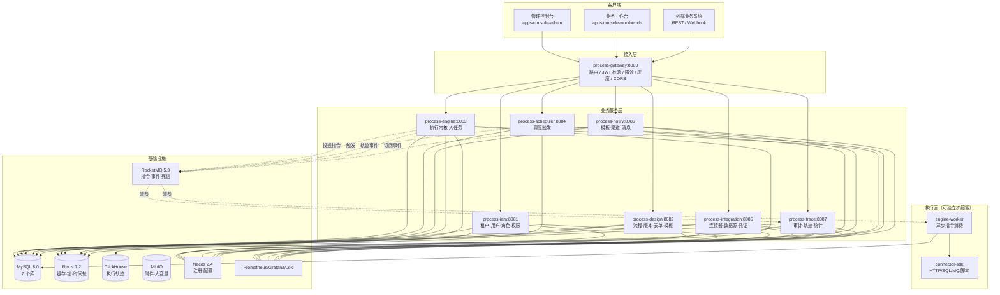

### 3.2 分层职责

| 层 | 组成 | 职责 | 禁止事项 |
| --- | --- | --- | --- |
| 接入层 | gateway | 路由、鉴权、限流、灰度、跨域、请求日志 | 不写业务逻辑、不直连业务库 |
| 应用层 | 各服务 `controller` + `application service` | 用例编排、事务边界、DTO 转换 | 不写领域算法 |
| 领域层 | 各服务 `domain`（engine 的 `engine-core`/`engine-runtime`） | 状态机、令牌算法、校验规则、SPI | 不依赖 Web、不依赖 MyBatis |
| 基础设施层 | `persistence` / `mq` / `cache` / `integration-client` | 持久化、消息、缓存、外部调用 | 不含业务判断 |

`engine-core` 与 `engine-runtime` 必须保持**对 Spring Web 与 MyBatis-Plus 零依赖**（仅依赖 `engine-model` 与 SPI 接口），持久化通过仓储接口 `RuntimeRepository` 反转入。目的是让引擎语义可以用内存仓储做纯单测，也便于将来把引擎整体搬到其他栈。这是本项目最重要的一条代码纪律。

### 3.3 服务交互矩阵

行 = 调用方，列 = 被调用方。`S` = 同步 Feign，`M` = 异步 MQ，`-` = 无交互。

| | iam | design | engine | scheduler | integration | notify | trace |
| --- | --- | --- | --- | --- | --- | --- | --- |
| **gateway** | S | S | S | S | S | S | S |
| **iam** | - | - | - | - | - | - | M |
| **design** | S(用户/部门) | - | M(版本发布) | - | S(连接器校验) | - | M |
| **engine** | S(候选人解析) | S(取定义) | - | S(注册定时器) | S(取连接器元数据) | M(通知事件) | M(轨迹) |
| **scheduler** | - | - | M(触发启动) | - | S(触发连接器) | - | M |
| **integration** | - | - | - | - | - | - | M |
| **notify** | S(用户联系方式) | - | - | - | - | - | M |
| **trace** | S(用户名补全) | - | - | - | - | - | - |

**关键约定**：`engine → design` 取流程定义走 **Feign 首次拉取 + 本地 Caffeine 缓存 + 版本发布 MQ 失效通知**，绝不在令牌推进的热路径上同步调用 design。缓存未命中才回源，回源失败时若本地有历史版本可用则降级使用并告警。

### 3.4 部署拓扑

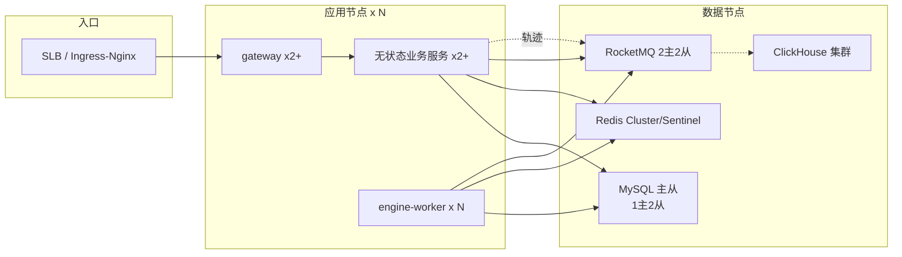

- 所有业务服务无状态，会话状态在 Redis；`engine-boot`（同步 API）与 `engine-worker`（异步执行）**使用同一份镜像、不同的启动 profile**，可独立设置副本数（例如 API 2 副本、Worker 8 副本）。
- Nacos 用于服务注册与配置中心，配置按 `{环境}` 命名空间隔离。
- MySQL 一主两从：主库承接写，从库承接报表与大列表查询（读写分离用动态数据源 + `@ReadOnly` 注解标注，强一致读显式走主库）。

---

## 4. 关键技术决策（ADR）

| 编号 | 决策 | 结论 | 主要理由 | 代价 / 缓解 |
| --- | --- | --- | --- | --- |
| ADR-01 | 执行内核选型 | **自研令牌驱动内核**，BPMN 2.0 仅作导入导出 | 需同时支撑审批流与数据编排，Flowable 的表结构与线程模型难以贴合「实例级串行 + 微服务无状态 worker」；且需支持 HTTP/SQL/MQ/脚本节点的异步回调语义 | 引擎正确性风险高 → 语义测试套件 ≥ 200 用例 + 对账巡检；预算 2~3 人月 |
| ADR-02 | 人任务归属 | 落在 `process-engine`，不拆 `task-service` | 人任务是引擎的 wait state，拆出去等于把状态机切成分布式状态机 | 待办查询压力与引擎写入争抢 → 待办列表走**只读投影 + 覆盖索引**，必要时独立只读副本 |
| ADR-03 | 连接器执行位置 | 定义/配置在 `integration`，**执行在 engine 内嵌 SDK** | 节点执行走 RPC 会给每条链路加一跳，放大故障面与时延 | 元数据同步延迟 → Feign 拉取 + 定时刷新 + 版本号校验 |
| ADR-04 | 跨服务一致性 | **本地事务 + Outbox + 幂等消费 + 补偿**，不引入 Seata | 避免全局锁与 TC 单点；流程编排天然是长事务，强一致不现实 | 必须实现对账与幂等表；UI 需暴露中间态 |
| ADR-05 | 流程模型存储 | **JSON 为主模型**，BPMN XML 为适配格式 | JSON 可直接驱动前端 X6 渲染；XML 转换是有损的，不能作为权威模型 | 与 BPMN 生态互操作受限 → 提供映射表与转换器，明确损失点 |
| ADR-06 | 实例级并发控制 | Redis 分布式锁（Redisson 看门狗）+ DB 乐观锁 + MQ 顺序重投 | 同一实例必须串行推进，否则令牌会重复消费 | 锁失效风险 → DB 乐观锁兜底二次校验，冲突即重投 |
| ADR-07 | 异步节点执行模型 | 引擎投递指令到 MQ，worker 执行连接器，结果回调引擎恢复令牌 | 引擎线程不被慢 IO 占住；worker 可独立扩缩容 | 需要指令幂等与结果乱序保护 → 幂等键 + 版本号 |
| ADR-08 | 轨迹数据分治 | 热数据（近 3 天/RUNNING 实例）在 MySQL，全量轨迹在 ClickHouse | 轨迹写入量是业务数据的 20 倍以上，MySQL 扛不住 | 冷热查询分流 → `trace` 服务统一封装，前端不感知 |
| ADR-09 | 多租户隔离 | 逻辑隔离（`tenant_id` 自动注入），保留 `isolation_mode` 升级路径 | 物理隔离运维成本高，v1.0 客户量不需要 | 越权风险 → 拦截器 + 白名单 + 单测强制覆盖跨租户用例 |
| ADR-10 | 前端设计器 | AntV X6 自研，独立成 `@pe/flow-designer` 包 | 需要与自研 JSON 模型 1:1 对应；X6 的节点/边/命令栈可完全自定义；独立包便于嵌入第三方系统 | 需自己实现对齐线、缩略图、Undo/Redo → 基于 X6 官方插件，工作量约 3 人周 |
| ADR-11 | 表达式与脚本 | 网关条件用 Aviator 沙箱；脚本节点用 GraalVM JS 沙箱 | Aviator 轻量、可编译缓存；JS 生态便于业务人员理解 | 沙箱逃逸风险 → 禁用 IO/线程/反射 + 3s 超时中断 + 安全基线测试 |
| ADR-12 | 定时器实现 | 自研「Redis ZSet 时间轮 + DB 持久化 + 到期投递 MQ」，SPI 可替换 Quartz | 与调度服务共用底座；避免 Quartz 集群模式的表锁竞争 | 精度与可靠性需自证 → P99 < 2s 压测目标 + DB 兜底扫描（1 分钟一次） |

---

## 5. 执行引擎内核设计（核心）

### 5.1 元模型与解析

**三段式模型**，从设计态到执行态单向转换：

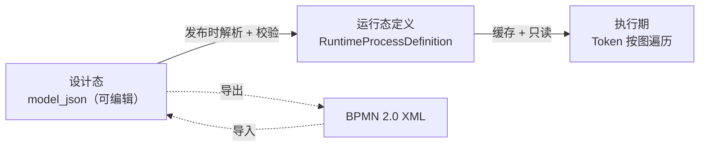

`RuntimeProcessDefinition` 是发布时构建的**不可变、可快速索引**的运行态对象：

```java
// 结构示意（非实现代码，仅表达设计）
RuntimeProcessDefinition {
    Long defId; String processKey; int version; Long versionId;
    Map<String, NodeDefinition> nodes;          // nodeId -> 节点定义，O(1) 定位
    Map<String, List<EdgeDefinition>> outgoing; // nodeId -> 出边列表（有序，条件按优先级）
    Map<String, List<EdgeDefinition>> incoming; // nodeId -> 入边列表（join 计算用）
    List<String> startNodeIds;
    int modelHash;                              // 内容哈希，用于缓存校验
}
```

**要点**：

- 出边顺序即**条件求值优先级**，由设计器中边的排序决定，序列化时必须保序。
- 解析阶段把设计态的「字符串类型」全部转成枚举与强类型，运行期**不再做字符串比较**。
- 发布后 `RuntimeProcessDefinition` 序列化存入 Redis（`def:{versionId}`，TTL 24h）与本地 Caffeine（最多 500 个版本，LRU）。缓存 key 含 `modelHash`，避免同 versionId 内容变化导致的脏读。

### 5.2 令牌驱动执行模型

**核心抽象**：流程实例是一张有向图，`Token` 是图上游走的执行指针。实例的推进 = 不断取出可运行的令牌，交给节点行为执行，根据结果决定「继续前进 / 停下等待 / 结束」。

#### 5.2.1 令牌状态机

| 状态 | 含义 | 允许迁移到 |
| --- | --- | --- |
| `ACTIVE` | 可调度，等待被 worker 取出推进 | `WAITING` / `CONSUMED` / `DEAD` |
| `WAITING` | 停在等待态（人任务 / 定时器 / 事件 / 异步节点） | `ACTIVE`（被唤醒）/ `DEAD` |
| `ARRIVED` | 已到达汇聚网关的入边，等待其他分支 | `CONSUMED` / `DEAD` |
| `CONSUMED` | 已被前向推进消耗，正常消亡 | 终态 |
| `DEAD` | 因中断（终止、排他分支未选中、错误边界打断）消亡 | 终态 |

#### 5.2.2 节点行为契约

每个节点类型实现一个 `NodeBehavior`，引擎只通过三个方法驱动它：

```java
interface NodeBehavior {
    NodeType nodeType();
    /** 进入节点：创建 rt_node_instance 与 rt_token，返回本次进入的判定 */
    EnterResult onEnter(ExecutionContext ctx, Token token, NodeDefinition node);
    /** 执行节点：同步完成返回 CONTINUE；需等待返回 WAIT；需异步返回 ASYNC */
    ExecuteResult execute(ExecutionContext ctx, Token token, NodeDefinition node);
    /** 离开节点：选择出边、创建后续令牌、触发离开监听器 */
    void onLeave(ExecutionContext ctx, Token token, NodeDefinition node);
}
```

三种结果对应的引擎动作：

| 结果 | 引擎动作 | 典型节点 |
| --- | --- | --- |
| `CONTINUE` | 立即调用 `onLeave`，令牌 `CONSUMED`，创建后续出向令牌继续本轮调度 | 开始事件、网关、脚本任务、同步服务任务 |
| `WAIT` | 令牌置 `WAITING`，落库，**结束本轮调度**（释放实例锁） | 用户任务、定时捕获事件、消息捕获事件 |
| `ASYNC` | 令牌置 `WAITING`，写入 `rt_outbox` 投递执行指令，结束本轮调度 | HTTP/SQL/MQ/gRPC 任务、延时任务 |
| `END`（内部结果） | 令牌 `CONSUMED`，检查实例是否还有活跃令牌，无则实例完成 | 结束事件 |

#### 5.2.3 单轮调度算法

```
execute(instanceId):
  lock = redis.tryLock("engine:inst:" + instanceId, lease=30s)
  if not lock: 投递延迟消息重试(退避 200ms/500ms/1s/2s/5s, 最多 12 次) ; return

  try:
    ctx = loadContext(instanceId)        // 实例 + 活跃令牌 + 变量（懒加载）
    budget = 100 节点 / 200ms            // 防止长流程长时间持锁
    while (token = ctx.nextActiveToken()) != null and budget.remain():
        node = ctx.definition.node(token.nodeId)
        result = behavior(node.type).execute(ctx, token, node)
        if result == WAIT or ASYNC:
            ctx.flushToken(token); continue          // 处理下一个活跃令牌（并行分支）
        if result == CONTINUE:
            behavior.onLeave(ctx, token, node)       // 创建后续令牌
            ctx.consume(token)
        if result == END:
            ctx.consume(token)

    ctx.commit()          // 单事务：node_instance + token + variable + outbox
  finally:
    lock.unlock()
    if budget.exhausted(): 重新投递推进指令（继续跑剩余令牌）
```

**三个关键设计点**：

1. **一轮调度 = 一个数据库事务**。所有状态变更与 Outbox 事件在同一个本地事务内提交，保证「状态变了事件一定发得出去，事件发得出去状态一定变了」。
2. **预算控制**。长流程（如 500 个节点的批量循环）单轮有上限，超出即重新入队，避免持有实例锁超过锁租期，也避免长事务撑大 undo log。
3. **并行令牌的批量处理**。并行网关 fork 后一轮内可以推进多个令牌，但不做跨令牌的并行执行（同一实例仍串行），保证语义可预测。

#### 5.2.4 并发与冲突处理

| 竞争场景 | 处理 |
| --- | --- |
| 两个 worker 同时推进同一实例 | Redis 锁串行化；抢锁失败方投递延迟消息（不阻塞线程） |
| 锁过期（GC 停顿等）导致双持有 | 每个状态变更带 `rt_token.version` / `rt_process_instance.version` 乐观锁；UPDATE 影响行数为 0 则抛 `OptimisticLockException`，整个事务回滚并重投 |
| 重投后重复推进同一令牌 | 令牌推进前校验 `status == ACTIVE`，非 ACTIVE 直接跳过（幂等）；`rt_idempotent` 以 `exec:{instanceId}:{tokenId}:{attempt}` 兜底 |
| 消息乱序（回调先于指令到达） | 消息按 `instanceId` 走 RocketMQ 顺序消息；回调携带 `tokenVersion`，版本不匹配则丢弃并记录告警 |

### 5.3 命令总线

引擎所有状态变更统一走命令模式，借鉴 Flowable 的 CommandContext 思想但按微服务场景重新设计：

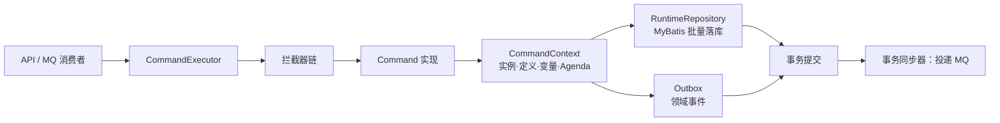

**拦截器链顺序（固定）**：

1. `TenantInterceptor`：校验并绑定租户上下文，拒绝跨租户命令。
2. `IdempotentInterceptor`：外部入口命令校验 `Idempotency-Key`。
3. `AuthInterceptor`：校验操作者对该实例/任务的权限（引擎层二次校验，不信任网关）。
4. `LoggingInterceptor`：记录命令入参摘要、耗时、实例 ID 到 MDC。
5. `TransactionInterceptor`：开启事务，绑定 `CommandContext`。
6. `EventDispatchInterceptor`：事务提交后按顺序投递领域事件。

**Command 与 Agenda**：`CommandContext` 内维护一个 `Agenda`（本轮待执行的节点行为队列）。`NodeBehavior` 不直接写库，只操作 `CommandContext` 中的内存对象并登记 `Agenda` 项，由 `CommandExecutor` 在预算内依次执行、统一 flush。这样保证「一个命令 = 一个事务」，也让引擎逻辑可脱离数据库做纯单测（内存仓储实现同一套 `RuntimeRepository` 接口）。

**核心命令清单**：

| 命令 | 触发来源 | 说明 |
| --- | --- | --- |
| `StartProcessInstanceCmd` | API / 调度 / 消息 | 启动实例并同步推进到第一个等待态 |
| `AdvanceTokenCmd` | MQ 推进指令 / 回调 | 推进指定实例的活跃令牌 |
| `EnterNodeCmd` / `LeaveNodeCmd` | 内核内部 | 节点进入/离开的原子操作 |
| `CompleteTaskCmd` | API | 完成任务并唤醒令牌 |
| `ClaimTaskCmd` / `DelegateTaskCmd` / `TransferTaskCmd` / `AddSignCmd` / `WithdrawTaskCmd` | API | 人任务各类操作 |
| `SuspendInstanceCmd` / `ResumeInstanceCmd` / `TerminateInstanceCmd` | API | 实例生命周期 |
| `TriggerTimerCmd` | MQ（定时器到期） | 定时器触发，唤醒令牌 |
| `MessageEventCmd` / `SignalEventCmd` | API / MQ | 事件投递与广播 |
| `RetryIncidentCmd` / `SkipIncidentCmd` | API | 故障的人工干预 |
| `CompensateCmd` | 内核 / API | 执行补偿链 |
| `MigrateInstanceCmd` | API | 实例版本迁移 |

### 5.4 网关算法

| 网关 | Fork 行为 | Join 行为 | 复杂度 |
| --- | --- | --- | --- |
| 排他网关 `EXCLUSIVE_GATEWAY` | 按出边顺序求值条件，取**第一条为真**的边；无条件边视为默认流（必须放在最后且唯一） | 无 join，每条入边独立产生令牌 | 低 |
| 并行网关 `PARALLEL_GATEWAY` | 所有出边各产生一个令牌 | 等待**全部入边**到达；到达的令牌置 `ARRIVED` 并记录 `gateway_join_key`；计数达到期望分支数时消费全部 `ARRIVED` 令牌并产生一个出向令牌 | 中 |
| 包容网关 `INCLUSIVE_GATEWAY` | 对所有出边求值，**每条为真的边**产生令牌（至少一条为真，否则走默认流） | 期望分支数**动态计算**：对本网关所有入边做反向可达性分析，若入边上游存在 ACTIVE/WAITING/ARRIVED 令牌或仍可达的活动节点，则该分支「未死」并计入期望数；全部到达后合并 | **高** |
| 事件网关 `EVENT_GATEWAY` | 为该网关后接的每个捕获事件创建**竞争性订阅** | 任一事件触发后，取消其余订阅并沿对应边前进 | 中 |

**Join 的实现细节**：

- `rt_token.gateway_join_key` = 汇聚网关节点 ID，配合 `scope_id`（子流程/多实例作用域）唯一确定一次汇聚。
- 期望分支数在 fork 时写入**首个到达令牌**的 `node_instance.input_json.expectedBranches`，并在每次 fork 追加时更新（支持嵌套循环多次 fork 的场景，用 `scope_id + loopIndex` 区分）。
- 汇聚判定使用 `SELECT COUNT(*) ... WHERE gateway_join_key = ? AND scope_id = ? AND status = 'ARRIVED' FOR UPDATE`，行锁保证并发到达不会重复触发汇聚。
- **包容网关是本设计中最容易出错的算法**，M3 阶段单独立项，必须覆盖以下测试：条件全真/部分真/全假、分支被中断事件打断、分支内嵌套子流程、分支内多实例、长时间悬挂分支（需配合超时清理）。

### 5.5 等待态与唤醒机制

实例「停下来」的四种原因与唤醒路径：

| 等待类型 | 落库记录 | 唤醒来源 | 唤醒动作 |
| --- | --- | --- | --- |
| 人任务等待 | `rt_task(status=CREATED/CLAIMED)` + `rt_token(WAITING)` | `CompleteTaskCmd` | 按会签模式决定是合并汇聚还是保持等待 |
| 定时器等待 | `rt_timer_job(status=PENDING)` + `rt_token(WAITING)` | `scheduler` 到期投递 `TriggerTimerCmd` | 取消定时器记录，令牌转 ACTIVE |
| 事件等待 | `rt_event_sub(status=OPEN)` + `rt_token(WAITING)` | 外部 API `message` / `signal` | 匹配订阅，令牌转 ACTIVE，其余竞争订阅置 CANCELED |
| 异步节点执行 | `rt_node_instance(status=ACTIVE)` + `rt_token(WAITING)` | worker 回调 `NODE_RESULT` | 写入输出变量，节点置 COMPLETED，令牌转 ACTIVE |

**统一唤醒契约**：无论哪种唤醒，最终都归结为「投递 `AdvanceTokenCmd` 到 `PE_ENGINE_COMMAND`（`commandType=ADVANCE_TOKEN`，按 `instanceId` 顺序消息）」，由 worker 统一走 5.2.3 的调度算法。这样唤醒路径只有一条，便于排查问题。

**超时兜底**：定时器除 Redis 时间轮外，`scheduler` 每分钟做一次 DB 扫描（`due_time <= now() AND status='PENDING'`，走 `idx_due_status` 索引），补偿 Redis 故障或消息丢失导致的未触发。

### 5.6 变量与作用域

**作用域层级**（由内向外查找，就近命中）：

```
LOCAL（节点级，仅本节点可见，如循环项 item）
  └─ SCOPE（子流程实例 / 多实例作用域，如 loopIndex、nrOfInstances）
       └─ INSTANCE（流程实例全局变量）
            └─ TENANT（租户级参数，只读，来自 sys_tenant 扩展配置）
```

| 变量类型 | 存储 | 说明 |
| --- | --- | --- |
| `STRING` / `NUMBER` / `BOOLEAN` / `DATE` | `rt_variable.value_text` | 短值直接存 |
| `JSON` / `LIST` | `rt_variable.value_text`（≤ 64KB） | 超过阈值外置 |
| `FILE` | `rt_variable.value_ref` | 只存 MinIO objectKey，读取走专用接口 |

**大对象外置策略**：序列化后 > 64KB 的变量，写入 MinIO（路径 `var/{tenantId}/{instanceId}/{scopeId}/{varName}`），`rt_variable` 只保留 `value_ref` 与 `value_size`。读取时默认返回 `{"__ref":"...","size":123}` 占位，前端按需调用获取接口。**目的**：防止一个 10MB 的 JSON 变量把实例加载拖到秒级。

**表达式求值**（Aviator）：

- 变量以 `v.xxx` 或裸名访问，注入只读白名单函数库：`str.*`（长度、截取、替换）、`date.*`（格式化、加减、比较）、`json.*`（取值、解析）、`list.*`（包含、大小）、`num.*`。
- **禁用**：`new`、反射、类加载、IO、线程创建；表达式长度上限 2000 字符，编译缓存 LRU 2000 条。
- 求值超时 1s，抛 `ExpressionException` → 节点进入 `rt_incident`。
- 网关条件返回非布尔值时按「非真即假」处理并记录 WARN（避免设计错误静默通过）。

### 5.7 异步节点执行与回调

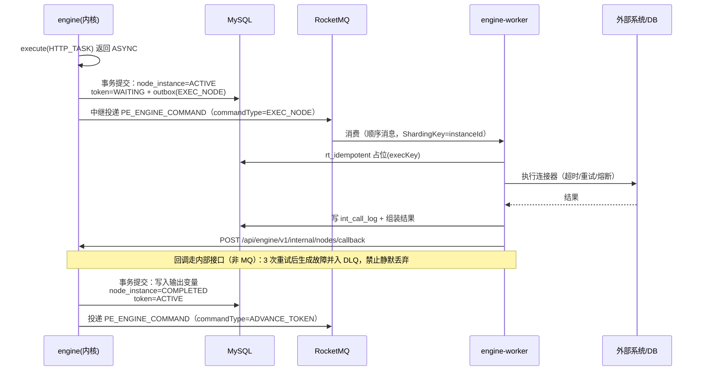

**指令消息体**（`PE_ENGINE_COMMAND`，`commandType=EXEC_NODE`）：

| 字段 | 说明 |
| --- | --- |
| `eventId` | 全局唯一（雪花），用于幂等与追踪 |
| `tenantId` / `instanceId` / `tokenId` / `nodeInstanceId` | 定位上下文 |
| `attempt` | 第几次尝试（从 1 开始），参与幂等键 |
| `nodeSnapshot` | 节点配置快照（连接器、参数映射、超时、重试策略），**随消息携带**，避免 worker 回查数据库 |
| `variablesDigest` | 节点所需变量的快照（只包含该节点引用到的变量，减少消息体） |
| `deadline` | 执行截止时间（时间戳），超时由 worker 主动失败 |

**回调保护**：

- 回调消息携带 `tokenVersion`（指令下发时令牌的 `version`）。worker 收到后若发现令牌 `version` 已变化，说明实例被并发修改（如被终止），回调**丢弃并记录**，不报错。
- worker 执行连接器前后各写一次 `int_call_log`（前写 `RUNNING`，后写终态），宕机时遗留的 `RUNNING` 记录由对账任务标记为 `UNKNOWN` 并触发故障事件，避免「发了请求但结果丢失」的静默黑洞。
- worker 执行前先写幂等占位；若占位已存在且为终态，直接复用上次结果并回调，不重复调用外部系统。

**为何用「随消息携带节点快照」**：worker 与 engine 同构但独立部署，若 worker 每次回查 DB 会放大数据库读压力；快照方式让 worker 只写不读（除幂等表），显著提升吞吐。代价是节点配置变更不影响已下发指令——这正好符合「一次执行绑定一次配置」的语义。

### 5.8 失败、重试与故障事件（Incident）

**重试策略**（节点级可配，默认继承流程级）：

| 策略 | 参数 | 适用 |
| --- | --- | --- |
| 固定间隔 | `intervalMs`, `maxAttempts` | 调用内部稳定服务 |
| 指数退避 | `initialMs`, `multiplier`, `maxMs`, `maxAttempts` | 外部第三方接口 |
| 自定义表达式 | Aviator 表达式返回下次延迟 | 特殊业务（如按错误码区分） |

**重试执行方式**：worker 在**本地**完成重试（不重新入队），每次重试更新 `rt_node_instance.retry_count` 与 `int_call_log`；本地重试全部失败后，才回调 `NODE_RESULT(FAILED)`。

**故障事件（Incident）**：以下情况创建 `rt_incident(status=OPEN)`：

1. 节点重试耗尽。
2. 表达式求值异常（网关条件、变量映射）。
3. 连接器返回业务性错误且配置为不可重试。
4. 子流程/调用活动的被调流程不存在或已下线。
5. 对账任务发现悬挂态或失联的 worker 遗留执行。

**Incident 的人工干预**（控制台）：

| 操作 | 语义 | 引擎动作 |
| --- | --- | --- |
| 重试 | 按当前节点配置重新执行 | 令牌转 ACTIVE，重新下发指令（`attempt++`） |
| 跳过 | 忽略该节点直接前进 | 节点置 `SKIPPED`，令牌 `onLeave` 走出边（走默认流） |
| 修改变量后重试 | 允许人工修正入参 | 更新变量后再下发 |
| 终止实例 | 放弃整个实例 | 取消所有等待态，实例 `TERMINATED`（可选触发补偿） |
| 转为人工任务 | 自动节点降级为人任务 | 在该节点位置动态创建 `USER_TASK` |

**死信处理**：MQ 消费重试耗尽后进入 `PE_DLQ_{原Topic}`（引擎命令 Topic 重试 5 次，退避 1s/5s/30s/60s/300s）。死信由 `process-trace` 的告警规则监控；人工在控制台查看死信详情后可「重放」（重新投递原消息，幂等键保证不重复执行）。

### 5.9 补偿（Saga）

**登记**：节点属性配置 `compensationHandlerId`（指向一个 `SERVICE_TASK`/`HTTP_TASK`/`SCRIPT_TASK` 节点）。节点执行成功后，引擎在 `rt_compensation` 写入 `PENDING` 记录（含 `seq_no` = 全局递增执行序号、`payload_json` = 补偿所需入参快照）。

**触发**：

| 触发源 | 语义 |
| --- | --- |
| `ERROR_BOUNDARY_EVENT` | 子流程/作用域内抛错，执行该作用域内已登记的全部补偿 |
| `COMPENSATION_BOUNDARY_EVENT` | 显式补偿边界，配合 `COMPENSATION_HANDLER` 节点 |
| 实例终止且配置 `compensateOnTerminate=true` | 终止时反向补偿 |
| 控制台手动触发 | 运维介入 |

**执行**：按 `seq_no` **逆序**逐条执行补偿处理器；每条执行成功后记录置 `DONE`，失败置 `FAILED` 并创建 Incident（补偿失败不自动重试无限循环，避免雪崩）。补偿处理器本身必须**幂等**（由连接器配置与业务方共同保证），因为至少一次投递语义下可能被重复调用。

### 5.10 子流程、调用活动与多实例

| 结构 | 实现 |
| --- | --- |
| 内嵌子流程 `SUB_PROCESS` | 同一实例内新增 `scope_id`，父子作用域共享实例变量，局部变量隔离；父令牌 `WAITING`，子作用域无活跃令牌时父令牌唤醒 |
| 调用活动 `CALL_ACTIVITY` | 创建**独立实例**（`parent_instance_id` / `root_instance_id` 关联），支持同步（父等子完）与异步（父继续，子完成发事件）两种模式；被调流程版本在调用时锁定 |
| 多实例（会签/循环） `USER_TASK` + `LOOP_TASK` | 生成 N 个并行或串行令牌，共享同一 `scope_id`；`scope` 变量记录 `nrOfInstances` / `nrOfCompleted` / `nrOfActive`；汇聚规则 = `ALL`（全部完成）/ `ANY`（任一完成即终止其余）/ `PERCENT`（达到阈值） |

**多实例汇聚的原子性**：`nrOfCompleted` 的递增用 `UPDATE rt_variable SET value = value + 1 WHERE ...` 的原子句更新（或对 scope 行加悲观锁），避免并发完成时丢失计数。`ANY` 模式在第一个完成的事务内将其余令牌置 `DEAD` 并取消对应任务。

### 5.11 版本管理与实例迁移

- **实例绑定版本**：`rt_process_instance.version_id` 在启动时锁定，运行期**绝不因新版本发布而改变**。这是保证长流程稳定性的底线。
- **草稿态隔离**：`DRAFT` 版本不允许启动实例；`OFFLINE`（已下线）版本不影响运行中实例，但不能启动新实例。
- **实例迁移**（控制台高级操作，默认关闭）：`MigrateInstanceCmd` 执行前置校验——当前活跃节点在新版本中必须存在且类型一致、新版本必须已发布、无未完成的多实例作用域。校验通过后更新 `version_id` 并刷新实例定义缓存，下一轮推进使用新定义。校验失败返回结构化差异（哪些节点不兼容），不做「尽力迁移」。

### 5.12 引擎对账（Reconciliation）

**目的**：分布式 + 至少一次投递必然产生「中间态卡死」，必须有兜底巡检。

**巡检规则**（`process-engine` 内定时任务，5 分钟一次，分片执行）：

| 巡检项 | 判定 | 处置 |
| --- | --- | --- |
| 悬挂实例 | `instance.status = RUNNING` 且无 `ACTIVE/WAITING/ARRIVED` 令牌且无 OPEN 任务/定时器/订阅 | 告警 + 自动补投推进指令（可开关） |
| 孤儿令牌 | 令牌 `WAITING` 但对应 `node_instance` 不存在或已终态 | 告警 + 自动修复令牌状态 |
| 失联执行 | `int_call_log.status = RUNNING` 且超过 `deadline * 3` | 标记 `UNKNOWN`，创建 Incident |
| 过期定时器 | `rt_timer_job` 到期超过 5 分钟仍未 FIRED | 补投触发指令 |
| Outbox 积压 | `rt_outbox` 中 `status=NEW` 且超过 3 分钟 | 告警（中继任务可能宕机） |
| 令牌版本冲突率 | 每分钟冲突次数 > 阈值 | 告警（可能是热点实例被高频并发操作） |

对账任务必须**幂等且可重入**，其自动修复动作要能通过配置一键关闭（生产事故时防止「越修越乱」）。

### 5.13 引擎线程模型与背压

| 执行环境 | 线程模型 | 说明 |
| --- | --- | --- |
| `engine-boot`（同步 API） | Tomcat 线程池（可开虚拟线程） | 承载启动实例、任务操作等交互型命令；单实例锁等待不阻塞线程（抢锁失败即投递延迟消息后立即返回） |
| `engine-worker`（异步） | RocketMQ 消费线程池（默认 20）+ 每实例串行队列 | 顺序消息保证同实例串行；不同实例并行处理 |
| `connector-executor` | 独立线程池（默认 200，与引擎线程池隔离）+ 每连接器信号量限流 | 慢 IO 不会耗尽引擎线程 |
| 定时器时间轮 | 单线程 + 分层时间轮 | 只做「到期投递」，不做业务 |
| 对账任务 | 独立小线程池（4） | 与主链路隔离，避免互相影响 |

**背压策略**：

1. MQ 堆积超过阈值（按 Topic 配置）→ 网关对「启动实例」接口返回 `429 + Retry-After`，并降级自动任务触发频率。
2. `connector-executor` 队列满 → 节点立即失败并进入重试队列（不阻塞引擎）。
3. 单租户实例创建速率超配额 → 该租户返回 `429`，其他租户不受影响（Sentinel 按 `tenantId` 做热点参数限流）。
4. 数据库连接池耗尽 → 快速失败并告警，禁止无限等待（连接获取超时 2s）。

---

## 6. 人任务子系统设计

### 6.1 候选人解析引擎

策略链按顺序执行，产出候选用户集：

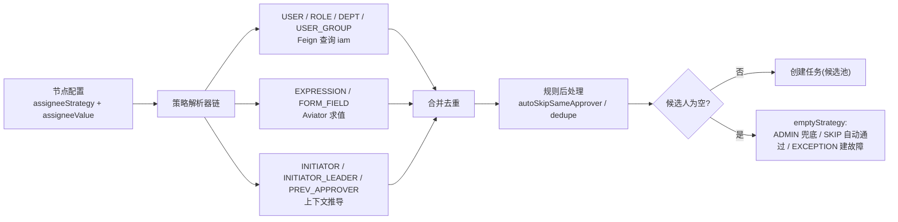

**要点**：

- `iam` 查询结果在引擎本地 Caffeine 缓存 60s（用户-角色关系变化频率低），并提供「按用户/角色/部门失效」的主动失效消息。
- 候选人以**逗号分隔的用户 ID 串**或**关联表**存储：v1.0 选择在 `rt_task` 上用 `candidate_users` / `candidate_roles` / `candidate_depts` / `candidate_groups` 四个字段存 ID 串（便于列表查询时用 `FIND_IN_SET` 或前缀匹配），同时保证**单个任务的候选规模 ≤ 5000 人**（超出时提示设计者改用角色/部门策略）。候选人规模是整个待办查询性能的关键约束。
- `INITIATOR_LEADER` 依赖组织架构的 `leader_user_id`；若为空则向上递归查找，最多 5 层，仍为空则走 `emptyStrategy`。

### 6.2 会签 / 或签 / 比例签

| 模式 | 语义 | 令牌处理 |
| --- | --- | --- |
| `ALL`（会签） | 全部办理完成后推进 | 每个办理人一个令牌（`scope_id` 相同）；全部完成汇聚 |
| `ANY`（或签） | 任一办理完成后推进 | 第一个完成的令牌触发汇聚，其余令牌 `DEAD`、任务 `CANCELED(自动办结)` |
| `PERCENT(n%)` | 完成比例达到 n% 即推进 | 计数达到 `ceil(nrOfInstances * n / 100)` 时汇聚，其余取消 |
| `SEQUENTIAL`（顺序会签） | 按配置顺序逐个办理 | 同一时刻只有一个活跃令牌，办理完成后创建下一个 |

**自动办结与自动通过**：`ANY`/`PERCENT` 下被取消的任务需在 `rt_task_oper_log` 记录 `CANCEL` 及原因（`OTHERS_COMPLETED` / `PERCENT_REACHED`），前端在「已办」中显示为「自动办结」，避免审批人困惑。

### 6.3 任务操作语义

| 操作 | 数据变更 | 令牌影响 | 权限要求 |
| --- | --- | --- | --- |
| 认领 `CLAIM` | `assignee_id` = 操作人，`status` = CLAIMED，`claim_time` | 无 | 候选人或管理员 |
| 释放 `UNCLAIM` | `assignee_id` 置空，`status` = CREATED | 无 | 当前办理人 |
| 完成 `COMPLETE` | `status` = COMPLETED，写 `form_data_json`、`opinion`、`result` | 按会签模式决定汇聚或继续等待 | 当前办理人 |
| 驳回 `REJECT` | 同上，`result` = REJECT | 目标节点由配置决定：`TO_START`（回到发起人）/ `TO_NODE`（回到指定节点，需清理中途节点实例并标记 `SKIPPED`）/ `TO_PREV` | 当前办理人 |
| 前加签 `ADD_SIGN_BEFORE` | 新建任务 + 原任务 `status` 回 CREATED（暂挂） | 原令牌保持 WAITING，直到加签任务完成 | 当前办理人 |
| 后加签 `ADD_SIGN_AFTER` | 新建任务，原任务正常完成 | 加签任务完成后才汇聚 | 当前办理人 |
| 转办 `TRANSFER` | `assignee_id` 改为目标人，记 `rt_task_oper_log` | 无 | 当前办理人 |
| 委托 `DELEGATE` | 新建被委托人任务，原任务 `status` = DELEGATED，`parent_task_id` 关联 | 被委托人完成后回到委托人确认（`DELEGATE` 回退语义） | 当前办理人 |
| 撤回 `WITHDRAW` | 取消下游未办结任务，恢复上游任务 | 下游令牌 `DEAD`，上游令牌唤醒 | 发起人（限 `withdrawScope`）/ 办理人（仅限其刚推进的下一步） |
| 催办 `URGE` | 不改状态，投递通知事件 | 无 | 发起人 / 管理员 |

**驳回的节点清理**：`TO_NODE` / `TO_PREV` 需要把目标节点到当前节点之间的所有已完成节点实例标记 `SKIPPED`（保留记录用于轨迹回溯），并清理 `rt_token` 中相关令牌。这是最容易出错的操作，必须整体在一个事务内完成，且写审计日志。

**撤回的边界**：`withdrawScope` = `FIRST_TASK`（仅下一步未办理时可撤）/ `ALL_UNFINISHED`（所有下游未办理即可撤）/ `NONE`。撤回必须校验下游**无任何已办任务**，否则拒绝（避免业务数据被推翻）。

### 6.4 超时与催办

配置在节点属性 `timeoutPolicy`：

| 策略 | 说明 |
| --- | --- |
| `REMIND` | 到期后每 `intervalMin` 发一次催办通知，最多 `maxTimes` 次 |
| `AUTO_APPROVE` | 到期自动通过（高风险，需审批配置变更） |
| `AUTO_REJECT` | 到期自动驳回 |
| `AUTO_TRANSFER` | 到期转办给指定人/角色（如上级） |
| `NONE` | 不处理 |

实现：任务创建时同事务写入 `rt_timer_job(timer_type=TIMER_TASK_TIMEOUT)`；到期由 `scheduler` 投递 `TriggerTimerCmd`，引擎按策略执行。策略变更只影响**之后创建的任务**，已创建任务的定时器保持原策略（符合「审批规则不追溯」原则）。

### 6.5 待办查询设计（性能关键）

**查询模式**（最高频的三类）：

```sql
-- 1. 我的待办（候选或已认领）
SELECT * FROM rt_task
WHERE tenant_id = ? AND deleted = 0
  AND status IN ('CREATED','CLAIMED')
  AND ( assignee_id = ?
        OR FIND_IN_SET(?, candidate_users)
        OR candidate_roles LIKE ?         -- 用 roleId 精确前缀匹配，限制命中行数
        OR candidate_depts LIKE ?
        OR candidate_groups LIKE ? )
ORDER BY priority DESC, create_time DESC
LIMIT 20;
```

**优化手段**（按优先级）：

1. **候选人维度冗余表**（推荐方案）：新增 `rt_task_candidate(task_id, user_id, type, tenant_id)`，任务创建时**展开候选人写入**该表（5000 人上限保证可接受）。待办查询退化为 `rt_task_candidate` 与 `rt_task` 的等值 JOIN，走 `uk_task_user(user_id, task_id)` 索引，性能从 `LIKE` 全表扫描提升到索引等值查找。此表是本设计对基线实体清单的**补充**（在 `docs/03-数据库设计.md` 中落地）。
2. 待办查询走只读副本（`@ReadOnly`），与引擎写路径隔离。
3. 列表字段剪裁：列表页不返回 `form_data_json`，详情页才加载。
4. 深分页用游标（`lastTaskId`），不用 `OFFSET`。
5. 已完成任务的归档：`COMPLETED/CANCELED` 超过 6 个月的任务迁出主表（见数据库设计的归档章节）。

**待办数量角标**：不在每次列表查询时 `COUNT(*)`。改为 Redis 计数器 `todo:{tenantId}:{userId}`，任务创建/完成时增减（允许 ±N 的短时误差），每日由定时任务校正一次。这是「最终一致换性能」的典型应用，需在 UI 上容忍轻微误差。

---

## 7. 流程建模与校验子系统

### 7.1 设计态模型规范

设计态模型（`model_json`）的 JSON Schema 由前端设计器与后端校验器**共享**一份 TypeScript/JSON Schema 定义（放在 `packages/types`，后端生成对应 Java 校验骨架），保证「前端存什么，后端就能读什么」。

模型字段已在基线 5 节定义。补充约定：

- 坐标 `position` 仅用于渲染，**不参与语义**；后端校验器忽略坐标。
- 节点 `properties` 采用**按节点类型的强类型子 schema**（`nodePropertiesSchema[nodeType]`），避免所有节点共用一个大对象导致校验失效。
- 边必须显式声明 `order`（整数），序列化时按 `order` 排序，决定条件求值优先级。
- 模型必须带 `schemaVersion`（如 `"1.0"`），用于将来模型结构的迁移。

### 7.2 校验规则全集

**A. 结构校验（模型自身完整性）**

| 规则 | 级别 |
| --- | --- |
| `schemaVersion` 受支持 | ERROR |
| 节点 ID / 边 ID 全局唯一 | ERROR |
| 节点 `type` 在 `NodeType` 枚举内 | ERROR |
| 节点 `properties` 通过对应类型的子 schema | ERROR |
| 边 `source`/`target` 指向存在的节点 | ERROR |
| 无自环边（除配置为循环的显式节点） | ERROR |

**B. 图语义校验**

| 规则 | 级别 |
| --- | --- |
| 有且仅有一个 `START_EVENT`（多起点需显式配置为「多触发器」） | ERROR |
| 每个节点从开始节点**可达** | ERROR |
| 每个节点都能到达某个 `END_EVENT`（无死路） | WARN（允许配置为「挂起」语义） |
| 无孤立节点（无入边且非开始节点） | ERROR |
| `EXCLUSIVE_GATEWAY` / `INCLUSIVE_GATEWAY` 的分支条件**必须覆盖全部分支**或有唯一默认流 | ERROR |
| 默认流最多一条且 `order` 最大（最后求值） | ERROR |
| `PARALLEL_GATEWAY` 的 fork 与 join **成对**（结构平衡检测） | WARN |
| `END_EVENT` 无出边 | ERROR |
| 网关无 `properties` 冲突 | ERROR |
| 子流程必须有内部开始与结束 | ERROR |
| `LOOP_TASK` 必须配置集合来源或次数 | ERROR |

**C. 引用校验（跨服务）**

| 规则 | 级别 | 校验方式 |
| --- | --- | --- |
| 节点引用的连接器与操作存在且启用 | ERROR | Feign 调 `integration`（带缓存） |
| 连接器的输入 schema 与节点入参映射匹配 | ERROR | 本地 schema 比对 |
| 表单引用存在且版本可用 | ERROR | Feign 调 `design` 内部接口 |
| 候选人策略的参数合法（角色/部门/用户组存在） | ERROR | Feign 调 `iam` |
| 表达式语法正确且引用的变量已声明 | ERROR | Aviator 编译 + 变量路径静态分析 |
| 脚本节点语法正确 | ERROR | GraalVM 解析（不执行） |
| `CALL_ACTIVITY` 引用的流程定义存在且已发布 | ERROR | 本地 + Feign |

**校验结果结构**（供前端在画布上定位）：

```jsonc
{
  "valid": false,
  "errors": [
    {
      "code": "DESIGN_10021",
      "level": "ERROR",
      "nodeId": "n_gw1",
      "edgeId": null,
      "field": "properties.conditions",
      "message": "排他网关缺少默认流，且分支条件未覆盖全部分支",
      "suggestion": "为其中一条出边勾选「默认流」"
    }
  ],
  "warnings": [ ]
}
```

校验分两级：**实时校验**（前端本地，结构 + 图语义，毫秒级）与**发布校验**（服务端，含跨服务引用校验，秒级）。

### 7.3 发布流程

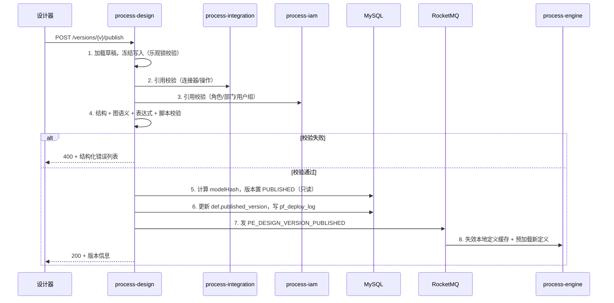

**发布的关键约束**：

- **发布即固化**：`PUBLISHED` 版本的 `model_json` 不允许再修改（接口层拒绝 + DB 层触发器/应用层双重校验）。要改动必须新建草稿版本。
- **发布原子性**：第 5、6 步在同一事务内；缓存失效在事务提交后。
- **回滚**：`pf_deploy_log` 支持 `ROLLBACK` 动作，语义是把 `def.published_version` 指回历史版本（**不修改任何版本内容**），这样新建实例走旧版本，运行中实例不受影响。
- **模型哈希**：`modelHash = SHA-256(canonical(model_json))`，规范化时对节点/边按 ID 排序、去除坐标，避免仅拖动位置就产生新哈希。哈希用于缓存校验与「内容是否真的变了」的判定。

### 7.4 BPMN 2.0 导入导出映射

| 平台节点 | BPMN 元素 | 转换说明 |
| --- | --- | --- |
| `START_EVENT` | `<startEvent>` | 定时/消息发起映射为 `timerEventDefinition` / `messageEventDefinition` |
| `END_EVENT` | `<endEvent>` | — |
| `TERMINATE_END_EVENT` | `<endEvent><terminateEventDefinition>` | — |
| `USER_TASK` | `<userTask>` | 候选人映射为 `potentialOwner`（`resourceAssignmentExpression` 中的 `formalExpression` 存平台策略 JSON） |
| `SERVICE_TASK` | `<serviceTask>` | 连接器映射为 `implementation="##WebService"` 扩展属性或 `pe:` 命名空间扩展 |
| `EXCLUSIVE_GATEWAY` | `<exclusiveGateway>` | 条件映射为 `conditionExpression` |
| `PARALLEL_GATEWAY` | `<parallelGateway>` | — |
| `INCLUSIVE_GATEWAY` | `<inclusiveGateway>` | — |
| `SUB_PROCESS` | `<subProcess>` | — |
| `CALL_ACTIVITY` | `<callActivity calledElement="key">` | — |
| `TIMER_CATCH_EVENT` | `<intermediateCatchEvent><timerEventDefinition>` | — |
| `TIMER_BOUNDARY_EVENT` | `<boundaryEvent cancelActivity>` | — |
| `COMPENSATION_HANDLER` | `<boundaryEvent><compensateEventDefinition>` | — |
| `HTTP_TASK` / `SQL_TASK` / `MQ_*` / `SCRIPT_TASK` | **无对应** | 导出时降级为 `<serviceTask>` + `pe:` 扩展属性（含完整平台配置），导入平台时无损还原 |

**明确声明**：导出到第三方 BPMN 工具时，平台专有节点会降级为 `serviceTask`，**信息保留在扩展属性中**；从第三方导入时，未识别的元素转换为 `SERVICE_TASK` 并在校验结果中给出 WARN 列表。不做「假装完全兼容」的承诺。

### 7.5 前端流程设计器架构

```
packages/flow-designer
├── src/core/          # 画布初始化、图实例、事件总线、插件注册
│   ├── GraphFactory.ts
│   ├── CommandStack.ts        # Undo/Redo（基于 X6 History 封装）
│   └── SelectionManager.ts
├── src/nodes/         # 节点注册表：每种 NodeType 一个 shape 定义
│   ├── registry.ts            # NodeType -> { shape, defaultProps, icon, group }
│   ├── events/ gateways/ tasks/ ...
├── src/edges/         # 边样式、条件标签、默认流标记
├── src/panels/        # 左侧节点面板、右侧属性面板、底部问题面板
├── src/plugins/       # 对齐线、缩略图、小地图、快捷键、框选、复制粘贴
├── src/validator/     # 实时校验（与后端共用规则定义）
├── src/serializer/    # X6 Graph <-> model_json 双向转换
├── src/bpmn/          # BPMN 2.0 XML 导入导出（前端预览用，权威转换在服务端）
└── src/index.ts       # 对外导出 FlowDesigner 组件 + 编程式 API
```

**架构要点**：

1. **节点注册表驱动**：新增节点类型 = 在 `registry.ts` 注册一项（shape + 默认属性 + 属性面板 schema），画布、面板、校验、序列化、BPMN 映射自动生效。这与后端 `NodeBehavior` 的 SPI 注册一一对应，是保证「前后端节点类型不漂移」的机制。
2. **单向数据流**：`Graph → model_json` 只在变更后通过 `serializer` 产出；属性面板不直接改 X6 节点，而是改 `model` 后由 `serializer` 同步到画布。避免双向绑定导致的状态不一致。
3. **Undo/Redo**：所有变更通过 `CommandStack.execute(cmd)` 提交，`cmd` 包含 `do/undo` 与模型变更描述。属性面板的连续输入做 500ms 合并，避免每个字符一条历史。
4. **校验可视化**：问题面板点击问题项 → 画布定位并高亮对应节点/边，错误红框、警告黄框。
5. **嵌入能力**：`@pe/flow-designer` 通过 props 接收 `mode`（`design` / `view` / `monitor`），`monitor` 模式下只读并渲染活动状态（当前节点高亮、已完成节点绿色、耗时热力），供实例监控页与第三方系统复用。
6. **性能**：超过 300 个节点时启用 X6 的 `virtual` 渲染与边简化；自动布局（Dagre）在节点数 > 200 时改为手动触发。

---

## 8. 表单子系统设计

### 8.1 表单 Schema 规范

```jsonc
{
  "schemaVersion": "1.0",
  "formKey": "leave_form",
  "version": 2,
  "layout": { "type": "grid", "columns": 2, "labelWidth": "120px" },
  "fields": [
    {
      "key": "days",
      "type": "NUMBER",
      "label": "请假天数",
      "required": true,
      "props": { "min": 0.5, "max": 30, "precision": 1 },
      "rules": [{ "type": "range", "min": 0.5, "message": "最少 0.5 天" }],
      "visible": { "expression": "true" },
      "readonly": { "expression": "v.days > 3" },
      "permission": { "view": ["APPLICANT","APPROVER"], "edit": ["APPLICANT"] }
    }
  ],
  "groups": [],
  "actions": { "submitText": "提交", "showDraft": true }
}
```

**字段类型全集**（v1.0）：`TEXT` / `TEXTAREA` / `NUMBER` / `MONEY` / `DATE` / `DATETIME` / `DATE_RANGE` / `SELECT` / `MULTI_SELECT` / `RADIO` / `CHECKBOX` / `SWITCH` / `SLIDER` / `RATE` / `USER_PICKER` / `DEPT_PICKER` / `ROLE_PICKER` / `FILE_UPLOAD` / `IMAGE_UPLOAD` / `RICH_TEXT` / `TABLE`（子表格）/ `DIVIDER` / `TEXT_BLOCK`（说明块）/ `CASCADER` / `ADDRESS`。

### 8.2 表单与流程节点的绑定

| 节点 | 表单模式 | 说明 |
| --- | --- | --- |
| `START_EVENT` | `CREATE` | 发起人填写，字段可编辑 |
| `USER_TASK` | `APPROVE` / `VIEW` | 审批可见/可编辑字段由 `permission` 决定；`VIEW` 为只读抄送 |
| `END_EVENT` | `VIEW` | 办结展示 |

- 表单版本在**流程发布时锁定**（`formRef.version` 支持 `LATEST` 与固定版本号）；选择 `LATEST` 时，实例运行期使用实例启动时解析的版本，避免表单变更导致历史实例渲染错乱。
- 表单数据存储：发起表单数据 → `rt_variable`（按字段名平铺，便于表达式引用）；审批表单数据 → `rt_task.form_data_json`（保留每个审批环节的独立填写内容）+ 关键字段同步写入 `rt_variable`（由节点属性 `syncFields` 声明）。
- **表单数据校验**：提交时服务端按 schema 重新校验（不信任前端），`rules` 中支持 `expression` 类自定义规则（Aviator 沙箱）。

### 8.3 渲染与复用

`@pe/form-renderer` 是一个**纯渲染包**，输入 `schema + data + mode + permission + context`，输出表单视图与 `validate()` / `getData()` 编程接口。它被三处复用：发起页、任务办理页、实例详情只读页。设计器 `@pe/form-designer` 依赖 renderer 做实时预览，保证「设计即所得」。字段组件通过注册表映射到 Element Plus 组件，业务方可通过 `registerField(type, component)` 注入自定义控件。

---

## 9. 调度子系统设计

### 9.1 调度模型

**分层时间轮 + DB 持久化**：

```
Redis ZSet:  pe:sched:wheel:{slot}   score = 触发时间戳，member = jobId@fireTime
DB:          sch_job.next_fire_time  （权威值，用于故障恢复与并发抢占）
```

- 加载时把 `next_fire_time` 在 5 分钟内的作业放入 ZSet 时间轮；到期由 `scheduler` 的调度线程取出并处理。
- 处理时先用 Redis 分布式锁（`sched:job:{jobId}:{fireTime}`）抢占，抢到者执行并计算 `next_fire_time` 写回 DB 与 ZSet；未抢到者直接放弃（避免重复触发）。
- DB `sch_job.next_fire_time` 是权威值：`scheduler` 启动时全量加载，运行时定期（每 5 分钟）做一次 DB 与 ZSet 的对账，修复因 Redis 重启丢失的调度项。

### 9.2 触发目标

| `target_type` | 行为 |
| --- | --- |
| `PROCESS` | 组装启动参数（`businessKey` = `jobCode + fireTime`，天然幂等），投递 `StartProcessInstanceCmd` |
| `CONNECTOR` | 直接调用连接器（无流程实例），结果写 `sch_job_execution` |
| `BEAN` | 调用注册在引擎内的 Spring Bean（平台内置维护任务用，如对账、归档） |

**幂等**：`businessKey` 含 `fireTime`（精确到秒），同一触发时刻重复触发只会启动一个实例（引擎的 `businessKey` 幂等校验兜底）。

### 9.3 misfire 与并发策略

| 策略 | 语义 |
| --- | --- |
| `SKIP` | 错过的触发直接跳过，计算下一次 |
| `FIRE_ONCE` | 错过的多次触发只补一次 |
| `CATCH_UP` | 逐次补齐所有错过的触发（仅用于幂等的对账类作业，**默认禁止**用于业务流程触发） |

| 并发策略 | 语义 |
| --- | --- |
| `ALLOW` | 允许同一作业并发执行 |
| `FORBID` | 上一次未结束则本次跳过并记录 `SKIPPED` |
| `REPLACE` | 终止上一次执行，启动本次（需作业支持中断） |

### 9.4 与引擎定时器的分工

| | `scheduler`（`sch_job`） | 引擎定时器（`rt_timer_job`） |
| --- | --- | --- |
| 管理对象 | 独立于流程的调度作业 | 流程实例内部的等待（任务超时、延时节点、cycle 边界事件） |
| 生命周期 | 长期存在 | 随实例创建/取消 |
| 数量级 | 百~千级 | 十万~百万级 |
| 存储 | Redis ZSet + `sch_job` | Redis ZSet + `rt_timer_job` 分片表 |
| 触发后 | 投递启动实例 / 调连接器 | 投递 `TriggerTimerCmd` 唤醒令牌 |

**共用底座**：两者使用同一套 `SchedulerKernel`（时间轮 + ZSet + 抢占 + DB 兜底扫描），通过不同的 `TimerStore` 实现隔离存储与扫描频率。百万级定时器场景下，`rt_timer_job` 按 `due_time` 范围分片，每个分片一个 ZSet，避免单 ZSet 过大。

---

## 10. 集成子系统设计（连接器）

### 10.1 连接器模型

连接器是「**能力定义**」，操作是「**具体动作**」，两者分离：

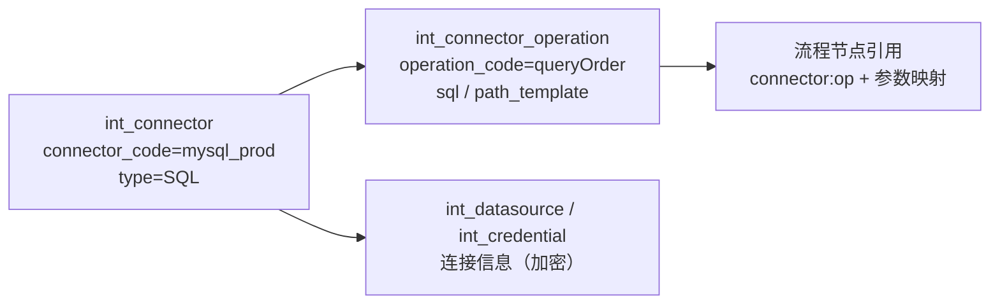

| 连接器类型 | 执行载体 | 关键配置 | 安全约束 |
| --- | --- | --- | --- |
| `HTTP` | WebClient（连接池隔离） | 方法、URL 模板、Header、超时、重试、SSL 校验开关 | **域名白名单**（防 SSRF）、禁止访问内网网段（可配置放行）、响应体大小上限 5MB |
| `SQL` | 每数据源独立 HikariCP | SQL 模板（命名参数）、超时、最大行数 | 默认**只读**（拒绝 `INSERT/UPDATE/DELETE/DDL`，写操作需连接器显式开启并二次授权）、强制参数化、最大返回 10000 行 |
| `MQ` | RocketMQ Client | Topic、Tag、消息体模板、发送超时 | 按租户隔离 Topic 前缀、禁止生产者指定任意 Topic（走白名单） |
| `SCRIPT` | GraalVM JS 沙箱 | 脚本源码、超时、内存上限 | 禁 IO/线程/反射/类加载、3s 强制中断、`allowHostAccess(NONE)` |
| `GRPC` | gRPC Channel 池 | 服务名、方法、Proto 描述、超时 | 白名单目标 |
| `BEAN` | Spring 容器内 Bean 方法 | Bean 名、方法名、参数类型 | **仅平台内置**，禁止租户自定义（防止任意代码执行） |

### 10.2 元数据同步（integration → engine）

```
engine 启动     → Feign 全量拉取「已启用」连接器与操作元数据 → 写入本地 Caffeine（TTL 30min）
integration 变更 → 发 PE_INTEG_CONNECTOR_CHANGED（含 connectorId + version）
engine 消费      → 失效对应缓存项；下次执行懒加载
执行时缓存未命中 → Feign 回源；回源失败 → 节点失败并重试（不降级使用过期配置，避免用错凭证）
```

**为什么不把连接器配置随节点快照下发**：凭证属于敏感信息，不应出现在 MQ 消息体与日志中。指令消息只携带 `connectorId + operationCode + 参数`，由 worker 在本地通过缓存/回源获取配置与凭证。

### 10.3 执行流水线

```
1. 解析节点入参映射（Aviator 表达式，从流程变量取值）      → 失败：Incident(EXPRESSION_ERROR)
2. 解析连接器配置 + 凭证（缓存/回源，凭证解密）            → 失败：重试 3 次 → Incident(CONNECTOR_ERROR)
3. 执行前写 int_call_log(RUNNING) + 幂等占位               → 幂等命中终态：直接复用结果
4. 执行（信号量限流 + 超时 + 熔断 Sentinel）
5. 出参映射（连接器响应 → 流程变量）                       → 失败：Incident(EXPRESSION_ERROR)
6. 写 int_call_log 终态；返回节点结果
```

**超时与熔断**：每个操作可配 `timeoutMs`（默认 10s，上限 5min）；Sentinel 按 `connectorId + operationCode` 维度做熔断（错误率 > 50% 且 QPS > 5 时熔断 30s），熔断期间节点快速失败并进入重试，避免拖垮引擎。

**连接池隔离**：每个数据源独立 HikariCP（默认 max 10，可配），总连接数受实例级配额限制。**禁止**所有数据源共用一个连接池——一个慢 SQL 会拖垮全部集成任务。

### 10.4 凭证与数据源安全

- 凭证内容（`int_credential.content_cipher`）与数据源口令（`int_datasource.password_cipher`）使用 **AES-256-GCM** 加密，主密钥从 KMS/环境变量注入（`PE_MASTER_KEY`），**绝不落库、绝不进日志**。
- 支持「凭证轮换」：同 `cred_name` 保留新旧两条，节点按创建时间取最新，轮换期间新旧并存。
- 解密只发生在 worker 执行连接的瞬间，内存中使用后立即清空引用；日志与异常堆栈统一脱敏（拦截器扫描 `password|secret|token|key` 字段名）。
- 数据源连通性测试在 `integration` 服务中执行，**不在网关**（避免网关成为任意 JDBC 连接的跳板）。
- 所有连接器配置变更写审计日志，包含变更前后差异（脱敏后）。

### 10.5 调用日志与限额

- `int_call_log` 记录每次调用（请求/响应只存摘要与哈希，**不存原始报文**，避免敏感数据泄漏与存储膨胀）；完整报文仅在「调试模式」下存入 MinIO 并设 7 天 TTL。
- 租户级调用限额（QPS / 日调用量）在 `integration` 与 `engine` 双层校验，超限返回明确的业务错误码而非静默失败。

---

## 11. 通知子系统设计

### 11.1 事件驱动模型

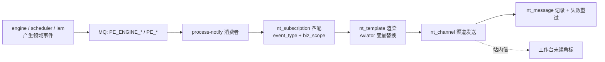

**事件与订阅分离**：事件生产者（引擎）**不需要知道谁要通知、通过什么渠道**。引擎只发 `TASK_CREATED` / `TASK_TIMEOUT` / `INSTANCE_COMPLETED` / `INSTANCE_TERMINATED` / `INCIDENT_CREATED` 等标准事件，`nt_subscription` 决定发给谁、用什么模板与渠道。这样新增渠道无需改动引擎。

### 11.2 渠道与降级

| 渠道 | 实现 | 失败降级 |
| --- | --- | --- |
| `INBOX` 站内信 | 直接写 `nt_message` | 不降级（基础能力） |
| `EMAIL` | SMTP（连接池） | 重试 3 次 → 转站内信 + 告警 |
| `SMS` | 短信网关 | 重试 2 次 → 转站内信 + 告警 |
| `WEBHOOK` / `DINGTALK` / `WECOM` / `FEISHU` | HTTP POST（签名校验） | 重试 3 次（指数退避）→ 转站内信 + 告警 |

**重试**：失败消息进延迟重投队列（1min / 5min / 15min 三档），3 次失败后按渠道降级（转站内信）、置 `FAILED`、投递 `PE_NOTIFY_MESSAGE_FAILED` 并告警。**聚合发送**：同一任务的多人候选人在 5 分钟内合并为一条消息（避免一次会签创建 200 条通知），由通知服务的聚合窗口实现。

**限流**：每渠道有全局速率限制（如短信 100 条/秒），超限入队而非丢弃；租户级限制防止单租户刷爆渠道。

---

## 12. 轨迹、审计与可观测设计

### 12.1 数据分治

| 数据 | 存储 | 保留 | 用途 |
| --- | --- | --- | --- |
| `rt_node_instance` / `rt_task` | MySQL（引擎库） | 在线 3 个月，归档 2 年 | 实例详情、待办、已办 |
| `tr_exec_trace` | ClickHouse | 13 个月（TTL） | 轨迹检索、耗时分析、回放 |
| `tr_oper_log` | MySQL（trace 库）+ 归档 | 180 天 | 合规审计 |
| `int_call_log` | MySQL（integration 库） | 30 天 | 调用排查 |
| 指标 | Prometheus | 15 天（高精度）/ 1 年（降采样） | 监控大盘与告警 |

### 12.2 轨迹事件模型

引擎在每个关键点投递轨迹事件（异步、不阻塞主链路，投递失败仅告警不影响业务）：

| `event_type` | 触发点 | `payload` 要点 |
| --- | --- | --- |
| `INSTANCE_STARTED` | 实例创建 | 定义 key、版本、发起人、businessKey |
| `NODE_ENTERED` | 节点进入 | nodeId、nodeType、tokenId |
| `NODE_COMPLETED` | 节点完成 | 耗时、输出摘要 |
| `NODE_FAILED` | 节点失败 | 错误码、重试次数、是否建 Incident |
| `GATEWAY_EVALUATED` | 网关求值 | 各分支条件与结果（**排查网关问题的关键数据**） |
| `VARIABLE_CHANGED` | 变量变更 | 变量名、旧值哈希、新值哈希（不存明文） |
| `TASK_CREATED` / `TASK_COMPLETED` | 任务生命周期 | 办理人、意见摘要、结果 |
| `TIMER_SCHEDULED` / `TIMER_FIRED` | 定时器 | dueTime、实际触发时间（衡量精度） |
| `INSTANCE_SUSPENDED` / `RESUMED` / `COMPLETED` / `TERMINATED` | 实例状态 | 原因、操作人 |

**轨迹回放**：前端按 `ts` 排序消费轨迹事件，在流程图上按时间轴重放实例的执行过程（节点逐个点亮）。这要求 `GATEWAY_EVALUATED` 与 `VARIABLE_CHANGED` 必须完整记录，否则回放会出现「跳跃」。

### 12.3 存储与查询

ClickHouse 表按 `toYYYYMM(ts)` 分区，`ORDER BY (tenant_id, instance_id, ts)`：

- 单实例轨迹查询：`WHERE tenant_id=? AND instance_id=? ORDER BY ts` —— 命中主键前缀，毫秒级。
- 跨实例检索（按流程/时间/事件类型）：用 `process_key + ts` 二级排序键辅助，必要时做物化视图预聚合。
- 写入：MQ 消费者批量写入（每批 1000 行或 1s 超时），避免单行插入。
- 降级：ClickHouse 不可用时，轨迹事件落 MySQL 的 `tr_exec_trace_buffer` 表（按天分区，保留 3 天）并异步补写，保证不丢数据。

### 12.4 实例活动高亮（前端关键需求）

实例详情页需要在流程图上标注每个节点的状态。数据来源：

```
GET /api/engine/v1/instances/{id}/diagram
→ { nodes: [{ nodeId, status, startTime, endTime, durationMs, loopCount, activeCount }],
    edges: [{ edgeId, takenCount, lastTakenTime }] }
```

聚合规则：`rt_node_instance` 按 `nodeId` 分组，多实例节点取「有 ACTIVE 则 ACTIVE，否则取最差状态」；耗时热力按 `durationMs` 分位数着色。**结果缓存在 Redis（10s TTL）**，因为监控页会高频轮询。

### 12.5 告警规则

| 告警 | 条件 | 级别 |
| --- | --- | --- |
| 实例悬挂 | 对账发现悬挂实例 > 0 | P1 |
| Incident 激增 | 5 分钟内新增 Incident > 100 | P1 |
| 待办积压 | 租户待办任务 > 阈值 | P2 |
| 定时器延迟 | 到期触发延迟 P99 > 5s | P1 |
| MQ 堆积 | Topic 堆积 > 阈值 | P1 |
| 死信产生 | 任一 DLQ 有新消息 | P1 |
| 连接器失败率 | 某操作错误率 > 30% | P2 |
| 引擎实例启动延迟 | P99 > 1s | P2 |
| 令牌冲突率 | 乐观锁冲突 > 阈值 | P2 |

---

## 13. 安全设计

### 13.1 认证与授权

| 层 | 机制 |
| --- | --- |
| 用户认证 | JWT（RS256）：Access 2h / Refresh 7d；Redis 存 `jti` 黑名单与在线会话，支持强制下线 |
| 网关校验 | 验签 + 过期 + 黑名单；解析 `tenantId`/`userId` 注入内部请求头（**剥离客户端伪造的同名头**） |
| 服务鉴权 | 每个接口标注 `@RequiresPermission("engine:instance:start")`，由 AOP 校验；网关与服务双层校验（防内网直连绕过） |
| 数据权限 | `data_scope` 五种（ALL / DEPT_AND_CHILD / DEPT / SELF / CUSTOM），MyBatis 拦截器在 SQL 中注入部门条件 |
| 服务间调用 | `X-Internal-Token`（网关签发，服务侧校验签名与时间戳，5 分钟有效） |
| 租户隔离 | `TenantLineInnerInterceptor` 自动注入 `tenant_id`；跨租户查询需 `@IgnoreTenant` 显式标注并走代码评审 |

### 13.2 引擎特有的权限点

流程编排平台比普通业务系统多三个权限维度，必须在设计中显式处理：

1. **流程定义权限**：谁能创建/发布/下线某分类下的流程（按分类授权）。
2. **实例操作权限**：谁能查看实例详情、终止实例、修改流程变量、处理 Incident。默认只有发起人、办理人、租户管理员可见；变量修改与终止必须显式授权。
3. **任务数据权限**：待办列表默认只返回「我是候选人/办理人」的任务；管理视角（查看他人任务）需要独立权限码。

### 13.3 数据安全

| 项 | 措施 |
| --- | --- |
| 口令 | BCrypt（cost 10）+ 登录失败锁定（5 次锁 10 分钟）+ 密码复杂度校验 |
| 凭证 | AES-256-GCM，主密钥外置 KMS/环境变量，轮换支持 |
| 敏感字段 | 手机号/邮箱在列表接口脱敏（`138****8888`），详情接口按权限返回明文 |
| 传输 | 全链路 HTTPS；服务间 mTLS（K8s 环境可选） |
| 存储 | 生产库表空间加密（TDE）+ 备份加密 |
| 日志 | 统一脱敏拦截器，禁止 `form_data_json` 与凭证明文进日志 |
| 导出 | 数据导出需二次授权 + 水印 + 审计 + 单次上限 5 万行 |
| 附件 | MinIO 私有桶 + 预签名 URL（5 分钟有效）+ 病毒扫描（ClamAV，可配）+ 类型白名单 |

### 13.4 应用安全

| 威胁 | 防护 |
| --- | --- |
| SQL 注入 | 全程 MyBatis 预编译；连接器 SQL 强制命名参数，禁止字符串拼接（静态检测 + 运行期拦截） |
| XSS | 富文本白名单过滤（服务端 + 前端 DOMPurify 双过滤） |
| CSRF | 无状态 JWT + 自定义头校验，不使用 Cookie 会话 |
| SSRF | HTTP 连接器域名白名单 + 内网网段黑名单 + 禁止跟随重定向到内网 |
| 脚本逃逸 | GraalVM 沙箱 + 禁 IO/线程/反射 + 超时中断 + 逃逸用例纳入安全测试套件 |
| 表达式注入 | Aviator 关闭反射与类加载，白名单函数库 |
| 越权 | 每个接口的权限码 + 数据权限 + 跨租户单测（强制用例） |
| 重放 | 幂等键 + 时间戳窗口（内部调用 5 分钟） |
| 限流 | 网关三维限流（IP / 用户 / 租户）+ Sentinel 热点参数限流 |
| 依赖漏洞 | CI 中 OWASP Dependency-Check + Trivy 镜像扫描，高危阻断 |

### 13.5 审计

- **必审计清单**：登录登出、权限与角色变更、流程发布/下线/回滚、实例终止/挂起/变量修改、任务转办/加签/驳回到指定节点、Incident 处理、连接器与凭证变更、数据导出、死信重放。
- 审计记录**只增不改不删**（`tr_oper_log` 无 UPDATE 权限，归档用独立账号），含操作前后差异摘要、IP、UA、traceId。
- 提供审计查询 API 与导出，支持按操作人/时间/模块/目标检索。

---

## 14. 高可用与容量设计

### 14.1 单点识别与消除

| 组件 | 风险 | 方案 |
| --- | --- | --- |
| gateway | 入口单点 | 多副本 + SLB；配置无状态 |
| 业务服务 | 单点 | 无状态多副本（≥ 2），K8s 滚动发布 + PDB |
| engine-worker | 任务丢失 | 多副本消费同一 Topic；实例锁保证不重复推进；宕机后消息重投给其他副本 |
| MySQL | 数据单点 | 一主两从（半同步）；主库故障由 MHA/Orchestrator 或云 RDS 自动切换 |
| Redis | 锁与缓存失效 | Sentinel/Cluster；**Redis 全挂时引擎仍可用**（降级为纯 DB 乐观锁，性能下降但语义正确） |
| RocketMQ | 消息堆积/丢失 | 2 主 2 从 + 同步刷盘；生产端本地重试 + Outbox 兜底 |
| Nacos | 注册中心不可用 | 客户端本地缓存服务列表，短期可用；Nacos 集群 ≥ 3 节点 |
| scheduler | 触发单点 | 多副本抢占式调度（Redis 锁 + DB `next_fire_time` 乐观更新） |
| ClickHouse | 轨迹不可查 | 降级写 MySQL buffer（见 12.3） |

**关键设计原则**：**Redis 不是正确性依赖**。所有依赖 Redis 的机制（实例锁、幂等、待办计数）都有 DB 兜底路径，Redis 故障时降级运行而非数据错乱。

### 14.2 容量模型

按基线指标（100 万活跃实例、2000 TPS、5000 万历史实例）推算：

| 资源 | 推算 | 配置建议 |
| --- | --- | --- |
| MySQL 写入 | 2000 实例/秒 × 约 6 行 = 12000 行/秒峰值（含节点/令牌/变量/任务/outbox） | 主库 8C16G + NVMe SSD，建议分库（引擎库按 `tenant_id` 取模或按 `hash(instanceId)` 分片） |
| MySQL 存储 | `rt_node_instance` 平均 1.5KB × 1 亿行 ≈ 150GB；含索引与变量约 400GB | 在线 3 个月热数据约 60GB，其余归档 |
| Redis 内存 | 实例锁 100 万个 key（约 200B）≈ 200MB；时间轮 10 万项 ≈ 50MB；缓存与计数器约 2GB | 8GB 起，Cluster 3 主 3 从 |
| RocketMQ | 峰值 6000 msg/s（含轨迹事件） | 2 主 2 从，单机 16C32G |
| engine-worker | 单副本约 500 TPS（自动化节点） | 4~8 副本（自动化节点为主场景），API 副本 2~4 |
| ClickHouse | 轨迹事件 2000 万/天 × 500B ≈ 10GB/天，压缩后约 1.5GB/天 | 3 节点集群，年约 550GB，TTL 13 个月 |
| MinIO | 附件与大变量，按租户配额 | 起步 2TB |

### 14.3 扩展性设计

| 维度 | 手段 |
| --- | --- |
| 计算扩展 | 所有服务无状态，水平扩副本；worker 按 MQ 堆积自动 HPA |
| 存储扩展 | MySQL 分库预留：`rt_*` 表用 `instance_id` 做分片键（业务查询天然带 `instance_id` 或可转为按时间+租户查询）；大表按时间分区 |
| 热点分散 | 实例锁 key 分散；`rt_timer_job` 按到期时间分片 ZSet；MQ 按 `instanceId` 顺序发送保证并行度（不同实例并行） |
| 冷热分离 | 完成任务与历史实例归档到 `_his` 表/库；轨迹全量在 ClickHouse |
| 功能扩展 | 节点行为、候选人策略、连接器执行器、通知渠道全部走 SPI + 注册表，不改内核 |

### 14.4 降级预案

| 故障 | 降级动作 | 影响 |
| --- | --- | --- |
| Redis 全挂 | 引擎切「DB 乐观锁」模式；待办计数改为实时查询；定时器全走 DB 扫描（频率提高） | 吞吐下降约 60%，功能完整 |
| RocketMQ 不可用 | 引擎拒绝新的异步节点下发（快速失败），Outbox 保留待中继恢复后补投 | 自动化节点暂停，人工流程仍可用 |
| ClickHouse 不可用 | 轨迹写 MySQL buffer | 轨迹查询变慢 |
| design 服务不可用 | 引擎使用本地缓存的定义；新实例可启动（缓存命中），发布功能不可用 | 无新建模能力 |
| integration 不可用 | 连接器配置使用本地缓存；未缓存的新连接器执行失败 | 部分集成节点失败 |
| notify 不可用 | 通知入 `nt_message(PENDING)` 待重试 | 无实时通知 |
| 数据库主库不可用 | 只读降级：待办查询与实例查看可用，写操作返回 503 | 无法发起/办理 |

**降级开关**：所有降级动作通过 Nacos 配置开关控制（`engine.fallback.no-redis=true` 等），并支持一键全量降级脚本，用于生产事故处置。

### 14.5 混沌演练场景

| 场景 | 预期 |
| --- | --- |
| 杀掉 1 个 engine-worker（持有实例锁） | 锁超时后其他副本接管，实例在 60s 内继续推进，无重复节点执行 |
| 杀掉 Redis 主节点 | 引擎降级运行，无数据错乱 |
| RocketMQ 单 broker 宕机 | 消息不丢，堆积随后消费 |
| MySQL 主从切换 | 30s 内恢复写入，期间写请求返回 503 而非数据错乱 |
| 注入连接器 30s 延迟 | 引擎不阻塞（异步节点），其他实例不受影响 |
| 制造 10 万定时器同时到期 | 时间轮平滑投递，P99 延迟 < 2s，无雪崩 |

---

## 15. 核心时序图

### 15.1 流程实例启动（同步推进到第一个等待态）

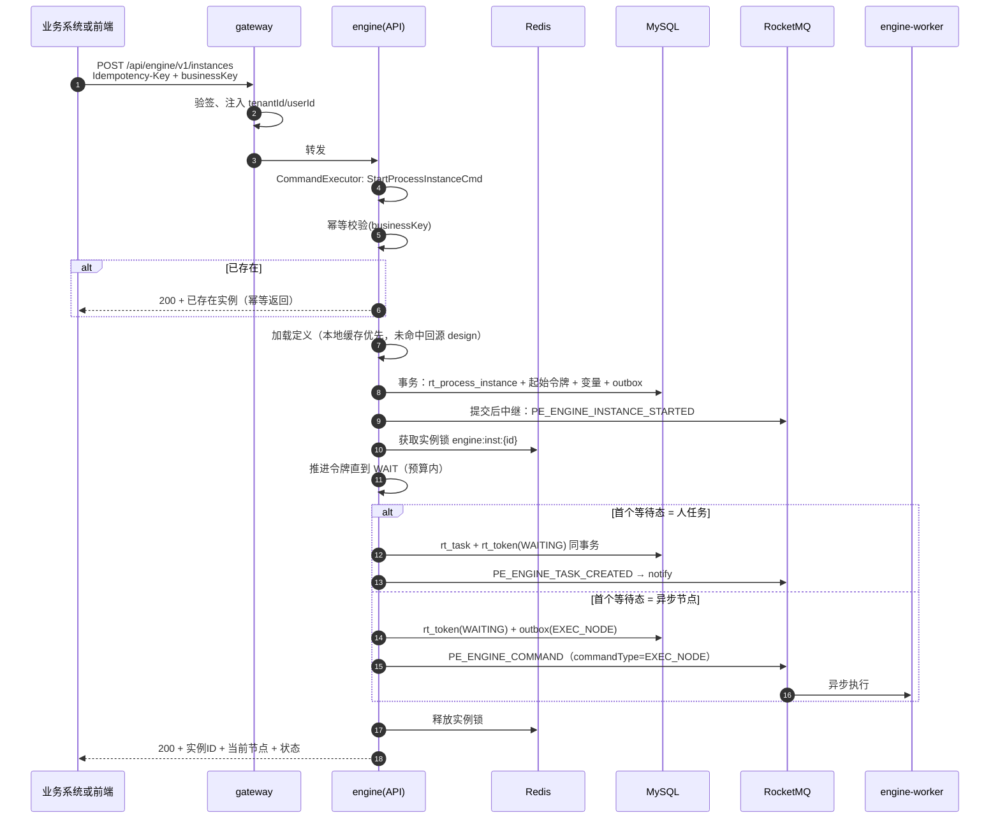

**要点**：启动接口**同步推进到第一个等待态**再返回（P99 < 300ms），调用方拿到的实例不是「刚创建的空壳」，而是已有明确当前节点与待办的状态，用户体验与排查效率显著更好。若首个等待态是耗时自动化节点则异步返回（`status=RUNNING`，`currentNode` 为运行中节点）。

### 15.2 人任务全生命周期

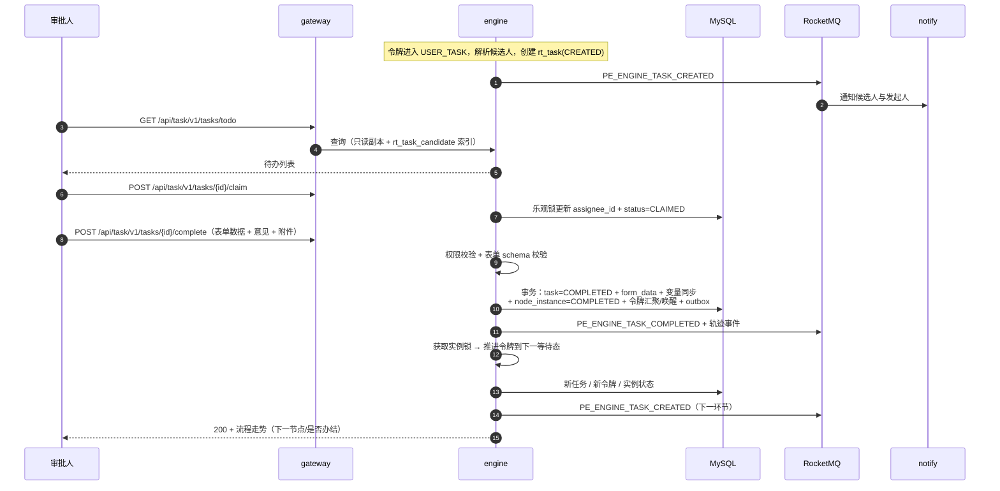

### 15.3 自动化节点异步执行与回调

已在 5.7 节给出。补充**失败路径**：

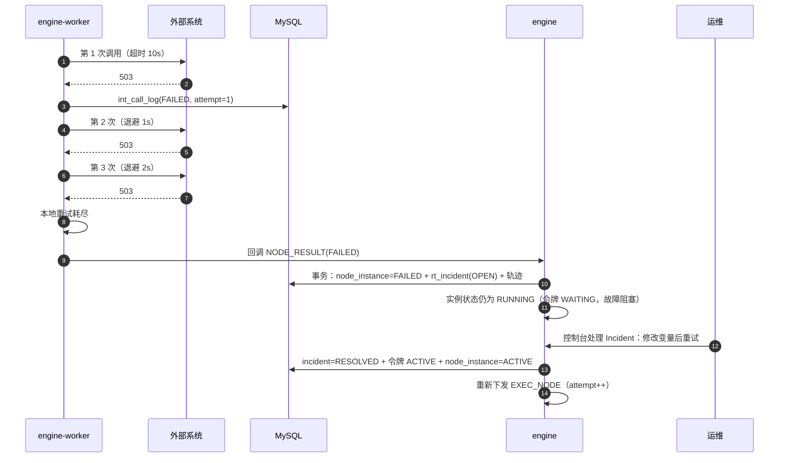

### 15.4 定时器触发（含精度保障）

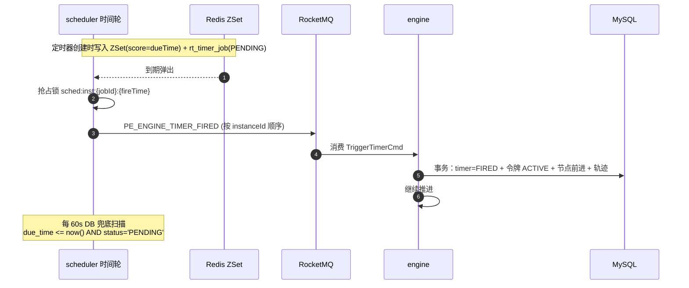

### 15.5 并行网关汇聚

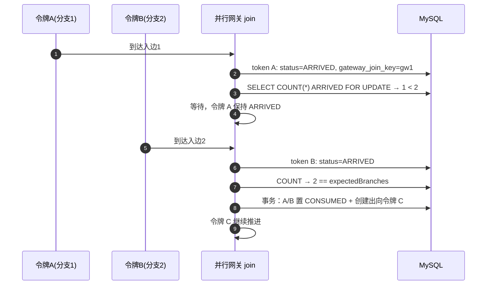

### 15.6 失败重试与故障人工处理

已在 15.3 给出。**跳过**路径：Incident → 跳过 → 节点置 `SKIPPED` → 令牌 `onLeave` 走默认流 → 轨迹记录 `INCIDENT_SKIPPED`（含操作人与原因）。

### 15.7 补偿执行

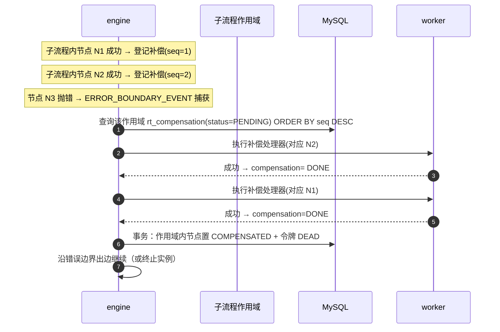

### 15.8 实例终止

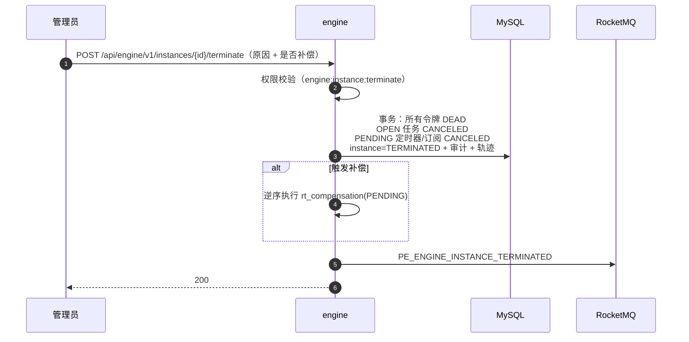

---

## 16. 数据一致性设计

### 16.1 Outbox 中继

```
事务内：业务状态变更 + INSERT rt_outbox(NEW)  ← 同一本地事务，原子
事务后：中继任务（每 200ms）扫描 status=NEW 且 next_retry_time<=now()
        → 投递 MQ（按聚合 ID 顺序）
        → 成功置 SENT；失败 retry_count++，指数退避，超 10 次告警
```

- 中继任务多副本并发安全：`UPDATE rt_outbox SET status='SENDING', owner=? WHERE id=? AND status='NEW'` 抢占式更新。
- 投递语义是 **at-least-once**，因此**所有消费者必须幂等**（`rt_idempotent` 或业务唯一键）。
- Outbox 表按月分区，已发送记录保留 3 天后清理（保留期需大于最大故障恢复时间）。

### 16.2 幂等实现矩阵

| 场景 | 幂等键 | 实现 |
| --- | --- | --- |
| 外部启动实例 | `Idempotency-Key` 或 `businessKey` | `rt_idempotent` 唯一索引 + `businessKey` 唯一索引 |
| 任务完成 | `taskId + 期望版本` | 乐观锁更新（status 必须为 CLAIMED/CREATED） |
| 异步节点执行 | `exec:{instanceId}:{tokenId}:{nodeInstanceId}:{attempt}` | `rt_idempotent` 占位 + 结果复用 |
| 定时器触发 | `timerId + fireTime` | `rt_timer_job` 状态机更新（PENDING → FIRED 原子） |
| 事件投递 | `eventSubId` | `rt_event_sub` 状态机更新（OPEN → TRIGGERED 原子） |
| MQ 消费 | `eventId` | `rt_idempotent`（TTL 7 天） |
| 通知发送 | `msgNo` | `nt_message` 状态机更新 |

**统一模式**：所有幂等最终都落成「**带状态前置条件的原子 UPDATE**」，影响行数为 0 即视为重复操作，直接返回成功（幂等语义）而非报错。

### 16.3 跨服务一致性

| 场景 | 一致性要求 | 方案 |
| --- | --- | --- |
| 发布流程 → engine 感知 | 最终一致（秒级） | MQ 失效通知 + 缓存 TTL 兜底；未感知期间新实例可能用旧版本（可接受，最长 30s） |
| 引擎取候选人 → iam | 弱一致（60s 缓存） | 缓存 + 主动失效；候选人变更后最长 60s 生效 |
| 引擎取连接器配置 → integration | 最终一致 | Feign 回源；**回源失败不降级使用过期凭证** |
| 任务完成 → 通知发送 | 最终一致 | MQ + 重试；通知失败不影响流程推进（关键设计） |
| 流程推进 → 轨迹落库 | 最终一致 | MQ 异步 + ClickHouse buffer 降级 |
| 实例终止 → 取消所有等待态 | **强一致（单库单事务）** | 同一事务内完成，这是不拆 task 服务的重要收益 |

### 16.4 对账与修复

三层兜底：

1. **实时**：状态机前置条件 + 乐观锁，拦截绝大多数并发错误。
2. **准实时**：Outbox 中继重试（秒级）、MQ 消费重试（秒级）、定时器 DB 兜底扫描（分钟级）。
3. **离线**：引擎对账任务（5 分钟）发现的悬挂态自动修复 + 告警；每日全量对账（凌晨低峰）扫描「RUNNING 超过 7 天且无任何活动的实例」，产出报表供人工确认。

**修复原则**：自动修复只做**幂等且可逆**的动作（补投推进指令、修正令牌状态），涉及业务语义的修复（跳过节点、终止实例、补偿）一律告警 + 人工确认。修复动作全部写审计日志。

---

## 17. 前端总体设计

### 17.1 应用与包结构

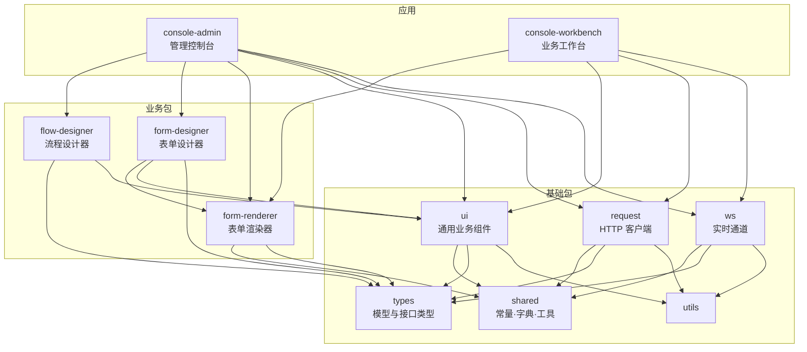

| 应用 | 使用者 | 核心页面 |
| --- | --- | --- |
| `console-admin` | 租户管理员、流程设计者、运维、审计员 | 首页大盘、流程设计（列表/设计器/版本/发布）、表单设计、实例监控（列表/详情/轨迹回放）、任务管理（管理视角）、故障处理、调度作业、连接器与数据源、通知模板、组织权限、审计日志、系统设置 |
| `console-workbench` | 业务用户、审批人 | 我的待办、我的已办、我发起的、抄送我的、发起流程（流程目录 + 表单）、任务详情与办理、消息中心、个人设置 |

**两个应用而非一个**：管理控制台功能重、权限高、迭代快；工作台面向全体业务用户、需要移动端适配、追求极简。混在一起会导致路由、菜单、打包体积与发布节奏互相牵制。两者共享全部基础包与业务包，代码复用率 > 60%。

### 17.2 路由、权限与状态

- **动态路由**：登录后 `GET /api/iam/v1/users/me/menus` 返回菜单树 → 前端转换为路由表并 `router.addRoute`；未授权路由不存在（而非「存在但拦截」），防止通过 URL 探测功能。
- **按钮级权限**：`v-perm="'engine:instance:terminate'"` 指令；同时后端必须有同名权限码校验（前端指令只是体验优化，不是安全边界）。
- **数据权限**：前端不参与数据权限计算，完全由后端注入条件。
- **Pinia 分域**：`useUserStore`（用户/权限/租户）、`useAppStore`（主题/布局/语言）、`useDictStore`（字典缓存）、`useWorkbenchStore`（待办计数/未读消息）。禁止建一个巨型 store。
- **待办计数**：通过 WebSocket 推送增量更新，而非轮询。

### 17.3 请求层

- Axios 实例统一：注入 `Authorization`、`X-Request-Id`、`Accept-Language`；响应拦截统一处理业务错误码（`code !== '0'`）、401 跳登录、403 提示无权限、429 提示限流并读 `Retry-After`。
- **Long 精度**：全局配置 `json-bigint` 或约定后端把 Long 序列化为字符串，前端类型定义统一用 `string`。
- **类型来源**：由 OpenAPI 生成 `packages/types/src/api/**`，**禁止手写接口类型**。生成脚本 `pnpm gen:api` 在 CI 中校验「后端契约变更必须同步更新前端类型」，diff 不为空则流水线失败。
- **取消与竞态**：列表页搜索用 `AbortController` 取消上一次请求；详情页切换实例时用请求序号丢弃过期响应（避免旧数据覆盖新数据）。

### 17.4 实时通道

- 工作台用 **WebSocket**（双向，需要订阅/退订管理）：地址 `/ws/notify`，鉴权用 URL 携带一次性 token（避免 Header 限制），心跳 30s，断线指数退避重连（1s/2s/5s/10s/30s），重连后按 `lastSeq` 补齐丢失消息。
- 实例监控页用 **SSE**（单向，浏览器自动重连）：地址 `/sse/instances/{id}`，推送节点状态变更与轨迹事件。
- **推送服务统一由 `process-trace` 提供**（它已消费全部轨迹事件，具备推送所需的实时数据源），网关把 `/ws/**`、`/sse/**` 路由到 `process-trace`，握手阶段校验 JWT 与实例可见性。`process-engine` 不承担长连接（避免长连接占用执行面资源）。
- 消息体带单调递增 `seq`，前端检测到缺口时主动调用 REST 补齐（**推送只做加速，不做唯一来源**，这样推送故障不会导致数据错误）。

### 17.5 性能与体验

| 优化点 | 手段 |
| --- | --- |
| 首屏 | 路由懒加载 + 组件按需引入（Element Plus 按需）+ gzip/brotli + CDN 静态资源 |
| 长列表 | 虚拟滚动（待办/实例列表 > 200 行）；游标分页 |
| 设计器 | X6 虚拟渲染；大模型（> 300 节点）禁用实时自动布局；序列化用增量 diff 而非全量重建 |
| 表单渲染 | 字段组件异步注册 + `KeepAlive`；大表单（> 100 字段）分组懒渲染 |
| 图表 | ECharts 按需注册；大数据量用 `large` 模式 |
| 交互 | 所有提交类操作防重复点击（按钮 loading + 幂等键）；长耗时操作（发布校验、批量审批）走异步任务 + 进度提示 |
| 国际化 | vue-i18n，中文为默认，预留英文；服务端错误消息按 `Accept-Language` 返回 |

### 17.6 前端工程约束

- TypeScript `strict: true`，禁止 `any`（ESLint 规则阻断），接口类型来自生成。
- 组件必须声明 props/emits 类型；`<script setup lang="ts">` 统一风格。
- 状态变更只允许在 store 的 action 中发生；组件不直接改 store 状态。
- 样式作用域：SCSS + `scoped`；跨包主题用 CSS 变量，禁止深层选择器穿透（`::v-deep` 需评审）。
- 单元测试覆盖工具函数与 store action；关键流程（发起、审批、设计器保存发布）用 Playwright 做 E2E。

---

## 18. 非功能需求落地对照

| 基线指标 | 设计手段 | 验证方式 |
| --- | --- | --- |
| 实例启动 P99 < 300ms | 定义缓存（Caffeine+Redis）、单事务批量落库、同步推进到首个等待态、Redis 锁不阻塞线程 | Gatling 压测 500 并发启动 |
| 大列表查询 P99 < 200ms | 覆盖索引、`rt_task_candidate` 冗余表、只读副本、字段剪裁、游标分页 | 1000 万行数据下压测 |
| 自动化节点 ≥ 2000 TPS | worker 无状态水平扩展、节点快照随消息下发（worker 不回查）、连接器线程池隔离 | 4/8/16 副本线性度测试 |
| 100 万活跃实例 | 分库预留、按时间分区、实例级锁分散、大变量外置 | 数据构造 + 全链路压测 |
| 定时器 P99 < 2s | ZSet 时间轮 + 分片 + DB 每分钟兜底 | 10 万定时器同时到期 |
| 可用性 99.95% | 全组件多副本、无单点表、Redis 非正确性依赖 | 混沌演练 |
| 单节点宕机 60s 内接管 | 实例锁租期 30s + 消息重投 + 对账补投 | kill -9 worker 演练 |
| 无悬挂态 | 引擎对账任务（5 分钟）+ 自动补投 + 告警 | 注入故障（丢弃消息）验证自愈 |
| 无明文凭证 | AES-256-GCM + KMS + 日志脱敏 | 安全测试 + 代码扫描 |
| 全链路 traceId | OTel Agent + MDC + MQ 消息头透传 | 抽样验证跨服务链路完整 |
| 可扩展新节点类型 | `NodeBehavior` SPI + 前端节点注册表 | 灰度新增一个自定义节点类型的成本评估（目标 < 2 人日） |

---

## 19. 风险与折中

| 风险 | 影响 | 概率 | 应对 | 兜底 |
| --- | --- | --- | --- | --- |
| 自研引擎语义缺陷（尤其包容网关、多实例、驳回清理） | 高（业务错误） | 中 | 语义测试套件 ≥ 200 用例；包容网关单独立项；灰度期双跑比对 | 保留「人工修复令牌 + 重放」工具；关键客户可临时切简化模型规避 |
| 分布式一致性漏洞 | 高 | 中 | Outbox + 幂等 + 对账三层 | 对账自动修复 + 人工干预台 |
| 实例级串行成为性能瓶颈（热点实例被高频操作） | 中 | 中 | 锁抢占失败不阻塞；冲突率监控与告警 | 热点实例改为「单实例分片队列」专用 worker |
| 待办查询在大规模候选人下退化 | 中 | 中 | `rt_task_candidate` 冗余表 + 候选人规模上限 5000 | 候选人超限强制改用角色/部门策略 |
| 大变量拖垮实例加载 | 中 | 中 | 64KB 外置 MinIO + 按需加载 | 上线后监控变量大小分布，动态下调阈值 |
| 脚本/表达式沙箱逃逸 | 高 | 低 | GraalVM 严格沙箱 + 超时中断 + 安全测试 | 生产可全局关闭脚本节点（配置开关） |
| 多租户越权 | 高 | 低 | 拦截器 + 权限码 + 跨租户强制单测 | 审计日志追溯 + 快速下线受影响接口 |
| ClickHouse 运维成本高 | 低 | 中 | 提供 MySQL 分区表降级方案 | 小规模租户走 MySQL 模式 |
| RocketMQ 运维复杂 | 中 | 中 | 提供 Kafka 适配层（仅需替换 producer/consumer 实现） | 保留同步执行模式（牺牲吞吐保功能） |
| 关键路径人力不足（引擎工作量最大） | 高 | 中 | 引擎由最强后端专职；M0/M1 提前搭建骨架让引擎尽早开工 | 削减 P2 需求（模板市场、表单设计器高级控件） |
| 前端设计器工作量被低估 | 中 | 中 | 复用 X6 官方插件；先做「够用的 12 种节点」再扩 | 降级为表单式建模（列表 + 属性表单）作为应急 |
| 第三方版本冲突（SCA / Boot / Boot 3.3） | 中 | 中 | 锁定 BOM，M0 阶段先跑通全依赖编译 | 弃用 SCA，直接使用 Nacos 官方 starter |
| 长流程实例（> 1 年）的版本与数据膨胀 | 中 | 低 | 实例绑定版本不变；历史数据归档；长流程建议拆分 | 提供「实例归档后只读」模式 |

---

## 20. 附录

### 20.1 状态枚举总表（跨服务统一语义）

| 实体 | 字段 | 取值 |
| --- | --- | --- |
| 流程版本 | `pf_process_version.status` | `DRAFT` / `PUBLISHED` / `OFFLINE` |
| 流程定义 | `pf_process_def.status` | `ENABLED` / `DISABLED` |
| 流程实例 | `rt_process_instance.status` | `RUNNING` / `SUSPENDED` / `COMPLETED` / `TERMINATED` |
| 令牌 | `rt_token.status` | `ACTIVE` / `WAITING` / `ARRIVED` / `CONSUMED` / `DEAD` |
| 节点实例 | `rt_node_instance.status` | `ACTIVE` / `COMPLETED` / `FAILED` / `SKIPPED` / `COMPENSATED` |
| 任务 | `rt_task.status` | `CREATED` / `CLAIMED` / `COMPLETED` / `DELEGATED` / `TRANSFERRED` / `CANCELED` / `TIMEOUT` |
| 定时器 | `rt_timer_job.status` | `PENDING` / `FIRED` / `CANCELED` |
| 事件订阅 | `rt_event_sub.status` | `OPEN` / `TRIGGERED` / `CANCELED` |
| 故障 | `rt_incident.status` | `OPEN` / `RESOLVED` / `CANCELED` |
| 补偿 | `rt_compensation.status` | `PENDING` / `DONE` / `FAILED` |
| 发件箱 | `rt_outbox.status` | `NEW` / `SENDING` / `SENT` / `FAILED` |
| 调度作业 | `sch_job.status` | `RUNNING` / `PAUSED` |
| 调度执行 | `sch_job_execution.status` | `RUNNING` / `SUCCESS` / `FAILED` / `TIMEOUT` / `SKIPPED` |
| 调用日志 | `int_call_log.call_status` | `RUNNING` / `SUCCESS` / `FAILED` / `UNKNOWN` |
| 消息 | `nt_message.status` | `PENDING` / `SENT` / `FAILED` / `READ` |
| 连接器 | `int_connector.status` | `ENABLED` / `DISABLED` |

### 20.2 MQ Topic（核心链路）

> **完整清单以 `docs/04-API契约.md` 第 4.2 节为准**（共 30 个业务 Topic + `PE_DLQ_{原Topic}` 命名模板，含生产者/消费者/消息体/幂等键/重试与死信策略）。本表只列出引擎主链路的 12 个关键 Topic，供阅读设计时对照。**Topic 命名与字段以 04 文档为准**，本文其他章节出现的 Topic 名均已与之对齐。

| Topic | 生产者 | 消费者 | 顺序键 | 说明 |
| --- | --- | --- | --- | --- |
| `PE_ENGINE_COMMAND` | engine（Outbox 中继）/ scheduler | engine-worker | `instanceId` | **引擎命令唯一通道**：令牌推进（`ADVANCE_TOKEN`）、异步节点执行（`EXEC_NODE`）、定时器触发、任务唤醒等；顺序消息保证同实例串行 |
| `PE_ENGINE_INSTANCE_STARTED` | engine | trace / notify | `eventId` | 实例已启动 |
| `PE_ENGINE_INSTANCE_ENDED` | engine | trace / notify / sched / 外部订阅方 | `eventId` | 实例完成 |
| `PE_ENGINE_INSTANCE_TERMINATED` | engine | trace / notify | `eventId` | 实例已终止 |
| `PE_ENGINE_NODE_COMPLETED` | engine | trace | `eventId` | 节点已完成（含耗时与输出摘要） |
| `PE_ENGINE_NODE_FAILED` | engine | trace / notify | `eventId` | 节点执行失败 |
| `PE_ENGINE_TASK_CREATED` | engine | trace / notify | `eventId` | 任务已创建 |
| `PE_ENGINE_TASK_COMPLETED` | engine | trace / notify / integration | `eventId` | 任务已完成 |
| `PE_ENGINE_TIMER_FIRED` | engine / scheduler | trace / notify | `{instanceId}:{timerId}:{fireTime}` | 定时器到期 |
| `PE_ENGINE_INCIDENT_CREATED` | engine | trace / notify | `incidentId` | 故障事件（P0 类，禁止静默丢弃） |
| `PE_TRACE_EXEC_TRACE` | engine / worker | trace（写 ClickHouse + 实时推送） | `execTraceId` | 执行轨迹（高吞吐，8 队列） |
| `PE_DLQ_{原Topic}` | MQ | 运维/管理端（人工或自动重放） | 原幂等键 | 死信队列，支持按 Topic/时间/关键字重放 |

**注意两处与直觉不同的设计**（详见 04 文档）：

1. **异步节点执行与令牌推进共用一个 Topic** `PE_ENGINE_COMMAND`，通过 `commandType` 区分。好处是「同一实例的所有指令天然进入同一顺序队列」，无需在多 Topic 之间保证相对顺序。
2. **worker 的执行结果回调不走 MQ，而走内部接口** `POST /api/engine/v1/internal/nodes/callback`（带 `X-Internal-Token`，3 次重试后生成故障并入 DLQ）。原因：回调是「必须送达的状态推进」，用同步接口 + 明确的失败语义比「丢进 MQ 等消费」更可控，也便于在返回体中直接告知 worker「令牌已被并发修改，请丢弃本次结果」。

### 20.3 关键技术指标（设计期承诺）

| 项 | 值 |
| --- | --- |
| 引擎单副本吞吐 | 500 TPS（自动化节点）；1500 TPS（纯人工流程推进） |
| 单实例最大并行令牌数 | 1000（超过建议拆分流程） |
| 单节点最大候选人 | 5000 人 |
| 单流程最大节点数 | 500（建议 ≤ 200） |
| 变量单值上限 | 10MB（超过拒绝并提示外置） |
| 表达式复杂度上限 | 2000 字符 |
| 脚本执行超时 | 3s |
| 连接器调用超时 | 默认 10s，上限 5min |
| 实例锁租期 | 30s（看门狗自动续期） |
| 对账周期 | 5 分钟 |
| 轨迹事件保留 | ClickHouse 13 个月 |

### 20.4 后续演进路线（v1.1+）

| 版本 | 内容 |
| --- | --- |
| v1.1 | 决策表/规则节点（替代复杂网关嵌套）、流程模拟与试跑（Mock 连接器）、移动端 H5 工作台 |
| v1.2 | 待办独立只读服务（`process-task-query`）与 CQRS 读模型、流程数据分析（节点耗时热力与瓶颈识别） |
| v1.3 | 多引擎集群联邦（跨集群实例路由）、流程市场（模板共享与计费） |
| v2.0 | 物理隔离多租户（`isolation_mode=SCHEMA/DATABASE`）、可视化调试器（断点与单步执行）、AI 辅助建模（自然语言生成流程草稿） |

### 20.5 设计自检清单（评审用）

- [ ] 每个基线实体在设计中都有明确归属服务与读写方
- [ ] 每个等待态都有明确的唤醒路径与超时兜底
- [ ] 每个跨服务写操作都有幂等键与失败处置
- [ ] 每个「自动推进」的动作都能被对账任务发现异常
- [ ] 每个敏感数据（凭证/口令/表单/附件）都有加密与脱敏路径
- [ ] 每个降级动作都有开关且不破坏正确性
- [ ] 每个节点类型都有行为、校验、前端 shape、BPMN 映射四件套
- [ ] 每条性能指标都有明确的设计手段与验证方式

