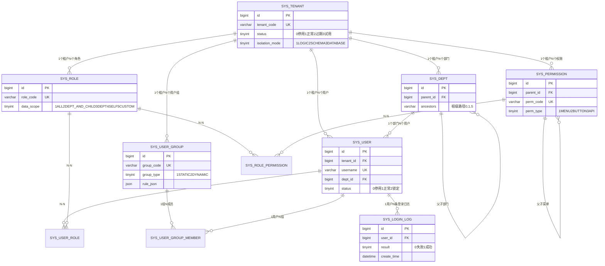
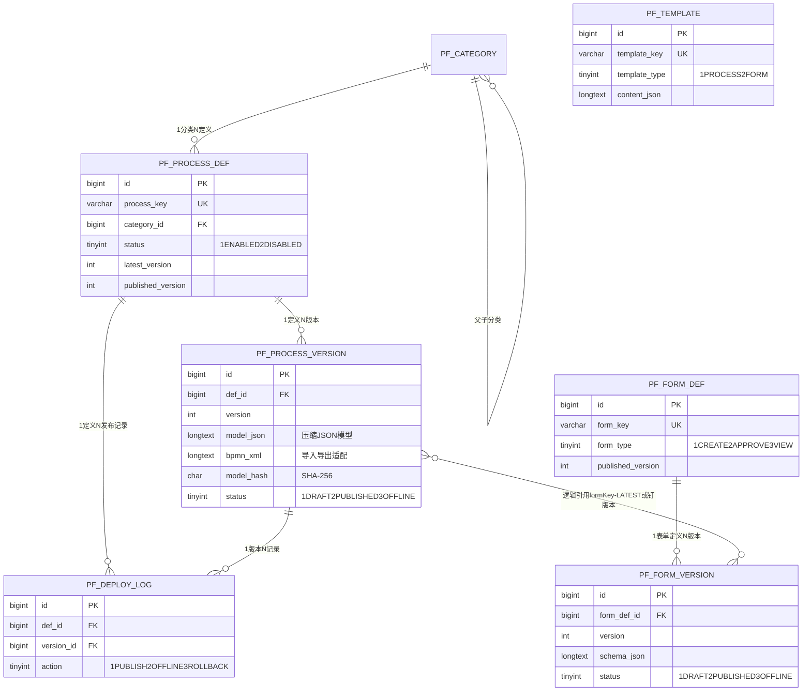
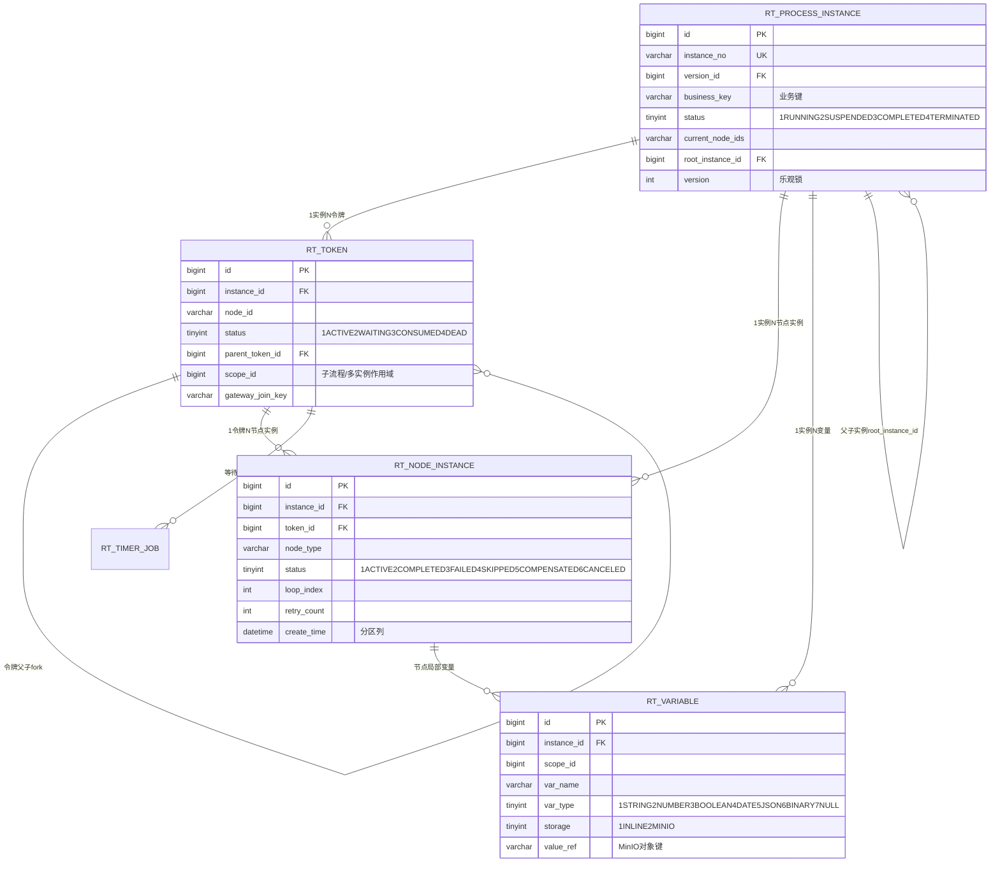
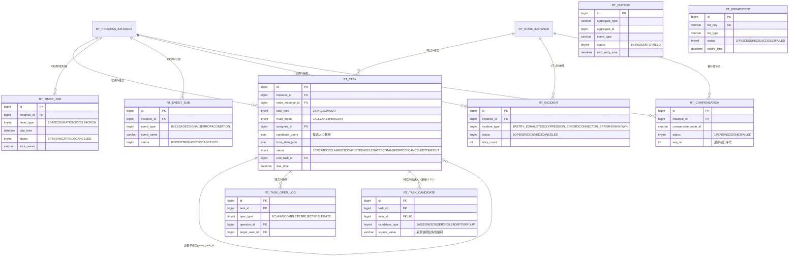
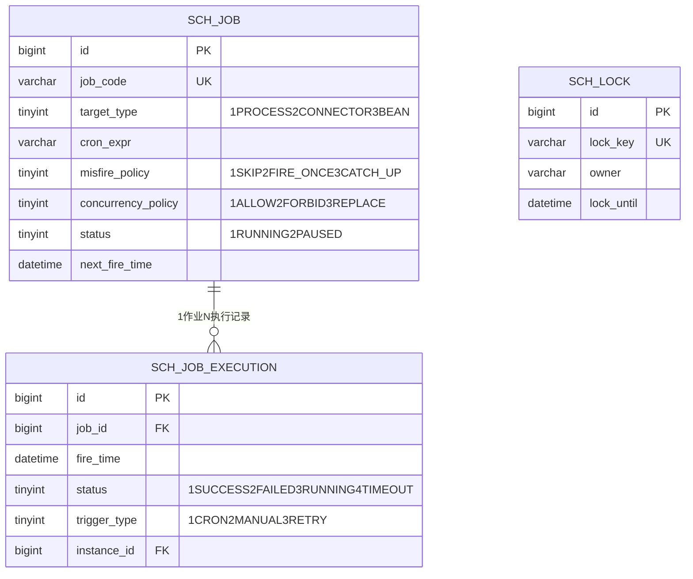
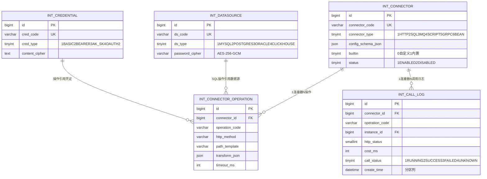
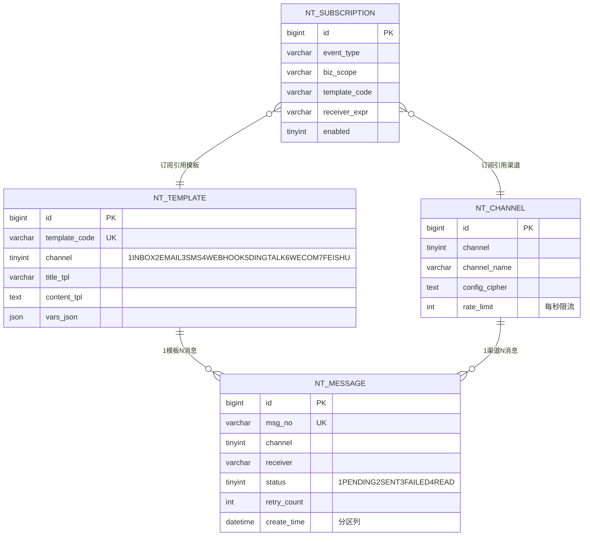
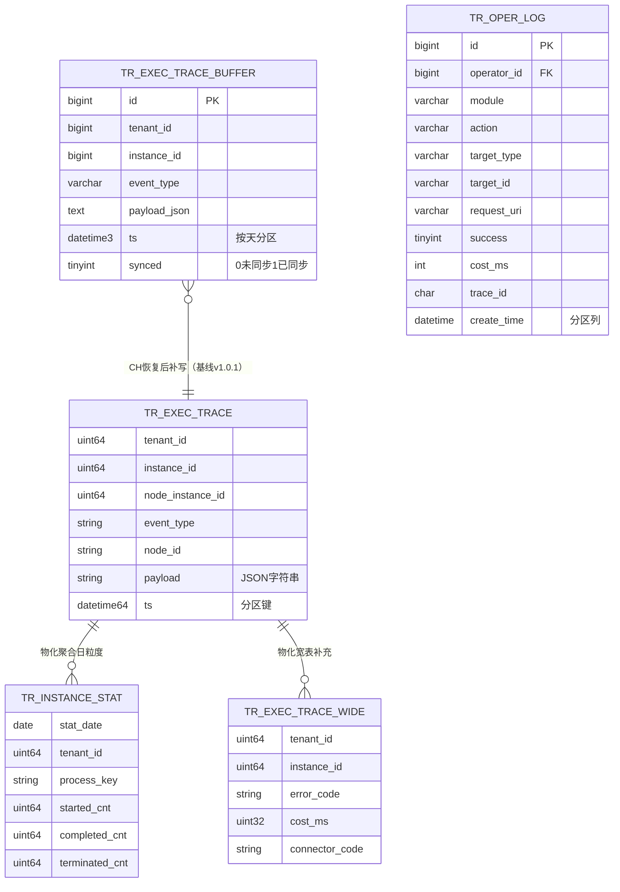

# ProcessEngine 流程编排平台 · 数据库设计

| 项 | 值 |
| --- | --- |
| 文档编号 | `docs/03-数据库设计.md` |
| 版本 | v1.0（与《00-设计基线》v1.0 冻结版对齐） |
| 状态 | 待评审 |
| 目标数据库 | **MySQL 8.0.x**（InnoDB / utf8mb4 / utf8mb4_general_ci / ROW_FORMAT=DYNAMIC）+ **ClickHouse 24.x**（轨迹与统计） |
| 覆盖范围 | 7 个逻辑库；**46 张基线表**（MySQL 44 张 + ClickHouse 2 张，基线 v1.0.1 口径）+ 1 张显式标注的补充表（ClickHouse 宽表） |
| 一致性锚点 | `docs/00-设计基线.md` 第 4 节（实体清单）、第 6.2/6.3/6.4/6.5 节（ID、多租户、时间与并发、公共列）、第 7 节（非功能指标） |
| 硬约束 | 禁止跨库物理外键；禁止跨库 JOIN；所有 Long 型 ID 对外序列化为字符串；DDL 必须可在 MySQL 8.0 直接执行 |

## 0. 阅读导引

本文是基线实体清单的**物理落地版**，不含任何与基线冲突的表。表数量分布如下（详见第 10 章总览表）：

| 逻辑库 | 归属服务 | 表数（MySQL） | 表数（ClickHouse） | 备注 |
| --- | --- | --- | --- | --- |
| `pe_iam` | `process-iam` | 10 | 0 | 租户/用户/部门/角色/权限/用户组/登录日志 |
| `pe_design` | `process-design` | 7 | 0 | 分类/流程定义与版本/表单定义与版本/模板/发布记录 |
| `pe_engine` | `process-engine` | 13 | 0 | 实例/令牌/节点/变量/任务/候选人冗余/任务操作日志/定时器/事件/故障/补偿/发件箱/幂等 |
| `pe_scheduler` | `process-scheduler` | 3 | 0 | 调度作业/执行记录/抢占锁 |
| `pe_integration` | `process-integration` | 5 | 0 | 连接器/操作/数据源/凭证/调用日志 |
| `pe_notify` | `process-notify` | 4 | 0 | 模板/渠道/订阅/消息记录 |
| `pe_trace` | `process-trace` | 2 | 2（+1 补充） | 操作审计、轨迹降级缓冲（MySQL）+ 执行轨迹、实例统计（ClickHouse） |
| **合计** | — | **44** | **2（+1 补充）** | 基线 v1.0.1 共 46 张，全覆盖 |

> **补充声明**：仅 `pe_trace.tr_exec_trace_wide`（ClickHouse 明细宽表）为「**相对基线的补充**」，第 5.3 节给出理由；它不承载任何源数据，可由 `tr_exec_trace` 重建，不改变基线清单语义。归档库（`pe_archive`）为纯物理副本，不计入清单。
>
> **基线 v1.0.1 对齐**：`rt_task_candidate`、`tr_exec_trace_buffer` 为基线 v1.0.1 新增表；`int_call_log.call_status`、`rt_outbox.owner` 为基线 v1.0.1 新增/修正字段。四项均已在 1.9 节显式登记，可追溯。

---

## 1. 设计约定

### 1.1 命名规则

| 对象 | 规则 | 示例 |
| --- | --- | --- |
| 库名 | `pe_{域}`，全小写 | `pe_engine` |
| 表名 | `{域前缀}_{名词}`，小写下划线，**单数** | `rt_process_instance` |
| 域前缀 | `sys_`（IAM）、`pf_`（建模）、`rt_`（运行时）、`sch_`（调度）、`int_`（集成）、`nt_`（通知）、`tr_`（轨迹审计） | — |
| 字段名 | 小写下划线，布尔/状态用 `_flag` / `_status`，时间用 `_time`，毫秒数用 `_ms`，JSON 用 `_json`，密文用 `_cipher` | `complete_time`、`cost_ms` |
| 主键 | 全库统一 `id` | `id` |
| 唯一索引 | `uk_{表名去域前缀}_{语义}`，末位固定为分区列或删除辅助列（见 1.4） | `uk_user_username` |
| 普通索引 | `idx_{表名去域前缀}_{语义}`，按「等值列 → 范围列 → 排序列」顺序组织 | `idx_task_assignee_status` |
| 外键 | **不使用物理外键**，逻辑外键一律用 `idx_` 命名，不出现 `fk_` 前缀 | `idx_task_instance` |
| 分区名 | `p{yyyyMM}` 月分区，末位保留 `pmax` | `p202601`、`pmax` |
| 归档表 | 归档库内同名 + `_his` 后缀（`rt_node_instance_his`），**不属于 7 库清单** | — |

**索引前缀缩写（解决索引名 64 字符上限，全文统一）**：

- `pe_iam`：`sys_tenant→tenant`、`sys_user→user`、`sys_dept→dept`、`sys_role→role`、`sys_user_role→user_role`、`sys_permission→perm`、`sys_role_permission→role_perm`、`sys_user_group→group`、`sys_user_group_member→group_member`、`sys_login_log→login`
- `pe_design`：`pf_category→category`、`pf_process_def→process_def`、`pf_process_version→pv`、`pf_form_def→form_def`、`pf_form_version→fv`、`pf_template→template`、`pf_deploy_log→deploy`
- `pe_engine`：`rt_process_instance→instance`、`rt_token→token`、`rt_node_instance→ni`、`rt_variable→var`、`rt_task→task`、`rt_task_candidate→task_candidate`（**基线指定例外**：`uk_task_user` / `idx_task`）、`rt_task_oper_log→tol`、`rt_timer_job→timer`、`rt_event_sub→es`、`rt_incident→incident`、`rt_compensation→comp`、`rt_outbox→outbox`、`rt_idempotent→idem`
- `pe_scheduler`：`sch_job→job`、`sch_job_execution→sje`、`sch_lock→lock`
- `pe_integration`：`int_connector→connector`、`int_connector_operation→op`、`int_datasource→ds`、`int_credential→cred`、`int_call_log→icl`
- `pe_notify`：`nt_template→template`（与 `pf_template` 不冲突，索引名在库内唯一）、`nt_channel→channel`、`nt_subscription→sub`、`nt_message→nm`
- `pe_trace`：`tr_oper_log→oplog`、`tr_exec_trace_buffer→trace_buffer`

索引列顺序总原则：**多租户列 `tenant_id` 打头**（等值）→ 业务等值列 → 范围/排序时间列；高频「我的」类查询把用户列放在 `tenant_id` 之后。

### 1.2 主键与雪花 ID

- 所有表主键 `id BIGINT UNSIGNED NOT NULL`，**不使用 AUTO_INCREMENT**，由雪花算法生成。
- `workerId`（5 bit）由 Nacos 配置中心按「服务 + 实例序号」分配并落盘，避免重启后重复；时钟回拨 > 5ms 直接拒绝发号并告警。
- 雪花结构（64 bit）：`1 符号位 + 41 时间戳(ms) + 5 datacenterId + 5 workerId + 12 序列`，单机 4096/ms，理论容量满足 5000 万历史实例量级。
- 对外 JSON 中**所有 Long 型 ID 序列化为字符串**（全局 Jackson `ToStringSerializer`），前端不做算术运算。
- 业务编号另设 `*_no` 列（`instance_no` / `msg_no`），格式 `{前缀}{yyyyMMdd}{8位当日序列}`，由 Redis `INCR` 生成，仅用于人机交互与对账，不参与关联。
- **分区表的 PK 形态**：按月分区的表主键为 `PRIMARY KEY (id, create_time)`（MySQL 要求唯一键包含全部分区列）。按 `id` 单值查询仍走主键最左前缀，代价为在各分区索引上做一次定位（分区数 ≤ 24 时可接受）；对外 API 与 Mapper 无需改动。

### 1.3 公共列（照抄基线 6.5）

| 列 | 类型 | 说明 |
| --- | --- | --- |
| `id` | `BIGINT UNSIGNED NOT NULL` | 雪花主键 |
| `tenant_id` | `BIGINT UNSIGNED NOT NULL DEFAULT 0` | 租户（平台表为 0） |
| `create_by` | `BIGINT UNSIGNED NULL` | 创建人 |
| `create_time` | `DATETIME(3) NOT NULL DEFAULT CURRENT_TIMESTAMP(3)` | 创建时间 |
| `update_by` | `BIGINT UNSIGNED NULL` | 更新人 |
| `update_time` | `DATETIME(3) NOT NULL DEFAULT CURRENT_TIMESTAMP(3) ON UPDATE CURRENT_TIMESTAMP(3)` | 更新时间 |
| `deleted` | `TINYINT NOT NULL DEFAULT 0` | 逻辑删除（0 未删 / 1 已删） |
| `version` | `INT NOT NULL DEFAULT 0` | 乐观锁（仅并发写表需要） |

**标准列定义 SQL 片段**（`docs/sql/` 下所有 `CREATE TABLE` 逐字包含以下两段之一）。

`A. 全量公共列`（并发写表：实例/令牌/节点/任务/作业/定义与版本等）：

```sql
  `id`          BIGINT UNSIGNED NOT NULL                              COMMENT '主键（雪花ID）',
  `tenant_id`   BIGINT UNSIGNED NOT NULL DEFAULT 0                    COMMENT '租户ID（平台级表为0）',
  `create_by`   BIGINT UNSIGNED NULL     DEFAULT NULL                 COMMENT '创建人ID',
  `create_time` DATETIME(3)     NOT NULL DEFAULT CURRENT_TIMESTAMP(3) COMMENT '创建时间',
  `update_by`   BIGINT UNSIGNED NULL     DEFAULT NULL                 COMMENT '更新人ID',
  `update_time` DATETIME(3)     NOT NULL DEFAULT CURRENT_TIMESTAMP(3) ON UPDATE CURRENT_TIMESTAMP(3) COMMENT '更新时间',
  `deleted`     TINYINT         NOT NULL DEFAULT 0                    COMMENT '逻辑删除：0未删除 1已删除',
  `version`     INT             NOT NULL DEFAULT 0                    COMMENT '乐观锁版本号',
```

`B. 精简公共列`（只增不改或纯追加日志表：关联表、日志表、消息记录、调用日志、事件订阅、补偿、幂等等，去掉 `version`）：

```sql
  `id`          BIGINT UNSIGNED NOT NULL                              COMMENT '主键（雪花ID）',
  `tenant_id`   BIGINT UNSIGNED NOT NULL DEFAULT 0                    COMMENT '租户ID（平台级表为0）',
  `create_by`   BIGINT UNSIGNED NULL     DEFAULT NULL                 COMMENT '创建人ID',
  `create_time` DATETIME(3)     NOT NULL DEFAULT CURRENT_TIMESTAMP(3) COMMENT '创建时间',
  `update_by`   BIGINT UNSIGNED NULL     DEFAULT NULL                 COMMENT '更新人ID',
  `update_time` DATETIME(3)     NOT NULL DEFAULT CURRENT_TIMESTAMP(3) ON UPDATE CURRENT_TIMESTAMP(3) COMMENT '更新时间',
  `deleted`     TINYINT         NOT NULL DEFAULT 0                    COMMENT '逻辑删除：0未删除 1已删除',
```

各表实际采用 A 或 B 在字段清单中标注（「公共列：A/B」）。**不使用 `version` 的表不代表没有并发**，而是其写模式为「仅追加」或「按主键覆盖」，冲突由唯一键或状态机保证。

> **列名适配（唯一例外，共 4 张表）**：`pf_process_version` / `pf_form_version` / `rt_process_instance` / `int_connector` 的**业务列 `version`**（流程/表单版本号、连接器实现版本，基线第 4 节明确要求）与公共列的乐观锁 `version` 同名冲突。处理方式：这 4 张表保留业务列 `version`，把乐观锁列命名为 **`version_lock`**（`INT NOT NULL DEFAULT 0`，语义、类型、用法与 `version` 完全一致，MyBatis-Plus `@Version` 映射到该列）。公共列**数量与语义不变**，仅列名适配，已在 4.2.3 / 4.3.1 / 4.5.1 逐表标注。

> **引擎库不使用逻辑删除兜底键**：`pe_engine` 的运行表（实例/令牌/节点/变量/任务等）不做逻辑删除（`deleted` 列保留以满足公共列规范，但恒为 0），清理一律走「归档 + 物理搬迁/分区 DROP」，因此这些表的唯一键**不需要 `uniq_del` 辅助列**，语义更简单、索引更小。

### 1.4 逻辑删除

- `deleted` 一律 `TINYINT`（0 未删 / 1 已删），MyBatis-Plus `@TableLogic` 全局配置，`select/update/delete` 自动追加 `deleted = 0`。
- **运行时不物理删除任何业务行**：实例、节点、任务、日志的清理走「分区 DROP」或「归档后批删」（见第 7 章），绕过 `deleted` 语义并在审计中留痕。
- 树结构（`sys_dept` / `sys_permission` / `pf_category`）删除为级联软删，`ancestors` 前缀保留，不重建路径。
- **唯一约束与软删的冲突处理**（关键约定）：
  - 需要「删除后可用同名重建」的唯一键表（`sys_user` / `sys_role` / `sys_user_group` / `int_connector` 等），在表内增加一个**索引辅助列**（非业务列）：

    ```sql
      `uniq_del` BIGINT UNSIGNED GENERATED ALWAYS AS (IF(`deleted` = 0, 0, `id`)) VIRTUAL COMMENT '唯一键软删辅助列（未删=0，已删=自身ID）',
    ```

    唯一索引形如 `uk_user_username (tenant_id, username, uniq_del)`：未删行恒为 `0`，保证活跃行唯一；删除行取自身 `id`，天然不与任何行冲突。虚拟列不占数据页空间，仅增加二级索引项。
  - 纯追加表（`*_log` / `rt_task_oper_log` / `nt_message`）不建业务唯一键，不需要 `uniq_del`；`rt_idempotent` 等需要「全表唯一」的短生命周期表直接建普通唯一键（不分区）。
- MyBatis-Plus 的唯一键冲突重试：捕获 `DuplicateKeyException` 后按「已存在 → 查询返回」处理，与幂等语义合并。

### 1.5 乐观锁使用范围

| 表 | 是否 `version` | 理由与冲突处理 |
| --- | --- | --- |
| `rt_process_instance` | ✅ | 实例状态机并发推进；冲突抛 `OptimisticLockException`，由命令重投（同实例串行锁下极少发生） |
| `rt_token` | ✅ | 令牌状态流转（ACTIVE→WAITING→CONSUMED），网关汇聚并发到达 |
| `rt_node_instance` | ✅ | 重试计数与状态跃迁 |
| `rt_task` | ✅ | 认领/办理/转办/加签并发 |
| `sch_job` | ✅ | 集群内作业元数据（`next_fire_time`）抢占更新 |
| `pf_process_def` / `pf_process_version` | ✅ | 但仅在 `DRAFT` 态生效；`PUBLISHED` 后只读，不产生冲突 |
| `pf_form_def` / `pf_form_version` | ✅ | 同上 |
| `sys_tenant` / `sys_user` / `sys_role` / `sys_permission` | ✅ | 管理台低频写，保留 `version` 便于「先读后写」表单乐观并发 |
| 其余（关联表、日志表、消息/事件/幂等/发件箱/调用日志、`sch_lock`） | ❌ | 仅追加或按主键覆盖写；`sch_lock` 用 `lock_until` 做 CAS 更新（`UPDATE ... WHERE lock_key=? AND lock_until<?`）而非 `version` |

**实例级串行**（基线 6.4）：乐观锁不是主防线。同一 `instance_id` 的推进由 Redis 锁 `engine:inst:{instanceId}`（Redisson 看门狗，租期 30s）+ `SELECT ... FOR UPDATE` 行锁双保险；乐观锁只用于覆盖「锁失效/跨节点重放」的兜底场景。

### 1.6 字段类型选用原则

| 语义 | 选型 | 约定与反例 |
| --- | --- | --- |
| ID / 外键ID | `BIGINT UNSIGNED` | 禁止 `INT`（雪花溢出）；禁止 `VARCHAR` 存 ID；Java 侧 `Long` |
| 业务编号 | `VARCHAR(64)` | 定长语义但含前缀，用 `VARCHAR`；`CHAR` 仅用于定长哈希（`model_hash CHAR(64)`、`trace_id CHAR(32)`） |
| 金额 | **`DECIMAL(18,4)`** 或最小币种单位 `BIGINT`（分） | 平台内金额仅用于扩展表单与配额，统一 `DECIMAL(18,4)`；**禁止 FLOAT/DOUBLE**；`tenant` 配额计数用 `BIGINT` |
| 布尔 | `TINYINT NOT NULL DEFAULT 0` | 0/1 语义，注释中写明；不新增 `_flag` 以外语义的 tinyint，避免与状态混淆 |
| 状态/枚举 | `TINYINT`（≤ 127 个取值）；超过 127 用 `SMALLINT` | 取值全部落代码枚举（见 1.7），列注释必须写 `0=xxx 1=yyy`；禁止用字符串存状态 |
| 位掩码/小集合 | `INT UNSIGNED` | 如 `visible/permissions` 的位标记；需在注释中给出位定义 |
| 计数 | `INT`（≤ 21 亿）；累计量级大用 `BIGINT` | `retry_count`/`repeat_count` 用 `INT`；统计计数（`*_cnt`）用 `BIGINT` |
| JSON | `JSON` | 仅用于**结构确有弹性**的配置（`model_json` 除外，见下）；`JSON` 列**不能直接建普通索引**，需下标访问时用**多值索引**（`CAST(col AS UNSIGNED ARRAY)`）或生成列；不可用于需要频繁范围查询的字段 |
| 大文本/模型 | `LONGTEXT` | `pf_process_version.model_json` / `bpmn_xml` / `pf_form_version.schema_json` / `pf_template.content_json` 用 `LONGTEXT`（首 4 字节长度前缀、最大 4GB、可外存）；应用层 gzip（阈值见第 4.2 节） |
| 中等文本 | `TEXT`（≤ 64KB） | 摘要、错误消息、模板正文、请求/响应摘要；**单列预期 > 1KB 一律用 TEXT/MEDIUMTEXT**，避免 `VARCHAR(n)` 撑爆 InnoDB 8126 字节行内限制 |
| 长文本（限定长度） | `VARCHAR(n)`，`n ≤ 1000` | 标题、名称、路径、URL、表达式；加入索引的列 `n ≤ 191`（utf8mb4 下 191×4=764B，兼容单列索引与组合索引预算） |
| 时间 | `DATETIME(3)` | 存 UTC+8 墙钟时间；**禁止 TIMESTAMP**（2038 与时区隐式转换）；Java `LocalDateTime`；仅日期用 `DATE`（`stat_date`） |
| 时长 | `INT`（毫秒）或 `BIGINT` | 字段名必须带 `_ms` |
| 密文 | `VARCHAR(512)` / `TEXT` | AES-256-GCM，Base64 存储，附 `key_version`；绝不落明文 |
| IP / UA | `VARCHAR(64)` / `VARCHAR(500)` | `ip` 兼容 IPv6 |
| 哈希/摘要 | `CHAR(64)`（SHA-256 hex）/ `CHAR(32)`（traceId） | 定长，节省索引空间 |

**JSON 不适合索引的场景（明确写入规范）**：

1. `payload_json` / `config_json` / `transform_json` 等**不建任何索引**，只做「按主键读取 → 应用层解析」；需要按其内部字段检索的场景，改为生成列 + 索引（如 `retry_count` 已独立成列）或投递到 ClickHouse 宽表检索。
2. `settings_json` / `vars_json` 等低频配置同理，禁止 `JSON_EXTRACT` 出现在 `WHERE` 中（全表扫描且无法利用索引）。
3. **不做 JSON 内字段检索**：`rt_task.candidate_users` 虽为 JSON 数组，但**不建多值索引**——候选人检索已由基线 v1.0.1 新增的 `rt_task_candidate` 冗余表承担（索引等值 JOIN），`candidate_users` 仅作审计与回显快照，详见 4.3.6 节。这样避免了「同一语义两份索引」的维护成本与 `CAST(... AS UNSIGNED ARRAY)` 的表达式限制。

### 1.7 枚举值落地方式

- **取值表（`sys_*` 字典表）不落库**：v1.0 不引入字典表（避免超出基线清单新增表）。枚举以「代码侧枚举 + 列注释 + 前端字典包」三处落地：
  1. 后端：`com.pe.common.enums.*` 实现 `DictEnum { int code; String label; }`，MyBatis-Plus `IEnum` 直接映射 `TINYINT`；
  2. 数据库：列 `COMMENT` 写全取值（本文每张表的字段清单表「枚举取值」列即 DDL 注释来源）；
  3. 前端：由 `/api/iam/v1/dict/enums` 批量下发枚举元数据（从 Java 枚举反射生成，**不查库**），前端缓存 30 分钟。
- 若未来需要「租户可自定义字典项」，再以 `sys_dict` / `sys_dict_item` 两张表作为**补充变更**提交到基线变更日志，v1.0 不实现。
- 枚举编码纪律：**永远只增不改**；删除语义时保留旧值并在 label 上标注 `_DEPRECATED`，避免历史数据不可解读。

**全库枚举取值表（权威来源，DDL 注释须与此一致）**：

| # | 表.列 | 枚举语义 | 取值 |
| --- | --- | --- | --- |
| 1 | `sys_tenant.status` | 租户状态 | `0` 停用 `1` 正常 `2` 已过期 `3` 试用 |
| 2 | `sys_tenant.isolation_mode` | 隔离模式 | `1` LOGIC `2` SCHEMA `3` DATABASE（v1.0 仅实现 1） |
| 3 | `sys_user.status` | 用户状态 | `0` 停用 `1` 正常 `2` 锁定 |
| 4 | `sys_user.user_type` | 用户类型 | `1` 内部员工 `2` 外部协作 `3` 系统账号 |
| 5 | `sys_role.data_scope` | 数据权限 | `1` ALL `2` DEPT_AND_CHILD `3` DEPT `4` SELF `5` CUSTOM |
| 6 | `sys_role.role_type` | 角色类型 | `1` 内置 `2` 自定义 |
| 7 | `sys_permission.perm_type` | 权限类型 | `1` MENU `2` BUTTON `3` API |
| 8 | `sys_user_group.group_type` | 用户组类型 | `1` STATIC `2` DYNAMIC |
| 9 | `sys_user_group_member.source` | 成员来源 | `1` 手工 `2` 动态规则 |
| 10 | `sys_login_log.login_type` | 登录方式 | `1` 密码 `2` 刷新令牌 `3` SSO |
| 11 | `sys_login_log.result` | 登录结果 | `0` 失败 `1` 成功 |
| 12 | `pf_process_def.status` | 定义状态 | `1` ENABLED `2` DISABLED |
| 13 | `pf_process_version.status` | 版本状态 | `1` DRAFT `2` PUBLISHED `3` OFFLINE |
| 14 | `pf_form_def.form_type` | 表单类型 | `1` CREATE `2` APPROVE `3` VIEW |
| 15 | `pf_form_def.status` / `pf_form_version.status` | 表单状态 | `1` DRAFT `2` PUBLISHED `3` OFFLINE |
| 16 | `pf_template.template_type` | 模板类型 | `1` PROCESS `2` FORM |
| 17 | `pf_deploy_log.action` | 发布动作 | `1` PUBLISH `2` OFFLINE `3` ROLLBACK |
| 18 | `rt_process_instance.status` | 实例状态 | `1` RUNNING `2` SUSPENDED `3` COMPLETED `4` TERMINATED |
| 19 | `rt_process_instance.trigger_type` | 触发方式 | `1` FORM `2` API `3` TIMER `4` MESSAGE `5` SUB_PROCESS |
| 20 | `rt_token.status` | 令牌状态 | `1` ACTIVE `2` WAITING `3` CONSUMED `4` DEAD |
| 21 | `rt_token.token_type` | 令牌类型 | `1` MAIN `2` FORK `3` MULTI_INSTANCE `4` SUB_PROCESS `5` COMPENSATION |
| 22 | `rt_node_instance.status` | 节点实例状态 | `1` ACTIVE `2` COMPLETED `3` FAILED `4` SKIPPED `5` COMPENSATED `6` CANCELED |
| 23 | `rt_variable.var_type` | 变量类型 | `1` STRING `2` NUMBER `3` BOOLEAN `4` DATE `5` JSON `6` BINARY `7` NULL |
| 24 | `rt_variable.storage` | 存储位置 | `1` INLINE（行内） `2` MINIO（外置） |
| 25 | `rt_task.task_type` | 任务类型 | `1` SINGLE `2` MULTI |
| 26 | `rt_task.multi_mode` | 多人模式 | `1` ALL `2` ANY `3` PERCENT |
| 27 | `rt_task.status` | 任务状态 | `1` CREATED `2` CLAIMED `3` COMPLETED `4` DELEGATED `5` TRANSFERRED `6` CANCELED `7` TIMEOUT |
| 28 | `rt_task.priority` | 优先级 | `1` 低 `2` 普通 `3` 高 `4` 紧急 |
| 29 | `rt_task.result` | 办理结论 | `0` 未办 `1` APPROVE `2` REJECT `3` ABSTAIN |
| 30 | `rt_task_oper_log.oper_type` | 操作类型 | `1` CLAIM `2` COMPLETE `3` REJECT `4` DELEGATE `5` TRANSFER `6` ADD_SIGN_BEFORE `7` ADD_SIGN_AFTER `8` WITHDRAW `9` URGE `10` CANCEL `11` TIMEOUT `12` SUSPEND `13` RESUME |
| 31 | `rt_timer_job.timer_type` | 定时器类型 | `1` DATE `2` DURATION `3` CYCLE `4` CRON |
| 32 | `rt_timer_job.status` | 定时器状态 | `1` PENDING `2` FIRED `3` CANCELED |
| 33 | `rt_event_sub.event_type` | 事件类型 | `1` MESSAGE `2` SIGNAL `3` ERROR `4` CONDITION |
| 34 | `rt_event_sub.status` | 订阅状态 | `1` OPEN `2` TRIGGERED `3` CANCELED |
| 35 | `rt_incident.incident_type` | 故障类型 | `1` RETRY_EXHAUSTED `2` EXPRESSION_ERROR `3` CONNECTOR_ERROR `4` UNKNOWN |
| 36 | `rt_incident.status` | 故障状态 | `1` OPEN `2` RESOLVED `3` CANCELED |
| 37 | `rt_compensation.status` | 补偿状态 | `1` PENDING `2` DONE `3` FAILED |
| 38 | `rt_outbox.status` | 发件箱状态 | `1` NEW `2` SENDING `3` SENT `4` FAILED（`SENDING` 为基线 v1.0.1 新增，中继抢占后置位） |
| 39 | `rt_idempotent.status` | 幂等状态 | `1` PROCESSING `2` SUCCESS `3` FAILED |
| 40 | `sch_job.target_type` | 目标类型 | `1` PROCESS `2` CONNECTOR `3` BEAN |
| 41 | `sch_job.misfire_policy` | 错过策略 | `1` SKIP `2` FIRE_ONCE `3` CATCH_UP |
| 42 | `sch_job.concurrency_policy` | 并发策略 | `1` ALLOW `2` FORBID `3` REPLACE |
| 43 | `sch_job.status` | 作业状态 | `1` RUNNING `2` PAUSED |
| 44 | `sch_job_execution.status` | 执行状态 | `1` SUCCESS `2` FAILED `3` RUNNING `4` TIMEOUT |
| 45 | `sch_job_execution.trigger_type` | 触发方式 | `1` CRON `2` MANUAL `3` RETRY |
| 46 | `int_connector.connector_type` | 连接器类型 | `1` HTTP `2` SQL `3` MQ `4` SCRIPT `5` GRPC `6` BEAN |
| 47 | `int_connector.scope` | 作用域 | `1` PLATFORM（内置，tenant_id=0） `2` TENANT |
| 48 | `int_datasource.ds_type` | 数据源类型 | `1` MYSQL `2` POSTGRES `3` ORACLE `4` CLICKHOUSE |
| 49 | `int_credential.cred_type` | 凭证类型 | `1` BASIC `2` BEARER `3` AK_SK `4` OAUTH2 |
| 50 | `nt_template.channel` / `nt_channel.channel` / `nt_message.channel` | 通知渠道 | `1` INBOX `2` EMAIL `3` SMS `4` WEBHOOK `5` DINGTALK `6` WECOM `7` FEISHU |
| 51 | `nt_message.status` | 消息状态 | `1` PENDING `2` SENT `3` FAILED `4` READ |
| 52 | `tr_oper_log.success` | 操作结果 | `0` 失败 `1` 成功 |
| 53 | `tr_exec_trace.event_type` | 轨迹事件（CH） | `INSTANCE_STARTED` / `INSTANCE_COMPLETED` / `INSTANCE_TERMINATED` / `TOKEN_CREATED` / `NODE_ENTERED` / `NODE_COMPLETED` / `NODE_FAILED` / `TASK_CREATED` / `TASK_CLAIMED` / `TASK_COMPLETED` / `TIMER_FIRED` / `EVENT_TRIGGERED` / `INCIDENT_OPENED` / `CONNECTOR_CALLED` / `COMPENSATED` |
| 54 | `tr_exec_trace.source` | 轨迹来源（CH） | `1` ENGINE `2` TASK `3` SCHEDULER `4` CONNECTOR `5` NOTIFY |
| 55 | `rt_task_candidate.candidate_type` | 候选人类型（基线 v1.0.1） | `1` ASSIGNEE（直接办理人） `2` USER（指定人） `3` ROLE（角色展开） `4` DEPT（部门展开） `5` GROUP（用户组展开） |
| 56 | `int_call_log.call_status` | 调用状态（基线 v1.0.1，替代原 `success` 布尔） | `1` RUNNING（已发起未回执） `2` SUCCESS `3` FAILED `4` UNKNOWN（失联，对账任务标记） |
| 57 | `tr_exec_trace_buffer.synced` | 轨迹缓冲同步标记（基线 v1.0.1） | `0` 未同步（待补写 CH） `1` 已同步（可清理） |

### 1.8 字符集、排序规则与表属性

- 库/表/列：`CHARACTER SET utf8mb4 COLLATE utf8mb4_general_ci`（基线冻结；不逐列指定，减少元数据体积与比较开销）。
- 表属性统一：`ENGINE=InnoDB DEFAULT CHARSET=utf8mb4 COLLATE=utf8mb4_general_ci ROW_FORMAT=DYNAMIC`。
  - `DYNAMIC` 保证长 `VARCHAR/TEXT` 走行外溢出页，配合 `innodb_default_row_format=DYNAMIC` 与 `innodb_file_per_table=ON`。
- 服务端参数（`my.cnf` 基线）：

  ```ini
  [mysqld]
  character-set-server        = utf8mb4
  collation-server            = utf8mb4_general_ci
  default-time-zone           = '+08:00'
  innodb_file_per_table       = ON
  innodb_default_row_format   = DYNAMIC
  innodb_buffer_pool_size     = 64G          # 独立 DB 实例基线，按物理内存 70% 调整
  innodb_flush_log_at_trx_commit = 1
  binlog_format               = ROW
  binlog_row_image            = MINIMAL
  binlog_expire_logs_seconds  = 604800       # 7 天，支撑按时间点恢复
  transaction_isolation       = READ-COMMITTED
  max_connections             = 1000
  ```

- 连接与排序：`utf8mb4_general_ci` 大小写不敏感（`username` / `role_code` 等唯一键天然忽略大小写，符合账号体系预期）；需要区分大小写的列（`model_hash`、`bpmn_xml` 无关）不改排序规则，哈希比较在应用层做。

### 1.9 相对基线 v1.0 的补充/修正登记

以下 5 项是本设计文档相对**基线 v1.0** 的差异项，逐项登记以保证可追溯。前 4 项由《系统设计方案》（`docs/02-系统设计方案.md`）的落地需要提出，**已在基线 v1.0.1 变更日志中登记**，因此它们是**基线口径的一部分**；第 5 项由本文档提出、尚未在基线登记。

| # | 项 | 类型 | 落点 | 出处 | 变更理由（摘要） | 影响面 |
| --- | --- | --- | --- | --- | --- | --- |
| 1 | `rt_task_candidate` | **新增表**（基线 v1.0.1） | `pe_engine`（4.3.13） | 02 文档 6.5 | 候选人原以 JSON 数组存于 `rt_task.candidate_users`，待办查询只能 `JSON_CONTAINS`/`FIND_IN_SET` 全表扫描；改为「创建时展开 + 冗余子表 + 索引等值 JOIN」 | 待办查询性能、任务写入放大、归档清理 |
| 2 | `tr_exec_trace_buffer` | **新增表**（基线 v1.0.1） | `pe_trace` / MySQL（4.7.2） | 02 文档 12.3 | ClickHouse 不可用时轨迹不能丢；先在 MySQL 落缓冲，恢复后补写 CH 再清理 | trace 服务可用性、MySQL 磁盘峰值 |
| 3 | `int_call_log.call_status` | **字段修正**（基线 v1.0.1） | `pe_integration`（4.5.5） | 02 文档 5.7 | 原布尔 `success` 无法表达「worker 执行前已写 RUNNING，宕机后结果丢失」的失联执行；改为 `call_status` 枚举 `RUNNING/SUCCESS/FAILED/UNKNOWN` | 调用统计口径、对账任务 |
| 4 | `rt_outbox.owner` + `status` 扩展 | **字段新增/修正**（基线 v1.0.1） | `pe_engine`（4.3.11） | 02 文档 16.1 | 支持多副本中继以 `UPDATE ... WHERE status='NEW'` 抢占式领取；增加 `SENDING` 中间态避免重复投递 | 中继并发、投递幂等 |
| 5 | `tr_exec_trace_wide` | **新增表**（本设计提出，未在基线登记） | `pe_trace` / ClickHouse（5.3） | 本文档 | 跨域多维检索（实例+节点+连接器+错误码）避免回查业务库；由物化视图从 `tr_exec_trace` 派生，可随时重建 | 需回填基线变更日志（建议 v1.0.2）；不采纳时删除 5.3 节即可，不影响其余设计 |

**版本对齐结论**：本设计覆盖基线 v1.0.1 的全部 **46 张表**（MySQL 44 + ClickHouse 2），另含 1 张显式补充的 ClickHouse 宽表，合计 47 张表。除上表 5 项外，无其他偏离。

---

## 2. 分库与部署拓扑

### 2.1 分库总览与归属

原则（基线第 3 节）：**按业务能力垂直切分，一个服务一个库，禁止跨库 JOIN，禁止物理外键**。

| 库 | 归属服务 | 端口 | 表数 | 写入特征 | 峰值 TPS（写） | 主要访问模式 |
| --- | --- | --- | --- | --- | --- | --- |
| `pe_iam` | `process-iam` | 8081 | 10 | 低频管理写 + 登录日志追加 | 200 | 主键/唯一键点查，树查询 |
| `pe_design` | `process-design` | 8082 | 7 | 发布态只读，草稿态低频写 | 20 | 点查 + 缓存（Redis 二级缓存） |
| `pe_engine` | `process-engine` | 8083 | 12 | **高频状态机写 + 追加** | 3000 | 按 `instance_id` 聚合读，待办按人/候选集读 |
| `pe_scheduler` | `process-scheduler` | 8084 | 3 | 定时扫描 + 抢占更新 | 500 | `status + next_fire_time` 范围扫描 |
| `pe_integration` | `process-integration` | 8085 | 5 | 配置低频写 + 调用日志追加 | 500 | 点查（本地缓存兜底）+ 日志范围查询 |
| `pe_notify` | `process-notify` | 8086 | 4 | 消息追加 + 状态回写 | 1000 | 重试扫描 + 收件人列表 |
| `pe_trace` | `process-trace` | 8087 | 1（MySQL）+ 2（CH） | 纯追加（审计）+ CH 批量导入 | 2000 | 多条件检索（时间范围为主） |

**库-服务绑定纪律**：每个库只有**一个**写入方服务（`pe_trace` 的 MySQL 库只由 `process-trace` 写；`process-engine` 通过 MQ 投递轨迹，不直连 trace 库）。跨服务只读一律走 `Feign + 本地冗余快照`（见 2.4）。

### 2.2 连接数与容量预估

**连接池基线（HikariCP）**：

| 服务 | 实例数（生产建议） | 单实例 `maximumPoolSize` | 单实例 `minimumIdle` | 服务总连接 | 说明 |
| --- | --- | --- | --- | --- | --- |
| `process-gateway` | 3 | 0 | 0 | 0 | 不连库 |
| `process-iam` | 2 | 20 | 5 | 40 | 管理台低频，读多写少 |
| `process-design` | 2 | 15 | 5 | 30 | 模型走 Redis 缓存，DB 仅回源 |
| `process-engine`（API） | 3 | 30 | 10 | 90 | 单实例 30，其中 5 条预留给「实例行锁长事务」 |
| `process-engine`（Worker） | 4 | 30 | 10 | 120 | MQ 消费 + 状态推进 |
| `process-scheduler` | 2 | 20 | 5 | 40 | 定时扫描 + 抢占 |
| `process-integration` | 2 | 15 | 5 | 30 | 配置缓存命中率高 |
| `process-notify` | 2 | 15 | 5 | 30 | 投递为主，DB 回写 |
| `process-trace` | 2 | 20 | 5 | 40 | 审计写 + 检索 |
| 迁移/归档作业 | 1 | 5 | 2 | 5 | 独立只读/批删连接，错峰运行 |
| **合计** | — | — | — | **≈ 425** | `max_connections = 1000`，留 50% 余量给运维与主从复制 |

**实例规格与 3 年容量预估**：

| 库 | 3 年在线数据量（估算） | 单实例规格建议 | 存储引擎参数 | 备注 |
| --- | --- | --- | --- | --- |
| `pe_iam` | ≈ 40 GB（3 年） | 4C16G / 200GB SSD | buffer_pool 10G | 登录日志（180 天滚动）是主要增量 |
| `pe_design` | ≈ 30 GB（3 年，含 LONGTEXT 模型） | 4C16G / 200GB SSD | buffer_pool 10G | 模型 gzip 后单版本 ≈ 20~80 KB |
| `pe_engine` | **在线窗口 ≈ 1.1 TB**（3 个月热数据 + 索引，推导见 7.2） | 16C64G / 4TB NVMe | buffer_pool 48G | 全量不落在线，靠分区 + 归档（第 7 章） |
| `pe_scheduler` | ≈ 70 GB（3 年） | 8C32G / 500GB SSD | buffer_pool 20G | 执行记录 90 天滚动 |
| `pe_integration` | ≈ 260 GB（3 年） | 8C32G / 1TB SSD | buffer_pool 24G | 调用日志「成功采样 10% + 失败全量」+ 3 个月 |
| `pe_notify` | ≈ 130 GB（3 年） | 8C32G / 500GB SSD | buffer_pool 20G | 消息 3 个月滚动 |
| `pe_trace`（MySQL） | ≈ 400 GB + 缓冲峰值 ≈ 45 GB | 8C32G / 1TB SSD | buffer_pool 24G | 审计 6 个月滚动；`tr_exec_trace_buffer` 仅 3 天（CH 降级期间） |
| `pe_trace`（ClickHouse） | ≈ 1.4 TB（压缩后，24 个月） | 16C64G / 6TB NVMe | 见第 5 章 TTL | 轨迹唯一权威存储 |

> 容量推导与逐表日增/年增明细见第 7 章。**结论先行**：`pe_engine` 是唯一需要「分区 + 归档 + 冷热分离」三层治理的库，其余库靠滚动清理即可。

### 2.3 读写分离建议

| 场景 | 路由 | 理由 |
| --- | --- | --- |
| 引擎状态推进（命令执行、令牌流转、任务办理、定时器触发） | **强制主库** | 读到旧状态会导致重复推进 / 状态机错乱 |
| 实例详情、令牌/节点/变量读取（推进前置读） | **强制主库**（同事务内 `FOR UPDATE`） | 参与决策的读必须强一致 |
| 实例列表、任务列表、历史查询、报表 | **可走只读从库**，延迟容忍 ≤ 1s | 大列表查询下沉，避免占用主库 CPU |
| 待办列表（`my todo`） | **主库**（v1.0）；从库需评估 | 任务刚创建即查，从库延迟会造成「看不到待办」投诉 |
| 审计日志检索、轨迹检索 | 从库 / ClickHouse | 纯只读分析 |
| MQ 消费后的回写校验 | 主库 | 幂等校验与状态回写同事务 |

**实现约定**：

1. 采用动态数据源（`dynamic-datasource-spring-boot-starter`）+ `@DS("slave")` **显式降级**，禁止把 `slave` 设为默认数据源（防止「默认走从库」造成引擎读到脏数据）。
2. 一个从库起步（同规格半配），读 QPS 超过主库 60% 时再扩第二个从库；从库只承担 `pe_engine` / `pe_trace` / `pe_notify` 的列表查询。
3. 半同步复制（`rpl_semi_sync_master_wait_for_slave_count=1`，超时 100ms 降级异步），保证从库延迟 P99 < 500ms。
4. 所有跨主从的「写后立即读」场景（如任务创建 → 查询我的待办）强制主库，并在 Mapper 上以 `@DS("master")` 显式标注，纳入 Code Review 检查项。

### 2.4 为什么不做跨库 JOIN 与对应补偿手段

**不做跨库 JOIN 的四条硬理由**：

1. **连接池与故障域不可控**：跨库 JOIN 需要应用层持有两个库的连接并在同一 SQL 内协同，一旦对端慢查询会同时打满两侧连接池，把「单库故障」升级成「双库故障」。
2. **服务自治与演进冲突**：`pe_design` 的模型表结构会随建模能力演进，`pe_engine` 若直接 JOIN 会被强制同步升级；DDL 窗口互相绑定，违反「一服务一库」的独立发布前提。
3. **扩容维度不同**：`pe_engine` 按实例吞吐扩容（分片维度 `instance_id`/`tenant_id`），`pe_iam` 按用户规模扩容（维度 `tenant_id`）。JOIN 会把两种分片策略锁死。
4. **物理隔离升级路径**：基线 6.3 保留了 `isolation_mode = SCHEMA | DATABASE` 的物理隔离升级路径；跨库 JOIN 会让该路径无法落地。

**补偿手段矩阵（统一替代方案）**：

| 手段 | 适用场景 | 实现要点 | 一致性级别 |
| --- | --- | --- | --- |
| **本地冗余快照** | 展示型关联字段（流程名、发起人姓名、部门名、连接器名） | 写入时把名称类字段冗余到本表（`process_name` / `initiator_name` / `assignee_name` / `node_name`）；列表查询零跨库 | 最终一致（快照可能滞后） |
| **Redis 二级缓存** | 流程模型、连接器元数据、字典、权限 | `pe_design` 发布时投递 `PE_DESIGN_VERSION_PUBLISHED`，各服务失效并重载；模型缓存 key `pe:model:{tenantId}:{processKey}:{version}` | 最终一致（秒级） |
| **Feign 只读查询** | 低频强校验（发起时校验用户有效、部门存在） | 超时 300ms + Sentinel 熔断 + 本地 Caffeine 兜底（TTL 60s）；失败降级为「放行 + 告警」 | 强一致（在线校验） |
| **MQ 事件同步** | 用户/部门/角色变更同步到冗余快照 | `PE_IAM_USER_UPDATED` / `PE_IAM_DEPT_UPDATED`，消费端批量刷新（按 `update_time` 增量） | 最终一致（秒~分钟） |
| **对账任务** | 悬挂态巡检、冗余快照纠偏、跨库计数核对 | 每 5 分钟巡检「有 ACTIVE 令牌但无待办/无定时器」；每日核对 `int_call_log` 与连接器统计 | 最终一致（分钟级） |
| **ClickHouse 宽表** | 跨域多维检索（实例 + 节点 + 任务 + 连接器 + 审计） | 各服务通过 MQ 单向投递轨迹事件，`process-trace` 批量写 CH；检索走宽表（第 5 章） | 最终一致（秒级） |
| **Outbox + 幂等消费** | 跨服务写一致性 | 本地事务写 `rt_outbox` → 中继投递 MQ（至少一次）→ 消费端 `rt_idempotent` 去重 | 最终一致 |

**禁止清单（写入研发门禁）**：

- ❌ SQL 中出现 `库名.表名` 形式的跨库引用；❌ `FOREIGN KEY` 关键字（含 `fk_` 索引名）；❌ 应用层在循环中做 N 次 Feign 调用（必须批量接口 `POST /batch`）；❌ 在 `WHERE` 中对冗余快照字段做业务判定（只用于展示与排序）。

### 2.5 部署拓扑

```text
                        ┌──────────────────────────────┐
                        │ 接入层：Nginx / SLB  →  Gateway│
                        └───────────────┬──────────────┘
                                        │ JWT 校验 / 限流 / 灰度
   ┌──────────┬──────────┬──────────────┼──────────────┬──────────┬──────────┐
   ▼          ▼          ▼              ▼              ▼          ▼          ▼
 iam       design     engine        scheduler     integration  notify     trace
 8081       8082       8083            8084          8085        8086      8087
   │          │          │               │              │          │          │
   ▼          ▼          ▼               ▼              ▼          ▼          ▼
pe_iam    pe_design  pe_engine      pe_scheduler   pe_integration pe_notify  pe_trace
   │          │          │               │              │          │       (MySQL)
   └──────────┴──────────┴───────┬───────┴──────────────┴──────────┘          │
                                 │                                            │
                    ┌────────────┴─────────────┐                    ┌─────────┴─────────┐
                    │ MySQL 8.0 主从（1主N从）  │                    │ ClickHouse 集群    │
                    │ 7 库同实例 → 按库拆分实例 │                    │ tr_exec_trace      │
                    │ 分片键 tenant_id/instance│                    │ tr_instance_stat   │
                    └──────────────────────────┘                    └───────────────────┘
                                 │
              ┌──────────────────┼───────────────────┬────────────────────┐
              ▼                  ▼                   ▼                    ▼
        Redis 7.2 集群     RocketMQ 5.3       MinIO（大变量/附件）   OTel + Prometheus
```

**分阶段部署策略**：v1.0 初期 7 库共用一个 MySQL 实例（通过库名隔离，仍禁止跨库 JOIN）；单库写入超过 3000 TPS 或数据量超过 1TB 时，按「`pe_engine` → `pe_trace` → `pe_integration` → 其余」的顺序拆成独立实例。**拆分不需要改表结构**——这正是坚持「无物理外键 + 无跨库 JOIN」的收益。

### 2.6 事务边界原则

| 原则 | 说明 |
| --- | --- |
| 单事务单库 | 一个事务只触碰一个库；跨服务一致性由 `rt_outbox` + 幂等消费兜底 |
| 事务内禁止远程调用 | 事务内不得 Feign / HTTP / MQ 发送（RocketMQ 事务消息除外，本项目用 Outbox 替代） |
| 事务粒度按「单实例一次推进」 | 一次命令 = 一个事务，包含：`rt_process_instance` 状态、`rt_token` 流转、`rt_node_instance` 追加、`rt_variable` 写入、`rt_task`/`rt_timer_job` 追加、`rt_outbox` 追加 |
| 长事务规避 | 大变量外置 MinIO 的写入在事务**外**完成后再落 `value_ref`；批量操作（撤回、批量加签）按实例分批提交，单批 ≤ 200 |
| 隔离级别 | `READ-COMMITTED`；依赖 `SELECT ... FOR UPDATE` 与 Redis 锁保证串行，而非 RR 的间隙锁 |

---

## 3. ER 图

> 全部关系为**逻辑关系**（应用层维护），MySQL 中不存在 `FOREIGN KEY`。`||--o{` 表示 1:N，`}o--||` 表示 N:1，`||--||` 表示 1:1，`}o--o{` 表示 N:N（通过中间表）。

### 3.1 `pe_iam`（身份与权限）



**基数说明**：1 租户 ↔ N 用户/部门/角色/权限/用户组；用户 ↔ 角色 = N:N（`sys_user_role`）；角色 ↔ 权限 = N:N（`sys_role_permission`）；用户 ↔ 用户组 = N:N（`sys_user_group_member`）；`sys_dept` 与 `sys_permission` 为自引用树（`parent_id` + `ancestors`）；`sys_login_log` 与租户弱关联（保留租户列便于平台级审计）。

### 3.2 `pe_design`（建模）



**基数说明**：`pf_process_version` 与 `pf_form_version` 的引用写在模型 JSON 内部（`formRef.formKey + version`），物理上是**跨表逻辑引用**而非外键；发布时把引用的表单版本号"钉"进模型（`version: 3` 而不是 `LATEST`），避免表单后续发布影响已发布流程。`pf_template` 为独立聚合，与定义/表单无强关系。

### 3.3 `pe_engine`（运行时）

#### 3.3.1 实例 / 令牌 / 节点 / 变量



#### 3.3.2 任务 / 定时器 / 事件 / 故障 / 补偿 / 一致性



**基数说明**：实例是聚合根，令牌/节点实例/变量/任务/定时器/事件订阅/故障/补偿均以 `instance_id` 归属；`rt_token` 自引用构成 fork 树，网关汇聚按 `gateway_join_key` 统计同组令牌;`rt_task` 通过 `parent_task_id` / `root_task_id` 组成会签/加签任务树（`root_task_id` 指向会签根任务）；`rt_outbox` 与 `rt_idempotent` 为**无关系的一致性辅助表**（按 `aggregate_id` / `biz_key` 逻辑关联，不建外键也不建聚合关系）。

### 3.4 `pe_scheduler`（调度）



**基数说明**：1 作业 ↔ N 执行记录；`sch_lock` 与作业无结构关系，是分布式抢占的兜底（Redis 不可用或需跨集群强一致时使用），`lock_key` 形如 `sch:job:{jobId}`、`sch:fire:{yyyyMMddHHmm}`。

### 3.5 `pe_integration`（集成）



**基数说明**：1 连接器 ↔ N 操作；1 操作可引用 0..1 个数据源与 0..1 个凭证（SQL 操作用数据源，HTTP 操作用凭证）；`int_call_log` 与连接器/操作/实例均为弱引用（日志允许对端已删除）。

### 3.6 `pe_notify`（通知）



**基数说明**：`nt_template` 与 `nt_channel` 是配置聚合，`nt_message` 是运行记录（按 `channel + template_code` 弱引用，允许模板改版后历史消息仍可解读，因此消息表冗余 `title` / `content` 快照正文）；`nt_subscription` 通过 `template_code + channel` 逻辑引用配置，用 `event_type + biz_scope` 匹配事件。

### 3.7 `pe_trace`（轨迹与审计）



**基数说明**：`tr_oper_log` 为 MySQL 中的独立审计流；`tr_exec_trace`（ClickHouse）一条事件一行，1 个实例 ↔ N 条轨迹；`tr_instance_stat` 与 `tr_exec_trace_wide` 均由**物化视图**从 `tr_exec_trace` 派生（第 5 章），不承载源数据、可随时重建；`tr_exec_trace_buffer`（MySQL，基线 v1.0.1）是 `tr_exec_trace` 的**降级前置缓冲**——CH 不可用时先落 MySQL，恢复后补写并置 `synced = 1` 再清理（4.7.2 节）。

### 3.8 跨库逻辑关系说明（无物理外键）

| # | 来源（列） | 目标（库.表.列） | 基数 | 关系性质 | 一致性手段 |
| --- | --- | --- | --- | --- | --- |
| 1 | `pe_engine.rt_process_instance.def_id` | `pe_design.pf_process_def.id` | N:1 | 建模引用 | 本地冗余 `process_key` / `process_name`；Redis 模型缓存 |
| 2 | `pe_engine.rt_process_instance.version_id` | `pe_design.pf_process_version.id` | N:1 | **运行期钉版本** | 发布时快照 `model_hash`；版本只读不可改 |
| 3 | `pe_engine.rt_node_instance.node_id` | `pe_design.pf_process_version.model_json.nodes[].id` | N:1 | 模型内节点 | 模型缓存（本地 Caffeine + Redis），JSON 内引用 |
| 4 | `pe_engine.rt_task.form_def_id` / `form_version` | `pe_design.pf_form_def` / `pf_form_version` | N:1 | 表单钉版本 | 冗余 `form_key`；表单发布事件失效缓存 |
| 5 | `pe_engine.rt_process_instance.initiator_id` | `pe_iam.sys_user.id` | N:1 | 用户引用 | 冗余 `initiator_name`；`PE_IAM_USER_UPDATED` 增量刷新 |
| 6 | `pe_engine.rt_task.assignee_id` / `candidate_users` | `pe_iam.sys_user.id` | N:1 / N:N | 办理人 | 冗余 `assignee_name`；候选人**创建时展开**为最终用户 ID 集合 |
| 7 | `pe_engine.rt_task.candidate_roles` / `candidate_depts` / `candidate_groups` | `pe_iam.sys_role` / `sys_dept` / `sys_user_group` | N:N | 审计留痕 | 仅审计与回溯，不参与待办查询（候选人已展开） |
| 8 | `pe_engine.rt_process_instance.initiator_dept_id` | `pe_iam.sys_dept.id` | N:1 | 数据权限 | 冗余 `initiator_dept_name`；部门树缓存 |
| 9 | `pe_engine.rt_node_instance.error_code` / `input_json` 中的连接器引用 | `pe_integration.int_connector_operation.operation_code` | N:1 | 连接器执行 | 引擎本地缓存连接器元数据（TTL 5 分钟 + 变更事件即时失效） |
| 10 | `pe_integration.int_call_log.instance_id` / `node_instance_id` | `pe_engine.rt_process_instance` / `rt_node_instance` | N:1 | 调用溯源 | 弱引用（不校验存在性），明细同时投递 CH |
| 11 | `pe_scheduler.sch_job_execution.instance_id` | `pe_engine.rt_process_instance.id` | N:1 | 触发溯源 | 弱引用；`target_ref` 存 `processKey` + 版本策略 |
| 12 | `pe_scheduler.sch_job.target_ref`（PROCESS 类型） | `pe_design.pf_process_def.process_key` | N:1 | 目标引用 | 按 key 启动（latest published），不钉版本 |
| 13 | `pe_notify.nt_message.biz_id` | 各业务表主键（`rt_task.id` / `rt_process_instance.id`） | N:1 | 业务溯源 | 冗余 `biz_type`，弱引用 |
| 14 | `pe_notify.nt_subscription.receiver_expr` | `pe_iam` 用户/角色/部门/用户组 | N:N | 收件人解析 | 解析在通知服务内完成（Feign 批量查询 + Caffeine 60s） |
| 15 | `pe_trace.tr_oper_log.operator_id` | `pe_iam.sys_user.id` | N:1 | 审计 | 冗余 `operator_name`，日志允许用户已删除 |
| 16 | `pe_trace.tr_exec_trace.instance_id` | `pe_engine.rt_process_instance.id` | N:1 | 轨迹 | MQ 单向投递 + 批量写 CH；冗余 `process_key` / `business_key` |
| 17 | `pe_engine.rt_variable.value_ref` | MinIO 对象键 | N:1 | 大值外置 | 写入幂等（`value_sha256` 校验）；对象生命周期随实例归档 |
| 18 | `pe_integration.int_datasource` / `int_credential` | 外部系统（外部库/第三方 API） | N:1 | 外部依赖 | 凭证 AES-256-GCM 加密，密钥 KMS 注入 |

**跨库查询的三种合法形态**：

1. **单库查询 + 应用层拼装**：按需批量 `IN` 查询后内存 join（受 `pageSize ≤ 200` 约束，避免 `IN` 列表爆炸）。
2. **冗余快照直出**：列表页展示字段全部冗余在本库（流程名、发起人、办理人、部门名）。
3. **ClickHouse 宽表检索**：需要「跨域 + 多维 + 时间范围」的检索（如「某流程某节点某连接器的失败调用」）统一走 `tr_exec_trace_wide`，不回头查业务库。

---

## 4. 表结构详细设计

本章按库分节。每张表的 DDL 均为**可直接在 MySQL 8.0 执行**的完整语句（含列注释与表注释）；所有表统一
`ENGINE=InnoDB DEFAULT CHARSET=utf8mb4 COLLATE=utf8mb4_general_ci ROW_FORMAT=DYNAMIC`。

**通用读表说明**：

- 「允许空」列：`N` = `NOT NULL`，`Y` = `NULL`；「默认值」列中「—」表示**无显式 DEFAULT**（`NOT NULL` 需应用层赋值，`NULL` 列等价于 `DEFAULT NULL`）。
- 每张表都含公共列 A（8 列，含 `version`）或 B（7 列，无 `version`），字段清单表中以「公共列 A/B」一行概括，DDL 中逐列展开。
- 所有 `id` 为雪花 ID；所有 `*_id` 列为逻辑外键，**无物理外键**。

### 4.1 `pe_iam`（身份与权限，10 张表）

| # | 表名 | 中文名 | 预估行数量级 | 主要写入模式 | 是否分区 |
| --- | --- | --- | --- | --- | --- |
| 4.1.1 | `sys_tenant` | 租户 | 10² | 低频更新 | 否（可忽略） |
| 4.1.2 | `sys_user` | 用户 | 10⁵ | 低频更新 + 登录回写 | 否 |
| 4.1.3 | `sys_dept` | 部门（树） | 10⁴ | 低频更新 | 否 |
| 4.1.4 | `sys_role` | 角色 | 10²~10³ | 低频更新 | 否 |
| 4.1.5 | `sys_user_role` | 用户-角色 | 10⁶ | 仅追加（重建式覆盖） | 否 |
| 4.1.6 | `sys_permission` | 权限/菜单（树） | 10³ | 低频更新 | 否 |
| 4.1.7 | `sys_role_permission` | 角色-权限 | 10⁵ | 仅追加（重建式覆盖） | 否 |
| 4.1.8 | `sys_user_group` | 用户组 | 10³ | 低频更新 | 否 |
| 4.1.9 | `sys_user_group_member` | 用户组成员 | 10⁶ | 仅追加（重建式覆盖） | 否 |
| 4.1.10 | `sys_login_log` | 登录日志 | 10⁷（日增 ~2×10⁵） | 仅追加 | 否（按月归档清理） |

#### 4.1.1 `sys_tenant` 租户

**说明**：平台级表，`tenant_id` 恒为 `0`，走 `@IgnoreTenant` 白名单。`isolation_mode` 保留 `SCHEMA`/`DATABASE` 物理隔离升级路径（v1.0 只实现 `LOGIC`）；配额字段用于租户级限流。公共列：**A + `uniq_del`**。

**字段清单**

| 字段名 | 类型 | 允许空 | 默认值 | 说明 | 枚举取值 |
| --- | --- | --- | --- | --- | --- |
| `id` | BIGINT UNSIGNED | N | — | 主键（雪花ID） | — |
| `tenant_id` | BIGINT UNSIGNED | N | 0 | 平台级恒为 0 | — |
| `tenant_code` | VARCHAR(64) | N | — | 租户编码，登录域与资源前缀 | — |
| `tenant_name` | VARCHAR(128) | N | — | 租户名称 | — |
| `short_name` | VARCHAR(64) | Y | NULL | 简称（界面展示） | — |
| `logo_url` | VARCHAR(500) | Y | NULL | Logo（MinIO 地址） | — |
| `contact_name` | VARCHAR(64) | Y | NULL | 联系人 | — |
| `contact_mobile` | VARCHAR(32) | Y | NULL | 联系电话 | — |
| `contact_email` | VARCHAR(128) | Y | NULL | 联系邮箱 | — |
| `status` | TINYINT | N | 1 | 租户状态 | `0`停用 `1`正常 `2`已过期 `3`试用 |
| `isolation_mode` | TINYINT | N | 1 | 隔离模式 | `1`LOGIC `2`SCHEMA `3`DATABASE |
| `expire_time` | DATETIME(3) | Y | NULL | 到期时间（NULL 永不过期） | — |
| `max_user_num` | INT | N | 100 | 用户数配额 | — |
| `max_instance_num` | INT | N | 100000 | 并发实例配额 | — |
| `max_call_num` | BIGINT | N | 1000000 | 月度连接器调用配额 | — |
| `quota_json` | JSON | Y | — | 扩展配额（存储/并发/限流） | — |
| `remark` | VARCHAR(500) | Y | NULL | 备注 | — |
| 公共列 | A（8 列） | — | — | 见 1.3 | — |
| `uniq_del` | BIGINT UNSIGNED 生成列 | N | 虚拟生成 | 唯一键软删辅助列 | — |

**索引清单**

| 索引名 | 类型 | 字段 | 用途 |
| --- | --- | --- | --- |
| `PRIMARY` | 主键 | `id` | 点查 |
| `uk_tenant_code` | 唯一 | `tenant_code`, `uniq_del` | 租户编码全局唯一（软删后可重建） |
| `idx_tenant_status` | 普通 | `status`, `expire_time` | 到期租户扫描（每日巡检） |

**DDL**

```sql
CREATE TABLE `sys_tenant` (
  `id`              BIGINT UNSIGNED NOT NULL                              COMMENT '主键（雪花ID）',
  `tenant_id`       BIGINT UNSIGNED NOT NULL DEFAULT 0                    COMMENT '租户ID（平台级表恒为0）',
  `tenant_code`     VARCHAR(64)     NOT NULL                              COMMENT '租户编码（全局唯一）',
  `tenant_name`     VARCHAR(128)    NOT NULL                              COMMENT '租户名称',
  `short_name`      VARCHAR(64)     NULL     DEFAULT NULL                 COMMENT '租户简称',
  `logo_url`        VARCHAR(500)    NULL     DEFAULT NULL                 COMMENT 'Logo地址（MinIO）',
  `contact_name`    VARCHAR(64)     NULL     DEFAULT NULL                 COMMENT '联系人',
  `contact_mobile`  VARCHAR(32)     NULL     DEFAULT NULL                 COMMENT '联系电话',
  `contact_email`   VARCHAR(128)    NULL     DEFAULT NULL                 COMMENT '联系邮箱',
  `status`          TINYINT         NOT NULL DEFAULT 1                    COMMENT '状态：0停用 1正常 2已过期 3试用',
  `isolation_mode`  TINYINT         NOT NULL DEFAULT 1                    COMMENT '隔离模式：1LOGIC 2SCHEMA 3DATABASE（v1.0仅实现1）',
  `expire_time`     DATETIME(3)     NULL     DEFAULT NULL                 COMMENT '到期时间（NULL=永不过期）',
  `max_user_num`    INT             NOT NULL DEFAULT 100                  COMMENT '用户数配额',
  `max_instance_num` INT            NOT NULL DEFAULT 100000               COMMENT '并发实例数配额',
  `max_call_num`    BIGINT          NOT NULL DEFAULT 1000000              COMMENT '月度连接器调用量配额',
  `quota_json`      JSON            NULL                                  COMMENT '扩展配额（存储/并发/限流，JSON）',
  `remark`          VARCHAR(500)    NULL     DEFAULT NULL                 COMMENT '备注',
  `create_by`       BIGINT UNSIGNED NULL     DEFAULT NULL                 COMMENT '创建人ID',
  `create_time`     DATETIME(3)     NOT NULL DEFAULT CURRENT_TIMESTAMP(3) COMMENT '创建时间',
  `update_by`       BIGINT UNSIGNED NULL     DEFAULT NULL                 COMMENT '更新人ID',
  `update_time`     DATETIME(3)     NOT NULL DEFAULT CURRENT_TIMESTAMP(3) ON UPDATE CURRENT_TIMESTAMP(3) COMMENT '更新时间',
  `deleted`         TINYINT         NOT NULL DEFAULT 0                    COMMENT '逻辑删除：0未删除 1已删除',
  `version`         INT             NOT NULL DEFAULT 0                    COMMENT '乐观锁版本号',
  `uniq_del`        BIGINT UNSIGNED GENERATED ALWAYS AS (IF(`deleted` = 0, 0, `id`)) VIRTUAL COMMENT '唯一键软删辅助列（未删=0，已删=自身ID）',
  PRIMARY KEY (`id`),
  UNIQUE KEY `uk_tenant_code` (`tenant_code`, `uniq_del`),
  KEY `idx_tenant_status` (`status`, `expire_time`)
) ENGINE=InnoDB DEFAULT CHARSET=utf8mb4 COLLATE=utf8mb4_general_ci ROW_FORMAT=DYNAMIC COMMENT='租户表（平台级，tenant_id恒为0）';
```

#### 4.1.2 `sys_user` 用户

**说明**：账号主体。`password` 存 BCrypt（`$2a$10$` 前缀，60 字符），**禁止明文/MD5**；`pwd_error_count` + `lock_until` 实现「连续 5 次失败锁定 30 分钟」策略；`user_type` 区分内部员工与外部协作账号。`dept_id` 为数据权限（`DEPT`/`DEPT_AND_CHILD`）的判定依据。公共列：**A + `uniq_del`**。

**字段清单**

| 字段名 | 类型 | 允许空 | 默认值 | 说明 | 枚举取值 |
| --- | --- | --- | --- | --- | --- |
| `id` | BIGINT UNSIGNED | N | — | 主键（雪花ID） | — |
| `tenant_id` | BIGINT UNSIGNED | N | 0 | 租户ID | — |
| `username` | VARCHAR(64) | N | — | 登录账号（租户内唯一） | — |
| `password` | VARCHAR(100) | N | — | BCrypt 哈希 | — |
| `password_update_time` | DATETIME(3) | Y | NULL | 上次改密时间（90 天策略） | — |
| `nickname` | VARCHAR(64) | N | — | 昵称/显示名 | — |
| `real_name` | VARCHAR(64) | Y | NULL | 真实姓名 | — |
| `avatar` | VARCHAR(500) | Y | NULL | 头像地址 | — |
| `email` | VARCHAR(128) | Y | NULL | 邮箱（通知渠道） | — |
| `mobile` | VARCHAR(32) | Y | NULL | 手机号（通知渠道） | — |
| `dept_id` | BIGINT UNSIGNED | Y | NULL | 所属部门（数据权限） | — |
| `position` | VARCHAR(64) | Y | NULL | 岗位 | — |
| `status` | TINYINT | N | 1 | 用户状态 | `0`停用 `1`正常 `2`锁定 |
| `user_type` | TINYINT | N | 1 | 用户类型 | `1`内部员工 `2`外部协作 `3`系统账号 |
| `pwd_error_count` | INT | N | 0 | 连续密码错误次数 | — |
| `lock_until` | DATETIME(3) | Y | NULL | 锁定截止时间 | — |
| `last_login_time` | DATETIME(3) | Y | NULL | 最近登录时间 | — |
| `last_login_ip` | VARCHAR(64) | Y | NULL | 最近登录 IP | — |
| `remark` | VARCHAR(500) | Y | NULL | 备注 | — |
| 公共列 | A（8 列） | — | — | 见 1.3 | — |
| `uniq_del` | BIGINT UNSIGNED 生成列 | N | 虚拟生成 | 唯一键软删辅助列 | — |

**索引清单**

| 索引名 | 类型 | 字段 | 用途 |
| --- | --- | --- | --- |
| `PRIMARY` | 主键 | `id` | 点查 |
| `uk_user_username` | 唯一 | `tenant_id`, `username`, `uniq_del` | 登录鉴权唯一命中 |
| `uk_user_mobile` | 唯一 | `tenant_id`, `mobile`, `uniq_del` | 手机号唯一（NULL 不参与唯一） |
| `idx_user_dept` | 普通 | `tenant_id`, `dept_id`, `status` | 部门人员列表 |
| `idx_user_status` | 普通 | `tenant_id`, `status`, `user_type` | 用户管理列表 |
| `idx_user_email` | 普通 | `tenant_id`, `email` | 通知收件人反查 |

**DDL**

```sql
CREATE TABLE `sys_user` (
  `id`                   BIGINT UNSIGNED NOT NULL                              COMMENT '主键（雪花ID）',
  `tenant_id`            BIGINT UNSIGNED NOT NULL DEFAULT 0                    COMMENT '租户ID',
  `username`             VARCHAR(64)     NOT NULL                              COMMENT '登录账号（租户内唯一）',
  `password`             VARCHAR(100)    NOT NULL                              COMMENT 'BCrypt口令哈希（$2a$10$...，禁止明文）',
  `password_update_time` DATETIME(3)     NULL     DEFAULT NULL                 COMMENT '上次改密时间（用于90天强制改密策略）',
  `nickname`             VARCHAR(64)     NOT NULL                              COMMENT '昵称（界面显示名）',
  `real_name`            VARCHAR(64)     NULL     DEFAULT NULL                 COMMENT '真实姓名',
  `avatar`               VARCHAR(500)    NULL     DEFAULT NULL                 COMMENT '头像地址',
  `email`                VARCHAR(128)    NULL     DEFAULT NULL                 COMMENT '邮箱',
  `mobile`               VARCHAR(32)     NULL     DEFAULT NULL                 COMMENT '手机号',
  `dept_id`              BIGINT UNSIGNED NULL     DEFAULT NULL                 COMMENT '所属部门ID（数据权限判定）',
  `position`             VARCHAR(64)     NULL     DEFAULT NULL                 COMMENT '岗位',
  `status`               TINYINT         NOT NULL DEFAULT 1                    COMMENT '状态：0停用 1正常 2锁定',
  `user_type`            TINYINT         NOT NULL DEFAULT 1                    COMMENT '用户类型：1内部员工 2外部协作 3系统账号',
  `pwd_error_count`      INT             NOT NULL DEFAULT 0                    COMMENT '连续密码错误次数（≥5触发锁定）',
  `lock_until`           DATETIME(3)     NULL     DEFAULT NULL                 COMMENT '锁定截止时间',
  `last_login_time`      DATETIME(3)     NULL     DEFAULT NULL                 COMMENT '最近登录时间',
  `last_login_ip`        VARCHAR(64)     NULL     DEFAULT NULL                 COMMENT '最近登录IP',
  `remark`               VARCHAR(500)    NULL     DEFAULT NULL                 COMMENT '备注',
  `create_by`            BIGINT UNSIGNED NULL     DEFAULT NULL                 COMMENT '创建人ID',
  `create_time`          DATETIME(3)     NOT NULL DEFAULT CURRENT_TIMESTAMP(3) COMMENT '创建时间',
  `update_by`            BIGINT UNSIGNED NULL     DEFAULT NULL                 COMMENT '更新人ID',
  `update_time`          DATETIME(3)     NOT NULL DEFAULT CURRENT_TIMESTAMP(3) ON UPDATE CURRENT_TIMESTAMP(3) COMMENT '更新时间',
  `deleted`              TINYINT         NOT NULL DEFAULT 0                    COMMENT '逻辑删除：0未删除 1已删除',
  `version`              INT             NOT NULL DEFAULT 0                    COMMENT '乐观锁版本号',
  `uniq_del`             BIGINT UNSIGNED GENERATED ALWAYS AS (IF(`deleted` = 0, 0, `id`)) VIRTUAL COMMENT '唯一键软删辅助列（未删=0，已删=自身ID）',
  PRIMARY KEY (`id`),
  UNIQUE KEY `uk_user_username` (`tenant_id`, `username`, `uniq_del`),
  UNIQUE KEY `uk_user_mobile` (`tenant_id`, `mobile`, `uniq_del`),
  KEY `idx_user_dept` (`tenant_id`, `dept_id`, `status`),
  KEY `idx_user_status` (`tenant_id`, `status`, `user_type`),
  KEY `idx_user_email` (`tenant_id`, `email`)
) ENGINE=InnoDB DEFAULT CHARSET=utf8mb4 COLLATE=utf8mb4_general_ci ROW_FORMAT=DYNAMIC COMMENT='用户表';
```

#### 4.1.3 `sys_dept` 部门（树）

**说明**：`ancestors` 存祖级路径 `0,1,5`（含根 `0`），用于「本部门及下级」数据权限的 `LIKE '0,1,%'` 前缀查询；`parent_id = 0` 为顶级。删除为级联软删，`ancestors` 不重建。公共列：**A + `uniq_del`**。

**字段清单**

| 字段名 | 类型 | 允许空 | 默认值 | 说明 | 枚举取值 |
| --- | --- | --- | --- | --- | --- |
| `id` | BIGINT UNSIGNED | N | — | 主键 | — |
| `tenant_id` | BIGINT UNSIGNED | N | 0 | 租户ID | — |
| `parent_id` | BIGINT UNSIGNED | N | 0 | 父部门ID（0=顶级） | — |
| `ancestors` | VARCHAR(500) | N | '0' | 祖级路径，逗号分隔 | — |
| `dept_code` | VARCHAR(64) | N | — | 部门编码 | — |
| `dept_name` | VARCHAR(128) | N | — | 部门名称 | — |
| `leader_user_id` | BIGINT UNSIGNED | Y | NULL | 负责人（发起人上级解析用） | — |
| `sort_no` | INT | N | 0 | 排序号（同级升序） | — |
| `status` | TINYINT | N | 1 | 状态 | `0`停用 `1`正常 |
| `remark` | VARCHAR(500) | Y | NULL | 备注 | — |
| 公共列 | A（8 列） | — | — | 见 1.3 | — |
| `uniq_del` | BIGINT UNSIGNED 生成列 | N | 虚拟生成 | 唯一键软删辅助列 | — |

**索引清单**

| 索引名 | 类型 | 字段 | 用途 |
| --- | --- | --- | --- |
| `PRIMARY` | 主键 | `id` | 点查 |
| `uk_dept_code` | 唯一 | `tenant_id`, `dept_code`, `uniq_del` | 部门编码唯一 |
| `idx_dept_parent` | 普通 | `tenant_id`, `parent_id`, `sort_no` | 部门树逐层展开 |
| `idx_dept_ancestors` | 普通 | `tenant_id`, `ancestors`(191) | 「本部门及下级」前缀扫描 |

**DDL**

```sql
CREATE TABLE `sys_dept` (
  `id`             BIGINT UNSIGNED NOT NULL                              COMMENT '主键（雪花ID）',
  `tenant_id`      BIGINT UNSIGNED NOT NULL DEFAULT 0                    COMMENT '租户ID',
  `parent_id`      BIGINT UNSIGNED NOT NULL DEFAULT 0                    COMMENT '父部门ID（0=顶级）',
  `ancestors`      VARCHAR(500)    NOT NULL DEFAULT '0'                  COMMENT '祖级路径，逗号分隔（如 0,1,5）',
  `dept_code`      VARCHAR(64)     NOT NULL                              COMMENT '部门编码',
  `dept_name`      VARCHAR(128)    NOT NULL                              COMMENT '部门名称',
  `leader_user_id` BIGINT UNSIGNED NULL     DEFAULT NULL                 COMMENT '部门负责人用户ID',
  `sort_no`        INT             NOT NULL DEFAULT 0                    COMMENT '同级排序号（升序）',
  `status`         TINYINT         NOT NULL DEFAULT 1                    COMMENT '状态：0停用 1正常',
  `remark`         VARCHAR(500)    NULL     DEFAULT NULL                 COMMENT '备注',
  `create_by`      BIGINT UNSIGNED NULL     DEFAULT NULL                 COMMENT '创建人ID',
  `create_time`    DATETIME(3)     NOT NULL DEFAULT CURRENT_TIMESTAMP(3) COMMENT '创建时间',
  `update_by`      BIGINT UNSIGNED NULL     DEFAULT NULL                 COMMENT '更新人ID',
  `update_time`    DATETIME(3)     NOT NULL DEFAULT CURRENT_TIMESTAMP(3) ON UPDATE CURRENT_TIMESTAMP(3) COMMENT '更新时间',
  `deleted`        TINYINT         NOT NULL DEFAULT 0                    COMMENT '逻辑删除：0未删除 1已删除',
  `version`        INT             NOT NULL DEFAULT 0                    COMMENT '乐观锁版本号',
  `uniq_del`       BIGINT UNSIGNED GENERATED ALWAYS AS (IF(`deleted` = 0, 0, `id`)) VIRTUAL COMMENT '唯一键软删辅助列（未删=0，已删=自身ID）',
  PRIMARY KEY (`id`),
  UNIQUE KEY `uk_dept_code` (`tenant_id`, `dept_code`, `uniq_del`),
  KEY `idx_dept_parent` (`tenant_id`, `parent_id`, `sort_no`),
  KEY `idx_dept_ancestors` (`tenant_id`, `ancestors`(191))
) ENGINE=InnoDB DEFAULT CHARSET=utf8mb4 COLLATE=utf8mb4_general_ci ROW_FORMAT=DYNAMIC COMMENT='部门表（树形，ancestors存祖级路径）';
```

#### 4.1.4 `sys_role` 角色

**说明**：`data_scope` 决定数据权限范围，`CUSTOM` 时读 `data_scope_depts`（部门 ID 数组）。`role_type = 1` 的内置角色（`SUPER_ADMIN`/`TENANT_ADMIN`/`PROCESS_DESIGNER`/`TASK_USER`/`AUDITOR`）不允许删除，由初始化脚本写入。公共列：**A + `uniq_del`**。

**字段清单**

| 字段名 | 类型 | 允许空 | 默认值 | 说明 | 枚举取值 |
| --- | --- | --- | --- | --- | --- |
| `id` | BIGINT UNSIGNED | N | — | 主键 | — |
| `tenant_id` | BIGINT UNSIGNED | N | 0 | 租户ID（内置角色为 0） | — |
| `role_code` | VARCHAR(64) | N | — | 角色编码 | — |
| `role_name` | VARCHAR(128) | N | — | 角色名称 | — |
| `data_scope` | TINYINT | N | 4 | 数据权限范围 | `1`ALL `2`DEPT_AND_CHILD `3`DEPT `4`SELF `5`CUSTOM |
| `data_scope_depts` | JSON | Y | — | 自定义部门ID数组（`data_scope=5`） | — |
| `role_type` | TINYINT | N | 2 | 角色类型 | `1`内置 `2`自定义 |
| `sort_no` | INT | N | 0 | 排序号 | — |
| `status` | TINYINT | N | 1 | 状态 | `0`停用 `1`正常 |
| `remark` | VARCHAR(500) | Y | NULL | 备注 | — |
| 公共列 | A（8 列） | — | — | 见 1.3 | — |
| `uniq_del` | BIGINT UNSIGNED 生成列 | N | 虚拟生成 | 唯一键软删辅助列 | — |

**索引清单**

| 索引名 | 类型 | 字段 | 用途 |
| --- | --- | --- | --- |
| `PRIMARY` | 主键 | `id` | 点查 |
| `uk_role_code` | 唯一 | `tenant_id`, `role_code`, `uniq_del` | 角色编码唯一 |
| `idx_role_status` | 普通 | `tenant_id`, `status`, `role_type` | 角色列表 |

**DDL**

```sql
CREATE TABLE `sys_role` (
  `id`               BIGINT UNSIGNED NOT NULL                              COMMENT '主键（雪花ID）',
  `tenant_id`        BIGINT UNSIGNED NOT NULL DEFAULT 0                    COMMENT '租户ID（内置角色为0）',
  `role_code`        VARCHAR(64)     NOT NULL                              COMMENT '角色编码（如 PROCESS_DESIGNER）',
  `role_name`        VARCHAR(128)    NOT NULL                              COMMENT '角色名称',
  `data_scope`       TINYINT         NOT NULL DEFAULT 4                    COMMENT '数据权限：1ALL 2DEPT_AND_CHILD 3DEPT 4SELF 5CUSTOM',
  `data_scope_depts` JSON            NULL                                  COMMENT '自定义数据权限部门ID数组（data_scope=5时有效）',
  `role_type`        TINYINT         NOT NULL DEFAULT 2                    COMMENT '角色类型：1内置 2自定义',
  `sort_no`          INT             NOT NULL DEFAULT 0                    COMMENT '排序号',
  `status`           TINYINT         NOT NULL DEFAULT 1                    COMMENT '状态：0停用 1正常',
  `remark`           VARCHAR(500)    NULL     DEFAULT NULL                 COMMENT '备注',
  `create_by`        BIGINT UNSIGNED NULL     DEFAULT NULL                 COMMENT '创建人ID',
  `create_time`      DATETIME(3)     NOT NULL DEFAULT CURRENT_TIMESTAMP(3) COMMENT '创建时间',
  `update_by`        BIGINT UNSIGNED NULL     DEFAULT NULL                 COMMENT '更新人ID',
  `update_time`      DATETIME(3)     NOT NULL DEFAULT CURRENT_TIMESTAMP(3) ON UPDATE CURRENT_TIMESTAMP(3) COMMENT '更新时间',
  `deleted`          TINYINT         NOT NULL DEFAULT 0                    COMMENT '逻辑删除：0未删除 1已删除',
  `version`          INT             NOT NULL DEFAULT 0                    COMMENT '乐观锁版本号',
  `uniq_del`         BIGINT UNSIGNED GENERATED ALWAYS AS (IF(`deleted` = 0, 0, `id`)) VIRTUAL COMMENT '唯一键软删辅助列（未删=0，已删=自身ID）',
  PRIMARY KEY (`id`),
  UNIQUE KEY `uk_role_code` (`tenant_id`, `role_code`, `uniq_del`),
  KEY `idx_role_status` (`tenant_id`, `status`, `role_type`)
) ENGINE=InnoDB DEFAULT CHARSET=utf8mb4 COLLATE=utf8mb4_general_ci ROW_FORMAT=DYNAMIC COMMENT='角色表';
```

#### 4.1.5 `sys_user_role` 用户-角色

**说明**：N:N 关联表，纯追加 + 「按用户整体重建」（先删后插在同一事务内，因此不建大量单行 DELETE）。**不建 `uk`（含软删）之外的唯一键**：唯一索引 `(tenant_id, user_id, role_id)` 由物理删除维护——本表**允许物理删除**（关联表 → 无审计价值，走 `DELETE` 而非 `deleted=1`），以保持唯一键语义简单。公共列：**B**。

**字段清单**

| 字段名 | 类型 | 允许空 | 默认值 | 说明 | 枚举取值 |
| --- | --- | --- | --- | --- | --- |
| `id` | BIGINT UNSIGNED | N | — | 主键 | — |
| `tenant_id` | BIGINT UNSIGNED | N | 0 | 租户ID | — |
| `user_id` | BIGINT UNSIGNED | N | — | 用户ID | — |
| `role_id` | BIGINT UNSIGNED | N | — | 角色ID | — |
| 公共列 | B（7 列） | — | — | 见 1.3 | — |

**索引清单**

| 索引名 | 类型 | 字段 | 用途 |
| --- | --- | --- | --- |
| `PRIMARY` | 主键 | `id` | 点查 |
| `uk_user_role` | 唯一 | `tenant_id`, `user_id`, `role_id` | 防重复授权 |
| `idx_user_role_role` | 普通 | `tenant_id`, `role_id`, `user_id` | 角色反查用户（候选人按角色展开） |

**DDL**

```sql
CREATE TABLE `sys_user_role` (
  `id`          BIGINT UNSIGNED NOT NULL                              COMMENT '主键（雪花ID）',
  `tenant_id`   BIGINT UNSIGNED NOT NULL DEFAULT 0                    COMMENT '租户ID',
  `user_id`     BIGINT UNSIGNED NOT NULL                              COMMENT '用户ID',
  `role_id`     BIGINT UNSIGNED NOT NULL                              COMMENT '角色ID',
  `create_by`   BIGINT UNSIGNED NULL     DEFAULT NULL                 COMMENT '创建人ID',
  `create_time` DATETIME(3)     NOT NULL DEFAULT CURRENT_TIMESTAMP(3) COMMENT '创建时间',
  `update_by`   BIGINT UNSIGNED NULL     DEFAULT NULL                 COMMENT '更新人ID',
  `update_time` DATETIME(3)     NOT NULL DEFAULT CURRENT_TIMESTAMP(3) ON UPDATE CURRENT_TIMESTAMP(3) COMMENT '更新时间',
  `deleted`     TINYINT         NOT NULL DEFAULT 0                    COMMENT '逻辑删除：0未删除 1已删除',
  PRIMARY KEY (`id`),
  UNIQUE KEY `uk_user_role` (`tenant_id`, `user_id`, `role_id`),
  KEY `idx_user_role_role` (`tenant_id`, `role_id`, `user_id`)
) ENGINE=InnoDB DEFAULT CHARSET=utf8mb4 COLLATE=utf8mb4_general_ci ROW_FORMAT=DYNAMIC COMMENT='用户-角色关联表';
```

#### 4.1.6 `sys_permission` 权限/菜单（树）

**说明**：`perm_type` 区分菜单/按钮/接口；`api_pattern` 存后端接口匹配模式（`GET:/api/engine/v1/instances/**`），网关与服务侧共用做接口级鉴权；`route_path` + `component` 驱动前端动态路由。公共列：**A + `uniq_del`**。

**字段清单**

| 字段名 | 类型 | 允许空 | 默认值 | 说明 | 枚举取值 |
| --- | --- | --- | --- | --- | --- |
| `id` | BIGINT UNSIGNED | N | — | 主键 | — |
| `tenant_id` | BIGINT UNSIGNED | N | 0 | 租户ID（内置权限为 0） | — |
| `parent_id` | BIGINT UNSIGNED | N | 0 | 父级ID（0=根） | — |
| `perm_code` | VARCHAR(128) | N | — | 权限编码（如 `engine:instance:list`） | — |
| `perm_name` | VARCHAR(128) | N | — | 权限名称 | — |
| `perm_type` | TINYINT | N | 1 | 权限类型 | `1`MENU `2`BUTTON `3`API |
| `route_path` | VARCHAR(255) | Y | NULL | 前端路由路径 | — |
| `component` | VARCHAR(255) | Y | NULL | 前端组件路径 | — |
| `icon` | VARCHAR(64) | Y | NULL | 图标 | — |
| `api_pattern` | VARCHAR(500) | Y | NULL | 接口匹配模式（`METHOD:path`） | — |
| `sort_no` | INT | N | 0 | 排序号 | — |
| `visible` | TINYINT | N | 1 | 是否可见 | `0`隐藏 `1`显示 |
| `keep_alive` | TINYINT | N | 0 | 是否缓存页面 | `0`否 `1`是 |
| `external_link` | TINYINT | N | 0 | 是否外链 | `0`否 `1`是 |
| `status` | TINYINT | N | 1 | 状态 | `0`停用 `1`正常 |
| 公共列 | A（8 列） | — | — | 见 1.3 | — |
| `uniq_del` | BIGINT UNSIGNED 生成列 | N | 虚拟生成 | 唯一键软删辅助列 | — |

**索引清单**

| 索引名 | 类型 | 字段 | 用途 |
| --- | --- | --- | --- |
| `PRIMARY` | 主键 | `id` | 点查 |
| `uk_perm_code` | 唯一 | `tenant_id`, `perm_code`, `uniq_del` | 权限编码唯一 |
| `idx_perm_parent` | 普通 | `tenant_id`, `parent_id`, `sort_no` | 菜单树加载 |
| `idx_perm_type` | 普通 | `tenant_id`, `perm_type`, `status` | 按类型取接口权限清单 |

**DDL**

```sql
CREATE TABLE `sys_permission` (
  `id`            BIGINT UNSIGNED NOT NULL                              COMMENT '主键（雪花ID）',
  `tenant_id`     BIGINT UNSIGNED NOT NULL DEFAULT 0                    COMMENT '租户ID（内置权限为0）',
  `parent_id`     BIGINT UNSIGNED NOT NULL DEFAULT 0                    COMMENT '父级ID（0=根）',
  `perm_code`     VARCHAR(128)    NOT NULL                              COMMENT '权限编码（如 engine:instance:list）',
  `perm_name`     VARCHAR(128)    NOT NULL                              COMMENT '权限名称',
  `perm_type`     TINYINT         NOT NULL DEFAULT 1                    COMMENT '权限类型：1MENU 2BUTTON 3API',
  `route_path`    VARCHAR(255)    NULL     DEFAULT NULL                 COMMENT '前端路由路径',
  `component`     VARCHAR(255)    NULL     DEFAULT NULL                 COMMENT '前端组件路径',
  `icon`          VARCHAR(64)     NULL     DEFAULT NULL                 COMMENT '图标',
  `api_pattern`   VARCHAR(500)    NULL     DEFAULT NULL                 COMMENT '接口匹配模式（METHOD:path，如 GET:/api/engine/v1/instances/**）',
  `sort_no`       INT             NOT NULL DEFAULT 0                    COMMENT '排序号',
  `visible`       TINYINT         NOT NULL DEFAULT 1                    COMMENT '是否可见：0隐藏 1显示',
  `keep_alive`    TINYINT         NOT NULL DEFAULT 0                    COMMENT '是否缓存页面：0否 1是',
  `external_link` TINYINT         NOT NULL DEFAULT 0                    COMMENT '是否外链：0否 1是',
  `status`        TINYINT         NOT NULL DEFAULT 1                    COMMENT '状态：0停用 1正常',
  `create_by`     BIGINT UNSIGNED NULL     DEFAULT NULL                 COMMENT '创建人ID',
  `create_time`   DATETIME(3)     NOT NULL DEFAULT CURRENT_TIMESTAMP(3) COMMENT '创建时间',
  `update_by`     BIGINT UNSIGNED NULL     DEFAULT NULL                 COMMENT '更新人ID',
  `update_time`   DATETIME(3)     NOT NULL DEFAULT CURRENT_TIMESTAMP(3) ON UPDATE CURRENT_TIMESTAMP(3) COMMENT '更新时间',
  `deleted`       TINYINT         NOT NULL DEFAULT 0                    COMMENT '逻辑删除：0未删除 1已删除',
  `version`       INT             NOT NULL DEFAULT 0                    COMMENT '乐观锁版本号',
  `uniq_del`      BIGINT UNSIGNED GENERATED ALWAYS AS (IF(`deleted` = 0, 0, `id`)) VIRTUAL COMMENT '唯一键软删辅助列（未删=0，已删=自身ID）',
  PRIMARY KEY (`id`),
  UNIQUE KEY `uk_perm_code` (`tenant_id`, `perm_code`, `uniq_del`),
  KEY `idx_perm_parent` (`tenant_id`, `parent_id`, `sort_no`),
  KEY `idx_perm_type` (`tenant_id`, `perm_type`, `status`)
) ENGINE=InnoDB DEFAULT CHARSET=utf8mb4 COLLATE=utf8mb4_general_ci ROW_FORMAT=DYNAMIC COMMENT='权限/菜单表（树形）';
```

#### 4.1.7 `sys_role_permission` 角色-权限

**说明**：N:N 关联表，写入模式与 `sys_user_role` 相同（整体重建，物理删除）。公共列：**B**。

**字段清单**

| 字段名 | 类型 | 允许空 | 默认值 | 说明 | 枚举取值 |
| --- | --- | --- | --- | --- | --- |
| `id` | BIGINT UNSIGNED | N | — | 主键 | — |
| `tenant_id` | BIGINT UNSIGNED | N | 0 | 租户ID | — |
| `role_id` | BIGINT UNSIGNED | N | — | 角色ID | — |
| `permission_id` | BIGINT UNSIGNED | N | — | 权限ID | — |
| 公共列 | B（7 列） | — | — | 见 1.3 | — |

**索引清单**

| 索引名 | 类型 | 字段 | 用途 |
| --- | --- | --- | --- |
| `PRIMARY` | 主键 | `id` | 点查 |
| `uk_role_perm` | 唯一 | `tenant_id`, `role_id`, `permission_id` | 防重复授权 |
| `idx_role_perm_perm` | 普通 | `tenant_id`, `permission_id`, `role_id` | 权限反查角色 |

**DDL**

```sql
CREATE TABLE `sys_role_permission` (
  `id`            BIGINT UNSIGNED NOT NULL                              COMMENT '主键（雪花ID）',
  `tenant_id`     BIGINT UNSIGNED NOT NULL DEFAULT 0                    COMMENT '租户ID',
  `role_id`       BIGINT UNSIGNED NOT NULL                              COMMENT '角色ID',
  `permission_id` BIGINT UNSIGNED NOT NULL                              COMMENT '权限ID',
  `create_by`     BIGINT UNSIGNED NULL     DEFAULT NULL                 COMMENT '创建人ID',
  `create_time`   DATETIME(3)     NOT NULL DEFAULT CURRENT_TIMESTAMP(3) COMMENT '创建时间',
  `update_by`     BIGINT UNSIGNED NULL     DEFAULT NULL                 COMMENT '更新人ID',
  `update_time`   DATETIME(3)     NOT NULL DEFAULT CURRENT_TIMESTAMP(3) ON UPDATE CURRENT_TIMESTAMP(3) COMMENT '更新时间',
  `deleted`       TINYINT         NOT NULL DEFAULT 0                    COMMENT '逻辑删除：0未删除 1已删除',
  PRIMARY KEY (`id`),
  UNIQUE KEY `uk_role_perm` (`tenant_id`, `role_id`, `permission_id`),
  KEY `idx_role_perm_perm` (`tenant_id`, `permission_id`, `role_id`)
) ENGINE=InnoDB DEFAULT CHARSET=utf8mb4 COLLATE=utf8mb4_general_ci ROW_FORMAT=DYNAMIC COMMENT='角色-权限关联表';
```

#### 4.1.8 `sys_user_group` 用户组

**说明**：候选人策略 `USER_GROUP` 的数据源。`STATIC` 组成员手工维护（`sys_user_group_member`）；`DYNAMIC` 组按 `rule_json` 规则（部门/岗位/用户属性表达式）实时求值，求值结果缓存 Redis 5 分钟，不落成员表。公共列：**A + `uniq_del`**。

**字段清单**

| 字段名 | 类型 | 允许空 | 默认值 | 说明 | 枚举取值 |
| --- | --- | --- | --- | --- | --- |
| `id` | BIGINT UNSIGNED | N | — | 主键 | — |
| `tenant_id` | BIGINT UNSIGNED | N | 0 | 租户ID | — |
| `group_code` | VARCHAR(64) | N | — | 用户组编码 | — |
| `group_name` | VARCHAR(128) | N | — | 用户组名称 | — |
| `group_type` | TINYINT | N | 1 | 组类型 | `1`STATIC `2`DYNAMIC |
| `rule_json` | JSON | Y | — | 动态规则（`{"deptIds":[],"positions":[],"expr":""}`） | — |
| `member_count` | INT | N | 0 | 成员数缓存（STATIC 组维护） | — |
| `status` | TINYINT | N | 1 | 状态 | `0`停用 `1`正常 |
| `remark` | VARCHAR(500) | Y | NULL | 备注 | — |
| 公共列 | A（8 列） | — | — | 见 1.3 | — |
| `uniq_del` | BIGINT UNSIGNED 生成列 | N | 虚拟生成 | 唯一键软删辅助列 | — |

**索引清单**

| 索引名 | 类型 | 字段 | 用途 |
| --- | --- | --- | --- |
| `PRIMARY` | 主键 | `id` | 点查 |
| `uk_group_code` | 唯一 | `tenant_id`, `group_code`, `uniq_del` | 组编码唯一 |
| `idx_group_status` | 普通 | `tenant_id`, `status`, `group_type` | 组列表 |

**DDL**

```sql
CREATE TABLE `sys_user_group` (
  `id`           BIGINT UNSIGNED NOT NULL                              COMMENT '主键（雪花ID）',
  `tenant_id`    BIGINT UNSIGNED NOT NULL DEFAULT 0                    COMMENT '租户ID',
  `group_code`   VARCHAR(64)     NOT NULL                              COMMENT '用户组编码',
  `group_name`   VARCHAR(128)    NOT NULL                              COMMENT '用户组名称',
  `group_type`   TINYINT         NOT NULL DEFAULT 1                    COMMENT '组类型：1STATIC 2DYNAMIC',
  `rule_json`    JSON            NULL                                  COMMENT '动态规则（部门/岗位/表达式）',
  `member_count` INT             NOT NULL DEFAULT 0                    COMMENT '成员数缓存',
  `status`       TINYINT         NOT NULL DEFAULT 1                    COMMENT '状态：0停用 1正常',
  `remark`       VARCHAR(500)    NULL     DEFAULT NULL                 COMMENT '备注',
  `create_by`    BIGINT UNSIGNED NULL     DEFAULT NULL                 COMMENT '创建人ID',
  `create_time`  DATETIME(3)     NOT NULL DEFAULT CURRENT_TIMESTAMP(3) COMMENT '创建时间',
  `update_by`    BIGINT UNSIGNED NULL     DEFAULT NULL                 COMMENT '更新人ID',
  `update_time`  DATETIME(3)     NOT NULL DEFAULT CURRENT_TIMESTAMP(3) ON UPDATE CURRENT_TIMESTAMP(3) COMMENT '更新时间',
  `deleted`      TINYINT         NOT NULL DEFAULT 0                    COMMENT '逻辑删除：0未删除 1已删除',
  `version`      INT             NOT NULL DEFAULT 0                    COMMENT '乐观锁版本号',
  `uniq_del`     BIGINT UNSIGNED GENERATED ALWAYS AS (IF(`deleted` = 0, 0, `id`)) VIRTUAL COMMENT '唯一键软删辅助列（未删=0，已删=自身ID）',
  PRIMARY KEY (`id`),
  UNIQUE KEY `uk_group_code` (`tenant_id`, `group_code`, `uniq_del`),
  KEY `idx_group_status` (`tenant_id`, `status`, `group_type`)
) ENGINE=InnoDB DEFAULT CHARSET=utf8mb4 COLLATE=utf8mb4_general_ci ROW_FORMAT=DYNAMIC COMMENT='用户组表（候选人策略数据源）';
```

#### 4.1.9 `sys_user_group_member` 用户组成员

**说明**：仅 `STATIC` 组使用；`source` 标记成员来源，`DYNAMIC` 规则命中的成员不落库。写入模式：整体重建（物理删除）。公共列：**B**。

**字段清单**

| 字段名 | 类型 | 允许空 | 默认值 | 说明 | 枚举取值 |
| --- | --- | --- | --- | --- | --- |
| `id` | BIGINT UNSIGNED | N | — | 主键 | — |
| `tenant_id` | BIGINT UNSIGNED | N | 0 | 租户ID | — |
| `group_id` | BIGINT UNSIGNED | N | — | 用户组ID | — |
| `user_id` | BIGINT UNSIGNED | N | — | 用户ID | — |
| `source` | TINYINT | N | 1 | 成员来源 | `1`手工 `2`动态规则 |
| 公共列 | B（7 列） | — | — | 见 1.3 | — |

**索引清单**

| 索引名 | 类型 | 字段 | 用途 |
| --- | --- | --- | --- |
| `PRIMARY` | 主键 | `id` | 点查 |
| `uk_group_member` | 唯一 | `tenant_id`, `group_id`, `user_id` | 防重复入组 |
| `idx_group_member_user` | 普通 | `tenant_id`, `user_id`, `group_id` | 用户反查所属组（候选人展开） |

**DDL**

```sql
CREATE TABLE `sys_user_group_member` (
  `id`          BIGINT UNSIGNED NOT NULL                              COMMENT '主键（雪花ID）',
  `tenant_id`   BIGINT UNSIGNED NOT NULL DEFAULT 0                    COMMENT '租户ID',
  `group_id`    BIGINT UNSIGNED NOT NULL                              COMMENT '用户组ID',
  `user_id`     BIGINT UNSIGNED NOT NULL                              COMMENT '用户ID',
  `source`      TINYINT         NOT NULL DEFAULT 1                    COMMENT '成员来源：1手工 2动态规则',
  `create_by`   BIGINT UNSIGNED NULL     DEFAULT NULL                 COMMENT '创建人ID',
  `create_time` DATETIME(3)     NOT NULL DEFAULT CURRENT_TIMESTAMP(3) COMMENT '创建时间',
  `update_by`   BIGINT UNSIGNED NULL     DEFAULT NULL                 COMMENT '更新人ID',
  `update_time` DATETIME(3)     NOT NULL DEFAULT CURRENT_TIMESTAMP(3) ON UPDATE CURRENT_TIMESTAMP(3) COMMENT '更新时间',
  `deleted`     TINYINT         NOT NULL DEFAULT 0                    COMMENT '逻辑删除：0未删除 1已删除',
  PRIMARY KEY (`id`),
  UNIQUE KEY `uk_group_member` (`tenant_id`, `group_id`, `user_id`),
  KEY `idx_group_member_user` (`tenant_id`, `user_id`, `group_id`)
) ENGINE=InnoDB DEFAULT CHARSET=utf8mb4 COLLATE=utf8mb4_general_ci ROW_FORMAT=DYNAMIC COMMENT='用户组成员表';
```

#### 4.1.10 `sys_login_log` 登录日志

**说明**：纯追加审计流，日增约 20 万行（含失败与刷新令牌），保留 **180 天**。**不分区**：查询模式是「按用户 + 时间」与「按 IP 统计」，`idx_login_user_time` 已足够；按月归档删除（`DELETE ... WHERE create_time < ? LIMIT 5000` 循环，或整月 `pt-archiver`）并落归档库。公共列：**B**（不使用 `deleted` 语义，清理走物理删除）。

**字段清单**

| 字段名 | 类型 | 允许空 | 默认值 | 说明 | 枚举取值 |
| --- | --- | --- | --- | --- | --- |
| `id` | BIGINT UNSIGNED | N | — | 主键 | — |
| `tenant_id` | BIGINT UNSIGNED | N | 0 | 租户ID（未知登录为 0） | — |
| `user_id` | BIGINT UNSIGNED | Y | NULL | 用户ID（失败且用户不存在时为空） | — |
| `username` | VARCHAR(64) | Y | NULL | 登录账号（快照） | — |
| `ip` | VARCHAR(64) | Y | NULL | 客户端 IP（兼容 IPv6） | — |
| `location` | VARCHAR(128) | Y | NULL | IP 归属地 | — |
| `ua` | VARCHAR(500) | Y | NULL | User-Agent | — |
| `os` | VARCHAR(64) | Y | NULL | 操作系统（解析结果） | — |
| `browser` | VARCHAR(64) | Y | NULL | 浏览器（解析结果） | — |
| `login_type` | TINYINT | N | 1 | 登录方式 | `1`密码 `2`刷新令牌 `3`SSO |
| `result` | TINYINT | N | 1 | 登录结果 | `0`失败 `1`成功 |
| `msg` | VARCHAR(500) | Y | NULL | 结果说明（失败原因） | — |
| `cost_ms` | INT | Y | NULL | 认证耗时（毫秒） | — |
| `trace_id` | CHAR(32) | Y | NULL | 链路追踪ID | — |
| 公共列 | B（7 列） | — | — | 见 1.3 | — |

**索引清单**

| 索引名 | 类型 | 字段 | 用途 |
| --- | --- | --- | --- |
| `PRIMARY` | 主键 | `id` | 点查 |
| `idx_login_user_time` | 普通 | `tenant_id`, `user_id`, `create_time` | 用户登录历史、异地登录检测 |
| `idx_login_ip_time` | 普通 | `tenant_id`, `ip`, `create_time` | 同 IP 暴破检测 |
| `idx_login_result` | 普通 | `tenant_id`, `result`, `create_time` | 失败登录统计告警 |

**DDL**

```sql
CREATE TABLE `sys_login_log` (
  `id`          BIGINT UNSIGNED NOT NULL                              COMMENT '主键（雪花ID）',
  `tenant_id`   BIGINT UNSIGNED NOT NULL DEFAULT 0                    COMMENT '租户ID（登录前未知时为0）',
  `user_id`     BIGINT UNSIGNED NULL     DEFAULT NULL                 COMMENT '用户ID（账号不存在时为空）',
  `username`    VARCHAR(64)     NULL     DEFAULT NULL                 COMMENT '登录账号（快照）',
  `ip`          VARCHAR(64)     NULL     DEFAULT NULL                 COMMENT '客户端IP（兼容IPv6）',
  `location`    VARCHAR(128)    NULL     DEFAULT NULL                 COMMENT 'IP归属地',
  `ua`          VARCHAR(500)    NULL     DEFAULT NULL                 COMMENT 'User-Agent',
  `os`          VARCHAR(64)     NULL     DEFAULT NULL                 COMMENT '操作系统',
  `browser`     VARCHAR(64)     NULL     DEFAULT NULL                 COMMENT '浏览器',
  `login_type`  TINYINT         NOT NULL DEFAULT 1                    COMMENT '登录方式：1密码 2刷新令牌 3SSO',
  `result`      TINYINT         NOT NULL DEFAULT 1                    COMMENT '登录结果：0失败 1成功',
  `msg`         VARCHAR(500)    NULL     DEFAULT NULL                 COMMENT '结果说明（失败原因）',
  `cost_ms`     INT             NULL     DEFAULT NULL                 COMMENT '认证耗时（毫秒）',
  `trace_id`    CHAR(32)        NULL     DEFAULT NULL                 COMMENT '链路追踪ID',
  `create_by`   BIGINT UNSIGNED NULL     DEFAULT NULL                 COMMENT '创建人ID',
  `create_time` DATETIME(3)     NOT NULL DEFAULT CURRENT_TIMESTAMP(3) COMMENT '创建时间',
  `update_by`   BIGINT UNSIGNED NULL     DEFAULT NULL                 COMMENT '更新人ID',
  `update_time` DATETIME(3)     NOT NULL DEFAULT CURRENT_TIMESTAMP(3) ON UPDATE CURRENT_TIMESTAMP(3) COMMENT '更新时间',
  `deleted`     TINYINT         NOT NULL DEFAULT 0                    COMMENT '逻辑删除：0未删除 1已删除（日志清理走物理删除）',
  PRIMARY KEY (`id`),
  KEY `idx_login_user_time` (`tenant_id`, `user_id`, `create_time`),
  KEY `idx_login_ip_time` (`tenant_id`, `ip`, `create_time`),
  KEY `idx_login_result` (`tenant_id`, `result`, `create_time`)
) ENGINE=InnoDB DEFAULT CHARSET=utf8mb4 COLLATE=utf8mb4_general_ci ROW_FORMAT=DYNAMIC COMMENT='登录日志表（保留180天，按月归档）';
```

### 4.2 `pe_design`（建模，7 张表）

| # | 表名 | 中文名 | 预估行数量级 | 主要写入模式 | 是否分区 |
| --- | --- | --- | --- | --- | --- |
| 4.2.1 | `pf_category` | 流程分类（树） | 10³ | 低频更新 | 否 |
| 4.2.2 | `pf_process_def` | 流程定义 | 10⁴ | 低频更新（发布回写版本号） | 否 |
| 4.2.3 | `pf_process_version` | 流程版本 | 10⁵ | **只追加 + 草稿覆盖写** | 否 |
| 4.2.4 | `pf_form_def` | 表单定义 | 10³ | 低频更新 | 否 |
| 4.2.5 | `pf_form_version` | 表单版本 | 10⁴ | **只追加 + 草稿覆盖写** | 否 |
| 4.2.6 | `pf_template` | 流程/表单模板 | 10³ | 低频更新（`use_count` 自增） | 否 |
| 4.2.7 | `pf_deploy_log` | 发布记录 | 10⁴ | 仅追加 | 否 |

#### 4.2.1 `pf_category` 流程分类（树）

**说明**：与 `sys_dept` 同构的树表，`ancestors` 支撑「按分类及子分类筛选流程」。公共列：**A + `uniq_del`**。

**字段清单**

| 字段名 | 类型 | 允许空 | 默认值 | 说明 | 枚举取值 |
| --- | --- | --- | --- | --- | --- |
| `id` | BIGINT UNSIGNED | N | — | 主键 | — |
| `tenant_id` | BIGINT UNSIGNED | N | 0 | 租户ID | — |
| `parent_id` | BIGINT UNSIGNED | N | 0 | 父分类ID（0=根） | — |
| `ancestors` | VARCHAR(500) | N | '0' | 祖级路径 | — |
| `category_code` | VARCHAR(64) | N | — | 分类编码 | — |
| `category_name` | VARCHAR(128) | N | — | 分类名称 | — |
| `icon` | VARCHAR(64) | Y | NULL | 图标 | — |
| `sort_no` | INT | N | 0 | 排序号 | — |
| `status` | TINYINT | N | 1 | 状态 | `0`停用 `1`正常 |
| 公共列 | A（8 列） | — | — | 见 1.3 | — |
| `uniq_del` | BIGINT UNSIGNED 生成列 | N | 虚拟生成 | 唯一键软删辅助列 | — |

**索引清单**

| 索引名 | 类型 | 字段 | 用途 |
| --- | --- | --- | --- |
| `PRIMARY` | 主键 | `id` | 点查 |
| `uk_category_code` | 唯一 | `tenant_id`, `category_code`, `uniq_del` | 分类编码唯一 |
| `idx_category_parent` | 普通 | `tenant_id`, `parent_id`, `sort_no` | 分类树逐层展开 |

**DDL**

```sql
CREATE TABLE `pf_category` (
  `id`            BIGINT UNSIGNED NOT NULL                              COMMENT '主键（雪花ID）',
  `tenant_id`     BIGINT UNSIGNED NOT NULL DEFAULT 0                    COMMENT '租户ID',
  `parent_id`     BIGINT UNSIGNED NOT NULL DEFAULT 0                    COMMENT '父分类ID（0=根）',
  `ancestors`     VARCHAR(500)    NOT NULL DEFAULT '0'                  COMMENT '祖级路径，逗号分隔',
  `category_code` VARCHAR(64)     NOT NULL                              COMMENT '分类编码',
  `category_name` VARCHAR(128)    NOT NULL                              COMMENT '分类名称',
  `icon`          VARCHAR(64)     NULL     DEFAULT NULL                 COMMENT '图标',
  `sort_no`       INT             NOT NULL DEFAULT 0                    COMMENT '排序号（升序）',
  `status`        TINYINT         NOT NULL DEFAULT 1                    COMMENT '状态：0停用 1正常',
  `create_by`     BIGINT UNSIGNED NULL     DEFAULT NULL                 COMMENT '创建人ID',
  `create_time`   DATETIME(3)     NOT NULL DEFAULT CURRENT_TIMESTAMP(3) COMMENT '创建时间',
  `update_by`     BIGINT UNSIGNED NULL     DEFAULT NULL                 COMMENT '更新人ID',
  `update_time`   DATETIME(3)     NOT NULL DEFAULT CURRENT_TIMESTAMP(3) ON UPDATE CURRENT_TIMESTAMP(3) COMMENT '更新时间',
  `deleted`       TINYINT         NOT NULL DEFAULT 0                    COMMENT '逻辑删除：0未删除 1已删除',
  `version`       INT             NOT NULL DEFAULT 0                    COMMENT '乐观锁版本号',
  `uniq_del`      BIGINT UNSIGNED GENERATED ALWAYS AS (IF(`deleted` = 0, 0, `id`)) VIRTUAL COMMENT '唯一键软删辅助列（未删=0，已删=自身ID）',
  PRIMARY KEY (`id`),
  UNIQUE KEY `uk_category_code` (`tenant_id`, `category_code`, `uniq_del`),
  KEY `idx_category_parent` (`tenant_id`, `parent_id`, `sort_no`)
) ENGINE=InnoDB DEFAULT CHARSET=utf8mb4 COLLATE=utf8mb4_general_ci ROW_FORMAT=DYNAMIC COMMENT='流程分类表（树形）';
```

#### 4.2.2 `pf_process_def` 流程定义

**说明**：流程的**逻辑身份**，由 `key + tenant` 唯一确定，不承载结构。`latest_version` 为最大版本号（含草稿），`published_version` 为当前发布版本号；两者由发布命令在同一事务内以「条件更新 + 版本号单调递增」维护（`UPDATE ... SET published_version = ? WHERE id = ? AND published_version < ?`）。公共列：**A + `uniq_del`**。

**字段清单**

| 字段名 | 类型 | 允许空 | 默认值 | 说明 | 枚举取值 |
| --- | --- | --- | --- | --- | --- |
| `id` | BIGINT UNSIGNED | N | — | 主键 | — |
| `tenant_id` | BIGINT UNSIGNED | N | 0 | 租户ID | — |
| `process_key` | VARCHAR(64) | N | — | 流程标识（租户内唯一） | — |
| `process_name` | VARCHAR(128) | N | — | 流程名称 | — |
| `category_id` | BIGINT UNSIGNED | Y | NULL | 分类ID | — |
| `icon` | VARCHAR(64) | Y | NULL | 图标 | — |
| `color` | VARCHAR(32) | Y | NULL | 主题色（界面） | — |
| `description` | VARCHAR(1000) | Y | NULL | 描述 | — |
| `status` | TINYINT | N | 1 | 定义状态 | `1`ENABLED `2`DISABLED |
| `latest_version` | INT | N | 0 | 最新版本号（含草稿） | — |
| `published_version` | INT | N | 0 | 已发布版本号（0=未发布） | — |
| 公共列 | A（8 列） | — | — | 见 1.3 | — |
| `uniq_del` | BIGINT UNSIGNED 生成列 | N | 虚拟生成 | 唯一键软删辅助列 | — |

**索引清单**

| 索引名 | 类型 | 字段 | 用途 |
| --- | --- | --- | --- |
| `PRIMARY` | 主键 | `id` | 点查 |
| `uk_process_key` | 唯一 | `tenant_id`, `process_key`, `uniq_del` | 流程标识唯一（建模与启动按 key 定位） |
| `idx_process_def_category` | 普通 | `tenant_id`, `category_id`, `status` | 按分类浏览流程 |
| `idx_process_def_status` | 普通 | `tenant_id`, `status`, `update_time` | 定义列表按更新时间排序 |

**DDL**

```sql
CREATE TABLE `pf_process_def` (
  `id`                BIGINT UNSIGNED NOT NULL                              COMMENT '主键（雪花ID）',
  `tenant_id`         BIGINT UNSIGNED NOT NULL DEFAULT 0                    COMMENT '租户ID',
  `process_key`       VARCHAR(64)     NOT NULL                              COMMENT '流程标识（key+tenant唯一）',
  `process_name`      VARCHAR(128)    NOT NULL                              COMMENT '流程名称',
  `category_id`       BIGINT UNSIGNED NULL     DEFAULT NULL                 COMMENT '流程分类ID',
  `icon`              VARCHAR(64)     NULL     DEFAULT NULL                 COMMENT '图标',
  `color`             VARCHAR(32)     NULL     DEFAULT NULL                 COMMENT '主题色',
  `description`       VARCHAR(1000)   NULL     DEFAULT NULL                 COMMENT '流程描述',
  `status`            TINYINT         NOT NULL DEFAULT 1                    COMMENT '定义状态：1ENABLED 2DISABLED',
  `latest_version`    INT             NOT NULL DEFAULT 0                    COMMENT '最新版本号（含草稿）',
  `published_version` INT             NOT NULL DEFAULT 0                    COMMENT '已发布版本号（0=未发布）',
  `create_by`         BIGINT UNSIGNED NULL     DEFAULT NULL                 COMMENT '创建人ID',
  `create_time`       DATETIME(3)     NOT NULL DEFAULT CURRENT_TIMESTAMP(3) COMMENT '创建时间',
  `update_by`         BIGINT UNSIGNED NULL     DEFAULT NULL                 COMMENT '更新人ID',
  `update_time`       DATETIME(3)     NOT NULL DEFAULT CURRENT_TIMESTAMP(3) ON UPDATE CURRENT_TIMESTAMP(3) COMMENT '更新时间',
  `deleted`           TINYINT         NOT NULL DEFAULT 0                    COMMENT '逻辑删除：0未删除 1已删除',
  `version`           INT             NOT NULL DEFAULT 0                    COMMENT '乐观锁版本号',
  `uniq_del`          BIGINT UNSIGNED GENERATED ALWAYS AS (IF(`deleted` = 0, 0, `id`)) VIRTUAL COMMENT '唯一键软删辅助列（未删=0，已删=自身ID）',
  PRIMARY KEY (`id`),
  UNIQUE KEY `uk_process_key` (`tenant_id`, `process_key`, `uniq_del`),
  KEY `idx_process_def_category` (`tenant_id`, `category_id`, `status`),
  KEY `idx_process_def_status` (`tenant_id`, `status`, `update_time`)
) ENGINE=InnoDB DEFAULT CHARSET=utf8mb4 COLLATE=utf8mb4_general_ci ROW_FORMAT=DYNAMIC COMMENT='流程定义表（逻辑身份，不承载结构）';
```

#### 4.2.3 `pf_process_version` 流程版本

**说明**：流程的**不可变结构快照**，是引擎运行期的模型来源。

- **大字段策略**：`model_json` / `bpmn_xml` 使用 `LONGTEXT`。应用层在写入前做 **gzip 压缩**（阈值：压缩前 > 32 KB 才压缩，`compressed = 1`；读取时按 gzip 魔数 `0x1F8B` 自适应识别，兼容历史未压缩数据）；**不使用 MySQL `COMPRESS()`**（返回 `BINARY`、CPU 消耗在 DB 侧、备份与主从传输不可控）。`model_size` 记录**压缩前**字节数，用于容量统计与告警（单版本 > 5 MB 时提示拆分）。
- **版本只读策略**：`status = PUBLISHED` 后**禁止更新任何模型列**。三层保障：① DAO 层拦截（`ProcessVersionMapper.updateModel` 仅允许 `status = DRAFT`，`WHERE status = 1`）；② 发布时计算 `model_hash`（SHA-256），运行期校验模型缓存与 DB 一致性；③ 审计：任何对 `PUBLISHED` 行的更新尝试记入 `tr_oper_log` 并告警。**不启用 MySQL `BEFORE UPDATE` 触发器**——隐式逻辑会破坏 Flyway 可重复性与数据修复能力。
- 修改模型 = 新建版本；下线 = `status = OFFLINE`；回滚 = 把 `pf_process_def.published_version` 指回旧版本（**不新建版本、不改旧版本**）。
- 全部版本按 `process_key + version + uniq_del` 唯一；`bpmn_xml` 仅在「导入/导出 BPMN 2.0」时写入，纯 JSON 建模的版本该列为 `NULL`。

公共列：**A + `uniq_del`**。

**字段清单**

| 字段名 | 类型 | 允许空 | 默认值 | 说明 | 枚举取值 |
| --- | --- | --- | --- | --- | --- |
| `id` | BIGINT UNSIGNED | N | — | 主键 | — |
| `tenant_id` | BIGINT UNSIGNED | N | 0 | 租户ID | — |
| `def_id` | BIGINT UNSIGNED | N | — | 流程定义ID | — |
| `process_key` | VARCHAR(64) | N | — | 流程标识（冗余，便于按 key 直查） | — |
| `process_name` | VARCHAR(128) | N | — | 流程名称（发布时快照） | — |
| `version` | INT | N | 1 | 版本号（同一 def 内单调递增） | — |
| `model_json` | LONGTEXT | Y | — | 流程模型 JSON（gzip，见说明） | — |
| `bpmn_xml` | LONGTEXT | Y | — | BPMN 2.0 XML（导入导出适配层） | — |
| `settings_json` | JSON | Y | — | 流程设置（撤回、超时、通知、全局变量定义） | — |
| `model_hash` | CHAR(64) | N | — | 模型 SHA-256（小写 hex），用于缓存校验 | — |
| `model_size` | INT UNSIGNED | N | 0 | 模型压缩前字节数 | — |
| `compressed` | TINYINT | N | 0 | 是否 gzip 压缩 | `0`未压缩 `1`已压缩 |
| `node_count` | INT | N | 0 | 节点数（建模统计+校验提示） | — |
| `status` | TINYINT | N | 1 | 版本状态 | `1`DRAFT `2`PUBLISHED `3`OFFLINE |
| `publish_time` | DATETIME(3) | Y | NULL | 发布时间 | — |
| `publish_by` | BIGINT UNSIGNED | Y | NULL | 发布人 | — |
| `offline_time` | DATETIME(3) | Y | NULL | 下线时间 | — |
| `change_log` | VARCHAR(1000) | Y | NULL | 版本变更说明 | — |
| 公共列 | A（8 列） | — | — | 见 1.3 | — |
| `uniq_del` | BIGINT UNSIGNED 生成列 | N | 虚拟生成 | 唯一键软删辅助列 | — |

**索引清单**

| 索引名 | 类型 | 字段 | 用途 |
| --- | --- | --- | --- |
| `PRIMARY` | 主键 | `id` | 引擎按 `version_id` 点查模型 |
| `uk_process_version` | 唯一 | `tenant_id`, `process_key`, `version`, `uniq_del` | 版本号唯一 |
| `idx_pv_def` | 普通 | `def_id`, `version` | 版本列表（倒序取最新） |
| `idx_pv_status` | 普通 | `tenant_id`, `status`, `publish_time` | 发布历史 / 待发布草稿扫描 |

**DDL**

```sql
CREATE TABLE `pf_process_version` (
  `id`            BIGINT UNSIGNED NOT NULL                              COMMENT '主键（雪花ID）',
  `tenant_id`     BIGINT UNSIGNED NOT NULL DEFAULT 0                    COMMENT '租户ID',
  `def_id`        BIGINT UNSIGNED NOT NULL                              COMMENT '流程定义ID（逻辑外键->pf_process_def.id）',
  `process_key`   VARCHAR(64)     NOT NULL                              COMMENT '流程标识（冗余）',
  `process_name`  VARCHAR(128)    NOT NULL                              COMMENT '流程名称（快照）',
  `version`       INT             NOT NULL DEFAULT 1                    COMMENT '版本号（同定义内单调递增）',
  `model_json`    LONGTEXT        NULL                                  COMMENT '流程模型JSON（>32KB时应用层gzip，见文档4.2.3）',
  `bpmn_xml`      LONGTEXT        NULL                                  COMMENT 'BPMN2.0 XML（导入导出适配层，可为空）',
  `settings_json` JSON            NULL                                  COMMENT '流程设置（撤回/超时/通知/全局变量定义）',
  `model_hash`    CHAR(64)        NOT NULL                              COMMENT '模型SHA-256（小写hex，缓存一致性校验）',
  `model_size`    INT UNSIGNED    NOT NULL DEFAULT 0                    COMMENT '模型压缩前字节数',
  `compressed`    TINYINT         NOT NULL DEFAULT 0                    COMMENT '是否gzip压缩：0未压缩 1已压缩',
  `node_count`    INT             NOT NULL DEFAULT 0                    COMMENT '节点数量',
  `status`        TINYINT         NOT NULL DEFAULT 1                    COMMENT '版本状态：1DRAFT 2PUBLISHED 3OFFLINE',
  `publish_time`  DATETIME(3)     NULL     DEFAULT NULL                 COMMENT '发布时间',
  `publish_by`    BIGINT UNSIGNED NULL     DEFAULT NULL                 COMMENT '发布人ID',
  `offline_time`  DATETIME(3)     NULL     DEFAULT NULL                 COMMENT '下线时间',
  `change_log`    VARCHAR(1000)   NULL     DEFAULT NULL                 COMMENT '版本变更说明',
  `create_by`     BIGINT UNSIGNED NULL     DEFAULT NULL                 COMMENT '创建人ID',
  `create_time`   DATETIME(3)     NOT NULL DEFAULT CURRENT_TIMESTAMP(3) COMMENT '创建时间',
  `update_by`     BIGINT UNSIGNED NULL     DEFAULT NULL                 COMMENT '更新人ID',
  `update_time`   DATETIME(3)     NOT NULL DEFAULT CURRENT_TIMESTAMP(3) ON UPDATE CURRENT_TIMESTAMP(3) COMMENT '更新时间',
  `deleted`       TINYINT         NOT NULL DEFAULT 0                    COMMENT '逻辑删除：0未删除 1已删除（PUBLISHED版本禁止删除）',
  `version_lock`  INT             NOT NULL DEFAULT 0                    COMMENT '乐观锁版本号',
  `uniq_del`      BIGINT UNSIGNED GENERATED ALWAYS AS (IF(`deleted` = 0, 0, `id`)) VIRTUAL COMMENT '唯一键软删辅助列（未删=0，已删=自身ID）',
  PRIMARY KEY (`id`),
  UNIQUE KEY `uk_process_version` (`tenant_id`, `process_key`, `version`, `uniq_del`),
  KEY `idx_pv_def` (`def_id`, `version`),
  KEY `idx_pv_status` (`tenant_id`, `status`, `publish_time`)
) ENGINE=InnoDB DEFAULT CHARSET=utf8mb4 COLLATE=utf8mb4_general_ci ROW_FORMAT=DYNAMIC COMMENT='流程版本表（不可变结构快照，PUBLISHED后只读）';
```

> ⚠️ **命名冲突规避**：基线要求公共列名为 `version`（乐观锁），而本表又需要业务列 `version`（版本号）。因此本表**公共列 `version` 改名为 `version_lock`**，属于**列名层面的适配**（不改变公共列的语义与数量），MyBatis-Plus `@Version` 映射到 `version_lock`。同类冲突仅出现在本表与 `pf_form_version`，其余表无影响。

#### 4.2.4 `pf_form_def` 表单定义

**说明**：表单逻辑身份，`form_type` 区分发起/审批/查看三种用途；同一 `form_key` 的不同用途通过 `form_type` 区分（唯一键包含 `form_type`）。公共列：**A + `uniq_del`**。

**字段清单**

| 字段名 | 类型 | 允许空 | 默认值 | 说明 | 枚举取值 |
| --- | --- | --- | --- | --- | --- |
| `id` | BIGINT UNSIGNED | N | — | 主键 | — |
| `tenant_id` | BIGINT UNSIGNED | N | 0 | 租户ID | — |
| `form_key` | VARCHAR(64) | N | — | 表单标识 | — |
| `form_name` | VARCHAR(128) | N | — | 表单名称 | — |
| `form_type` | TINYINT | N | 1 | 表单类型 | `1`CREATE `2`APPROVE `3`VIEW |
| `description` | VARCHAR(1000) | Y | NULL | 描述 | — |
| `status` | TINYINT | N | 1 | 状态 | `1`DRAFT `2`PUBLISHED `3`OFFLINE |
| `latest_version` | INT | N | 0 | 最新版本号 | — |
| `published_version` | INT | N | 0 | 已发布版本号 | — |
| 公共列 | A（8 列） | — | — | 见 1.3 | — |
| `uniq_del` | BIGINT UNSIGNED 生成列 | N | 虚拟生成 | 唯一键软删辅助列 | — |

**索引清单**

| 索引名 | 类型 | 字段 | 用途 |
| --- | --- | --- | --- |
| `PRIMARY` | 主键 | `id` | 点查 |
| `uk_form_key` | 唯一 | `tenant_id`, `form_key`, `form_type`, `uniq_del` | 同用途表单标识唯一 |
| `idx_form_def_status` | 普通 | `tenant_id`, `status`, `form_type` | 表单列表 |

**DDL**

```sql
CREATE TABLE `pf_form_def` (
  `id`                BIGINT UNSIGNED NOT NULL                              COMMENT '主键（雪花ID）',
  `tenant_id`         BIGINT UNSIGNED NOT NULL DEFAULT 0                    COMMENT '租户ID',
  `form_key`          VARCHAR(64)     NOT NULL                              COMMENT '表单标识',
  `form_name`         VARCHAR(128)    NOT NULL                              COMMENT '表单名称',
  `form_type`         TINYINT         NOT NULL DEFAULT 1                    COMMENT '表单类型：1CREATE 2APPROVE 3VIEW',
  `description`       VARCHAR(1000)   NULL     DEFAULT NULL                 COMMENT '表单描述',
  `status`            TINYINT         NOT NULL DEFAULT 1                    COMMENT '状态：1DRAFT 2PUBLISHED 3OFFLINE',
  `latest_version`    INT             NOT NULL DEFAULT 0                    COMMENT '最新版本号',
  `published_version` INT             NOT NULL DEFAULT 0                    COMMENT '已发布版本号（0=未发布）',
  `create_by`         BIGINT UNSIGNED NULL     DEFAULT NULL                 COMMENT '创建人ID',
  `create_time`       DATETIME(3)     NOT NULL DEFAULT CURRENT_TIMESTAMP(3) COMMENT '创建时间',
  `update_by`         BIGINT UNSIGNED NULL     DEFAULT NULL                 COMMENT '更新人ID',
  `update_time`       DATETIME(3)     NOT NULL DEFAULT CURRENT_TIMESTAMP(3) ON UPDATE CURRENT_TIMESTAMP(3) COMMENT '更新时间',
  `deleted`           TINYINT         NOT NULL DEFAULT 0                    COMMENT '逻辑删除：0未删除 1已删除',
  `version`           INT             NOT NULL DEFAULT 0                    COMMENT '乐观锁版本号',
  `uniq_del`          BIGINT UNSIGNED GENERATED ALWAYS AS (IF(`deleted` = 0, 0, `id`)) VIRTUAL COMMENT '唯一键软删辅助列（未删=0，已删=自身ID）',
  PRIMARY KEY (`id`),
  UNIQUE KEY `uk_form_key` (`tenant_id`, `form_key`, `form_type`, `uniq_del`),
  KEY `idx_form_def_status` (`tenant_id`, `status`, `form_type`)
) ENGINE=InnoDB DEFAULT CHARSET=utf8mb4 COLLATE=utf8mb4_general_ci ROW_FORMAT=DYNAMIC COMMENT='表单定义表';
```

#### 4.2.5 `pf_form_version` 表单版本

**说明**：`schema_json` 用 `LONGTEXT`，与 `model_json` 采用**同一套 gzip 压缩策略**（> 32 KB 压缩、`compressed` 标记、`schema_size` 记录压缩前大小）与**同一套版本只读策略**（`PUBLISHED` 后仅允许读；表单渲染缓存 key `pe:form:{tenantId}:{formKey}:{version}`）。运行期任务的表单版本在 `rt_task.form_version` 中**钉死**，表单新版本不影响在办任务。公共列：**A + `uniq_del`**（乐观锁列名同 `pf_process_version` 改为 `version_lock`）。

**字段清单**

| 字段名 | 类型 | 允许空 | 默认值 | 说明 | 枚举取值 |
| --- | --- | --- | --- | --- | --- |
| `id` | BIGINT UNSIGNED | N | — | 主键 | — |
| `tenant_id` | BIGINT UNSIGNED | N | 0 | 租户ID | — |
| `form_def_id` | BIGINT UNSIGNED | N | — | 表单定义ID | — |
| `form_key` | VARCHAR(64) | N | — | 表单标识（冗余） | — |
| `version` | INT | N | 1 | 版本号 | — |
| `schema_json` | LONGTEXT | Y | — | 表单 Schema（gzip，>32KB 压缩） | — |
| `schema_size` | INT UNSIGNED | N | 0 | Schema 压缩前字节数 | — |
| `compressed` | TINYINT | N | 0 | 是否 gzip 压缩 | `0`未压缩 `1`已压缩 |
| `model_hash` | CHAR(64) | N | — | Schema SHA-256 | — |
| `status` | TINYINT | N | 1 | 版本状态 | `1`DRAFT `2`PUBLISHED `3`OFFLINE |
| `publish_time` | DATETIME(3) | Y | NULL | 发布时间 | — |
| `publish_by` | BIGINT UNSIGNED | Y | NULL | 发布人 | — |
| `remark` | VARCHAR(500) | Y | NULL | 变更说明 | — |
| 公共列 | A（8 列，`version`→`version_lock`） | — | — | 见 1.3 | — |
| `uniq_del` | BIGINT UNSIGNED 生成列 | N | 虚拟生成 | 唯一键软删辅助列 | — |

**索引清单**

| 索引名 | 类型 | 字段 | 用途 |
| --- | --- | --- | --- |
| `PRIMARY` | 主键 | `id` | 任务渲染按 `form_def_id + version` 点查 |
| `uk_form_version` | 唯一 | `tenant_id`, `form_key`, `version`, `uniq_del` | 版本号唯一 |
| `idx_fv_def` | 普通 | `form_def_id`, `version` | 版本列表 |

**DDL**

```sql
CREATE TABLE `pf_form_version` (
  `id`           BIGINT UNSIGNED NOT NULL                              COMMENT '主键（雪花ID）',
  `tenant_id`    BIGINT UNSIGNED NOT NULL DEFAULT 0                    COMMENT '租户ID',
  `form_def_id`  BIGINT UNSIGNED NOT NULL                              COMMENT '表单定义ID（逻辑外键->pf_form_def.id）',
  `form_key`     VARCHAR(64)     NOT NULL                              COMMENT '表单标识（冗余）',
  `version`      INT             NOT NULL DEFAULT 1                    COMMENT '版本号',
  `schema_json`  LONGTEXT        NULL                                  COMMENT '表单Schema（>32KB时应用层gzip）',
  `schema_size`  INT UNSIGNED    NOT NULL DEFAULT 0                    COMMENT 'Schema压缩前字节数',
  `compressed`   TINYINT         NOT NULL DEFAULT 0                    COMMENT '是否gzip压缩：0未压缩 1已压缩',
  `model_hash`   CHAR(64)        NOT NULL                              COMMENT 'Schema SHA-256',
  `status`       TINYINT         NOT NULL DEFAULT 1                    COMMENT '版本状态：1DRAFT 2PUBLISHED 3OFFLINE',
  `publish_time` DATETIME(3)     NULL     DEFAULT NULL                 COMMENT '发布时间',
  `publish_by`   BIGINT UNSIGNED NULL     DEFAULT NULL                 COMMENT '发布人ID',
  `remark`       VARCHAR(500)    NULL     DEFAULT NULL                 COMMENT '变更说明',
  `create_by`    BIGINT UNSIGNED NULL     DEFAULT NULL                 COMMENT '创建人ID',
  `create_time`  DATETIME(3)     NOT NULL DEFAULT CURRENT_TIMESTAMP(3) COMMENT '创建时间',
  `update_by`    BIGINT UNSIGNED NULL     DEFAULT NULL                 COMMENT '更新人ID',
  `update_time`  DATETIME(3)     NOT NULL DEFAULT CURRENT_TIMESTAMP(3) ON UPDATE CURRENT_TIMESTAMP(3) COMMENT '更新时间',
  `deleted`      TINYINT         NOT NULL DEFAULT 0                    COMMENT '逻辑删除：0未删除 1已删除（PUBLISHED版本禁止删除）',
  `version_lock` INT             NOT NULL DEFAULT 0                    COMMENT '乐观锁版本号（公共列version，因业务列占用而改名）',
  `uniq_del`     BIGINT UNSIGNED GENERATED ALWAYS AS (IF(`deleted` = 0, 0, `id`)) VIRTUAL COMMENT '唯一键软删辅助列（未删=0，已删=自身ID）',
  PRIMARY KEY (`id`),
  UNIQUE KEY `uk_form_version` (`tenant_id`, `form_key`, `version`, `uniq_del`),
  KEY `idx_fv_def` (`form_def_id`, `version`)
) ENGINE=InnoDB DEFAULT CHARSET=utf8mb4 COLLATE=utf8mb4_general_ci ROW_FORMAT=DYNAMIC COMMENT='表单版本表（PUBLISHED后只读）';
```

#### 4.2.6 `pf_template` 流程/表单模板

**说明**：可复用的流程/表单模板（行业模板、审批模板）。`content_json` 用 `LONGTEXT`（同 gzip 策略）；`tags` 为逗号分隔标签串，**不建索引**（标签检索走前端内存过滤或 ClickHouse，避免 `LIKE '%x%'` 全表扫描）。`use_count` 由「从模板创建」命令自增，允许最终一致。公共列：**A + `uniq_del`**。

**字段清单**

| 字段名 | 类型 | 允许空 | 默认值 | 说明 | 枚举取值 |
| --- | --- | --- | --- | --- | --- |
| `id` | BIGINT UNSIGNED | N | — | 主键 | — |
| `tenant_id` | BIGINT UNSIGNED | N | 0 | 租户ID（0=平台内置模板） | — |
| `template_key` | VARCHAR(64) | N | — | 模板标识 | — |
| `template_name` | VARCHAR(128) | N | — | 模板名称 | — |
| `template_type` | TINYINT | N | 1 | 模板类型 | `1`PROCESS `2`FORM |
| `content_json` | LONGTEXT | Y | — | 模板内容（gzip） | — |
| `content_size` | INT UNSIGNED | N | 0 | 内容压缩前字节数 | — |
| `compressed` | TINYINT | N | 0 | 是否 gzip 压缩 | `0`未压缩 `1`已压缩 |
| `tags` | VARCHAR(255) | Y | NULL | 标签（逗号分隔，不建索引） | — |
| `icon` | VARCHAR(64) | Y | NULL | 图标 | — |
| `preview_url` | VARCHAR(500) | Y | NULL | 预览图（MinIO） | — |
| `use_count` | INT | N | 0 | 使用次数 | — |
| `status` | TINYINT | N | 1 | 状态 | `0`停用 `1`正常 |
| 公共列 | A（8 列） | — | — | 见 1.3 | — |
| `uniq_del` | BIGINT UNSIGNED 生成列 | N | 虚拟生成 | 唯一键软删辅助列 | — |

**索引清单**

| 索引名 | 类型 | 字段 | 用途 |
| --- | --- | --- | --- |
| `PRIMARY` | 主键 | `id` | 点查 |
| `uk_template_key` | 唯一 | `tenant_id`, `template_key`, `uniq_del` | 模板标识唯一 |
| `idx_template_type` | 普通 | `tenant_id`, `template_type`, `status` | 模板市场列表 |
| `idx_template_use` | 普通 | `tenant_id`, `use_count` | 热门模板排序 |

**DDL**

```sql
CREATE TABLE `pf_template` (
  `id`            BIGINT UNSIGNED NOT NULL                              COMMENT '主键（雪花ID）',
  `tenant_id`     BIGINT UNSIGNED NOT NULL DEFAULT 0                    COMMENT '租户ID（0=平台内置模板）',
  `template_key`  VARCHAR(64)     NOT NULL                              COMMENT '模板标识',
  `template_name` VARCHAR(128)    NOT NULL                              COMMENT '模板名称',
  `template_type` TINYINT         NOT NULL DEFAULT 1                    COMMENT '模板类型：1PROCESS 2FORM',
  `content_json`  LONGTEXT        NULL                                  COMMENT '模板内容JSON（>32KB时应用层gzip）',
  `content_size`  INT UNSIGNED    NOT NULL DEFAULT 0                    COMMENT '内容压缩前字节数',
  `compressed`    TINYINT         NOT NULL DEFAULT 0                    COMMENT '是否gzip压缩：0未压缩 1已压缩',
  `tags`          VARCHAR(255)    NULL     DEFAULT NULL                 COMMENT '标签（逗号分隔，不建索引）',
  `icon`          VARCHAR(64)     NULL     DEFAULT NULL                 COMMENT '图标',
  `preview_url`   VARCHAR(500)    NULL     DEFAULT NULL                 COMMENT '预览图地址（MinIO）',
  `use_count`     INT             NOT NULL DEFAULT 0                    COMMENT '使用次数',
  `status`        TINYINT         NOT NULL DEFAULT 1                    COMMENT '状态：0停用 1正常',
  `create_by`     BIGINT UNSIGNED NULL     DEFAULT NULL                 COMMENT '创建人ID',
  `create_time`   DATETIME(3)     NOT NULL DEFAULT CURRENT_TIMESTAMP(3) COMMENT '创建时间',
  `update_by`     BIGINT UNSIGNED NULL     DEFAULT NULL                 COMMENT '更新人ID',
  `update_time`   DATETIME(3)     NOT NULL DEFAULT CURRENT_TIMESTAMP(3) ON UPDATE CURRENT_TIMESTAMP(3) COMMENT '更新时间',
  `deleted`       TINYINT         NOT NULL DEFAULT 0                    COMMENT '逻辑删除：0未删除 1已删除',
  `version`       INT             NOT NULL DEFAULT 0                    COMMENT '乐观锁版本号',
  `uniq_del`      BIGINT UNSIGNED GENERATED ALWAYS AS (IF(`deleted` = 0, 0, `id`)) VIRTUAL COMMENT '唯一键软删辅助列（未删=0，已删=自身ID）',
  PRIMARY KEY (`id`),
  UNIQUE KEY `uk_template_key` (`tenant_id`, `template_key`, `uniq_del`),
  KEY `idx_template_type` (`tenant_id`, `template_type`, `status`),
  KEY `idx_template_use` (`tenant_id`, `use_count`)
) ENGINE=InnoDB DEFAULT CHARSET=utf8mb4 COLLATE=utf8mb4_general_ci ROW_FORMAT=DYNAMIC COMMENT='流程/表单模板表';
```

#### 4.2.7 `pf_deploy_log` 发布记录

**说明**：纯追加的发布审计流（发布/下线/回滚），与 `tr_oper_log` 的区别是**领域语义更强**（含版本号与快照哈希），供流程详情页「版本历史」直接展示。公共列：**B**。保留策略：不清理（量级 10⁴），随租户数据导出。

**字段清单**

| 字段名 | 类型 | 允许空 | 默认值 | 说明 | 枚举取值 |
| --- | --- | --- | --- | --- | --- |
| `id` | BIGINT UNSIGNED | N | — | 主键 | — |
| `tenant_id` | BIGINT UNSIGNED | N | 0 | 租户ID | — |
| `def_id` | BIGINT UNSIGNED | N | — | 流程定义ID | — |
| `version_id` | BIGINT UNSIGNED | N | — | 流程版本ID | — |
| `process_key` | VARCHAR(64) | N | — | 流程标识（冗余） | — |
| `version` | INT | N | — | 版本号（冗余） | — |
| `action` | TINYINT | N | — | 发布动作 | `1`PUBLISH `2`OFFLINE `3`ROLLBACK |
| `operator` | BIGINT UNSIGNED | Y | NULL | 操作人ID | — |
| `operator_name` | VARCHAR(64) | Y | NULL | 操作人姓名（快照） | — |
| `snapshot_hash` | CHAR(64) | Y | NULL | 该版本模型哈希（操作时快照） | — |
| `remark` | VARCHAR(1000) | Y | NULL | 操作说明 | — |
| 公共列 | B（7 列） | — | — | 见 1.3 | — |

**索引清单**

| 索引名 | 类型 | 字段 | 用途 |
| --- | --- | --- | --- |
| `PRIMARY` | 主键 | `id` | 点查 |
| `idx_deploy_def` | 普通 | `def_id`, `create_time` | 流程版本历史（倒序） |
| `idx_deploy_tenant` | 普通 | `tenant_id`, `action`, `create_time` | 平台级发布审计与统计 |

**DDL**

```sql
CREATE TABLE `pf_deploy_log` (
  `id`            BIGINT UNSIGNED NOT NULL                              COMMENT '主键（雪花ID）',
  `tenant_id`     BIGINT UNSIGNED NOT NULL DEFAULT 0                    COMMENT '租户ID',
  `def_id`        BIGINT UNSIGNED NOT NULL                              COMMENT '流程定义ID',
  `version_id`    BIGINT UNSIGNED NOT NULL                              COMMENT '流程版本ID',
  `process_key`   VARCHAR(64)     NOT NULL                              COMMENT '流程标识（冗余）',
  `version`       INT             NOT NULL                              COMMENT '版本号（冗余）',
  `action`        TINYINT         NOT NULL                              COMMENT '发布动作：1PUBLISH 2OFFLINE 3ROLLBACK',
  `operator`      BIGINT UNSIGNED NULL     DEFAULT NULL                 COMMENT '操作人ID',
  `operator_name` VARCHAR(64)     NULL     DEFAULT NULL                 COMMENT '操作人姓名（快照）',
  `snapshot_hash` CHAR(64)        NULL     DEFAULT NULL                 COMMENT '操作时模型哈希快照',
  `remark`        VARCHAR(1000)   NULL     DEFAULT NULL                 COMMENT '操作说明',
  `create_by`     BIGINT UNSIGNED NULL     DEFAULT NULL                 COMMENT '创建人ID',
  `create_time`   DATETIME(3)     NOT NULL DEFAULT CURRENT_TIMESTAMP(3) COMMENT '创建时间',
  `update_by`     BIGINT UNSIGNED NULL     DEFAULT NULL                 COMMENT '更新人ID',
  `update_time`   DATETIME(3)     NOT NULL DEFAULT CURRENT_TIMESTAMP(3) ON UPDATE CURRENT_TIMESTAMP(3) COMMENT '更新时间',
  `deleted`       TINYINT         NOT NULL DEFAULT 0                    COMMENT '逻辑删除：0未删除 1已删除',
  PRIMARY KEY (`id`),
  KEY `idx_deploy_def` (`def_id`, `create_time`),
  KEY `idx_deploy_tenant` (`tenant_id`, `action`, `create_time`)
) ENGINE=InnoDB DEFAULT CHARSET=utf8mb4 COLLATE=utf8mb4_general_ci ROW_FORMAT=DYNAMIC COMMENT='流程发布记录表（追加型审计流）';
```

### 4.3 `pe_engine`（运行时，13 张表）

| # | 表名 | 中文名 | 预估行数量级 | 主要写入模式 | 是否分区 |
| --- | --- | --- | --- | --- | --- |
| 4.3.1 | `rt_process_instance` | 流程实例 | 10⁸（在线 10⁶） | 状态机更新（乐观锁） | 否（归档） |
| 4.3.2 | `rt_token` | 令牌 | 10⁸（在线 ~2×10⁶） | 高频状态流转（乐观锁） | 否（归档） |
| 4.3.3 | `rt_node_instance` | 节点实例 | 10⁹（日增 ~5×10⁶） | 仅追加 + 收尾更新 | **是（按月 RANGE）** |
| 4.3.4 | `rt_variable` | 流程变量 | 10⁹（日增 ~3×10⁶） | 追加 + 覆盖写 | 否（归档） |
| 4.3.5 | `rt_task` | 人任务 | 10⁸（日增 ~6×10⁵） | 追加 + 状态更新（乐观锁） | 否（归档） |
| 4.3.6 | `rt_task_candidate` | 候选人冗余表 | 10⁹（日增 ~2×10⁶） | **仅追加**（任务创建同事务批量） | 否（归档） |
| 4.3.7 | `rt_task_oper_log` | 任务操作日志 | 10⁸（日增 ~6×10⁵） | 仅追加 | 否（归档） |
| 4.3.8 | `rt_timer_job` | 定时器 | 10⁸（日增 ~8×10⁵） | 追加 + 到期更新 | 否（归档） |
| 4.3.9 | `rt_event_sub` | 事件订阅 | 10⁷ | 追加 + 触发更新 | 否 |
| 4.3.10 | `rt_incident` | 故障记录 | 10⁶ | 追加 + 处置更新 | 否 |
| 4.3.11 | `rt_compensation` | 补偿记录 | 10⁶ | 仅追加 + 状态更新 | 否 |
| 4.3.12 | `rt_outbox` | 发件箱 | 10⁹（日增 ~5×10⁶） | 仅追加 + 抢占更新 | **是（按月 RANGE）** |
| 4.3.13 | `rt_idempotent` | 幂等表 | 10⁸ | 仅追加 + 结果回写 | 否（按 `expire_time` 清理） |

> 本章所有引擎表的 `deleted` 列恒为 `0`（不使用逻辑删除），唯一键不含 `uniq_del`，理由见 1.3 末尾说明。

#### 4.3.1 `rt_process_instance` 流程实例

**说明**：引擎聚合根。**运行期不改变绑定版本**（`version_id` 与业务列 `version` 在启动时写入后不可变），保证长跑实例行为可复现。

- **`current_node_ids`**：逗号分隔的当前等待节点 ID 列表（人任务/定时器/事件等待），由推进事务同步维护，用于列表页「当前环节」展示与对账（`_names` 为对应名称快照）；长度超 512 字符时截断并置 `current_node_truncated = 1`（避免大宽度列影响索引）。
- **`vars_digest`**：实例变量集合的 SHA-256 摘要（变量变更后重算），用于「变量是否变化」的快速判定与跨库对账，不承载变量值。
- **`business_key`**：业务单据键（如 `LEAVE_2026_0001`），**同一租户 + 流程 key 下建议唯一**，由业务侧保证；不建唯一键（允许一单多流程），建查询索引。
- 归档：实例完结（`status IN (3,4)`）后 **在线保留 90 天**，随后整实例归档至 `pe_archive` 并物理搬迁（第 7 章）。
- 公共列：**A**，其中乐观锁列为 `version_lock`（业务列 `version` 表示流程版本号）。

**字段清单**

| 字段名 | 类型 | 允许空 | 默认值 | 说明 | 枚举取值 |
| --- | --- | --- | --- | --- | --- |
| `id` | BIGINT UNSIGNED | N | — | 主键（雪花ID） | — |
| `instance_no` | VARCHAR(64) | N | — | 实例编号 `PI{yyyyMMdd}{8位序列}` | — |
| `def_id` | BIGINT UNSIGNED | N | — | 流程定义ID | — |
| `version_id` | BIGINT UNSIGNED | N | — | 流程版本ID（钉版本） | — |
| `process_key` | VARCHAR(64) | N | — | 流程标识（冗余） | — |
| `process_name` | VARCHAR(128) | N | — | 流程名称（快照） | — |
| `version` | INT | N | — | 流程版本号（业务列，运行期不可变） | — |
| `business_key` | VARCHAR(128) | Y | NULL | 业务单据键 | — |
| `title` | VARCHAR(255) | N | — | 实例标题（如「张三的请假申请」） | — |
| `status` | TINYINT | N | 1 | 实例状态 | `1`RUNNING `2`SUSPENDED `3`COMPLETED `4`TERMINATED |
| `trigger_type` | TINYINT | N | 1 | 触发方式 | `1`FORM `2`API `3`TIMER `4`MESSAGE `5`SUB_PROCESS |
| `current_node_ids` | VARCHAR(512) | Y | NULL | 当前等待节点ID（逗号分隔） | — |
| `current_node_names` | VARCHAR(512) | Y | NULL | 当前等待节点名称快照 | — |
| `current_node_truncated` | TINYINT | N | 0 | 当前节点列表是否被截断 | `0`否 `1`是 |
| `initiator_id` | BIGINT UNSIGNED | N | — | 发起人ID | — |
| `initiator_name` | VARCHAR(64) | Y | NULL | 发起人姓名（快照） | — |
| `initiator_dept_id` | BIGINT UNSIGNED | Y | NULL | 发起人部门ID（数据权限） | — |
| `initiator_dept_name` | VARCHAR(128) | Y | NULL | 发起人部门名称（快照） | — |
| `parent_instance_id` | BIGINT UNSIGNED | Y | NULL | 父实例ID（子流程/调用活动） | — |
| `root_instance_id` | BIGINT UNSIGNED | Y | NULL | 根实例ID（自身为 NULL） | — |
| `start_time` | DATETIME(3) | N | — | 开始时间 | — |
| `end_time` | DATETIME(3) | Y | NULL | 结束时间 | — |
| `duration_ms` | BIGINT | Y | NULL | 运行时长（毫秒） | — |
| `end_reason` | VARCHAR(500) | Y | NULL | 结束原因（终止/撤回/异常说明） | — |
| `vars_digest` | VARCHAR(64) | Y | NULL | 变量集合 SHA-256 摘要 | — |
| 公共列 | A（8 列，`version`→`version_lock`） | — | — | 见 1.3 | — |

**索引清单**

| 索引名 | 类型 | 字段 | 用途 |
| --- | --- | --- | --- |
| `PRIMARY` | 主键 | `id` | 实例详情、按 `instance_id` 推进 |
| `uk_instance_no` | 唯一 | `tenant_id`, `instance_no` | 实例编号唯一（对外交互） |
| `idx_instance_business` | 普通 | `tenant_id`, `process_key`, `business_key` | 按业务键查实例（列表，允许一单多实例） |
| `idx_instance_tenant_business` | 普通 | `tenant_id`, `business_key`, `start_time` | 跨流程按业务键检索 |
| `idx_instance_status_start` | 普通 | `tenant_id`, `status`, `start_time` | 实例列表（状态 + 时间范围 + 倒序） |
| `idx_instance_process_start` | 普通 | `tenant_id`, `process_key`, `status`, `start_time` | 按流程筛选实例 |
| `idx_instance_initiator` | 普通 | `tenant_id`, `initiator_id`, `status`, `start_time` | 「我发起的」 |
| `idx_instance_root` | 普通 | `root_instance_id` | 子实例汇总到根实例 |
| `idx_instance_parent` | 普通 | `parent_instance_id` | 父子实例树 |

**DDL**

```sql
CREATE TABLE `rt_process_instance` (
  `id`                     BIGINT UNSIGNED NOT NULL                              COMMENT '主键（雪花ID）',
  `tenant_id`              BIGINT UNSIGNED NOT NULL DEFAULT 0                    COMMENT '租户ID',
  `instance_no`            VARCHAR(64)     NOT NULL                              COMMENT '实例编号（PI+yyyyMMdd+8位序列）',
  `def_id`                 BIGINT UNSIGNED NOT NULL                              COMMENT '流程定义ID（逻辑外键->pf_process_def.id）',
  `version_id`             BIGINT UNSIGNED NOT NULL                              COMMENT '流程版本ID（逻辑外键->pf_process_version.id，运行期不改）',
  `process_key`            VARCHAR(64)     NOT NULL                              COMMENT '流程标识（冗余）',
  `process_name`           VARCHAR(128)    NOT NULL                              COMMENT '流程名称（快照）',
  `version`                INT             NOT NULL                              COMMENT '流程版本号（业务列，运行期不可变）',
  `business_key`           VARCHAR(128)    NULL     DEFAULT NULL                 COMMENT '业务单据键（如 LEAVE_2026_0001）',
  `title`                  VARCHAR(255)    NOT NULL                              COMMENT '实例标题',
  `status`                 TINYINT         NOT NULL DEFAULT 1                    COMMENT '实例状态：1RUNNING 2SUSPENDED 3COMPLETED 4TERMINATED',
  `trigger_type`           TINYINT         NOT NULL DEFAULT 1                    COMMENT '触发方式：1FORM 2API 3TIMER 4MESSAGE 5SUB_PROCESS',
  `current_node_ids`       VARCHAR(512)    NULL     DEFAULT NULL                 COMMENT '当前等待节点ID（逗号分隔）',
  `current_node_names`     VARCHAR(512)    NULL     DEFAULT NULL                 COMMENT '当前等待节点名称快照（逗号分隔）',
  `current_node_truncated` TINYINT         NOT NULL DEFAULT 0                    COMMENT '当前节点列表是否截断：0否 1是',
  `initiator_id`           BIGINT UNSIGNED NOT NULL                              COMMENT '发起人ID（逻辑外键->sys_user.id）',
  `initiator_name`         VARCHAR(64)     NULL     DEFAULT NULL                 COMMENT '发起人姓名（快照）',
  `initiator_dept_id`      BIGINT UNSIGNED NULL     DEFAULT NULL                 COMMENT '发起人部门ID（数据权限）',
  `initiator_dept_name`    VARCHAR(128)    NULL     DEFAULT NULL                 COMMENT '发起人部门名称（快照）',
  `parent_instance_id`     BIGINT UNSIGNED NULL     DEFAULT NULL                 COMMENT '父实例ID（子流程/调用活动）',
  `root_instance_id`       BIGINT UNSIGNED NULL     DEFAULT NULL                 COMMENT '根实例ID（自身为NULL）',
  `start_time`             DATETIME(3)     NOT NULL                              COMMENT '开始时间',
  `end_time`               DATETIME(3)     NULL     DEFAULT NULL                 COMMENT '结束时间',
  `duration_ms`            BIGINT          NULL     DEFAULT NULL                 COMMENT '运行时长（毫秒）',
  `end_reason`             VARCHAR(500)    NULL     DEFAULT NULL                 COMMENT '结束原因（终止/撤回/异常说明）',
  `vars_digest`            VARCHAR(64)     NULL     DEFAULT NULL                 COMMENT '变量集合SHA-256摘要（不含变量值）',
  `create_by`              BIGINT UNSIGNED NULL     DEFAULT NULL                 COMMENT '创建人ID',
  `create_time`            DATETIME(3)     NOT NULL DEFAULT CURRENT_TIMESTAMP(3) COMMENT '创建时间',
  `update_by`              BIGINT UNSIGNED NULL     DEFAULT NULL                 COMMENT '更新人ID',
  `update_time`            DATETIME(3)     NOT NULL DEFAULT CURRENT_TIMESTAMP(3) ON UPDATE CURRENT_TIMESTAMP(3) COMMENT '更新时间',
  `deleted`                TINYINT         NOT NULL DEFAULT 0                    COMMENT '逻辑删除：引擎表不使用（恒为0），清理走归档',
  `version_lock`           INT             NOT NULL DEFAULT 0                    COMMENT '乐观锁版本号（公共列version，因业务列占用而改名）',
  PRIMARY KEY (`id`),
  UNIQUE KEY `uk_instance_no` (`tenant_id`, `instance_no`),
  KEY `idx_instance_business` (`tenant_id`, `process_key`, `business_key`),
  KEY `idx_instance_tenant_business` (`tenant_id`, `business_key`, `start_time`),
  KEY `idx_instance_status_start` (`tenant_id`, `status`, `start_time`),
  KEY `idx_instance_process_start` (`tenant_id`, `process_key`, `status`, `start_time`),
  KEY `idx_instance_initiator` (`tenant_id`, `initiator_id`, `status`, `start_time`),
  KEY `idx_instance_root` (`root_instance_id`),
  KEY `idx_instance_parent` (`parent_instance_id`)
) ENGINE=InnoDB DEFAULT CHARSET=utf8mb4 COLLATE=utf8mb4_general_ci ROW_FORMAT=DYNAMIC COMMENT='流程实例表（引擎聚合根，钉版本运行）';
```

#### 4.3.2 `rt_token` 令牌

**说明**：自研引擎的执行指针，图遍历的最小调度单元。

- `token_type` 区分主令牌/fork 令牌/多实例令牌/子流程令牌/补偿令牌，`scope_id` 标识子流程与多实例作用域（同 `scope_id` 的令牌共享局部变量）。
- **网关汇聚**：`gateway_join_key` 形如 `{instanceId}:{gatewayNodeId}:{scopeId}:{loopIndex}`，`join_count` 记录该汇聚点已到达数，`join_expected` 记录期望数（fork 时写入）。汇聚判定条件：`join_count >= join_expected` 由**同一条 `UPDATE ... SET join_count = join_count + 1 WHERE id = ? AND join_count < join_expected`** 原子完成，避免并行分支同时放行。
- `priority` 影响调度队列顺序（数值越大越先推进），用于「加急任务」「定时器先于普通令牌」。
- 归档：实例完结后随实例整体归档；**对账巡检**（每 5 分钟）扫描 `status = 1` 且长时间未推进的令牌（悬挂态告警）。
- 公共列：**A**。

**字段清单**

| 字段名 | 类型 | 允许空 | 默认值 | 说明 | 枚举取值 |
| --- | --- | --- | --- | --- | --- |
| `id` | BIGINT UNSIGNED | N | — | 主键 | — |
| `tenant_id` | BIGINT UNSIGNED | N | 0 | 租户ID | — |
| `instance_id` | BIGINT UNSIGNED | N | — | 实例ID | — |
| `node_id` | VARCHAR(64) | N | — | 当前节点ID（模型内 ID） | — |
| `node_instance_id` | BIGINT UNSIGNED | Y | NULL | 当前节点实例ID | — |
| `token_type` | TINYINT | N | 1 | 令牌类型 | `1`MAIN `2`FORK `3`MULTI_INSTANCE `4`SUB_PROCESS `5`COMPENSATION |
| `status` | TINYINT | N | 1 | 令牌状态 | `1`ACTIVE `2`WAITING `3`CONSUMED `4`DEAD |
| `parent_token_id` | BIGINT UNSIGNED | Y | NULL | 父令牌ID | — |
| `scope_id` | BIGINT UNSIGNED | N | 0 | 作用域ID（子流程/多实例，0=主作用域） | — |
| `gateway_join_key` | VARCHAR(191) | Y | NULL | 网关汇聚键 | — |
| `join_count` | INT | N | 0 | 汇聚已到达数 | — |
| `join_expected` | INT | N | 0 | 汇聚期望数（fork 时写入） | — |
| `priority` | INT | N | 0 | 调度优先级（大者先） | — |
| `loop_index` | INT | N | 0 | 多实例循环下标 | — |
| 公共列 | A（8 列） | — | — | 见 1.3 | — |

**索引清单**

| 索引名 | 类型 | 字段 | 用途 |
| --- | --- | --- | --- |
| `PRIMARY` | 主键 | `id` | 点查 |
| `idx_token_instance_status` | 普通 | `instance_id`, `status` | 实例内活跃令牌扫描（推进与完成判定） |
| `idx_token_node_instance` | 普通 | `node_instance_id` | 节点反查令牌 |
| `idx_token_parent` | 普通 | `parent_token_id` | fork 树遍历、父令牌回收 |
| `idx_token_join` | 普通 | `instance_id`, `gateway_join_key`, `status` | 网关汇聚计数定位 |
| `idx_token_status_update` | 普通 | `status`, `update_time` | 悬挂态对账巡检（ACTIVE 超时告警） |

**DDL**

```sql
CREATE TABLE `rt_token` (
  `id`               BIGINT UNSIGNED NOT NULL                              COMMENT '主键（雪花ID）',
  `tenant_id`        BIGINT UNSIGNED NOT NULL DEFAULT 0                    COMMENT '租户ID',
  `instance_id`      BIGINT UNSIGNED NOT NULL                              COMMENT '流程实例ID（逻辑外键->rt_process_instance.id）',
  `node_id`          VARCHAR(64)     NOT NULL                              COMMENT '当前节点ID（模型内ID）',
  `node_instance_id` BIGINT UNSIGNED NULL     DEFAULT NULL                 COMMENT '当前节点实例ID',
  `token_type`       TINYINT         NOT NULL DEFAULT 1                    COMMENT '令牌类型：1MAIN 2FORK 3MULTI_INSTANCE 4SUB_PROCESS 5COMPENSATION',
  `status`           TINYINT         NOT NULL DEFAULT 1                    COMMENT '令牌状态：1ACTIVE 2WAITING 3CONSUMED 4DEAD',
  `parent_token_id`  BIGINT UNSIGNED NULL     DEFAULT NULL                 COMMENT '父令牌ID（fork树）',
  `scope_id`         BIGINT UNSIGNED NOT NULL DEFAULT 0                    COMMENT '作用域ID（子流程/多实例，0=主作用域）',
  `gateway_join_key` VARCHAR(191)    NULL     DEFAULT NULL                 COMMENT '网关汇聚键（instance:gateway:scope:loop）',
  `join_count`       INT             NOT NULL DEFAULT 0                    COMMENT '汇聚已到达数',
  `join_expected`    INT             NOT NULL DEFAULT 0                    COMMENT '汇聚期望数（fork时写入）',
  `priority`         INT             NOT NULL DEFAULT 0                    COMMENT '调度优先级（数值大者先推进）',
  `loop_index`       INT             NOT NULL DEFAULT 0                    COMMENT '多实例循环下标',
  `create_by`        BIGINT UNSIGNED NULL     DEFAULT NULL                 COMMENT '创建人ID',
  `create_time`      DATETIME(3)     NOT NULL DEFAULT CURRENT_TIMESTAMP(3) COMMENT '创建时间',
  `update_by`        BIGINT UNSIGNED NULL     DEFAULT NULL                 COMMENT '更新人ID',
  `update_time`      DATETIME(3)     NOT NULL DEFAULT CURRENT_TIMESTAMP(3) ON UPDATE CURRENT_TIMESTAMP(3) COMMENT '更新时间',
  `deleted`          TINYINT         NOT NULL DEFAULT 0                    COMMENT '逻辑删除：引擎表不使用（恒为0）',
  `version`          INT             NOT NULL DEFAULT 0                    COMMENT '乐观锁版本号',
  PRIMARY KEY (`id`),
  KEY `idx_token_instance_status` (`instance_id`, `status`),
  KEY `idx_token_node_instance` (`node_instance_id`),
  KEY `idx_token_parent` (`parent_token_id`),
  KEY `idx_token_join` (`instance_id`, `gateway_join_key`, `status`),
  KEY `idx_token_status_update` (`status`, `update_time`)
) ENGINE=InnoDB DEFAULT CHARSET=utf8mb4 COLLATE=utf8mb4_general_ci ROW_FORMAT=DYNAMIC COMMENT='令牌表（引擎执行指针）';
```

#### 4.3.3 `rt_node_instance` 节点实例（大表 · 按月分区）

**说明**：令牌在某个节点上的一次执行记录（含重试次数、输入输出快照）。**本表是引擎写入量最大的表**（日增约 500 万行）。

- **`input_json` / `output_json` 使用 `MEDIUMTEXT` 而非 `JSON`**：① 热路径写入不做 JSON 解析与校验（性能）；② 排障场景需要**原样保留非法/超长快照**（JSON 类型会拒绝非法文档，反而丢失证据）；③ 只整取不按字段检索。写入前若 > 64 KB 则应用层 gzip 并置 `io_compressed = 1`；完整 payload 同步投递 ClickHouse（第 5 章）。
- **分区方案**：`PARTITION BY RANGE COLUMNS(create_time)` **按月分区**，主键 `(id, create_time)`；提前 3 个月建好分区，保留 `pmax` 兜底。归档以 **`DROP PARTITION`** 完成（秒级，不产生大事务与碎片）。
- **归档前置校验**：DROP 前必须确认该分区内**无 `status = 1`（ACTIVE）行**（长跑实例可能跨月）；若有，先把活跃行 `INSERT ... SELECT` 迁到新分区（`ALTER TABLE ... EXCHANGE PARTITION` 或重建分区），再 DROP。归档任务 SQL 见 7.5 节。
- 公共列：**A**。

**字段清单**

| 字段名 | 类型 | 允许空 | 默认值 | 说明 | 枚举取值 |
| --- | --- | --- | --- | --- | --- |
| `id` | BIGINT UNSIGNED | N | — | 主键（与 `create_time` 组成分区主键） | — |
| `tenant_id` | BIGINT UNSIGNED | N | 0 | 租户ID | — |
| `instance_id` | BIGINT UNSIGNED | N | — | 实例ID | — |
| `token_id` | BIGINT UNSIGNED | Y | NULL | 令牌ID | — |
| `node_id` | VARCHAR(64) | N | — | 节点ID（模型内） | — |
| `node_type` | VARCHAR(32) | N | — | 节点类型（见基线 5.1 节点全集） | `START_EVENT`…`USER_TASK`…`PARALLEL_GATEWAY` 等 |
| `node_name` | VARCHAR(128) | Y | NULL | 节点名称（快照） | — |
| `status` | TINYINT | N | 1 | 节点实例状态 | `1`ACTIVE `2`COMPLETED `3`FAILED `4`SKIPPED `5`COMPENSATED `6`CANCELED |
| `loop_index` | INT | N | 0 | 多实例/循环下标 | — |
| `scope_id` | BIGINT UNSIGNED | N | 0 | 作用域ID | — |
| `assignee_id` | BIGINT UNSIGNED | Y | NULL | 办理人（自动化节点为空） | — |
| `retry_count` | INT | N | 0 | 已重试次数 | — |
| `error_code` | VARCHAR(64) | Y | NULL | 错误码 | — |
| `error_msg` | VARCHAR(1000) | Y | NULL | 错误摘要 | — |
| `input_json` | MEDIUMTEXT | Y | — | 输入快照（gzip 可选，不建索引） | — |
| `output_json` | MEDIUMTEXT | Y | — | 输出快照（gzip 可选，不建索引） | — |
| `io_compressed` | TINYINT | N | 0 | 快照是否 gzip 压缩 | `0`未压缩 `1`已压缩 |
| `worker_id` | VARCHAR(64) | Y | NULL | 执行节点标识（排查用） | — |
| `start_time` | DATETIME(3) | Y | NULL | 开始时间 | — |
| `end_time` | DATETIME(3) | Y | NULL | 结束时间 | — |
| `duration_ms` | INT | Y | NULL | 耗时（毫秒） | — |
| 公共列 | A（8 列） | — | — | 见 1.3 | — |

**索引清单**

| 索引名 | 类型 | 字段 | 用途 |
| --- | --- | --- | --- |
| `PRIMARY` | 主键 | `id`, `create_time` | 分区表主键（含分区列） |
| `idx_ni_instance_time` | 普通 | `instance_id`, `create_time` | **实例轨迹按时间排序**（核心查询） |
| `idx_ni_instance_node` | 普通 | `instance_id`, `node_id`, `loop_index` | 节点级定位（重试、补偿、跳转） |
| `idx_ni_token` | 普通 | `token_id` | 令牌反查节点实例 |
| `idx_ni_status_time` | 普通 | `status`, `create_time` | 活跃节点巡检、失败统计 |

**DDL**

```sql
CREATE TABLE `rt_node_instance` (
  `id`          BIGINT UNSIGNED NOT NULL                              COMMENT '主键（雪花ID）',
  `tenant_id`   BIGINT UNSIGNED NOT NULL DEFAULT 0                    COMMENT '租户ID',
  `instance_id` BIGINT UNSIGNED NOT NULL                              COMMENT '流程实例ID',
  `token_id`    BIGINT UNSIGNED NULL     DEFAULT NULL                 COMMENT '令牌ID',
  `node_id`     VARCHAR(64)     NOT NULL                              COMMENT '节点ID（模型内ID）',
  `node_type`   VARCHAR(32)     NOT NULL                              COMMENT '节点类型（START_EVENT/USER_TASK/HTTP_TASK/PARALLEL_GATEWAY等）',
  `node_name`   VARCHAR(128)    NULL     DEFAULT NULL                 COMMENT '节点名称（快照）',
  `status`      TINYINT         NOT NULL DEFAULT 1                    COMMENT '状态：1ACTIVE 2COMPLETED 3FAILED 4SKIPPED 5COMPENSATED 6CANCELED',
  `loop_index`  INT             NOT NULL DEFAULT 0                    COMMENT '多实例/循环下标',
  `scope_id`    BIGINT UNSIGNED NOT NULL DEFAULT 0                    COMMENT '作用域ID',
  `assignee_id` BIGINT UNSIGNED NULL     DEFAULT NULL                 COMMENT '办理人ID（自动化节点为空）',
  `retry_count` INT             NOT NULL DEFAULT 0                    COMMENT '已重试次数',
  `error_code`  VARCHAR(64)     NULL     DEFAULT NULL                 COMMENT '错误码',
  `error_msg`   VARCHAR(1000)   NULL     DEFAULT NULL                 COMMENT '错误摘要',
  `input_json`  MEDIUMTEXT      NULL                                  COMMENT '输入快照（>64KB时应用层gzip，不建索引）',
  `output_json` MEDIUMTEXT      NULL                                  COMMENT '输出快照（>64KB时应用层gzip，不建索引）',
  `io_compressed` TINYINT       NOT NULL DEFAULT 0                    COMMENT '快照是否gzip压缩：0未压缩 1已压缩',
  `worker_id`   VARCHAR(64)     NULL     DEFAULT NULL                 COMMENT '执行节点标识（workerId@host）',
  `start_time`  DATETIME(3)     NULL     DEFAULT NULL                 COMMENT '开始时间',
  `end_time`    DATETIME(3)     NULL     DEFAULT NULL                 COMMENT '结束时间',
  `duration_ms` INT             NULL     DEFAULT NULL                 COMMENT '耗时（毫秒）',
  `create_by`   BIGINT UNSIGNED NULL     DEFAULT NULL                 COMMENT '创建人ID',
  `create_time` DATETIME(3)     NOT NULL DEFAULT CURRENT_TIMESTAMP(3) COMMENT '创建时间（分区列）',
  `update_by`   BIGINT UNSIGNED NULL     DEFAULT NULL                 COMMENT '更新人ID',
  `update_time` DATETIME(3)     NOT NULL DEFAULT CURRENT_TIMESTAMP(3) ON UPDATE CURRENT_TIMESTAMP(3) COMMENT '更新时间',
  `deleted`     TINYINT         NOT NULL DEFAULT 0                    COMMENT '逻辑删除：引擎表不使用（恒为0）',
  `version`     INT             NOT NULL DEFAULT 0                    COMMENT '乐观锁版本号',
  PRIMARY KEY (`id`, `create_time`),
  KEY `idx_ni_instance_time` (`instance_id`, `create_time`),
  KEY `idx_ni_instance_node` (`instance_id`, `node_id`, `loop_index`),
  KEY `idx_ni_token` (`token_id`),
  KEY `idx_ni_status_time` (`status`, `create_time`)
) ENGINE=InnoDB DEFAULT CHARSET=utf8mb4 COLLATE=utf8mb4_general_ci ROW_FORMAT=DYNAMIC COMMENT='节点实例表（大表，按月RANGE分区，归档走DROP PARTITION）'
PARTITION BY RANGE COLUMNS(`create_time`) (
  PARTITION `p202601` VALUES LESS THAN ('2026-02-01 00:00:00.000'),
  PARTITION `p202602` VALUES LESS THAN ('2026-03-01 00:00:00.000'),
  PARTITION `p202603` VALUES LESS THAN ('2026-04-01 00:00:00.000'),
  PARTITION `p202604` VALUES LESS THAN ('2026-05-01 00:00:00.000'),
  PARTITION `p202605` VALUES LESS THAN ('2026-06-01 00:00:00.000'),
  PARTITION `p202606` VALUES LESS THAN ('2026-07-01 00:00:00.000'),
  PARTITION `p202607` VALUES LESS THAN ('2026-08-01 00:00:00.000'),
  PARTITION `p202608` VALUES LESS THAN ('2026-09-01 00:00:00.000'),
  PARTITION `p202609` VALUES LESS THAN ('2026-10-01 00:00:00.000'),
  PARTITION `pmax`    VALUES LESS THAN (MAXVALUE)
);
```

> 新分区由定时任务提前 3 个月创建（`REORGANIZE PARTITION pmax INTO (...)`，见 7.5 节）；**不允许直接 `ADD PARTITION`**（`pmax` 存在时必须用 `REORGANIZE`）。

#### 4.3.4 `rt_variable` 流程变量（大表 · 大值外置 MinIO）

**说明**：流程变量存储。变量按作用域分三类：**全局变量**（`scope_id = 0`、`node_instance_id = 0`）、**作用域变量**（子流程/多实例，`scope_id != 0`）、**节点局部变量**（`is_local = 1`）。

**大值外置 MinIO 判定阈值与字段设计（`value_ref`）**：

| 项 | 设计 | 理由 |
| --- | --- | --- |
| 阈值 | 序列化后 **> 8 KB** 外置（可配 `pe.variable.external-threshold`，允许 4 KB~256 KB）；另对「单实例变量总量 > 256 KB」的大对象类变量强制外置 | 8 KB 是「行内 vs 对象存储」的成本拐点：行内可让缓冲池承载更多行；外置比例实测 < 3%，`rt_variable` 平均行宽从 ~9 KB 降到 ~200 B |
| 判定时机 | 命令执行期序列化后按**字节数**判定，不按字符数（utf8mb4 中文 3 字节） | 避免阈值漂移 |
| 存储位置 | `storage = 2`，`value_text = NULL`，对象键写入 `value_ref` | 读路径按 `storage` 分支，避免无谓的 MinIO 探活 |
| `value_ref` 格式 | `minio://pe-variable/{tenantId}/{yyyyMM}/{instanceId}/{sha256前16}.bin` | 按租户+实例前缀聚合，便于**按实例生命周期批量清理**；同内容变量复用同一对象（幂等 + 去重） |
| 完整性 | `value_size`（压缩前字节数）+ `value_sha256`（明文 SHA-256） | 读取校验、跨副本一致、重复对象复用 |
| 压缩与加密 | 对象内部 `gzip`；敏感变量（`settings.vars[].sensitive = true`）再套 AES-256-GCM | 与 `int_credential` 同一套密钥体系 |
| 写入顺序 | **先写 MinIO（事务外）→ 再写变量行（事务内）** | 保证「有行必有对象」；MinIO 失败则命令整体失败并重投，重投按 sha256 幂等 |
| 读取缓存 | 本地 Caffeine（TTL 5 min，上限 1000 项，单对象 ≤ 1 MB 才缓存） | 同一实例在一次推进中多次读写同一变量 |
| 生命周期 | 对象随实例归档：归档完成后转低频存储（IA），**实例完结 + 2 年**后删除；孤儿对象由每日巡检（对比 `value_ref` 集合）清理 | 与 7.4 冷热分离策略一致 |

- **不分区**：变量查询入口恒为 `instance_id`（+ 变量名），时间范围分区**无法剪枝**，反而放大索引维护成本；归档随实例整体搬迁（第 7 章）。
- `value_num`：数值变量的规范化副本（`DECIMAL(38,10)`），用于对账/统计 SQL 直接比较，**不建索引**（变量查询不以数值为入口）。
- 公共列：**B**（变量写模式为「同键覆盖」，冲突由唯一键保证，无需乐观锁）。

**字段清单**

| 字段名 | 类型 | 允许空 | 默认值 | 说明 | 枚举取值 |
| --- | --- | --- | --- | --- | --- |
| `id` | BIGINT UNSIGNED | N | — | 主键 | — |
| `tenant_id` | BIGINT UNSIGNED | N | 0 | 租户ID | — |
| `instance_id` | BIGINT UNSIGNED | N | — | 实例ID | — |
| `scope_id` | BIGINT UNSIGNED | N | 0 | 作用域ID（0=全局） | — |
| `node_instance_id` | BIGINT UNSIGNED | N | 0 | 节点实例ID（0=非节点局部） | — |
| `var_name` | VARCHAR(128) | N | — | 变量名 | — |
| `var_type` | TINYINT | N | 1 | 变量类型 | `1`STRING `2`NUMBER `3`BOOLEAN `4`DATE `5`JSON `6`BINARY `7`NULL |
| `is_local` | TINYINT | N | 0 | 是否节点局部变量 | `0`否 `1`是 |
| `storage` | TINYINT | N | 1 | 值存储位置 | `1`INLINE（行内） `2`MINIO（外置） |
| `value_text` | MEDIUMTEXT | Y | — | 行内值（`storage=1`；JSON 类型存序列化串） | — |
| `value_num` | DECIMAL(38,10) | Y | NULL | 数值变量规范化副本（对账用，不建索引） | — |
| `value_ref` | VARCHAR(512) | Y | NULL | MinIO 对象键（`storage=2`） | — |
| `value_size` | INT UNSIGNED | N | 0 | 值字节数（压缩前） | — |
| `value_sha256` | CHAR(64) | Y | NULL | 值 SHA-256（明文，用于校验与对象复用） | — |
| `value_compressed` | TINYINT | N | 0 | 行内/对象是否 gzip | `0`未压缩 `1`已压缩 |
| 公共列 | B（7 列） | — | — | 见 1.3 | — |

**索引清单**

| 索引名 | 类型 | 字段 | 用途 |
| --- | --- | --- | --- |
| `PRIMARY` | 主键 | `id` | 点查 |
| `uk_var_scope_name` | 唯一 | `instance_id`, `scope_id`, `node_instance_id`, `var_name` | 变量覆盖写的唯一性锚点（`INSERT ... ON DUPLICATE KEY UPDATE`） |
| `idx_var_instance_name` | 普通 | `instance_id`, `var_name` | 按名字取变量（不限定 scope，走 Aviator 表达式求值） |
| `idx_var_node_instance` | 普通 | `node_instance_id` | 节点局部变量批量读取 |
| `idx_var_ref` | 普通 | `value_ref`(191) | 孤儿对象巡检（对象键反查变量行） |

**DDL**

```sql
CREATE TABLE `rt_variable` (
  `id`                BIGINT UNSIGNED NOT NULL                              COMMENT '主键（雪花ID）',
  `tenant_id`         BIGINT UNSIGNED NOT NULL DEFAULT 0                    COMMENT '租户ID',
  `instance_id`       BIGINT UNSIGNED NOT NULL                              COMMENT '流程实例ID',
  `scope_id`          BIGINT UNSIGNED NOT NULL DEFAULT 0                    COMMENT '作用域ID（0=全局，子流程/多实例为非0）',
  `node_instance_id`  BIGINT UNSIGNED NOT NULL DEFAULT 0                    COMMENT '节点实例ID（0=非节点局部变量）',
  `var_name`          VARCHAR(128)    NOT NULL                              COMMENT '变量名',
  `var_type`          TINYINT         NOT NULL DEFAULT 1                    COMMENT '变量类型：1STRING 2NUMBER 3BOOLEAN 4DATE 5JSON 6BINARY 7NULL',
  `is_local`          TINYINT         NOT NULL DEFAULT 0                    COMMENT '是否节点局部变量：0否 1是',
  `storage`           TINYINT         NOT NULL DEFAULT 1                    COMMENT '值存储位置：1INLINE行内 2MINIO外置（>8KB外置）',
  `value_text`        MEDIUMTEXT      NULL                                  COMMENT '行内值（storage=1；JSON/NUMBER为序列化串）',
  `value_num`         DECIMAL(38,10)  NULL     DEFAULT NULL                 COMMENT '数值变量规范化副本（对账用，不建索引）',
  `value_ref`         VARCHAR(512)    NULL     DEFAULT NULL                 COMMENT 'MinIO对象键：minio://pe-variable/{tenantId}/{yyyyMM}/{instanceId}/{hash16}.bin',
  `value_size`        INT UNSIGNED    NOT NULL DEFAULT 0                    COMMENT '值字节数（压缩前）',
  `value_sha256`      CHAR(64)        NULL     DEFAULT NULL                 COMMENT '值SHA-256（明文摘要，校验与对象复用）',
  `value_compressed`  TINYINT         NOT NULL DEFAULT 0                    COMMENT '是否gzip压缩：0未压缩 1已压缩',
  `create_by`         BIGINT UNSIGNED NULL     DEFAULT NULL                 COMMENT '创建人ID',
  `create_time`       DATETIME(3)     NOT NULL DEFAULT CURRENT_TIMESTAMP(3) COMMENT '创建时间',
  `update_by`         BIGINT UNSIGNED NULL     DEFAULT NULL                 COMMENT '更新人ID',
  `update_time`       DATETIME(3)     NOT NULL DEFAULT CURRENT_TIMESTAMP(3) ON UPDATE CURRENT_TIMESTAMP(3) COMMENT '更新时间',
  `deleted`           TINYINT         NOT NULL DEFAULT 0                    COMMENT '逻辑删除：引擎表不使用（恒为0）',
  PRIMARY KEY (`id`),
  UNIQUE KEY `uk_var_scope_name` (`instance_id`, `scope_id`, `node_instance_id`, `var_name`),
  KEY `idx_var_instance_name` (`instance_id`, `var_name`),
  KEY `idx_var_node_instance` (`node_instance_id`),
  KEY `idx_var_ref` (`value_ref`(191))
) ENGINE=InnoDB DEFAULT CHARSET=utf8mb4 COLLATE=utf8mb4_general_ci ROW_FORMAT=DYNAMIC COMMENT='流程变量表（>8KB大值外置MinIO，value_ref指向对象）';
```

#### 4.3.5 `rt_task` 人任务

**说明**：人任务的**权威状态行**（wait state），支持单选/会签/或签/比例签、加签、转办、委托、撤回。

- **候选人字段的双轨设计（基线 v1.0.1）**：
  - `candidate_users` / `candidate_roles` / `candidate_depts` / `candidate_groups` 为 **JSON 快照**（`candidate_users` 为**已经展开并去重后的最终用户 ID 数组**），用途：审计回溯（「当初为什么是他」）、界面回显、重新指派时的候选池。**不建索引**。
  - **待办查询权威数据源是 `rt_task_candidate`**（4.3.6），由本表创建时同事务展开写入。
- **会签进度**：`multi_total`（应办人数）、`multi_done`（已办人数）、`multi_pass_percent`（`multi_mode = PERCENT` 时的通过阈值百分比）。`ALL` 要求 `multi_done = multi_total`；`ANY` 一人办理即推进；`PERCENT` 达阈值即推进。`multi_done` 在办理事务内以 `UPDATE ... SET multi_done = multi_done + 1 WHERE id = ?` 原子累加。
- **加签/委托关系**：`parent_task_id` 指向加签来源任务，`root_task_id` 指向会签根任务（自身为根时等于 `id`），`delegate_from_id` 记录委托发起人（委托需回退确认）。
- **`form_data_json`**：表单数据快照（`JSON`），仅整取不按字段检索；大表单（> 64 KB）时同步外置 MinIO 并在 `rt_variable` 留 `value_ref`（与 4.3.4 同一策略）。
- **归档**：任务终态（`status IN (3,6,7)`）后在线保留 90 天，随后归档清理（第 7 章）。
- 公共列：**A**。

**字段清单**

| 字段名 | 类型 | 允许空 | 默认值 | 说明 | 枚举取值 |
| --- | --- | --- | --- | --- | --- |
| `id` | BIGINT UNSIGNED | N | — | 主键 | — |
| `tenant_id` | BIGINT UNSIGNED | N | 0 | 租户ID | — |
| `instance_id` | BIGINT UNSIGNED | N | — | 实例ID | — |
| `node_instance_id` | BIGINT UNSIGNED | N | — | 节点实例ID | — |
| `process_key` | VARCHAR(64) | N | — | 流程标识（冗余，待办列表展示与筛选） | — |
| `process_name` | VARCHAR(128) | N | — | 流程名称（快照） | — |
| `task_def_key` | VARCHAR(64) | N | — | 任务定义键（=节点ID） | — |
| `task_name` | VARCHAR(128) | N | — | 任务名称 | — |
| `title` | VARCHAR(255) | Y | NULL | 任务标题（默认取实例标题） | — |
| `business_key` | VARCHAR(128) | Y | NULL | 业务单据键（冗余） | — |
| `task_type` | TINYINT | N | 1 | 任务类型 | `1`SINGLE `2`MULTI |
| `multi_mode` | TINYINT | N | 1 | 多人模式 | `1`ALL（会签） `2`ANY（或签） `3`PERCENT（比例签） |
| `multi_total` | INT | N | 1 | 应办人数 | — |
| `multi_done` | INT | N | 0 | 已办人数（原子累加） | — |
| `multi_pass_percent` | TINYINT | N | 100 | 比例签通过阈值（%，`multi_mode=3` 有效） | — |
| `assignee_id` | BIGINT UNSIGNED | Y | NULL | 当前办理人ID（未认领为空） | — |
| `assignee_name` | VARCHAR(64) | Y | NULL | 办理人姓名（快照） | — |
| `candidate_users` | JSON | N | — | 候选人ID数组（已展开去重，审计/回显用，不建索引） | — |
| `candidate_roles` | JSON | Y | — | 候选角色ID数组（审计用） | — |
| `candidate_depts` | JSON | Y | — | 候选部门ID数组（审计用） | — |
| `candidate_groups` | JSON | Y | — | 候选用户组ID数组（审计用） | — |
| `assignee_expr` | VARCHAR(1000) | Y | NULL | 候选人表达式原文（Aviator） | — |
| `form_def_id` | BIGINT UNSIGNED | Y | NULL | 表单定义ID | — |
| `form_key` | VARCHAR(64) | Y | NULL | 表单标识（冗余） | — |
| `form_version` | INT | Y | NULL | 表单版本（钉版本） | — |
| `form_data_json` | JSON | Y | — | 表单数据（只整取，不建索引） | — |
| `status` | TINYINT | N | 1 | 任务状态 | `1`CREATED `2`CLAIMED `3`COMPLETED `4`DELEGATED `5`TRANSFERRED `6`CANCELED `7`TIMEOUT |
| `priority` | TINYINT | N | 2 | 优先级 | `1`低 `2`普通 `3`高 `4`紧急 |
| `due_time` | DATETIME(3) | Y | NULL | 到期时间（超时提醒/自动处理） | — |
| `claim_time` | DATETIME(3) | Y | NULL | 认领时间 | — |
| `complete_time` | DATETIME(3) | Y | NULL | 办结时间 | — |
| `opinion` | VARCHAR(1000) | Y | NULL | 办理意见 | — |
| `result` | TINYINT | N | 0 | 办理结论 | `0`未办 `1`APPROVE `2`REJECT `3`ABSTAIN |
| `parent_task_id` | BIGINT UNSIGNED | Y | NULL | 加签来源任务ID | — |
| `root_task_id` | BIGINT UNSIGNED | Y | NULL | 会签根任务ID（根=自身） | — |
| `delegate_from_id` | BIGINT UNSIGNED | Y | NULL | 委托发起人ID（委托回退确认用） | — |
| `last_urge_time` | DATETIME(3) | Y | NULL | 最近催办时间（催办频次限制） | — |
| 公共列 | A（8 列） | — | — | 见 1.3 | — |

**索引清单**

| 索引名 | 类型 | 字段 | 用途 |
| --- | --- | --- | --- |
| `PRIMARY` | 主键 | `id` | 任务详情、办理事务行锁 |
| `idx_task_assignee_status` | 普通 | `assignee_id`, `status`, `create_time` | 「我的待办/已办」（已认领任务） |
| `idx_task_assignee_complete` | 普通 | `assignee_id`, `status`, `complete_time` | 「我的已办」按办结时间倒序（避免回表排序） |
| `idx_task_instance` | 普通 | `instance_id`, `status` | 实例下任务列表、实例完成判定 |
| `idx_task_root` | 普通 | `root_task_id`, `status` | 会签/加签任务树汇总 |
| `idx_task_due` | 普通 | `status`, `due_time` | 超时任务扫描（提醒、自动通过/驳回） |
| `idx_task_tenant_status` | 普通 | `tenant_id`, `status`, `create_time` | 管理端任务列表与积压监控 |
| `idx_task_complete_clean` | 普通 | `status`, `complete_time` | 归档清理扫描（终态 + 完成时间） |

**DDL**

```sql
CREATE TABLE `rt_task` (
  `id`                BIGINT UNSIGNED NOT NULL                              COMMENT '主键（雪花ID）',
  `tenant_id`         BIGINT UNSIGNED NOT NULL DEFAULT 0                    COMMENT '租户ID',
  `instance_id`       BIGINT UNSIGNED NOT NULL                              COMMENT '流程实例ID',
  `node_instance_id`  BIGINT UNSIGNED NOT NULL                              COMMENT '节点实例ID',
  `process_key`       VARCHAR(64)     NOT NULL                              COMMENT '流程标识（冗余）',
  `process_name`      VARCHAR(128)    NOT NULL                              COMMENT '流程名称（快照）',
  `task_def_key`      VARCHAR(64)     NOT NULL                              COMMENT '任务定义键（节点ID）',
  `task_name`         VARCHAR(128)    NOT NULL                              COMMENT '任务名称',
  `title`             VARCHAR(255)    NULL     DEFAULT NULL                 COMMENT '任务标题',
  `business_key`      VARCHAR(128)    NULL     DEFAULT NULL                 COMMENT '业务单据键（冗余）',
  `task_type`         TINYINT         NOT NULL DEFAULT 1                    COMMENT '任务类型：1SINGLE 2MULTI',
  `multi_mode`        TINYINT         NOT NULL DEFAULT 1                    COMMENT '多人模式：1ALL会签 2ANY或签 3PERCENT比例签',
  `multi_total`       INT             NOT NULL DEFAULT 1                    COMMENT '应办人数',
  `multi_done`        INT             NOT NULL DEFAULT 0                    COMMENT '已办人数（原子累加）',
  `multi_pass_percent` TINYINT        NOT NULL DEFAULT 100                  COMMENT '比例签通过阈值百分比（multi_mode=3有效）',
  `assignee_id`       BIGINT UNSIGNED NULL     DEFAULT NULL                 COMMENT '当前办理人ID（未认领为空）',
  `assignee_name`     VARCHAR(64)     NULL     DEFAULT NULL                 COMMENT '办理人姓名（快照）',
  `candidate_users`   JSON            NOT NULL                              COMMENT '候选人ID数组（已展开去重；审计与回显，不建索引；查询走rt_task_candidate）',
  `candidate_roles`   JSON            NULL                                  COMMENT '候选角色ID数组（审计用）',
  `candidate_depts`   JSON            NULL                                  COMMENT '候选部门ID数组（审计用）',
  `candidate_groups`  JSON            NULL                                  COMMENT '候选用户组ID数组（审计用）',
  `assignee_expr`     VARCHAR(1000)   NULL     DEFAULT NULL                 COMMENT '候选人表达式原文（Aviator）',
  `form_def_id`       BIGINT UNSIGNED NULL     DEFAULT NULL                 COMMENT '表单定义ID',
  `form_key`          VARCHAR(64)     NULL     DEFAULT NULL                 COMMENT '表单标识（冗余）',
  `form_version`      INT             NULL     DEFAULT NULL                 COMMENT '表单版本（钉版本）',
  `form_data_json`    JSON            NULL                                  COMMENT '表单数据快照（只整取，不建索引）',
  `status`            TINYINT         NOT NULL DEFAULT 1                    COMMENT '状态：1CREATED 2CLAIMED 3COMPLETED 4DELEGATED 5TRANSFERRED 6CANCELED 7TIMEOUT',
  `priority`          TINYINT         NOT NULL DEFAULT 2                    COMMENT '优先级：1低 2普通 3高 4紧急',
  `due_time`          DATETIME(3)     NULL     DEFAULT NULL                 COMMENT '到期时间',
  `claim_time`        DATETIME(3)     NULL     DEFAULT NULL                 COMMENT '认领时间',
  `complete_time`     DATETIME(3)     NULL     DEFAULT NULL                 COMMENT '办结时间',
  `opinion`           VARCHAR(1000)   NULL     DEFAULT NULL                 COMMENT '办理意见',
  `result`            TINYINT         NOT NULL DEFAULT 0                    COMMENT '办理结论：0未办 1APPROVE 2REJECT 3ABSTAIN',
  `parent_task_id`    BIGINT UNSIGNED NULL     DEFAULT NULL                 COMMENT '加签来源任务ID',
  `root_task_id`      BIGINT UNSIGNED NULL     DEFAULT NULL                 COMMENT '会签根任务ID（根=自身ID）',
  `delegate_from_id`  BIGINT UNSIGNED NULL     DEFAULT NULL                 COMMENT '委托发起人ID（委托需回退确认）',
  `last_urge_time`    DATETIME(3)     NULL     DEFAULT NULL                 COMMENT '最近催办时间',
  `create_by`         BIGINT UNSIGNED NULL     DEFAULT NULL                 COMMENT '创建人ID',
  `create_time`       DATETIME(3)     NOT NULL DEFAULT CURRENT_TIMESTAMP(3) COMMENT '创建时间',
  `update_by`         BIGINT UNSIGNED NULL     DEFAULT NULL                 COMMENT '更新人ID',
  `update_time`       DATETIME(3)     NOT NULL DEFAULT CURRENT_TIMESTAMP(3) ON UPDATE CURRENT_TIMESTAMP(3) COMMENT '更新时间',
  `deleted`           TINYINT         NOT NULL DEFAULT 0                    COMMENT '逻辑删除：引擎表不使用（恒为0）',
  `version`           INT             NOT NULL DEFAULT 0                    COMMENT '乐观锁版本号',
  PRIMARY KEY (`id`),
  KEY `idx_task_assignee_status` (`assignee_id`, `status`, `create_time`),
  KEY `idx_task_assignee_complete` (`assignee_id`, `status`, `complete_time`),
  KEY `idx_task_instance` (`instance_id`, `status`),
  KEY `idx_task_root` (`root_task_id`, `status`),
  KEY `idx_task_due` (`status`, `due_time`),
  KEY `idx_task_tenant_status` (`tenant_id`, `status`, `create_time`),
  KEY `idx_task_complete_clean` (`status`, `complete_time`)
) ENGINE=InnoDB DEFAULT CHARSET=utf8mb4 COLLATE=utf8mb4_general_ci ROW_FORMAT=DYNAMIC COMMENT='人任务表（wait state，支持会签/加签/转办/委托）';
```

#### 4.3.6 `rt_task_candidate` 候选人冗余表（**基线 v1.0.1 新增**）

**说明**：把「任务 → 候选人」从 JSON 数组展开为**行级冗余子表**，使待办查询从「JSON 全表扫描」变为「唯一索引等值定位 + 主键回表」。

**为什么需要它（性能论证，对应 02 文档 6.5）**：

| 维度 | 旧方案（`JSON_CONTAINS(rt_task.candidate_users, ...)` / `FIND_IN_SET`） | 新方案（`rt_task_candidate` 等值 JOIN） |
| --- | --- | --- |
| 可用索引 | **无**（JSON 内元素无法用 B+Tree 定位） | `uk_task_user(user_id, task_id)` 唯一索引等值定位 |
| 执行计划 | 全表扫描 + 每行 JSON 解析 | 索引范围扫描（每用户 5~50 行）+ 主键回表 |
| 扫描行数（在线 6000 万任务） | ≈ 6000 万行/次 | ≤ 50 行/次（回表 50 次） |
| 单次响应 | P99 > 10 s，CPU 打满，连接池被占死 | **P99 < 20 ms** |
| 并发能力 | 几十 QPS 即雪崩 | 单库 ≥ 3000 QPS（纯索引读） |
| 会签 20 人场景 | 每行解析 20 元素 | 20 行索引项，无解析开销 |

**写入时机**：

1. **任务创建同事务批量展开写入**（与 `rt_task` 插入同一事务）：候选人解析器（`USER/ROLE/DEPT/USER_GROUP/EXPRESSION/INITIATOR/…`）先在不同数据源中解析出最终用户 ID 集合，**去重**后写入；`candidate_type` 记录该用户的来源类型，`source_value` 记录来源快照（角色编码 / 部门ID / 用户组编码 / 表达式片段），便于「为什么是他」的追溯。
2. **单任务候选人上限 5000**：超过上限时**拒绝写入并抛业务异常**（错误码 `TASK_30012`），提示改用「角色/部门/用户组」策略或拆分节点；防止误配表达式导致写放大（例如误用「全员」策略）。写入按 **≤ 1000 行/批**分片，避免单条 SQL 过大。
3. **加签/转办/重新指派时追加**：加签新增候选人写新行（`candidate_type = 1 ASSIGNEE`）；转办不改候选行（保留原始候选池，转办是移交不是重新解析）。
4. **直接办理人**：任务创建时若已有 `assignee_id`（如 `INITIATOR`、`PREV_APPROVER` 策略），同样写一行 `candidate_type = 1 ASSIGNEE`，保证「我的待办」查询路径统一。

**清理时机**：

1. **任务终态后随归档清理**：归档任务按 `rt_task(status IN (3,6,7) AND complete_time < now - 90d)` 取任务 ID（走 `idx_task_complete_clean`），按 `task_id` 批量 `DELETE FROM rt_task_candidate WHERE task_id IN (...)`（单批 ≤ 2000，走 `idx_task`），随后再按同一批归档/清理 `rt_task`。
2. **实例整体归档时随实例搬迁**：以 `instance_id` 为条件批量搬迁到归档库（`instance_id` 冗余列即为此设计），迁移完成后删除在线行。
3. **兜底对账**：每日巡检「`rt_task_candidate` 中存在但 `rt_task` 已物理删除」的孤儿行（`LEFT JOIN` 在**离线归档作业**中执行，不在在线链路），批量清理并告警。
4. 若未来 `rt_task` 改为按月分区，则本表**跟随同一 `create_time` 分区策略**，归档直接 `DROP PARTITION`（无需 DELETE）。

**字段与索引**：

- 唯一键与索引名**遵循基线 v1.0.1 / 02 文档 6.5 的约定**（`uk_task_user` / `idx_task`），是对 1.1 节 `idx_{表名}_{语义}` 命名规则的**显式例外**，已在本文档登记。
- 公共列：**B**；`deleted` 恒为 0，唯一键不含 `uniq_del`（清理走物理删除）。

**字段清单**

| 字段名 | 类型 | 允许空 | 默认值 | 说明 | 枚举取值 |
| --- | --- | --- | --- | --- | --- |
| `id` | BIGINT UNSIGNED | N | — | 主键 | — |
| `tenant_id` | BIGINT UNSIGNED | N | 0 | 租户ID | — |
| `task_id` | BIGINT UNSIGNED | N | — | 任务ID | — |
| `user_id` | BIGINT UNSIGNED | N | — | 候选人用户ID（已展开） | — |
| `instance_id` | BIGINT UNSIGNED | N | 0 | 实例ID（冗余，归档与巡检按实例定位） | — |
| `candidate_type` | TINYINT | N | 2 | 候选人来源类型 | `1`ASSIGNEE `2`USER `3`ROLE `4`DEPT `5`GROUP |
| `source_value` | VARCHAR(128) | Y | NULL | 来源快照（角色编码/部门ID/用户组编码/表达式片段） | — |
| 公共列 | B（7 列） | — | — | 见 1.3 | — |

**索引清单**

| 索引名 | 类型 | 字段 | 用途 |
| --- | --- | --- | --- |
| `PRIMARY` | 主键 | `id` | 点查 |
| `uk_task_user` | 唯一 | `user_id`, `task_id` | **「我的待办」索引等值定位**（基线约定名） |
| `idx_task` | 普通 | `task_id` | 按任务批量删除/归档（基线约定名） |
| `idx_task_candidate_instance` | 普通 | `instance_id`, `user_id` | 实例级归档搬迁与巡检 |

**DDL**

```sql
CREATE TABLE `rt_task_candidate` (
  `id`             BIGINT UNSIGNED NOT NULL                              COMMENT '主键（雪花ID）',
  `tenant_id`      BIGINT UNSIGNED NOT NULL DEFAULT 0                    COMMENT '租户ID',
  `task_id`        BIGINT UNSIGNED NOT NULL                              COMMENT '任务ID（逻辑外键->rt_task.id）',
  `user_id`        BIGINT UNSIGNED NOT NULL                              COMMENT '候选人用户ID（已展开去重）',
  `instance_id`    BIGINT UNSIGNED NOT NULL DEFAULT 0                    COMMENT '流程实例ID（冗余，归档/巡检用）',
  `candidate_type` TINYINT         NOT NULL DEFAULT 2                    COMMENT '候选人来源：1ASSIGNEE 2USER 3ROLE 4DEPT 5GROUP',
  `source_value`   VARCHAR(128)    NULL     DEFAULT NULL                 COMMENT '来源快照（角色编码/部门ID/用户组编码/表达式片段）',
  `create_by`      BIGINT UNSIGNED NULL     DEFAULT NULL                 COMMENT '创建人ID',
  `create_time`    DATETIME(3)     NOT NULL DEFAULT CURRENT_TIMESTAMP(3) COMMENT '创建时间',
  `update_by`      BIGINT UNSIGNED NULL     DEFAULT NULL                 COMMENT '更新人ID',
  `update_time`    DATETIME(3)     NOT NULL DEFAULT CURRENT_TIMESTAMP(3) ON UPDATE CURRENT_TIMESTAMP(3) COMMENT '更新时间',
  `deleted`        TINYINT         NOT NULL DEFAULT 0                    COMMENT '逻辑删除：引擎表不使用（恒为0），清理走物理删除',
  PRIMARY KEY (`id`),
  UNIQUE KEY `uk_task_user` (`user_id`, `task_id`),
  KEY `idx_task` (`task_id`),
  KEY `idx_task_candidate_instance` (`instance_id`, `user_id`)
) ENGINE=InnoDB DEFAULT CHARSET=utf8mb4 COLLATE=utf8mb4_general_ci ROW_FORMAT=DYNAMIC COMMENT='任务候选人冗余表（基线v1.0.1新增，支撑待办索引等值查询）';
```

#### 4.3.7 `rt_task_oper_log` 任务操作日志

**说明**：任务全生命周期操作流（认领/办理/驳回/委托/转办/前加签/后加签/撤回/催办/取消/超时/挂起/恢复），是「审批意见与操作轨迹」的权威记录。纯追加，公共列：**B**。归档：随任务归档（保留 90 天在线，之后搬迁归档库，**总额保留 2 年**）。

**字段清单**

| 字段名 | 类型 | 允许空 | 默认值 | 说明 | 枚举取值 |
| --- | --- | --- | --- | --- | --- |
| `id` | BIGINT UNSIGNED | N | — | 主键 | — |
| `tenant_id` | BIGINT UNSIGNED | N | 0 | 租户ID | — |
| `task_id` | BIGINT UNSIGNED | N | — | 任务ID | — |
| `instance_id` | BIGINT UNSIGNED | N | 0 | 实例ID（冗余，实例轨迹检索） | — |
| `node_instance_id` | BIGINT UNSIGNED | N | 0 | 节点实例ID（冗余） | — |
| `oper_type` | TINYINT | N | — | 操作类型 | `1`CLAIM `2`COMPLETE `3`REJECT `4`DELEGATE `5`TRANSFER `6`ADD_SIGN_BEFORE `7`ADD_SIGN_AFTER `8`WITHDRAW `9`URGE `10`CANCEL `11`TIMEOUT `12`SUSPEND `13`RESUME |
| `operator_id` | BIGINT UNSIGNED | Y | NULL | 操作人ID（系统操作为空） | — |
| `operator_name` | VARCHAR(64) | Y | NULL | 操作人姓名（快照） | — |
| `target_user_id` | BIGINT UNSIGNED | Y | NULL | 目标用户ID（转办/加签/委托对象） | — |
| `target_user_name` | VARCHAR(64) | Y | NULL | 目标用户姓名（快照） | — |
| `from_status` | TINYINT | Y | NULL | 操作前状态（同 `rt_task.status` 取值） | — |
| `to_status` | TINYINT | Y | NULL | 操作后状态（同 `rt_task.status` 取值） | — |
| `opinion` | VARCHAR(1000) | Y | NULL | 意见/备注 | — |
| `ext_json` | JSON | Y | — | 扩展信息（加签位置、催办渠道等） | — |
| `oper_time` | DATETIME(3) | N | — | 操作时间 | — |
| 公共列 | B（7 列） | — | — | 见 1.3 | — |

**索引清单**

| 索引名 | 类型 | 字段 | 用途 |
| --- | --- | --- | --- |
| `PRIMARY` | 主键 | `id` | 点查 |
| `idx_tol_task_time` | 普通 | `task_id`, `oper_time` | 任务操作轨迹（时间升序） |
| `idx_tol_instance_time` | 普通 | `instance_id`, `oper_time` | 实例级审批轨迹 |
| `idx_tol_operator` | 普通 | `tenant_id`, `operator_id`, `oper_time` | 「我的已办」与操作统计 |
| `idx_tol_type_time` | 普通 | `tenant_id`, `oper_type`, `oper_time` | 撤回/催办/加签行为分析 |

**DDL**

```sql
CREATE TABLE `rt_task_oper_log` (
  `id`               BIGINT UNSIGNED NOT NULL                              COMMENT '主键（雪花ID）',
  `tenant_id`        BIGINT UNSIGNED NOT NULL DEFAULT 0                    COMMENT '租户ID',
  `task_id`          BIGINT UNSIGNED NOT NULL                              COMMENT '任务ID',
  `instance_id`      BIGINT UNSIGNED NOT NULL DEFAULT 0                    COMMENT '流程实例ID（冗余）',
  `node_instance_id` BIGINT UNSIGNED NOT NULL DEFAULT 0                    COMMENT '节点实例ID（冗余）',
  `oper_type`        TINYINT         NOT NULL                              COMMENT '操作类型：1CLAIM 2COMPLETE 3REJECT 4DELEGATE 5TRANSFER 6ADD_SIGN_BEFORE 7ADD_SIGN_AFTER 8WITHDRAW 9URGE 10CANCEL 11TIMEOUT 12SUSPEND 13RESUME',
  `operator_id`      BIGINT UNSIGNED NULL     DEFAULT NULL                 COMMENT '操作人ID（系统操作为空）',
  `operator_name`    VARCHAR(64)     NULL     DEFAULT NULL                 COMMENT '操作人姓名（快照）',
  `target_user_id`   BIGINT UNSIGNED NULL     DEFAULT NULL                 COMMENT '目标用户ID（转办/加签/委托对象）',
  `target_user_name` VARCHAR(64)     NULL     DEFAULT NULL                 COMMENT '目标用户姓名（快照）',
  `from_status`      TINYINT         NULL     DEFAULT NULL                 COMMENT '操作前状态（同rt_task.status取值）',
  `to_status`        TINYINT         NULL     DEFAULT NULL                 COMMENT '操作后状态（同rt_task.status取值）',
  `opinion`          VARCHAR(1000)   NULL     DEFAULT NULL                 COMMENT '意见/备注',
  `ext_json`         JSON            NULL                                  COMMENT '扩展信息（加签位置/催办渠道等）',
  `oper_time`        DATETIME(3)     NOT NULL                              COMMENT '操作时间',
  `create_by`        BIGINT UNSIGNED NULL     DEFAULT NULL                 COMMENT '创建人ID',
  `create_time`      DATETIME(3)     NOT NULL DEFAULT CURRENT_TIMESTAMP(3) COMMENT '创建时间',
  `update_by`        BIGINT UNSIGNED NULL     DEFAULT NULL                 COMMENT '更新人ID',
  `update_time`      DATETIME(3)     NOT NULL DEFAULT CURRENT_TIMESTAMP(3) ON UPDATE CURRENT_TIMESTAMP(3) COMMENT '更新时间',
  `deleted`          TINYINT         NOT NULL DEFAULT 0                    COMMENT '逻辑删除：引擎表不使用（恒为0）',
  PRIMARY KEY (`id`),
  KEY `idx_tol_task_time` (`task_id`, `oper_time`),
  KEY `idx_tol_instance_time` (`instance_id`, `oper_time`),
  KEY `idx_tol_operator` (`tenant_id`, `operator_id`, `oper_time`),
  KEY `idx_tol_type_time` (`tenant_id`, `oper_type`, `oper_time`)
) ENGINE=InnoDB DEFAULT CHARSET=utf8mb4 COLLATE=utf8mb4_general_ci ROW_FORMAT=DYNAMIC COMMENT='任务操作日志表（追加型，随任务归档）';
```

#### 4.3.8 `rt_timer_job` 定时器

**说明**：流程中的等待定时器（`TIMER_CATCH_EVENT` / `TIMER_BOUNDARY_EVENT` / `DELAY_TASK`）与超时策略的持久化载体；Redis ZSet 为**一级时间轮**（快），本表为**权威存储与兜底扫描**（不丢）。

- **到期扫描**：由 `process-engine` 的定时器调度线程池执行，`SELECT id, instance_id, node_instance_id FROM rt_timer_job WHERE status = 1 AND due_time <= NOW(3) ORDER BY due_time LIMIT 500`，命中 `idx_timer_due (status, due_time, id)` 的**覆盖索引**（不回表即可取 `instance_id`/`node_instance_id`），随后按 `instance_id` 归一化为命令投递 MQ。
- **分布式抢占**：`UPDATE rt_timer_job SET status = 2, lock_owner = ?, fire_time = NOW(3) WHERE id = ? AND status = 1`（CAS，影响行数 0 表示已被其他节点抢占）；`lock_owner` / `lock_until` 仅用于**长周期定时器**（`CYCLE`/`CRON`）的续期排他。
- **重复定时器**：`repeat_interval`（ISO-8601，如 `PT1H`）与 `repeat_limit`（次数上限）/`repeat_count`（已触发次数）；触发后若未达上限，**原地更新 `due_time = due_time + interval`、`status` 保持 1**（不新建行），避免重复行膨胀。
- **不分区，采用归档方案**：到期扫描必须命中**紧凑且全量驻留缓冲池**的索引；按月分区会让 `(status, due_time)` 索引分散到所有 Open 分区，扫描需打开全部子表，**延迟与内存都不划算**。清理策略：`status IN (2,3) AND update_time < NOW(3) - INTERVAL 7 DAY` 的行分批搬迁到归档库并删除（走 `idx_timer_clean`）。
- 公共列：**A**。

**字段清单**

| 字段名 | 类型 | 允许空 | 默认值 | 说明 | 枚举取值 |
| --- | --- | --- | --- | --- | --- |
| `id` | BIGINT UNSIGNED | N | — | 主键 | — |
| `tenant_id` | BIGINT UNSIGNED | N | 0 | 租户ID | — |
| `instance_id` | BIGINT UNSIGNED | N | — | 实例ID | — |
| `node_instance_id` | BIGINT UNSIGNED | Y | NULL | 节点实例ID | — |
| `scope_id` | BIGINT UNSIGNED | N | 0 | 作用域ID | — |
| `token_id` | BIGINT UNSIGNED | Y | NULL | 令牌ID（到期后推动该令牌） | — |
| `timer_type` | TINYINT | N | 1 | 定时器类型 | `1`DATE `2`DURATION `3`CYCLE `4`CRON |
| `due_time` | DATETIME(3) | N | — | 到期时间 | — |
| `repeat_interval` | VARCHAR(64) | Y | NULL | 重复间隔（ISO-8601，如 PT1H） | — |
| `repeat_limit` | INT | Y | NULL | 重复次数上限（NULL=无限） | — |
| `repeat_count` | INT | N | 0 | 已触发次数 | — |
| `status` | TINYINT | N | 1 | 定时器状态 | `1`PENDING `2`FIRED `3`CANCELED |
| `payload_json` | JSON | Y | — | 触发负载（节点信息、变量快照等） | — |
| `fire_time` | DATETIME(3) | Y | NULL | 实际触发时间 | — |
| `lock_owner` | VARCHAR(128) | Y | NULL | 抢占者标识（workerId@host） | — |
| `lock_until` | DATETIME(3) | Y | NULL | 抢占租约到期时间 | — |
| `error_msg` | VARCHAR(1000) | Y | NULL | 触发失败原因 | — |
| 公共列 | A（8 列） | — | — | 见 1.3 | — |

**索引清单**

| 索引名 | 类型 | 字段 | 用途 |
| --- | --- | --- | --- |
| `PRIMARY` | 主键 | `id` | CAS 抢占与点查 |
| `idx_timer_due` | 普通 | `status`, `due_time`, `id` | **到期扫描（覆盖索引，避免回表）** |
| `idx_timer_instance` | 普通 | `instance_id`, `node_instance_id` | 实例取消时批量作废（撤回/终止） |
| `idx_timer_clean` | 普通 | `status`, `update_time` | 归档清理扫描 |

**DDL**

```sql
CREATE TABLE `rt_timer_job` (
  `id`               BIGINT UNSIGNED NOT NULL                              COMMENT '主键（雪花ID）',
  `tenant_id`        BIGINT UNSIGNED NOT NULL DEFAULT 0                    COMMENT '租户ID',
  `instance_id`      BIGINT UNSIGNED NOT NULL                              COMMENT '流程实例ID',
  `node_instance_id` BIGINT UNSIGNED NULL     DEFAULT NULL                 COMMENT '节点实例ID',
  `scope_id`         BIGINT UNSIGNED NOT NULL DEFAULT 0                    COMMENT '作用域ID',
  `token_id`         BIGINT UNSIGNED NULL     DEFAULT NULL                 COMMENT '令牌ID（到期后推进该令牌）',
  `timer_type`       TINYINT         NOT NULL DEFAULT 1                    COMMENT '定时器类型：1DATE 2DURATION 3CYCLE 4CRON',
  `due_time`         DATETIME(3)     NOT NULL                              COMMENT '到期时间',
  `repeat_interval`  VARCHAR(64)     NULL     DEFAULT NULL                 COMMENT '重复间隔（ISO-8601，如PT1H）',
  `repeat_limit`     INT             NULL     DEFAULT NULL                 COMMENT '重复次数上限（NULL=无限）',
  `repeat_count`     INT             NOT NULL DEFAULT 0                    COMMENT '已触发次数',
  `status`           TINYINT         NOT NULL DEFAULT 1                    COMMENT '状态：1PENDING 2FIRED 3CANCELED',
  `payload_json`     JSON            NULL                                  COMMENT '触发负载（节点信息/变量快照）',
  `fire_time`        DATETIME(3)     NULL     DEFAULT NULL                 COMMENT '实际触发时间',
  `lock_owner`       VARCHAR(128)    NULL     DEFAULT NULL                 COMMENT '抢占者标识（workerId@host）',
  `lock_until`       DATETIME(3)     NULL     DEFAULT NULL                 COMMENT '抢占租约到期时间',
  `error_msg`        VARCHAR(1000)   NULL     DEFAULT NULL                 COMMENT '触发失败原因',
  `create_by`        BIGINT UNSIGNED NULL     DEFAULT NULL                 COMMENT '创建人ID',
  `create_time`      DATETIME(3)     NOT NULL DEFAULT CURRENT_TIMESTAMP(3) COMMENT '创建时间',
  `update_by`        BIGINT UNSIGNED NULL     DEFAULT NULL                 COMMENT '更新人ID',
  `update_time`      DATETIME(3)     NOT NULL DEFAULT CURRENT_TIMESTAMP(3) ON UPDATE CURRENT_TIMESTAMP(3) COMMENT '更新时间',
  `deleted`          TINYINT         NOT NULL DEFAULT 0                    COMMENT '逻辑删除：引擎表不使用（恒为0）',
  `version`          INT             NOT NULL DEFAULT 0                    COMMENT '乐观锁版本号',
  PRIMARY KEY (`id`),
  KEY `idx_timer_due` (`status`, `due_time`, `id`),
  KEY `idx_timer_instance` (`instance_id`, `node_instance_id`),
  KEY `idx_timer_clean` (`status`, `update_time`)
) ENGINE=InnoDB DEFAULT CHARSET=utf8mb4 COLLATE=utf8mb4_general_ci ROW_FORMAT=DYNAMIC COMMENT='定时器表（Redis时间轮一级、本表权威兜底）';
```

#### 4.3.9 `rt_event_sub` 事件订阅

**说明**：实例对 message / signal / error / condition 的等待登记。消息投递时按 `(tenant_id, event_type, event_name, status)` 找到**全部订阅者**（signal 广播语义：同一 `event_name` 可被多个实例订阅）；`correlation_key` 支持**定向投递**（只唤醒匹配业务键的实例）。

- `config_json` 存投递配置（条件表达式、超时策略、是否非中断边界事件）。
- `expire_time`：等待超时时间，超时后由巡检任务置 `status = 3 CANCELED` 并按边界事件语义继续（或抛故障）。
- 量大且生命周期短（实例推进即 TRIGGERED/CANCELED），归档：随实例归档；在线保留 90 天。
- 公共列：**B**（订阅以状态覆盖写为主，无并发计数需求）。

**字段清单**

| 字段名 | 类型 | 允许空 | 默认值 | 说明 | 枚举取值 |
| --- | --- | --- | --- | --- | --- |
| `id` | BIGINT UNSIGNED | N | — | 主键 | — |
| `tenant_id` | BIGINT UNSIGNED | N | 0 | 租户ID | — |
| `instance_id` | BIGINT UNSIGNED | N | — | 实例ID | — |
| `node_instance_id` | BIGINT UNSIGNED | Y | NULL | 节点实例ID | — |
| `token_id` | BIGINT UNSIGNED | Y | NULL | 令牌ID | — |
| `event_type` | TINYINT | N | 1 | 事件类型 | `1`MESSAGE `2`SIGNAL `3`ERROR `4`CONDITION |
| `event_name` | VARCHAR(191) | N | — | 事件名（消息名/信号名/错误码） | — |
| `activity_id` | VARCHAR(64) | Y | NULL | 捕获活动ID（节点ID） | — |
| `correlation_key` | VARCHAR(191) | Y | NULL | 关联键（定向投递，如 businessKey） | — |
| `status` | TINYINT | N | 1 | 订阅状态 | `1`OPEN `2`TRIGGERED `3`CANCELED |
| `config_json` | JSON | Y | — | 投递配置（条件、超时、是否非中断） | — |
| `expire_time` | DATETIME(3) | Y | NULL | 等待超时时间 | — |
| `triggered_time` | DATETIME(3) | Y | NULL | 触发时间 | — |
| 公共列 | B（7 列） | — | — | 见 1.3 | — |

**索引清单**

| 索引名 | 类型 | 字段 | 用途 |
| --- | --- | --- | --- |
| `PRIMARY` | 主键 | `id` | 点查 |
| `idx_es_match` | 普通 | `tenant_id`, `event_type`, `event_name`, `status` | 事件广播投递匹配（signal/message） |
| `idx_es_correlation` | 普通 | `tenant_id`, `event_type`, `correlation_key`, `status` | 按业务键定向投递 |
| `idx_es_instance` | 普通 | `instance_id`, `status` | 实例取消时的订阅清理、对账巡检 |
| `idx_es_expire` | 普通 | `status`, `expire_time` | 等待超时扫描 |

**DDL**

```sql
CREATE TABLE `rt_event_sub` (
  `id`               BIGINT UNSIGNED NOT NULL                              COMMENT '主键（雪花ID）',
  `tenant_id`        BIGINT UNSIGNED NOT NULL DEFAULT 0                    COMMENT '租户ID',
  `instance_id`      BIGINT UNSIGNED NOT NULL                              COMMENT '流程实例ID',
  `node_instance_id` BIGINT UNSIGNED NULL     DEFAULT NULL                 COMMENT '节点实例ID',
  `token_id`         BIGINT UNSIGNED NULL     DEFAULT NULL                 COMMENT '令牌ID',
  `event_type`       TINYINT         NOT NULL DEFAULT 1                    COMMENT '事件类型：1MESSAGE 2SIGNAL 3ERROR 4CONDITION',
  `event_name`       VARCHAR(191)    NOT NULL                              COMMENT '事件名（消息名/信号名/错误码）',
  `activity_id`      VARCHAR(64)     NULL     DEFAULT NULL                 COMMENT '捕获活动ID（节点ID）',
  `correlation_key`  VARCHAR(191)    NULL     DEFAULT NULL                 COMMENT '关联键（定向投递，如businessKey）',
  `status`           TINYINT         NOT NULL DEFAULT 1                    COMMENT '状态：1OPEN 2TRIGGERED 3CANCELED',
  `config_json`      JSON            NULL                                  COMMENT '投递配置（条件/超时/是否非中断）',
  `expire_time`      DATETIME(3)     NULL     DEFAULT NULL                 COMMENT '等待超时时间',
  `triggered_time`   DATETIME(3)     NULL     DEFAULT NULL                 COMMENT '触发时间',
  `create_by`        BIGINT UNSIGNED NULL     DEFAULT NULL                 COMMENT '创建人ID',
  `create_time`      DATETIME(3)     NOT NULL DEFAULT CURRENT_TIMESTAMP(3) COMMENT '创建时间',
  `update_by`        BIGINT UNSIGNED NULL     DEFAULT NULL                 COMMENT '更新人ID',
  `update_time`      DATETIME(3)     NOT NULL DEFAULT CURRENT_TIMESTAMP(3) ON UPDATE CURRENT_TIMESTAMP(3) COMMENT '更新时间',
  `deleted`          TINYINT         NOT NULL DEFAULT 0                    COMMENT '逻辑删除：引擎表不使用（恒为0）',
  PRIMARY KEY (`id`),
  KEY `idx_es_match` (`tenant_id`, `event_type`, `event_name`, `status`),
  KEY `idx_es_correlation` (`tenant_id`, `event_type`, `correlation_key`, `status`),
  KEY `idx_es_instance` (`instance_id`, `status`),
  KEY `idx_es_expire` (`status`, `expire_time`)
) ENGINE=InnoDB DEFAULT CHARSET=utf8mb4 COLLATE=utf8mb4_general_ci ROW_FORMAT=DYNAMIC COMMENT='事件订阅表（message/signal/error/condition等待登记）';
```

#### 4.3.10 `rt_incident` 故障记录

**说明**：节点重试耗尽或不可恢复异常的人工介入记录。同一节点实例的**同类故障合并为一行**（`occur_count` 累加、`last_occur_time` 刷新），避免重试风暴把表打爆。

- `stack_digest`：异常栈的**去标识化摘要**（去除行号/内存地址/时间戳后取前 4 KB），用于故障聚类统计；完整栈在 Loki 日志中按 `traceId` 检索。
- 处置：`status = 2 RESOLVED` 需记录 `resolve_remark`/`resolve_by`/`resolve_time`；支持「重试节点」「跳过节点」「终止实例」三种处置动作（动作本身写 `tr_oper_log`）。
- 归档：`RESOLVED`/`CANCELED` 且 180 天后搬迁归档库。
- 公共列：**A**（处置状态并发写）。

**字段清单**

| 字段名 | 类型 | 允许空 | 默认值 | 说明 | 枚举取值 |
| --- | --- | --- | --- | --- | --- |
| `id` | BIGINT UNSIGNED | N | — | 主键 | — |
| `tenant_id` | BIGINT UNSIGNED | N | 0 | 租户ID | — |
| `instance_id` | BIGINT UNSIGNED | N | — | 实例ID | — |
| `node_instance_id` | BIGINT UNSIGNED | Y | NULL | 节点实例ID | — |
| `node_id` | VARCHAR(64) | Y | NULL | 节点ID（模型内） | — |
| `incident_type` | TINYINT | N | 4 | 故障类型 | `1`RETRY_EXHAUSTED `2`EXPRESSION_ERROR `3`CONNECTOR_ERROR `4`UNKNOWN |
| `error_code` | VARCHAR(64) | Y | NULL | 错误码 | — |
| `error_msg` | VARCHAR(2000) | Y | NULL | 错误摘要 | — |
| `stack_digest` | TEXT | Y | — | 异常栈摘要（去标识化，≤4KB） | — |
| `retry_count` | INT | N | 0 | 发生时的重试次数 | — |
| `occur_count` | INT | N | 1 | 合并发生次数 | — |
| `first_occur_time` | DATETIME(3) | Y | NULL | 首次发生时间 | — |
| `last_occur_time` | DATETIME(3) | Y | NULL | 最近发生时间 | — |
| `status` | TINYINT | N | 1 | 故障状态 | `1`OPEN `2`RESOLVED `3`CANCELED |
| `resolve_by` | BIGINT UNSIGNED | Y | NULL | 处置人ID | — |
| `resolve_remark` | VARCHAR(1000) | Y | NULL | 处置说明 | — |
| `resolve_time` | DATETIME(3) | Y | NULL | 处置时间 | — |
| 公共列 | A（8 列） | — | — | 见 1.3 | — |

**索引清单**

| 索引名 | 类型 | 字段 | 用途 |
| --- | --- | --- | --- |
| `PRIMARY` | 主键 | `id` | 点查 |
| `idx_incident_open` | 普通 | `tenant_id`, `status`, `create_time` | 故障工作台（OPEN 优先，倒序） |
| `idx_incident_instance` | 普通 | `instance_id`, `status` | 实例级故障查询 |
| `idx_incident_type` | 普通 | `tenant_id`, `incident_type`, `status` | 故障类型分布统计与告警 |
| `idx_incident_clean` | 普通 | `status`, `resolve_time` | 归档清理扫描 |

**DDL**

```sql
CREATE TABLE `rt_incident` (
  `id`                BIGINT UNSIGNED NOT NULL                              COMMENT '主键（雪花ID）',
  `tenant_id`         BIGINT UNSIGNED NOT NULL DEFAULT 0                    COMMENT '租户ID',
  `instance_id`       BIGINT UNSIGNED NOT NULL                              COMMENT '流程实例ID',
  `node_instance_id`  BIGINT UNSIGNED NULL     DEFAULT NULL                 COMMENT '节点实例ID',
  `node_id`           VARCHAR(64)     NULL     DEFAULT NULL                 COMMENT '节点ID（模型内）',
  `incident_type`     TINYINT         NOT NULL DEFAULT 4                    COMMENT '故障类型：1RETRY_EXHAUSTED 2EXPRESSION_ERROR 3CONNECTOR_ERROR 4UNKNOWN',
  `error_code`        VARCHAR(64)     NULL     DEFAULT NULL                 COMMENT '错误码',
  `error_msg`         VARCHAR(2000)   NULL     DEFAULT NULL                 COMMENT '错误摘要',
  `stack_digest`      TEXT            NULL                                  COMMENT '异常栈摘要（去标识化，≤4KB）',
  `retry_count`       INT             NOT NULL DEFAULT 0                    COMMENT '发生时的重试次数',
  `occur_count`       INT             NOT NULL DEFAULT 1                    COMMENT '合并发生次数',
  `first_occur_time`  DATETIME(3)     NULL     DEFAULT NULL                 COMMENT '首次发生时间',
  `last_occur_time`   DATETIME(3)     NULL     DEFAULT NULL                 COMMENT '最近发生时间',
  `status`            TINYINT         NOT NULL DEFAULT 1                    COMMENT '状态：1OPEN 2RESOLVED 3CANCELED',
  `resolve_by`        BIGINT UNSIGNED NULL     DEFAULT NULL                 COMMENT '处置人ID',
  `resolve_remark`    VARCHAR(1000)   NULL     DEFAULT NULL                 COMMENT '处置说明',
  `resolve_time`      DATETIME(3)     NULL     DEFAULT NULL                 COMMENT '处置时间',
  `create_by`         BIGINT UNSIGNED NULL     DEFAULT NULL                 COMMENT '创建人ID',
  `create_time`       DATETIME(3)     NOT NULL DEFAULT CURRENT_TIMESTAMP(3) COMMENT '创建时间',
  `update_by`         BIGINT UNSIGNED NULL     DEFAULT NULL                 COMMENT '更新人ID',
  `update_time`       DATETIME(3)     NOT NULL DEFAULT CURRENT_TIMESTAMP(3) ON UPDATE CURRENT_TIMESTAMP(3) COMMENT '更新时间',
  `deleted`           TINYINT         NOT NULL DEFAULT 0                    COMMENT '逻辑删除：引擎表不使用（恒为0）',
  `version`           INT             NOT NULL DEFAULT 0                    COMMENT '乐观锁版本号',
  PRIMARY KEY (`id`),
  KEY `idx_incident_open` (`tenant_id`, `status`, `create_time`),
  KEY `idx_incident_instance` (`instance_id`, `status`),
  KEY `idx_incident_type` (`tenant_id`, `incident_type`, `status`),
  KEY `idx_incident_clean` (`status`, `resolve_time`)
) ENGINE=InnoDB DEFAULT CHARSET=utf8mb4 COLLATE=utf8mb4_general_ci ROW_FORMAT=DYNAMIC COMMENT='故障记录表（重试耗尽/不可恢复异常，人工介入）';
```

#### 4.3.11 `rt_compensation` 补偿记录

**说明**：Saga 式反向操作的执行台账。`seq_no` 为**正序执行序号**（补偿时按 `seq_no DESC` 逆序执行）；`compensate_node_id` 指向 `COMPENSATION_HANDLER` 节点。

- 执行语义：实例进入终止/回滚路径时，引擎扫描本实例所有 `status = 1 PENDING` 记录，按 `seq_no` 逆序投递补偿命令；每条补偿独立事务，失败置 `status = 3 FAILED` 并生成 `rt_incident`（不阻塞其余补偿）。
- 幂等：补偿处理器必须自身幂等（同一 `seq_no` 可重试），`payload_json` 记录补偿入参快照。
- 归档：随实例归档（保留 90 天在线）。
- 公共列：**B**。

**字段清单**

| 字段名 | 类型 | 允许空 | 默认值 | 说明 | 枚举取值 |
| --- | --- | --- | --- | --- | --- |
| `id` | BIGINT UNSIGNED | N | — | 主键 | — |
| `tenant_id` | BIGINT UNSIGNED | N | 0 | 租户ID | — |
| `instance_id` | BIGINT UNSIGNED | N | — | 实例ID | — |
| `node_instance_id` | BIGINT UNSIGNED | Y | NULL | 被补偿的节点实例ID | — |
| `compensate_node_id` | VARCHAR(64) | N | — | 补偿处理器节点ID | — |
| `token_id` | BIGINT UNSIGNED | Y | NULL | 补偿令牌ID | — |
| `status` | TINYINT | N | 1 | 补偿状态 | `1`PENDING `2`DONE `3`FAILED |
| `seq_no` | INT | N | 0 | 执行序号（补偿按逆序） | — |
| `payload_json` | JSON | Y | — | 补偿入参快照 | — |
| `execute_time` | DATETIME(3) | Y | NULL | 补偿执行时间 | — |
| `error_msg` | VARCHAR(1000) | Y | NULL | 失败原因 | — |
| 公共列 | B（7 列） | — | — | 见 1.3 | — |

**索引清单**

| 索引名 | 类型 | 字段 | 用途 |
| --- | --- | --- | --- |
| `PRIMARY` | 主键 | `id` | 点查 |
| `idx_comp_instance_seq` | 普通 | `instance_id`, `seq_no` | 按实例逆序扫描待补偿（核心查询） |
| `idx_comp_status` | 普通 | `status`, `create_time` | 失败补偿巡检与告警 |

**DDL**

```sql
CREATE TABLE `rt_compensation` (
  `id`                 BIGINT UNSIGNED NOT NULL                              COMMENT '主键（雪花ID）',
  `tenant_id`          BIGINT UNSIGNED NOT NULL DEFAULT 0                    COMMENT '租户ID',
  `instance_id`        BIGINT UNSIGNED NOT NULL                              COMMENT '流程实例ID',
  `node_instance_id`   BIGINT UNSIGNED NULL     DEFAULT NULL                 COMMENT '被补偿的节点实例ID',
  `compensate_node_id` VARCHAR(64)     NOT NULL                              COMMENT '补偿处理器节点ID',
  `token_id`           BIGINT UNSIGNED NULL     DEFAULT NULL                 COMMENT '补偿令牌ID',
  `status`             TINYINT         NOT NULL DEFAULT 1                    COMMENT '状态：1PENDING 2DONE 3FAILED',
  `seq_no`             INT             NOT NULL DEFAULT 0                    COMMENT '执行序号（补偿按逆序执行）',
  `payload_json`       JSON            NULL                                  COMMENT '补偿入参快照',
  `execute_time`       DATETIME(3)     NULL     DEFAULT NULL                 COMMENT '补偿执行时间',
  `error_msg`          VARCHAR(1000)   NULL     DEFAULT NULL                 COMMENT '失败原因',
  `create_by`          BIGINT UNSIGNED NULL     DEFAULT NULL                 COMMENT '创建人ID',
  `create_time`        DATETIME(3)     NOT NULL DEFAULT CURRENT_TIMESTAMP(3) COMMENT '创建时间',
  `update_by`          BIGINT UNSIGNED NULL     DEFAULT NULL                 COMMENT '更新人ID',
  `update_time`        DATETIME(3)     NOT NULL DEFAULT CURRENT_TIMESTAMP(3) ON UPDATE CURRENT_TIMESTAMP(3) COMMENT '更新时间',
  `deleted`            TINYINT         NOT NULL DEFAULT 0                    COMMENT '逻辑删除：引擎表不使用（恒为0）',
  PRIMARY KEY (`id`),
  KEY `idx_comp_instance_seq` (`instance_id`, `seq_no`),
  KEY `idx_comp_status` (`status`, `create_time`)
) ENGINE=InnoDB DEFAULT CHARSET=utf8mb4 COLLATE=utf8mb4_general_ci ROW_FORMAT=DYNAMIC COMMENT='补偿记录表（Saga反向操作台账，按seq_no逆序执行）';
```

#### 4.3.12 `rt_outbox` 发件箱（大表 · 按月分区）

**说明**：本地事务内写事件、事务提交后投递 MQ 的最终一致方案核心表。

- **状态机（基线 v1.0.1）**：`1 NEW` →（中继抢占）→ `2 SENDING` →（投递成功）`3 SENT`；投递失败或 `SENDING` 超时失联 → `4 FAILED`（可重试时回到 `1 NEW`）。
- **`owner` 抢占（基线 v1.0.1 新增）**：中继任务为多副本，通过 `owner` 标识领取者，实现无 Redis 依赖的抢占式领取：

  ```sql
  -- 步骤 1：多副本安全领取（InnoDB 行锁 + SKIP LOCKED，MySQL 8.0 支持）
  SELECT `id`, `event_type`, `topic`, `payload_json`
    FROM `rt_outbox`
   WHERE `status` = 1 AND `next_retry_time` <= NOW(3)
   ORDER BY `next_retry_time`, `id`
   LIMIT 200
     FOR UPDATE SKIP LOCKED;

  -- 步骤 2：置为 SENDING 并写入 owner（影响行数即本副本领取数）
  UPDATE `rt_outbox`
     SET `status` = 2,
         `owner` = 'engine-7f9c-1#relay-3#a1b2c3',
         `update_time` = NOW(3)
   WHERE `id` IN (?, ?, ...) AND `status` = 1;

  -- 步骤 3：投递成功后置 SENT
  UPDATE `rt_outbox` SET `status` = 3, `sent_time` = NOW(3), `error_msg` = NULL WHERE `id` = ? AND `owner` = ?;

  -- 步骤 4：投递失败（未超 retry 上限）回到 NEW，退避后重试
  UPDATE `rt_outbox` SET `status` = 1, `retry_count` = `retry_count` + 1,
         `next_retry_time` = DATE_ADD(NOW(3), INTERVAL 5 SECOND), `error_msg` = ?
   WHERE `id` = ? AND `owner` = ?;

  -- 步骤 5：失联回收（SENDING 超 60s 未回执，由巡检任务执行）
  UPDATE `rt_outbox` SET `status` = 1, `owner` = NULL, `next_retry_time` = NOW(3)
   WHERE `status` = 2 AND `update_time` < NOW(3) - INTERVAL 60 SECOND;
  ```

- **分区方案**：`PARTITION BY RANGE COLUMNS(create_time)` 按月；主键 `(id, create_time)`；中继查询带 `create_time` 范围条件（`next_retry_time` 不会超过投递窗口太久）以启用分区剪枝。
- **保留策略**：`SENT` 记录在线保留 **3 天**（供对账），`FAILED` 保留 7 天并告警；超期分区直接 `DROP PARTITION`（先搬迁 `FAILED` 与未发送记录）。
- 公共列：**B**（仅追加 + 状态覆盖，无乐观锁需求）。

**字段清单**

| 字段名 | 类型 | 允许空 | 默认值 | 说明 | 枚举取值 |
| --- | --- | --- | --- | --- | --- |
| `id` | BIGINT UNSIGNED | N | — | 主键（与 `create_time` 组成分区主键） | — |
| `tenant_id` | BIGINT UNSIGNED | N | 0 | 租户ID | — |
| `aggregate_type` | VARCHAR(64) | N | — | 聚合类型（`INSTANCE`/`TASK`/`JOB`…） | — |
| `aggregate_id` | BIGINT UNSIGNED | N | — | 聚合ID（如实例ID） | — |
| `event_type` | VARCHAR(64) | N | — | 事件类型（`NODE_COMPLETED` 等） | — |
| `event_id` | VARCHAR(64) | N | — | 事件唯一ID（消费端幂等键） | — |
| `topic` | VARCHAR(128) | N | — | MQ Topic（`PE_{DOMAIN}_{EVENT}`） | — |
| `payload_json` | MEDIUMTEXT | N | — | 消息体（含 eventId/tenantId/occurredAt/traceId/payload） | — |
| `status` | TINYINT | N | 1 | 投递状态 | `1`NEW `2`SENDING `3`SENT `4`FAILED |
| `owner` | VARCHAR(128) | Y | NULL | 领取者标识（多副本抢占，`instanceId#thread#uuid`） | — |
| `retry_count` | INT | N | 0 | 重试次数 | — |
| `next_retry_time` | DATETIME(3) | N | — | 下次投递时间（退避调度） | — |
| `sent_time` | DATETIME(3) | Y | NULL | 投递成功时间 | — |
| `error_msg` | VARCHAR(1000) | Y | NULL | 最近失败原因 | — |
| `trace_id` | CHAR(32) | Y | NULL | 链路追踪ID | — |
| 公共列 | B（7 列） | — | — | 见 1.3 | — |

**索引清单**

| 索引名 | 类型 | 字段 | 用途 |
| --- | --- | --- | --- |
| `PRIMARY` | 主键 | `id`, `create_time` | 分区表主键 |
| `idx_outbox_relay` | 普通 | `status`, `next_retry_time`, `id` | **中继扫描/抢占**（`status=1` + 到期） |
| `idx_outbox_owner` | 普通 | `status`, `update_time`, `owner` | 失联回收（SENDING + 超时） |
| `idx_outbox_agg` | 普通 | `aggregate_type`, `aggregate_id`, `event_type` | 按聚合查事件（对账与重放） |

**DDL**

```sql
CREATE TABLE `rt_outbox` (
  `id`              BIGINT UNSIGNED NOT NULL                              COMMENT '主键（雪花ID）',
  `tenant_id`       BIGINT UNSIGNED NOT NULL DEFAULT 0                    COMMENT '租户ID',
  `aggregate_type`  VARCHAR(64)     NOT NULL                              COMMENT '聚合类型（INSTANCE/TASK/JOB）',
  `aggregate_id`    BIGINT UNSIGNED NOT NULL                              COMMENT '聚合ID（如实例ID）',
  `event_type`      VARCHAR(64)     NOT NULL                              COMMENT '事件类型（NODE_COMPLETED/TASK_CREATED等）',
  `event_id`        VARCHAR(64)     NOT NULL                              COMMENT '事件唯一ID（消费端幂等键）',
  `topic`           VARCHAR(128)    NOT NULL                              COMMENT 'MQ Topic（PE_{DOMAIN}_{EVENT}）',
  `payload_json`    MEDIUMTEXT      NOT NULL                              COMMENT '消息体JSON（eventId/tenantId/occurredAt/traceId/payload）',
  `status`          TINYINT         NOT NULL DEFAULT 1                    COMMENT '状态：1NEW 2SENDING 3SENT 4FAILED',
  `owner`           VARCHAR(128)    NULL     DEFAULT NULL                 COMMENT '领取者标识（多副本抢占：instanceId#thread#uuid）',
  `retry_count`     INT             NOT NULL DEFAULT 0                    COMMENT '重试次数',
  `next_retry_time` DATETIME(3)     NOT NULL                              COMMENT '下次投递时间（退避）',
  `sent_time`       DATETIME(3)     NULL     DEFAULT NULL                 COMMENT '投递成功时间',
  `error_msg`       VARCHAR(1000)   NULL     DEFAULT NULL                 COMMENT '最近失败原因',
  `trace_id`        CHAR(32)        NULL     DEFAULT NULL                 COMMENT '链路追踪ID',
  `create_by`       BIGINT UNSIGNED NULL     DEFAULT NULL                 COMMENT '创建人ID',
  `create_time`     DATETIME(3)     NOT NULL DEFAULT CURRENT_TIMESTAMP(3) COMMENT '创建时间（分区列）',
  `update_by`       BIGINT UNSIGNED NULL     DEFAULT NULL                 COMMENT '更新人ID',
  `update_time`     DATETIME(3)     NOT NULL DEFAULT CURRENT_TIMESTAMP(3) ON UPDATE CURRENT_TIMESTAMP(3) COMMENT '更新时间',
  `deleted`         TINYINT         NOT NULL DEFAULT 0                    COMMENT '逻辑删除：引擎表不使用（恒为0）',
  PRIMARY KEY (`id`, `create_time`),
  KEY `idx_outbox_relay` (`status`, `next_retry_time`, `id`),
  KEY `idx_outbox_owner` (`status`, `update_time`, `owner`),
  KEY `idx_outbox_agg` (`aggregate_type`, `aggregate_id`, `event_type`)
) ENGINE=InnoDB DEFAULT CHARSET=utf8mb4 COLLATE=utf8mb4_general_ci ROW_FORMAT=DYNAMIC COMMENT='发件箱表（本地事务消息，多副本owner抢占，按月分区保留3~7天）'
PARTITION BY RANGE COLUMNS(`create_time`) (
  PARTITION `p202601` VALUES LESS THAN ('2026-02-01 00:00:00.000'),
  PARTITION `p202602` VALUES LESS THAN ('2026-03-01 00:00:00.000'),
  PARTITION `p202603` VALUES LESS THAN ('2026-04-01 00:00:00.000'),
  PARTITION `pmax`    VALUES LESS THAN (MAXVALUE)
);
```

#### 4.3.13 `rt_idempotent` 幂等表

**说明**：外部写接口（`Idempotency-Key` 头）与内部 MQ 消费的去重表。

- **写入协议（并发去重）**：
  1. `INSERT IGNORE INTO rt_idempotent (id, tenant_id, biz_key, biz_type, request_digest, status, expire_time) VALUES (...)`；
  2. `affectedRows = 1` → 首次请求，执行业务，成功后 `UPDATE ... SET status = 2, result_json = ?`；
  3. `affectedRows = 0` → 重复请求，读取现有行：`status = 1` 返回「处理中」（前端退避重试或轮询），`status = 2` 直接返回 `result_json`（原样回放），`status = 3` 返回上次失败错误码（允许按 `request_digest` 是否一致决定是否放行重试）。
- **`request_digest`**：请求体 SHA-256。同一 `biz_key` 不同 `request_digest` 视为**幂等键冲突**（返回 `COMMON_30011`），防止键复用导致的串单。
- **不分区，按 `expire_time` 清理**：外部写接口幂等窗口 **24 小时**（`expire_time = now + 24h`），MQ 消费幂等窗口 **7 天**；每日凌晨分批 `DELETE FROM rt_idempotent WHERE expire_time < NOW(3) LIMIT 2000`（循环 + 主从错峰），走 `idx_idem_expire`。
- 公共列：**B**。

**字段清单**

| 字段名 | 类型 | 允许空 | 默认值 | 说明 | 枚举取值 |
| --- | --- | --- | --- | --- | --- |
| `id` | BIGINT UNSIGNED | N | — | 主键 | — |
| `tenant_id` | BIGINT UNSIGNED | N | 0 | 租户ID | — |
| `biz_key` | VARCHAR(191) | N | — | 幂等键（外部 `Idempotency-Key` 或 `{instanceId}:{nodeInstanceId}:{attempt}`） | — |
| `biz_type` | VARCHAR(64) | N | — | 业务类型（`TASK_COMPLETE`/`NODE_CALLBACK`…） | — |
| `request_digest` | CHAR(64) | Y | NULL | 请求体 SHA-256（键复用检测） | — |
| `result_json` | MEDIUMTEXT | Y | — | 首次执行结果（重放返回） | — |
| `status` | TINYINT | N | 1 | 幂等状态 | `1`PROCESSING `2`SUCCESS `3`FAILED |
| `instance_id` | BIGINT UNSIGNED | Y | NULL | 关联实例ID（引擎链路排查） | — |
| `expire_time` | DATETIME(3) | N | — | 过期时间（清理依据） | — |
| 公共列 | B（7 列） | — | — | 见 1.3 | — |

**索引清单**

| 索引名 | 类型 | 字段 | 用途 |
| --- | --- | --- | --- |
| `PRIMARY` | 主键 | `id` | 点查 |
| `uk_idem_biz_key` | 唯一 | `tenant_id`, `biz_key` | **幂等去重锚点**（`INSERT IGNORE` 冲突判定） |
| `idx_idem_expire` | 普通 | `expire_time` | 过期数据分批清理 |
| `idx_idem_instance` | 普通 | `instance_id`, `biz_type` | 实例链路幂等排查 |

**DDL**

```sql
CREATE TABLE `rt_idempotent` (
  `id`             BIGINT UNSIGNED NOT NULL                              COMMENT '主键（雪花ID）',
  `tenant_id`      BIGINT UNSIGNED NOT NULL DEFAULT 0                    COMMENT '租户ID',
  `biz_key`        VARCHAR(191)    NOT NULL                              COMMENT '幂等键（Idempotency-Key 或 instanceId:nodeInstanceId:attempt）',
  `biz_type`       VARCHAR(64)     NOT NULL                              COMMENT '业务类型（TASK_COMPLETE/NODE_CALLBACK等）',
  `request_digest` CHAR(64)        NULL     DEFAULT NULL                 COMMENT '请求体SHA-256（键复用冲突检测）',
  `result_json`    MEDIUMTEXT      NULL                                  COMMENT '首次执行结果（重复请求原样回放）',
  `status`         TINYINT         NOT NULL DEFAULT 1                    COMMENT '状态：1PROCESSING 2SUCCESS 3FAILED',
  `instance_id`    BIGINT UNSIGNED NULL     DEFAULT NULL                 COMMENT '关联流程实例ID',
  `expire_time`    DATETIME(3)     NOT NULL                              COMMENT '过期时间（24小时/7天，清理依据）',
  `create_by`      BIGINT UNSIGNED NULL     DEFAULT NULL                 COMMENT '创建人ID',
  `create_time`    DATETIME(3)     NOT NULL DEFAULT CURRENT_TIMESTAMP(3) COMMENT '创建时间',
  `update_by`      BIGINT UNSIGNED NULL     DEFAULT NULL                 COMMENT '更新人ID',
  `update_time`    DATETIME(3)     NOT NULL DEFAULT CURRENT_TIMESTAMP(3) ON UPDATE CURRENT_TIMESTAMP(3) COMMENT '更新时间',
  `deleted`        TINYINT         NOT NULL DEFAULT 0                    COMMENT '逻辑删除：引擎表不使用（恒为0），清理走物理删除',
  PRIMARY KEY (`id`),
  UNIQUE KEY `uk_idem_biz_key` (`tenant_id`, `biz_key`),
  KEY `idx_idem_expire` (`expire_time`),
  KEY `idx_idem_instance` (`instance_id`, `biz_type`)
) ENGINE=InnoDB DEFAULT CHARSET=utf8mb4 COLLATE=utf8mb4_general_ci ROW_FORMAT=DYNAMIC COMMENT='幂等表（写接口与MQ消费去重，按expire_time清理）';
```

### 4.4 `pe_scheduler`（调度，3 张表）

| # | 表名 | 中文名 | 预估行数量级 | 主要写入模式 | 是否分区 |
| --- | --- | --- | --- | --- | --- |
| 4.4.1 | `sch_job` | 调度作业 | 10⁴~10⁵ | 低频更新 + 抢占更新（乐观锁） | 否 |
| 4.4.2 | `sch_job_execution` | 执行记录 | 10⁸（日增 ~10⁶） | 仅追加 + 收尾更新 | 否（按月归档） |
| 4.4.3 | `sch_lock` | 抢占锁（兜底） | 10² | CAS 覆盖写 | 否 |

#### 4.4.1 `sch_job` 调度作业

**说明**：cron/固定频率/一次性触发作业定义，可触发流程实例、连接器或 Spring Bean。

- **调度主循环**：`SELECT id FROM sch_job WHERE status = 1 AND next_fire_time <= NOW(3) ORDER BY next_fire_time LIMIT 200`，命中 `idx_job_scan`；随后 CAS 抢占：`UPDATE sch_job SET next_fire_time = ?, last_fire_time = NOW(3), version = version + 1 WHERE id = ? AND next_fire_time = ?`（**用旧 `next_fire_time` 作为 CAS 条件**，天然防重复触发，比 `version` 更直观）。
- **misfire 策略**：`SKIP`（跳过并推进到下次）、`FIRE_ONCE`（补一次即推进）、`CATCH_UP`（逐次补齐，上限 100 次防雪崩）。
- **并发策略**：`ALLOW` 允许重叠执行；`FORBID` 上一次未结束时本轮跳过；`REPLACE` 本轮取消上一轮（需作业支持中断，否则降级为 `FORBID` 并告警）。
- **`fixed_rate` 与 `cron_expr` 互斥**：`cron_expr` 非空时优先；`fixed_rate`（毫秒）用于简单频率；两者都为空则仅手动触发。
- 公共列：**A + `uniq_del`**。

**字段清单**

| 字段名 | 类型 | 允许空 | 默认值 | 说明 | 枚举取值 |
| --- | --- | --- | --- | --- | --- |
| `id` | BIGINT UNSIGNED | N | — | 主键 | — |
| `tenant_id` | BIGINT UNSIGNED | N | 0 | 租户ID | — |
| `job_code` | VARCHAR(64) | N | — | 作业编码 | — |
| `job_name` | VARCHAR(128) | N | — | 作业名称 | — |
| `job_group` | VARCHAR(64) | N | 'DEFAULT' | 作业分组 | — |
| `target_type` | TINYINT | N | 1 | 目标类型 | `1`PROCESS `2`CONNECTOR `3`BEAN |
| `target_ref` | VARCHAR(255) | N | — | 目标引用（`processKey` / `connectorCode:operationCode` / Bean 名） | — |
| `cron_expr` | VARCHAR(64) | Y | NULL | cron 表达式（6 段，含秒） | — |
| `fixed_rate` | BIGINT | Y | NULL | 固定频率（毫秒），与 cron 互斥 | — |
| `params_json` | JSON | Y | — | 启动参数（流程变量 / 连接器入参） | — |
| `misfire_policy` | TINYINT | N | 1 | 错过策略 | `1`SKIP `2`FIRE_ONCE `3`CATCH_UP |
| `timeout_sec` | INT | N | 300 | 单次执行超时（秒） | — |
| `retry_policy_json` | JSON | Y | — | 重试策略（次数/间隔/退避） | — |
| `concurrency_policy` | TINYINT | N | 2 | 并发策略 | `1`ALLOW `2`FORBID `3`REPLACE |
| `status` | TINYINT | N | 1 | 作业状态 | `1`RUNNING `2`PAUSED |
| `next_fire_time` | DATETIME(3) | Y | NULL | 下次触发时间（扫描与 CAS 依据） | — |
| `last_fire_time` | DATETIME(3) | Y | NULL | 最近触发时间 | — |
| `last_status` | TINYINT | Y | NULL | 最近执行状态（冗余，便于列表展示） | 同 `sch_job_execution.status` |
| `remark` | VARCHAR(500) | Y | NULL | 备注 | — |
| 公共列 | A（8 列） | — | — | 见 1.3 | — |
| `uniq_del` | BIGINT UNSIGNED 生成列 | N | 虚拟生成 | 唯一键软删辅助列 | — |

**索引清单**

| 索引名 | 类型 | 字段 | 用途 |
| --- | --- | --- | --- |
| `PRIMARY` | 主键 | `id` | 点查与 CAS 更新 |
| `uk_job_code` | 唯一 | `tenant_id`, `job_code`, `uniq_del` | 作业编码唯一 |
| `idx_job_scan` | 普通 | `status`, `next_fire_time`, `id` | **调度扫描（覆盖索引）** |
| `idx_job_group` | 普通 | `tenant_id`, `job_group`, `status` | 按分组管理作业 |

**DDL**

```sql
CREATE TABLE `sch_job` (
  `id`                 BIGINT UNSIGNED NOT NULL                              COMMENT '主键（雪花ID）',
  `tenant_id`          BIGINT UNSIGNED NOT NULL DEFAULT 0                    COMMENT '租户ID',
  `job_code`           VARCHAR(64)     NOT NULL                              COMMENT '作业编码',
  `job_name`           VARCHAR(128)    NOT NULL                              COMMENT '作业名称',
  `job_group`          VARCHAR(64)     NOT NULL DEFAULT 'DEFAULT'            COMMENT '作业分组',
  `target_type`        TINYINT         NOT NULL DEFAULT 1                    COMMENT '目标类型：1PROCESS 2CONNECTOR 3BEAN',
  `target_ref`         VARCHAR(255)    NOT NULL                              COMMENT '目标引用（processKey/connectorCode:operationCode/BeanName）',
  `cron_expr`          VARCHAR(64)     NULL     DEFAULT NULL                 COMMENT 'cron表达式（6段含秒，与fixed_rate互斥）',
  `fixed_rate`         BIGINT          NULL     DEFAULT NULL                 COMMENT '固定频率（毫秒）',
  `params_json`        JSON            NULL                                  COMMENT '启动参数（流程变量/连接器入参）',
  `misfire_policy`     TINYINT         NOT NULL DEFAULT 1                    COMMENT '错过策略：1SKIP 2FIRE_ONCE 3CATCH_UP',
  `timeout_sec`        INT             NOT NULL DEFAULT 300                  COMMENT '单次执行超时（秒）',
  `retry_policy_json`  JSON            NULL                                  COMMENT '重试策略（次数/间隔/退避）',
  `concurrency_policy` TINYINT         NOT NULL DEFAULT 2                    COMMENT '并发策略：1ALLOW 2FORBID 3REPLACE',
  `status`             TINYINT         NOT NULL DEFAULT 1                    COMMENT '作业状态：1RUNNING 2PAUSED',
  `next_fire_time`     DATETIME(3)     NULL     DEFAULT NULL                 COMMENT '下次触发时间（扫描与CAS依据）',
  `last_fire_time`     DATETIME(3)     NULL     DEFAULT NULL                 COMMENT '最近触发时间',
  `last_status`        TINYINT         NULL     DEFAULT NULL                 COMMENT '最近执行状态（冗余，同sch_job_execution.status）',
  `remark`             VARCHAR(500)    NULL     DEFAULT NULL                 COMMENT '备注',
  `create_by`          BIGINT UNSIGNED NULL     DEFAULT NULL                 COMMENT '创建人ID',
  `create_time`        DATETIME(3)     NOT NULL DEFAULT CURRENT_TIMESTAMP(3) COMMENT '创建时间',
  `update_by`          BIGINT UNSIGNED NULL     DEFAULT NULL                 COMMENT '更新人ID',
  `update_time`        DATETIME(3)     NOT NULL DEFAULT CURRENT_TIMESTAMP(3) ON UPDATE CURRENT_TIMESTAMP(3) COMMENT '更新时间',
  `deleted`            TINYINT         NOT NULL DEFAULT 0                    COMMENT '逻辑删除：0未删除 1已删除',
  `version`            INT             NOT NULL DEFAULT 0                    COMMENT '乐观锁版本号',
  `uniq_del`           BIGINT UNSIGNED GENERATED ALWAYS AS (IF(`deleted` = 0, 0, `id`)) VIRTUAL COMMENT '唯一键软删辅助列（未删=0，已删=自身ID）',
  PRIMARY KEY (`id`),
  UNIQUE KEY `uk_job_code` (`tenant_id`, `job_code`, `uniq_del`),
  KEY `idx_job_scan` (`status`, `next_fire_time`, `id`),
  KEY `idx_job_group` (`tenant_id`, `job_group`, `status`)
) ENGINE=InnoDB DEFAULT CHARSET=utf8mb4 COLLATE=utf8mb4_general_ci ROW_FORMAT=DYNAMIC COMMENT='调度作业表（自研调度内核，DB权威+Redis时间轮）';
```

#### 4.4.2 `sch_job_execution` 执行记录

**说明**：每次触发的执行台账，支撑「作业成功率/耗时分布/misfire 统计」。纯追加 + 收尾更新（`RUNNING → SUCCESS/FAILED/TIMEOUT`）。

- **重复触发判定**：`(job_id, fire_time)` 逻辑唯一（**不建唯一键**，避免时钟回拨或 misfire 补齐造成的写入失败；由 `idx_sje_job_fire` 支撑 `SELECT ... WHERE job_id = ? AND fire_time = ?` 的存在性检查）。
- 归档：保留 **90 天**在线，随后按月批量搬迁归档库并删除（走 `idx_sje_clean`）；`TIMEOUT` 记录额外保留 180 天用于问题复盘（白名单式保留，量级小）。
- 公共列：**B**。

**字段清单**

| 字段名 | 类型 | 允许空 | 默认值 | 说明 | 枚举取值 |
| --- | --- | --- | --- | --- | --- |
| `id` | BIGINT UNSIGNED | N | — | 主键 | — |
| `tenant_id` | BIGINT UNSIGNED | N | 0 | 租户ID | — |
| `job_id` | BIGINT UNSIGNED | N | — | 作业ID | — |
| `job_code` | VARCHAR(64) | N | — | 作业编码（冗余） | — |
| `fire_time` | DATETIME(3) | N | — | 计划触发时间 | — |
| `start_time` | DATETIME(3) | Y | NULL | 实际开始时间 | — |
| `end_time` | DATETIME(3) | Y | NULL | 结束时间 | — |
| `status` | TINYINT | N | 3 | 执行状态 | `1`SUCCESS `2`FAILED `3`RUNNING `4`TIMEOUT |
| `result_json` | MEDIUMTEXT | Y | — | 执行结果摘要（连接器响应摘要/实例ID列表） | — |
| `error_msg` | VARCHAR(1000) | Y | NULL | 失败原因 | — |
| `cost_ms` | INT | Y | NULL | 耗时（毫秒） | — |
| `trigger_type` | TINYINT | N | 1 | 触发方式 | `1`CRON `2`MANUAL `3`RETRY |
| `instance_id` | BIGINT UNSIGNED | Y | NULL | 触发的流程实例ID（弱引用） | — |
| `worker_id` | VARCHAR(64) | Y | NULL | 执行节点标识 | — |
| `trace_id` | CHAR(32) | Y | NULL | 链路追踪ID | — |
| 公共列 | B（7 列） | — | — | 见 1.3 | — |

**索引清单**

| 索引名 | 类型 | 字段 | 用途 |
| --- | --- | --- | --- |
| `PRIMARY` | 主键 | `id` | 点查 |
| `idx_sje_job_fire` | 普通 | `job_id`, `fire_time` | 作业执行历史（倒序）+ 重复触发检查 |
| `idx_sje_tenant_status` | 普通 | `tenant_id`, `status`, `fire_time` | 失败作业列表、成功率统计 |
| `idx_sje_instance` | 普通 | `instance_id` | 由实例反查调度触发 |
| `idx_sje_clean` | 普通 | `fire_time`, `status` | 归档清理扫描（90 天前） |

**DDL**

```sql
CREATE TABLE `sch_job_execution` (
  `id`           BIGINT UNSIGNED NOT NULL                              COMMENT '主键（雪花ID）',
  `tenant_id`    BIGINT UNSIGNED NOT NULL DEFAULT 0                    COMMENT '租户ID',
  `job_id`       BIGINT UNSIGNED NOT NULL                              COMMENT '调度作业ID（逻辑外键->sch_job.id）',
  `job_code`     VARCHAR(64)     NOT NULL                              COMMENT '作业编码（冗余）',
  `fire_time`    DATETIME(3)     NOT NULL                              COMMENT '计划触发时间',
  `start_time`   DATETIME(3)     NULL     DEFAULT NULL                 COMMENT '实际开始时间',
  `end_time`     DATETIME(3)     NULL     DEFAULT NULL                 COMMENT '结束时间',
  `status`       TINYINT         NOT NULL DEFAULT 3                    COMMENT '执行状态：1SUCCESS 2FAILED 3RUNNING 4TIMEOUT',
  `result_json`  MEDIUMTEXT      NULL                                  COMMENT '执行结果摘要（响应摘要/实例ID列表）',
  `error_msg`    VARCHAR(1000)   NULL     DEFAULT NULL                 COMMENT '失败原因',
  `cost_ms`      INT             NULL     DEFAULT NULL                 COMMENT '耗时（毫秒）',
  `trigger_type` TINYINT         NOT NULL DEFAULT 1                    COMMENT '触发方式：1CRON 2MANUAL 3RETRY',
  `instance_id`  BIGINT UNSIGNED NULL     DEFAULT NULL                 COMMENT '触发的流程实例ID（弱引用）',
  `worker_id`    VARCHAR(64)     NULL     DEFAULT NULL                 COMMENT '执行节点标识',
  `trace_id`     CHAR(32)        NULL     DEFAULT NULL                 COMMENT '链路追踪ID',
  `create_by`    BIGINT UNSIGNED NULL     DEFAULT NULL                 COMMENT '创建人ID',
  `create_time`  DATETIME(3)     NOT NULL DEFAULT CURRENT_TIMESTAMP(3) COMMENT '创建时间',
  `update_by`    BIGINT UNSIGNED NULL     DEFAULT NULL                 COMMENT '更新人ID',
  `update_time`  DATETIME(3)     NOT NULL DEFAULT CURRENT_TIMESTAMP(3) ON UPDATE CURRENT_TIMESTAMP(3) COMMENT '更新时间',
  `deleted`      TINYINT         NOT NULL DEFAULT 0                    COMMENT '逻辑删除：日志表不使用（清理走物理删除）',
  PRIMARY KEY (`id`),
  KEY `idx_sje_job_fire` (`job_id`, `fire_time`),
  KEY `idx_sje_tenant_status` (`tenant_id`, `status`, `fire_time`),
  KEY `idx_sje_instance` (`instance_id`),
  KEY `idx_sje_clean` (`fire_time`, `status`)
) ENGINE=InnoDB DEFAULT CHARSET=utf8mb4 COLLATE=utf8mb4_general_ci ROW_FORMAT=DYNAMIC COMMENT='调度执行记录表（保留90天，TIMEOUT额外180天）';
```

#### 4.4.3 `sch_lock` 抢占锁（兜底）

**说明**：Redis 不可用或需要**跨集群强一致**时的兜底互斥锁（如「同一业务键的全平台唯一实例」「跨机房单点触发」）。平台级表（`tenant_id = 0`），`lock_key` 全局唯一。

- **CAS 语义**：抢占 = `INSERT INTO sch_lock (...) VALUES (...) ON DUPLICATE KEY UPDATE owner = IF(lock_until < NOW(3), VALUES(owner), owner), lock_until = IF(lock_until < NOW(3), VALUES(lock_until), lock_until)`；或显式两步 `UPDATE sch_lock SET owner = ?, lock_until = ?, acquire_time = NOW(3) WHERE lock_key = ? AND lock_until < NOW(3)`（影响行数 1 = 抢占成功）。**推荐后者**，语义清晰可观测。
- 释放：`UPDATE sch_lock SET lock_until = NOW(3) WHERE lock_key = ? AND owner = ?`（幂等释放）。
- 清理：`lock_until < NOW(3) - INTERVAL 7 DAY` 的行由巡检任务删除（避免历史锁堆积）。
- 公共列：**B**（无乐观锁需求，`lock_until` 即 CAS 条件）。

**字段清单**

| 字段名 | 类型 | 允许空 | 默认值 | 说明 | 枚举取值 |
| --- | --- | --- | --- | --- | --- |
| `id` | BIGINT UNSIGNED | N | — | 主键 | — |
| `tenant_id` | BIGINT UNSIGNED | N | 0 | 平台级恒为 0 | — |
| `lock_key` | VARCHAR(191) | N | — | 锁键（`sch:job:{jobId}` / `biz:{tenantId}:{key}`） | — |
| `owner` | VARCHAR(128) | N | — | 持有者标识 | — |
| `lock_until` | DATETIME(3) | N | — | 锁到期时间（CAS 条件） | — |
| `acquire_time` | DATETIME(3) | Y | NULL | 获取时间 | — |
| `renew_count` | INT | N | 0 | 续期次数（诊断长事务） | — |
| 公共列 | B（7 列） | — | — | 见 1.3 | — |

**索引清单**

| 索引名 | 类型 | 字段 | 用途 |
| --- | --- | --- | --- |
| `PRIMARY` | 主键 | `id` | 点查 |
| `uk_lock_key` | 唯一 | `lock_key` | 锁互斥锚点 |
| `idx_lock_until` | 普通 | `lock_until` | 过期锁清理与锁状态巡检 |

**DDL**

```sql
CREATE TABLE `sch_lock` (
  `id`           BIGINT UNSIGNED NOT NULL                              COMMENT '主键（雪花ID）',
  `tenant_id`    BIGINT UNSIGNED NOT NULL DEFAULT 0                    COMMENT '租户ID（平台级恒为0）',
  `lock_key`     VARCHAR(191)    NOT NULL                              COMMENT '锁键（sch:job:{jobId} / biz:{tenantId}:{key}）',
  `owner`        VARCHAR(128)    NOT NULL                              COMMENT '持有者标识（instanceId@host）',
  `lock_until`   DATETIME(3)     NOT NULL                              COMMENT '锁到期时间（CAS条件）',
  `acquire_time` DATETIME(3)     NULL     DEFAULT NULL                 COMMENT '获取时间',
  `renew_count`  INT             NOT NULL DEFAULT 0                    COMMENT '续期次数',
  `create_by`    BIGINT UNSIGNED NULL     DEFAULT NULL                 COMMENT '创建人ID',
  `create_time`  DATETIME(3)     NOT NULL DEFAULT CURRENT_TIMESTAMP(3) COMMENT '创建时间',
  `update_by`    BIGINT UNSIGNED NULL     DEFAULT NULL                 COMMENT '更新人ID',
  `update_time`  DATETIME(3)     NOT NULL DEFAULT CURRENT_TIMESTAMP(3) ON UPDATE CURRENT_TIMESTAMP(3) COMMENT '更新时间',
  `deleted`      TINYINT         NOT NULL DEFAULT 0                    COMMENT '逻辑删除：不使用（清理走物理删除）',
  PRIMARY KEY (`id`),
  UNIQUE KEY `uk_lock_key` (`lock_key`),
  KEY `idx_lock_until` (`lock_until`)
) ENGINE=InnoDB DEFAULT CHARSET=utf8mb4 COLLATE=utf8mb4_general_ci ROW_FORMAT=DYNAMIC COMMENT='调度抢占锁表（Redis不可用时的兜底互斥）';
```

### 4.5 `pe_integration`（集成，5 张表）

| # | 表名 | 中文名 | 预估行数量级 | 主要写入模式 | 是否分区 |
| --- | --- | --- | --- | --- | --- |
| 4.5.1 | `int_connector` | 连接器 | 10³ | 低频更新 | 否 |
| 4.5.2 | `int_connector_operation` | 连接器操作 | 10⁴ | 低频更新 | 否 |
| 4.5.3 | `int_datasource` | 数据源 | 10² | 低频更新 + 连通性测试回写 | 否 |
| 4.5.4 | `int_credential` | 凭证 | 10²~10³ | 低频更新 | 否 |
| 4.5.5 | `int_call_log` | 调用日志（近期热数据） | 10⁹（日增 ~3.5×10⁶，采样后） | 仅追加 + 状态回写 | **是（按月 RANGE）** |

#### 4.5.1 `int_connector` 连接器

**说明**：连接器元数据（定义与配置）。**连接器的「执行」在 `process-engine` 内嵌 SDK 完成**（基线 3 节），引擎通过本地缓存（Caffeine，TTL 5 分钟）+ `PE_INTEG_CONNECTOR_CHANGED` 事件即时失效获取元数据，**不在执行链路查询本表**。

- `config_schema_json`：配置项 JSON Schema，前端据此渲染配置表单；
- `default_config_json`：默认配置（HTTP 的基础 URL、**SSRF 白名单域名列表**、MQ 集群地址等）。**JSON 列不建索引**，白名单校验在应用层内存集合中完成（加载后构建 Set）；
- `builtin = 1` 的内置连接器（HTTP/SQL/MQ/SCRIPT）由初始化脚本写入 `tenant_id = 0`，租户不可删除，只能覆盖配置；
- `scope`：`PLATFORM`（平台内置）/ `TENANT`（租户自定义），决定可见性。
- **列名适配**：本表业务列 `version`（连接器实现版本，`VARCHAR(32)`）与公共列乐观锁 `version` 冲突，故乐观锁列命名为 **`version_lock`**（见 1.3 说明）。
- 公共列：**A + `uniq_del`**（乐观锁列为 `version_lock`）。

**字段清单**

| 字段名 | 类型 | 允许空 | 默认值 | 说明 | 枚举取值 |
| --- | --- | --- | --- | --- | --- |
| `id` | BIGINT UNSIGNED | N | — | 主键 | — |
| `tenant_id` | BIGINT UNSIGNED | N | 0 | 租户ID（内置为 0） | — |
| `connector_code` | VARCHAR(64) | N | — | 连接器编码 | — |
| `connector_name` | VARCHAR(128) | N | — | 连接器名称 | — |
| `connector_type` | TINYINT | N | 1 | 连接器类型 | `1`HTTP `2`SQL `3`MQ `4`SCRIPT `5`GRPC `6`BEAN |
| `icon` | VARCHAR(64) | Y | NULL | 图标 | — |
| `description` | VARCHAR(1000) | Y | NULL | 描述 | — |
| `config_schema_json` | JSON | Y | — | 配置项 JSON Schema（前端渲染） | — |
| `default_config_json` | JSON | Y | — | 默认配置（含 SSRF 白名单域名） | — |
| `version` | VARCHAR(32) | N | '1.0' | 连接器实现版本 | — |
| `builtin` | TINYINT | N | 0 | 是否内置 | `0`自定义 `1`内置 |
| `scope` | TINYINT | N | 2 | 作用域 | `1`PLATFORM `2`TENANT |
| `status` | TINYINT | N | 1 | 状态 | `1`ENABLED `2`DISABLED |
| `sort_no` | INT | N | 0 | 排序号 | — |
| 公共列 | A（8 列） | — | — | 见 1.3 | — |
| `uniq_del` | BIGINT UNSIGNED 生成列 | N | 虚拟生成 | 唯一键软删辅助列 | — |

**索引清单**

| 索引名 | 类型 | 字段 | 用途 |
| --- | --- | --- | --- |
| `PRIMARY` | 主键 | `id` | 点查 |
| `uk_connector_code` | 唯一 | `tenant_id`, `connector_code`, `uniq_del` | 连接器编码唯一 |
| `idx_connector_type` | 普通 | `tenant_id`, `connector_type`, `status` | 连接器市场列表（按类型筛选） |
| `idx_connector_scope` | 普通 | `scope`, `builtin`, `status` | 内置连接器加载（引擎启动预热） |

**DDL**

```sql
CREATE TABLE `int_connector` (
  `id`                  BIGINT UNSIGNED NOT NULL                              COMMENT '主键（雪花ID）',
  `tenant_id`           BIGINT UNSIGNED NOT NULL DEFAULT 0                    COMMENT '租户ID（内置为0）',
  `connector_code`      VARCHAR(64)     NOT NULL                              COMMENT '连接器编码（如 http_builtin）',
  `connector_name`      VARCHAR(128)    NOT NULL                              COMMENT '连接器名称',
  `connector_type`      TINYINT         NOT NULL DEFAULT 1                    COMMENT '类型：1HTTP 2SQL 3MQ 4SCRIPT 5GRPC 6BEAN',
  `icon`                VARCHAR(64)     NULL     DEFAULT NULL                 COMMENT '图标',
  `description`         VARCHAR(1000)   NULL     DEFAULT NULL                 COMMENT '描述',
  `config_schema_json`  JSON            NULL                                  COMMENT '配置项JSON Schema（前端渲染，不建索引）',
  `default_config_json` JSON            NULL                                  COMMENT '默认配置（含SSRF白名单域名，应用层内存校验）',
  `version`             VARCHAR(32)     NOT NULL DEFAULT '1.0'                COMMENT '连接器实现版本',
  `builtin`             TINYINT         NOT NULL DEFAULT 0                    COMMENT '是否内置：0自定义 1内置',
  `scope`               TINYINT         NOT NULL DEFAULT 2                    COMMENT '作用域：1PLATFORM 2TENANT',
  `status`              TINYINT         NOT NULL DEFAULT 1                    COMMENT '状态：1ENABLED 2DISABLED',
  `sort_no`             INT             NOT NULL DEFAULT 0                    COMMENT '排序号',
  `create_by`           BIGINT UNSIGNED NULL     DEFAULT NULL                 COMMENT '创建人ID',
  `create_time`         DATETIME(3)     NOT NULL DEFAULT CURRENT_TIMESTAMP(3) COMMENT '创建时间',
  `update_by`           BIGINT UNSIGNED NULL     DEFAULT NULL                 COMMENT '更新人ID',
  `update_time`         DATETIME(3)     NOT NULL DEFAULT CURRENT_TIMESTAMP(3) ON UPDATE CURRENT_TIMESTAMP(3) COMMENT '更新时间',
  `deleted`             TINYINT         NOT NULL DEFAULT 0                    COMMENT '逻辑删除：0未删除 1已删除',
  `version_lock`        INT             NOT NULL DEFAULT 0                    COMMENT '乐观锁版本号（公共列version，因业务列version占用而改名）',
  `uniq_del`            BIGINT UNSIGNED GENERATED ALWAYS AS (IF(`deleted` = 0, 0, `id`)) VIRTUAL COMMENT '唯一键软删辅助列（未删=0，已删=自身ID）',
  PRIMARY KEY (`id`),
  UNIQUE KEY `uk_connector_code` (`tenant_id`, `connector_code`, `uniq_del`),
  KEY `idx_connector_type` (`tenant_id`, `connector_type`, `status`),
  KEY `idx_connector_scope` (`scope`, `builtin`, `status`)
) ENGINE=InnoDB DEFAULT CHARSET=utf8mb4 COLLATE=utf8mb4_general_ci ROW_FORMAT=DYNAMIC COMMENT='连接器表（定义与配置；执行在engine内嵌SDK）';
```

#### 4.5.2 `int_connector_operation` 连接器操作

**说明**：连接器下的一个具体动作（如 `POST /orders`），流程节点通过 `connectorCode:operationCode` 引用。

- `input_schema_json` / `output_schema_json`：入参/出参 Schema，用于设计器校验与运行时轻量校验；
- `transform_json`：入参/出参映射（JSONPath + 变量表达式），**不建索引**；
- `ds_id` / `cred_id`：SQL 操作引用数据源、HTTP 操作引用凭证（可为空）；
- `http_method` / `path_template` 仅 HTTP/GRPC 类型有效（`path_template` 支持 `{var}` 占位）；
- 公共列：**A + `uniq_del`**。

**字段清单**

| 字段名 | 类型 | 允许空 | 默认值 | 说明 | 枚举取值 |
| --- | --- | --- | --- | --- | --- |
| `id` | BIGINT UNSIGNED | N | — | 主键 | — |
| `tenant_id` | BIGINT UNSIGNED | N | 0 | 租户ID | — |
| `connector_id` | BIGINT UNSIGNED | N | — | 连接器ID | — |
| `operation_code` | VARCHAR(64) | N | — | 操作编码 | — |
| `operation_name` | VARCHAR(128) | N | — | 操作名称 | — |
| `http_method` | VARCHAR(10) | Y | NULL | HTTP 方法 | `GET` `POST` `PUT` `DELETE` `PATCH` |
| `path_template` | VARCHAR(500) | Y | NULL | 路径模板（支持 `{var}`） | — |
| `input_schema_json` | JSON | Y | — | 入参 Schema | — |
| `output_schema_json` | JSON | Y | — | 出参 Schema | — |
| `transform_json` | JSON | Y | — | 入参/出参映射（JSONPath + 表达式） | — |
| `headers_json` | JSON | Y | — | 默认请求头 | — |
| `ds_id` | BIGINT UNSIGNED | Y | NULL | 数据源ID（SQL 类型） | — |
| `cred_id` | BIGINT UNSIGNED | Y | NULL | 凭证ID（HTTP/GRPC 类型） | — |
| `timeout_ms` | INT | N | 30000 | 超时（毫秒） | — |
| `retry_json` | JSON | Y | — | 重试策略（次数/间隔/退避/可重试错误码） | — |
| `description` | VARCHAR(1000) | Y | NULL | 描述 | — |
| `status` | TINYINT | N | 1 | 状态 | `1`ENABLED `2`DISABLED |
| `sort_no` | INT | N | 0 | 排序号 | — |
| 公共列 | A（8 列） | — | — | 见 1.3 | — |
| `uniq_del` | BIGINT UNSIGNED 生成列 | N | 虚拟生成 | 唯一键软删辅助列 | — |

**索引清单**

| 索引名 | 类型 | 字段 | 用途 |
| --- | --- | --- | --- |
| `PRIMARY` | 主键 | `id` | 点查 |
| `uk_op_code` | 唯一 | `connector_id`, `operation_code`, `uniq_del` | 操作编码在连接器内唯一 |
| `idx_op_connector` | 普通 | `tenant_id`, `connector_id`, `status` | 操作列表 |
| `idx_op_ds` | 普通 | `ds_id` | 数据源被引用检查（删除前校验） |
| `idx_op_cred` | 普通 | `cred_id` | 凭证被引用检查（删除前校验） |

**DDL**

```sql
CREATE TABLE `int_connector_operation` (
  `id`                 BIGINT UNSIGNED NOT NULL                              COMMENT '主键（雪花ID）',
  `tenant_id`          BIGINT UNSIGNED NOT NULL DEFAULT 0                    COMMENT '租户ID',
  `connector_id`       BIGINT UNSIGNED NOT NULL                              COMMENT '连接器ID（逻辑外键->int_connector.id）',
  `operation_code`     VARCHAR(64)     NOT NULL                              COMMENT '操作编码（节点引用 connectorCode:operationCode）',
  `operation_name`     VARCHAR(128)    NOT NULL                              COMMENT '操作名称',
  `http_method`        VARCHAR(10)     NULL     DEFAULT NULL                 COMMENT 'HTTP方法：GET/POST/PUT/DELETE/PATCH',
  `path_template`      VARCHAR(500)    NULL     DEFAULT NULL                 COMMENT '路径模板（支持{var}占位）',
  `input_schema_json`  JSON            NULL                                  COMMENT '入参JSON Schema',
  `output_schema_json` JSON            NULL                                  COMMENT '出参JSON Schema',
  `transform_json`     JSON            NULL                                  COMMENT '入参/出参映射（JSONPath+表达式，不建索引）',
  `headers_json`       JSON            NULL                                  COMMENT '默认请求头',
  `ds_id`              BIGINT UNSIGNED NULL     DEFAULT NULL                 COMMENT '数据源ID（SQL类型使用）',
  `cred_id`            BIGINT UNSIGNED NULL     DEFAULT NULL                 COMMENT '凭证ID（HTTP/GRPC类型使用）',
  `timeout_ms`         INT             NOT NULL DEFAULT 30000                COMMENT '超时（毫秒）',
  `retry_json`         JSON            NULL                                  COMMENT '重试策略（次数/间隔/退避/可重试错误码）',
  `description`        VARCHAR(1000)   NULL     DEFAULT NULL                 COMMENT '描述',
  `status`             TINYINT         NOT NULL DEFAULT 1                    COMMENT '状态：1ENABLED 2DISABLED',
  `sort_no`            INT             NOT NULL DEFAULT 0                    COMMENT '排序号',
  `create_by`          BIGINT UNSIGNED NULL     DEFAULT NULL                 COMMENT '创建人ID',
  `create_time`        DATETIME(3)     NOT NULL DEFAULT CURRENT_TIMESTAMP(3) COMMENT '创建时间',
  `update_by`          BIGINT UNSIGNED NULL     DEFAULT NULL                 COMMENT '更新人ID',
  `update_time`        DATETIME(3)     NOT NULL DEFAULT CURRENT_TIMESTAMP(3) ON UPDATE CURRENT_TIMESTAMP(3) COMMENT '更新时间',
  `deleted`            TINYINT         NOT NULL DEFAULT 0                    COMMENT '逻辑删除：0未删除 1已删除',
  `version`            INT             NOT NULL DEFAULT 0                    COMMENT '乐观锁版本号',
  `uniq_del`           BIGINT UNSIGNED GENERATED ALWAYS AS (IF(`deleted` = 0, 0, `id`)) VIRTUAL COMMENT '唯一键软删辅助列（未删=0，已删=自身ID）',
  PRIMARY KEY (`id`),
  UNIQUE KEY `uk_op_code` (`connector_id`, `operation_code`, `uniq_del`),
  KEY `idx_op_connector` (`tenant_id`, `connector_id`, `status`),
  KEY `idx_op_ds` (`ds_id`),
  KEY `idx_op_cred` (`cred_id`)
) ENGINE=InnoDB DEFAULT CHARSET=utf8mb4 COLLATE=utf8mb4_general_ci ROW_FORMAT=DYNAMIC COMMENT='连接器操作表（连接器下的具体动作）';
```

#### 4.5.3 `int_datasource` 数据源

**说明**：SQL 连接器执行时使用的数据库连接配置。**`password_cipher` 必须为 AES-256-GCM 密文**（Base64），密钥由 KMS/环境变量注入，`key_version` 支持密钥轮转（旧版本密钥保留解密能力，新写入用新版本）。

- **脱敏与隔离**：连接测试（`test_sql`）与试运行在 `process-integration` 的**受限线程池**中执行，禁止 `SELECT` 之外的语句（关键词黑名单）与多语句；
- 连接池配置 `pool_config_json`（最大连接、超时、校验语句），实际连接池在引擎/集成服务的连接池注册表中按 `ds_code` 构建；
- 名称重复性：删除前需校验 `int_connector_operation.ds_id` 引用（应用层校验 + 提示）；
- 公共列：**A + `uniq_del`**。

**字段清单**

| 字段名 | 类型 | 允许空 | 默认值 | 说明 | 枚举取值 |
| --- | --- | --- | --- | --- | --- |
| `id` | BIGINT UNSIGNED | N | — | 主键 | — |
| `tenant_id` | BIGINT UNSIGNED | N | 0 | 租户ID | — |
| `ds_code` | VARCHAR(64) | N | — | 数据源编码 | — |
| `ds_name` | VARCHAR(128) | N | — | 数据源名称 | — |
| `ds_type` | TINYINT | N | 1 | 数据源类型 | `1`MYSQL `2`POSTGRES `3`ORACLE `4`CLICKHOUSE |
| `jdbc_url` | VARCHAR(1000) | N | — | JDBC URL | — |
| `driver_class` | VARCHAR(255) | Y | NULL | 驱动类名（缺省按类型推断） | — |
| `username` | VARCHAR(128) | N | — | 连接用户名 | — |
| `password_cipher` | VARCHAR(512) | N | — | AES-256-GCM 密文（Base64） | — |
| `key_version` | VARCHAR(32) | N | 'v1' | 密钥版本（轮转） | — |
| `pool_config_json` | JSON | Y | — | 连接池配置 | — |
| `test_sql` | VARCHAR(500) | Y | NULL | 连通性测试语句（默认 `SELECT 1`） | — |
| `status` | TINYINT | N | 1 | 状态 | `1`ENABLED `2`DISABLED |
| `last_test_time` | DATETIME(3) | Y | NULL | 最近连通性测试时间 | — |
| `last_test_result` | TINYINT | Y | NULL | 最近测试结果 | `0`失败 `1`成功 |
| `remark` | VARCHAR(500) | Y | NULL | 备注 | — |
| 公共列 | A（8 列） | — | — | 见 1.3 | — |
| `uniq_del` | BIGINT UNSIGNED 生成列 | N | 虚拟生成 | 唯一键软删辅助列 | — |

**索引清单**

| 索引名 | 类型 | 字段 | 用途 |
| --- | --- | --- | --- |
| `PRIMARY` | 主键 | `id` | 点查 |
| `uk_ds_code` | 唯一 | `tenant_id`, `ds_code`, `uniq_del` | 数据源编码唯一 |
| `idx_ds_type` | 普通 | `tenant_id`, `ds_type`, `status` | 数据源列表 |

**DDL**

```sql
CREATE TABLE `int_datasource` (
  `id`               BIGINT UNSIGNED NOT NULL                              COMMENT '主键（雪花ID）',
  `tenant_id`        BIGINT UNSIGNED NOT NULL DEFAULT 0                    COMMENT '租户ID',
  `ds_code`          VARCHAR(64)     NOT NULL                              COMMENT '数据源编码',
  `ds_name`          VARCHAR(128)    NOT NULL                              COMMENT '数据源名称',
  `ds_type`          TINYINT         NOT NULL DEFAULT 1                    COMMENT '类型：1MYSQL 2POSTGRES 3ORACLE 4CLICKHOUSE',
  `jdbc_url`         VARCHAR(1000)   NOT NULL                              COMMENT 'JDBC URL',
  `driver_class`     VARCHAR(255)    NULL     DEFAULT NULL                 COMMENT '驱动类名（缺省按类型推断）',
  `username`         VARCHAR(128)    NOT NULL                              COMMENT '连接用户名',
  `password_cipher`  VARCHAR(512)    NOT NULL                              COMMENT '口令密文（AES-256-GCM Base64，禁止明文）',
  `key_version`      VARCHAR(32)     NOT NULL DEFAULT 'v1'                 COMMENT '加密密钥版本（支持轮转）',
  `pool_config_json` JSON            NULL                                  COMMENT '连接池配置（最大连接/超时/校验）',
  `test_sql`         VARCHAR(500)    NULL     DEFAULT NULL                 COMMENT '连通性测试语句（默认 SELECT 1）',
  `status`           TINYINT         NOT NULL DEFAULT 1                    COMMENT '状态：1ENABLED 2DISABLED',
  `last_test_time`   DATETIME(3)     NULL     DEFAULT NULL                 COMMENT '最近连通性测试时间',
  `last_test_result` TINYINT         NULL     DEFAULT NULL                 COMMENT '最近测试结果：0失败 1成功',
  `remark`           VARCHAR(500)    NULL     DEFAULT NULL                 COMMENT '备注',
  `create_by`        BIGINT UNSIGNED NULL     DEFAULT NULL                 COMMENT '创建人ID',
  `create_time`      DATETIME(3)     NOT NULL DEFAULT CURRENT_TIMESTAMP(3) COMMENT '创建时间',
  `update_by`        BIGINT UNSIGNED NULL     DEFAULT NULL                 COMMENT '更新人ID',
  `update_time`      DATETIME(3)     NOT NULL DEFAULT CURRENT_TIMESTAMP(3) ON UPDATE CURRENT_TIMESTAMP(3) COMMENT '更新时间',
  `deleted`          TINYINT         NOT NULL DEFAULT 0                    COMMENT '逻辑删除：0未删除 1已删除',
  `version`          INT             NOT NULL DEFAULT 0                    COMMENT '乐观锁版本号',
  `uniq_del`         BIGINT UNSIGNED GENERATED ALWAYS AS (IF(`deleted` = 0, 0, `id`)) VIRTUAL COMMENT '唯一键软删辅助列（未删=0，已删=自身ID）',
  PRIMARY KEY (`id`),
  UNIQUE KEY `uk_ds_code` (`tenant_id`, `ds_code`, `uniq_del`),
  KEY `idx_ds_type` (`tenant_id`, `ds_type`, `status`)
) ENGINE=InnoDB DEFAULT CHARSET=utf8mb4 COLLATE=utf8mb4_general_ci ROW_FORMAT=DYNAMIC COMMENT='数据源表（SQL连接器执行配置，口令AES-256-GCM加密）';
```

#### 4.5.4 `int_credential` 凭证

**说明**：外部系统访问凭证（BASIC / BEARER / AK_SK / OAUTH2）。

- **`content_cipher` 为 JSON 明文的 AES-256-GCM 密文**（字段结构随 `cred_type` 变化：BASIC 存 `{username,password}`、AK_SK 存 `{ak,sk}`、OAUTH2 存 `{clientId,clientSecret,tokenUrl,scope,refreshToken}`），密文整体 Base64 存 `TEXT`；
- 读取路径：仅 `process-integration` 的解密服务可解密；引擎执行连接器时通过**内部接口按 `cred_id` 取用**（不落引擎日志、不落 MQ 消息）；
- `expire_time` 到期前 15 天告警（`idx_cred_expire`）；
- 公共列：**A + `uniq_del`**。

**字段清单**

| 字段名 | 类型 | 允许空 | 默认值 | 说明 | 枚举取值 |
| --- | --- | --- | --- | --- | --- |
| `id` | BIGINT UNSIGNED | N | — | 主键 | — |
| `tenant_id` | BIGINT UNSIGNED | N | 0 | 租户ID | — |
| `cred_code` | VARCHAR(64) | N | — | 凭证编码 | — |
| `cred_name` | VARCHAR(128) | N | — | 凭证名称 | — |
| `cred_type` | TINYINT | N | 1 | 凭证类型 | `1`BASIC `2`BEARER `3`AK_SK `4`OAUTH2 |
| `content_cipher` | TEXT | N | — | 凭证密文（AES-256-GCM，JSON 结构随类型变化） | — |
| `key_version` | VARCHAR(32) | N | 'v1' | 密钥版本 | — |
| `expire_time` | DATETIME(3) | Y | NULL | 凭证到期时间（提前 15 天告警） | — |
| `status` | TINYINT | N | 1 | 状态 | `1`ENABLED `2`DISABLED |
| `last_used_time` | DATETIME(3) | Y | NULL | 最近使用时间 | — |
| `remark` | VARCHAR(500) | Y | NULL | 备注 | — |
| 公共列 | A（8 列） | — | — | 见 1.3 | — |
| `uniq_del` | BIGINT UNSIGNED 生成列 | N | 虚拟生成 | 唯一键软删辅助列 | — |

**索引清单**

| 索引名 | 类型 | 字段 | 用途 |
| --- | --- | --- | --- |
| `PRIMARY` | 主键 | `id` | 点查 |
| `uk_cred_code` | 唯一 | `tenant_id`, `cred_code`, `uniq_del` | 凭证编码唯一 |
| `idx_cred_expire` | 普通 | `status`, `expire_time` | 到期告警扫描 |
| `idx_cred_type` | 普通 | `tenant_id`, `cred_type`, `status` | 凭证列表 |

**DDL**

```sql
CREATE TABLE `int_credential` (
  `id`             BIGINT UNSIGNED NOT NULL                              COMMENT '主键（雪花ID）',
  `tenant_id`      BIGINT UNSIGNED NOT NULL DEFAULT 0                    COMMENT '租户ID',
  `cred_code`      VARCHAR(64)     NOT NULL                              COMMENT '凭证编码',
  `cred_name`      VARCHAR(128)    NOT NULL                              COMMENT '凭证名称',
  `cred_type`      TINYINT         NOT NULL DEFAULT 1                    COMMENT '类型：1BASIC 2BEARER 3AK_SK 4OAUTH2',
  `content_cipher` TEXT            NOT NULL                              COMMENT '凭证密文（AES-256-GCM Base64；JSON结构随类型变化，禁止明文）',
  `key_version`    VARCHAR(32)     NOT NULL DEFAULT 'v1'                 COMMENT '加密密钥版本（支持轮转）',
  `expire_time`    DATETIME(3)     NULL     DEFAULT NULL                 COMMENT '凭证到期时间（提前15天告警）',
  `status`         TINYINT         NOT NULL DEFAULT 1                    COMMENT '状态：1ENABLED 2DISABLED',
  `last_used_time` DATETIME(3)     NULL     DEFAULT NULL                 COMMENT '最近使用时间',
  `remark`         VARCHAR(500)    NULL     DEFAULT NULL                 COMMENT '备注',
  `create_by`      BIGINT UNSIGNED NULL     DEFAULT NULL                 COMMENT '创建人ID',
  `create_time`    DATETIME(3)     NOT NULL DEFAULT CURRENT_TIMESTAMP(3) COMMENT '创建时间',
  `update_by`      BIGINT UNSIGNED NULL     DEFAULT NULL                 COMMENT '更新人ID',
  `update_time`    DATETIME(3)     NOT NULL DEFAULT CURRENT_TIMESTAMP(3) ON UPDATE CURRENT_TIMESTAMP(3) COMMENT '更新时间',
  `deleted`        TINYINT         NOT NULL DEFAULT 0                    COMMENT '逻辑删除：0未删除 1已删除',
  `version`        INT             NOT NULL DEFAULT 0                    COMMENT '乐观锁版本号',
  `uniq_del`       BIGINT UNSIGNED GENERATED ALWAYS AS (IF(`deleted` = 0, 0, `id`)) VIRTUAL COMMENT '唯一键软删辅助列（未删=0，已删=自身ID）',
  PRIMARY KEY (`id`),
  UNIQUE KEY `uk_cred_code` (`tenant_id`, `cred_code`, `uniq_del`),
  KEY `idx_cred_expire` (`status`, `expire_time`),
  KEY `idx_cred_type` (`tenant_id`, `cred_type`, `status`)
) ENGINE=InnoDB DEFAULT CHARSET=utf8mb4 COLLATE=utf8mb4_general_ci ROW_FORMAT=DYNAMIC COMMENT='凭证表（AES-256-GCM密文落库，密钥KMS注入）';
```

#### 4.5.5 `int_call_log` 调用日志（大表 · 按月分区）

**说明**：连接器调用的近期热数据（3 个月在线），支撑「调用统计、失败排查、实例溯源」。

- **`call_status` 枚举（基线 v1.0.1 修正项）**：原布尔 `success` 无法表达执行生命周期。worker **在执行前先写 `RUNNING`**（`status = 1`），执行完成回写 `SUCCESS`（2）或 `FAILED`（3）；**宕机遗留的 `RUNNING` 记录由对账任务标记为 `UNKNOWN`（4）**，用于识别「请求已发出但结果丢失」的失联执行（02 文档 5.7）。`UNKNOWN` 记录必须在实例推进前排查（可能已在外部系统生效），这是幂等设计的重要输入。
- **写入放大控制（采样策略）**：`SUCCESS` 调用按 **10% 采样**入库（`trace_id` 哈希取模，保证同一链路要么全采要么全不采）；`FAILED` / `UNKNOWN` / `RUNNING` **100% 入库**；**全量明细投递 ClickHouse**（`tr_exec_trace_wide`），统计类查询走 CH，MySQL 只保留近期问题样本。采样后日增 ≈ 350 万行。
- **分区与保留**：`PARTITION BY RANGE COLUMNS(create_time)` 按月，保留 **3 个月**，到期 `DROP PARTITION`（先核对 `call_status = 4` 的 UNKNOWN 记录已处置）。
- 公共列：**B**。

**字段清单**

| 字段名 | 类型 | 允许空 | 默认值 | 说明 | 枚举取值 |
| --- | --- | --- | --- | --- | --- |
| `id` | BIGINT UNSIGNED | N | — | 主键（与 `create_time` 组成分区主键） | — |
| `tenant_id` | BIGINT UNSIGNED | N | 0 | 租户ID | — |
| `connector_id` | BIGINT UNSIGNED | N | — | 连接器ID | — |
| `connector_code` | VARCHAR(64) | N | — | 连接器编码（冗余） | — |
| `operation_code` | VARCHAR(64) | N | — | 操作编码 | — |
| `instance_id` | BIGINT UNSIGNED | Y | NULL | 实例ID（弱引用） | — |
| `node_instance_id` | BIGINT UNSIGNED | Y | NULL | 节点实例ID（弱引用） | — |
| `ds_id` | BIGINT UNSIGNED | Y | NULL | 数据源ID（SQL 调用） | — |
| `call_status` | TINYINT | N | 1 | **调用状态（基线 v1.0.1）** | `1`RUNNING `2`SUCCESS `3`FAILED `4`UNKNOWN |
| `http_status` | SMALLINT | Y | NULL | HTTP/驱动状态码 | — |
| `request_digest` | TEXT | Y | — | 请求摘要（头脱敏 + 体截断 ≤4KB） | — |
| `response_digest` | TEXT | Y | — | 响应摘要（截断 ≤4KB） | — |
| `request_size` | INT | Y | NULL | 请求体字节数 | — |
| `response_size` | INT | Y | NULL | 响应体字节数 | — |
| `cost_ms` | INT | Y | NULL | 耗时（毫秒） | — |
| `retry_count` | INT | N | 0 | 本次调用属于第几次重试 | — |
| `error_code` | VARCHAR(64) | Y | NULL | 错误码 | — |
| `error_msg` | VARCHAR(1000) | Y | NULL | 错误摘要 | — |
| `trace_id` | CHAR(32) | Y | NULL | 链路追踪ID | — |
| 公共列 | B（7 列） | — | — | 见 1.3 | — |

**索引清单**

| 索引名 | 类型 | 字段 | 用途 |
| --- | --- | --- | --- |
| `PRIMARY` | 主键 | `id`, `create_time` | 分区表主键 |
| `idx_icl_connector_time` | 普通 | `connector_id`, `create_time` | 连接器调用量统计（时间范围） |
| `idx_icl_op_time` | 普通 | `connector_id`, `operation_code`, `create_time` | 操作级统计与失败排查 |
| `idx_icl_status_time` | 普通 | `tenant_id`, `call_status`, `create_time` | **失败/UNKNOWN 列表**与对账扫描 |
| `idx_icl_instance` | 普通 | `instance_id`, `create_time` | 实例级调用溯源 |
| `idx_icl_trace` | 普通 | `trace_id` | 按链路追踪 ID 聚合一次流程推进的全部调用 |

**DDL**

```sql
CREATE TABLE `int_call_log` (
  `id`               BIGINT UNSIGNED NOT NULL                              COMMENT '主键（雪花ID）',
  `tenant_id`        BIGINT UNSIGNED NOT NULL DEFAULT 0                    COMMENT '租户ID',
  `connector_id`     BIGINT UNSIGNED NOT NULL                              COMMENT '连接器ID',
  `connector_code`   VARCHAR(64)     NOT NULL                              COMMENT '连接器编码（冗余）',
  `operation_code`   VARCHAR(64)     NOT NULL                              COMMENT '操作编码',
  `instance_id`      BIGINT UNSIGNED NULL     DEFAULT NULL                 COMMENT '流程实例ID（弱引用）',
  `node_instance_id` BIGINT UNSIGNED NULL     DEFAULT NULL                 COMMENT '节点实例ID（弱引用）',
  `ds_id`            BIGINT UNSIGNED NULL     DEFAULT NULL                 COMMENT '数据源ID（SQL调用）',
  `call_status`      TINYINT         NOT NULL DEFAULT 1                    COMMENT '调用状态：1RUNNING 2SUCCESS 3FAILED 4UNKNOWN(失联，对账任务标记)',
  `http_status`      SMALLINT        NULL     DEFAULT NULL                 COMMENT 'HTTP/驱动状态码',
  `request_digest`   TEXT            NULL                                  COMMENT '请求摘要（头脱敏+体截断≤4KB）',
  `response_digest`  TEXT            NULL                                  COMMENT '响应摘要（截断≤4KB）',
  `request_size`     INT             NULL     DEFAULT NULL                 COMMENT '请求体字节数',
  `response_size`    INT             NULL     DEFAULT NULL                 COMMENT '响应体字节数',
  `cost_ms`          INT             NULL     DEFAULT NULL                 COMMENT '耗时（毫秒）',
  `retry_count`      INT             NOT NULL DEFAULT 0                    COMMENT '重试序号（0=首次）',
  `error_code`       VARCHAR(64)     NULL     DEFAULT NULL                 COMMENT '错误码',
  `error_msg`        VARCHAR(1000)   NULL     DEFAULT NULL                 COMMENT '错误摘要',
  `trace_id`         CHAR(32)        NULL     DEFAULT NULL                 COMMENT '链路追踪ID',
  `create_by`        BIGINT UNSIGNED NULL     DEFAULT NULL                 COMMENT '创建人ID',
  `create_time`      DATETIME(3)     NOT NULL DEFAULT CURRENT_TIMESTAMP(3) COMMENT '创建时间（分区列）',
  `update_by`        BIGINT UNSIGNED NULL     DEFAULT NULL                 COMMENT '更新人ID',
  `update_time`      DATETIME(3)     NOT NULL DEFAULT CURRENT_TIMESTAMP(3) ON UPDATE CURRENT_TIMESTAMP(3) COMMENT '更新时间',
  `deleted`          TINYINT         NOT NULL DEFAULT 0                    COMMENT '逻辑删除：日志表不使用（清理走DROP PARTITION）',
  PRIMARY KEY (`id`, `create_time`),
  KEY `idx_icl_connector_time` (`connector_id`, `create_time`),
  KEY `idx_icl_op_time` (`connector_id`, `operation_code`, `create_time`),
  KEY `idx_icl_status_time` (`tenant_id`, `call_status`, `create_time`),
  KEY `idx_icl_instance` (`instance_id`, `create_time`),
  KEY `idx_icl_trace` (`trace_id`)
) ENGINE=InnoDB DEFAULT CHARSET=utf8mb4 COLLATE=utf8mb4_general_ci ROW_FORMAT=DYNAMIC COMMENT='连接器调用日志表（成功采样10%+失败全量，按月分区保留3个月）'
PARTITION BY RANGE COLUMNS(`create_time`) (
  PARTITION `p202601` VALUES LESS THAN ('2026-02-01 00:00:00.000'),
  PARTITION `p202602` VALUES LESS THAN ('2026-03-01 00:00:00.000'),
  PARTITION `p202603` VALUES LESS THAN ('2026-04-01 00:00:00.000'),
  PARTITION `p202604` VALUES LESS THAN ('2026-05-01 00:00:00.000'),
  PARTITION `pmax`    VALUES LESS THAN (MAXVALUE)
);
```

### 4.6 `pe_notify`（通知，4 张表）

| # | 表名 | 中文名 | 预估行数量级 | 主要写入模式 | 是否分区 |
| --- | --- | --- | --- | --- | --- |
| 4.6.1 | `nt_template` | 消息模板 | 10³ | 低频更新 | 否 |
| 4.6.2 | `nt_channel` | 渠道配置 | 10 | 低频更新 + 测试回写 | 否 |
| 4.6.3 | `nt_subscription` | 订阅规则 | 10³ | 低频更新 | 否 |
| 4.6.4 | `nt_message` | 消息记录 | 10⁹（日增 ~10⁶） | 仅追加 + 状态回写 | **是（按月 RANGE）** |

#### 4.6.1 `nt_template` 消息模板

**说明**：消息模板按「渠道 × 模板编码」唯一（同一业务事件在不同渠道有不同文案）。

- 变量占位符统一 `${varName}`（与 Aviator 表达式区分：模板替换用 `${}`，条件用 `#{expr}`，渲染引擎先做表达式求值再做占位替换）；
- `vars_json` 声明可用变量及默认值，前端渲染预览与校验；
- 模板正文使用 `TEXT`（邮件 HTML 可能 > 1KB，避免 `VARCHAR` 行宽问题）；
- 公共列：**A + `uniq_del`**。

**字段清单**

| 字段名 | 类型 | 允许空 | 默认值 | 说明 | 枚举取值 |
| --- | --- | --- | --- | --- | --- |
| `id` | BIGINT UNSIGNED | N | — | 主键 | — |
| `tenant_id` | BIGINT UNSIGNED | N | 0 | 租户ID（0=平台内置模板） | — |
| `template_code` | VARCHAR(64) | N | — | 模板编码 | — |
| `template_name` | VARCHAR(128) | N | — | 模板名称 | — |
| `channel` | TINYINT | N | 1 | 渠道 | `1`INBOX `2`EMAIL `3`SMS `4`WEBHOOK `5`DINGTALK `6`WECOM `7`FEISHU |
| `title_tpl` | VARCHAR(500) | Y | NULL | 标题模板 | — |
| `content_tpl` | TEXT | N | — | 正文模板（支持 `${var}` 与 `#{expr}`） | — |
| `vars_json` | JSON | Y | — | 变量声明（名称/类型/默认值） | — |
| `status` | TINYINT | N | 1 | 状态 | `0`停用 `1`正常 |
| `remark` | VARCHAR(500) | Y | NULL | 备注 | — |
| 公共列 | A（8 列） | — | — | 见 1.3 | — |
| `uniq_del` | BIGINT UNSIGNED 生成列 | N | 虚拟生成 | 唯一键软删辅助列 | — |

**索引清单**

| 索引名 | 类型 | 字段 | 用途 |
| --- | --- | --- | --- |
| `PRIMARY` | 主键 | `id` | 点查 |
| `uk_template_code_channel` | 唯一 | `tenant_id`, `template_code`, `channel`, `uniq_del` | 模板编码+渠道唯一 |
| `idx_template_channel` | 普通 | `tenant_id`, `channel`, `status` | 模板列表 |

**DDL**

```sql
CREATE TABLE `nt_template` (
  `id`            BIGINT UNSIGNED NOT NULL                              COMMENT '主键（雪花ID）',
  `tenant_id`     BIGINT UNSIGNED NOT NULL DEFAULT 0                    COMMENT '租户ID（0=平台内置模板）',
  `template_code` VARCHAR(64)     NOT NULL                              COMMENT '模板编码（如 TASK_CREATED）',
  `template_name` VARCHAR(128)    NOT NULL                              COMMENT '模板名称',
  `channel`       TINYINT         NOT NULL DEFAULT 1                    COMMENT '渠道：1INBOX 2EMAIL 3SMS 4WEBHOOK 5DINGTALK 6WECOM 7FEISHU',
  `title_tpl`     VARCHAR(500)    NULL     DEFAULT NULL                 COMMENT '标题模板',
  `content_tpl`   TEXT            NOT NULL                              COMMENT '正文模板（${var}占位 + #{expr}条件）',
  `vars_json`     JSON            NULL                                  COMMENT '变量声明（名称/类型/默认值）',
  `status`        TINYINT         NOT NULL DEFAULT 1                    COMMENT '状态：0停用 1正常',
  `remark`        VARCHAR(500)    NULL     DEFAULT NULL                 COMMENT '备注',
  `create_by`     BIGINT UNSIGNED NULL     DEFAULT NULL                 COMMENT '创建人ID',
  `create_time`   DATETIME(3)     NOT NULL DEFAULT CURRENT_TIMESTAMP(3) COMMENT '创建时间',
  `update_by`     BIGINT UNSIGNED NULL     DEFAULT NULL                 COMMENT '更新人ID',
  `update_time`   DATETIME(3)     NOT NULL DEFAULT CURRENT_TIMESTAMP(3) ON UPDATE CURRENT_TIMESTAMP(3) COMMENT '更新时间',
  `deleted`       TINYINT         NOT NULL DEFAULT 0                    COMMENT '逻辑删除：0未删除 1已删除',
  `version`       INT             NOT NULL DEFAULT 0                    COMMENT '乐观锁版本号',
  `uniq_del`      BIGINT UNSIGNED GENERATED ALWAYS AS (IF(`deleted` = 0, 0, `id`)) VIRTUAL COMMENT '唯一键软删辅助列（未删=0，已删=自身ID）',
  PRIMARY KEY (`id`),
  UNIQUE KEY `uk_template_code_channel` (`tenant_id`, `template_code`, `channel`, `uniq_del`),
  KEY `idx_template_channel` (`tenant_id`, `channel`, `status`)
) ENGINE=InnoDB DEFAULT CHARSET=utf8mb4 COLLATE=utf8mb4_general_ci ROW_FORMAT=DYNAMIC COMMENT='消息模板表（按渠道×编码唯一）';
```

#### 4.6.2 `nt_channel` 渠道配置

**说明**：渠道级发送配置（SMTP、短信网关、钉钉/企微/飞书机器人、Webhook 地址与密钥）。

- `config_cipher` 为 **AES-256-GCM 密文**（JSON 结构随渠道变化），与 `int_credential` 共用密钥体系与 `key_version`；
- `rate_limit`（每秒最大发送量）与 `daily_limit`（日上限）实现渠道级限流（Sentinel + Redis 令牌桶，DB 仅存配置）；
- 同一租户每个渠道**只允许一条配置**（唯一键 `(tenant_id, channel)`），多套配置场景用 `nt_subscription.biz_scope` 分流到不同模板而非不同渠道；
- 公共列：**A + `uniq_del`**。

**字段清单**

| 字段名 | 类型 | 允许空 | 默认值 | 说明 | 枚举取值 |
| --- | --- | --- | --- | --- | --- |
| `id` | BIGINT UNSIGNED | N | — | 主键 | — |
| `tenant_id` | BIGINT UNSIGNED | N | 0 | 租户ID | — |
| `channel` | TINYINT | N | 1 | 渠道 | 同 `nt_template.channel` |
| `channel_name` | VARCHAR(128) | N | — | 渠道名称 | — |
| `config_cipher` | TEXT | N | — | 渠道配置密文（AES-256-GCM） | — |
| `key_version` | VARCHAR(32) | N | 'v1' | 密钥版本 | — |
| `rate_limit` | INT | N | 100 | 每秒发送上限 | — |
| `daily_limit` | INT | N | 100000 | 每日发送上限 | — |
| `status` | TINYINT | N | 1 | 状态 | `1`ENABLED `2`DISABLED |
| `last_test_time` | DATETIME(3) | Y | NULL | 最近连通性测试时间 | — |
| `last_test_result` | TINYINT | Y | NULL | 最近测试结果 | `0`失败 `1`成功 |
| `remark` | VARCHAR(500) | Y | NULL | 备注 | — |
| 公共列 | A（8 列） | — | — | 见 1.3 | — |
| `uniq_del` | BIGINT UNSIGNED 生成列 | N | 虚拟生成 | 唯一键软删辅助列 | — |

**索引清单**

| 索引名 | 类型 | 字段 | 用途 |
| --- | --- | --- | --- |
| `PRIMARY` | 主键 | `id` | 点查 |
| `uk_channel` | 唯一 | `tenant_id`, `channel`, `uniq_del` | 租户内渠道唯一 |
| `idx_channel_status` | 普通 | `tenant_id`, `status`, `channel` | 渠道配置列表 |

**DDL**

```sql
CREATE TABLE `nt_channel` (
  `id`               BIGINT UNSIGNED NOT NULL                              COMMENT '主键（雪花ID）',
  `tenant_id`        BIGINT UNSIGNED NOT NULL DEFAULT 0                    COMMENT '租户ID',
  `channel`          TINYINT         NOT NULL DEFAULT 1                    COMMENT '渠道：1INBOX 2EMAIL 3SMS 4WEBHOOK 5DINGTALK 6WECOM 7FEISHU',
  `channel_name`     VARCHAR(128)    NOT NULL                              COMMENT '渠道名称',
  `config_cipher`    TEXT            NOT NULL                              COMMENT '渠道配置密文（AES-256-GCM Base64，禁止明文）',
  `key_version`      VARCHAR(32)     NOT NULL DEFAULT 'v1'                 COMMENT '加密密钥版本（支持轮转）',
  `rate_limit`       INT             NOT NULL DEFAULT 100                  COMMENT '每秒发送上限（令牌桶）',
  `daily_limit`      INT             NOT NULL DEFAULT 100000               COMMENT '每日发送上限',
  `status`           TINYINT         NOT NULL DEFAULT 1                    COMMENT '状态：1ENABLED 2DISABLED',
  `last_test_time`   DATETIME(3)     NULL     DEFAULT NULL                 COMMENT '最近连通性测试时间',
  `last_test_result` TINYINT         NULL     DEFAULT NULL                 COMMENT '最近测试结果：0失败 1成功',
  `remark`           VARCHAR(500)    NULL     DEFAULT NULL                 COMMENT '备注',
  `create_by`        BIGINT UNSIGNED NULL     DEFAULT NULL                 COMMENT '创建人ID',
  `create_time`      DATETIME(3)     NOT NULL DEFAULT CURRENT_TIMESTAMP(3) COMMENT '创建时间',
  `update_by`        BIGINT UNSIGNED NULL     DEFAULT NULL                 COMMENT '更新人ID',
  `update_time`      DATETIME(3)     NOT NULL DEFAULT CURRENT_TIMESTAMP(3) ON UPDATE CURRENT_TIMESTAMP(3) COMMENT '更新时间',
  `deleted`          TINYINT         NOT NULL DEFAULT 0                    COMMENT '逻辑删除：0未删除 1已删除',
  `version`          INT             NOT NULL DEFAULT 0                    COMMENT '乐观锁版本号',
  `uniq_del`         BIGINT UNSIGNED GENERATED ALWAYS AS (IF(`deleted` = 0, 0, `id`)) VIRTUAL COMMENT '唯一键软删辅助列（未删=0，已删=自身ID）',
  PRIMARY KEY (`id`),
  UNIQUE KEY `uk_channel` (`tenant_id`, `channel`, `uniq_del`),
  KEY `idx_channel_status` (`tenant_id`, `status`, `channel`)
) ENGINE=InnoDB DEFAULT CHARSET=utf8mb4 COLLATE=utf8mb4_general_ci ROW_FORMAT=DYNAMIC COMMENT='通知渠道配置表（配置AES-256-GCM加密，含渠道级限流）';
```

#### 4.6.3 `nt_subscription` 订阅规则

**说明**：把「领域事件」映射为「渠道 + 模板 + 收件人」的规则表。事件匹配：`event_type` 精确匹配 + `biz_scope` 支持通配（`*` 或 `processKey:*`），按 `priority`（并入 `sort_no`）从小到大取**第一条命中**规则（可配置为「全部命中」）。

- `receiver_expr`：收件人表达式，支持 `INITIATOR` / `ASSIGNEE` / `ROLE:dept_manager` / `DEPT_LEADER:${deptId}` / `USER:${var.approver}` 等语法，由通知服务解析为最终收件人集合；
- 公共列：**A + `uniq_del`**（唯一键防止同一事件重复配置同一渠道模板）。

**字段清单**

| 字段名 | 类型 | 允许空 | 默认值 | 说明 | 枚举取值 |
| --- | --- | --- | --- | --- | --- |
| `id` | BIGINT UNSIGNED | N | — | 主键 | — |
| `tenant_id` | BIGINT UNSIGNED | N | 0 | 租户ID | — |
| `event_type` | VARCHAR(64) | N | — | 领域事件类型（`TASK_CREATED` 等） | — |
| `biz_scope` | VARCHAR(128) | N | '*' | 业务范围（`*` 或 `processKey:*`） | — |
| `channel` | TINYINT | N | 1 | 渠道 | 同 `nt_template.channel` |
| `template_code` | VARCHAR(64) | N | — | 模板编码 | — |
| `receiver_expr` | VARCHAR(1000) | N | — | 收件人表达式 | — |
| `enabled` | TINYINT | N | 1 | 是否启用 | `0`停用 `1`启用 |
| `sort_no` | INT | N | 0 | 匹配优先级（小者先） | — |
| `remark` | VARCHAR(500) | Y | NULL | 备注 | — |
| 公共列 | A（8 列） | — | — | 见 1.3 | — |
| `uniq_del` | BIGINT UNSIGNED 生成列 | N | 虚拟生成 | 唯一键软删辅助列 | — |

**索引清单**

| 索引名 | 类型 | 字段 | 用途 |
| --- | --- | --- | --- |
| `PRIMARY` | 主键 | `id` | 点查 |
| `uk_sub_rule` | 唯一 | `tenant_id`, `event_type`, `biz_scope`, `channel`, `template_code`, `uniq_del` | 防重复订阅 |
| `idx_sub_match` | 普通 | `tenant_id`, `event_type`, `enabled`, `sort_no` | **事件匹配（消费端热路径，走缓存兜底）** |

**DDL**

```sql
CREATE TABLE `nt_subscription` (
  `id`             BIGINT UNSIGNED NOT NULL                              COMMENT '主键（雪花ID）',
  `tenant_id`      BIGINT UNSIGNED NOT NULL DEFAULT 0                    COMMENT '租户ID',
  `event_type`     VARCHAR(64)     NOT NULL                              COMMENT '领域事件类型（TASK_CREATED/PROCESS_COMPLETED等）',
  `biz_scope`      VARCHAR(128)    NOT NULL DEFAULT '*'                  COMMENT '业务范围（* 或 processKey:*）',
  `channel`        TINYINT         NOT NULL DEFAULT 1                    COMMENT '渠道：1INBOX 2EMAIL 3SMS 4WEBHOOK 5DINGTALK 6WECOM 7FEISHU',
  `template_code`  VARCHAR(64)     NOT NULL                              COMMENT '模板编码',
  `receiver_expr`  VARCHAR(1000)   NOT NULL                              COMMENT '收件人表达式（INITIATOR/ASSIGNEE/ROLE:xx/DEPT_LEADER:${deptId}）',
  `enabled`        TINYINT         NOT NULL DEFAULT 1                    COMMENT '是否启用：0停用 1启用',
  `sort_no`        INT             NOT NULL DEFAULT 0                    COMMENT '匹配优先级（小者先）',
  `remark`         VARCHAR(500)    NULL     DEFAULT NULL                 COMMENT '备注',
  `create_by`      BIGINT UNSIGNED NULL     DEFAULT NULL                 COMMENT '创建人ID',
  `create_time`    DATETIME(3)     NOT NULL DEFAULT CURRENT_TIMESTAMP(3) COMMENT '创建时间',
  `update_by`      BIGINT UNSIGNED NULL     DEFAULT NULL                 COMMENT '更新人ID',
  `update_time`    DATETIME(3)     NOT NULL DEFAULT CURRENT_TIMESTAMP(3) ON UPDATE CURRENT_TIMESTAMP(3) COMMENT '更新时间',
  `deleted`        TINYINT         NOT NULL DEFAULT 0                    COMMENT '逻辑删除：0未删除 1已删除',
  `version`        INT             NOT NULL DEFAULT 0                    COMMENT '乐观锁版本号',
  `uniq_del`       BIGINT UNSIGNED GENERATED ALWAYS AS (IF(`deleted` = 0, 0, `id`)) VIRTUAL COMMENT '唯一键软删辅助列（未删=0，已删=自身ID）',
  PRIMARY KEY (`id`),
  UNIQUE KEY `uk_sub_rule` (`tenant_id`, `event_type`, `biz_scope`, `channel`, `template_code`, `uniq_del`),
  KEY `idx_sub_match` (`tenant_id`, `event_type`, `enabled`, `sort_no`)
) ENGINE=InnoDB DEFAULT CHARSET=utf8mb4 COLLATE=utf8mb4_general_ci ROW_FORMAT=DYNAMIC COMMENT='通知订阅规则表（事件->渠道+模板+收件人）';
```

#### 4.6.4 `nt_message` 消息记录（大表 · 按月分区）

**说明**：消息投递记录，含站内信正文（`content` 冗余快照，模板改版不影响历史消息解读）。

- **投递流程**：`PENDING(1)` → 投递 → `SENT(2)` 或 `FAILED(3)`；站内信被阅读后置 `READ(4)`；失败按 `next_retry_time` 退避重试（最多 3 次，之后入死信并告警）。
- **分区与保留**：`PARTITION BY RANGE COLUMNS(create_time)` 按月，保留 **3 个月**，到期先搬迁到归档库（归档库内同名表，仅保留必要列）再 `DROP PARTITION`。
- **`msg_no` 非唯一索引**：分区表要求唯一键必须包含分区列，本表改用**非唯一索引 + 生成器保证**（`msg_no = MSG{yyyyMMdd}{8位序列}` 由 Redis `INCR` 生成，天然唯一）；如需数据库级强约束，可改为 `uk_msg_no (tenant_id, msg_no, create_time)`（代价是唯一性仅在单月内生效，价值有限，故不采用）。
- 公共列：**B**。

**字段清单**

| 字段名 | 类型 | 允许空 | 默认值 | 说明 | 枚举取值 |
| --- | --- | --- | --- | --- | --- |
| `id` | BIGINT UNSIGNED | N | — | 主键（与 `create_time` 组成分区主键） | — |
| `tenant_id` | BIGINT UNSIGNED | N | 0 | 租户ID | — |
| `msg_no` | VARCHAR(64) | N | — | 消息编号 | — |
| `channel` | TINYINT | N | 1 | 渠道 | 同 `nt_template.channel` |
| `template_code` | VARCHAR(64) | Y | NULL | 模板编码（弱引用） | — |
| `receiver` | VARCHAR(255) | N | — | 收件人（用户ID / 邮箱 / 手机号 / Webhook 地址） | — |
| `receiver_name` | VARCHAR(64) | Y | NULL | 收件人姓名/名称（快照） | — |
| `title` | VARCHAR(500) | Y | NULL | 标题（渲染后快照） | — |
| `content` | MEDIUMTEXT | Y | — | 正文（渲染后快照） | — |
| `biz_type` | VARCHAR(64) | Y | NULL | 业务类型（`TASK`/`INSTANCE`） | — |
| `biz_id` | BIGINT UNSIGNED | Y | NULL | 业务ID（弱引用） | — |
| `instance_id` | BIGINT UNSIGNED | Y | NULL | 实例ID（弱引用） | — |
| `task_id` | BIGINT UNSIGNED | Y | NULL | 任务ID（弱引用） | — |
| `status` | TINYINT | N | 1 | 消息状态 | `1`PENDING `2`SENT `3`FAILED `4`READ |
| `retry_count` | INT | N | 0 | 重试次数 | — |
| `next_retry_time` | DATETIME(3) | Y | NULL | 下次重试时间 | — |
| `send_time` | DATETIME(3) | Y | NULL | 发送成功时间 | — |
| `read_time` | DATETIME(3) | Y | NULL | 阅读时间（站内信） | — |
| `error_msg` | VARCHAR(1000) | Y | NULL | 失败原因 | — |
| `provider_msg_id` | VARCHAR(128) | Y | NULL | 渠道回执ID（短信/钉钉） | — |
| `trace_id` | CHAR(32) | Y | NULL | 链路追踪ID | — |
| 公共列 | B（7 列） | — | — | 见 1.3 | — |

**索引清单**

| 索引名 | 类型 | 字段 | 用途 |
| --- | --- | --- | --- |
| `PRIMARY` | 主键 | `id`, `create_time` | 分区表主键 |
| `idx_nm_receiver_status` | 普通 | `tenant_id`, `receiver`, `status`, `create_time` | **站内信未读列表/我的消息** |
| `idx_nm_retry` | 普通 | `status`, `next_retry_time` | 失败重试扫描 |
| `idx_nm_msg_no` | 普通 | `tenant_id`, `msg_no` | 按消息编号查询（生成器保证唯一） |
| `idx_nm_biz` | 普通 | `biz_type`, `biz_id` | 业务维度消息回溯 |
| `idx_nm_instance` | 普通 | `instance_id`, `create_time` | 实例级通知记录 |

**DDL**

```sql
CREATE TABLE `nt_message` (
  `id`              BIGINT UNSIGNED NOT NULL                              COMMENT '主键（雪花ID）',
  `tenant_id`       BIGINT UNSIGNED NOT NULL DEFAULT 0                    COMMENT '租户ID',
  `msg_no`          VARCHAR(64)     NOT NULL                              COMMENT '消息编号（MSG+yyyyMMdd+8位序列）',
  `channel`         TINYINT         NOT NULL DEFAULT 1                    COMMENT '渠道：1INBOX 2EMAIL 3SMS 4WEBHOOK 5DINGTALK 6WECOM 7FEISHU',
  `template_code`   VARCHAR(64)     NULL     DEFAULT NULL                 COMMENT '模板编码（弱引用）',
  `receiver`        VARCHAR(255)    NOT NULL                              COMMENT '收件人（用户ID/邮箱/手机号/Webhook）',
  `receiver_name`   VARCHAR(64)     NULL     DEFAULT NULL                 COMMENT '收件人姓名（快照）',
  `title`           VARCHAR(500)    NULL     DEFAULT NULL                 COMMENT '标题（渲染后快照）',
  `content`         MEDIUMTEXT      NULL                                  COMMENT '正文（渲染后快照）',
  `biz_type`        VARCHAR(64)     NULL     DEFAULT NULL                 COMMENT '业务类型（TASK/INSTANCE）',
  `biz_id`          BIGINT UNSIGNED NULL     DEFAULT NULL                 COMMENT '业务ID（弱引用）',
  `instance_id`     BIGINT UNSIGNED NULL     DEFAULT NULL                 COMMENT '流程实例ID（弱引用）',
  `task_id`         BIGINT UNSIGNED NULL     DEFAULT NULL                 COMMENT '任务ID（弱引用）',
  `status`          TINYINT         NOT NULL DEFAULT 1                    COMMENT '状态：1PENDING 2SENT 3FAILED 4READ',
  `retry_count`     INT             NOT NULL DEFAULT 0                    COMMENT '重试次数',
  `next_retry_time` DATETIME(3)     NULL     DEFAULT NULL                 COMMENT '下次重试时间',
  `send_time`       DATETIME(3)     NULL     DEFAULT NULL                 COMMENT '发送成功时间',
  `read_time`       DATETIME(3)     NULL     DEFAULT NULL                 COMMENT '阅读时间（站内信）',
  `error_msg`       VARCHAR(1000)   NULL     DEFAULT NULL                 COMMENT '失败原因',
  `provider_msg_id` VARCHAR(128)    NULL     DEFAULT NULL                 COMMENT '渠道回执ID',
  `trace_id`        CHAR(32)        NULL     DEFAULT NULL                 COMMENT '链路追踪ID',
  `create_by`       BIGINT UNSIGNED NULL     DEFAULT NULL                 COMMENT '创建人ID',
  `create_time`     DATETIME(3)     NOT NULL DEFAULT CURRENT_TIMESTAMP(3) COMMENT '创建时间（分区列）',
  `update_by`       BIGINT UNSIGNED NULL     DEFAULT NULL                 COMMENT '更新人ID',
  `update_time`     DATETIME(3)     NOT NULL DEFAULT CURRENT_TIMESTAMP(3) ON UPDATE CURRENT_TIMESTAMP(3) COMMENT '更新时间',
  `deleted`         TINYINT         NOT NULL DEFAULT 0                    COMMENT '逻辑删除：日志表不使用（清理走DROP PARTITION）',
  PRIMARY KEY (`id`, `create_time`),
  KEY `idx_nm_receiver_status` (`tenant_id`, `receiver`, `status`, `create_time`),
  KEY `idx_nm_retry` (`status`, `next_retry_time`),
  KEY `idx_nm_msg_no` (`tenant_id`, `msg_no`),
  KEY `idx_nm_biz` (`biz_type`, `biz_id`),
  KEY `idx_nm_instance` (`instance_id`, `create_time`)
) ENGINE=InnoDB DEFAULT CHARSET=utf8mb4 COLLATE=utf8mb4_general_ci ROW_FORMAT=DYNAMIC COMMENT='消息记录表（站内信/邮件/短信/Webhook，按月分区保留3个月）'
PARTITION BY RANGE COLUMNS(`create_time`) (
  PARTITION `p202601` VALUES LESS THAN ('2026-02-01 00:00:00.000'),
  PARTITION `p202602` VALUES LESS THAN ('2026-03-01 00:00:00.000'),
  PARTITION `p202603` VALUES LESS THAN ('2026-04-01 00:00:00.000'),
  PARTITION `p202604` VALUES LESS THAN ('2026-05-01 00:00:00.000'),
  PARTITION `pmax`    VALUES LESS THAN (MAXVALUE)
);
```

### 4.7 `pe_trace`（轨迹与审计，MySQL 2 张表 + ClickHouse 2 张表）

| # | 表名 | 中文名 | 存储 | 预估行数量级 | 主要写入模式 | 是否分区 |
| --- | --- | --- | --- | --- | --- | --- |
| 4.7.1 | `tr_oper_log` | 操作审计 | MySQL | 10⁹（日增 ~2×10⁶） | 仅追加 | **是（按月 RANGE）** |
| 4.7.2 | `tr_exec_trace_buffer` | 轨迹降级缓冲 | MySQL | 10⁸（CH 降级期间） | 仅追加 + `synced` 置位 | **是（按天 RANGE）** |
| 5.2 | `tr_exec_trace` | 执行轨迹 | ClickHouse | 10¹⁰ | 批量导入 | 是（按月） |
| 5.4 | `tr_instance_stat` | 实例统计（日粒度） | ClickHouse | 10⁶ | 物化视图写入 | 是（按月） |

#### 4.7.1 `tr_oper_log` 操作审计

**说明**：所有写操作与关键读操作的审计流（基线 6.8 要求保留 ≥ 180 天，本设计保留 **6 个月**）。

- **写入路径**：业务服务通过 MQ（`PE_TRACE_OPER_LOG`）异步投递，`process-trace` 批量落库（单批 ≤ 1000，`rewriteBatchedStatements=true`），**不阻塞业务事务**；投递失败降级为本地日志文件（保证不丢）。
- **脱敏**：`params_digest` 为请求参数摘要（**手机号/邮箱/身份证/口令自动打码**，单体截断 ≤ 4KB，超长只记字段名与长度）；`ua` 截断 500 字符。
- **分区与保留**：按月分区，保留 6 个月，到期先归档（冷备到对象存储）再 `DROP PARTITION`。
- 公共列：**B**。

**字段清单**

| 字段名 | 类型 | 允许空 | 默认值 | 说明 | 枚举取值 |
| --- | --- | --- | --- | --- | --- |
| `id` | BIGINT UNSIGNED | N | — | 主键（与 `create_time` 组成分区主键） | — |
| `tenant_id` | BIGINT UNSIGNED | N | 0 | 租户ID | — |
| `operator_id` | BIGINT UNSIGNED | Y | NULL | 操作人ID（系统操作为空） | — |
| `operator_name` | VARCHAR(64) | Y | NULL | 操作人姓名（快照） | — |
| `module` | VARCHAR(64) | N | — | 模块（`ENGINE`/`DESIGN`/`IAM`…） | — |
| `action` | VARCHAR(64) | N | — | 动作（`INSTANCE_TERMINATE`/`TASK_TRANSFER`…） | — |
| `target_type` | VARCHAR(64) | Y | NULL | 目标类型（`INSTANCE`/`TASK`/`USER`…） | — |
| `target_id` | VARCHAR(128) | Y | NULL | 目标ID（字符串化，兼容非 Long 主键） | — |
| `request_uri` | VARCHAR(500) | Y | NULL | 请求 URI | — |
| `http_method` | VARCHAR(10) | Y | NULL | HTTP 方法 | — |
| `params_digest` | TEXT | Y | — | 请求参数摘要（脱敏 + 截断 ≤4KB） | — |
| `result_code` | VARCHAR(32) | Y | NULL | 业务返回码（`0`/`ENGINE_40001`…） | — |
| `success` | TINYINT | N | 1 | 操作结果 | `0`失败 `1`成功 |
| `error_msg` | VARCHAR(1000) | Y | NULL | 失败原因 | — |
| `ip` | VARCHAR(64) | Y | NULL | 客户端 IP | — |
| `location` | VARCHAR(128) | Y | NULL | IP 归属地 | — |
| `ua` | VARCHAR(500) | Y | NULL | User-Agent | — |
| `cost_ms` | INT | Y | NULL | 请求耗时（毫秒） | — |
| `trace_id` | CHAR(32) | Y | NULL | 链路追踪ID | — |
| `oper_time` | DATETIME(3) | N | — | 操作发生时间（业务时间，与 `create_time` 可能有秒级差） | — |
| 公共列 | B（7 列） | — | — | 见 1.3 | — |

**索引清单**

| 索引名 | 类型 | 字段 | 用途 |
| --- | --- | --- | --- |
| `PRIMARY` | 主键 | `id`, `create_time` | 分区表主键 |
| `idx_oplog_tenant_module` | 普通 | `tenant_id`, `module`, `oper_time` | **审计检索（模块 + 时间范围）** |
| `idx_oplog_operator` | 普通 | `tenant_id`, `operator_id`, `oper_time` | 按人审计（「谁做了什么」） |
| `idx_oplog_target` | 普通 | `target_type`, `target_id`, `oper_time` | 按对象审计（某实例/任务的操作史） |
| `idx_oplog_trace` | 普通 | `trace_id` | 按链路 ID 串联 |
| `idx_oplog_success` | 普通 | `tenant_id`, `success`, `oper_time` | 失败操作告警与统计 |

**DDL**

```sql
CREATE TABLE `tr_oper_log` (
  `id`            BIGINT UNSIGNED NOT NULL                              COMMENT '主键（雪花ID）',
  `tenant_id`     BIGINT UNSIGNED NOT NULL DEFAULT 0                    COMMENT '租户ID',
  `operator_id`   BIGINT UNSIGNED NULL     DEFAULT NULL                 COMMENT '操作人ID（系统操作为空）',
  `operator_name` VARCHAR(64)     NULL     DEFAULT NULL                 COMMENT '操作人姓名（快照）',
  `module`        VARCHAR(64)     NOT NULL                              COMMENT '模块（ENGINE/DESIGN/IAM/SCHED/INTEG/NOTIFY）',
  `action`        VARCHAR(64)     NOT NULL                              COMMENT '动作（INSTANCE_TERMINATE/TASK_TRANSFER/CONNECTOR_UPDATE等）',
  `target_type`   VARCHAR(64)     NULL     DEFAULT NULL                 COMMENT '目标类型（INSTANCE/TASK/USER/CONNECTOR等）',
  `target_id`     VARCHAR(128)    NULL     DEFAULT NULL                 COMMENT '目标ID（字符串化，兼容非Long主键）',
  `request_uri`   VARCHAR(500)    NULL     DEFAULT NULL                 COMMENT '请求URI',
  `http_method`   VARCHAR(10)     NULL     DEFAULT NULL                 COMMENT 'HTTP方法',
  `params_digest` TEXT            NULL                                  COMMENT '请求参数摘要（脱敏+截断≤4KB）',
  `result_code`   VARCHAR(32)     NULL     DEFAULT NULL                 COMMENT '业务返回码（0/ENGINE_40001等）',
  `success`       TINYINT         NOT NULL DEFAULT 1                    COMMENT '操作结果：0失败 1成功',
  `error_msg`     VARCHAR(1000)   NULL     DEFAULT NULL                 COMMENT '失败原因',
  `ip`            VARCHAR(64)     NULL     DEFAULT NULL                 COMMENT '客户端IP',
  `location`      VARCHAR(128)    NULL     DEFAULT NULL                 COMMENT 'IP归属地',
  `ua`            VARCHAR(500)    NULL     DEFAULT NULL                 COMMENT 'User-Agent',
  `cost_ms`       INT             NULL     DEFAULT NULL                 COMMENT '请求耗时（毫秒）',
  `trace_id`      CHAR(32)        NULL     DEFAULT NULL                 COMMENT '链路追踪ID',
  `oper_time`     DATETIME(3)     NOT NULL                              COMMENT '操作发生时间',
  `create_by`     BIGINT UNSIGNED NULL     DEFAULT NULL                 COMMENT '创建人ID',
  `create_time`   DATETIME(3)     NOT NULL DEFAULT CURRENT_TIMESTAMP(3) COMMENT '创建时间（分区列）',
  `update_by`     BIGINT UNSIGNED NULL     DEFAULT NULL                 COMMENT '更新人ID',
  `update_time`   DATETIME(3)     NOT NULL DEFAULT CURRENT_TIMESTAMP(3) ON UPDATE CURRENT_TIMESTAMP(3) COMMENT '更新时间',
  `deleted`       TINYINT         NOT NULL DEFAULT 0                    COMMENT '逻辑删除：审计表不使用（清理走DROP PARTITION）',
  PRIMARY KEY (`id`, `create_time`),
  KEY `idx_oplog_tenant_module` (`tenant_id`, `module`, `oper_time`),
  KEY `idx_oplog_operator` (`tenant_id`, `operator_id`, `oper_time`),
  KEY `idx_oplog_target` (`target_type`, `target_id`, `oper_time`),
  KEY `idx_oplog_trace` (`trace_id`),
  KEY `idx_oplog_success` (`tenant_id`, `success`, `oper_time`)
) ENGINE=InnoDB DEFAULT CHARSET=utf8mb4 COLLATE=utf8mb4_general_ci ROW_FORMAT=DYNAMIC COMMENT='操作审计日志表（保留6个月，按月分区，到期归档后DROP）'
PARTITION BY RANGE COLUMNS(`create_time`) (
  PARTITION `p202601` VALUES LESS THAN ('2026-02-01 00:00:00.000'),
  PARTITION `p202602` VALUES LESS THAN ('2026-03-01 00:00:00.000'),
  PARTITION `p202603` VALUES LESS THAN ('2026-04-01 00:00:00.000'),
  PARTITION `p202604` VALUES LESS THAN ('2026-05-01 00:00:00.000'),
  PARTITION `p202605` VALUES LESS THAN ('2026-06-01 00:00:00.000'),
  PARTITION `p202606` VALUES LESS THAN ('2026-07-01 00:00:00.000'),
  PARTITION `p202607` VALUES LESS THAN ('2026-08-01 00:00:00.000'),
  PARTITION `pmax`    VALUES LESS THAN (MAXVALUE)
);
```

#### 4.7.2 `tr_exec_trace_buffer` 轨迹降级缓冲（**基线 v1.0.1 新增**）

**说明**：ClickHouse 不可用（集群故障/网络分区/写入超限）时的**轨迹落库缓冲**，保证「轨迹不丢」（02 文档 12.3）。

**降级 → 补写 → 置位 → 清理 流程**：

| 阶段 | 触发条件 | 动作 | SQL/要点 |
| --- | --- | --- | --- |
| ① 正常直写 | CH 健康 | 批量写 `tr_exec_trace`（单批 ≤ 5000 行 / ≤ 8 MB，`async_insert` 可选） | 不经过本表 |
| ② 降级落缓冲 | CH 写入失败或熔断（连续 3 次失败/超 2 s） | 同批轨迹转为写本表（`synced = 0`），并**开启事件白名单降级采集**：仅保留 `INSTANCE_STARTED/COMPLETED/TERMINATED`、`NODE_COMPLETED/NODE_FAILED`、`TASK_*`、`INCIDENT_OPENED`、`CONNECTOR_CALLED`；丢弃 `TOKEN_CREATED`、`NODE_ENTERED` 等高频低价值事件，置 `degraded = 1` | 缓冲区限流：单批 ≤ 1000 行，避免打爆 MySQL；总量 > 2000 万行或 > 20 GB 时**降级为仅落文件**（本地磁盘 + 对象存储），并 P1 告警 |
| ③ 探测与补写 | 每 10 s 健康探测，CH 恢复（连续 3 次成功） | 补写任务按 `synced = 0` 且 `create_time < NOW(3) - INTERVAL 10 SECOND` 扫描（走 `idx_trace_buffer_sync`），按 `(tenant_id, instance_id)` 排序后批量 `INSERT INTO tr_exec_trace` | 单批 ≤ 5000 行；补写幂等由 CH 端按 `(instance_id, node_instance_id, event_type, ts)` 去重（`ReplacingMergeTree` 或应用层幂等键）保证 |
| ④ 置位 | 补写成功 | `UPDATE ... SET synced = 1, sync_time = NOW(3) WHERE id IN (...)` | 失败则 `retry_count = retry_count + 1`，指数退避（1 s→30 s 上限），连续 10 次失败告警 |
| ⑤ 清理 | 每日 03:00 | 仅对**全部分区均已同步**的天分区执行 `ALTER TABLE ... DROP PARTITION`；存在 `synced = 0` 的分区**拒绝清理并告警**（防数据丢失） | 保留窗口 3 天（即最多保留 4 个天分区） |

- **分区键选 `create_time` 而非 `ts`**：`ts` 是事件发生时间（可能因 MQ 重投而滞后），用 `ts` 分区会导致「旧天分区被重新写入」，使 `DROP PARTITION` 不安全；`create_time` 单调递增，分区可安全回收（`ts` 仍是 CH 的排序/分区键，两条时间线各司其职）。
- **与 MySQL 容量**：正常运行时本表为空；降级期间日增 ≈ 500 万行限流后 ≈ 20 万行（白名单降采样）× 3 天，最坏情况（未限流）日增 5000 万行 × 300 B ≈ 15 GB/天，故必须限流 + 3 天窗口（见 7.4 抗风险条目）。
- 公共列：**B**（不使用 `deleted`，清理走分区 DROP）。

**字段清单**

| 字段名 | 类型 | 允许空 | 默认值 | 说明 | 枚举取值 |
| --- | --- | --- | --- | --- | --- |
| `id` | BIGINT UNSIGNED | N | — | 主键（与 `create_time` 组成分区主键） | — |
| `tenant_id` | BIGINT UNSIGNED | N | 0 | 租户ID | — |
| `instance_id` | BIGINT UNSIGNED | N | — | 实例ID | — |
| `node_instance_id` | BIGINT UNSIGNED | N | 0 | 节点实例ID（0=实例级事件） | — |
| `token_id` | BIGINT UNSIGNED | N | 0 | 令牌ID（0=不适用） | — |
| `process_key` | VARCHAR(64) | Y | NULL | 流程标识（冗余，便于补写与排查） | — |
| `event_type` | VARCHAR(64) | N | — | 事件类型（同 `tr_exec_trace.event_type`） | 见 1.7 第 53 项 |
| `source` | TINYINT | N | 1 | 轨迹来源 | `1`ENGINE `2`TASK `3`SCHEDULER `4`CONNECTOR `5`NOTIFY |
| `node_id` | VARCHAR(64) | Y | NULL | 节点ID | — |
| `payload_json` | TEXT | N | — | 事件负载（与 CH `payload` 同构） | — |
| `ts` | DATETIME(3) | N | — | 事件发生时间（写入 CH 的时间列） | — |
| `trace_id` | CHAR(32) | Y | NULL | 链路追踪ID | — |
| `synced` | TINYINT | N | 0 | 同步标记 | `0`未同步 `1`已同步 |
| `sync_time` | DATETIME(3) | Y | NULL | 补写成功时间 | — |
| `retry_count` | INT | N | 0 | 补写重试次数 | — |
| `degraded` | TINYINT | N | 0 | 是否降级采样期间采集（补写时写入 CH payload 的 `_degraded` 字段） | `0`否 `1`是 |
| `error_msg` | VARCHAR(500) | Y | NULL | 最近补写失败原因 | — |
| 公共列 | B（7 列） | — | — | 见 1.3 | — |

**索引清单**

| 索引名 | 类型 | 字段 | 用途 |
| --- | --- | --- | --- |
| `PRIMARY` | 主键 | `id`, `create_time` | 分区表主键 |
| `idx_trace_buffer_sync` | 普通 | `synced`, `create_time`, `id` | **补写扫描（未同步 + 时间窗）** |
| `idx_trace_buffer_instance` | 普通 | `instance_id`, `ts` | 按实例补写与丢失排查 |
| `idx_trace_buffer_degraded` | 普通 | `degraded`, `create_time` | 降级期间数据完整性审计 |

**DDL**

```sql
CREATE TABLE `tr_exec_trace_buffer` (
  `id`               BIGINT UNSIGNED NOT NULL                              COMMENT '主键（雪花ID）',
  `tenant_id`        BIGINT UNSIGNED NOT NULL DEFAULT 0                    COMMENT '租户ID',
  `instance_id`      BIGINT UNSIGNED NOT NULL                              COMMENT '流程实例ID',
  `node_instance_id` BIGINT UNSIGNED NOT NULL DEFAULT 0                    COMMENT '节点实例ID（0=实例级事件）',
  `token_id`         BIGINT UNSIGNED NOT NULL DEFAULT 0                    COMMENT '令牌ID（0=不适用）',
  `process_key`      VARCHAR(64)     NULL     DEFAULT NULL                 COMMENT '流程标识（冗余）',
  `event_type`       VARCHAR(64)     NOT NULL                              COMMENT '事件类型（INSTANCE_STARTED/NODE_COMPLETED等）',
  `source`           TINYINT         NOT NULL DEFAULT 1                    COMMENT '来源：1ENGINE 2TASK 3SCHEDULER 4CONNECTOR 5NOTIFY',
  `node_id`          VARCHAR(64)     NULL     DEFAULT NULL                 COMMENT '节点ID',
  `payload_json`     TEXT            NOT NULL                              COMMENT '事件负载JSON（与CH payload同构）',
  `ts`               DATETIME(3)     NOT NULL                              COMMENT '事件发生时间（补写CH的ts列）',
  `trace_id`         CHAR(32)        NULL     DEFAULT NULL                 COMMENT '链路追踪ID',
  `synced`           TINYINT         NOT NULL DEFAULT 0                    COMMENT '同步标记：0未同步 1已同步',
  `sync_time`        DATETIME(3)     NULL     DEFAULT NULL                 COMMENT '补写成功时间',
  `retry_count`      INT             NOT NULL DEFAULT 0                    COMMENT '补写重试次数',
  `degraded`         TINYINT         NOT NULL DEFAULT 0                    COMMENT '是否降级采样采集：0否 1是',
  `error_msg`        VARCHAR(500)    NULL     DEFAULT NULL                 COMMENT '最近补写失败原因',
  `create_by`        BIGINT UNSIGNED NULL     DEFAULT NULL                 COMMENT '创建人ID',
  `create_time`      DATETIME(3)     NOT NULL DEFAULT CURRENT_TIMESTAMP(3) COMMENT '创建时间（分区列）',
  `update_by`        BIGINT UNSIGNED NULL     DEFAULT NULL                 COMMENT '更新人ID',
  `update_time`      DATETIME(3)     NOT NULL DEFAULT CURRENT_TIMESTAMP(3) ON UPDATE CURRENT_TIMESTAMP(3) COMMENT '更新时间',
  `deleted`          TINYINT         NOT NULL DEFAULT 0                    COMMENT '逻辑删除：缓冲表不使用（清理走DROP PARTITION）',
  PRIMARY KEY (`id`, `create_time`),
  KEY `idx_trace_buffer_sync` (`synced`, `create_time`, `id`),
  KEY `idx_trace_buffer_instance` (`instance_id`, `ts`),
  KEY `idx_trace_buffer_degraded` (`degraded`, `create_time`)
) ENGINE=InnoDB DEFAULT CHARSET=utf8mb4 COLLATE=utf8mb4_general_ci ROW_FORMAT=DYNAMIC COMMENT='轨迹降级缓冲表（基线v1.0.1新增，CH不可用时缓冲，恢复后补写并清理）'
PARTITION BY RANGE COLUMNS(`create_time`) (
  PARTITION `p20260115` VALUES LESS THAN ('2026-01-16 00:00:00.000'),
  PARTITION `p20260116` VALUES LESS THAN ('2026-01-17 00:00:00.000'),
  PARTITION `p20260117` VALUES LESS THAN ('2026-01-18 00:00:00.000'),
  PARTITION `p20260118` VALUES LESS THAN ('2026-01-19 00:00:00.000'),
  PARTITION `pmax`      VALUES LESS THAN (MAXVALUE)
);
```

---

## 5. ClickHouse 表设计（轨迹与统计）

### 5.1 集群与库约定

| 项 | 设计 |
| --- | --- |
| 版本 | ClickHouse 24.x（基线），`MergeTree` 家族，`Atomic` 数据库引擎 |
| 库 | 单库 `pe_trace`（与 MySQL 的 `pe_trace` 同名不同实例，**语义一致**：轨迹与审计域） |
| 拓扑 | 2 分片 × 2 副本（`ReplicatedMergeTree` + ClickHouse Keeper）；分片键 `sipHash64(instance_id)`，保证同一实例轨迹落同一分片（便于按实例检索与局部聚合） |
| 写入链路 | `process-engine` / `process-trace` 通过 MQ（`PE_TRACE_EXEC`）投递 → `process-trace` 批量消费（5000 行/批 或 1 s 触发 flush）→ `INSERT INTO tr_exec_trace`；CH 不可用时降级写 MySQL `tr_exec_trace_buffer`（4.7.2），恢复后补写 |
| 表引擎选择说明 | 基线仅要求「按 `toYYYYMM(ts)` 分区、`instance_id` 排序键」。本设计采用 `ReplicatedReplacingMergeTree`（Replacing 语义用于**补写幂等**，见 5.5），属于实现层选择，不改变基线对分区键与排序键的要求 |
| 时间列 | `DateTime64(3, 'Asia/Shanghai')`，与 MySQL 的 UTC+8 墙钟一致，避免跨库对时间做换算 |
| 压缩 | `payload` 用 `CODEC(ZSTD(3))`（文本 JSON，压缩比 8~12 倍）；数值/低基数列用默认 LZ4 |

### 5.2 `tr_exec_trace` 执行轨迹（主表）

```sql
CREATE DATABASE IF NOT EXISTS `pe_trace`;

CREATE TABLE IF NOT EXISTS `pe_trace`.`tr_exec_trace`
(
    `tenant_id`        UInt64                                  COMMENT '租户ID',
    `instance_id`      UInt64                                  COMMENT '流程实例ID',
    `node_instance_id` UInt64                                  COMMENT '节点实例ID（0=实例级事件）',
    `token_id`         UInt64                                  COMMENT '令牌ID（0=不适用）',
    `process_key`      LowCardinality(String)                  COMMENT '流程标识',
    `process_name`     String                                  COMMENT '流程名称',
    `business_key`     String                                  COMMENT '业务单据键',
    `event_type`       LowCardinality(String)                  COMMENT '事件类型（见1.7第53项）',
    `node_id`          LowCardinality(String)                  COMMENT '节点ID',
    `node_type`        LowCardinality(String)                  COMMENT '节点类型',
    `node_name`        String                                  COMMENT '节点名称',
    `operator_id`      UInt64                                  COMMENT '操作人ID（0=系统）',
    `operator_name`    String                                  COMMENT '操作人姓名',
    `duration_ms`      UInt32                                  COMMENT '耗时（毫秒）',
    `payload`          String CODEC(ZSTD(3))                   COMMENT '事件负载JSON字符串',
    `trace_id`         String                                  COMMENT '链路追踪ID',
    `source`           UInt8                                   COMMENT '来源：1ENGINE 2TASK 3SCHEDULER 4CONNECTOR 5NOTIFY',
    `ts`               DateTime64(3, 'Asia/Shanghai')           COMMENT '事件发生时间',
    INDEX `idx_event_type`   `event_type`   TYPE set(64)               GRANULARITY 4,
    INDEX `idx_node_type`    `node_type`    TYPE set(64)               GRANULARITY 4,
    INDEX `idx_process_key`  `process_key`  TYPE set(1024)             GRANULARITY 4,
    INDEX `idx_business_key` `business_key` TYPE bloom_filter(0.01)    GRANULARITY 4,
    INDEX `idx_trace_id`     `trace_id`     TYPE bloom_filter(0.01)    GRANULARITY 4
)
ENGINE = ReplicatedReplacingMergeTree('/clickhouse/tables/{shard}/pe_trace/tr_exec_trace', '{replica}', `ts`)
PARTITION BY toYYYYMM(`ts`)
ORDER BY (`tenant_id`, `instance_id`, `ts`, `node_instance_id`, `event_type`)
TTL toDateTime(`ts`) + INTERVAL 24 MONTH DELETE
SETTINGS index_granularity = 8192;
```

| 设计点 | 取值 | 理由 |
| --- | --- | --- |
| 分区键 | `toYYYYMM(ts)` | 基线要求；月度粒度使 `DROP PARTITION`/TTL 高效，且单分区规模可控（约 50 GB/月） |
| 排序键 | `(tenant_id, instance_id, ts, node_instance_id, event_type)` | 最高频查询是「某实例的轨迹按时间排序」：`tenant_id + instance_id` 前缀等值定位后 `ts` 天然有序，**零排序开销**；末位 `event_type` 服务于 Replacing 去重粒度 |
| 主键（隐式） | 同排序键 | 稀疏索引按 8192 行粒度，典型实例轨迹 ≤ 200 行，命中 1 个 granule |
| TTL | `ts + 24 MONTH DELETE` | 与「归档 2 年」策略一致（第 7 章） |
| 跳数索引 | `set` / `bloom_filter` | 平台级按 `event_type`、`process_key` 过滤（跨租户统计）与按 `business_key`/`trace_id` 检索时避免全分区扫描 |
| 副本 | `ReplicatedReplacingMergeTree` | 双副本高可用；`{shard}`/`{replica}` 宏由集群配置注入 |
| 去重 | `Replacing` + 排序键含 `event_type` + 补写批次 `insert_deduplication_token` | 直写与补写双路径下的幂等（5.5） |

**典型查询**（实例轨迹）：

```sql
SELECT `ts`, `event_type`, `node_id`, `node_name`, `operator_name`, `duration_ms`, `payload`
  FROM `pe_trace`.`tr_exec_trace`
 WHERE `tenant_id` = 1001
   AND `instance_id` = 1234567890123456789
   AND `ts` >= '2026-01-01 00:00:00'
 ORDER BY `ts`
 LIMIT 500;
```

### 5.3 补充表：`tr_exec_trace_wide` 执行轨迹明细宽表（**相对基线的补充**）

**补充理由**：`tr_exec_trace.payload` 是一个 JSON 字符串，跨域多维检索（如「某连接器在某流程的失败调用 TopN」「某错误码的 P95 耗时」）需要每次 `JSONExtract` 解析，扫 24 个月数据时开销不可接受。宽表把高频检索字段**在写入时打平为独立列**，配合 `LowCardinality` 与合适排序键，把「解析 + 全列扫描」变成「列裁剪 + 稀疏索引」。

**不违反基线清单的理由**：① 它不承载任何**源数据**，全部字段可由 `tr_exec_trace` 通过物化视图重建；② 只服务于检索与 BI，删除该表不影响任何业务功能；③ 已在 1.9 节登记为补充项，待回填基线变更日志。

```sql
CREATE TABLE IF NOT EXISTS `pe_trace`.`tr_exec_trace_wide`
(
    `tenant_id`      UInt64                    COMMENT '租户ID',
    `stat_date`      Date                      COMMENT '事件日期（ts 派生）',
    `instance_id`    UInt64                    COMMENT '流程实例ID',
    `process_key`    LowCardinality(String)    COMMENT '流程标识',
    `process_name`   String                    COMMENT '流程名称',
    `business_key`   String                    COMMENT '业务单据键',
    `node_id`        LowCardinality(String)    COMMENT '节点ID',
    `node_type`      LowCardinality(String)    COMMENT '节点类型',
    `event_type`     LowCardinality(String)    COMMENT '事件类型',
    `connector_code` LowCardinality(String)    COMMENT '连接器编码（payload 打平）',
    `error_code`     LowCardinality(String)    COMMENT '错误码（payload 打平）',
    `http_status`    UInt16                    COMMENT 'HTTP 状态码（payload 打平）',
    `cost_ms`        UInt32                    COMMENT '连接器调用耗时（payload 打平）',
    `duration_ms`    UInt32                    COMMENT '节点耗时（毫秒）',
    `retry_count`    UInt8                     COMMENT '重试序号（payload 打平）',
    `has_error`      UInt8                     COMMENT '是否错误（0否 1是）',
    `trace_id`       String                    COMMENT '链路追踪ID',
    `ts`             DateTime64(3, 'Asia/Shanghai') COMMENT '事件发生时间',
    INDEX `idx_wide_connector` `connector_code` TYPE set(1024) GRANULARITY 4,
    INDEX `idx_wide_error`     `error_code`     TYPE set(1024) GRANULARITY 4
)
ENGINE = ReplicatedMergeTree('/clickhouse/tables/{shard}/pe_trace/tr_exec_trace_wide', '{replica}')
PARTITION BY toYYYYMM(`ts`)
ORDER BY (`tenant_id`, `process_key`, `stat_date`, `event_type`, `node_id`, `ts`)
TTL toDateTime(`ts`) + INTERVAL 24 MONTH DELETE
SETTINGS index_granularity = 8192;

CREATE MATERIALIZED VIEW IF NOT EXISTS `pe_trace`.`mv_exec_trace_wide`
TO `pe_trace`.`tr_exec_trace_wide`
AS
SELECT
    `tenant_id`                                             AS `tenant_id`,
    toDate(`ts`)                                            AS `stat_date`,
    `instance_id`                                           AS `instance_id`,
    `process_key`                                           AS `process_key`,
    `process_name`                                          AS `process_name`,
    `business_key`                                          AS `business_key`,
    `node_id`                                               AS `node_id`,
    `node_type`                                             AS `node_type`,
    `event_type`                                            AS `event_type`,
    JSONExtractString(`payload`, 'connectorCode')           AS `connector_code`,
    JSONExtractString(`payload`, 'errorCode')               AS `error_code`,
    toUInt16OrZero(JSONExtractString(`payload`, 'httpStatus')) AS `http_status`,
    toUInt32OrZero(JSONExtractString(`payload`, 'costMs'))  AS `cost_ms`,
    `duration_ms`                                           AS `duration_ms`,
    toUInt8OrZero(JSONExtractString(`payload`, 'retryCount')) AS `retry_count`,
    if(JSONExtractString(`payload`, 'errorCode') = '', toUInt8(0), toUInt8(1)) AS `has_error`,
    `trace_id`                                              AS `trace_id`,
    `ts`                                                    AS `ts`
FROM `pe_trace`.`tr_exec_trace`
WHERE `event_type` IN ('NODE_COMPLETED', 'NODE_FAILED', 'CONNECTOR_CALLED');
```

### 5.4 `tr_instance_stat` 实例统计（日粒度 · 物化视图生成）

**生成方式**：`tr_exec_trace` → 物化视图（聚合）→ `tr_instance_stat`（`AggregatingMergeTree` 存中间状态）→ 查询视图 `v_instance_stat` 计算 `avg` / `p95`。

```sql
-- ① 聚合结果表：存 count 与 quantilesState（不存最终标量，避免不可再聚合）
CREATE TABLE IF NOT EXISTS `pe_trace`.`tr_instance_stat`
(
    `stat_date`      Date                                    COMMENT '统计日期',
    `tenant_id`      UInt64                                  COMMENT '租户ID',
    `process_key`    LowCardinality(String)                  COMMENT '流程标识',
    `started_cnt`    UInt64                                  COMMENT '启动实例数',
    `completed_cnt`  UInt64                                  COMMENT '完成实例数',
    `terminated_cnt` UInt64                                  COMMENT '终止实例数',
    `duration_sum`   UInt64                                  COMMENT '完成实例耗时合计（毫秒）',
    `duration_cnt`   UInt64                                  COMMENT '完成实例数（avg 分母）',
    `duration_q95`   AggregateFunction(quantiles(0.95), UInt32) COMMENT '耗时 P95 状态'
)
ENGINE = ReplicatedAggregatingMergeTree('/clickhouse/tables/{shard}/pe_trace/tr_instance_stat', '{replica}')
PARTITION BY toYYYYMM(`stat_date`)
ORDER BY (`tenant_id`, `process_key`, `stat_date`)
TTL `stat_date` + INTERVAL 60 MONTH DELETE
SETTINGS index_granularity = 8192;

-- ② 物化视图：从轨迹事件流实时聚合（按插入块聚合，AggregatingMergeTree 后台自动再合并）
CREATE MATERIALIZED VIEW IF NOT EXISTS `pe_trace`.`mv_instance_stat`
TO `pe_trace`.`tr_instance_stat`
AS
SELECT
    toDate(`ts`)                                                        AS `stat_date`,
    `tenant_id`                                                         AS `tenant_id`,
    `process_key`                                                       AS `process_key`,
    countIf(`event_type` = 'INSTANCE_STARTED')                          AS `started_cnt`,
    countIf(`event_type` = 'INSTANCE_COMPLETED')                        AS `completed_cnt`,
    countIf(`event_type` = 'INSTANCE_TERMINATED')                       AS `terminated_cnt`,
    sumIf(toUInt64(`duration_ms`), `event_type` = 'INSTANCE_COMPLETED') AS `duration_sum`,
    countIf(`event_type` = 'INSTANCE_COMPLETED')                        AS `duration_cnt`,
    quantilesState(0.95)(if(`event_type` = 'INSTANCE_COMPLETED', `duration_ms`, toUInt32(0))) AS `duration_q95`
FROM `pe_trace`.`tr_exec_trace`
WHERE `event_type` IN ('INSTANCE_STARTED', 'INSTANCE_COMPLETED', 'INSTANCE_TERMINATED')
GROUP BY `stat_date`, `tenant_id`, `process_key`;

-- ③ 查询视图：对外暴露基线要求的 avg_duration_ms / p95_duration_ms
CREATE VIEW IF NOT EXISTS `pe_trace`.`v_instance_stat` AS
SELECT
    `stat_date`,
    `tenant_id`,
    `process_key`,
    sum(`started_cnt`)                                     AS `started_cnt`,
    sum(`completed_cnt`)                                   AS `completed_cnt`,
    sum(`terminated_cnt`)                                  AS `terminated_cnt`,
    if(sum(`duration_cnt`) = 0, 0, sum(`duration_sum`) / sum(`duration_cnt`)) AS `avg_duration_ms`,
    quantilesMerge(0.95)(`duration_q95`)[1]                AS `p95_duration_ms`
FROM `pe_trace`.`tr_instance_stat`
GROUP BY `stat_date`, `tenant_id`, `process_key`;
```

| 设计点 | 说明 |
| --- | --- |
| 为何 `AggregatingMergeTree` + 查询视图 | 基线列名要求 `avg_duration_ms` / `p95_duration_ms`。若直接落标量，后台合并会**重复累加或错误平均**；存 `sum`/`count`/`quantilesState` 才能保证任意粒度再聚合正确 |
| 查询示例 | `SELECT * FROM pe_trace.v_instance_stat WHERE tenant_id = 1001 AND stat_date >= today() - 30 ORDER BY stat_date DESC, process_key` |
| 写入放大 | 物化视图按插入块聚合，建议写入批次 ≥ 8192 行以降低合并压力（批量消费已满足） |
| 保留 | 统计表 TTL **60 个月**（长期趋势），远长于明细的 24 个月 |
| 与业务库的关系 | 统计口径来自轨迹事件，**不查 MySQL**；因此不受「无跨库 JOIN」约束 |
| 实时看板 | 当日数据（`stat_date = today()`）存在分钟级延迟，实时指标由 Prometheus 指标提供，CH 负责历史趋势 |

### 5.5 降级补写与去重（与 `tr_exec_trace_buffer` 的对接）

| 步骤 | 说明 |
| --- | --- |
| 1 | `process-trace` 常态直写 `tr_exec_trace`；写入失败（连续 3 次/超 2 s）切换降级 |
| 2 | 降级期：事件白名单采样后写 MySQL `tr_exec_trace_buffer`（`synced = 0`、`degraded = 1`），单批 ≤ 1000 行 |
| 3 | CH 恢复：补写任务按 `synced = 0 AND create_time < NOW(3) - INTERVAL 10 SECOND` 分批读取，按 `(tenant_id, instance_id, ts)` 排序后 `INSERT INTO tr_exec_trace` |
| 4 | **补写幂等**：每批携带确定性 token `insert_deduplication_token = 'buf:{minId}-{maxId}'`，ClickHouse 对同一 token 的重复块直接丢弃（副本表默认块级去重 + 显式 token 双保险）；同时排序键含 `event_type`，`Replacing` 语义在后台 merge 时清理残余重复 |
| 5 | 成功后 `UPDATE tr_exec_trace_buffer SET synced = 1, sync_time = NOW(3) WHERE id IN (...)` |
| 6 | 每日 03:00 清理：全分区同步完成才 `DROP PARTITION`（保留 3 天窗口），存在未同步分区则跳过并告警 |
| 7 | 补写完成后执行一次「对账」：对比 `tr_exec_trace` 中 `_degraded = 1` 的事件数与 buffer 已同步行数（同窗口），差异 > 0.1% 触发 P1 告警 |

**TTL 与容量汇总（ClickHouse）**：

| 表 | 保留 | 估算压缩后容量 | 说明 |
| --- | --- | --- | --- |
| `tr_exec_trace` | 24 个月 | ≈ 1.4 TB（日 5000 万事件 × 24 个月，ZSTD） | 唯一权威轨迹存储 |
| `tr_exec_trace_wide` | 24 个月 | ≈ 400 GB（仅 3 类事件，列裁剪后更小） | 检索/BI 专用 |
| `tr_instance_stat` | 60 个月 | < 5 GB | 日粒度聚合 |

---

## 6. 索引设计与典型查询

**容量假设**（与第 7 章共用；在线窗口：引擎运行表 90 天、调用日志 90 天、审计 180 天、发件箱 7 天）：

| 表 | 在线行数（估算） | 依据 |
| --- | --- | --- |
| `rt_process_instance` | ≈ 3700 万 | 100 万 RUNNING + 90 天 × 40 万完结 |
| `rt_task` | ≈ 5400 万 | 90 天 × 60 万任务 |
| `rt_task_candidate` | ≈ 1.6 亿 | 90 天 × 180 万候选行（3 人/任务） |
| `rt_node_instance` | ≈ 4.3 亿 | 90 天 × 480 万节点实例 |
| `rt_variable` | ≈ 2.9 亿 | 90 天 × 320 万变量 |
| `rt_timer_job` | ≈ 7200 万（PENDING ≈ 10 万） | 90 天 × 80 万 |
| `rt_outbox` | ≈ 3500 万 | 7 天 × 500 万 |
| `rt_idempotent` | ≈ 700 万 | 24 小时外部写 + 7 天 MQ 消费 |
| `int_call_log` | ≈ 3.2 亿 | 90 天 × 350 万（采样后） |
| `tr_oper_log` | ≈ 3.6 亿 | 180 天 × 200 万 |
| `nt_message` | ≈ 9000 万 | 90 天 × 100 万 |
| `sch_job_execution` | ≈ 9000 万 | 90 天 × 100 万 |
| `sys_user` / `sys_login_log` | 20 万 / 3600 万 | 200 租户 × 1000 用户；180 天 × 20 万 |

**Q1 我的待办（候选人）**

```sql
SELECT t.`id`, t.`title`, t.`task_name`, t.`process_name`, t.`priority`, t.`due_time`, t.`create_time`
  FROM `rt_task_candidate` c STRAIGHT_JOIN `rt_task` t ON t.`id` = c.`task_id`
 WHERE c.`user_id` = 100000001
   AND t.`tenant_id` = 1001
   AND t.`status` IN (1, 2)
 ORDER BY t.`priority` DESC, t.`create_time` DESC
 LIMIT 20;
```

- 命中索引：`uk_task_user(user_id, task_id)` 驱动定位候选行（等值）→ `rt_task` 主键回表过滤 `status`/`tenant_id`。
- 预估扫描行数：**≤ 60 行**（单用户活跃候选任务典型 10~50 个；历史终态行由 90 天归档清理控制）。
- 关键点：必须 `STRAIGHT_JOIN`（或 `FORCE INDEX(uk_task_user)`）防止优化器误选 `rt_task` 为驱动表导致全表扫描；`ORDER BY` 在 ≤ 60 行的内存结果集上完成。

**Q2 我的已办**

```sql
SELECT `id`, `title`, `task_name`, `result`, `opinion`, `complete_time`
  FROM `rt_task`
 WHERE `tenant_id` = 1001
   AND `assignee_id` = 100000001
   AND `status` = 3
   AND `complete_time` >= '2026-01-01 00:00:00'
   AND `complete_time` <  '2026-04-01 00:00:00'
 ORDER BY `complete_time` DESC
 LIMIT 20;
```

- 命中索引：`idx_task_assignee_complete(assignee_id, status, complete_time)`（**范围 + 排序由索引完成，无 filesort**）。
- 预估扫描行数：单用户 90 天办结 ≈ **200~2000 行**（回表 20 行）。
- 备选：若需要「操作维度」的已办（含撤回/催办），走 `rt_task_oper_log` 的 `idx_tol_operator(tenant_id, operator_id, oper_time)`。

**Q3 实例列表（多条件筛选 + 深分页规避）**

```sql
-- 第 1 页
SELECT `id`, `instance_no`, `process_name`, `title`, `status`, `initiator_name`,
       `current_node_names`, `start_time`
  FROM `rt_process_instance`
 WHERE `tenant_id` = 1001
   AND `status` = 1
   AND `process_key` = 'leave_approval'
   AND `start_time` >= '2026-03-01 00:00:00'
   AND `start_time` <  '2026-04-01 00:00:00'
 ORDER BY `start_time` DESC
 LIMIT 20;

-- 深分页（pageNum*pageSize > 10000）改游标模式（基线 6.7）
SELECT ... FROM `rt_process_instance`
 WHERE `tenant_id` = 1001 AND `status` = 1 AND `process_key` = 'leave_approval'
   AND `start_time` < :lastStartTime
 ORDER BY `start_time` DESC
 LIMIT 20;
```

- 命中索引：`idx_instance_process_start(tenant_id, process_key, status, start_time)`（等值 + 等值 + 等值 + 范围，**完全覆盖过滤与排序**）。
- 预估扫描行数：单租户单流程一个月 ≈ **1 万~30 万行**（首屏 20 行即止）；无 `process_key` 时走 `idx_instance_status_start`。
- 关键点：`title`/`business_key` 的模糊匹配**不进索引**，必须与 `tenant_id + 时间范围` 组合（时间范围先把候选集压到万级，再做 `LIKE` 过滤）。

**Q4 按 business_key 查实例**

```sql
SELECT `id`, `instance_no`, `process_name`, `status`, `start_time`, `end_time`
  FROM `rt_process_instance`
 WHERE `tenant_id` = 1001
   AND `business_key` = 'LEAVE_2026_0001'
 ORDER BY `start_time` DESC
 LIMIT 50;
```

- 命中索引：`idx_instance_tenant_business(tenant_id, business_key, start_time)`。
- 预估扫描行数：**1~10 行**（一单多流程场景通常 ≤ 5）。
- 校验「流程内唯一」时用 `idx_instance_business(tenant_id, process_key, business_key)`，扫描 ≤ 3 行。

**Q5 实例轨迹按时间排序（MySQL 节点实例 / CH 轨迹）**

```sql
-- MySQL：运行期轨迹（在线 90 天）
SELECT `node_id`, `node_name`, `node_type`, `status`, `assignee_id`,
       `retry_count`, `duration_ms`, `start_time`, `end_time`
  FROM `rt_node_instance`
 WHERE `instance_id` = 1234567890123456789
   AND `create_time` >= '2026-01-01 00:00:00'
 ORDER BY `create_time`
 LIMIT 500;

-- ClickHouse：全量轨迹（含 payload）
SELECT `ts`, `event_type`, `node_name`, `operator_name`, `duration_ms`
  FROM `pe_trace`.`tr_exec_trace`
 WHERE `tenant_id` = 1001 AND `instance_id` = 1234567890123456789
 ORDER BY `ts` LIMIT 2000;
```

- 命中索引：MySQL `idx_ni_instance_time(instance_id, create_time)`；CH 排序键前缀 `(tenant_id, instance_id, ts, ...)`。
- 预估扫描行数：MySQL 单实例节点实例 ≈ **10~200 行**；CH 单实例事件 ≈ **50~500 行**（1 个 granule 内）。
- 关键点：MySQL 查询带上 `create_time` 才能触发**分区剪枝**（只打开命中月份的分区）。

**Q6 定时器到期扫描**

```sql
SELECT `id`, `instance_id`, `node_instance_id`, `timer_type`, `due_time`
  FROM `rt_timer_job`
 WHERE `status` = 1
   AND `due_time` <= NOW(3)
 ORDER BY `due_time`
 LIMIT 500;
```

- 命中索引：`idx_timer_due(status, due_time, id)` —— **覆盖索引，扫描不回表**。
- 预估扫描行数：到期窗口内 ≈ **500~5000 行**（P99 到期偏差 < 2 s 的保证：扫描周期 500 ms + 批次 500）。
- 抢占更新：`UPDATE rt_timer_job SET status = 2, lock_owner = ? WHERE id = ? AND status = 1`（主键点查，影响行数 0 即失败重取）。

**Q7 调度作业抢占**

```sql
SELECT `id`, `next_fire_time`, `misfire_policy`, `concurrency_policy`
  FROM `sch_job`
 WHERE `status` = 1
   AND `next_fire_time` <= NOW(3)
 ORDER BY `next_fire_time`
 LIMIT 200;

UPDATE `sch_job`
   SET `next_fire_time` = :newNextFireTime,
       `last_fire_time`  = NOW(3)
 WHERE `id` = :jobId
   AND `next_fire_time` = :oldNextFireTime;   -- CAS：影响行数 0 表示被其他副本抢占
```

- 命中索引：`idx_job_scan(status, next_fire_time, id)`（覆盖索引）。
- 预估扫描行数：单次到期作业 ≈ **0~200 行**（全表 5 万作业，到期集通常 < 50）。
- 关键点：以**旧 `next_fire_time` 值**做 CAS 条件，比 `version` 更直观且天然防重复触发。

**Q8 连接器调用统计（近 30 天失败率 + P95 耗时）**

```sql
-- MySQL（近期问题样本，采样数据；用于"最近失败列表"与对账）
SELECT `connector_code`, `operation_code`, `call_status`, COUNT(*) AS cnt
  FROM `int_call_log`
 WHERE `tenant_id` = 1001
   AND `create_time` >= NOW(3) - INTERVAL 30 DAY
   AND `call_status` IN (3, 4)
 GROUP BY `connector_code`, `operation_code`, `call_status`
 ORDER BY cnt DESC
 LIMIT 50;

-- ClickHouse（全量口径统计）
SELECT `connector_code`, `operation_code`,
       countIf(`call_status` = 3)                                   AS failed_cnt,
       count()                                                       AS total_cnt,
       round(countIf(`call_status` = 3) / count() * 100, 2)          AS fail_rate,
       quantile(0.95)(`cost_ms`)                                     AS p95_cost_ms
  FROM `pe_trace`.`tr_exec_trace_wide`
 WHERE `tenant_id` = 1001
   AND `stat_date` >= today() - 30
   AND `event_type` = 'CONNECTOR_CALLED'
 GROUP BY `connector_code`, `operation_code`
 ORDER BY failed_cnt DESC
 LIMIT 50;
```

- 命中索引：MySQL `idx_icl_status_time(tenant_id, call_status, create_time)`（失败/UNKNOWN 分支）+ 分区剪枝（近 2 个月分区）；CH `idx_wide_connector` 跳数索引 + `(tenant_id, process_key/event_type)` 前缀。
- 预估扫描行数：MySQL 近 30 天失败样本 ≈ **10 万~50 万行**（失败占比 < 5%）；CH ≈ **1500 万行**（列裁剪 + 向量化，< 1 s）。
- 关键点：**统计口径以 CH 为准**（全量），MySQL 只做「最近失败」与 `UNKNOWN` 对账，避免采样误差。

**Q9 审计日志检索**

```sql
SELECT `id`, `operator_name`, `module`, `action`, `target_type`, `target_id`,
       `success`, `ip`, `cost_ms`, `oper_time`
  FROM `tr_oper_log`
 WHERE `tenant_id` = 1001
   AND `module` = 'ENGINE'
   AND `oper_time` >= '2026-03-01 00:00:00'
   AND `oper_time` <  '2026-04-01 00:00:00'
   AND (`operator_id` = 100000001 OR `target_id` = '1234567890123456789')
 ORDER BY `oper_time` DESC
 LIMIT 50;
```

- 命中索引：`idx_oplog_tenant_module(tenant_id, module, oper_time)`；若只按人检索走 `idx_oplog_operator`；`OR` 条件可能触发 index merge，建议按查询意图拆成两条 SQL（按人 / 按对象各自命中索引）。
- 预估扫描行数：单租户单模块一个月 ≈ **5 万~50 万行**（首屏 50 行即止）；按 `operator_id` 时 ≈ 几百行。

**Q10 发件箱中继扫描与抢占**

```sql
SELECT `id`, `event_type`, `topic`, `payload_json`
  FROM `rt_outbox`
 WHERE `status` = 1
   AND `next_retry_time` <= NOW(3)
   AND `create_time` >= NOW(3) - INTERVAL 7 DAY   -- 分区剪枝
 ORDER BY `next_retry_time`, `id`
 LIMIT 200
   FOR UPDATE SKIP LOCKED;
```

- 命中索引：`idx_outbox_relay(status, next_retry_time, id)`；`create_time` 条件触发分区剪枝（只打开当前与上月分区）。
- 预估扫描行数：待投递积压通常为 0；峰值积压 ≤ **10 万行**（`status = 1` 的窄范围）。
- 关键点：`SKIP LOCKED` 使多副本中继互不阻塞；`owner` 字段记录领取者，失联回收走 `idx_outbox_owner`。

**Q11 幂等键校验**

```sql
INSERT IGNORE INTO `rt_idempotent`
  (`id`, `tenant_id`, `biz_key`, `biz_type`, `request_digest`, `status`, `expire_time`)
VALUES
  (?, 1001, 'Idem-8f3c1a...', 'TASK_COMPLETE', SHA2(?, 256), 1, NOW(3) + INTERVAL 24 HOUR);
-- affectedRows = 1 → 首次；0 → 重复，读取现有行
SELECT `status`, `result_json` FROM `rt_idempotent`
 WHERE `tenant_id` = 1001 AND `biz_key` = 'Idem-8f3c1a...';
```

- 命中索引：`uk_idem_biz_key(tenant_id, biz_key)`（唯一键冲突判定 + 回读点查）。
- 预估扫描行数：**1 行**（点查）；`INSERT IGNORE` 冲突检测走唯一索引，O(1)。
- 关键点：`biz_key` 用 VARCHAR(191)（utf8mb4 下 764 B，索引安全）；`request_digest` 差异视为键复用冲突。

**Q12 登录鉴权（按账号查用户）**

```sql
SELECT `id`, `password`, `status`, `pwd_error_count`, `lock_until`, `dept_id`, `nickname`
  FROM `sys_user`
 WHERE `tenant_id` = 1001
   AND `username` = 'zhangsan'
   AND `deleted` = 0;
```

- 命中索引：`uk_user_username(tenant_id, username, uniq_del)`。
- 预估扫描行数：**1 行**（20 万用户表，等值唯一命中）。
- 关键点：登录是最高频的鉴权查询（峰值数千 QPS），**必须走唯一索引且强制主库**（避免从库延迟导致密码刚改就登录失败）。

**Q13 权限菜单树与接口鉴权**

```sql
-- 菜单树（按角色聚合权限）
SELECT DISTINCT p.`id`, p.`parent_id`, p.`perm_code`, p.`perm_name`, p.`perm_type`,
       p.`route_path`, p.`component`, p.`icon`, p.`sort_no`
  FROM `sys_role_permission` rp
  JOIN `sys_permission` p ON p.`id` = rp.`permission_id` AND p.`deleted` = 0
 WHERE rp.`tenant_id` = 1001
   AND rp.`role_id` IN (1001, 1002)
   AND p.`status` = 1
 ORDER BY p.`sort_no`;

-- 接口鉴权（网关/服务侧取用户接口权限集合，走缓存）
SELECT p.`perm_code`, p.`api_pattern`
  FROM `sys_role_permission` rp
  JOIN `sys_permission` p ON p.`id` = rp.`permission_id`
 WHERE rp.`role_id` IN (:roleIds) AND p.`perm_type` = 3 AND p.`status` = 1;
```

- 命中索引：`uk_role_perm(tenant_id, role_id, permission_id)` 驱动 + `sys_permission` 主键回表。
- 预估扫描行数：单角色权限 ≈ **50~500 行**（菜单+按钮+API），内存去重与排序。
- 关键点：鉴权热路径**不查库**——权限集合在登录时构建并缓存 Redis（`pe:perm:user:{userId}`，TTL 30 分钟，权限变更事件失效）；上述 SQL 只用于缓存构建与兜底。

**Q14 会签/加签任务树汇总**

```sql
SELECT `id`, `assignee_id`, `assignee_name`, `status`, `result`, `opinion`, `complete_time`
  FROM `rt_task`
 WHERE `root_task_id` = 1234567890123456789
   AND `status` IN (1, 2, 3)
 ORDER BY `create_time`;
```

- 命中索引：`idx_task_root(root_task_id, status)`。
- 预估扫描行数：**1~50 行**（会签人数上限；加签后 ≤ 100）。
- 关键点：会签推进判定只需 `multi_done >= multi_total`（本表冗余计数），**不必回扫子任务**，本查询只用于界面展示与补账。

**Q15 用户组成员解析（候选人展开）**

```sql
SELECT `user_id` FROM `sys_user_group_member`
 WHERE `tenant_id` = 1001 AND `group_id` IN (2001, 2002);

SELECT `user_id` FROM `sys_user_role`
 WHERE `tenant_id` = 1001 AND `role_id` = 3001;
```

- 命中索引：`uk_group_member(tenant_id, group_id, user_id)`、`uk_user_role(tenant_id, user_id, role_id)` 的**最左前缀**（等值定位）。
- 预估扫描行数：单角色/组 ≈ **10~2000 行**（候选人上限 5000 与 4.3.6 约束一致）。
- 关键点：解析结果缓存 5 分钟（Redis），避免任务创建时高频穿透。

**Q16 悬挂态对账巡检（无活跃令牌但有等待）**

```sql
-- ① 长时间未推进的 ACTIVE 令牌（潜在悬挂）
SELECT `instance_id`, `id`, `node_id`, `update_time`
  FROM `rt_token`
 WHERE `status` = 1
   AND `update_time` < NOW(3) - INTERVAL 10 MINUTE
 LIMIT 500;

-- ② 实例是否还有活跃令牌（完成判定）
SELECT COUNT(*) FROM `rt_token` WHERE `instance_id` = ? AND `status` = 1;

-- ③ 实例是否有等待中的任务/定时器
SELECT (SELECT COUNT(*) FROM `rt_task`       WHERE `instance_id` = ? AND `status` IN (1,2))
     + (SELECT COUNT(*) FROM `rt_timer_job`  WHERE `instance_id` = ? AND `status` = 1)
     + (SELECT COUNT(*) FROM `rt_event_sub`  WHERE `instance_id` = ? AND `status` = 1) AS waiting;
```

- 命中索引：`idx_token_status_update(status, update_time)`（扫描）+ `idx_token_instance_status`、`idx_task_instance`、`idx_timer_instance`、`idx_es_instance`（点查）。
- 预估扫描行数：① 活跃令牌中异常者 ≈ **0~100 行**（占比 < 0.01%）；②③ 每实例 **≤ 10 行**。
- 关键点：巡检每 5 分钟一次（基线第 7 节一致性要求），命中即告警；发现「有待办无令牌」或「有令牌无等待」都视为悬挂态。

**Q17 站内信未读列表**

```sql
SELECT `id`, `msg_no`, `title`, `channel`, `biz_type`, `biz_id`, `create_time`
  FROM `nt_message`
 WHERE `tenant_id` = 1001
   AND `receiver` = '100000001'
   AND `status` IN (1, 2)
   AND `create_time` >= NOW(3) - INTERVAL 30 DAY
 ORDER BY `create_time` DESC
 LIMIT 20;
```

- 命中索引：`idx_nm_receiver_status(tenant_id, receiver, status, create_time)`（等值 + IN + 范围 + 排序，无需 filesort）。
- 预估扫描行数：单用户 30 天未读 ≈ **20~500 行**；带 `create_time` 条件触发分区剪枝（打开 2 个月分区）。
- 关键点：未读数（红点）用 Redis 计数（`pe:msg:unread:{userId}`），列表才查库。

**Q18 轨迹降级缓冲补写扫描**

```sql
SELECT `id`, `tenant_id`, `instance_id`, `node_instance_id`, `token_id`, `process_key`,
       `event_type`, `source`, `node_id`, `payload_json`, `ts`, `trace_id`, `degraded`
  FROM `tr_exec_trace_buffer`
 WHERE `synced` = 0
   AND `create_time` < NOW(3) - INTERVAL 10 SECOND
 ORDER BY `create_time`, `id`
 LIMIT 5000;
```

- 命中索引：`idx_trace_buffer_sync(synced, create_time, id)`（等值 + 范围 + 排序全覆盖）。
- 预估扫描行数：正常期 **0 行**；降级期单批 **5000 行**（单批 ≤ 8 MB 控制 CH 写入块大小）。
- 关键点：补写后必须先确认 CH 落盘再置 `synced = 1`；分区清理前校验「无 `synced = 0` 行」，否则跳过并告警（4.7.2）。

**Q19 作业执行历史与失败排查**

```sql
SELECT `id`, `job_code`, `fire_time`, `start_time`, `end_time`, `status`, `cost_ms`, `error_msg`
  FROM `sch_job_execution`
 WHERE `job_id` = 4001
   AND `fire_time` >= NOW(3) - INTERVAL 7 DAY
 ORDER BY `fire_time` DESC
 LIMIT 50;
```

- 命中索引：`idx_sje_job_fire(job_id, fire_time)`。
- 预估扫描行数：单作业 7 天 ≈ **30~200 行**（每分钟触发的高频作业约 1 万行，仍在索引范围扫描量级）。

**Q20 流程版本发布查询（建模侧）**

```sql
SELECT `id`, `process_key`, `version`, `status`, `model_hash`, `model_size`, `publish_time`, `publish_by`
  FROM `pf_process_version`
 WHERE `tenant_id` = 1001
   AND `process_key` = 'leave_approval'
 ORDER BY `version` DESC
 LIMIT 20;

SELECT `id`, `process_key`, `version`, `model_json`, `compressed`, `model_hash`
  FROM `pf_process_version`
 WHERE `id` = 987654321;   -- 引擎按 version_id 取模型（走 Redis 缓存，缓存未命中才落库）
```

- 命中索引：`uk_process_version(tenant_id, process_key, version, uniq_del)`（倒序扫描取最新版本）、主键点查。
- 预估扫描行数：版本列表 ≈ **1~50 行**；引擎取模型 **1 行**（且 99% 命中 Redis 缓存，DB QPS < 10）。
- 关键点：`model_json` 为 `LONGTEXT`（可能压缩），**任何查询都不要把它带进列表页**（引擎点查除外，且必须命中缓存）。

**索引设计反模式（明确禁止）**

| 反模式 | 后果 | 正确做法 |
| --- | --- | --- |
| 在 `model_json` / `payload_json` / `candidate_users` 上做 `LIKE '%x%'` 或 `JSON_EXTRACT` 过滤 | 全表扫描 + JSON 解析，P99 秒级 | 候选人走 `rt_task_candidate`；模型内容检索走 ClickHouse 宽表 |
| 无 `tenant_id` 前缀的多租户查询 | 跨租户扫描，索引选择性差 | 所有业务查询强制带 `tenant_id`（MyBatis-Plus 租户插件自动注入） |
| `ORDER BY` 列不在索引末尾 | filesort + 临时表，深分页性能崩塌 | 排序列进索引（如 `idx_task_assignee_complete`） |
| 深分页 `LIMIT 100000, 20` | 扫描并丢弃 10 万行 | 基线 6.7：`pageNum * pageSize > 10000` 强制游标（`searchAfter`） |
| 给低基数列单独建索引（`status`、`deleted`） | 优化器弃用，白占空间 | 与高基数列组合（如 `(tenant_id, status, create_time)`） |
| 唯一键不含软删辅助列却使用逻辑删除 | 删除后无法重建同名对象 | 使用 `uniq_del` 虚拟生成列（1.4 节） |

---

## 7. 容量估算与归档

### 7.1 估算基准（对齐基线第 7 节）

| 基准项 | 取值 | 来源 |
| --- | --- | --- |
| 并行运行实例容量 | ≥ **100 万**活跃实例 | 基线 7 |
| 历史实例规模 | ≥ **5000 万** | 基线 7 |
| 平台整体自动化吞吐 | ≥ **2000 TPS**（峰值） | 基线 7 |
| 每实例平均节点实例数 | 12（含网关/自动化/人工节点） | 本文假设，可由实测量修正 |
| 每实例平均变量数 | 8 | 本文假设 |
| 每实例平均人任务数 | 1.5 | 本文假设 |
| 每任务平均候选人数 | 3（会签场景 5~20，取均值偏保守） | 本文假设 |
| 日启动实例数 | **40 万** | 由「100 万活跃 / 平均在途 2.5 天」推导 |
| 日节点实例数 | **480 万** | 40 万 × 12 |
| 日领域事件数（Outbox） | **500 万** | 节点完成 + 任务事件 + 状态变更 |
| 日连接器调用数 | **3500 万**（采样后入库 350 万） | 2000 TPS 峰值 → 日均 300 TPS |
| 日轨迹事件数（ClickHouse） | **5000 万** | 含节点级与令牌级事件（降级时白名单采样） |
| 租户数 / 用户数 | 200 / 20 万 | 基线 6.3 多租户逻辑隔离 |
| 行宽假设 | 见 7.2 逐表「平均行宽」列 | 含 JSON 摘要、文本截断后的实测均值 |
| 在线磁盘系数 | 行宽 × 1.5~1.8（二级索引 + 页填充 + 碎片） | InnoDB 经验系数 |

**计算口径**：`日增容量 = 日增行数 × 平均行宽`；`年增容量 = 日增容量 × 365`；`在线磁盘 = 在线行数 × 平均行宽 × 索引系数`。

### 7.2 逐表数据量与磁盘占用

| 表 | 日增行数 | 平均行宽 | 日增容量 | 年增行数 | 年增容量 | 在线窗口 | 在线磁盘（含索引） | 治理方式 |
| --- | --- | --- | --- | --- | --- | --- | --- | --- |
| `rt_process_instance` | 40 万 | 600 B | 240 MB | 1.46 亿 | 87 GB | 完结后 90 天 | 35 GB | 归档搬迁 |
| `rt_token` | 480 万（写入，高周转） | 300 B | 1.4 GB（写入） | — | — | ACTIVE/WAITING 常驻；`CONSUMED` 结尾即删 | 2 GB | 实例完结即时清理 |
| `rt_node_instance` | 480 万 | 700 B | 3.4 GB | 17.5 亿 | **1.23 TB** | 90 天 | **450 GB** | **月分区 + DROP** |
| `rt_variable` | 320 万 | 250 B | 0.8 GB | 11.7 亿 | 292 GB | 完结后 90 天 | 94 GB | 归档搬迁 |
| `rt_task` | 60 万 | 1.5 KB | 0.9 GB | 2.19 亿 | 328 GB | 终态后 90 天 | 113 GB | 归档搬迁 |
| `rt_task_candidate` | 180 万 | 80 B | 144 MB | 6.57 亿 | 52 GB | 随任务 90 天 | 21 GB | 归档搬迁（批量 DELETE） |
| `rt_task_oper_log` | 150 万 | 200 B | 300 MB | 5.5 亿 | 110 GB | 90 天（总额 2 年） | 40 GB | 归档搬迁 |
| `rt_timer_job` | 80 万 | 300 B | 240 MB | 2.9 亿 | 88 GB | PENDING 常驻；终态保留 7 天 | 32 GB | 归档清理 |
| `rt_event_sub` | 40 万 | 150 B | 60 MB | 1.46 亿 | 22 GB | 完结后 90 天 | 5 GB | 归档搬迁 |
| `rt_incident` | < 1 万 | 1.5 KB | 15 MB | 365 万 | 5.5 GB | 处置后 180 天 | < 1 GB | 归档搬迁 |
| `rt_compensation` | 2 万 | 300 B | 6 MB | 730 万 | 2.2 GB | 完结后 90 天 | < 1 GB | 归档搬迁 |
| `rt_outbox` | 500 万 | 500 B | 2.5 GB | 18 亿 | 913 GB | **7 天** | 25 GB | **月分区 + DROP** |
| `rt_idempotent` | 400 万 | 300 B | 120 MB | 14.6 亿 | 438 GB | 24 小时 / 7 天 | 2 GB | `expire_time` 分批 DELETE |
| **`pe_engine` 小计** | — | — | **≈ 10 GB/天** | — | — | — | **≈ 820 GB** | 加 20% 余量 → **≈ 1.0 TB** |
| `int_call_log` | 350 万（采样后） | 500 B | 1.75 GB | 12.8 亿 | 640 GB | 90 天 | 250 GB | **月分区 + DROP** |
| `tr_oper_log` | 200 万 | 700 B | 1.4 GB | 7.3 亿 | 510 GB | **180 天** | 400 GB | **月分区 + 归档 + DROP** |
| `nt_message` | 100 万 | 1.0 KB | 1.0 GB | 3.65 亿 | 365 GB | 90 天 | 120 GB | **月分区 + DROP** |
| `sch_job_execution` | 100 万 | 500 B | 500 MB | 3.65 亿 | 183 GB | 90 天（TIMEOUT 180 天） | 65 GB | 归档搬迁 |
| `sys_login_log` | 20 万 | 600 B | 120 MB | 7300 万 | 44 GB | 180 天 | 25 GB | 归档清理 |
| `tr_exec_trace_buffer` | 0（正常）/ 20 万（降级限流后） | 300 B | 0 / 60 MB | — | — | **3 天** | 0 ~ 45 GB（最坏未限流） | **天分区 + DROP** |
| `tr_exec_trace`（CH） | 5000 万 | 30 B（ZSTD 后） | ≈ 1.5 GB（压缩） | 182 亿 | ≈ 550 GB | **24 个月** | **≈ 1.4 TB** | TTL DELETE |
| `tr_exec_trace_wide`（CH） | 1500 万 | 25 B（ZSTD 后） | ≈ 0.4 GB | 55 亿 | ≈ 140 GB | 24 个月 | ≈ 400 GB | TTL DELETE |
| `tr_instance_stat`（CH） | 200 租户 × 200 流程 = 4 万 | 60 B | 2.4 MB | 1460 万 | 0.9 GB | 60 个月 | < 5 GB | TTL DELETE |

**结论**：

1. **`pe_engine` 是唯一需要三重治理的库**：`rt_node_instance` 单表占在线 55%（450 GB），必须月分区 + 90 天 DROP；`rt_variable` / `rt_task` 靠实例归档；`rt_outbox` / `rt_idempotent` 靠短窗口滚动。
2. **不治理的话**：`rt_node_instance` 一年 1.23 TB、三年 3.7 TB，且索引维护成本随时间线性上升（B+Tree 深度增加 → 写入放大）；分区 DROP 是**唯一**能在秒级释放海量空间且不产生碎片的手段（`DELETE` 1 亿行需数小时并产生大量 undo/binlog）。
3. **审计与调用日志**靠「采样 + 月分区」把 `pe_integration` 压到 260 GB、`pe_trace` MySQL 压到 400 GB。
4. **ClickHouse 是轨迹的唯一长期存储**：24 个月 ≈ 1.4 TB 压缩后，单位成本远低于 MySQL（同数据在 MySQL 需 ≥ 12 TB）。

### 7.3 分区与保留策略总表

| 表 | 分区键 | 分区粒度 | 在线保留 | 归档保留 | 超期处理 | 执行手段 |
| --- | --- | --- | --- | --- | --- | --- |
| `rt_node_instance` | `create_time` | 月 | 3 个月 | 2 年 | 清理 | `DROP PARTITION`（前置活跃行校验） |
| `rt_outbox` | `create_time` | 月 | 7 天 | 3 天（仅 `SENT`） | 清理 | `DROP PARTITION`（未发送行先搬迁） |
| `int_call_log` | `create_time` | 月 | 3 个月 | —（明细在 CH） | 清理 | `DROP PARTITION`（`UNKNOWN` 未处置则顺延） |
| `nt_message` | `create_time` | 月 | 3 个月 | 2 年（必要列） | 清理 | 归档搬迁 + `DROP PARTITION` |
| `tr_oper_log` | `create_time` | 月 | **6 个月** | 2 年 | 清理 | 冷备对象存储 + `DROP PARTITION` |
| `tr_exec_trace_buffer` | `create_time` | 天 | **3 天** | — | 清理 | `DROP PARTITION`（存在 `synced = 0` 则跳过并告警） |
| `tr_exec_trace`（CH） | `toYYYYMM(ts)` | 月 | — | **24 个月** | TTL DELETE | `TTL toDateTime(ts) + INTERVAL 24 MONTH DELETE` |
| `tr_instance_stat`（CH） | `toYYYYMM(stat_date)` | 月 | — | **60 个月** | TTL DELETE | `TTL stat_date + INTERVAL 60 MONTH DELETE` |
| `rt_variable` / `rt_task` / `rt_task_candidate` / `rt_task_oper_log` / `rt_timer_job` / `rt_event_sub` / `rt_compensation` | 不分区 | — | 90 天 | 2 年 | 清理 | 实例整体归档（批搬迁 + 批 DELETE） |
| `rt_incident` | 不分区 | — | 180 天 | 2 年 | 清理 | 批搬迁 + 批 DELETE |
| `rt_idempotent` | 不分区 | — | 24 小时 / 7 天 | — | 清理 | `DELETE ... WHERE expire_time < ? LIMIT 2000` 循环 |
| `sch_job_execution` | 不分区 | — | 90 天 | 2 年 | 清理 | 批搬迁 + 批 DELETE（`idx_sje_clean`） |
| `sys_login_log` | 不分区 | — | 180 天 | 2 年 | 清理 | 批搬迁 + 批 DELETE |
| `sys_*` / `pf_*` / `int_connector*` / `int_datasource` / `int_credential` / `nt_template` / `nt_channel` / `nt_subscription` / `sch_job` | 不分区 | — | 永久 | — | — | 量级 10²~10⁵，不治理 |

**为什么「运行表不分区、日志表分区」**（关键设计裁定）：

- 运行表（令牌/变量/任务）的**唯一查询入口是 `instance_id`**，时间分区无法剪枝（查询不带时间范围时需打开全部分区），反而：① 增大打开表数与内存；② 使 `(instance_id, …)` 索引分散到各分区；③ 让 `INSERT` 的分区路由成为写入路径上的额外开销。
- 日志表的查询入口天然是**时间范围**（列表默认近 7~30 天），分区剪枝收益巨大，且允许 `DROP PARTITION` 秒级回收。
- 例外：`rt_node_instance` 虽然是运行表，但它是**追加型执行流水**（写入后只更新状态），且量级最大（450 GB），因此选择分区，并用「DROP 前校验活跃行」解决跨月长跑问题。`rt_outbox` / `int_call_log` / `nt_message` / `tr_oper_log` 同属追加型，分区无争议。

### 7.4 冷热分离策略

| 层 | 数据年龄 | 存储介质 | 访问方式 | 命中率预期 |
| --- | --- | --- | --- | --- |
| **热** | 0 ~ 3 个月 | MySQL NVMe（在线库，分区表 + buffer_pool 常驻热点分区） | 直接 SQL（实例轨迹、待办、审计检索） | ≥ 98% 的查询 |
| **温** | 3 个月 ~ 2 年 | MySQL 归档实例 `pe_archive`（大容量 SSD，仅保留查询必要索引） | 通过 `process-trace` / `process-engine` 的「历史查询」接口（限定 `tenant_id + 时间范围`，超时 5 s） | ≈ 1.9% 的查询 |
| **冷** | > 2 年 | 对象存储 Parquet 导出（按 `tenant` + 月 分目录，Hive 分区），ClickHouse TTL 到期自动删除 | 按需批量导出/离线分析（不提供在线查询） | < 0.1% |
| **对象存储（MinIO）** | 大变量与附件 | `pe-variable` 桶：0~3 个月标准；3 个月~2 年 IA；> 2 年删除（与实例归档联动） | 引擎按 `value_ref` 直读，Caffeine 缓存 | — |

**保留策略对齐基线要求**：**在线 3 个月 → 归档 2 年 → 超期清理**。

| 例外 | 值 | 理由 |
| --- | --- | --- |
| 审计日志 `tr_oper_log` | 在线 **6 个月** | 基线 6.8 明确要求「保留 ≥ 180 天」，取 180 天的 1 倍余量 |
| 幂等表 `rt_idempotent` | 24 小时（外部写）/ 7 天（MQ 消费） | 幂等窗口由业务决定，长期保留无价值 |
| 发件箱 `rt_outbox` | 7 天 | 投递成功后 3 天足够对账；失败 7 天足够人工介入 |
| 轨迹缓冲 `tr_exec_trace_buffer` | 3 天 | 仅覆盖 CH 故障恢复窗口（4.7.2） |
| 统计物化 `tr_instance_stat` | 60 个月 | 小表（< 5 GB），长期趋势分析价值高 |
| 定义/版本/模板/权限/连接器配置 | 永久 | 量级 10²~10⁵，不治理；版本只读，随租户生命周期存续 |

**抗风险条目（降级期容量上界）**：

| 风险 | 上界设定 | 处置 |
| --- | --- | --- |
| ClickHouse 长时间不可用 | `tr_exec_trace_buffer` 单批 ≤ 1000 行；总量 > 2000 万行 或 > 20 GB | 切换「仅落本地文件 + 对象存储」模式，P1 告警；恢复后由文件补写 |
| MinIO 不可用 | 变量外置失败 | 命令失败并重投（幂等由 `value_sha256` 保证），不降级为「丢弃变量」 |
| 归档任务与业务高峰冲突 | 归档窗口 02:00~06:00，单表 ≤ 50 万行/小时，连接池独立（≤ 5 连接） | 主从延迟 > 5 s 时自动暂停归档（读取 `Seconds_Behind_Master`） |
| 单表超 5 亿行 | `rt_node_instance` / `rt_task` 监控阈值 | 触发「按 `instance_id` 哈希分 8~16 表」预案（应用层分片路由，DDL 不变） |

### 7.5 归档任务设计

**任务清单**（由 `process-engine` / `process-trace` 的「归档作业」模块承担，调度走 `sch_job` 内置作业，非业务作业）：

| # | 任务 | 频率 | 对象 | 动作 | 限流 |
| --- | --- | --- | --- | --- | --- |
| 1 | 分区维护 | 每日 01:00 | 分区表 | 提前 3 个月创建月分区（`REORGANIZE pmax`）；缓冲表提前 3 天创建天分区 | — |
| 2 | 实例整体归档 | 每日 02:00 | 引擎 11 张表 | 完结 ≥ 90 天的实例，按 `instance_id` 整实例搬迁到 `pe_archive`，成功后删除在线行 | 2000 实例/批，20 批/小时 |
| 3 | 候选与任务清理 | 每日 02:30 | `rt_task_candidate` / `rt_task_oper_log` | 终态 ≥ 90 天任务按 `task_id` 批量搬迁 + DELETE | 2000 行/批 |
| 4 | 定时器/事件/补偿清理 | 每日 03:00 | `rt_timer_job` / `rt_event_sub` / `rt_compensation` | 终态 ≥ 90 天（定时器 7 天）行搬迁 + DELETE | 2000 行/批 |
| 5 | 幂等清理 | 每日 03:30 | `rt_idempotent` | `expire_time < NOW(3)` 循环 DELETE | 2000 行/批，循环上限 500 次 |
| 6 | 调度执行记录清理 | 每日 03:40 | `sch_job_execution` | `fire_time < NOW(3) - 90 天` 且非 `TIMEOUT` 行搬迁 + DELETE | 2000 行/批 |
| 7 | 审计/登录日志归档 | 每日 04:00 | `tr_oper_log` / `sys_login_log` | 冷备为 Parquet 到对象存储 → DROP 分区（登录日志批删） | 单分区一次性 DROP |
| 8 | 轨迹缓冲补写与清理 | 每 10 s（补写）/ 每日 03:00（清理） | `tr_exec_trace_buffer` | 补写 CH → 置 `synced` → DROP 全同步分区 | 5000 行/批 |
| 9 | 对象清理 | 每日 05:00 | MinIO `pe-variable` | 对比归档/删除的实例集合，清理孤儿对象与超期对象 | 1000 对象/批 |
| 10 | 对账与告警 | 每 5 分钟 | 全库 | 悬挂态、`UNKNOWN` 调用、`synced = 0` 积压、归档失败率 | — |

**关键 SQL（可直接执行）**：

```sql
-- ① 分区维护：把 pmax 拆出新月份（必须用 REORGANIZE，不能对 MAXVALUE 分区 ADD）
ALTER TABLE `rt_node_instance`
REORGANIZE PARTITION `pmax` INTO (
  PARTITION `p202609` VALUES LESS THAN ('2026-10-01 00:00:00.000'),
  PARTITION `p202610` VALUES LESS THAN ('2026-11-01 00:00:00.000'),
  PARTITION `p202611` VALUES LESS THAN ('2026-12-01 00:00:00.000'),
  PARTITION `pmax`    VALUES LESS THAN (MAXVALUE)
);

-- ② 归档前置校验：分区内是否仍有活跃（ACTIVE）节点实例
SELECT COUNT(*) AS active_cnt
  FROM `rt_node_instance` PARTITION (`p202511`)
 WHERE `status` = 1;
-- active_cnt > 0 时：先把活跃行迁出该分区（见 ③），再执行 ④

-- ③ 活跃行迁出（保持仍在校验中的运行数据在线）
INSERT INTO `rt_node_instance`
  (`id`, `tenant_id`, `instance_id`, `token_id`, `node_id`, `node_type`, `node_name`, `status`,
   `loop_index`, `scope_id`, `assignee_id`, `retry_count`, `error_code`, `error_msg`,
   `input_json`, `output_json`, `io_compressed`, `worker_id`, `start_time`, `end_time`, `duration_ms`,
   `create_by`, `create_time`, `update_by`, `update_time`, `deleted`, `version`)
SELECT `id`, `tenant_id`, `instance_id`, `token_id`, `node_id`, `node_type`, `node_name`, `status`,
       `loop_index`, `scope_id`, `assignee_id`, `retry_count`, `error_code`, `error_msg`,
       `input_json`, `output_json`, `io_compressed`, `worker_id`, `start_time`, `end_time`, `duration_ms`,
       `create_by`, `create_time`, `update_by`, `update_time`, `deleted`, `version`
  FROM `rt_node_instance` PARTITION (`p202511`)
 WHERE `status` = 1;
DELETE FROM `rt_node_instance` PARTITION (`p202511`) WHERE `status` = 1;

-- ④ 归档搬迁（归档作业特权：允许同实例内跨库引用，非在线链路，已在 9.2 豁免清单）
INSERT INTO `pe_archive`.`rt_node_instance`
SELECT * FROM `rt_node_instance` PARTITION (`p202511`);

-- ⑤ 释放在线空间（秒级，无碎片，不产生 binlog 行级日志）
ALTER TABLE `rt_node_instance` DROP PARTITION `p202511`;

-- ⑥ 实例整体归档（按实例维度，适用于不分区表）
INSERT INTO `pe_archive`.`rt_task`
SELECT * FROM `rt_task`
 WHERE `tenant_id` = 1001
   AND `instance_id` = 1234567890123456789
   AND `status` IN (3, 6, 7);
DELETE FROM `rt_task`
 WHERE `tenant_id` = 1001
   AND `instance_id` = 1234567890123456789
   AND `status` IN (3, 6, 7)
 LIMIT 2000;

-- ⑦ 候选行批量清理（先按任务取 ID，再按 task_id 删，命中 idx_task）
DELETE FROM `rt_task_candidate`
 WHERE `task_id` IN (?, ?, ...)   -- 单批 ≤ 2000 个任务 ID
 LIMIT 2000;

-- ⑧ 幂等表滚动清理（循环执行直至影响行数 < LIMIT）
DELETE FROM `rt_idempotent`
 WHERE `expire_time` < NOW(3)
 LIMIT 2000;

-- ⑨ 轨迹缓冲同步状态巡检（清理前置条件）
SELECT COUNT(*) AS unsynced_cnt
  FROM `tr_exec_trace_buffer`
 WHERE `synced` = 0;

-- ⑩ 归档后行数核对（搬迁完整性，两边应相等）
SELECT
  (SELECT COUNT(*) FROM `rt_node_instance` PARTITION (`p202511`))            AS src_cnt,
  (SELECT COUNT(*) FROM `pe_archive`.`rt_node_instance` WHERE `create_time` >= '2025-11-01' AND `create_time` < '2025-12-01') AS dst_cnt;
```

**归档作业实现要点**：

1. **读写分离**：归档的 `SELECT` 走只读从库（延迟容忍分钟级），`INSERT`/`DELETE`/`DROP` 走主库并限流；`Seconds_Behind_Master > 5` 时暂停。
2. **幂等**：归档批次以「实例 ID 集合」为工作单元，重复执行不会丢数据（搬迁用 `INSERT ... ON DUPLICATE KEY UPDATE` 或先查后插）；`DELETE` 在搬迁确认后执行。
3. **失败处理**：单实例搬迁失败 → 记录到归档作业日志（Loki，按 `traceId` 检索）+ 跳过，下轮重试；同实例连续 3 轮失败 → P2 告警并停止该租户归档。
4. **归档库结构**：`pe_archive` 与在线库**表结构一致但去分区、去冗余索引**（仅保留主键 + `instance_id` + `create_time` 索引），关闭 `binlog`（`binlog_format=OFF` 实例）以节省空间与带宽。
5. **回捞**：`process-trace` 提供「历史实例轨迹回捞」接口（需 `AUDITOR` 角色 + 数据权限校验 + 强制写 `tr_oper_log`），按 `instance_no` / `business_key` + 时间范围查询归档库并合并返回。

### 7.6 扩容触发条件

| 指标 | 阈值 | 动作 |
| --- | --- | --- |
| 单库写 TPS | > 3000（持续 5 分钟） | 拆分为独立 MySQL 实例（`pe_engine` 优先） |
| 单表行数 | > 5 亿 | 按 `instance_id` 哈希分 8~16 表（应用层分片路由） |
| 磁盘使用率 | > 70% | 触发强制归档 + 扩容；> 85% P1 告警 |
| `buffer_pool` 命中率 | < 99% | 扩容内存或缩短在线窗口（90 → 60 天） |
| 主从延迟 | > 5 s | 归档限流下调 50%；持续 > 30 s 停止归档 |
| ClickHouse 单分区 | > 200 GB | 细分分区（半月/周）或增加分片 |
| 单实例轨迹事件数 | > 100 万 | 检查循环/多实例配置（模型问题优先于容量问题） |

---

## 8. 初始化数据

### 8.1 Flyway 目录结构与按库分包

**目录规划**（**本文档只做规划，不在本次交付中创建这些文件**）：

```text
docs/sql/                                  # 迁移脚本根目录（纳入 Git，与代码同仓）
├── README.md                              # 脚本编写规范、执行顺序、责任人
├── iam/                                   # pe_iam 库
│   ├── V1.0.0__baseline_schema.sql
│   ├── V1.0.1__init_platform_tenant.sql
│   ├── V1.0.2__init_super_admin.sql
│   ├── V1.0.3__init_builtin_role_permission.sql
│   └── V1.0.4__init_menu_permission.sql
├── design/                                # pe_design 库
│   ├── V1.0.0__baseline_schema.sql
│   └── V1.0.1__init_category_and_template.sql
├── engine/                                # pe_engine 库
│   ├── V1.0.0__baseline_schema.sql        # 13 张表（含分区与初始月份分区）
│   └── V1.0.1__init_partition_policy.sql  # 预建未来 3 个月分区（幂等）
├── scheduler/                             # pe_scheduler 库
│   ├── V1.0.0__baseline_schema.sql
│   └── V1.0.1__init_system_jobs.sql       # 归档/对账/清理等内置作业
├── integration/                           # pe_integration 库
│   ├── V1.0.0__baseline_schema.sql
│   └── V1.0.1__init_builtin_connector.sql # HTTP/SQL/MQ/SCRIPT 内置连接器与示例操作
├── notify/                                # pe_notify 库
│   ├── V1.0.0__baseline_schema.sql
│   └── V1.0.1__init_template_subscription.sql
├── trace/                                 # pe_trace 库（MySQL 部分）
│   ├── V1.0.0__baseline_schema.sql
│   └── V1.0.1__init_buffer_partition.sql
├── clickhouse/                            # ClickHouse（由 trace 服务独立执行，不经 Flyway）
│   ├── V1.0.0__tr_exec_trace.sql
│   ├── V1.0.1__tr_exec_trace_wide.sql
│   └── V1.0.2__tr_instance_stat.sql
└── undo/                                  # 人工回滚脚本（不自动执行）
    ├── U1.0.5__add_task_priority_index.sql
    └── ...
```

**分层说明**：MySQL 部分由 Flyway 管理（每个库一个 `history` 表）；ClickHouse 部分由 `process-trace` 启动时执行的**幂等 DDL**（`CREATE ... IF NOT EXISTS`）管理，因为 ClickHouse 的物化视图/视图不适合 Flyway 的事务语义，但版本号**与 Flyway 保持同一编号体系**，便于追溯。

**各库 Flyway `history` 表**：默认 `flyway_schema_history`，按库隔离（各自 schema 下），互不干扰。多数据源由各服务自己的 `spring.flyway` 配置驱动，**只有一个服务对同一库执行 migrate**（`pe_engine` 的 API 与 Worker 共享库，仅 `engine-boot` 开启 `flyway.enabled=true`，Worker 关闭）。

### 8.2 迁移脚本规划

| 库 | 脚本 | 类型 | 内容 | 备注 |
| --- | --- | --- | --- | --- |
| `pe_iam` | `V1.0.0__baseline_schema.sql` | DDL | 10 张表（公共列 + `uniq_del` + 全部索引） | 单库事务，InnoDB DDL 隐式提交（每表一个语句） |
| `pe_iam` | `V1.0.1__init_platform_tenant.sql` | DML | 平台默认租户（`tenant_id = 0`, `tenant_code = 'platform'`） | 幂等：`INSERT ... ON DUPLICATE KEY UPDATE` |
| `pe_iam` | `V1.0.2__init_super_admin.sql` | DML | 超级管理员账号（BCrypt 哈希 + 首次登录强制改密） | 不含明文口令 |
| `pe_iam` | `V1.0.3__init_builtin_role_permission.sql` | DML | 5 个内置角色 + 角色权限映射 | `role_type = 1` |
| `pe_iam` | `V1.0.4__init_menu_permission.sql` | DML | 平台菜单/按钮/API 权限（抽样见 8.3.4） | 按模块分批，单脚本 ≤ 300 行 |
| `pe_design` | `V1.0.0__baseline_schema.sql` | DDL | 7 张表 | — |
| `pe_design` | `V1.0.1__init_category_and_template.sql` | DML | 根分类（`DEFAULT`/`APPROVAL`/`INTEGRATION`）+ 2 个示例模板 | — |
| `pe_engine` | `V1.0.0__baseline_schema.sql` | DDL | 13 张表（`rt_node_instance` / `rt_outbox` 带分区） | 分区表 DDL 需一次性写完初始分区 |
| `pe_engine` | `V1.0.1__init_partition_policy.sql` | DDL | 预建未来 3 个月分区（`REORGANIZE pmax`） | 幂等实现：先判 `INFORMATION_SCHEMA.PARTITIONS` |
| `pe_scheduler` | `V1.0.0__baseline_schema.sql` | DDL | 3 张表 | — |
| `pe_scheduler` | `V1.0.1__init_system_jobs.sql` | DML | 内置作业：归档、对账、幂等清理、对象清理、分区维护 | `tenant_id = 0` |
| `pe_integration` | `V1.0.0__baseline_schema.sql` | DDL | 5 张表 | — |
| `pe_integration` | `V1.0.1__init_builtin_connector.sql` | DML | 4 个内置连接器 + 6 个示例操作 | `builtin = 1`, `scope = 1` |
| `pe_notify` | `V1.0.0__baseline_schema.sql` | DDL | 4 张表 | — |
| `pe_notify` | `V1.0.1__init_template_subscription.sql` | DML | 8 个内置模板 + 6 条订阅规则 | `tenant_id = 0` 供租户继承 |
| `pe_trace` | `V1.0.0__baseline_schema.sql` | DDL | `tr_oper_log` + `tr_exec_trace_buffer`（按天分区） | — |
| `clickhouse` | `V1.0.0~V1.0.2` | DDL | 3 张表 + 2 个物化视图 + 1 个查询视图 | 幂等，`IF NOT EXISTS` |

**版本号规则**：`V{主}.{次}.{修订}__{描述}.sql`；**同一版本号在 7 个库中可并存**（各库独立 `history`）；跨库协调的变更（如「任务优先级字段」）用同一版本号在多个库下提交，并在 `README.md` 的变更批次表中登记。

### 8.3 必须的初始化数据

> 以下 INSERT 均为**示例与抽样**（不是全量初始化脚本）。真实脚本由 DBA 与研发按 8.2 的规划补齐。
> **固定 ID 约定**：初始化数据使用 `1~9999` 的固定小整数 ID，便于脚本间互相引用；雪花 ID 为 19 位（当前时间戳下 ≥ 10¹⁸），**与固定 ID 段无任何冲突风险**。

#### 8.3.1 默认租户与平台账号

```sql
-- ① 平台默认租户（tenant_id = 0：平台自身的资源归属）
INSERT INTO `sys_tenant`
  (`id`, `tenant_id`, `tenant_code`, `tenant_name`, `short_name`, `status`, `isolation_mode`,
   `expire_time`, `max_user_num`, `max_instance_num`, `max_call_num`, `remark`,
   `create_by`, `create_time`, `update_by`, `update_time`, `deleted`, `version`)
VALUES
  (1, 0, 'platform', '平台默认租户', '平台', 1, 1,
   NULL, 100000, 10000000, 100000000, '系统初始化租户，禁止删除与停用',
   0, NOW(3), 0, NOW(3), 0, 0)
ON DUPLICATE KEY UPDATE `tenant_name` = VALUES(`tenant_name`), `update_time` = NOW(3);

-- ② 平台超级管理员（tenant_id = 0；口令为 BCrypt('Pe@Admin2026') 的哈希占位）
--    password_update_time 置 NULL → 首次登录强制改密（无需额外标志列）
INSERT INTO `sys_user`
  (`id`, `tenant_id`, `username`, `password`, `password_update_time`, `nickname`, `real_name`,
   `email`, `mobile`, `dept_id`, `status`, `user_type`, `pwd_error_count`,
   `create_by`, `create_time`, `update_by`, `update_time`, `deleted`, `version`)
VALUES
  (1, 0, 'admin', '$2a$10$Q0oQm3rGm1yq1XbZ0Kq9cO0Yq7lJ2mQ0k8dYbT1uVwXyZaBcDeFgH', NULL, '超级管理员', '平台管理员',
   'admin@process-engine.local', NULL, NULL, 1, 3, 0,
   0, NOW(3), 0, NOW(3), 0, 0)
ON DUPLICATE KEY UPDATE `nickname` = VALUES(`nickname`), `update_time` = NOW(3);

-- ③ 超管绑定内置角色 SUPER_ADMIN
INSERT INTO `sys_user_role`
  (`id`, `tenant_id`, `user_id`, `role_id`, `create_by`, `create_time`, `update_by`, `update_time`, `deleted`)
VALUES
  (1, 0, 1, 1, 0, NOW(3), 0, NOW(3), 0)
ON DUPLICATE KEY UPDATE `update_time` = NOW(3);
```

**密码策略说明**（`process-iam` 强制执行，不落库配置）：

> ⚠️ **脚本占位提示**：上例中的 `$2a$10$Q0oQ...` 是**格式占位串**，并非 `Pe@Admin2026` 的真实 BCrypt 哈希。真实脚本必须由发布流水线在部署时**现场生成**（`BCryptPasswordEncoder(10).encode(env.ADMIN_INIT_PASSWORD)`）并通过 Flyway 占位符（`${adminInitPasswordHash}`）注入，**严禁把可用口令或其哈希提交进代码仓库**。

| 项 | 策略 | 实现位置 |
| --- | --- | --- |
| 哈希算法 | **BCrypt，cost = 10**（`$2a$10$` 前缀，60 字符） | `sys_user.password`；升级 cost 时登录成功后透明重写 |
| 复杂度 | 长度 ≥ 10，至少包含 大写/小写/数字/符号 中 3 类 | `PasswordPolicyValidator` |
| 初始口令 | 由运维通过环境变量注入的**一次性口令**，`password_update_time = NULL` 标记「从未改密」 | 首次登录强制跳转改密 |
| 有效期 | 90 天（`password_update_time` 超期强制改密） | 登录校验 |
| 历史口令 | 最近 **5 次**不可复用；存 Redis `pe:pwd:history:{userId}`（List，LTRIM 保留 5 条），**不新增数据表** | `PasswordHistoryService` |
| 失败锁定 | 连续 5 次失败锁定 30 分钟（`pwd_error_count` + `lock_until`），成功登录清零 | 登录流程 |
| 传输 | 前端 RSA 公钥加密后提交（HTTPS 之上再加一层），服务端解密后 BCrypt | 网关 + IAM |

#### 8.3.2 内置角色

```sql
INSERT INTO `sys_role`
  (`id`, `tenant_id`, `role_code`, `role_name`, `data_scope`, `data_scope_depts`, `role_type`,
   `sort_no`, `status`, `remark`, `create_by`, `create_time`, `update_by`, `update_time`, `deleted`, `version`)
VALUES
  (1, 0, 'SUPER_ADMIN',       '超级管理员',   1, NULL, 1, 1, 1, '平台最高权限，跨租户',        0, NOW(3), 0, NOW(3), 0, 0),
  (2, 0, 'TENANT_ADMIN',      '租户管理员',   1, NULL, 1, 2, 1, '租户内最高权限',              0, NOW(3), 0, NOW(3), 0, 0),
  (3, 0, 'PROCESS_DESIGNER',  '流程设计者',   3, NULL, 1, 3, 1, '建模、发布、表单设计',        0, NOW(3), 0, NOW(3), 0, 0),
  (4, 0, 'TASK_USER',         '任务办理人',   4, NULL, 1, 4, 1, '待办办理、发起流程',          0, NOW(3), 0, NOW(3), 0, 0),
  (5, 0, 'AUDITOR',           '审计员',       3, NULL, 1, 5, 1, '审计日志与轨迹只读查询',      0, NOW(3), 0, NOW(3), 0, 0)
ON DUPLICATE KEY UPDATE `role_name` = VALUES(`role_name`), `update_time` = NOW(3);
```

#### 8.3.3 角色-权限映射（抽样）

```sql
-- 超管：全部权限（脚本中用 INSERT ... SELECT 一次性授权，避免逐条列举）
INSERT INTO `sys_role_permission`
  (`id`, `tenant_id`, `role_id`, `permission_id`, `create_by`, `create_time`, `update_by`, `update_time`, `deleted`)
SELECT
  100000 + p.`id` % 100000, 0, 1, p.`id`, 0, NOW(3), 0, NOW(3), 0
  FROM `sys_permission` p
 WHERE p.`tenant_id` = 0 AND p.`deleted` = 0
ON DUPLICATE KEY UPDATE `update_time` = NOW(3);

-- 任务办理人：只授「首页/我的待办/我发起的/流程发起」菜单与按钮
INSERT INTO `sys_role_permission`
  (`id`, `tenant_id`, `role_id`, `permission_id`, `create_by`, `create_time`, `update_by`, `update_time`, `deleted`)
SELECT
  200000 + p.`id` % 100000, 0, 4, p.`id`, 0, NOW(3), 0, NOW(3), 0
  FROM `sys_permission` p
 WHERE p.`tenant_id` = 0
   AND p.`deleted` = 0
   AND p.`perm_code` IN ('portal:home','engine:todo:list','engine:todo:complete',
                         'engine:instance:my','engine:instance:start')
ON DUPLICATE KEY UPDATE `update_time` = NOW(3);
```

#### 8.3.4 权限菜单（抽样）

```sql
INSERT INTO `sys_permission`
  (`id`, `tenant_id`, `parent_id`, `perm_code`, `perm_name`, `perm_type`, `route_path`, `component`,
   `icon`, `api_pattern`, `sort_no`, `visible`, `keep_alive`, `external_link`, `status`,
   `create_by`, `create_time`, `update_by`, `update_time`, `deleted`, `version`)
VALUES
  -- 一级目录
  (101, 0, 0,   'engine',              '流程中心',     1, '/engine',        NULL,                        'Workflow', NULL, 10, 1, 0, 0, 1, 0, NOW(3), 0, NOW(3), 0, 0),
  (102, 0, 0,   'design',              '流程设计',     1, '/design',        NULL,                        'Edit',     NULL, 20, 1, 0, 0, 1, 0, NOW(3), 0, NOW(3), 0, 0),
  (103, 0, 0,   'integration',         '集成管理',     1, '/integration',   NULL,                        'Link',     NULL, 30, 1, 0, 0, 1, 0, NOW(3), 0, NOW(3), 0, 0),
  (104, 0, 0,   'trace',               '轨迹与审计',   1, '/trace',         NULL,                        'Search',   NULL, 40, 1, 0, 0, 1, 0, NOW(3), 0, NOW(3), 0, 0),
  (105, 0, 0,   'system',              '系统管理',     1, '/system',        NULL,                        'Setting',  NULL, 90, 1, 0, 0, 1, 0, NOW(3), 0, NOW(3), 0, 0),
  -- 菜单 + 按钮 + API（流程中心）
  (201, 0, 101, 'engine:todo:list',    '我的待办',     1, '/engine/todo',   'engine/todo/index',         'List',     NULL, 1, 1, 1, 0, 1, 0, NOW(3), 0, NOW(3), 0, 0),
  (202, 0, 201, 'engine:todo:complete','办理任务',     2, NULL,             NULL,                        NULL,       NULL, 1, 1, 0, 0, 1, 0, NOW(3), 0, NOW(3), 0, 0),
  (203, 0, 201, 'engine:todo:transfer','转办任务',     2, NULL,             NULL,                        NULL,       NULL, 2, 1, 0, 0, 1, 0, NOW(3), 0, NOW(3), 0, 0),
  (204, 0, 201, 'engine:todo:addSign', '加签',         2, NULL,             NULL,                        NULL,       NULL, 3, 1, 0, 0, 1, 0, NOW(3), 0, NOW(3), 0, 0),
  (205, 0, 101, 'engine:instance:my',  '我发起的',     1, '/engine/my',     'engine/instance/my',        'Document', NULL, 2, 1, 1, 0, 1, 0, NOW(3), 0, NOW(3), 0, 0),
  (206, 0, 101, 'engine:instance:list','实例管理',     1, '/engine/instance','engine/instance/index',    'Tickets',  NULL, 3, 1, 1, 0, 1, 0, NOW(3), 0, NOW(3), 0, 0),
  (207, 0, 206, 'engine:instance:terminate','终止实例',2, NULL,            NULL,                        NULL,       NULL, 1, 1, 0, 0, 1, 0, NOW(3), 0, NOW(3), 0, 0),
  (208, 0, 206, 'engine:instance:api:list','实例列表API',3, NULL,           NULL,   'GET:/api/engine/v1/instances/**', 2, 1, 0, 0, 1, 0, NOW(3), 0, NOW(3), 0, 0),
  (209, 0, 206, 'engine:instance:api:terminate','终止实例API',3, NULL,      NULL,   'POST:/api/engine/v1/instances/*/terminate', 3, 1, 0, 0, 1, 0, NOW(3), 0, NOW(3), 0, 0)
ON DUPLICATE KEY UPDATE `perm_name` = VALUES(`perm_name`), `api_pattern` = VALUES(`api_pattern`), `update_time` = NOW(3);
```

> 真实脚本按模块分批（IAM / DESIGN / ENGINE / SCHED / INTEG / NOTIFY / TRACE 各一个脚本），预计 600~900 行权限数据；本文档只给抽样，**不逐条罗列**。

#### 8.3.5 内置连接器与示例操作

```sql
-- 4 个内置连接器（tenant_id = 0，scope = 1 PLATFORM，builtin = 1）
INSERT INTO `int_connector`
  (`id`, `tenant_id`, `connector_code`, `connector_name`, `connector_type`, `icon`, `description`,
   `config_schema_json`, `default_config_json`, `version`, `builtin`, `scope`, `status`, `sort_no`,
   `create_by`, `create_time`, `update_by`, `update_time`, `deleted`, `version_lock`)
VALUES
  (1, 0, 'http_builtin', 'HTTP 请求', 1, 'Link',
   '通用 HTTP 连接器，支持方法/路径/头/体模板与 SSRF 白名单',
   JSON_OBJECT('type','object','properties',
     JSON_OBJECT('baseUrl', JSON_OBJECT('type','string','title','基础地址'),
                 'allowedHosts', JSON_OBJECT('type','array','items',JSON_OBJECT('type','string'),'title','SSRF域名白名单'),
                 'connectTimeoutMs', JSON_OBJECT('type','integer','default',3000))),
   JSON_OBJECT('connectTimeoutMs', 3000, 'readTimeoutMs', 30000, 'allowedHosts', JSON_ARRAY()),
   '1.0', 1, 1, 1, 10, 0, NOW(3), 0, NOW(3), 0, 0),
  (2, 0, 'sql_builtin', 'SQL 执行', 2, 'Coin',
   '基于数据源的 SQL 执行连接器，仅允许单条 SELECT/INSERT/UPDATE/DELETE，绑定数据源与超时',
   JSON_OBJECT('type','object','properties',
     JSON_OBJECT('dsCode', JSON_OBJECT('type','string','title','数据源编码'),
                 'maxRows', JSON_OBJECT('type','integer','default',1000))),
   JSON_OBJECT('maxRows', 1000, 'queryTimeoutSec', 30),
   '1.0', 1, 1, 1, 20, 0, NOW(3), 0, NOW(3), 0, 0),
  (3, 0, 'mq_builtin', '消息发送', 3, 'ChatDotRound',
   'RocketMQ 生产者连接器，支持普通/顺序/延迟消息',
   JSON_OBJECT('type','object','properties',
     JSON_OBJECT('topic', JSON_OBJECT('type','string','title','Topic'),
                 'delayLevel', JSON_OBJECT('type','integer','default',0))),
   JSON_OBJECT('producerGroup','PE_CONNECTOR_PRODUCER', 'sendTimeoutMs', 3000),
   '1.0', 1, 1, 1, 30, 0, NOW(3), 0, NOW(3), 0, 0),
  (4, 0, 'script_builtin', '脚本', 4, 'Cpu',
   'GraalVM JS 沙箱脚本连接器（禁 IO/线程/反射，超时 3s 强制中断）',
   JSON_OBJECT('type','object','properties',
     JSON_OBJECT('script', JSON_OBJECT('type','string','title','脚本内容'),
                 'timeoutMs', JSON_OBJECT('type','integer','default',3000))),
   JSON_OBJECT('timeoutMs', 3000, 'strictSandbox', TRUE),
   '1.0', 1, 1, 1, 40, 0, NOW(3), 0, NOW(3), 0, 0)
ON DUPLICATE KEY UPDATE `connector_name` = VALUES(`connector_name`), `update_time` = NOW(3);

-- 示例操作：HTTP POST JSON + SQL 单行查询
INSERT INTO `int_connector_operation`
  (`id`, `tenant_id`, `connector_id`, `operation_code`, `operation_name`, `http_method`, `path_template`,
   `input_schema_json`, `output_schema_json`, `transform_json`, `headers_json`, `ds_id`, `cred_id`,
   `timeout_ms`, `retry_json`, `description`, `status`, `sort_no`,
   `create_by`, `create_time`, `update_by`, `update_time`, `deleted`, `version`)
VALUES
  (11, 0, 1, 'post_json', 'POST JSON', 'POST', '/api/v1/orders',
   JSON_OBJECT('type','object','properties',JSON_OBJECT('orderNo',JSON_OBJECT('type','string'),'amount',JSON_OBJECT('type','number'))),
   JSON_OBJECT('type','object','properties',JSON_OBJECT('code',JSON_OBJECT('type','string'))),
   JSON_OBJECT('request', JSON_OBJECT('orderNo','$.orderNo','amount','$.formData.amount'),
               'response', JSON_OBJECT('bizCode','$.code')),
   JSON_OBJECT('Content-Type','application/json'), NULL, 1, 30000,
   JSON_OBJECT('maxAttempts',3,'backoffMs',500,'retryOn',JSON_ARRAY(502,503,504)),
   '示例：向外部订单系统下单', 1, 10, 0, NOW(3), 0, NOW(3), 0, 0),
  (12, 0, 2, 'select_leave_days', '查询剩余年假', NULL, NULL,
   JSON_OBJECT('type','object','properties',JSON_OBJECT('userId',JSON_OBJECT('type','string'))),
   JSON_OBJECT('type','object','properties',JSON_OBJECT('days',JSON_OBJECT('type','number'))),
   JSON_OBJECT('request', JSON_OBJECT('userId','$.initiatorId'),
               'response', JSON_OBJECT('days','$.days')),
   NULL, 1, NULL, 10000,
   JSON_OBJECT('maxAttempts',1),
   '示例：按用户ID查询年假余额（需先配置数据源）', 1, 20, 0, NOW(3), 0, NOW(3), 0, 0)
ON DUPLICATE KEY UPDATE `operation_name` = VALUES(`operation_name`), `update_time` = NOW(3);
```

#### 8.3.6 通知模板与订阅（抽样）

```sql
-- 模板：待办创建（站内信 + 邮件）、实例完成（站内信）、任务超时提醒（邮件）
INSERT INTO `nt_template`
  (`id`, `tenant_id`, `template_code`, `template_name`, `channel`, `title_tpl`, `content_tpl`,
   `vars_json`, `status`, `create_by`, `create_time`, `update_by`, `update_time`, `deleted`, `version`)
VALUES
  (1, 0, 'TASK_CREATED', '待办创建-站内信', 1,
   '【待办】${taskName}',
   '您有新的待办任务：${processName} / ${taskName}，发起人：${initiatorName}，请在 ${dueTime} 前处理。',
   JSON_OBJECT('taskName','流程节点名','processName','流程名','initiatorName','发起人','dueTime','到期时间'),
   1, 0, NOW(3), 0, NOW(3), 0, 0),
  (2, 0, 'TASK_CREATED', '待办创建-邮件', 2,
   '[流程平台] 待办：${taskName}',
   '<p>您有新的待办任务：<b>${processName} / ${taskName}</b></p><p>发起人：${initiatorName}</p><p>请于 ${dueTime} 前处理。</p>',
   JSON_OBJECT('taskName','流程节点名','processName','流程名','initiatorName','发起人','dueTime','到期时间'),
   1, 0, NOW(3), 0, NOW(3), 0, 0),
  (3, 0, 'TASK_TIMEOUT', '任务超时提醒', 2,
   '[流程平台] 超时提醒：${taskName}',
   '<p>任务 <b>${taskName}</b> 已超时，请尽快处理。</p>',
   JSON_OBJECT('taskName','流程节点名'),
   1, 0, NOW(3), 0, NOW(3), 0, 0)
ON DUPLICATE KEY UPDATE `title_tpl` = VALUES(`title_tpl`), `update_time` = NOW(3);

-- 订阅：TASK_CREATED 事件 → 站内信通知办理人；TASK_TIMEOUT → 邮件通知办理人与部门负责人
INSERT INTO `nt_subscription`
  (`id`, `tenant_id`, `event_type`, `biz_scope`, `channel`, `template_code`, `receiver_expr`,
   `enabled`, `sort_no`, `create_by`, `create_time`, `update_by`, `update_time`, `deleted`, `version`)
VALUES
  (1, 0, 'TASK_CREATED',  '*', 1, 'TASK_CREATED', 'ASSIGNEE',                        1, 10, 0, NOW(3), 0, NOW(3), 0, 0),
  (2, 0, 'TASK_CREATED',  '*', 2, 'TASK_CREATED', 'ASSIGNEE',                        0, 20, 0, NOW(3), 0, NOW(3), 0, 0),
  (3, 0, 'TASK_TIMEOUT',  '*', 2, 'TASK_TIMEOUT', 'ASSIGNEE,DEPT_LEADER:${deptId}',  1, 30, 0, NOW(3), 0, NOW(3), 0, 0)
ON DUPLICATE KEY UPDATE `receiver_expr` = VALUES(`receiver_expr`), `update_time` = NOW(3);
```

#### 8.3.7 字典与枚举初始化

**明确结论：v1.0 不引入 `sys_dict` / `sys_dict_item` 表**（避免超出基线实体清单新增表），枚举以「代码枚举 + 列注释 + 前端字典接口」三处落地（详见 1.7）：

| 落地位置 | 内容 | 示例 |
| --- | --- | --- |
| 后端 Java 枚举 | `com.pe.common.enums.*` 实现 `DictEnum` | `ProcessInstanceStatus.RUNNING(1, "运行中")` |
| 数据库列注释 | 与 1.7 枚举取值表逐字一致 | `COMMENT '实例状态：1RUNNING 2SUSPENDED 3COMPLETED 4TERMINATED'` |
| 前端字典接口 | `GET /api/iam/v1/dict/enums?codes=ProcessInstanceStatus,TaskStatus` 返回 `[{code,label}]`，**从 Java 枚举反射生成，不查库**，前端缓存 30 分钟 | 下拉框/状态标签统一取自该接口 |

**若未来需要「租户可自定义字典项」**（如自定义优先级名称），按基线变更流程新增 `sys_dict` / `sys_dict_item` 两张表（**不在 v1.0**），并在 1.7 节登记。

另需初始化的**小体量业务数据**（均在上述脚本中）：

| 库 | 数据 | 说明 |
| --- | --- | --- |
| `pe_design` | 根分类 `DEFAULT` / `APPROVAL` / `INTEGRATION` | `pf_category`，`tenant_id = 0` |
| `pe_design` | 2 个示例模板（请假审批、HTTP 数据同步） | `pf_template`，供租户一键创建流程 |
| `pe_scheduler` | 6 个内置系统作业 | 归档、对账、幂等清理、对象清理、分区维护、缓冲补写巡检 |
| `pe_engine` | 无需业务初始化数据 | 只建分区（`V1.0.1__init_partition_policy.sql`） |
| `pe_trace` | 无需业务初始化数据 | 只建天分区 |

```sql
-- 内置系统作业（pe_scheduler）
INSERT INTO `sch_job`
  (`id`, `tenant_id`, `job_code`, `job_name`, `job_group`, `target_type`, `target_ref`, `cron_expr`,
   `fixed_rate`, `params_json`, `misfire_policy`, `timeout_sec`, `retry_policy_json`,
   `concurrency_policy`, `status`, `next_fire_time`, `remark`,
   `create_by`, `create_time`, `update_by`, `update_time`, `deleted`, `version`)
VALUES
  (1, 0, 'SYS_ARCHIVE_PARTITION', '分区维护',   'SYSTEM', 3, 'partitionMaintainJob', '0 0 1 * * ?',
   NULL, JSON_OBJECT('aheadMonths',3), 1, 600, JSON_OBJECT('maxAttempts',2), 2, 1, NOW(3), '提前3个月创建月分区', 0, NOW(3), 0, NOW(3), 0, 0),
  (2, 0, 'SYS_ARCHIVE_INSTANCE',  '实例归档',   'SYSTEM', 3, 'instanceArchiveJob',   '0 0 2 * * ?',
   NULL, JSON_OBJECT('retainDays',90,'batchSize',2000), 1, 14400, JSON_OBJECT('maxAttempts',1), 2, 1, NOW(3), '完结90天实例整体归档', 0, NOW(3), 0, NOW(3), 0, 0),
  (3, 0, 'SYS_ARCHIVE_LOG',       '日志归档清理','SYSTEM', 3, 'logArchiveJob',       '0 0 4 * * ?',
   NULL, JSON_OBJECT('operLogMonths',6,'loginLogDays',180), 1, 7200, JSON_OBJECT('maxAttempts',1), 2, 1, NOW(3), '审计/登录日志归档并DROP分区', 0, NOW(3), 0, NOW(3), 0, 0),
  (4, 0, 'SYS_IDEM_PURGE',        '幂等表清理', 'SYSTEM', 3, 'idempotentPurgeJob',   '0 30 3 * * ?',
   NULL, JSON_OBJECT('batchSize',2000), 1, 3600, JSON_OBJECT('maxAttempts',1), 2, 1, NOW(3), '按expire_time分批清理', 0, NOW(3), 0, NOW(3), 0, 0),
  (5, 0, 'SYS_RECONCILE',         '悬挂态对账', 'SYSTEM', 3, 'reconcileJob',         '0 */5 * * * ?',
   NULL, JSON_OBJECT('activeTokenTimeoutMin',10), 1, 300, JSON_OBJECT('maxAttempts',1), 2, 1, NOW(3), '悬挂态巡检与告警', 0, NOW(3), 0, NOW(3), 0, 0),
  (6, 0, 'SYS_OBJECT_CLEAN',      '对象存储清理','SYSTEM', 3, 'objectCleanJob',      '0 0 5 * * ?',
   NULL, JSON_OBJECT('batchSize',1000), 1, 3600, JSON_OBJECT('maxAttempts',1), 2, 1, NOW(3), '孤儿/超期MinIO对象清理', 0, NOW(3), 0, NOW(3), 0, 0)
ON DUPLICATE KEY UPDATE `cron_expr` = VALUES(`cron_expr`), `update_time` = NOW(3);
```

### 8.4 迁移执行约定

| 项 | 约定 |
| --- | --- |
| 执行者 | 各服务启动时 auto-migrate（**仅 `*-boot` 模块开启**，worker/多副本关闭，避免并发 migrate） |
| 生产执行 | **关闭自动迁移**（`spring.flyway.enabled=false`），由 CI/CD 流水线的「DB 变更 Job」以专用账号串行执行，执行日志归档 |
| 账号权限 | 迁移账号需 `DDL + DML + DROP PARTITION` 权限；应用运行账号**只有 DML**（无 `DROP`/`ALTER`），通过两套账号实现最小权限 |
| `baselineOnMigrate` | 新库 `false`；已有数据的存量库首次接入时 `true` 并设 `baselineVersion=0`（记录当前状态） |
| `outOfOrder` | **`false`**（禁止补写历史版本号，防止顺序错乱） |
| 校验 | `migrate` 后自动执行 `flyway validate`；CI 中对所有脚本执行 `flyway info` 与 SQL 语法检查（Lint） |
| 幂等 | 初始化 DML 必须使用 `INSERT ... ON DUPLICATE KEY UPDATE`（可重复执行） |
| 占位符策略 | Flyway 默认以 `${...}` 作为占位符，而通知模板正文（`nt_template.content_tpl`）与流程设置同样使用 `${var}` 字面量 —— **二者冲突**。约定：仅需要注入机密的库（`pe_iam`）开启替换并使用 `${adminInitPasswordHash}`；含 `${var}` 模板字面量的库（`pe_notify` / `pe_design` / `pe_engine`）设置 `spring.flyway.placeholder-replacement=false`，或全局改用 `placeholder-prefix=__` / `placeholder-suffix=__`（推荐后者，全库统一、无歧义） |
| `VALUES()` 兼容性 | `INSERT ... ON DUPLICATE KEY UPDATE col = VALUES(col)` 自 MySQL 8.0.20 起**已废弃**（仍可用，仅告警）。新脚本建议使用行别名形式：`INSERT INTO t (...) VALUES (...) AS new ON DUPLICATE KEY UPDATE col = new.col` |

---

## 9. 迁移与变更规范

### 9.1 Flyway 目录结构与协作约定

目录结构见 8.1。协作约定：

1. **一个变更 = 一个脚本**：禁止把多个不相关变更塞进同一脚本；禁止修改已发布（已进入任何环境的 `history` 表）的脚本。
2. **命名**：`V{主}.{次}.{修订}__{动词}_{对象}.sql`，动词用 `create/add/alter/drop/init/backfill`，全小写下划线。
3. **脚本内容**：单脚本 ≤ 300 行；DDL 与 DML 分离（DDL 脚本不写数据，DML 脚本不改结构）；数据回填脚本必须分批（`LIMIT` 循环）+ 可重复执行。
4. **审核**：所有脚本经 **≥ 2 人 Review**（1 名 DBA + 1 名模块负责人），在大表上执行的脚本必须附 `EXPLAIN`/`SHOW CREATE TABLE` 与预估耗时。
5. **ClickHouse 例外**：CH 的 DDL 由 `process-trace` 启动时幂等执行（`IF NOT EXISTS`），不走 Flyway，但版本号与 Flyway 对齐（8.1）。

### 9.2 禁止事项

| # | 禁止项 | 原因 | 替代方案 |
| --- | --- | --- | --- |
| 1 | 修改已发布的迁移脚本（已进 `history`） | 校验和变化导致 `validate` 失败；已执行环境与代码不一致 | 新增脚本修正（`V1.0.x__fix_*.sql`） |
| 2 | 在生产 DDL 中加**物理外键** `FOREIGN KEY` | 违反基线「禁止跨库物理外键」；跨库不可能、同库带来锁与删除顺序耦合 | 逻辑外键 + 应用层校验 + 对账任务 |
| 3 | 跨库 JOIN / 跨库视图 / 同 SQL 引用两个库 | 破坏服务自治与故障隔离（2.4 节） | 冗余快照、Feign 批量、CH 宽表 |
| 4 | 在生产脚本中 `DROP TABLE` / `TRUNCATE` 业务表 | 不可逆 | 先逻辑下线（`status = 2`）→ 观察 1 个版本 → 单独变更单删除 |
| 5 | `ALTER TABLE ... MODIFY` 改大表列类型（`INT`→`BIGINT`、字符集变更） | COPY 算法，锁写 + 重建表，4 亿行表需数小时 | 新列 + 双写 + 回填 + 切换 + 删旧列（expand-contract） |
| 6 | 大表加索引不评估写入放大 | 每个二级索引增加 5%~10% 写开销；`rt_node_instance` 已 7 个索引 | 先评估，必要时用 `gh-ost` / `pt-online-schema-change` 在低峰执行 |
| 7 | 在 `WHERE` 中对 JSON 列做过滤 / 对文本列做 `LIKE '%x%'` | 全表扫描（6 章反模式表） | 拆列、生成列 + 索引，或走 ClickHouse |
| 8 | 深分页 `LIMIT 100000, 20` | 扫描丢弃 10 万行 | 游标 `searchAfter`（基线 6.7） |
| 9 | 使用 `TIMESTAMP` 类型 | 2038 上限 + 隐式时区转换 | 统一 `DATETIME(3)`（基线 6.4） |
| 10 | 生产库开启 `SELECT ... FOR UPDATE` 跨多表的长时间事务 | 锁等待与死锁 | 单实例推进事务 ≤ 200 ms，跨表操作按 `instance_id` 归一 |

**跨库引用豁免清单（仅归档作业）**：`docs/sql` 与归档作业脚本允许在同一 MySQL 实例内使用 `pe_archive.xxx` 形式的跨库 `INSERT ... SELECT`（7.5 节 ④）。豁免原因：归档作业**不在在线链路**、不参与业务事务、不与业务查询并发争用同一行；该例外需 DBA 审批并在变更单中标注。

### 9.3 大表加列与 INSTANT DDL 条件

MySQL 8.0 InnoDB 的 `ALGORITHM=INSTANT` 只修改数据字典，**不重建表、不拷贝数据、不阻塞读写**，是超大表（`rt_node_instance` 4.3 亿行、`rt_task` 5400 万行）加列的唯一安全手段。

| 操作 | 8.0 算法 | 锁与代价 | 大表可行性 |
| --- | --- | --- | --- |
| `ADD COLUMN`（常量默认值，**末尾**） | **INSTANT**（8.0.12+） | 仅元数据，毫秒级 | ✅ 推荐 |
| `ADD COLUMN`（中间位置 / `AFTER`） | **INSTANT**（**8.0.29+**） | 仅元数据 | ✅（8.0.29 及以上） |
| `DROP COLUMN` | **INSTANT**（**8.0.29+**） | 仅元数据 | ✅（需先确认无索引/无代码依赖） |
| `ADD/DROP` **虚拟**生成列 | INSTANT | 仅元数据 | ✅ |
| `ADD/DROP` **存储**生成列 | INPLACE/COPY | 重建表 | ❌ 走拓列方案 |
| `ADD INDEX` | INPLACE | 不锁写，但需构建索引（IO 密集） | ⚠️ 低峰 + 限流（`innodb_online_alter_log_max_size`） |
| `ADD UNIQUE INDEX` | INPLACE（有重复则失败） | 同上 + 需先清重 | ⚠️ 先去重再建 |
| `MODIFY COLUMN` 类型变更 | **COPY** | 锁写 + 重建表 + 双倍空间 | ❌ 禁止；用新列 |
| 字符集/排序规则变更 | **COPY** | 重建 | ❌ 禁止 |
| `ADD FULLTEXT INDEX` | INPLACE | 大表慢 | ⚠️ 仅日志类表 |
| 分区维护 `REORGANIZE pmax` | INPLACE（元数据 + 数据重分布） | 与 `pmax` 数据量成正比 | ✅ 提前建、每季度滚动 |

**INSTANT 前置条件（必须逐条确认）**：

1. 表 `ROW_FORMAT` 为 `DYNAMIC` 或 `COMPRESSED`（本项目全部为 `DYNAMIC`）；
2. 新增列**不能**是 `AUTO_INCREMENT`，**不能**带 `STORED` 生成表达式；
3. 新列默认值必须是**常量**（`CURRENT_TIMESTAMP` 等非常量默认值会退化为 INPLACE/COPY）；
4. 表上不能有 `FULLTEXT` 索引（8.0.29 之前）；
5. 需评估「同一行被多次 INSTANT 修改」的行版本上限：MySQL 8.0.29+ 已支持任意位置，但仍建议**每次变更后择期做一次 `OPTIMIZE TABLE` 重建**（分区表按分区 `ALTER TABLE ... REBUILD PARTITION`），以清理累积的行版本与碎片。

**标准写法（显式声明算法与锁，让不满足条件时立即失败而不是静默锁表）**：

```sql
-- ✅ 大表加列（不满足 INSTANT 条件会直接报错，避免误锁生产）
ALTER TABLE `rt_node_instance`
  ADD COLUMN `priority` TINYINT NOT NULL DEFAULT 2 COMMENT '节点优先级：1低 2普通 3高 4紧急',
  ALGORITHM = INSTANT,
  LOCK = NONE;

-- ✅ 大表加普通索引（INPLACE，不阻塞读写；低峰执行并限流）
ALTER TABLE `rt_task`
  ADD KEY `idx_task_business_key` (`tenant_id`, `business_key`, `status`),
  ALGORITHM = INPLACE,
  LOCK = NONE;

-- ✅ 分区表分区重建（清理行版本与碎片，单分区执行，避免全表重建）
ALTER TABLE `rt_node_instance` REBUILD PARTITION `p202601`;

-- ⚠️ 事后验证：确认新列/索引已生效，且表未被重建（update_time 不应变化）
SHOW CREATE TABLE `rt_node_instance`;
SELECT `TABLE_ROWS`, `DATA_LENGTH`, `INDEX_LENGTH`
  FROM `INFORMATION_SCHEMA`.`TABLES`
 WHERE `TABLE_SCHEMA` = 'pe_engine' AND `TABLE_NAME` = 'rt_node_instance';
```

### 9.4 灰度与回滚流程

**核心原则：expand-contract（扩展-收缩）三段式，保证任意时刻「新旧代码 + 新库结构」都能运行**。

| 阶段 | 数据库动作 | 应用动作 | 可回滚性 |
| --- | --- | --- | --- |
| **E（扩展）** | 加列（可空/有默认）、加索引、加表；**不改不删** | 发布兼容新结构的代码（双写：写旧列 + 新列） | ✅ 随时回滚代码，旧列仍完整 |
| **M（迁移）** | 分批回填历史数据（`LIMIT` 循环 + 幂等） | 读路径切换到新列（配置开关 `feature.xxx.readNew=true`，可按租户灰度） | ✅ 关闭开关即回退读路径 |
| **C（收缩）** | **下一个版本**删除旧列/旧索引 | 移除双写与开关 | ⚠️ 谨慎：删除前需确认 7 天内无任何代码/报表引用（`performance_schema` 与慢日志扫描） |

**环境灰度顺序**：`dev` → `test`（功能）→ `staging`（**生产数据量级副本**，必须验证 DDL 耗时与索引效果）→ 生产**只读库**（先验证 SELECT 计划）→ 生产**主库**。

**生产窗口**：

| 变更类型 | 窗口 | 说明 |
| --- | --- | --- |
| INSTANT DDL（加列/删列） | 任意时间（秒级） | 仍建议低峰，便于观察 |
| 加索引（INPLACE） | 22:00 ~ 01:30 | 与归档（02:00~06:00）**错开**，避免 IO 争用 |
| 回填/批删（DML） | 22:00 ~ 01:30 | 单批 ≤ 2000 行，批间 sleep 50 ms |
| 分区 DROP / REORGANIZE | 归档窗口内 | 由归档作业统一调度 |

**回滚流程**：

1. **代码回滚**优先（关闭开关 / 回退镜像），数据库**不回滚**（结构是超集的，旧代码可正常运行）；
2. 结构确需回滚时，执行 `docs/sql/undo/U{版本}__{描述}.sql`（**人工审核 + 手工执行**，Flyway 不自动执行 undo）；
3. 数据级回滚：依赖**物理备份 + binlog 时间点恢复**（PITR），恢复前先 `FLUSH TABLES WITH READ LOCK` 或使用从库切换；
4. 每次变更单必须写明：**变更前状态、变更后状态、回滚步骤、回滚耗时预估、决策人**；
5. 归档/清理类变更**不可回滚**（分区已 DROP），因此必须在执行前完成冷备（对象存储 Parquet）并校验行数一致。

### 9.5 生产变更检查清单

| # | 检查项 | 责任人 | 通过标准 |
| --- | --- | --- | --- |
| 1 | 变更单已审批（含影响面、窗口、回滚方案） | 变更申请人 | 审批记录可查 |
| 2 | 脚本经 ≥ 2 人 Review（含 DBA） | DBA | Review 评论留痕 |
| 3 | 脚本未修改任何已发布版本 | DBA | `flyway validate` 通过 |
| 4 | DDL 已确认 `ALGORITHM`/`LOCK`，大表为 INSTANT 或已用 gh-ost | DBA | `SHOW CREATE TABLE` + 执行计划 |
| 5 | staging（同量级）已演练，DDL 耗时 < 5 s 或有明确上限 | 研发 | 演练报告 |
| 6 | 新索引已评估写入放大与磁盘增量（≤ 10% 表大小） | 研发/DBA | `EXPLAIN` 前后对比 |
| 7 | 新增/修改索引后回归核心查询（Q1~Q20） | 研发 | 慢查询无退化 |
| 8 | 备份已完成（全量 + binlog 位点已记录） | DBA | 备份 ID 与位点 |
| 9 | 回滚脚本已准备并演练 | DBA | undo 脚本路径 |
| 10 | 应用侧兼容（expand-contract 同版本；双写/开关已实现） | 研发 | 代码链接 + 开关名 |
| 11 | 监控告警已就绪（慢查询、主从延迟、QPS、错误率、磁盘、锁等待） | SRE | 大盘与告警规则链接 |
| 12 | 归档任务已避让（变更窗口不与 02:00~06:00 重叠） | DBA | 窗口确认 |
| 13 | 多租户影响已评估（`tenant_id` 注入、平台级表 `IGNORE_TENANT`） | 研发 | 评审记录 |
| 14 | 幂等/可重复执行（DML 分批 + `ON DUPLICATE KEY`） | 研发 | 连续执行两次无副作用 |
| 15 | `max_execution_time` / 超时与限流已设置（避免拖垮实例） | DBA | 会话参数 |
| 16 | 变更后验证：行数、索引使用、业务冒烟、悬挂态对账通过 | 研发/DBA | 验证报告 |
| 17 | ClickHouse 侧变更已同步（宽表/MV 定义版本一致） | 研发 | CH DDL 版本号 |
| 18 | 变更记录写入运维知识库（含耗时、异常、优化点） | SRE | 知识库条目 |

---

## 10. 附：表清单总览

### 10.1 全库汇总（47 张表 = 基线 v1.0.1 的 46 张 + 1 张补充）

| # | 库 | 表名 | 中文名 | 归属服务 | 分区 | 在线保留 | 本文档章节 |
| --- | --- | --- | --- | --- | --- | --- | --- |
| 1 | `pe_iam` | `sys_tenant` | 租户 | `process-iam` | 否 | 永久 | 4.1.1 |
| 2 | `pe_iam` | `sys_user` | 用户 | `process-iam` | 否 | 永久 | 4.1.2 |
| 3 | `pe_iam` | `sys_dept` | 部门（树） | `process-iam` | 否 | 永久 | 4.1.3 |
| 4 | `pe_iam` | `sys_role` | 角色 | `process-iam` | 否 | 永久 | 4.1.4 |
| 5 | `pe_iam` | `sys_user_role` | 用户-角色 | `process-iam` | 否 | 永久 | 4.1.5 |
| 6 | `pe_iam` | `sys_permission` | 权限/菜单（树） | `process-iam` | 否 | 永久 | 4.1.6 |
| 7 | `pe_iam` | `sys_role_permission` | 角色-权限 | `process-iam` | 否 | 永久 | 4.1.7 |
| 8 | `pe_iam` | `sys_user_group` | 用户组 | `process-iam` | 否 | 永久 | 4.1.8 |
| 9 | `pe_iam` | `sys_user_group_member` | 用户组成员 | `process-iam` | 否 | 永久 | 4.1.9 |
| 10 | `pe_iam` | `sys_login_log` | 登录日志 | `process-iam` | 否 | 180 天 | 4.1.10 |
| 11 | `pe_design` | `pf_category` | 流程分类（树） | `process-design` | 否 | 永久 | 4.2.1 |
| 12 | `pe_design` | `pf_process_def` | 流程定义 | `process-design` | 否 | 永久 | 4.2.2 |
| 13 | `pe_design` | `pf_process_version` | 流程版本 | `process-design` | 否 | 永久（只读） | 4.2.3 |
| 14 | `pe_design` | `pf_form_def` | 表单定义 | `process-design` | 否 | 永久 | 4.2.4 |
| 15 | `pe_design` | `pf_form_version` | 表单版本 | `process-design` | 否 | 永久（只读） | 4.2.5 |
| 16 | `pe_design` | `pf_template` | 流程/表单模板 | `process-design` | 否 | 永久 | 4.2.6 |
| 17 | `pe_design` | `pf_deploy_log` | 发布记录 | `process-design` | 否 | 永久 | 4.2.7 |
| 18 | `pe_engine` | `rt_process_instance` | 流程实例 | `process-engine` | 否 | 90 天 | 4.3.1 |
| 19 | `pe_engine` | `rt_token` | 令牌 | `process-engine` | 否 | 完结即清理 | 4.3.2 |
| 20 | `pe_engine` | `rt_node_instance` | 节点实例 | `process-engine` | **月** | 90 天 | 4.3.3 |
| 21 | `pe_engine` | `rt_variable` | 流程变量 | `process-engine` | 否 | 90 天 | 4.3.4 |
| 22 | `pe_engine` | `rt_task` | 人任务 | `process-engine` | 否 | 90 天 | 4.3.5 |
| 23 | `pe_engine` | `rt_task_candidate` | 候选人冗余表（**v1.0.1 新增**） | `process-engine` | 否 | 90 天 | 4.3.6 |
| 24 | `pe_engine` | `rt_task_oper_log` | 任务操作日志 | `process-engine` | 否 | 90 天（总额 2 年） | 4.3.7 |
| 25 | `pe_engine` | `rt_timer_job` | 定时器 | `process-engine` | 否 | PENDING 常驻 / 终态 7 天 | 4.3.8 |
| 26 | `pe_engine` | `rt_event_sub` | 事件订阅 | `process-engine` | 否 | 90 天 | 4.3.9 |
| 27 | `pe_engine` | `rt_incident` | 故障记录 | `process-engine` | 否 | 180 天 | 4.3.10 |
| 28 | `pe_engine` | `rt_compensation` | 补偿记录 | `process-engine` | 否 | 90 天 | 4.3.11 |
| 29 | `pe_engine` | `rt_outbox` | 发件箱 | `process-engine` | **月** | 7 天 | 4.3.12 |
| 30 | `pe_engine` | `rt_idempotent` | 幂等表 | `process-engine` | 否 | 24 小时 / 7 天 | 4.3.13 |
| 31 | `pe_scheduler` | `sch_job` | 调度作业 | `process-scheduler` | 否 | 永久 | 4.4.1 |
| 32 | `pe_scheduler` | `sch_job_execution` | 执行记录 | `process-scheduler` | 否 | 90 天 | 4.4.2 |
| 33 | `pe_scheduler` | `sch_lock` | 抢占锁（兜底） | `process-scheduler` | 否 | 永久 | 4.4.3 |
| 34 | `pe_integration` | `int_connector` | 连接器 | `process-integration` | 否 | 永久 | 4.5.1 |
| 35 | `pe_integration` | `int_connector_operation` | 连接器操作 | `process-integration` | 否 | 永久 | 4.5.2 |
| 36 | `pe_integration` | `int_datasource` | 数据源 | `process-integration` | 否 | 永久 | 4.5.3 |
| 37 | `pe_integration` | `int_credential` | 凭证 | `process-integration` | 否 | 永久 | 4.5.4 |
| 38 | `pe_integration` | `int_call_log` | 调用日志 | `process-integration` | **月** | 90 天 | 4.5.5 |
| 39 | `pe_notify` | `nt_template` | 消息模板 | `process-notify` | 否 | 永久 | 4.6.1 |
| 40 | `pe_notify` | `nt_channel` | 渠道配置 | `process-notify` | 否 | 永久 | 4.6.2 |
| 41 | `pe_notify` | `nt_subscription` | 订阅规则 | `process-notify` | 否 | 永久 | 4.6.3 |
| 42 | `pe_notify` | `nt_message` | 消息记录 | `process-notify` | **月** | 90 天 | 4.6.4 |
| 43 | `pe_trace`（MySQL） | `tr_oper_log` | 操作审计 | `process-trace` | **月** | 180 天 | 4.7.1 |
| 44 | `pe_trace`（MySQL） | `tr_exec_trace_buffer` | 轨迹降级缓冲（**v1.0.1 新增**） | `process-trace` | **天** | 3 天 | 4.7.2 |
| 45 | `pe_trace`（CH） | `tr_exec_trace` | 执行轨迹 | `process-trace` | **月** | 24 个月 | 5.2 |
| 46 | `pe_trace`（CH） | `tr_instance_stat` | 实例统计（日粒度） | `process-trace` | **月** | 60 个月 | 5.4 |
| 47 | `pe_trace`（CH） | `tr_exec_trace_wide` | 执行轨迹明细宽表（**补充**） | `process-trace` | **月** | 24 个月 | 5.3 |

**分库统计**：

| 库 | MySQL 表数 | ClickHouse 表数 | 合计 | 与基线 v1.0.1 对比 |
| --- | --- | --- | --- | --- |
| `pe_iam` | 10 | 0 | 10 | 一致 |
| `pe_design` | 7 | 0 | 7 | 一致 |
| `pe_engine` | 13 | 0 | 13 | 一致（含 v1.0.1 新增 `rt_task_candidate`） |
| `pe_scheduler` | 3 | 0 | 3 | 一致 |
| `pe_integration` | 5 | 0 | 5 | 一致 |
| `pe_notify` | 4 | 0 | 4 | 一致 |
| `pe_trace` | 2 | 3（2 基线 + 1 补充） | 5 | 一致（含 v1.0.1 新增 `tr_exec_trace_buffer`）+ 1 张补充 |
| **合计** | **44** | **3** | **47** | **基线 46 张全部覆盖 + 1 张补充** |

### 10.2 覆盖性与约束核对

| 核对项 | 结论 | 证据 |
| --- | --- | --- |
| 基线 v1.0.1 的 7 库 46 张表是否全部覆盖 | ✅ **全覆盖，无遗漏、无改名** | 10.1 汇总表 1~46 行与基线第 4 节逐条对应（`pe_trace` 的 2 张 ClickHouse 表列于 45/46 行） |
| 是否新增基线外的大表 | ✅ 仅 1 张，且已显式登记 | `tr_exec_trace_wide`（10.1 第 47 行，1.9 节第 5 项，5.3 节给出理由与可删除性） |
| 基线 v1.0.1 的 4 项补充/修正是否落地 | ✅ 全部落地 | ① `rt_task_candidate`（4.3.6，含写入/清理时机与性能论证）；② `tr_exec_trace_buffer`（4.7.2，按天分区 + 3 天 + 补写流程）；③ `int_call_log.call_status`（4.5.5，`1RUNNING/2SUCCESS/3FAILED/4UNKNOWN`）；④ `rt_outbox.owner` + `status` 扩展 `1NEW/2SENDING/3SENT/4FAILED`（4.3.12） |
| 公共列（基线 6.5）是否强制 | ✅ 47 张表全部包含 | 公共列 A（8 列）用于并发写表，B（7 列）用于追加型表；3 处列名适配（`version_lock`）已在 1.3 登记 |
| 是否出现物理外键 | ✅ **零处** | 全文无 `FOREIGN KEY` 关键字与 `fk_` 索引名（可用 `grep -i "foreign key"` 校验） |
| 是否出现跨库 JOIN / 跨库引用 | ✅ 仅归档作业豁免 1 处 | 9.2 豁免清单（`pe_archive.xxx` 的 `INSERT ... SELECT`，非在线链路） |
| ID 规范（基线 6.2） | ✅ `BIGINT UNSIGNED` + 雪花 | 全部主键统一；初始化数据使用 1~9999 固定段并说明无冲突风险（8.3） |
| 多租户（基线 6.3） | ✅ 业务表全带 `tenant_id` | 平台级表 `tenant_id = 0`（`sys_tenant` / `sch_lock` / 平台内置连接器与模板） |
| 时间规范（基线 6.4） | ✅ 统一 `DATETIME(3)` | 全文无 `TIMESTAMP`；仅统计用 `DATE`（`stat_date`） |
| 字符集与表属性 | ✅ 统一 | 每张 MySQL 表均含 `ENGINE=InnoDB DEFAULT CHARSET=utf8mb4 COLLATE=utf8mb4_general_ci ROW_FORMAT=DYNAMIC` |
| 枚举落地（1.7） | ✅ 58 项枚举取值表 + 列注释一致 | DDL 的 `COMMENT` 与 1.7 表逐项对应 |
| 大表治理（分区/归档） | ✅ 9 张指定大表全部有方案 | `rt_node_instance`/`rt_outbox`/`int_call_log`/`nt_message`/`tr_oper_log` 月分区；`tr_exec_trace_buffer` 天分区；`rt_variable`/`rt_task`/`rt_timer_job`/`rt_idempotent` 归档或清理（7.3 总表） |
| 大字段策略 | ✅ 已覆盖 | `pf_process_version.model_json`/`bpmn_xml`、`pf_form_version.schema_json`、`pf_template.content_json` 用 `LONGTEXT` + gzip 阈值 + 版本只读（4.2.3/4.2.5/4.2.6）；`rt_variable` 大值外置 MinIO 阈值 8 KB + `value_ref` 设计（4.3.4） |

### 10.3 DDL 语法自检报告

**自检方式与局限（如实声明）**：本次交付环境**无法执行真实数据库校验**——宿主 PowerShell 不可用（进程初始化失败）、无 MySQL 客户端与 ClickHouse 客户端，因此**未在真实实例上执行过任何 DDL**。自检采用「逐条人工核对 + 结构化要素检查（对全文 47 条 `CREATE TABLE` 逐项比对 MySQL 8.0 / ClickHouse 24.x 语法要素）」，并在下方列出**已发现并修正**与**已知需在 CI 复核**的事项。

**自检清单（全部通过）**：

| # | 检查项 | 结果 |
| --- | --- | --- |
| 1 | 每条 `CREATE TABLE` 均以合法的表属性收尾（`ENGINE` / `CHARSET` / `COLLATE` / `ROW_FORMAT` / 可选 `COMMENT` / 可选 `PARTITION BY`） | ✅ 44/44 |
| 2 | 每个列定义均带 `COMMENT`，枚举取值写在注释中 | ✅ |
| 3 | 无 `TEXT` / `BLOB` / `JSON` 列的非法 `DEFAULT`（未使用非常量默认值） | ✅ |
| 4 | 无 `TIMESTAMP` 类型；时间统一 `DATETIME(3)`（CH 侧 `DateTime64(3, 'Asia/Shanghai')`） | ✅ |
| 5 | 分区表的主键均包含分区列（`PRIMARY KEY (id, create_time)`），且无「不含分区列的其它唯一键」 | ✅ 6 张分区表 |
| 6 | 唯一键 `uk_` / 普通索引 `idx_` / 无 `fk_`；索引名 ≤ 64 字符（已用 1.1 缩写表规避） | ✅ |
| 7 | 参与索引的 `VARCHAR` 列 ≤ 191 字符或显式前缀（`ancestors(191)`、`value_ref(191)`） | ✅ utf8mb4 下 ≤ 764 B，安全 |
| 8 | 虚拟生成列 `uniq_del` 仅引用同表基列（`deleted`、`id`），仅出现在二级唯一索引中，未进入主键 | ✅ |
| 9 | 未使用 MySQL 不存在的语法（无 `CREATE INDEX IF NOT EXISTS`、无 `DROP COLUMN IF EXISTS`、无 `ALTER TABLE ... ADD COLUMN IF NOT EXISTS`） | ✅ |
| 10 | 分区维护使用 `REORGANIZE PARTITION pmax INTO (...)`（存在 `MAXVALUE` 分区时不可 `ADD PARTITION`） | ✅ 7.5 节 |
| 11 | `SELECT ... FROM t PARTITION (p)`（分区选择语法）、`FOR UPDATE SKIP LOCKED`（8.0.1+）用法正确 | ✅ 7.5 / Q10 |
| 12 | ClickHouse：`ReplicatedReplacingMergeTree('/path','{replica}', ver)` 参数形态、`LowCardinality`/`CODEC(ZSTD(3))`/跳数索引 `INDEX ... TYPE set(n) GRANULARITY n`、TTL 表达式、`AggregatingMergeTree` + `AggregateFunction(quantiles(0.95), UInt32)` + `quantilesState`/`quantilesMerge`、`CREATE MATERIALIZED VIEW ... TO ... AS SELECT` 语法 | ✅ 3 张表 + 3 个视图 |
| 13 | 所有 DDL 与 DML 语句可单独执行（无未闭合的 `$$`/存储过程；注释为 `--` 与 `COMMENT` 两种合法形式） | ✅ |
| 14 | 分区表 PK 含 `create_time` 后，按 `id` 单值查询仍走主键最左前缀（已在 1.2 说明代价） | ✅ |

**自检中发现并已修正的问题**：

| # | 问题 | 修正 |
| --- | --- | --- |
| 1 | 索引名按「全表名 + 语义」会超过 MySQL 64 字符上限（如 `idx_task_oper_log_instance_time`） | 1.1 节新增「索引前缀缩写表」，全文统一缩写（`tol` / `sje` / `icl` / `nm` / `oplog` 等） |
| 2 | 公共列 `version` 与业务列 `version`（流程/表单/连接器版本号）同名冲突 | 3 张表 + 1 张表（`int_connector`）将乐观锁列改名 `version_lock` 并在 1.3 显式登记 |
| 3 | 原设计把「我的已办」排序压在 `create_time` 索引上，会产生 filesort | `rt_task` 增补 `idx_task_assignee_complete(assignee_id, status, complete_time)` |
| 4 | `nt_message` 原计划建 `msg_no` 唯一键，与「唯一键必须包含分区列」冲突，会导致唯一性仅在单月内生效 | 改为非唯一索引 `idx_nm_msg_no` + 业务编号生成器保证唯一，并在 4.6.4 说明取舍 |
| 5 | `rt_task.candidate_users` 若走 JSON 多值索引，会与 v1.0.1 新增的 `rt_task_candidate` 形成双份索引维护 | 明确「候选人检索唯一走 `rt_task_candidate`」，`candidate_users` 仅作审计快照、不建索引（1.6 / 4.3.5 / 4.3.6） |
| 6 | Flyway 默认占位符 `${...}` 会误替换通知模板正文中的 `${var}` 字面量 | 8.4 节新增「占位符策略」约定（关闭替换或改用 `__VAR__` 风格） |
| 7 | `INSERT ... ON DUPLICATE KEY UPDATE ... VALUES(col)` 自 8.0.20 起废弃 | 8.4 节给出行别名（`AS new`）的推荐写法 |
| 8 | 初始化脚本中的 BCrypt 串易被误当作可用口令 | 8.3.1 增加显式警告，要求由流水线注入 |

**提交 CI 复核（本环境无法完成）**：

1. 用 Testcontainers（`mysql:8.0`）**实际执行全部 44 条 MySQL DDL**，断言无 `Error 1064/1118/1071/1101`；
2. 用 `mysql --show-warnings` 执行迁移脚本，确保无 `Warning 1287`（废弃语法）；
3. 对每条核心查询执行 `EXPLAIN FORMAT=JSON`，断言 `access_type` 与 6 章声明的索引一致（回归门禁）；
4. 用 ClickHouse 24.x 容器执行 3 条 CH DDL 与视图定义，断言 MV 可正常触发写入；
5. 校验「分区唯一键」「生成列索引」等在目标小版本（建议锁定 8.0.29+ 以支持任意位置 INSTANT DDL）上的行为；
6. 校验所有 `CREATE TABLE` 的 `ROW_FORMAT` 实际生效为 `DYNAMIC`（`SHOW TABLE STATUS`）。

### 10.4 文档变更记录

| 版本 | 日期 | 变更 | 说明 |
| --- | --- | --- | --- |
| v1.0 | — | 首次发布 | 对齐基线 v1.0.1：7 库 46 张基线表全覆盖 + 1 张显式补充表（`tr_exec_trace_wide`）；含设计约定、分库拓扑、ER 图、逐表 DDL 与索引、ClickHouse 设计、20 个典型查询、容量与归档、初始化数据、变更规范、总览与自检 |

