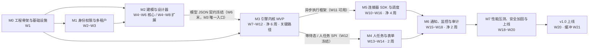
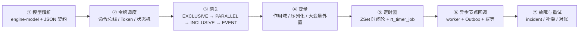
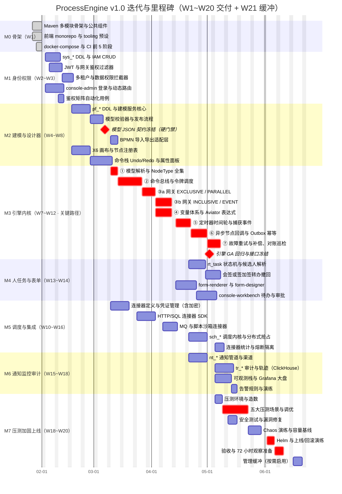
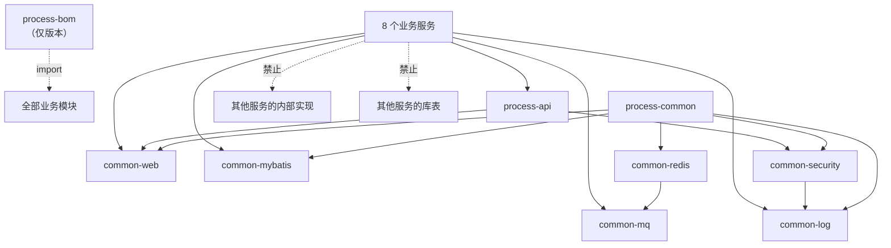
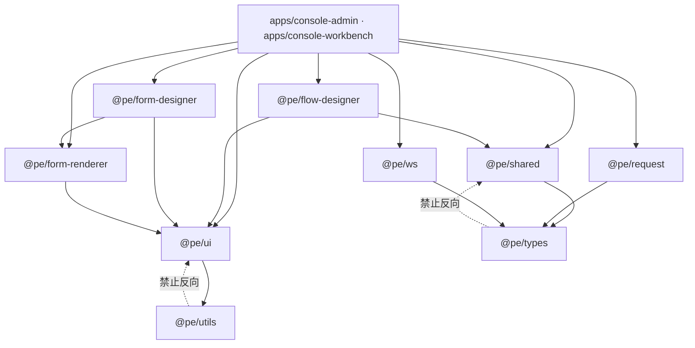
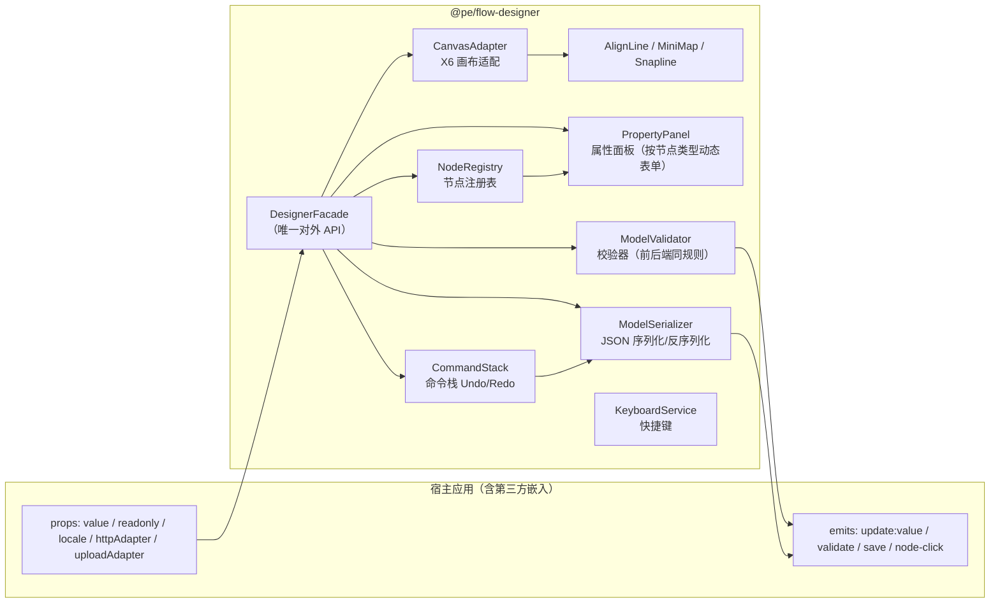
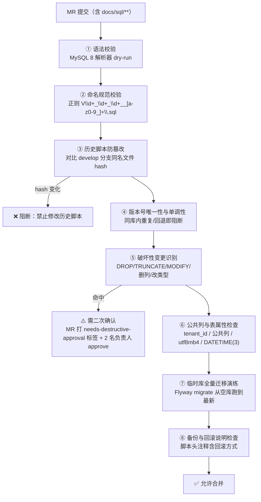
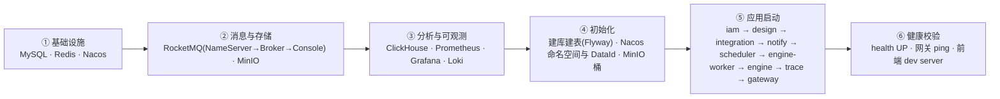
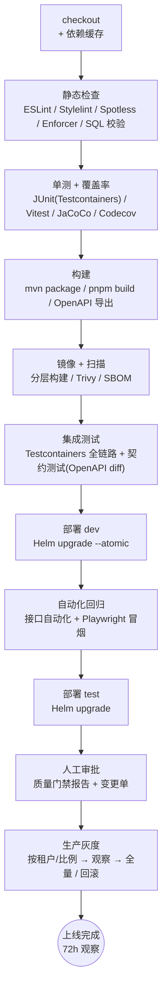
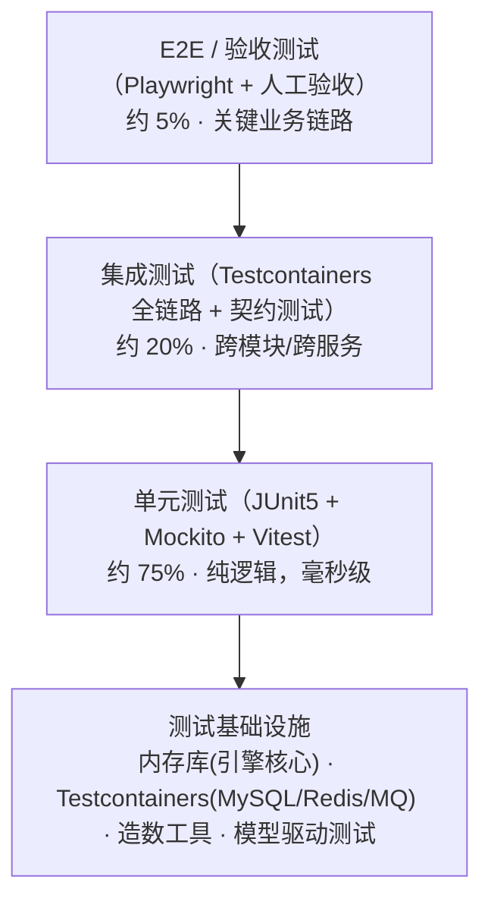

# 流程编排平台 · 迭代计划与项目骨架搭建方案

> 上游唯一一致性锚点：`docs/00-设计基线.md`（技术选型 / 8 服务与端口 / engine 内层模块 / 实体清单 / 全局规范 / 非功能指标）。
> 本文是**搭建方案（Plan）**：只描述里程碑、迭代 WBS、目录结构、依赖与配置约定、CI/CD 与质量门禁、环境与上线准备。
> **本文不创建任何代码与项目文件**；所有目录树均为目标形态描述，实际落地在 M0 里程碑由骨架迁移任务批量生成。
>
> | 项 | 值 |
> | --- | --- |
> | 适用范围 | ProcessEngine v1.0（基线冻结） |
> | 总工期 | **20 周**（W1~W20：迭代 0 为 M0 骨架 1 周 + 迭代 1~8 各 2 周 + 迭代 9 为 3 周；**可压缩/可缓冲区间 19~21 周**，W21 为管理缓冲周） |
> | 里程碑 | M0 ~ M7 共 **8** 个 |
> | 迭代节奏 | 迭代 0 ~ 迭代 9（共 10 个迭代；若按固定双周会期，迭代 9 可拆为「迭代 9 = W18~W19 压测加固」+「迭代 10 = W20 上线发布」，任务内容不变） |
> | 假设团队规模 | 1 架构/技术负责人 + 3 后端 + 2 前端 + 1 测试 + 0.5 运维（合计 7.5 人，区间 5~7 人） |
> | 关键路径 | M0(W1) → M2 模型 JSON 契约冻结(W6 末) → M3 引擎内核(W7~W12) → M4 人任务与表单(W13~W14) → M7 压测加固与上线(W18~W20) |
> | 版本对齐 | Java 21 / Spring Boot 3.3.x / Spring Cloud 2023.0.x / Spring Cloud Alibaba 2023.0.3.x / Vue 3.4+ / Vite 5.4+ |

---

## 1. 团队与协作假设

### 1.1 团队构成与角色职责

| 角色 | 建议人数 | 投入 | 核心职责 | 关键交付 |
| --- | --- | --- | --- | --- |
| 架构 / 技术负责人 | 1 | 100%（其中 40% 编码） | 基线守护、技术选型裁决、跨服务契约裁决、引擎内核算法评审、代码评审终审、风险兜底 | 骨架、engine-core 关键算法、ADR、发布决策 |
| 后端工程师 A（引擎内核） | 1 | 100% | 令牌调度、网关算法、变量、定时器、异步回调、故障与重试、补偿 | `engine-core` / `engine-runtime` / `engine-worker` |
| 后端工程师 B（平台能力） | 1 | 100% | 网关、IAM、多租户、数据权限、Trace、审计、通知 | `process-gateway` / `process-iam` / `process-trace` / `process-notify` |
| 后端工程师 C（建模与集成） | 1 | 100% | 建模服务、模型校验与发布、调度内核、连接器与凭证（V1.0 为 3 人；压缩到 5 人团队时该角色与 B 合并，工期 +1~2 周） | `process-design` / `process-scheduler` / `process-integration` |
| 前端工程师 A（设计器） | 1 | 100% | `@pe/flow-designer`（X6 画布、节点注册表、命令栈、校验器、序列化）、`@pe/form-designer` | 设计器包 + 单测 |
| 前端工程师 B（控制台 / 工作台） | 1 | 100% | `console-admin` / `console-workbench`（动态路由、权限、待办、监控大盘）、`@pe/*` 基础包 | 两个应用 + E2E |
| 测试工程师 | 1 | 100% | 测试策略、用例设计、接口自动化、性能压测、Chaos 演练、上线验收 | 自动化套件、压测报告、验收报告 |
| 运维（SRE，可由平台组兼任） | 0.5 | 50% | Compose/Helm、CI/CD 流水线、可观测栈、容量基线、监控告警、发布与回滚演练 | 流水线、Grafana 大盘、告警规则、Runbook |

> 人数区间说明：**5 人团队** = 架构/负责人 + 2 后端 + 1 前端 + 1 测试（运维由负责人兼任），工期放宽至 **21 周**，砍掉 P2 范围（模板市场、gRPC 连接器、`PERCENT` 比例签、ClickHouse 降级自动切换）。
> **7 人团队**（+1 后端 +1 前端）为标准配置，对应本文 20 周计划。

### 1.2 协作机制

| 机制 | 频率 / 时点 | 参与人 | 产出与规则 |
| --- | --- | --- | --- |
| 迭代长度 | 2 周（周一 ~ 次周五） | 全员 | 迭代目标单一，不允许中途插入新需求；插入须替换等量范围 |
| 迭代计划会 | 迭代首日周一 10:00，≤ 2h | 全员 | 认领任务、确认人日估算、锁定迭代承诺（Velocity 基线：后端 45 人日/迭代） |
| 每日站会 | 每工作日 9:30，≤ 15min | 全员 | 三问（昨日/今日/阻塞）；阻塞项 30min 内指派 owner |
| 架构评审会（ADR） | 每周三 15:00，≤ 1h | 架构 + 相关方 | 产出 ADR（`docs/adr/ADR-{序号}-{标题}.md`），48h 内异步复议窗口 |
| 迭代评审 | 迭代末周四 15:00，≤ 1.5h | 全员 + 业务方 | 演示可运行功能，逐条对照验收标准打勾 |
| 迭代回顾 | 迭代末周五 10:00，≤ 1h | 全员 | 最多 1 项「继续 / 停止 / 开始」，形成改进项进入下个迭代待办 |
| 缺陷分级例会 | 每周五 16:00，≤ 30min | 测试 + 后端 | P0 当班修复、P1 当迭代修复、P2 排期、P3 记录 |
| 里程碑门禁 | 每个 Mx 结束时 | 全员 | 验收标准全部通过才允许进入下一里程碑；不通过则触发范围裁剪或加班决策 |
| 技术债看板 | 常驻 | 全员 | 每人每迭代 ≤ 20% 工时用于还债；债务条目须可度量 |

### 1.3 完成定义（DoD）

| 维度 | DoD 条目 |
| --- | --- |
| 代码 | 通过 `mvn -T 1C verify` / `pnpm build`；编译零告警；无 `TODO` 遗留（或有对应 issue 编号） |
| 测试 | 新增/变更逻辑单元测试覆盖；后端行覆盖率 ≥ 70%、`engine-core` ≥ 80%、前端 ≥ 60%；接口用例纳入自动化套件 |
| 契约 | 接口变更同步 `docs/04-API契约.md` 与 OpenAPI 产物；前端类型由 OpenAPI 生成而非手写 |
| 数据 | 涉及表结构变更必须提供 Flyway 迁移脚本 + 回滚说明；禁止修改历史脚本 |
| 规范 | 命名/分层/错误码/统一响应符合基线第 6 节；Long 型 ID 序列化为字符串 |
| 可观测 | 关键路径埋点（实例启动、令牌推进、节点耗时）与 MDC 字段（`traceId/tenantId/instanceId`）齐备 |
| 多租户 | 新表带 `tenant_id` 与公共列；跨租户白名单显式标注 `@IgnoreTenant` |
| 文档 | 对外可见行为的变化更新文档；ADR 记录关键决策 |
| 评审 | ≥ 1 名非作者评审通过（引擎内核与安全相关必须架构评审）；MR 检查项全绿 |
| 部署 | 服务可打包镜像并在 dev 环境启动、`/actuator/health` 就绪探针通过 |

### 1.4 沟通与工具约定

| 项 | 约定 |
| --- | --- |
| 需求追踪 | 需求编号 `FR-{DOMAIN}-{三位序号}` / `NFR-{分类}-{三位序号}`（基线第 8 节），每个任务必须挂 `FR`/`NFR` 编号 |
| 任务追踪 | Jira / 禅道：Epic = 里程碑，Story = 迭代任务，颗粒度 ≤ 5 人日 |
| 分支与提交 | 见第 9.4 节（Conventional Commits + Changesets） |
| 缺陷响应 | P0（阻塞/数据错）15min 响应、P1 当班、P2 当迭代、P3 排期 |
| 知识沉淀 | 复盘、事故、压测结论一律落 `docs/`，禁止只存在于聊天记录 |

---

## 2. 总体里程碑计划（M0 ~ M7）

### 2.1 里程碑总览

| 里程碑 | 名称 | 时间窗 | 工期(周) | 迭代覆盖 | 关键路径 | 主导角色 |
| --- | --- | --- | --- | --- | --- | --- |
| M0 | 工程骨架与基础设施 | W1 | 1 | 迭代 0（M0 骨架，1 周） | ✅ 起点 | 架构 + 运维 |
| M1 | 身份权限与多租户 | W2~W3 | 2 | 迭代 1 | ➖ 并行 | 后端 B + 前端 B |
| M2 | 建模与设计器 | W4~W6（核心）/ W4~W8（扩展） | 3 / 5 | 迭代 2~3 | ➖ 并行 | 后端 C + 前端 A |
| M3 | 引擎内核 MVP | W7~W12 | 6 | 迭代 4~6 | ✅ **核心** | 后端 A（+W10 起后端 C）+ 架构 |
| M4 | 人任务与表单 | W13~W14 | 2 | 迭代 6 | ➖ 依赖 M3 GA | 后端 A + 前端 B |
| M5 | 调度与集成连接器 | W10~W16 | 4（含并行） | 迭代 5~6 | ➖ 并行 | 后端 C + 后端 A |
| M6 | 通知、监控与审计 | W15~W18 | 2（净） | 迭代 6~7 | ➖ 并行 | 后端 B + 运维 |
| M7 | 性能压测、安全加固与上线 | W18~W20 | 3 | 迭代 8~9 | ✅ 收口 | 测试 + 全员 |

> 时间窗存在重叠，且**每个里程碑的「净工期」按人力折算**，拆解如下：
> ① **M2 分两段**：核心段 W4~W6（后端 C 独立完成流程定义/版本/校验器/发布 + **W6 末模型 JSON 契约冻结**，这是 M3 的唯一入口，硬门禁）；扩展段 W4~W8（前端 A 的设计器画布、属性面板、命令栈、BPMN 适配层与版本对比，属 P1，可延展不影响关键路径）。
> ② **M3 时间窗 W7~W12 即净 6 周**，单靠后端 A 一人串行需 8.8 周，故 **W10 起借调后端 C 并行**（见 M3 资源假设），无浮动。
> ③ **M5 时间窗 W10~W16 但净 4 周**：连接器定义/数据源/凭证/HTTP-SQL SDK **不依赖引擎**，W10 即由后端 C 启动（与 M3 尾部并行）；MQ/脚本/调度内核在 W14~W16 收口。
> ④ **M6 时间窗 W15~W18，净 2 周**：站内信 + 邮件 + Webhook + 审计 + 轨迹 + 大盘 + 告警为 P0 集；SMS 与 IM 渠道、部分大盘为 P2，可延展至 W18。
> ⑤ **M7 为 W18~W20 三周**：W18~W19 压测、Chaos 与安全加固，W20 上线准备与发布；W21 为管理缓冲周（见 3.13）。



### 2.2 里程碑明细

#### M0 · 工程骨架与基础设施（W1，1 周）

| 项 | 内容 |
| --- | --- |
| 目标 | 一次性把「能编译、能启动、能提交、能构建镜像、能本地一键起环境」的地基打完，后续所有迭代只在此骨架上加肉 |
| 交付物 | ① Maven 多模块骨架（第 5.1 节目录树，`process-parent` 可 `mvn -DskipTests package` 通过）；② 8 个服务空壳可启动（含 `process-gateway` 路由到空壳）；③ 前端 monorepo 骨架（第 6.1 节，`pnpm dev` 可起两个应用与两个设计器包）；④ `docker-compose.yml` 中间件一键起（第 8 节）；⑤ CI 流水线前 5 个阶段跑通；⑥ Flyway 基线与 `docs/sql/` 目录规划落地；⑦ Nacos 命名空间与 DataId 规范文档化；⑧ 统一响应 / 统一异常 / 统一错误码 / 参数校验 / 日志切面 / `TenantContext` 六个公共组件；⑨ ADR-001（骨架与分层）、ADR-002（引擎内层模块边界） |
| 验收标准 | 本地 `docker compose up -d` 后 8 服务全部注册到 Nacos；任一服务 `/actuator/health` 返回 `UP`；`mvn verify` 与 `pnpm build && pnpm typecheck && pnpm lint` 全绿；CI 出首个镜像并推送成功；空壳接口 `/api/{服务}/v1/ping` 经网关可达并带 `traceId` |
| 依赖 | Maven 3.9.x / JDK 21 / Node 20 / pnpm 9 / Docker Desktop 环境就绪；Nacos、MySQL、Redis、RocketMQ 镜像版本确认 |
| 工期 | 1 周 |
| 参与角色 | 架构（主）、后端 A/B/C、前端 A/B、运维 |
| 风险 | 环境不可用导致全员阻塞（对策：镜像预先离线缓存 + 提供 `scripts/dev-up.ps1` 一键脚本 + 本地 H2 兜底单测）；多模块聚合配置反复返工（对策：以 BOM 集中管理版本，禁止子模块写死版本） |

#### M1 · 身份权限与多租户（W2~W3，2 周）

| 项 | 内容 |
| --- | --- |
| 目标 | 打通「登录 → 拿 Token → 网关鉴权 → 服务内 `TenantContext` → 数据权限过滤」全链路，为所有业务服务提供可信身份底座 |
| 交付物 | ① `process-iam` 全量接口：租户、用户、部门、角色、权限/菜单、用户组、登录认证、数据权限（`data_scope`：ALL/DEPT_AND_CHILD/DEPT/SELF/CUSTOM）；② 10 张 `sys_*` 表 DDL 与种子数据；③ JWT RS256 签发与校验（Access 2h / Refresh 7d）、Redis 黑名单与在线会话；④ 网关鉴权过滤器 + `X-Internal-Token` 签发/校验；⑤ MyBatis-Plus 多租户插件 + 数据权限拦截器；⑥ 前端 `console-admin` 登录、动态路由、权限指令、用户/角色/菜单管理页 |
| 验收标准 | 登录链路 E2E 通过；跨租户访问返回 `IAM_2xxxx`；无权限接口返回 403 且审计落库；RBAC 与数据权限矩阵用例 100% 通过（≥ 30 条自动化用例）；Long 型 ID 在 JSON 中为字符串 |
| 依赖 | M0 骨架与公共组件；`sys_tenant.isolation_mode` 只实现 `LOGIC` |
| 工期 | 2 周 |
| 参与角色 | 后端 B（主）、前端 B、测试 |
| 风险 | 数据权限规则复杂导致返工（对策：先冻结 `data_scope` 语义矩阵与 SQL 拼装白名单，用注解 + 单测锁定）；JWT 密钥管理（对策：密钥经环境变量/KMS 注入，dev/test/uat/prod 各一套，不入库不入仓） |

#### M2 · 建模与设计器（W4~W8，关键交付物 2 周）

| 项 | 内容 |
| --- | --- |
| 目标 | 交付「能画图 → 能校验 → 能保存 → 能发布版本 → 能导出 BPMN」的完整建模侧，并把**模型 JSON 契约冻结**，交棒给引擎 |
| 交付物 | ① `process-design` 服务：流程分类树、流程定义、版本、保存/校验/发布/下线/回滚、导入导出（JSON + BPMN 2.0 XML 适配层）、模板、表单定义与版本；② 7 张 `pf_*` 表 DDL；③ 模型校验器（结构/连通性/网关出口/变量引用/节点属性必填，返回分级问题清单）；④ `@pe/flow-designer`：X6 画布、节点注册表、命令栈 Undo/Redo、对齐线、缩略图、属性面板、校验器、JSON 序列化；⑤ 节点类型全集（基线 5.1）的属性面板覆盖 START/END/USER_TASK/EXCLUSIVE/PARALLEL/INCLUSIVE/EVENT_GATEWAY/SERVICE_TASK 等 P0 节点；⑥ 模型快照缓存（Redis）与 `model_hash` |
| 验收标准 | 设计器可完整绘制并发布「请假审批」样例流程，画布保存-刷新-回显一致（JSON 深度相等）；模型校验对 10 类错误模型全部命中且给出定位；发布产生不可变版本且 `PUBLISHED` 只读；导出 BPMN 2.0 XML 可被标准工具打开；模型 JSON 契约评审通过并冻结（v1 快照入库 `docs/`） |
| 依赖 | M1（租户与用户上下文、权限）；M0 前端骨架 |
| 工期 | 时间窗 5 周（W4~W8），其中**净关键工作 2 周**：后端建模服务与模型 JSON 契约（W4 + W8 上半）为 M3 的硬依赖；设计器高级特性（版本对比、BPMN 导出打磨、复杂节点属性面板）为 P1，允许延展至 W17 |
| 参与角色 | 后端 C（主，W4~W8 前半）、前端 A（主）、测试 |
| 风险 | 模型 JSON 结构反复（对策：**W6 末**前冻结契约，之后只允许加字段走 ADR）；X6 与自定义模型耦合（对策：节点注册表外置，X6 图形与业务属性分离，序列化层独立单测）；BPMN 导入导出语义缺口（对策：明确「仅支持基线 5.1 节点子集」，不支持的节点导入即报错并列出清单）；**契约冻结若延期，M3 起始日顺延，直接吃掉 W21 缓冲** |

#### M3 · 引擎内核 MVP（W9~W14 净 6 周，**关键路径**）

| 项 | 内容 |
| --- | --- |
| 目标 | 交付可直接驱动流程实例跑通的令牌引擎：单实例串行推进、网关分支汇聚、变量读写、定时器到期、异步节点回调、故障重试与补偿 |
| 交付物 | ① `engine-core`：命令总线（Command/CommandContext/CommandExecutor）、令牌调度器、网关算法（EXCLUSIVE/PARALLEL/INCLUSIVE/EVENT）、表达式（Aviator 沙箱）、SPI 体系（`NodeBehavior` / `ExpressionEvaluator` / `AssigneeResolver` / `ConnectorExecutor` / `VariableSerializer` / 监听器）；② `engine-model`：模型 POJO、`NodeType` 枚举全集、JSON 解析器、BPMN 适配；③ `engine-runtime`：节点行为实现（事件类、网关类、自动化类骨架）、定时器、事件订阅、补偿；④ `engine-persistence`：10 张 `rt_*` 表 Mapper/DO/缓存；⑤ `engine-worker`：MQ 指令消费与异步执行；⑥ `engine-boot`：同步 API 形态（`/api/engine/v1/instances` 启动/挂起/恢复/终止/查询，变量读写，`/api/engine/v1/tokens` 轨迹）；⑦ Outbox 中继 + 幂等表；⑧ 实例级串行（Redisson 锁 `engine:inst:{instanceId}` + 行锁 + 乐观锁重试） |
| 验收标准 | ① 样例流程端到端推进正确率 100%（覆盖顺序、分支、并行、包容、事件网关、子流程、循环）；② 实例启动 P99 < 300ms（同步推进到第一个等待态，本地 8C16G 基准）；③ 单实例并发推进无状态错乱（200 并发写入同一实例，令牌数/状态一致）；④ 定时器到期偏差 P99 < 2s（1 万级待触发，M3 阶段基线）；⑤ 自动化节点异步执行 + 回调恢复令牌正确，重试耗尽落 `rt_incident`；⑥ `engine-core` 行覆盖率 ≥ 80%；⑦ 单元测试用内存库 + Testcontainers MySQL 双跑通过 |
| 依赖 | M2 模型 JSON 契约冻结（**W8 周三，硬门禁**）、M0 数据库与 MQ 环境、M1 `TenantContext` |
| 工期 | 净 6 周（W9~W14），**无浮动**；W4~W8 期间可预热 `engine-model` 解析器骨架，但不计入净工期 |
| 参与角色 | 后端 A（主）、架构（算法评审与结对）、后端 C（**W11 起借调支援内核**：Worker 进程、子流程/循环、持久层）、测试（引擎专项） |
| 资源假设 | 单靠后端 A 一人串行需要 44 工作日（8.8 周）> 6 周净窗口。因此 M3 必须**双人并行**：W9~W10 由后端 A 承担；**W11 起后端 C 借调至内核**（此时 M5 的 HTTP/SQL 连接器侧由后端 A 结对收尾，冲突可控）；后端 C 在 W13 起回填 M5。若团队为 5 人（无后端 C），M3 顺延 **1~2 周**，以 W21 缓冲吸收 |
| 风险 | 令牌算法正确性（对策：先写状态机不变量测试与模型驱动测试，再实现；每个节点行为配「单测 + 集成测试」双层）；分布式一致性（对策：Outbox + 幂等 + 对账巡检，见第 11 节）；工期风险（对策：M3 内部按「顺序 → 网关 → 变量 → 定时器 → 回调 → 故障」六段切分并每段独立可演示，任何一段延期立即降级 P2 节点类型）；**借调风险（对策：后端 C 只接「Worker 进程 / 子流程与循环 / SQL 与持久层」三块与内核算法解耦的工作，内核算法（令牌/网关/回调恢复）始终由后端 A + 架构闭环，避免双人对核心状态机交叉修改）** |

**M3 推进顺序与理由（关键路径内部排序）**



| 顺序 | 阶段 | 为什么必须排在这里 | 可独立演示的产物 | 排期（周） | 人日 |
| --- | --- | --- | --- | --- | --- |
| ① | 模型解析 | 引擎的**输入契约**。契约不冻结，后续所有节点行为都在改字段，返工面 100%。先做解析器可让测试用模型文件驱动，无需 DB 即可跑 | 模型 JSON → POJO 树的解析与 `NodeType` 分发 | W9 上半 | 4 |
| ② | 令牌调度 | 引擎的**心脏**。令牌是所有状态的载体，网关/定时器/回调本质都是「令牌的等待与唤醒」。状态机不变量（令牌守恒、无悬挂）在只有顺序流时最容易验证 | 顺序流实例端到端跑通 + 令牌不变量测试 | W9 下半~W10 | 6 + 3 |
| ③ | 网关（前半） | 有了稳定单令牌推进后，网关才是「多令牌 + 汇聚计数」的增量复杂度；若先做网关，任何令牌 bug 都会与分支语义纠缠，定位成本翻倍。EXCLUSIVE 最简先做，PARALLEL 引入 `gateway_join_key` 计数 | EXCLUSIVE 条件优先级 + 默认流；PARALLEL fork/join 汇聚计数 | W10（与 ② 后半并发） | 5 |
| ③ | 网关（后半） | INCLUSIVE 需要「实际激活分支集合」推断，EVENT 需要竞争等待 + 先到先得取消其余，难度在 ③ 前半之上严格递增 | 4 类网关的汇聚正确性测试（含嵌套与跨作用域） | W11 | 7 |
| ④ | 变量 | 网关条件依赖表达式求值，必须先有变量作用域（全局/局部/`scope_id`）与类型体系，否则条件表达式只能读常量。变量也是网关之后所有节点行为的公共输入。**③ 后半与 ④ 可并行**（网关算法与变量/表达式分属不同类，接口先定契约） | Aviator 沙箱求值 + 变量作用域隔离 + 大变量转 MinIO | W11（与 ③ 后半并行） | 7 |
| ⑤ | 定时器 | 定时器是「非阻塞等待」的标准实现，把人任务（M4）之外的所有等待态先统一到一套底座；且定时器依赖变量（`DURATION`/`CYCLE` 的时长常来自变量），故必须排在变量之后。ZSet 时间轮与 `sch_job` 共用底座，此处定型可为 M5 省一次重构 | 定时捕获事件、边界定时、延时任务、精度采样报告 | W12 | 6 |
| ⑥ | 异步节点回调 | 到此时才有「等待外部结果」的语义：连接器类节点（HTTP/SQL/MQ/脚本）必须异步执行并在回调后恢复令牌。回调正确性依赖 ②③④⑤ 全部成立，且必须引入 Outbox + 幂等 + worker 抢占，是分布式语义的引入点。**⑥ 与 ⑦ 末周重叠**（正常路径已覆盖全部网关后即可注入故障） | 异步节点吞吐基准 + 回调恢复 + 幂等去重验证 | W13 | 7 |
| ⑦ | 故障与重试 | 最后做，因为**只有前面的正常路径足够稳定，故障注入才有意义**（否则分不清是 bug 还是重试逻辑）。此处落地 `rt_incident`、重试退避、补偿（Saga 反向）、对账巡检（5 分钟巡检悬挂态） | 故障注入测试 + 补偿链路 + 对账告警 | W13 下半~W14 上半 | 6 |
| — | 内核 GA 收口 | 全节点类型清单核对、接口冻结、缺陷清零；冻结后才允许 M4/M5 依赖其接口 | GA 回归报告 + 接口冻结基线 | W14 下半 | 4 |

> 关键点：**每一段结束都必须保持主干可运行（trunk-based）**，不允许「六段做完才第一次跑通」。

#### M4 · 人任务与表单（W15~W16，2 周）

| 项 | 内容 |
| --- | --- |
| 目标 | 让流程能真正停下来等人：待办产生、候选人解析、认领/办理/转办/委托/加签/撤回、会签与或签、表单渲染与数据落库 |
| 交付物 | ① `engine-task`：候选人解析 9 种策略（`USER`/`ROLE`/`DEPT`/`USER_GROUP`/`EXPRESSION`/`INITIATOR`/`INITIATOR_LEADER`/`FORM_FIELD`/`PREV_APPROVER`）、去重与自动跳过（`autoSkipSameApprover`/`dedupe`）、空候选人策略（`ADMIN`/`SKIP`/`EXCEPTION`）；② `rt_task` + `rt_task_oper_log` 行为实现与状态机；③ 会签 `ALL` / 或签 `ANY`（`PERCENT` 为 P2）；④ 加签（前/后）、转办、委托确认、撤回（含 `withdrawScope`）；⑤ 接口：`/api/engine/v1/tasks`（我的待办/已办/我发起的）、`/claim`、`/complete`、`/reject`、`/transfer`、`/delegate`、`/add-sign`、`/withdraw`、`/urge`、`/api/engine/v1/tasks/statistics`；⑥ 前端 `@pe/form-renderer` 渲染 12 类控件 + 表单数据与 `form_data_json` 双向绑定；⑦ `@pe/form-designer` 基础版（拖拽布局 + 字段属性 + schema 导出）；⑧ `console-workbench` 待办中心、流程发起、审批详情页、流程图回显当前节点 |
| 验收标准 | 待办列表 P99 < 200ms（100 万任务量级走覆盖索引）；9 种候选人策略用例全通过；会签/或签/加签/转办/撤回全链路 E2E 通过；空候选人三策略行为符合定义；表单渲染 12 类控件与校验规则全部通过；`rt_task` 状态机无非法跃迁（状态机单测覆盖） |
| 依赖 | M3 令牌与等待态机制（**W14 引擎 GA 接口冻结**）；M2 表单定义与版本 |
| 工期 | 2 周（W15~W16）；W12~W14 为并行前置：候选人查询接口、`@pe/form-renderer` 控件、待办列表页骨架 |
| 参与角色 | 后端 A（主）、前端 B（主）、前端 A（表单设计器支援）、测试 |
| 风险 | 候选人解析涉及跨服务用户数据（对策：`process-iam` 提供批量候选人查询接口 + 引擎本地缓存快照 5 分钟，禁止引擎直连 `pe_iam` 库）；表单控件与审批语义耦合（对策：渲染器只认 schema，不认业务）；**M3 GA 若延期，M4 整体顺延（对策：W12 先并行开发不依赖引擎的部分——表单渲染器、待办列表页骨架、候选人查询接口）** |

#### M5 · 调度与集成连接器（W12~W17，净 4 周）

| 项 | 内容 |
| --- | --- |
| 目标 | 让平台能「按时触发」与「连得上外部系统」，把连接器执行 SDK 打通到 5 类连接器 |
| 交付物 | ① `process-scheduler`：cron/固定频率/一次性触发、`target_type`（PROCESS/CONNECTOR/BEAN）、misfire 策略（`SKIP`/`FIRE_ONCE`/`CATCH_UP`）、并发策略（`ALLOW`/`FORBID`/`REPLACE`）、超时、重试、分布式抢占（Redis ZSet + `sch_lock` 兜底）、执行记录、`next_fire_time` 预计算；② 3 张 `sch_*` 表；③ `process-integration`：连接器定义、连接器操作、数据源（密码 AES-256-GCM 加密）、凭证、连通性测试、调用统计、`config_schema_json` 驱动动态表单；④ 5 张 `int_*` 表；⑤ `engine-connector-sdk`：HTTP / SQL / MQ / SCRIPT / GRPC 五类执行器（GRPC 为 P2），超时、重试、映射转换（`transform_json`）、SSRF 白名单、调用日志；⑥ 引擎侧连接器元数据本地缓存 + 定时刷新；⑦ 前端连接器管理页、数据源管理页、调度作业管理页 + Cron 可视化编辑器 |
| 验收标准 | 调度精度：cron 触发偏差 P99 < 2s；misfire 三策略行为符合定义且有用例；集群 3 节点抢占无重复触发（1000 次触发 0 重复）；连接器连通性测试覆盖 HTTP/SQL/MQ/脚本；HTTP 目标域名不在白名单时被拒绝（SSRF 防护用例通过）；凭证在库中密文存储且接口不回显明文；`int_call_log` 落库完整（含 `trace_id`） |
| 依赖 | M3（引擎启动实例接口 + worker 异步执行框架，**W13 可用**）、M1（凭证权限与租户）；**连接器定义/数据源/凭证与 HTTP/SQL SDK 不依赖引擎，W12 即可启动** |
| 工期 | 净 4 周（时间窗 W12~W17）：W12~W14 连接器定义/凭证/HTTP-SQL SDK；W15~W17 调度内核 + MQ/脚本连接器 + 统计 |
| 参与角色 | 后端 C（主）、后端 A（SDK 侧）、前端 B、测试 |
| 风险 | 调度漂移与重复触发（对策：`next_fire_time` 预计算 + Redis 分布式抢占 + `sch_lock` 双保险 + 幂等键）；外部系统不可用导致引擎线程耗尽（对策：连接器执行统一走 worker 线程池隔离 + 超时强制中断 + 熔断保护）；脚本沙箱与 SSRF 安全（对策：GraalVM JS 禁 IO/线程/反射 + 3s 超时中断 + 域名白名单，安全用例纳入 CI）；**W11 起后端 C 借调内核导致连接器侧人力下降（对策：HTTP/SQL SDK 由后端 A 结对承接，调度内核推迟到 W15 启动，仍落在 W17 收口窗口内）** |

#### M6 · 通知、监控与审计（W17~W19，净 2 周）

| 项 | 内容 |
| --- | --- |
| 目标 | 让流程「可感知、可追溯、可运营」：消息触达、全链路可观测、操作可审计、执行轨迹可检索、实时推送 |
| 交付物 | ① `process-notify`：模板、渠道（站内信/邮件/短信/Webhook/钉钉/企微/飞书）、订阅规则、发送与重试、限流（`rate_limit`）；4 张 `nt_*` 表；② `process-trace`：操作审计（`tr_oper_log`，保留 ≥ 180 天）、执行轨迹（ClickHouse `tr_exec_trace`，按 `toYYYYMM(ts)` 分区 + `instance_id` 排序键）、实例统计物化（`tr_instance_stat` 日粒度）、WebSocket/SSE 实时推送、轨迹检索（可按实例/节点/时间/事件类型过滤）；③ 全链路 `traceId` 贯通（OpenTelemetry Java Agent + MDC）；④ Prometheus 指标族（HTTP QPS/延迟/错误率、引擎实例启动数/令牌推进耗时/任务积压/定时器延迟/incident 数、MQ 堆积、连接池）；⑤ Grafana 大盘（平台总览 / 引擎内核 / 调度 / 连接器 / 业务待办）；⑥ Loki 日志采集与检索；⑦ 告警规则（P0/P1）+ 通知渠道接入；⑧ 前端通知中心、审计日志页、执行轨迹可视化页、监控大盘 |
| 验收标准 | 任一请求可从网关日志追到引擎节点日志（同一 `traceId`）；轨迹写入 ClickHouse 延迟 P99 < 3s；WebSocket 推送 500 并发连接稳定；告警规则覆盖全部 P0/P1 场景且做一次真实触发演练；审计日志对全部写操作 100% 落库；ClickHouse 不可用时自动降级到 MySQL 分区表且不阻塞主链路 |
| 依赖 | M3/M4/M5 的事件产出（MQ Topic `PE_{DOMAIN}_{EVENT}`）；运维提供可观测栈；**可用 Mock 事件源在 W16 前并行开发消费侧** |
| 工期 | 净 2 周（W17~W19，与 M5 收口、M7 启动并行；P0 集为站内信 + 邮件 + Webhook + 审计 + 轨迹 + 大盘 + 告警） |
| 参与角色 | 后端 B（主）、运维（主）、前端 B、测试 |
| 风险 | 轨迹写入量压垮 ClickHouse（对策：批量写 + 本地缓冲 + 采样策略 + 可配置开关）；可观测引入的性能损耗（对策：OTel 采样率可配，压测阶段降到 10%）；通知渠道外部限流（对策：渠道级限流 + 异步队列 + 失败重试与死信） |

#### M7 · 性能压测、安全加固与上线（W18~W20，3 周）

| 项 | 内容 |
| --- | --- |
| 目标 | 把「功能可用」变成「生产可交付」：指标达标、安全基线通过、部署可回滚、容量有据、演练已完成 |
| 交付物 | ① 压测方案与脚本（Gatling/JMeter）：实例启动 TPS、自动化节点吞吐、待办查询、定时器精度、10 万待触发定时器五大场景；② 压测报告（含瓶颈定位、调优前后对比、容量结论）；③ 调优清单（JVM/GC、连接池、索引、线程池、批量、缓存命中率）；④ 安全测试报告（越权、注入、脚本逃逸、SSRF、凭证明文、CVE 扫描）；⑤ 漏洞修复与回归；⑥ Chaos 演练报告（引擎节点宕机接管、MQ 抖动、Redis 抖动、DB 主从切换）；⑦ Helm Chart + K8s 清单（Deployment/Service/ConfigMap/Ingress/HPA/PDB）；⑧ 灰度与回滚 Runbook；⑨ 上线检查清单与 72 小时观察表；⑩ 验收报告（第 13 节四类标准逐条结论） |
| 验收标准 | 实例启动延迟 P99 < 300ms；大列表查询 P99 < 200ms；自动化节点吞吐单 Worker ≥ 500 TPS、集群 ≥ 2000 TPS；并行活跃实例 ≥ 100 万；定时器偏差 P99 < 2s（10 万级待触发）；单节点宕机 60s 内接管继续推进；可用性设计达成 99.95% 且无单点；镜像 CVE 高危 = 0；安全基线用例 100% 通过；灰度发布与回滚各演练 1 次成功；核心文档齐备 |
| 依赖 | M3~M6 全部功能就绪且冻结（**W17 末进入 Code Freeze，仅接受缺陷修复**）；压测环境与可观测栈就绪 || 工期 | 3 周（W18~W20；含 1 周管理缓冲 W21） |
| 参与角色 | 测试（主）、运维（主）、全员参与修复与调优 |
| 风险 | 压测暴露架构级瓶颈（对策：瓶颈分级处理——索引/参数级当场修、架构级评估降级范围；W21 缓冲吸收）；安全漏洞修复影响功能（对策：修复走正常 MR + 回归，禁止直改生产）；上线窗口与业务冲突（对策：提前 2 周锁定窗口，准备回滚剧本） |

### 2.3 关键路径说明

**关键路径（最长链，决定总工期）：**

```text
M0 工程骨架(1w, W1)
  → M2 模型 JSON 契约冻结(W8 周三，M3 唯一入口)
    → M3 引擎内核净 6 周(W9~W14)：①模型解析 → ②令牌调度 → ③网关 → ④变量 → ⑤定时器 → ⑥异步回调 → ⑦故障重试 → GA 接口冻结
      → M4 人任务与表单 2 周(W15~W16)
        → M7 性能压测、安全加固与上线 3 周(W18~W20)
          → v1.0 上线（W20；W21 管理缓冲）
```

| 路径环节 | 时间窗 | 净工期 | 浮动 | 说明 |
| --- | --- | --- | --- | --- |
| M0 | W1 | 1 周 | 0 | 全员阻塞点，任何延期直接顺延总工期 |
| M1 IAM | W2~W3 | 2 周 | +1 周 | 有 1 周浮动：M2 只需「租户 + 用户 + 权限」最小集，用户组等可延后至 M4 前 |
| M2 建模 | W4~W8 | 2 周（关键工作） | 0（关键工作）/ +3 周（设计器高级特性） | 模型 JSON 契约冻结日（**W8 周三**）不可移；设计器版本对比、BPMN 导出打磨、复杂属性面板可延展 |
| **M3 引擎内核** | W9~W14 | 6 周 | 0 | **最高风险项，无浮动**。W11 起借调后端 C 并行；GA 接口冻结在 W14 下半 |
| M4 人任务与表单 | W15~W16 | 2 周 | 0 | 依赖 M3-W14 的等待态机制与 GA 接口冻结；W12~W14 并行前置表单渲染器与候选人查询接口 |
| M5 调度与集成 | W12~W17 | 4 周 | +1 周 | 连接器定义/凭证/HTTP-SQL SDK 不依赖引擎，W12 即可启动；MQ/脚本/调度内核在 W15~W17 |
| M6 通知监控审计 | W17~W19 | 2 周 | +1 周 | 与 M5 收口、M7 启动并行；SMS/部分渠道与 IM 可降级为 P2；轨迹消费可用 Mock 事件源提前开发 |
| M7 压测加固上线 | W18~W20 | 3 周 | 0 | W18~W19 压测加固与 Chaos/安全，W20 上线准备与发布；W21 为管理缓冲 |

**关键路径上的三个不可压缩点**：① M0 骨架质量（决定后续返工量）；② 模型 JSON 契约冻结（决定引擎返工面）；③ M3 令牌算法正确性（决定整个平台可信度）。

**工期区间说明（19~21 周）**：计划交付区间为 **W1~W20（20 周）**，W21 为管理缓冲周（见 3.13）。

| 方案 | 总工期 | 达成条件 |
| --- | --- | --- |
| **19 周（乐观）** | v1.0 于 W19 末上线 | M3 提前 1 周完成 GA，且首轮压测即达标、无需架构级修复；M5/M6 全部按计划收口 |
| **20 周（基准）** | v1.0 于 W20 发布，W21 用于技术债与文档终审 | 本文默认计划；各里程碑按 2.1 表推进 |
| **21 周（含缓冲）** | v1.0 于 W20 发布，W21 用于吸收关键路径延期 | M3 任一段延期 > 3 个工作日，或压测/安全修复量超出预期 |

**不建议压缩到 18 周以下**：M3 的 6 周净工期已包含「令牌算法正确性验证」的必要时间，压缩即用正确性换进度（见第 11 节 R1）。

---

## 3. 迭代级 WBS（Iteration 0 ~ 9）

> 规则：**任务颗粒度 ≤ 5 人日**；每迭代 2 周 = 10 个工作日；后端产能按 3 人 × 10 天 × 0.8 = 24 人日/迭代可用（20% 用于评审/联调/还债）。
> 迭代 0 为 M0 骨架期（1 周，W1）；迭代 1~8 各 2 周（W2~W17）；迭代 9 覆盖 W18~W20 的最后三周（性能加固 + 上线发布 + 验收）。W1~W20 为计划交付区间（**总工期 20 周**），W21 为管理缓冲周（见 3.13，**总工期区间 19~21 周**）。若按 10 个「两周迭代」的固定节奏排会期（常见做法），则迭代 9 拆为「迭代 9 = W18~W19 压测加固」与「迭代 10 = W20 上线发布」，任务内容不变。

### 3.1 迭代与里程碑 / 版本映射总表

| 迭代 | 周次 | 主要里程碑 | 版本标签 | 迭代目标（一句话） |
| --- | --- | --- | --- | --- |
| Iteration 0 | W1 | M0 | `v0.1.0-skeleton` | 骨架可编译、环境一键起、CI 出首个镜像 |
| Iteration 1 | W2~W3 | M1 | `v0.2.0-iam` | 登录鉴权与多租户全链路可用 |
| Iteration 2 | W4~W5 | M2 核心段 | `v0.3.0-design-core` | 建模服务核心（定义/版本/校验/发布）可用 |
| Iteration 3 | W6~W7 | M2 收口（W6）+ M3 启动（W7） | `v0.3.5-design-model` | **模型 JSON 契约冻结**；引擎解析器与令牌调度启动 |
| Iteration 4 | W8~W9 | M3-②③前方 / M5 启动 | `v0.4.0-engine-core` | 顺序流 + EXCLUSIVE/PARALLEL 网关跑通 |
| Iteration 5 | W10~W11 | M3-③后④ + M5-a | `v0.5.0-engine-gateway` | 4 类网关 + 变量与表达式；HTTP/SQL 连接器可用 |
| Iteration 6 | W12~W13 | M3-⑤⑥⑦ + GA | `v0.6.0-engine-ga` | 定时器 + 异步回调 + 故障重试，**内核 GA 接口冻结** |
| Iteration 7 | W14~W15 | M4 + M5 收口 | `v0.7.0-task-form` | 人任务与表单端到端；调度与 5 类连接器收口 |
| Iteration 8 | W16~W17 | M6 | `v0.8.0-observability` | 通知/轨迹/审计/大盘齐备，可压测 |
| Iteration 9 | W18~W20 | M7 | `v0.9.5-hardening` → `v1.0.0` | 性能达标、安全基线通过、灰度回滚演练、发布 |
| 缓冲（按需） | W21 | — | — | 关键路径延期吸收 / 文档终审（见 3.13） |

> 说明：① 迭代 3 的**唯一硬门禁**是 W6 末的模型 JSON 契约冻结（解锁 M3）；设计器高级特性作为扩展项贯穿至迭代 5，不占用关键路径；② 迭代 6 末完成 M3 GA 并**冻结引擎接口**（M4 依赖该冻结）；③ 迭代 4~7 是后端 A（内核）、后端 C（连接器/调度）、后端 B（可观测）三线并行期，M5 的连接器定义/凭证/HTTP-SQL SDK 在迭代 5 即启动（不依赖引擎）；④ 迭代 9 内部分两段：W18~W19 压测与安全加固（门禁），W20 上线准备与发布；⑤ **每个迭代末必须产出可演示的增量**，禁止「迭代末才发现没跑通」。

### 3.2 Iteration 0 · 工程骨架与基础设施（W1，1 周）

| 类型 | 任务 | 人日 | 负责 |
| --- | --- | --- | --- |
| 后端 | `process-parent` + BOM + 公共模块（common/common-web/common-mybatis/common-redis/common-mq/common-security/common-log）骨架与依赖收敛 | 3 | 架构 |
| 后端 | 8 服务空壳工程（gateway/iam/design/engine[9 内层模块]/scheduler/integration/notify/trace）+ 启动类 + `/ping` | 3 | 后端 A/B/C |
| 后端 | 统一响应 / 全局异常 / 错误码枚举 / 参数校验 / 日志切面 / `TenantContext` 六件套 | 3 | 后端 B |
| 后端 | Flyway 接入 + `docs/sql/` 分包规划 + 首个基线脚本（公共列模板） | 1 | 后端 C |
| 后端 | Nacos 命名空间（dev/test/uat/prod）与 DataId 规范落地 + 服务注册验证 | 1 | 运维 |
| 前端 | pnpm monorepo + `tooling/*`（tsconfig/eslint/prettier/stylelint/vite 预设）+ 两个应用可启动 | 3 | 前端 A/B |
| 前端 | `@pe/request`（Axios 拦截器：鉴权/错误/traceId）+ `@pe/types` + `@pe/utils` 基础版 | 2 | 前端 B |
| 测试 | 测试骨架（JUnit5 + Testcontainers + JaCoCo）+ Vitest/Playwright 接入 | 1 | 测试 |
| 运维 | `docker-compose.yml`（MySQL/Redis/Nacos/RocketMQ/MinIO/ClickHouse/Prometheus/Grafana/Loki）+ 一键脚本 | 2 | 运维 |
| 运维 | CI 流水线（checkout→静态检查→单测→构建→镜像）跑通 | 2 | 运维 |
| **产出与验收** | **8 服务注册 Nacos 且 health UP；`mvn verify` 与 `pnpm build/typecheck/lint` 全绿；首个镜像推送；网关 `/api/{服务}/v1/ping` 带 traceId 可达；`docker compose up -d` 后 9 个中间件全绿；ADR-001/002 归档** | | |

### 3.3 Iteration 1 · 身份权限与多租户（W2~W3）

| 类型 | 任务 | 人日 | 负责 |
| --- | --- | --- | --- |
| 后端 | `sys_*` 10 张表 DDL + 种子数据（租户/管理员/默认角色/基础菜单 60 项） | 2 | 后端 B |
| 后端 | 租户管理（CRUD、启用停用、配额字段、`isolation_mode`） | 2 | 后端 B |
| 后端 | 用户/部门树/角色/权限菜单/用户组 CRUD + 树形与分页查询 | 4 | 后端 B |
| 后端 | JWT RS256 签发校验、Refresh、Redis 会话与黑名单、登出、登录日志 | 3 | 后端 B |
| 后端 | 网关鉴权过滤器（白名单/Token 解析/`tenantId` 透传/`X-Internal-Token`） | 2 | 后端 B |
| 后端 | MyBatis-Plus 多租户插件 + 数据权限拦截器（5 种 `data_scope`）+ `@IgnoreTenant` 白名单 | 3 | 后端 B + 架构 |
| 后端 | 权限注解与 API 级鉴权（`perm_type=API`）+ 审计投递骨架 | 2 | 后端 B |
| 前端 | `console-admin` 登录页、Token 刷新、动态路由生成、权限指令 `v-perm` | 3 | 前端 B |
| 前端 | 用户/角色/菜单/部门/租户管理 5 个页面 | 5 | 前端 B |
| 测试 | 鉴权与数据权限矩阵用例（≥ 30 条）+ 接口自动化接入 CI | 3 | 测试 |
| **产出与验收** | **登录→鉴权→多租户→数据权限端到端通过；跨租户访问被拒并审计；RBAC 矩阵用例 100% 通过；`v0.2.0-iam` 打标** | | |

### 3.4 Iteration 2 · 建模服务核心（M2 核心段，W4~W5）

| 类型 | 任务 | 人日 | 负责 |
| --- | --- | --- | --- |
| 后端 | `pf_*` 7 张表 DDL + 流程分类树 CRUD | 2 | 后端 C |
| 后端 | 流程定义/版本管理（草稿、保存、版本号自增、`model_hash`、发布/下线/回滚） | 4 | 后端 C |
| 后端 | 模型校验器（结构/连通性/网关出口/变量引用/属性必填）+ 分级问题清单 | 3 | 后端 C |
| 后端 | 模型快照缓存（Redis）+ 发布事件投递（`PE_DESIGN_VERSION_PUBLISHED`） | 1 | 后端 C |
| 后端 | 表单定义与版本 CRUD + `schema_json` 校验 + 模板 CRUD | 3 | 后端 C |
| 后端 | `/api/design/v1/process-defs`、`/versions`、`/validate`、`/publish` 接口编排 | 2 | 后端 C |
| 后端 | `process-api` 中 design 契约定稿（供引擎/前端引用） | 1 | 后端 C + 架构 |
| 前端 | 流程列表/版本列表/发布页（含表单定义列表） | 3 | 前端 B |
| 前端 | X6 画布底座（缩放/平移/网格/小地图/快捷键） | 3 | 前端 A |
| 前端 | 节点注册表 + 拖拽面板（基线 5.1 的 P0 节点类型） | 3 | 前端 A |
| 测试 | 模型校验用例（10 类错误模型）+ 建模服务接口自动化 | 3 | 测试 |
| **产出与验收** | **建模服务核心可用：分类/定义/版本/校验/发布/回滚全链路通过；10 类错误模型全部命中；`v0.3.0-design-core` 打标** | | |

### 3.5 Iteration 3 · 建模收口与契约冻结 + 引擎启动（W6~W7）

| 类型 | 任务 | 人日 | 负责 |
| --- | --- | --- | --- |
| 后端 | **模型 JSON 契约冻结评审并快照入库（W6 末，M3 唯一门禁）** | 2 | 架构 |
| 后端 | BPMN 2.0 XML 导入导出适配层（基线 5.1 节点子集） | 3 | 后端 C |
| 后端 | `engine-model`：模型 POJO + `NodeType` 枚举全集 + JSON 解析器 + `ModelHasher` | 4 | 后端 A |
| 后端 | `rt_*` 10 张表 DDL + Mapper/DO + 索引设计（`instance_id`/`status`/`due_time` 覆盖索引） | 3 | 后端 A |
| 后端 | 命令总线（Command/CommandContext/CommandExecutor/拦截器链） | 3 | 后端 A |
| 后端 | 令牌调度器（ACTIVE/WAITING/CONSUMED/DEAD、父子令牌、`scope_id`）+ 令牌不变量测试 | 5 | 后端 A + 架构 |
| 后端 | 开始/结束/终止事件行为 + 顺序流推进 + 实例状态机 | 3 | 后端 A |
| 前端 | 命令栈 Undo/Redo + 对齐线 + 缩略图 | 3 | 前端 A |
| 前端 | 属性面板（按节点类型动态表单）+ 校验结果面板 | 4 | 前端 A |
| 前端 | JSON 序列化/反序列化 + 版本对比视图 | 2 | 前端 A |
| 测试 | 设计器单测（Vitest 覆盖率 ≥ 60%）+ 引擎模型解析单测 | 3 | 测试 |
| **产出与验收** | **模型 JSON 契约冻结（v1 快照入库 + 评审通过）；BPMN 导出可被标准工具打开；引擎可解析模型并跑通顺序流；保存刷新回显 JSON 深度相等；`v0.3.5-design-model` 打标** | | |

### 3.6 Iteration 4 · 引擎内核 ①②③前半：持久层、令牌调度、条件/并行网关（W8~W9）

| 类型 | 任务 | 人日 | 负责 |
| --- | --- | --- | --- |
| 后端 | 令牌调度器收口（多令牌、等待/唤醒、`scope_id` 作用域隔离）+ 令牌不变量测试 | 4 | 后端 A |
| 后端 | 实例级串行锁（Redisson `engine:inst:{id}` 看门狗 + DB 行锁 + 乐观锁重试退避） | 3 | 后端 A |
| 后端 | 网关算法：EXCLUSIVE（条件优先级 + 默认流） | 2 | 后端 A |
| 后端 | 网关算法：PARALLEL（fork/join + `gateway_join_key` 计数） | 3 | 后端 A |
| 后端 | `/api/engine/v1/instances` 启动/挂起/恢复/终止/查询 | 3 | 后端 A |
| 后端 | `int_*` 5 张表 DDL + 连接器/操作 CRUD（M5 启动，不依赖引擎） | 4 | 后端 C |
| 后端 | 数据源与凭证 CRUD + AES-256-GCM 加解密（KMS/环境变量密钥注入，禁止明文） | 3 | 后端 C + 架构 |
| 测试 | 顺序流与条件/并行网关矩阵用例（8 组合）+ 200 并发同实例一致性测试 | 4 | 测试 |
| 前端 | 实例列表页 + 实例详情基础版（当前节点、令牌列表） | 4 | 前端 B |
| **产出与验收** | **顺序流 + EXCLUSIVE + PARALLEL 端到端正确率 100%；200 并发同实例无状态错乱；启动 P99 < 300ms（顺序流专项）；连接器/数据源/凭证管理可用；`v0.4.0-engine-core` 打标** | | |

### 3.7 Iteration 5 · 引擎内核 ③后半④ + 连接器 SDK（HTTP/SQL）（W10~W11）

| 类型 | 任务 | 人日 | 负责 |
| --- | --- | --- | --- |
| 后端 | 网关算法：INCLUSIVE（激活分支集合推断 + join 等待实际分支） | 4 | 后端 A |
| 后端 | 网关算法：EVENT（竞争等待 + 先到先得 + 取消其余分支） | 3 | 后端 A |
| 后端 | 变量体系（作用域/类型/`is_local`/`scope_id`/读写 API） | 4 | 后端 A |
| 后端 | `VariableSerializer`（大变量阈值判定 → MinIO 外置 → 读取回填） | 3 | 后端 A |
| 后端 | `ExpressionEvaluator`（Aviator 沙箱、禁反射、函数白名单、超时） | 3 | 后端 A |
| 后端 | `engine-connector-sdk`：HTTP 执行器（超时/重试/映射/SSRF 白名单/日志） | 4 | 后端 C |
| 后端 | `engine-connector-sdk`：SQL 执行器（数据源路由/参数化防注入/结果映射/大结果集分页） | 4 | 后端 C |
| 后端 | 连接器元数据本地缓存 + 定时刷新（引擎侧，不走 Feign 执行） | 2 | 后端 A |
| 后端 | 连通性测试接口 + `int_call_log` 落库（含 `trace_id`） | 2 | 后端 C |
| 测试 | 4 类网关全矩阵用例（16 组合，含嵌套/跨作用域）+ HTTP/SQL 连接器集成测试 + SSRF 用例 | 5 | 测试 |
| 前端 | 连接器管理、连接器操作编辑、数据源管理、凭证管理页（4 页） | 6 | 前端 B |
| 前端 | 实例详情增强（变量查看含大变量预览）+ 网关分支路径高亮 + 连接器选择器 | 4 | 前端 A/B |
| **产出与验收** | **4 类网关（EXCLUSIVE/PARALLEL/INCLUSIVE/EVENT）汇聚正确率 100%；变量作用域隔离与大变量外置可用；Aviator 沙箱拒绝反射类表达式；HTTP/SQL 连接器端到端可用、凭证密文且不回显明文、SSRF 白名单拦截生效；`v0.5.0-engine-gateway` 打标** | | |

### 3.8 Iteration 6 · 引擎内核 ⑤⑥⑦与 GA：定时器、异步回调、故障重试（W12~W13）

| 类型 | 任务 | 人日 | 负责 |
| --- | --- | --- | --- |
| 后端 | 定时器底座（Redis ZSet 时间轮 + `rt_timer_job` 持久化 + 到期扫描与认领） | 4 | 后端 A |
| 后端 | 定时捕获事件 / 边界定时事件 / 延时任务（DATE/DURATION/CYCLE/CRON） | 4 | 后端 A |
| 后端 | 事件订阅（MESSAGE/SIGNAL/CONDITION/ERROR）+ 广播与点对点语义 | 4 | 后端 C |
| 后端 | `engine-worker` 独立进程（MQ 指令消费、线程池隔离、优雅停机） | 4 | 后端 C |
| 后端 | 自动化节点异步执行框架（提交 → 等待 → 回调恢复令牌）+ Outbox 中继 + `rt_idempotent` 幂等 | 5 | 后端 A |
| 后端 | 重试策略（次数/退避/超时）+ 耗尽落 `rt_incident` + 人工重试/终止接口 | 3 | 后端 A |
| 后端 | 补偿（`rt_compensation` + `COMPENSATION_HANDLER` / `COMPENSATION_BOUNDARY`，Saga 反向） | 3 | 后端 A |
| 后端 | 子流程 / 调用活动（内嵌与 CALL_ACTIVITY，同步与异步） | 4 | 后端 C |
| 后端 | 循环节点 LOOP_TASK（集合遍历 + 次数循环 + 多实例令牌） | 3 | 后端 C |
| 后端 | 对账巡检任务（5 分钟巡检悬挂态：有活跃令牌但无待办/无定时器 → 告警） | 2 | 后端 C |
| 后端 | SPI 全部落地（7 类 SPI）+ Spring Bean 双重注册 + 生命周期监听器 | 3 | 后端 A |
| 后端 | 引擎 GA 收口：节点类型全覆盖清单核对 + **接口冻结** + 缺陷清零 | 4 | 后端 A + 架构 |
| 后端 | `/api/engine/v1/tokens` 令牌与节点实例轨迹查询接口 | 2 | 后端 A |
| 测试 | 定时器精度采样（1 万级，偏差 P99 < 2s）+ 故障注入（重试/补偿） | 4 | 测试 |
| 测试 | 引擎 GA 回归（≥ 120 条用例）+ 覆盖率复核（`engine-core` ≥ 80%） | 5 | 测试 |
| 前端 | 实例轨迹时间线视图 + 故障（incident）处理页 | 4 | 前端 B |
| **产出与验收** | **定时器精度达标；异步节点回调恢复正确且幂等；重试耗尽落 incident 可人工介入；补偿链路验证通过；对账告警可触发；SPI 与引擎接口冻结（GA）；`engine-core` 覆盖率 ≥ 80%；`v0.6.0-engine-ga` 打标** | | |

### 3.9 Iteration 7 · 人任务与表单 + 调度与连接器收口（W14~W15）

| 类型 | 任务 | 人日 | 负责 |
| --- | --- | --- | --- |
| 后端 | `rt_task` + `rt_task_oper_log` 行为实现与任务状态机（7 态）+ 状态机单测 | 4 | 后端 A |
| 后端 | 候选人解析 9 策略 + 去重/自动跳过/空候选人三策略 | 5 | 后端 A |
| 后端 | 会签 `ALL` / 或签 `ANY` + 加签（前/后）+ 转办 + 委托确认 | 5 | 后端 A |
| 后端 | 撤回（`withdrawScope`）+ 催办 + 超时策略（REMIND/TRANSFER/AUTO_PASS） | 3 | 后端 A |
| 后端 | 任务查询接口（我的待办/已办/我发起/抄送我）+ 统计 + 深分页 `searchAfter` | 4 | 后端 A |
| 后端 | 批量候选人查询接口（供引擎，`process-iam`）+ 引擎侧候选缓存快照 | 2 | 后端 B |
| 后端 | `sch_*` 3 张表 DDL + 作业 CRUD + cron 解析与 `next_fire_time` 预计算 | 4 | 后端 C |
| 后端 | 触发执行框架（PROCESS/CONNECTOR/BEAN 三类 target）+ 执行记录 + 手动触发/暂停/恢复 | 4 | 后端 C |
| 后端 | misfire 三策略（SKIP/FIRE_ONCE/CATCH_UP）+ 并发三策略（ALLOW/FORBID/REPLACE）+ 分布式抢占（Redis ZSet + `sch_lock` 兜底） | 4 | 后端 C |
| 后端 | 连接器 SDK：MQ 生产者执行器 + 脚本执行器（GraalVM JS 沙箱、禁 IO/线程/反射、3s 超时） | 4 | 后端 C |
| 后端 | 连接器熔断与线程池隔离（Sentinel + 独立池）+ 调用统计（成功率/耗时分位/TOP 失败） | 4 | 后端 C |
| 前端 | `@pe/form-renderer`：12 类控件（文本/数字/日期/下拉/单选/多选/附件/子表单/明细表/部门/用户/富文本）+ 校验规则 + 联动 | 6 | 前端 B |
| 前端 | `@pe/form-designer` 基础版（拖拽布局 + 字段属性 + schema 导出） | 5 | 前端 A |
| 前端 | `console-workbench`：待办中心、已办、我发起的、审批操作（同意/驳回/加签/转办/撤回）弹窗 | 6 | 前端 B |
| 前端 | 流程发起页（表单 + 附件上传 MinIO）+ 审批详情页（含流程图回显当前节点） | 5 | 前端 B |
| 前端 | 设计器用户任务节点配置表单引用（`formRef`）与候选人策略可视化配置 | 3 | 前端 A |
| 测试 | 待办查询性能基线（100 万任务量级 P99 < 200ms）+ 会签/或签/加签/撤回 E2E | 4 | 测试 |
| 测试 | 调度精度与重复触发测试（3 节点 × 1000 次触发，0 重复）+ misfire 用例 | 4 | 测试 |
| 测试 | 脚本沙箱逃逸用例（IO/线程/反射/死循环/超时）+ SSRF 用例 | 3 | 测试 |
| **产出与验收** | **9 策略用例全通过；会签/或签/加签/转办/撤回 E2E 通过；待办 P99 < 200ms；表单 12 控件与校验全通过；调度偏差 P99 < 2s 且 1000 次触发 0 重复；5 类连接器可用（GRPC 可裁剪）；沙箱逃逸与 SSRF 用例全通过；`v0.7.0-task-form` 打标** | | |

### 3.10 Iteration 8 · 通知、轨迹、审计与可观测（W16~W17）

| 类型 | 任务 | 人日 | 负责 |
| --- | --- | --- | --- |
| 后端 | `nt_*` 4 张表 DDL + 模板/渠道/订阅 CRUD + 模板变量渲染 | 4 | 后端 B |
| 后端 | 通知发送管道（站内信/邮件/Webhook/钉钉/企微/飞书，SMS 为 P2）+ 重试 + 死信 | 4 | 后端 B |
| 后端 | 渠道限流（`rate_limit`）+ 发送记录与失败重试 | 2 | 后端 B |
| 后端 | `tr_oper_log` 审计：切面采集全部写操作 + 关键读 + 保留 180 天分区/归档策略 | 3 | 后端 B |
| 后端 | ClickHouse `tr_exec_trace` 写入（批量 + 缓冲 + 采样开关）+ 查询 API | 4 | 后端 B |
| 后端 | `tr_instance_stat` 日粒度物化任务（统计 started/completed/terminated/avg/p95） | 3 | 后端 B |
| 后端 | WebSocket/SSE 实时推送（实例轨迹）+ 连接管理 + 心跳 | 3 | 后端 B |
| 后端 | ClickHouse 不可用降级到 MySQL 分区表（自动切换 + 告警） | 2 | 后端 B |
| 运维 | OTel Agent 接入 + MDC 全链路 traceId 贯通验证 | 2 | 运维 |
| 运维 | Prometheus 指标族 + Grafana 5 张大盘 + Loki 日志检索 | 4 | 运维 |
| 运维 | 告警规则（P0/P1）+ 通知接入 + 真实触发演练 | 3 | 运维 |
| 前端 | 通知中心（站内信列表/已读/批量）+ 消息模板与渠道管理页 | 4 | 前端 B |
| 前端 | 审计日志页 + 执行轨迹可视化页（时间线 + 节点详情 + 实时推送） | 5 | 前端 B |
| 前端 | 监控大盘（ECharts：实例趋势/任务积压/定时器延迟/incident/连接器成功率） | 5 | 前端 B |
| 测试 | 轨迹写入延迟（P99 < 3s）+ WebSocket 500 并发 + 告警触发演练 | 3 | 测试 |
| **产出与验收** | **同一 traceId 贯通网关→引擎日志；轨迹 P99 < 3s；500 并发 WS 稳定；告警 P0/P1 全覆盖且演练通过；审计写操作 100% 落库；`v0.8.0-observability` 打标** | | |

### 3.11 Iteration 9（前段 W18~W19）· 性能压测与安全加固

| 类型 | 任务 | 人日 | 负责 |
| --- | --- | --- | --- |
| 测试 | 压测环境搭建（K8s/Compose 等价拓扑）+ 数据造数（100 万实例 / 5000 万历史 / 10 万定时器） | 4 | 测试 + 运维 |
| 测试 | Gatling 场景 1：实例启动 TPS 与 P99（目标 < 300ms） | 3 | 测试 |
| 测试 | Gatling 场景 2：自动化节点吞吐（单 Worker ≥ 500 TPS、集群 ≥ 2000 TPS） | 4 | 测试 |
| 测试 | 场景 3：待办/实例大列表查询（1000 万量级 P99 < 200ms） | 3 | 测试 |
| 测试 | 场景 4：定时器精度 + 场景 5：10 万待触发定时器专项 | 4 | 测试 |
| 后端 | 性能调优（JVM/GC、连接池、线程池、SQL 与索引、批量写、缓存命中、异步化） | 8 | 后端 A/B/C |
| 测试 | Chaos 演练：引擎节点宕机接管（60s 内接管）/ MQ 抖动 / Redis 抖动 / DB 主从切换 | 5 | 测试 + 运维 |
| 测试 | 安全测试：越权（水平/垂直）、SQL/表达式注入、脚本逃逸、SSRF、凭证明文、依赖 CVE | 5 | 测试 |
| 后端 | 安全漏洞修复 + 回归 | 5 | 后端 A/B/C |
| 后端 | 压测暴露的缺陷修复（顶层 10 项） | 5 | 后端 A/B/C |
| 运维 | 容量基线报告（每 1000 TPS 所需 CPU/内存/连接数）+ 资源规格建议 | 2 | 运维 |
| **产出与验收** | **7 项非功能指标全部达标；Chaos 演练通过（接管 < 60s）；安全基线 100% 通过、镜像 CVE 高危 = 0；压测报告与容量基线归档；`v0.9.5-hardening` 打标** | | |

### 3.12 Iteration 9（后段 W20）· 上线准备与验收

| 类型 | 任务 | 人日 | 负责 |
| --- | --- | --- | --- |
| 运维 | Helm Chart 定稿 + K8s 清单（Deployment/Service/ConfigMap/Ingress/HPA/PDB） | 3 | 运维 |
| 运维 | 生产环境初始化（Nacos 生产命名空间、MySQL 生产库与账号最小权限、Redis/MQ/MinIO/ClickHouse） | 3 | 运维 |
| 运维 | 灰度策略配置（按租户 / 按流量比例）+ 回滚 Runbook 编写 | 2 | 运维 + 后端 B |
| 测试 | 数据初始化与导入演练（租户、角色、菜单、模板、样例流程） | 2 | 测试 |
| 测试 | 上线演练（部署 → 验证 → 回滚 → 再部署）在生产等价环境完整走一遍 | 3 | 测试 + 运维 |
| 测试 | 生产等价环境冒烟 + 核心业务链路 E2E 回归 | 3 | 测试 |
| 全员 | 验收报告（功能/性能/安全/文档四类逐条判定） | 2 | 架构 + 测试 |
| 全员 | 上线检查清单逐项核对 + 72 小时观察表与值守排班 | 2 | 架构 + 运维 |
| **产出与验收** | **Helm/清单/Runbook 齐备；灰度与回滚各演练 1 次成功；验收报告四类全部达标；上线检查清单 100% 打勾；`v1.0.0` 发布** | | |

### 3.13 缓冲与收尾（W21，仅按需启用）

| 项 | 内容 |
| --- | --- |
| 定位 | **管理缓冲周，非交付周**。W1~W20 为计划交付区间（对应「总工期 20 周」）；W21 仅在关键路径出现延期时启用，因此**总工期区间为 19~21 周** |
| 触发条件 | ① M3 引擎内核任一段延期 > 3 个工作日；② M7 压测暴露需架构级修复的瓶颈；③ 安全漏洞修复影响面超出预期；④ 上线演练发现流程缺陷 |
| 启用后动作 | 优先保证 4 项：压测指标达标、安全高危清零、回滚演练成功、上线检查清单全绿；可裁剪项按 P2 → P1 顺序放弃（见 11 节 R14） |
| 未启用时 | W21 用于技术债清理、文档终审、v1.1 需求梳理与团队休整 |
| 反向压缩（19 周方案） | 若 M3 提前完成且压测一次达标：W19 完成灰度与回滚演练，W20 前半完成验收，可提前至 W19 末上线；**不建议压缩到 18 周以下**（M3 的算法验证时间不可再压） |

---

## 4. 依赖与关键路径分析

### 4.1 甘特图（mermaid gantt）



### 4.2 任务级依赖关系说明

| # | 前置任务 | 后置任务 | 依赖性质 | 说明与解除条件 |
| --- | --- | --- | --- | --- |
| D1 | M0 全部骨架 | 所有后续任务 | 强阻塞 | 骨架不通过（编译/启动/CI）不允许开工业务码。解除条件：`mvn verify` + 8 服务 health UP |
| D2 | M1 JWT 与 `TenantContext` | M2 全部接口 | 强阻塞 | 建模接口必须带租户与权限；解除条件：网关鉴权 + 租户拦截器可用 |
| D3 | **M2 模型 JSON 契约冻结（W6 末，硬门禁）** | M3 全部节点行为 | 强阻塞（关键路径） | 未冻结则引擎解析器与节点行为将反复返工。解除条件：契约快照入库 + 架构评审通过。**该门禁延期一天，总工期顺延一天** |
| D4 | M3-② 令牌调度 | M3-③ 网关 | 强阻塞 | 网关是「多令牌」增量，单令牌不稳定则无法定位问题 |
| D5 | M3-③ 网关 | M3-④ 变量 | 软阻塞 | 网关条件的表达式求值需要变量作用域；可先并行开发，接口按契约对齐 |
| D6 | M3-④ 变量 | M3-⑤ 定时器 | 软阻塞 | `DURATION`/`CYCLE` 时长常来自变量，变量先行可减少返工 |
| D7 | M3-⑤ 定时器 | M3-⑥ 异步回调 | 强阻塞 | 异步等待复用定时器/事件订阅的等待-唤醒底座 |
| D8 | M3-⑥ 异步回调 | M3-⑦ 故障重试 | 强阻塞 | 正常路径稳定后故障注入才有判定价值 |
| D9 | M3 等待态机制 | M4 全部人任务 | 强阻塞 | 人任务是 wait state，必须由令牌的 WAITING 语义承载 |
| D10 | M3 worker 与异步执行框架 | M5 连接器执行 | 强阻塞 | 连接器执行复用 worker 线程池与回调恢复机制 |
| D11 | M5 事件产出（MQ） | M6 轨迹与通知 | 强阻塞 | 无事件源则轨迹/通知无数据；可用 Mock 事件提前开发 |
| D12 | M4/M5/M6 功能就绪 | M7 压测 | 强阻塞 | 功能未冻结时压测结果无意义。冻结点：**W17 末 Code Freeze** |
| D13 | 运维中间件环境 | 所有联调 | 强阻塞 | 本地 Compose 先行；K8s 环境需在 **W16 前**就绪（M7 压测依赖）；可观测栈需在 W16 前就绪 |
| D14 | 安全测试结论 | 上线 | 强阻塞 | 高危漏洞未清零不允许上线 |
| D15 | 回滚演练成功 | 上线 | 强阻塞 | 未演练的回滚剧本视为不可用 |

### 4.3 外部依赖

| 外部依赖 | 用途 | 就绪时间要求 | 风险与对策 |
| --- | --- | --- | --- |
| **Nacos 2.4.x**（注册 + 配置） | 服务注册发现、配置中心、命名空间灰度 | 本地 M0；K8s 环境 W16 前 | Nacos 单点 → 生产至少 3 节点集群 + MySQL 外部存储；内存不足导致频繁 GC → 见第 8.4 节 |
| **RocketMQ 5.3.x**（namesrv + broker + console） | 引擎异步指令、领域事件、事件总线、DLQ | 本地 M0；K8s 环境 W16 前 | Broker 磁盘不足导致写入失败 → 设置磁盘水位告警与自动清理；大页内存配置错误导致启动失败 → 见第 8.4 节 |
| **MySQL 8.0.x** | 7 个业务库 | 本地 M0；生产 W3 前（生产库初始化在 W20 上线准备完成） | 主从/高可用方案由运维确定；字符集必须 `utf8mb4`；时区问题见第 8.4 节 |
| **Redis 7.2** | 缓存、分布式锁、时间轮 ZSet、限流、会话 | 本地 M0；生产 W20 前 | 持久化策略（AOF everysec）；锁与时间轮依赖 Redis 可用性 → 生产 Cluster 或哨兵 |
| **MinIO RELEASE.2024.x** | 附件、大变量、导入导出 | 本地 M0；生产 W20 前 | 桶策略与生命周期规则需提前配置；大变量上限阈值（默认 64KB）需评审 |
| **ClickHouse 24.x** | 执行轨迹与时序日志 | 本地 M0；生产 W18 前 | 若运维无 ClickHouse 运维能力，**降级方案**：`tr_exec_trace` 用 MySQL 按月分区表（已在架构中预留开关） |
| **Prometheus + Grafana + Loki** | 指标、大盘、日志 | W15 前 | 存储容量按 15 天保留估算；Loki 需与日志 JSON 格式对齐 |
| **OpenTelemetry Java Agent 2.x** | 全链路 trace | W15 前 | Agent 与 Spring Boot 3.3 / 虚拟线程的兼容性需在 W15 验证；采样率可配 |
| **前端 npm 生态**（Vue/Vite/X6/Element Plus 等） | 前端构建 | M0 | 私有镜像源（防止网络抖动）；版本锁定 `pnpm-lock.yaml` + 提交前校验 |
| **第三方组件评估结论** | 见下表 | M0 完成 | 选型一旦冻结，变更须走 ADR |

**第三方组件评估（M0 冻结结论）**

| 组件 | 候选 | 结论 | 理由 |
| --- | --- | --- | --- |
| 流程引擎内核 | 自研 / Flowable / Camunda | **自研** | 基线 2.3 明确排除 Flowable/Camunda 作为内核；自研可控令牌语义，避免与自研模型 JSON 双模型同步 |
| BPMN 设计器 | AntV X6 / bpmn-js | **AntV X6 2.x** | 基线 2.2 明确；自研模型为主，bpmn-js 强绑定 BPMN 语义会引入转换层 |
| 表达式引擎 | Aviator / SpEL / MVEL | **Aviator 5.4.x** | 基线 2.1；沙箱化容易、性能好；SpEL 能力过强（可反射）不利于安全 |
| 脚本沙箱 | GraalVM JS / Nashorn / Lua | **GraalVM JS 23.x** | 基线 2.1；禁 IO/线程/反射，超时可中断；JDK 21 无 Nashorn |
| 定时调度 | 自研（Redis ZSet + DB）/ Quartz / XXL-Job | **自研 + SPI 可换 Quartz** | 基线 2.1；与引擎定时器共用底座，避免两套时间语义 |
| ORM | MyBatis-Plus / JPA | **MyBatis-Plus 3.5.x** | 基线 2.1；多租户/逻辑删除/乐观锁/分页插件开箱即用，SQL 可控 |
| 跨服务一致性 | Outbox + 幂等 / Seata | **Outbox + 幂等 + 补偿** | 基线 2.3 明确排除 Seata |
| API 契约 | springdoc-openapi + Knife4j | **采用** | 基线 2.1；同时作为前端类型生成源 |
| 前端类型生成 | openapi-typescript + orval / 手写 | **openapi-typescript（类型）+ orval（请求函数）** | 见第 6.5 节，避免手写类型漂移 |

### 4.4 关键路径与浮动汇总

| 类别 | 任务 | 总浮动 | 说明 |
| --- | --- | --- | --- |
| 关键路径 | M0 → M2 契约冻结（W6 末）→ M3（7 段，W7~W12）→ M4（W13~W14）→ M7（W18~W20） | 0 | 任一延期直接顺延上线，由 W21 缓冲吸收 |
| 近关键 | M1 IAM（W2~W3） | 1 周 | 只保「租户 + 用户 + 权限」最小集即可解锁 M2 |
| 关键前置 | M2 建模服务核心与契约冻结（W4~W6） | 0 | 硬门禁；前端设计器高级特性（W4~W8）有 2 周浮动 |
| 有浮动 | M5 调度与集成（W10~W16） | 1~2 周 | GRPC 连接器 / `PERCENT` 比例签 / 部分统计可裁剪 |
| 有浮动 | M6 通知监控审计（W15~W18） | 1~2 周 | SMS 与部分 IM 渠道、部分大盘可裁剪为 P2 |
| 有浮动 | 前端各设计器增强项 | 1~2 周 | 分泳道、自动布局、版本对比可视化可延后 |
| 有浮动 | M7 内的 Chaos 与容量基线（W18~W20） | 1 周 | 若压测一次达标，可压缩至 W19 完成 |

---

## 5. 后端项目骨架

### 5.1 Maven 多模块目录树

```text
process-engine/                          # 仓库根（当前为空，本方案为落库目标形态）
├── pom.xml                              # 聚合 POM（即 process-parent，packaging=pom）
├── README.md
├── .gitignore / .gitattributes
├── .editorconfig
├── .mvn/                                # Maven Wrapper（mvnw / mvnw.cmd / wrapper 配置）
├── mvnw / mvnw.cmd
├── .github/workflows/                   # 或 .gitlab-ci.yml；流水线定义
├── docs/                                # 文档体系（00~05 + sql + adr）
│   ├── 00-设计基线.md
│   ├── 01-需求规格说明书.md
│   ├── 02-系统设计方案.md
│   ├── 03-数据库设计.md
│   ├── 04-API契约.md
│   ├── 05-迭代计划与项目骨架.md          # 本文
│   ├── adr/                             # 架构决策记录 ADR-{序号}-{标题}.md
│   └── sql/                             # 见第 7 节
├── deploy/
│   ├── docker-compose/                  # 本地一键环境（见第 8 节）
│   ├── helm/                            # Helm Chart（见第 9.3 节）
│   └── k8s/                             # 裸 K8s 清单（备用）
├── scripts/                             # dev-up / dev-down / gen-api / verify-sql 等脚本
├── process-bom/                         # 唯一版本管理：第三方依赖 BOM
├── process-common/                      # 公共基础：工具、常量、错误码、上下文、分页、树
├── process-common-web/                  # Web 层公共：统一响应、全局异常、参数校验、CORS
├── process-common-mybatis/              # 持久层公共：MP 配置、多租户、数据权限、自动填充、逻辑删除
├── process-common-redis/                # 缓存与分布式锁：RedisTemplate、Redisson、限流、序列化
├── process-common-mq/                   # 消息公共：RocketMQ 模板、Outbox 中继、幂等消费、DLQ
├── process-common-security/             # 安全公共：JWT 解析、TenantContext、权限注解、内部令牌
├── process-common-log/                  # 日志公共：MDC 过滤器、日志切面、JSON 编码、审计投递
├── process-api/                         # 跨服务契约：各服务 Feign Client 接口 + 请求/响应 DTO
├── process-gateway/                     # 服务 1 · 8080：统一入口、鉴权、路由、限流、灰度、CORS
├── process-iam/                         # 服务 2 · 8081 · 库 pe_iam
├── process-design/                      # 服务 3 · 8082 · 库 pe_design
├── process-engine/                      # 服务 4 · 8083 · 库 pe_engine（含 9 个内层模块）
│   ├── engine-api/
│   ├── engine-model/
│   ├── engine-core/
│   ├── engine-runtime/
│   ├── engine-task/
│   ├── engine-connector-sdk/
│   ├── engine-persistence/
│   ├── engine-worker/
│   └── engine-boot/
├── process-scheduler/                   # 服务 5 · 8084 · 库 pe_scheduler
├── process-integration/                 # 服务 6 · 8085 · 库 pe_integration
├── process-notify/                      # 服务 7 · 8086 · 库 pe_notify
└── process-trace/                       # 服务 8 · 8087 · 库 pe_trace + ClickHouse
```

> 说明：仓库根 `pom.xml` 同时充当 `process-parent`（`groupId=com.pe`、`artifactId=process-parent`、`version=1.0.0-SNAPSHOT`），保证「一个仓库一个根 POM」，避免多余一层目录。

### 5.2 模块职责与依赖方向

| 模块 | 一句话职责 | 依赖方向（→ 表示依赖） | 是否可独立部署 |
| --- | --- | --- | --- |
| `process-parent`（根 pom） | 聚合与全局构建配置（插件、编译级别、编码、JaCoCo、Enforcer） | — | 否（pom） |
| `process-bom` | **唯一**第三方版本来源（import Spring Boot / Spring Cloud / Alibaba BOM + 自管组件版本） | 无 | 否（pom，被 `dependencyManagement` import） |
| `process-common` | 无框架侵入的基础能力：常量、错误码枚举、`Result`、`BizException`、分页对象、树工具、雪花 ID | → 无（仅 JDK + Jackson + Lombok） | 否（jar） |
| `process-common-web` | Web 层约定：统一响应包装、`@RestControllerAdvice`、参数校验、Jackson 全局（Long→String）、CORS、OpenAPI 配置 | → common | 否（jar） |
| `process-common-mybatis` | 持久层约定：MP 拦截器（分页/乐观锁/多租户/数据权限）、公共列自动填充、逻辑删除、`BaseDO` | → common | 否（jar） |
| `process-common-redis` | 缓存与分布式协调：缓存注解、Redisson 客户端、`engine:inst:{id}` 锁工具、令牌桶限流、序列化约定 | → common | 否（jar） |
| `process-common-mq` | 消息约定：RocketMQ 生产者/消费者模板、事件信封（`eventId/tenantId/occurredAt/traceId/payload`）、Outbox 中继、幂等消费 | → common, common-redis | 否（jar） |
| `process-common-security` | 安全上下文：JWT 解析、`TenantContext`/`UserContext`、权限注解与判定、`X-Internal-Token` 校验、AES-256-GCM 加解密工具 | → common, common-redis | 否（jar） |
| `process-common-log` | 日志与审计：MDC 过滤器（`traceId/tenantId/userId/instanceId/nodeInstanceId`）、访问日志切面、审计事件投递 | → common, common-security, process-api | 否（jar） |
| `process-api` | **跨服务契约单点**：各服务的 Feign Client 接口 + DTO/VO（不含实现），供其他服务引用 | → common | 否（jar） |
| `process-gateway` | 统一入口：路由、JWT 校验、限流熔断（Sentinel）、CORS、灰度（按租户/比例）、`X-Internal-Token` 签发 | → common-web, common-security, common-redis | 是（8080） |
| `process-iam` | 租户/用户/部门/角色/权限/菜单/用户组/登录认证/数据权限 | → common-web, common-mybatis, common-redis, common-security, common-log, common-mq, process-api | 是（8081） |
| `process-design` | 流程定义与版本、模型校验、发布下线、分类、导入导出、模板、表单定义与版本 | → 同上 | 是（8082） |
| `process-engine` | 执行内核（9 内层模块，见 5.3） | → 同上 + engine 内层 | 是（8083，含 worker 独立进程） |
| `process-scheduler` | 调度作业、cron/频率触发、misfire、并发策略、执行记录、分布式抢占 | → 同上 | 是（8084） |
| `process-integration` | 连接器/操作/数据源/凭证定义与连通性测试、调用统计 | → 同上 | 是（8085） |
| `process-notify` | 消息模板、渠道配置、站内信/邮件/短信/Webhook/IM、重试限流 | → 同上 | 是（8086） |
| `process-trace` | 操作审计、执行轨迹（ClickHouse）、统计聚合、WS/SSE 推送 | → 同上 | 是（8087） |

**依赖方向铁律（防止架构腐化）**



| 铁律 | 内容 |
| --- | --- |
| R1 | `common-*` 之间**只允许**依赖 `process-common`（单向），禁止循环依赖 |
| R2 | `process-api` 只放契约（接口 + DTO），**禁止**放实现、Feign 配置类以外的逻辑、实体 |
| R3 | 业务服务之间只通过 `process-api`（Feign）或 MQ 通信，**禁止**依赖其他服务的 `impl` / `mapper` / `entity` |
| R4 | **禁止跨库 JOIN**（基线第 3 节）；跨服务只读数据用「Feign + 本地冗余快照」 |
| R5 | 引擎连接器**执行**在本进程内（`engine-connector-sdk`），不通过 Feign 调用 `process-integration`（基线 3 节归属裁决） |
| R6 | 所有第三方版本只在 `process-bom` 声明，子模块 pom **禁止**写 `<version>` |
| R7 | `process-trace` 只读检索 + 推送，**不写业务库**；各服务通过 MQ 单向投递 |

### 5.3 process-engine 内层模块划分（对齐基线 3.1）

```text
process-engine/                          # 聚合 POM（packaging=pom）
├── pom.xml
├── engine-api/                          # 对外 DTO / Feign 契约（被其他服务依赖）
│   └── src/main/java/com/pe/engine/api/
│       ├── dto/                         # 启动实例、完成任务、变量读写请求
│       ├── vo/                          # 实例、令牌、节点实例、任务视图对象
│       ├── enums/                       # 对外可见状态枚举（与领域枚举隔离）
│       ├── EngineInstanceClient.java    # Feign 契约
│       ├── EngineTaskClient.java
│       └── EngineConnectorClient.java
├── engine-model/                        # 流程模型 POJO、节点类型枚举、解析器
│   └── src/main/java/com/pe/engine/model/
│       ├── definition/                  # ProcessModel / Node / Edge / Settings / Variable
│       ├── enums/                       # NodeType（基线 5.1 全集）、GatewayType、MultiMode
│       ├── parser/                      # JsonModelParser / ModelValidator / ModelHasher
│       └── bpmn/                        # BPMN 2.0 XML 导入导出适配层
├── engine-core/                         # 命令总线、令牌调度、网关算法、表达式、SPI 定义
│   └── src/main/java/com/pe/engine/core/
│       ├── command/                     # Command / CommandContext / CommandExecutor / 拦截器链
│       ├── runtime/                     # ExecutionContext / Token / Scope / 调度骨架
│       ├── gateway/                     # Exclusive/Parallel/Inclusive/Event 网关算法
│       ├── expression/                  # Aviator 沙箱求值器
│       ├── variable/                    # 变量作用域与读写
│       ├── spi/                         # 7 类 SPI 接口定义（基线 5.3）
│       └── id/                          # 雪花 ID、业务编号生成
├── engine-runtime/                      # 各节点行为实现（NodeBehavior）、定时器、事件、补偿
│   └── src/main/java/com/pe/engine/runtime/
│       ├── behavior/                    # 各 NodeType 的 NodeBehavior 实现
│       ├── timer/                       # 时间轮 + rt_timer_job + 到期处理
│       ├── event/                       # 事件订阅与信号广播
│       ├── compensation/                # Saga 反向补偿
│       ├── listener/                    # 生命周期监听器注册与派发
│       └── incident/                    # 故障记录与重试策略
├── engine-task/                         # 人任务：候选人解析、认领、加签、转办、会签
│   └── src/main/java/com/pe/engine/task/
│       ├── assignee/                    # 9 种候选人解析策略
│       ├── behavior/                    # UserTaskBehavior
│       ├── multi/                       # ALL/ANY/PERCENT 聚合
│       └── operation/                   # claim/complete/reject/transfer/delegate/addSign/withdraw/urge
├── engine-connector-sdk/                # 连接器执行 SDK（HTTP/SQL/MQ/脚本），可被 worker 单独打包
│   └── src/main/java/com/pe/engine/connector/
│       ├── http/  sql/  mq/  script/  grpc/
│       ├── transform/                   # 入参/出参映射
│       ├── security/                    # SSRF 白名单、沙箱配置
│       └── metadata/                    # 连接器元数据本地缓存与刷新
├── engine-persistence/                  # Mapper / DO / 缓存
│   └── src/main/java/com/pe/engine/persistence/
│       ├── mapper/                      # 10 张 rt_* 表 Mapper
│       ├── entity/                      # DO（含公共列与 version）
│       ├── convert/                     # MapStruct 转换器
│       └── cache/                       # 模型快照、定义缓存、连接器元数据缓存
├── engine-worker/                       # 独立可部署的异步执行进程（消费 MQ 指令）
│   └── src/main/java/com/pe/engine/worker/
│       ├── consumer/                    # 指令消费者、幂等去重
│       ├── pool/                        # 业务线程池隔离与背压
│       ├── outbox/                      # 发件箱中继
│       ├── reconcile/                   # 对账巡检（悬挂态检测）
│       └── WorkerApplication.java
└── engine-boot/                         # Spring Boot 启动模块（同步 API 形态）
    └── src/main/
        ├── java/com/pe/engine/boot/
        │   ├── EngineApplication.java
        │   ├── controller/              # 实例/令牌/变量/任务/incident/补偿 接口
        │   ├── service/ + service/impl/
        │   ├── config/  handler/  enums/  constant/  exception/
        └── resources/
            ├── application.yml          # 本地默认（含 bootstrap 指向 Nacos）
            ├── application-local.yml
            └── mapper/                  # XML（仅复杂 SQL）
```

| 内层模块 | 依赖方向 | 可独立打包 | 关键约束 |
| --- | --- | --- | --- |
| `engine-api` | → `process-common` | 否 | 只放对外契约；禁止依赖 `engine-core` 及以下 |
| `engine-model` | → `process-common` | 否 | 纯 POJO + 解析，**禁止**依赖 Spring 容器与持久层 |
| `engine-core` | → `engine-model`, `engine-api` | 否 | 命令总线/调度/网关/表达式；**禁止**依赖 `engine-persistence`（通过仓储接口反转） |
| `engine-runtime` | → `engine-core` | 否 | 节点行为实现；**禁止**直连 MQ（统一走 core 暴露的事件端口） |
| `engine-task` | → `engine-runtime` | 否 | 人任务；候选人解析通过 `process-api` 获取用户数据 |
| `engine-connector-sdk` | → `process-common`（可零 Spring） | **是**（可单独打包给 worker） | 禁止依赖 `engine-core`/`engine-runtime`，保证可被 worker 与第三方独立引入 |
| `engine-persistence` | → `engine-core`（实现其仓储接口） | 否 | Mapper/DO 只在此模块出现；其他内层模块禁止出现 `@Mapper` |
| `engine-worker` | → `engine-runtime`, `engine-task`, `engine-persistence`, `common-mq` | **是**（独立进程） | 无 HTTP 端口或仅管理端口；消费幂等必须生效 |
| `engine-boot` | → 全部内层 | **是**（8083） | 唯一含 `main` 的同步 API 形态 + 装配所有内层模块 |

### 5.4 process-parent/pom.xml 关键片段

> 以下为**关键片段**（非完整文件），用于骨架落库时对齐。版本属性与基线第 2 节一致。

```xml
<!-- ============ 1. 坐标与继承 ============ -->
<project xmlns="http://maven.apache.org/POM/4.0.0" ...>
  <modelVersion>4.0.0</modelVersion>
  <groupId>com.pe</groupId>
  <artifactId>process-parent</artifactId>
  <version>1.0.0-SNAPSHOT</version>
  <packaging>pom</packaging>
  <name>process-parent</name>
  <description>ProcessEngine 流程编排平台 · 聚合与构建父 POM</description>

  <!-- ============ 2. 版本属性（唯一版本来源） ============ -->
  <properties>
    <!-- 语言与构建 -->
    <java.version>21</java.version>
    <maven.compiler.release>21</maven.compiler.release>
    <project.build.sourceEncoding>UTF-8</project.build.sourceEncoding>
    <project.reporting.outputEncoding>UTF-8</project.reporting.outputEncoding>

    <!-- 核心框架（基线 2.1） -->
    <spring-boot.version>3.3.5</spring-boot.version>
    <spring-cloud.version>2023.0.3</spring-cloud.version>
    <spring-cloud-alibaba.version>2023.0.3.2</spring-cloud-alibaba.version>

    <!-- 基础组件 -->
    <mybatis-plus.version>3.5.7</mybatis-plus.version>
    <redisson.version>3.34.1</redisson.version>
    <rocketmq-spring.version>2.3.1</rocketmq-spring.version>
    <sentinel.version>1.8.8</sentinel.version>
    <nacos-client.version>2.4.3</nacos-client.version>

    <!-- 引擎依赖 -->
    <aviator.version>5.4.3</aviator.version>
    <graalvm-js.version>23.0.4</graalvm-js.version>
    <graalvm-polyglot.version>23.0.4</graalvm-polyglot.version>

    <!-- 存储与集成 -->
    <minio.version>8.5.12</minio.version>
    <clickhouse-jdbc.version>0.6.5</clickhouse-jdbc.version>
    <mysql.version>8.0.33</mysql.version>
    <hikari.version>5.1.0</hikari.version>

    <!-- 映射与工具 -->
    <mapstruct.version>1.6.0</mapstruct.version>
    <lombok.version>1.18.34</lombok.version>
    <hutool.version>5.8.32</hutool.version>
    <jackson.version>2.17.2</jackson.version>

    <!-- API 文档 -->
    <springdoc.version>2.6.0</springdoc.version>
    <knife4j.version>4.5.0</knife4j.version>

    <!-- 可观测 -->
    <otel-agent.version>2.6.0</otel-agent.version>
    <micrometer.version>1.13.5</micrometer.version>

    <!-- 测试 -->
    <junit.version>5.10.5</junit.version>
    <mockito.version>5.13.0</mockito.version>
    <testcontainers.version>1.20.2</testcontainers.version>
    <jacoco.version>0.8.12</jacoco.version>
    <assertj.version>3.26.3</assertj.version>

    <!-- 构建插件 -->
    <maven-compiler-plugin.version>3.13.0</maven-compiler-plugin.version>
    <maven-surefire-plugin.version>3.5.0</maven-surefire-plugin.version>
    <maven-failsafe-plugin.version>3.5.0</maven-failsafe-plugin.version>
    <spring-boot-maven-plugin.version>3.3.5</spring-boot-maven-plugin.version>
    <flatten-maven-plugin.version>1.6.0</flatten-maven-plugin.version>
    <maven-enforcer-plugin.version>3.5.0</maven-enforcer-plugin.version>
    <openapi-generator-plugin.version>7.8.0</openapi-generator-plugin.version>

    <!-- 覆盖率门禁（CI 读取） -->
    <jacoco.coverage.min>0.70</jacoco.coverage.min>
    <jacoco.coverage.min.engine-core>0.80</jacoco.coverage.min.engine-core>
  </properties>

  <!-- ============ 3. dependencyManagement ============ -->
  <dependencyManagement>
    <dependencies>
      <!-- 3.1 统一版本 BOM（本仓库唯一版本来源） -->
      <dependency>
        <groupId>com.pe</groupId>
        <artifactId>process-bom</artifactId>
        <version>${project.version}</version>
        <type>pom</type>
        <scope>import</scope>
      </dependency>

      <!-- 3.2 内部模块 -->
      <dependency><groupId>com.pe</groupId><artifactId>process-common</artifactId><version>${project.version}</version></dependency>
      <dependency><groupId>com.pe</groupId><artifactId>process-common-web</artifactId><version>${project.version}</version></dependency>
      <dependency><groupId>com.pe</groupId><artifactId>process-common-mybatis</artifactId><version>${project.version}</version></dependency>
      <dependency><groupId>com.pe</groupId><artifactId>process-common-redis</artifactId><version>${project.version}</version></dependency>
      <dependency><groupId>com.pe</groupId><artifactId>process-common-mq</artifactId><version>${project.version}</version></dependency>
      <dependency><groupId>com.pe</groupId><artifactId>process-common-security</artifactId><version>${project.version}</version></dependency>
      <dependency><groupId>com.pe</groupId><artifactId>process-common-log</artifactId><version>${project.version}</version></dependency>
      <dependency><groupId>com.pe</groupId><artifactId>process-api</artifactId><version>${project.version}</version></dependency>
      <dependency><groupId>com.pe</groupId><artifactId>engine-api</artifactId><version>${project.version}</version></dependency>
      <dependency><groupId>com.pe</groupId><artifactId>engine-model</artifactId><version>${project.version}</version></dependency>
      <dependency><groupId>com.pe</groupId><artifactId>engine-core</artifactId><version>${project.version}</version></dependency>
      <dependency><groupId>com.pe</groupId><artifactId>engine-runtime</artifactId><version>${project.version}</version></dependency>
      <dependency><groupId>com.pe</groupId><artifactId>engine-task</artifactId><version>${project.version}</version></dependency>
      <dependency><groupId>com.pe</groupId><artifactId>engine-connector-sdk</artifactId><version>${project.version}</version></dependency>
      <dependency><groupId>com.pe</groupId><artifactId>engine-persistence</artifactId><version>${project.version}</version></dependency>
      <dependency><groupId>com.pe</groupId><artifactId>engine-worker</artifactId><version>${project.version}</version></dependency>
      <dependency><groupId>com.pe</groupId><artifactId>engine-boot</artifactId><version>${project.version}</version></dependency>

      <!-- 3.3 关键第三方（版本由 process-bom 覆盖，此处显式声明便于阅读） -->
      <dependency>
        <groupId>com.baomidou</groupId><artifactId>mybatis-plus-spring-boot3-starter</artifactId>
        <version>${mybatis-plus.version}</version>
      </dependency>
      <dependency>
        <groupId>org.redisson</groupId><artifactId>redisson-spring-boot-starter</artifactId>
        <version>${redisson.version}</version>
      </dependency>
      <dependency>
        <groupId>org.apache.rocketmq</groupId><artifactId>rocketmq-spring-boot-starter</artifactId>
        <version>${rocketmq-spring.version}</version>
      </dependency>
      <dependency>
        <groupId>com.googlecode.aviator</groupId><artifactId>aviator</artifactId>
        <version>${aviator.version}</version>
      </dependency>
      <dependency>
        <groupId>org.graalvm.js</groupId><artifactId>js</artifactId>
        <version>${graalvm-js.version}</version>
      </dependency>
      <dependency>
        <groupId>org.graalvm.js</groupId><artifactId>js-scriptengine</artifactId>
        <version>${graalvm-js.version}</version>
      </dependency>
      <dependency>
        <groupId>org.mapstruct</groupId><artifactId>mapstruct</artifactId>
        <version>${mapstruct.version}</version>
      </dependency>
      <dependency>
        <groupId>cn.hutool</groupId><artifactId>hutool-core</artifactId>
        <version>${hutool.version}</version>
      </dependency>
      <dependency>
        <groupId>com.github.xiaoymin</groupId><artifactId>knife4j-openapi3-jakarta-spring-boot-starter</artifactId>
        <version>${knife4j.version}</version>
      </dependency>
      <dependency>
        <groupId>org.springdoc</groupId><artifactId>springdoc-openapi-starter-webmvc-ui</artifactId>
        <version>${springdoc.version}</version>
      </dependency>
      <dependency>
        <groupId>io.minio</groupId><artifactId>minio</artifactId>
        <version>${minio.version}</version>
      </dependency>
      <dependency>
        <groupId>com.clickhouse</groupId><artifactId>clickhouse-jdbc</artifactId>
        <version>${clickhouse-jdbc.version}</version>
        <classifier>all</classifier>
      </dependency>

      <!-- 3.4 测试 -->
      <dependency>
        <groupId>org.testcontainers</groupId><artifactId>testcontainers-bom</artifactId>
        <version>${testcontainers.version}</version><type>pom</type><scope>import</scope>
      </dependency>
      <dependency>
        <groupId>org.junit</groupId><artifactId>junit-bom</artifactId>
        <version>${junit.version}</version><type>pom</type><scope>import</scope>
      </dependency>
    </dependencies>
  </dependencyManagement>

  <!-- ============ 4. build ============ -->
  <build>
    <pluginManagement>
      <plugins>
        <!-- 4.1 编译：Java 21 + -parameters + MapStruct/Lombok 注解处理器顺序 -->
        <plugin>
          <groupId>org.apache.maven.plugins</groupId>
          <artifactId>maven-compiler-plugin</artifactId>
          <version>${maven-compiler-plugin.version}</version>
          <configuration>
            <release>${java.version}</release>
            <parameters>true</parameters>
            <showWarnings>true</showWarnings>
            <compilerArgs>
              <arg>-Xlint:all,-processing,-serial</arg>
              <arg>-Werror</arg>            <!-- 编译告警零容忍（门禁） -->
            </compilerArgs>
            <annotationProcessorPaths>
              <path><groupId>org.projectlombok</groupId><artifactId>lombok</artifactId><version>${lombok.version}</version></path>
              <path><groupId>org.mapstruct</groupId><artifactId>mapstruct-processor</artifactId><version>${mapstruct.version}</version></path>
              <path><groupId>org.projectlombok</groupId><artifactId>lombok-mapstruct-binding</artifactId><version>0.2.0</version></path>
            </annotationProcessorPaths>
          </configuration>
        </plugin>

        <!-- 4.2 Spring Boot 可执行包（仅 *-boot / *-worker / gateway / 业务服务启用） -->
        <plugin>
          <groupId>org.springframework.boot</groupId>
          <artifactId>spring-boot-maven-plugin</artifactId>
          <version>${spring-boot-maven-plugin.version}</version>
          <configuration>
            <mainClass>${start-class}</mainClass>
            <layers><enabled>true</enabled></layers>   <!-- 分层镜像，提升构建缓存命中 -->
            <excludes>
              <exclude><groupId>org.projectlombok</groupId><artifactId>lombok</artifactId></exclude>
            </excludes>
          </configuration>
        </plugin>

        <!-- 4.3 覆盖率：单测（surefire）/ 集成测试（failsafe）分离，合并出报告 -->
        <plugin>
          <groupId>org.jacoco</groupId>
          <artifactId>jacoco-maven-plugin</artifactId>
          <version>${jacoco.version}</version>
          <executions>
            <execution><id>prepare-agent</id><goals><goal>prepare-agent</goal></goals></execution>
            <execution><id>prepare-agent-integration</id><goals><goal>prepare-agent-integration</goal></goals></execution>
            <execution>
              <id>report</id><phase>verify</phase>
              <goals><goal>report</goal><goal>report-integration</goal></goals>
            </execution>
            <execution>
              <id>merge-and-check</id><phase>verify</phase>
              <goals><goal>merge</goal><goal>check</goal></goals>
              <configuration>
                <haltOnFailure>true</haltOnFailure>
                <rules>
                  <rule>
                    <element>BUNDLE</element>
                    <limits>
                      <limit><counter>LINE</counter><value>COVEREDRATIO</value><minimum>${jacoco.coverage.min}</minimum></limit>
                    </limits>
                  </rule>
                </rules>
              </configuration>
            </execution>
          </executions>
        </plugin>

        <!-- 4.4 flatten：CI 友好版本（${revision} 占位符展开，避免子模块继承开发版本） -->
        <plugin>
          <groupId>org.codehaus.mojo</groupId>
          <artifactId>flatten-maven-plugin</artifactId>
          <version>${flatten-maven-plugin.version}</version>
          <configuration>
            <updatePomFile>true</updatePomFile>
            <flattenMode>resolveCiFriendliesOnly</flattenMode>
          </configuration>
          <executions>
            <execution><id>flatten</id><phase>process-resources</phase><goals><goal>flatten</goal></goals></execution>
            <execution><id>flatten.clean</id><phase>clean</phase><goals><goal>clean</goal></goals></execution>
          </executions>
        </plugin>

        <!-- 4.5 enforcer：构建环境与依赖红线（版本收敛、禁 SNAPSHOT 外依赖、JDK 21） -->
        <plugin>
          <groupId>org.apache.maven.plugins</groupId>
          <artifactId>maven-enforcer-plugin</artifactId>
          <version>${maven-enforcer-plugin.version}</version>
          <executions>
            <execution>
              <id>enforce-rules</id><phase>validate</phase><goals><goal>enforce</goal></goals>
              <configuration>
                <rules>
                  <requireJavaVersion><version>[21,22)</version></requireJavaVersion>
                  <requireMavenVersion><version>[3.9,)</version></requireMavenVersion>
                  <dependencyConvergence/>
                  <banDuplicatePomDependencyVersions/>
                  <bannedDependencies>
                    <excludes>
                      <exclude>org.springframework.boot:spring-boot-starter-logging</exclude> <!-- 统一 logback 由 boot 引入 -->
                      <exclude>io.seata:*</exclude>                                          <!-- 基线 2.3 明确不引入 -->
                      <exclude>org.flowable:*</exclude> <exclude>org.camunda.bpm:*</exclude>   <!-- 不作为内核 -->
                    </excludes>
                  </bannedDependencies>
                </rules>
                <fail>true</fail>
              </configuration>
            </execution>
          </executions>
        </plugin>

        <!-- 4.6 OpenAPI 契约导出（供前端类型生成 / 契约测试 diff） -->
        <plugin>
          <groupId>org.springdoc</groupId>
          <artifactId>springdoc-openapi-maven-plugin</artifactId>
          <version>1.4</version>
          <executions>
            <execution><id>generate-openapi</id><phase>integration-test</phase><goals><goal>generate</goal></goals></execution>
          </executions>
          <configuration>
            <apiDocsUrl>http://localhost:${server.port}/v3/api-docs</apiDocsUrl>
            <outputFileName>openapi-${project.artifactId}.json</outputFileName>
            <outputDir>${project.build.directory}/openapi</outputDir>
          </configuration>
        </plugin>
      </plugins>
    </pluginManagement>
  </build>

  <!-- ============ 5. modules ============ -->
  <modules>
    <module>process-bom</module>
    <module>process-common</module>
    <module>process-common-web</module>
    <module>process-common-mybatis</module>
    <module>process-common-redis</module>
    <module>process-common-mq</module>
    <module>process-common-security</module>
    <module>process-common-log</module>
    <module>process-api</module>
    <module>process-gateway</module>
    <module>process-iam</module>
    <module>process-design</module>
    <module>process-engine</module>
    <module>process-scheduler</module>
    <module>process-integration</module>
    <module>process-notify</module>
    <module>process-trace</module>
  </modules>
</project>
```

**`process-bom/pom.xml` 关键片段**

```xml
<project ...>
  <parent>
    <groupId>com.pe</groupId><artifactId>process-parent</artifactId><version>1.0.0-SNAPSHOT</version>
  </parent>
  <artifactId>process-bom</artifactId>
  <packaging>pom</packaging>
  <dependencyManagement>
    <dependencies>
      <!-- 统一 BOM：全部第三方版本的唯一来源 -->
      <dependency>
        <groupId>org.springframework.boot</groupId><artifactId>spring-boot-dependencies</artifactId>
        <version>${spring-boot.version}</version><type>pom</type><scope>import</scope>
      </dependency>
      <dependency>
        <groupId>org.springframework.cloud</groupId><artifactId>spring-cloud-dependencies</artifactId>
        <version>${spring-cloud.version}</version><type>pom</type><scope>import</scope>
      </dependency>
      <dependency>
        <groupId>com.alibaba.cloud</groupId><artifactId>spring-cloud-alibaba-dependencies</artifactId>
        <version>${spring-cloud-alibaba.version}</version><type>pom</type><scope>import</scope>
      </dependency>
      <!-- 其余自管组件版本见 process-parent properties，不在子模块声明 -->
    </dependencies>
  </dependencyManagement>
</project>
```

**引擎内层模块 pom 关键约束示例（`engine-core/pom.xml`）**

```xml
<project ...>
  <parent>
    <groupId>com.pe</groupId><artifactId>process-parent</artifactId><version>1.0.0-SNAPSHOT</version>
    <relativePath>../../pom.xml</relativePath>
  </parent>
  <artifactId>engine-core</artifactId>
  <dependencies>
    <dependency><groupId>com.pe</groupId><artifactId>engine-model</artifactId></dependency>
    <dependency><groupId>com.pe</groupId><artifactId>engine-api</artifactId></dependency>
    <dependency><groupId>com.googlecode.aviator</groupId><artifactId>aviator</artifactId></dependency>
    <dependency><groupId>org.projectlombok</groupId><artifactId>lombok</artifactId><scope>provided</scope></dependency>
    <dependency><groupId>org.junit.jupiter</groupId><artifactId>junit-jupiter</artifactId><scope>test</scope></dependency>
    <dependency><groupId>org.assertj</groupId><artifactId>assertj-core</artifactId><scope>test</scope></dependency>
    <dependency><groupId>org.testcontainers</groupId><artifactId>mysql</artifactId><scope>test</scope></dependency>
    <!-- 禁止：spring-boot-starter-web / mybatis-plus / engine-persistence -->
  </dependencies>
</project>
```

### 5.5 单服务标准分层包结构

```text
process-{服务}/src/main/java/com/pe/{服务}/
├── {服务}Application.java           # 启动类（@SpringBootApplication + @EnableDiscoveryClient + @EnableFeignClients）
├── controller/                      # 只做参数校验与编排，禁止写业务逻辑；路径 /api/{服务短名}/v{n}/{资源复数}
├── service/                         # 业务接口（含事务边界定义）
│   └── impl/                        # 业务实现（@Service + @Transactional 严格控制粒度）
├── mapper/                          # MyBatis-Plus Mapper 接口（继承 BaseMapper / 自定义方法）
├── entity/                          # DO（数据库对象，含公共列 + @Version）
├── dto/                             # 入参对象（含分组校验注解）
├── vo/                              # 出参对象（Long ID 序列化为 String）
├── convert/                         # MapStruct 转换器（DO ↔ DTO/VO）
├── config/                          # 配置类（数据源、Redis、MQ、线程池、OpenAPI、Jackson、MyBatis-Plus）
├── handler/                         # 处理器（全局异常、类型转换、填充器、监听器、MQ 消费者）
├── enums/                           # 业务枚举（UPPER_SNAKE）
├── constant/                        # 常量与缓存 Key 前缀、MQ Topic 常量
└── exception/                       # 服务私有异常与错误码（引用 common 的 BizException）
```

**通用能力落位表（公共组件封装在 `common-*`，各服务只做装配）**

| 能力 | 落位类 / 注解 | 所属模块 | 落位说明 |
| --- | --- | --- | --- |
| 统一响应 | `Result<T>` + `@RestControllerAdvice` 自动包装 | `common-web` | Controller 直接返回 `Result` 或裸对象（由 ResponseBodyAdvice 包装）；分页统一 `{pageNum,pageSize,total,records}`（基线 6.7） |
| 统一异常 | `BizException` + `GlobalExceptionHandler` + 错误码枚举 `{DOMAIN}_{5位}` | `common`（异常/码）/ `common-web`（处理） | HTTP 状态码与业务码双语义（基线 6.6）；`message` 支持 `Accept-Language` 国际化 |
| 参数校验 | `@Validated` + Jakarta Validation 分组（`Create`/`Update`/`Query`） | `common-web` | 校验失败统一转 `COMMON_1xxxx`；Controller 层禁止手写校验分支 |
| 日志切面 | `@WebLog` / `AccessLogAspect` + MDC 过滤器 | `common-log` | 记录入参摘要（脱敏）、出参摘要、耗时、`traceId`；MDC 字段见基线 6.9 |
| 多租户拦截 | `TenantLineInnerInterceptor` + `TenantContext` + `@IgnoreTenant` | `common-mybatis`（拦截器）/ `common-security`（上下文） | 网关解析 JWT `tenantId` → 请求头 → `TenantContext` → MP 自动注入 `tenant_id`（基线 6.3） |
| 数据权限拦截 | `DataScopeInterceptor` + `@DataScope(deptAlias,userAlias)` | `common-mybatis` | 按 `data_scope`（ALL/DEPT_AND_CHILD/DEPT/SELF/CUSTOM）拼装 SQL 片段；白名单方法与 `@IgnoreTenant` 同级管理 |
| 乐观锁 / 逻辑删除 / 自动填充 | `OptimisticLockerInnerInterceptor` / `@TableLogic` / `MetaObjectHandler` | `common-mybatis` | `version` 列冲突抛可重试异常，由引擎重投（基线 6.4） |
| 分布式锁 | `DistributedLock` + `engine:inst:{instanceId}` | `common-redis` | Redisson 看门狗续期，锁超时 30s，失败退避重投（基线 6.4） |
| 幂等 | `@Idempotent` + `rt_idempotent` | `common-redis`（快速判定）+ `common-mq`（消息幂等） | 外部写接口要求 `Idempotency-Key`；消费幂等键 `{instanceId}:{nodeInstanceId}:{attempt}` |
| Outbox | `OutboxRecorder` + `OutboxRelay` | `common-mq` | 本地事务内写 `rt_outbox`，事务提交后投递（基线 6.10） |
| 鉴权 | `@RequiresPerm("iam:user:add")` + `PermissionAspect` | `common-security` | 支持 `perm_type=API` 校验；网关做粗粒度、服务做细粒度 |
| 审计 | `@Audit(module, action, targetType)` | `common-log` | 写操作与关键读操作投递 `tr_oper_log`（保留 ≥ 180 天） |
| 对象映射 | MapStruct `XxxConvert` | `convert` 包（每服务） | 编译期生成；禁止手写 BeanUtils 大量拷贝 |
| Long→String | Jackson 全局 `ToStringSerializer` | `common-web` | 所有 `Long`/`long` 字段序列化为字符串（基线 6.2） |

### 5.6 配置管理

**Nacos 命名空间规划**

| 环境 | Namespace 名 | Namespace ID 规则 | 用途 | 发布权限 |
| --- | --- | --- | --- | --- |
| dev | `pe-dev` | 由 Nacos 生成，登记在 `deploy/nacos/namespaces.md` | 开发自测、CI 部署目标 | 全员可写 |
| test | `pe-test` | 同上 | 集成测试、自动化回归 | 后端可写，测试可读 |
| uat | `pe-uat` | 同上 | 业务验收、压测、演练 | 架构 + 运维可写 |
| prod | `pe-prod` | 同上 | 生产 | **仅运维可写**，变更需审批 |

**DataId 规范**

| 类型 | DataId 格式 | 示例 | Group | 说明 |
| --- | --- | --- | --- | --- |
| 服务专有配置 | `{服务}-{环境}.yml` | `process-engine-dev.yml` | `PE_GROUP` | 每服务一个；按服务名精确匹配 `spring.application.name` + profile |
| 公共共享配置 | `process-common-{环境}.yml` | `process-common-prod.yml` | `PE_GROUP` | 日志、Jackson、MP、线程池、Feign、Sentinel 公共项 |
| 敏感配置 | `process-common-secret-{环境}.yml` | `process-common-secret-prod.yml` | `PE_SECRET` | JWT 密钥、AES 主密钥、DB/Redis/MQ 密码；**独立 Group，权限收紧** |
| 中间件连接 | `process-middleware-{环境}.yml` | `process-middleware-test.yml` | `PE_GROUP` | MySQL/Redis/RocketMQ/MinIO/ClickHouse/Nacos 连接串 |
| 业务开关 | `process-switch-{环境}.yml` | `process-switch-prod.yml` | `PE_GROUP` | 降级/限流/熔断/采样率等运行时开关（**热更新，无需重启**） |

```yaml
# process-engine-dev.yml（示例：服务专有配置，不写任何密码）
spring:
  application:
    name: process-engine
  config:
    import:
      - optional:nacos:process-common-dev.yml?group=PE_GROUP&refreshEnabled=true
      - optional:nacos:process-middleware-dev.yml?group=PE_GROUP&refreshEnabled=true
      - optional:nacos:process-common-secret-dev.yml?group=PE_SECRET&refreshEnabled=false
      - optional:nacos:process-engine-dev.yml?group=PE_GROUP&refreshEnabled=true
pe:
  engine:
    token:
      max-active-tokens-per-instance: 2000     # 单实例活跃令牌上限（防雪崩）
      lock-timeout-seconds: 30                 # 实例级锁超时（基线 6.4）
    timer:
      scan-interval-ms: 500                    # 到期扫描间隔
      wheel-bucket-size: 512
      batch-size: 500
    variable:
      big-value-threshold-bytes: 65536         # 超过则外置 MinIO
    retry:
      default-max-attempts: 3
      backoff-ms: [1000, 5000, 15000]
    reconcile:
      enabled: true
      cron: "0 */5 * * * ?"                    # 5 分钟悬挂态巡检（基线 7）
    connector:
      ssrf-whitelist-enabled: true
      script-timeout-ms: 3000
```

**约定与规则**

| 项 | 规则 |
| --- | --- |
| 优先级 | `application-local.yml`（本地）> Nacos 服务专有 > Nacos 公共 > jar 内 `application.yml` 默认值；本地 profile 不允许覆盖生产语义（如租户过滤开关） |
| 本地开发 | 仓库内提供 `application-local.yml`（连本机 Compose 中间件、关闭 Nacos 配置拉取或指向 dev 命名空间、开启 DEBUG 日志与 SQL 打印）；**该文件不含任何真实密码，仅用 Compose 默认弱口令**，并加入 `.gitignore` 的例外白名单 |
| 敏感配置 | ① 一律放 `PE_SECRET` Group；② 库内值用 Nacos 加密插件或平台自研 `ENC(...)` 前缀 + AES-256-GCM（主密钥经 KMS/环境变量注入，**禁止硬编码与入库**，基线 6.8）；③ 中间件密码在生产由 K8s Secret 注入环境变量，Nacos 只放占位符 `__FROM_ENV__` |
| 配置灰度 | Nacos 命名空间灰度（环境级）+ 服务实例级灰度：新增临时 DataId `{服务}-{环境}-{灰度标识}.yml`，通过 `spring.cloud.nacos.config.group` 或实例标签定向；先灰度 1 个实例观察 10 分钟指标，再全量 |
| 变更管理 | 生产配置变更走「MR 到配置仓库 → 审批 → 运维发布」，禁止控制台直改；每次变更记录变更单号与回滚值 |
| 热更新 | 仅 `@RefreshScope` 标注的 Bean 支持热更新；`process-switch-*` 中的开关必须热更新（降级/限流依赖它） |
| 启动强校验 | 启动时校验必需配置项（DB/Redis/MQ 连接、JWT 密钥、AES 主密钥），缺失则**快速失败**并明确报错项，禁止带病启动 |
| 密钥轮换 | JWT 密钥与 AES 主密钥支持双活（新旧并存），轮换窗口 ≥ 7 天 |

---

## 6. 前端项目骨架

### 6.1 pnpm Monorepo 目录树

```text
process-engine-web/                      # 前端仓库（与后端仓库并列，或作为 monorepo 子目录 frontend/）
├── package.json                         # 根清单：workspaces 脚本、统一依赖基线
├── pnpm-workspace.yaml                  # packages: apps/*, packages/*, tooling/*
├── pnpm-lock.yaml                       # 锁定文件（提交，CI 用 --frozen-lockfile）
├── .nvmrc                               # 20（Node LTS，基线 2.2）
├── .npmrc                               # registry（私有镜像）、strict-peer-dependencies=true
├── tsconfig.base.json                   # 编译基线：strict、paths、moduleResolution=bundler
├── tsconfig.json                        # 解决方案文件（references 全量工程）
├── .eslintrc 相关 → eslint.config.js     # ESLint 9 扁平配置
├── .prettierrc.json  /  .prettierignore
├── .stylelintrc.json
├── commitlint.config.cjs
├── .husky/                              # pre-commit / commit-msg / pre-push
├── .changeset/                          # Changesets 配置与变更记录
├── vitest.workspace.ts                  # 工作区级单测聚合
├── playwright.config.ts                 # E2E 配置
├── .env.development / .env.test / .env.uat / .env.production
├── apps/
│   ├── console-admin/                   # 平台管理控制台（租户/用户/权限/建模/连接器/调度/审计/监控）
│   │   ├── index.html  vite.config.ts  tsconfig.json  package.json  Dockerfile
│   │   └── src/
│   │       ├── main.ts  App.vue
│   │       ├── api/                     # 按后端服务分文件
│   │       ├── stores/  router/  directives/  styles/  locales/  layout/
│   │       ├── views/                   # 页面（按领域分目录）
│   │       ├── components/              # 应用级组件
│   │       └── composables/             # 应用级组合式函数
│   └── console-workbench/               # 业务工作台（发起流程/待办/已办/我发起/审批详情/通知中心）
│       └── （同上结构，领域视图不同）
├── packages/
│   ├── flow-designer/                   # @pe/flow-designer  · 自研流程设计器（X6）
│   ├── form-designer/                   # @pe/form-designer  · 表单设计器（拖拽 + schema）
│   ├── form-renderer/                   # @pe/form-renderer  · 表单渲染器（运行时，12 类控件）
│   ├── shared/                          # @pe/shared        · 跨包共享：常量、枚举、业务工具、字典
│   ├── ui/                              # @pe/ui            · 二次封装 Element Plus 组件 + 主题
│   ├── request/                         # @pe/request       · Axios 实例、拦截器、错误码映射、取消
│   ├── ws/                              # @pe/ws            · WebSocket/SSE 客户端、重连、心跳、订阅
│   ├── types/                           # @pe/types         · OpenAPI 生成的类型 + 手写公共类型
│   └── utils/                           # @pe/utils         · 无业务纯函数（日期/树/格式化/脱敏）
└── tooling/
    ├── tsconfig/                        # tsconfig 预设（base / vue-app / lib）
    ├── eslint-config/                   # @pe/eslint-config（Vue+TS+Import 排序+命名规范）
    ├── prettier-config/                 # @pe/prettier-config
    ├── stylelint-config/                # @pe/stylelint-config
    └── vite-config/                     # @pe/vite-config（多环境、代理、分包、按需、压缩）
```

### 6.2 包职责与依赖方向

| 包 | 职责 | 依赖方向 | 发布形态 |
| --- | --- | --- | --- |
| `apps/console-admin` | 平台管理控制台：租户/用户/角色/菜单、流程建模、表单管理、连接器/数据源/凭证、调度作业、通知模板、审计日志、执行轨迹、监控大盘 | → 全部 `packages/*` | 独立部署（静态站点） |
| `apps/console-workbench` | 业务工作台：发起流程、我的待办/已办/我发起、审批详情（含流程图回显）、通知中心 | → 全部 `packages/*` | 独立部署（静态站点） |
| `@pe/flow-designer` | **自研流程设计器**：X6 画布、节点注册表、命令栈、对齐线、缩略图、属性面板、校验器、JSON 序列化、BPMN 导入导出入口 | → `@pe/ui`, `@pe/shared`, `@pe/types`, `@pe/utils` | 可独立发包/可嵌入 |
| `@pe/form-designer` | 表单设计器：拖拽布局、字段属性、联动规则、schema 导入导出、预览 | → `@pe/ui`, `@pe/form-renderer`, `@pe/shared`, `@pe/types` | 可独立发包 |
| `@pe/form-renderer` | 表单渲染器：schema → 12 类控件、校验、联动、只读模式、审批意见区 | → `@pe/ui`, `@pe/shared`, `@pe/types`, `@pe/utils` | 可独立发包（第三方可只用渲染） |
| `@pe/shared` | 跨包共享：业务常量、枚举（与后端 `NodeType` 对齐）、字典、权限码、事件名 | → `@pe/types`, `@pe/utils` | 内部包 |
| `@pe/ui` | Element Plus 二次封装 + 主题变量 + 暗色模式 + 通用表格/表单/弹窗 | → `@pe/utils`, Element Plus | 内部包 |
| `@pe/request` | Axios 实例：鉴权头、`traceId` 透传、统一错误提示、401 刷新、请求取消、重复请求拦截 | → `@pe/types`, `@pe/utils` | 内部包 |
| `@pe/ws` | WebSocket/SSE 客户端：连接管理、心跳、指数退避重连、Topic 订阅分发 | → `@pe/types`, `@pe/utils` | 内部包 |
| `@pe/types` | 类型单点：OpenAPI 生成的类型与请求函数 + 手写公共类型（分页、枚举） | → 无（零依赖包，避免循环） | 内部包 |
| `@pe/utils` | 纯函数工具：日期、树、格式化、脱敏、深拷贝、防抖节流 | → 无 | 内部包 |

**依赖方向规则（用 ESLint `no-restricted-imports` 强制）**



| 规则 | 内容 |
| --- | --- |
| F1 | `@pe/types` 与 `@pe/utils` 是**零业务依赖的叶子包**，禁止依赖任何其他 `@pe/*`（防循环） |
| F2 | 设计器与渲染器**禁止**依赖 `apps/*`（必须可被第三方独立引入） |
| F3 | 设计器与渲染器**禁止**直接引用全局 store / 路由；一切通过 props 与事件 + 可选 `adapter` 注入 |
| F4 | `apps/*` 之间禁止互相 import（共享逻辑上提到 `packages/*`） |
| F5 | 跨包 import 一律用 `@pe/{包名}` 别名，禁止 `../../packages/...` 相对路径穿透 |

**为什么设计器必须独立成包**

| 理由 | 说明 |
| --- | --- |
| 第三方嵌入是产品需求 | 客户要在自己的业务系统里内嵌「流程设计」能力；独立包 + 独立样式 + 零全局副作用才能被 `npm install` 后直接挂载 |
| 隔离宿主环境假设 | 设计器若依赖宿主的路由/权限/store/请求实例，嵌入第三方时必然冲突。独立包通过 `props`（`value`/`readonly`/`locale`/`httpAdapter`/`uploadAdapter`）注入宿主能力 |
| 独立版本与发布节奏 | 设计器迭代频率高于控制台；独立 changeset 与语义化版本，避免「改一个节点属性就重发整个控制台」 |
| 独立测试与体积 | 设计器可单独跑 Vitest + 可视化回归；Vite 分包后可被按需加载，避免拖累工作台首屏 |
| 便于替换与演进 | 未来若要替换 X6 或增加 BPMN 兼容渲染，只影响一个包 |
| 复用同一内核 | 设计器与「审批详情页流程图回显」复用同一套节点注册表与只读渲染模式 |

### 6.3 根 `package.json`、workspace 与 TypeScript 工程引用

```jsonc
// package.json（关键片段）
{
  "name": "process-engine-web",
  "private": true,
  "packageManager": "pnpm@9.12.0",
  "engines": { "node": ">=20.11.0 <21", "pnpm": ">=9" },
  "scripts": {
    "dev": "pnpm --parallel --filter \"./apps/*\" dev",
    "dev:admin": "pnpm --filter @pe/console-admin dev",
    "dev:workbench": "pnpm --filter @pe/console-workbench dev",
    "build": "pnpm -r --filter \"./packages/*\" build && pnpm -r --filter \"./apps/*\" build",
    "build:admin": "pnpm --filter @pe/console-admin build",
    "preview": "pnpm -r --filter \"./apps/*\" preview",
    "lint": "eslint . --max-warnings 0 && stylelint \"**/*.{vue,scss,css}\" --max-warnings 0",
    "lint:fix": "eslint . --fix && stylelint \"**/*.{vue,scss,css}\" --fix",
    "format": "prettier --write \"**/*.{ts,tsx,vue,scss,json,md}\"",
    "test": "vitest run --coverage",
    "test:watch": "vitest",
    "test:e2e": "playwright test",
    "typecheck": "vue-tsc --build --force",
    "gen:api": "node scripts/gen-api.mjs",
    "changeset": "changeset",
    "version-packages": "changeset version && pnpm install --lockfile-only",
    "release": "pnpm build && changeset publish",
    "prepare": "husky"
  },
  "lint-staged": {
    "*.{ts,tsx,vue}": ["eslint --fix --max-warnings 0", "prettier --write"],
    "*.{scss,css,vue}": ["stylelint --fix", "prettier --write"],
    "*.{json,md}": ["prettier --write"]
  },
  "devDependencies": {
    "typescript": "^5.5.0", "vite": "^5.4.0", "vue": "^3.4.0", "vue-tsc": "^2.1.0",
    "vitest": "^2.1.0", "@playwright/test": "^1.48.0", "eslint": "^9.13.0",
    "prettier": "^3.3.0", "stylelint": "^16.10.0", "husky": "^9.1.0",
    "lint-staged": "^15.2.0", "@commitlint/cli": "^19.5.0", "@changesets/cli": "^2.27.0",
    "openapi-typescript": "^7.4.0", "orval": "^7.2.0"
  }
}
```

```yaml
# pnpm-workspace.yaml
packages:
  - "apps/*"
  - "packages/*"
  - "tooling/*"
```

```jsonc
// tsconfig.base.json（关键片段）
{
  "compilerOptions": {
    "target": "ES2022", "module": "ESNext", "moduleResolution": "bundler",
    "lib": ["ES2022", "DOM", "DOM.Iterable"],
    "strict": true, "noUnusedLocals": true, "noUnusedParameters": true,
    "noImplicitOverride": true, "noFallthroughCasesInSwitch": true,
    "exactOptionalPropertyTypes": true,
    "verbatimModuleSyntax": true, "isolatedModules": true,
    "skipLibCheck": true, "resolveJsonModule": true, "useDefineForClassFields": true,
    "paths": {
      "@pe/flow-designer": ["./packages/flow-designer/src"],
      "@pe/form-designer": ["./packages/form-designer/src"],
      "@pe/form-renderer": ["./packages/form-renderer/src"],
      "@pe/shared": ["./packages/shared/src"],
      "@pe/ui": ["./packages/ui/src"],
      "@pe/request": ["./packages/request/src"],
      "@pe/ws": ["./packages/ws/src"],
      "@pe/types": ["./packages/types/src"],
      "@pe/utils": ["./packages/utils/src"]
    }
  }
}
```

```jsonc
// tsconfig.json（解决方案文件：工程引用，保证增量构建与类型隔离）
{
  "files": [],
  "references": [
    { "path": "./tooling/tsconfig" },
    { "path": "./packages/utils" },
    { "path": "./packages/types" },
    { "path": "./packages/shared" },
    { "path": "./packages/ui" },
    { "path": "./packages/request" },
    { "path": "./packages/ws" },
    { "path": "./packages/form-renderer" },
    { "path": "./packages/form-designer" },
    { "path": "./packages/flow-designer" },
    { "path": "./apps/console-admin" },
    { "path": "./apps/console-workbench" }
  ]
}
```

**TypeScript 工程引用约定**

| 项 | 规则 |
| --- | --- |
| 每个包必须有 `tsconfig.json` | `extends` 到 `tooling/tsconfig` 预设，且声明 `composite: true`、`declaration: true`、`outDir: dist` |
| 构建顺序 | 由 `references` 拓扑保证；`vue-tsc --build` 增量构建，改一个包只重编下游 |
| 类型禁止逃逸 | 包对外导出统一从 `src/index.ts` 出发；禁止 deep import 到其他包的 `src/**`（用 `exports` 字段限制） |
| `@pe/types` 例外 | 生成物放 `src/generated/**`，不参与 lint 规则（`.eslintignore` 排除），但参与 typecheck |

**Vite 多环境配置**

| 环境 | 文件 | `import.meta.env` 关键项 | 构建行为 |
| --- | --- | --- | --- |
| development | `.env.development` | `VITE_API_BASE=/api`、`VITE_PROXY_TARGET=http://localhost:8080`、`VITE_WS_URL=ws://localhost:8080/ws` | 本地 dev server + 代理到网关 8080 |
| test | `.env.test` | `VITE_API_BASE=https://test-gw.pe.local/api` | 构建产物部署 test |
| uat | `.env.uat` | `VITE_API_BASE=https://uat-gw.pe.local/api` | 构建产物部署 uat（含压测/演练） |
| production | `.env.production` | `VITE_API_BASE=/api`（同域经 Ingress） | sourcemap 关闭或上传私有 Sentry，开启 gzip/brotli |
| 构建模式 | `vite build --mode {env}` | — | `@pe/vite-config` 统一处理：别名、代理、按需引入、分包（`vue`/`element-plus`/`x6`/`echarts`/`monaco` 分包）、CDN 可选 |

**Lint 与提交门禁**

| 工具 | 配置要点 |
| --- | --- |
| ESLint 9（扁平配置） | `eslint.config.js` 组合 `@pe/eslint-config`：`typescript-eslint` 严格规则、`eslint-plugin-vue`（Vue3 推荐 + `<script setup>` 顺序）、`simple-import-sort`（导入分组排序）、`vue/component-name-in-template-casing`（PascalCase，基线 6.1）、`no-restricted-imports`（禁止跨应用 import、禁止相对路径穿透包）、`no-console`（除 `warn/error`） |
| Prettier | 单引号、无分号、printWidth 120、`endOfLine: lf`；与 ESLint 通过 `eslint-config-prettier` 去冲突 |
| Stylelint | `stylelint-config-standard-scss` + `stylelint-config-recommended-vue`；强制 BEM 命名、禁止 `!important`（白名单除外）、强制使用 CSS 变量而非魔法色值 |
| husky | `pre-commit` → `lint-staged`；`commit-msg` → `commitlint`；`pre-push` → `pnpm typecheck && pnpm test --run` |
| lint-staged | 只处理暂存文件，见根 `package.json` |
| commitlint | 继承 `@commitlint/config-conventional`，type 限定 `feat|fix|docs|style|refactor|perf|test|build|ci|chore|revert`，scope 限定服务/包短名 |
| Changesets | 每个影响 `packages/*` 的 MR 必须带 changeset（CI 校验 `.changeset/*.md` 存在），否则阻断 |

### 6.4 前端分层约定与 X6 设计器架构

**应用分层（`apps/*/src`）**

| 目录 | 职责 | 约束 |
| --- | --- | --- |
| `api/` | 接口层：**按后端服务分文件**（`engine.ts`、`iam.ts`、`design.ts`、`integration.ts`、`scheduler.ts`、`notify.ts`、`trace.ts`），只做请求封装与类型标注 | 禁止在组件内直接 `axios`；所有接口函数由 OpenAPI 生成或薄封装生成物 |
| `stores/` | Pinia：按领域分 store（`user`、`permission`、`dict`、`engineInstance`、`task`、`designer`） | 禁止跨 store 直接改对方 state；用 action 暴露；持久化只用于必要项 |
| `views/` | 页面：按领域分子目录，文件名与路由组件对应 | 页面只做编排与展示，业务逻辑下沉 composable 或 store |
| `components/` | 应用级组件（非复用则不上升到 `@pe/ui`） | 命名 `PascalCase.vue` |
| `composables/` | 组合式函数：`useTable`、`usePermission`、`useDict`、`useInstanceTrace`、`useTaskActions` | 命名 `useXxx.ts`；禁止在 composable 内直接操作 DOM（除设计器专用） |
| `router/` | 路由：静态路由（登录/404）+ **动态路由**（登录后按 `sys_permission` 菜单生成）+ 权限守卫（`beforeEach` 校验 token/权限/租户） | 动态路由组件用 `import.meta.glob` 懒加载；无权限跳 403 而非静默 |
| `directives/` | 权限指令 `v-perm="'iam:user:add'"`、`v-role`、`v-debounce`、`v-copy` | 无权限时默认移除元素（可配置禁用） |
| `styles/` | 全局样式：CSS 变量（主题/暗色）、重置、Element Plus 主题覆盖 | 组件内禁止写全局选择器 |
| `locales/` | i18n 资源（`zh-CN`/`en-US`），键名与后端错误码对齐 | 新增文案必须双语 |
| `layout/` | 布局壳（侧边菜单、面包屑、多标签页、用户菜单） | — |

**X6 设计器核心架构（`@pe/flow-designer`）**



| 组件 | 职责 | 关键设计决策 |
| --- | --- | --- |
| `DesignerFacade` | 唯一对外入口，封装全部内部实现 | 宿主只依赖它；内部组件变更不破坏嵌入方 |
| `NodeRegistry` | 节点元数据注册表：`type`、图标、默认尺寸、锚点、属性 schema、是否可起止、允许的出入边数 | **数据驱动**：新增节点类型只改注册表，不改画布代码；与后端 `NodeType` 枚举（基线 5.1）一一对应，用 `@pe/shared` 中的枚举做编译期校验 |
| `CanvasAdapter` | X6 `Graph` 生命周期、事件桥接、缩放平移、只读模式 | 业务语义与 X6 API 隔离；只读模式用于「审批详情页回显」复用 |
| `CommandStack` | 所有变更封装为 Command（`AddNode`/`MoveNode`/`UpdateProp`/`DeleteEdge`/`Paste`…），压栈出栈实现 Undo/Redo | 不允许直接改图数据；所有变更必须走命令，保证可撤销、可录制、可回放 |
| `AlignLine`/`Snapline`/`MiniMap` | 对齐辅助线、缩略图、网格吸附 | 仅交互增强，不参与序列化 |
| `PropertyPanel` | 按 `NodeRegistry` 的属性 schema 生成动态表单；含表达式编辑器（Monaco）、候选人选择器、连接器选择器 | 属性 schema 与后端模型校验共用一份字段定义（`@pe/shared` 导出） |
| `ModelValidator` | 前端预校验：孤立节点、无出口网关、缺开始/结束、变量未定义、必填属性为空、环路非法 | **规则与后端一致**（同一份规则表驱动），前端给定位与提示，后端做终审 |
| `ModelSerializer` | 模型 ↔ 图数据双向转换；保证 `id` 稳定、坐标精度、字段顺序（用于 JSON 深度比对测试） | 序列化结果即 `model_json`，与 M2 冻结契约严格一致 |
| `KeyboardService` | 快捷键（Ctrl+Z/Y、Delete、Ctrl+C/V、空格拖拽） | 只读模式全部禁用 |

### 6.5 接口层代码生成（OpenAPI → TypeScript）

**为什么禁止手写类型**

| 理由 | 说明 |
| --- | --- |
| 消除漂移 | 后端 DTO/VO 变更（含必填、枚举、分页结构）会静默破坏前端；手写类型无法保证同步，只能在运行时爆炸 |
| 契约即文档 | OpenAPI 由 springdoc 从注解生成（基线 2.1），是唯一可信契约；类型从它派生，杜绝「口头约定」 |
| 枚举一致性 | `NodeType`、任务状态、`data_scope` 等枚举值数量多（节点类型 30+），手写必然遗漏；生成可让编译期报错 |
| Long→String 语义 | 基线 6.2 要求所有 Long 序列化为 String，生成类型天然为 `string`，避免前端精度 bug |
| 减少评审成本 | 后端 MR 变更契约后，前端 CI 由「OpenAPI diff」直接提示，无需人工比对文档 |
| 提速 | 数百个接口的请求函数与类型自动化生成，节省大量重复劳动，新接口接入成本接近 0 |

**工具选型与流程**

| 环节 | 工具 | 说明 |
| --- | --- | --- |
| 契约产出 | `springdoc-openapi`（运行时 `/v3/api-docs`）+ Maven 插件导出 `openapi-{服务}.json` | 每服务一份，构建产物归档，CI 比对基线 |
| 类型生成 | `openapi-typescript` 7.x | `openapi-*.json` → `packages/types/src/generated/{服务}.ts`（纯类型，零运行时） |
| 请求函数 | `orval` 7.x（`client: 'axios'`，`mutator` 指向 `@pe/request`） | 生成 `packages/types/src/generated/{服务}.api.ts`，复用统一 Axios 实例（鉴权/错误/traceId 全生效） |
| 聚合入口 | `packages/types/src/index.ts` 手工维护（薄） | 只做 re-export 与少量手写公共类型（分页、字典），避免生成物互相覆盖 |
| 触发方式 | `pnpm gen:api`（本地）/ CI 阶段自动执行并校验 `git diff --exit-code` | 生成物必须提交；CI 校验「契约变更 → 生成物已更新」，否则阻断 |
| 契约测试 | 见第 10.4 节（OpenAPI diff） | 破坏性变更（删除字段/改类型/收紧必填）在 CI 中告警并需人工确认 |

```jsonc
// orval.config.ts（关键片段，落在 packages/types）
export default {
  engine: {
    input: "../../openapi/openapi-process-engine.json",
    output: {
      target: "./src/generated/engine.api.ts",
      schemas: "./src/generated/engine.model.ts",
      client: "axios",
      mode: "tags-split",
      override: { mutator: { path: "../../packages/request/src/http.ts", name: "http" } }
    }
  }
  // iam / design / scheduler / integration / notify / trace 同构
};
```

---

## 7. 数据库与迁移

### 7.1 `docs/sql/` 目录规划

```text
docs/sql/
├── README.md                          # 迁移规范、命名规则、评审流程、回滚说明模板
├── baseline/                          # 基线快照（只读，供新建环境快速起库）
│   ├── pe_iam__baseline.sql
│   ├── pe_design__baseline.sql
│   ├── pe_engine__baseline.sql
│   ├── pe_scheduler__baseline.sql
│   ├── pe_integration__baseline.sql
│   ├── pe_notify__baseline.sql
│   └── pe_trace__baseline.sql
├── pe_iam/                            # 按库分包（7 个库 7 个包）
│   ├── V1_0_0__init_schema.sql
│   ├── V1_0_1__create_sys_tenant.sql
│   ├── V1_0_2__create_sys_user_and_dept.sql
│   ├── V1_0_3__create_sys_role_permission.sql
│   └── V1_0_4__seed_base_menu.sql
├── pe_design/
│   ├── V1_0_0__init_schema.sql
│   ├── V1_0_1__create_pf_process_def_version.sql
│   ├── V1_0_2__create_pf_form_def_version.sql
│   └── V1_0_3__create_pf_template_and_deploy_log.sql
├── pe_engine/
│   ├── V1_0_0__init_schema.sql
│   ├── V1_0_1__create_rt_process_instance_and_token.sql
│   ├── V1_0_2__create_rt_node_instance_and_variable.sql
│   ├── V1_0_3__create_rt_task_and_oper_log.sql
│   ├── V1_0_4__create_rt_timer_job_and_event_sub.sql
│   ├── V1_0_5__create_rt_incident_and_compensation.sql
│   └── V1_0_6__create_rt_outbox_and_idempotent.sql
├── pe_scheduler/
│   └── V1_0_1__create_sch_job_and_execution.sql
├── pe_integration/
│   ├── V1_0_1__create_int_connector_and_operation.sql
│   ├── V1_0_2__create_int_datasource_and_credential.sql
│   └── V1_0_3__create_int_call_log.sql
├── pe_notify/
│   └── V1_0_1__create_nt_template_channel_message.sql
├── pe_trace/
│   ├── V1_0_1__create_tr_oper_log.sql
│   └── V1_0_2__create_tr_instance_stat.sql
├── clickhouse/                        # ClickHouse 非 Flyway 管理（独立执行）
│   ├── 01_create_tr_exec_trace.sql    # 按 toYYYYMM(ts) 分区，instance_id 排序键
│   └── 02_create_materialized_view.sql
└── upgrade/                           # 大版本升级脚本（破坏性变更，需二次确认）
    └── V1_1_0__upgrade_notes.md
```

### 7.2 Flyway 规范

| 项 | 规则 |
| --- | --- |
| 命名 | `V{主}_{次}_{修订}__{小写下划线描述}.sql`，如 `V1_0_2__create_sys_user_and_dept.sql`；**双下划线**分隔版本与描述 |
| 版本号策略 | 基线 `V1_0_0__init_schema.sql`（建库/建 schema）；每个新表/新列一个脚本，版本号**单调递增且全局唯一**（按库独立编号，跨库允许相同版本号） |
| 禁止事项 | ① **禁止修改已合并的历史脚本**（Flyway checksum 校验会失败，且属不可追溯变更）；② 禁止在脚本中写 `DROP DATABASE` / `TRUNCATE` 生产表；③ 禁止无 `WHERE` 的 `UPDATE/DELETE`；④ 禁止在一条脚本里跨库操作 |
| 公共列 | 所有业务表必须包含基线 6.5 的公共列；表默认 `ENGINE=InnoDB DEFAULT CHARSET=utf8mb4 COLLATE=utf8mb4_general_ci ROW_FORMAT=DYNAMIC` |
| 时间 | `create_time`/`update_time` 用 `DATETIME(3)`（基线 6.4），禁止 `TIMESTAMP`（避免 2038 与时区问题） |
| 主键 | `id BIGINT UNSIGNED NOT NULL`（雪花），不使用自增 |
| 索引 | 每张表至少一个业务唯一索引；`rt_task`/`rt_process_instance` 必须有「租户 + 状态 + 时间」复合索引（支撑基线 7 的 P99 < 200ms） |
| 大字段 | `model_json`/`schema_json` 用 `LONGTEXT`；大变量走 `value_ref` → MinIO（基线 4.3） |
| 回滚说明 | 每个脚本头部注释必须写「回滚方式」；不可回滚的变更（如删列）必须写明数据备份与二次确认要求 |
| 环境隔离 | 脚本文件由 Flyway 在服务启动时执行；dev/test/uat/prod 各自维护 `flyway_schema_history`，禁止手工 `baseline` 跳过历史 |
| ClickHouse | 不由 Flyway 管理，用 `docs/sql/clickhouse/` 独立脚本 + 幂等 `IF NOT EXISTS`，由运维在环境初始化时执行 |

### 7.3 迁移脚本的 CI 校验



| 校验项 | 实现方式 | 失败处理 |
| --- | --- | --- |
| 语法 | 用 MySQL 8 容器执行解析（`--dry-run` 或临时库执行） | 阻断 |
| 命名 | 正则 + 路径与库名一致性检查（`docs/sql/pe_engine/` 只能操作 `pe_engine`） | 阻断 |
| 历史脚本防篡改 | `git diff --name-status origin/develop...HEAD` 中出现 `M docs/sql/**/V*.sql` 即阻断 | 阻断（需架构审批后强制合并并记录 ADR） |
| 版本号唯一/单调 | 扫描同库目录，检查重复与小于历史最大值 | 阻断 |
| 破坏性变更 | 关键字扫描（`DROP TABLE`/`DROP COLUMN`/`TRUNCATE`/`MODIFY COLUMN`/`CHANGE COLUMN`/`ALTER ... DROP`）+ 人工确认标签 | 需二次确认（2 人 approve + 备份计划） |
| 公共列检查 | 解析 `CREATE TABLE` 语句，校验 8 个公共列存在与类型 | 阻断（白名单表除外，需 ADR 说明） |
| 全量迁移演练 | CI 起临时 MySQL 容器 → `flyway migrate` 到最新 → `flyway validate` | 阻断 |
| 备份与回滚说明 | 脚本头必须有 `-- 回滚方式:` 注释块 | 阻断 |

---

## 8. 本地开发环境（docker-compose）

### 8.1 服务清单

| 组件 | 镜像 | 版本 | 容器端口 | 数据卷 | 用途 |
| --- | --- | --- | --- | --- | --- |
| MySQL | `mysql` | 8.0 | 3306 | `mysql-data` | 7 个业务库（`pe_iam`/`pe_design`/`pe_engine`/`pe_scheduler`/`pe_integration`/`pe_notify`/`pe_trace`） |
| Redis | `redis` | 7.2 | 6379 | `redis-data` | 缓存、分布式锁、时间轮 ZSet、限流、会话 |
| Nacos | `nacos/nacos-server` | v2.4.x | 8848（控制台）、9848（gRPC） | `nacos-data` | 注册中心 + 配置中心（derby 单机模式，dev 用） |
| RocketMQ NameServer | `apache/rocketmq` | 5.3.x | 9876 | `rmq-namesrv-logs` | 路由 |
| RocketMQ Broker | `apache/rocketmq` | 5.3.x | 10909 / 10911 / 10912 | `rmq-broker-store` | 消息存储与投递 |
| RocketMQ Console | `apacherocketmq/rocketmq-dashboard` | latest | 8180 | — | 消息/主题/Topic 可视化 |
| MinIO | `minio/minio` | RELEASE.2024.x | 9000（API）、9001（控制台） | `minio-data` | 附件、大变量、导入导出 |
| ClickHouse | `clickhouse/clickhouse-server` | 24.x | 8123（HTTP）、9000→**改为 9100**（TCP，避免与 MinIO 冲突） | `clickhouse-data` | 执行轨迹与时序日志 |
| Prometheus | `prom/prometheus` | v2.55.x | 9090 | `prom-data` | 指标抓取 |
| Grafana | `grafana/grafana` | 11.x | 3000 | `grafana-data` | 大盘 |
| Loki | `grafana/loki` | 3.x | 3100 | `loki-data` | 日志聚合 |
| （可选）Promtail | `grafana/promtail` | 3.x | — | — | 本地日志采集到 Loki |
| （可选）Sentinel Dashboard | `bladex/sentinel-dashboard` | 1.8.x | 8858 | — | 网关与服务流控规则调试 |

### 8.2 端口分配表（与基线第 3 节一致 + 中间件端口）

| 类别 | 服务 / 组件 | 端口 | 说明 |
| --- | --- | --- | --- |
| 应用 | `process-gateway` | **8080** | 统一入口（基线 3） |
| 应用 | `process-iam` | **8081** | 库 `pe_iam` |
| 应用 | `process-design` | **8082** | 库 `pe_design` |
| 应用 | `process-engine` | **8083** | 库 `pe_engine`（`engine-boot`） |
| 应用 | `process-scheduler` | **8084** | 库 `pe_scheduler` |
| 应用 | `process-integration` | **8085** | 库 `pe_integration` |
| 应用 | `process-notify` | **8086** | 库 `pe_notify` |
| 应用 | `process-trace` | **8087** | 库 `pe_trace` + ClickHouse |
| 应用 | `engine-worker`（独立进程） | 8088（仅管理端口） | 无对外业务端口；健康检查与管理端点 |
| 中间件 | MySQL | 3306 | — |
| 中间件 | Redis | 6379 | — |
| 中间件 | Nacos 控制台/OpenAPI | 8848 | gRPC 9848 |
| 中间件 | RocketMQ NameServer | 9876 | — |
| 中间件 | RocketMQ Broker | 10911（主）/ 10909（VIP）/ 10912（HA） | — |
| 中间件 | RocketMQ Console | 8180 | 避免与 Nacos 8848 混淆 |
| 中间件 | MinIO API / 控制台 | 9000 / 9001 | — |
| 中间件 | ClickHouse HTTP / TCP | 8123 / 9100 | **TCP 端口避开 MinIO 的 9000** |
| 中间件 | Prometheus | 9090 | — |
| 中间件 | Grafana | 3000 | — |
| 中间件 | Loki | 3100 | — |
| 中间件 | Sentinel Dashboard（可选） | 8858 | — |

### 8.3 启动顺序与一键脚本



| 脚本 | 作用 | 关键行为 |
| --- | --- | --- |
| `scripts/dev-up.ps1`（Windows）/ `scripts/dev-up.sh` | **一键起环境** | 检查 Docker 与端口占用 → `docker compose -f deploy/docker-compose/docker-compose.yml up -d` → 等待健康检查（最多 180s）→ 执行 `scripts/init-db.ps1` → 导入 Nacos 配置（`scripts/nacos-import.ps1`）→ 创建 MinIO 桶 → 打印访问地址表 |
| `scripts/dev-down.ps1` | 停环境（保留数据卷） | `docker compose down` |
| `scripts/dev-reset.ps1` | 重置环境（**删数据卷，需二次确认**） | `docker compose down -v` + 清空 MinIO 本地目录 |
| `scripts/init-db.ps1` | 建库 + Flyway 迁移 | 建 7 个库（utf8mb4）→ 对每个库执行 `docs/sql/{库}/` 迁移（或由服务启动时 Flyway 执行）→ 灌种子数据 |
| `scripts/nacos-import.ps1` | 导入 Nacos 配置 | 创建 `pe-dev` 命名空间 → 导入 `deploy/nacos/dev/*.yml`（含 `process-common-dev.yml`、各服务 DataId） |
| `scripts/check-port.ps1` | 端口占用检查 | 校验上表端口是否被占用，冲突时给出提示 |
| `scripts/logs.ps1` | 聚合日志 | `docker compose logs -f {服务}` 快捷方式 |

> 应用服务默认在 IDE 内启动（便于断点调试），Docker 只承载中间件；如需全容器化，提供 `docker-compose.app.yml` 叠加文件，用同一套镜像与配置。

### 8.4 资源建议与常见问题

**资源建议（Docker Desktop）**

| 配置档 | CPU | 内存 | 磁盘 | 适用场景 | 说明 |
| --- | --- | --- | --- | --- | --- |
| 最低可用 | 4 核 | **12 GB** | 40 GB | 单人开发，不启 ClickHouse/Loki | 关闭 ClickHouse、Loki、Promtail、Sentinel Dashboard；轨迹降级 MySQL |
| 推荐 | 8 核 | **16 GB** | 80 GB | 标准开发（全中间件 + 8 服务 IDE 启动） | 本文默认档；引擎内核开发建议此档以上 |
| 压测 / 集成测试 | 16 核 | **32 GB** | 200 GB | 本地压测、Testcontainers 密集跑 | Testcontainers 会额外拉起 MySQL/Redis 容器 |
| 单机 K8s（可选） | 16 核 | 32 GB+ | 200 GB | 演练 Helm 与灰度回滚 | 用 kind/minikube，不建议与全中间件同机 |
| 引擎开发专项 | 8 核 | 16 GB | — | `engine-core` 开发 | JVM 参数建议 `-Xmx2g -XX:+UseZGC`（JDK 21），Maven 编译 `-T 1C` |

**内存分配参考（推荐档 16 GB）**

| 组件 | 内存上限 |
| --- | --- |
| MySQL | 2 GB |
| Nacos | 1.5 GB（JVM `-Xmx1g`，见下方问题） |
| RocketMQ Broker | 2 GB |
| ClickHouse | 1.5 GB |
| Redis | 512 MB |
| MinIO | 512 MB |
| Prometheus + Grafana + Loki | 1.5 GB |
| 剩余给 IDE + 8 个 JVM + Node | ≈ 6 GB |

**常见问题与处理**

| 问题 | 现象 | 原因 | 处理 |
| --- | --- | --- | --- |
| **Nacos 内存不足/启动失败** | 容器反复重启、日志 `OutOfMemoryError`，或注册失败 | Nacos 2.4 默认 JVM 堆偏大，Docker 内存不足 | 显式设置 `JVM_XMS=512m JVM_XMX=1g JVM_XMN=256m`；Docker Desktop 内存 ≥ 4 GB；确认`MODE=standalone` |
| Nacos 8848 可访问但服务注册失败 | 应用报 `server is DOWN` / gRPC 连接超时 | 只映射了 8848，缺少 9848/9849 gRPC 端口（Nacos 2.x 需要） | compose 中同时映射 `9848:9848` 与 `9849:9849` |
| **RocketMQ 大页内存问题** | Broker 启动失败，日志提示 `Transparent Huge Pages` 或内存锁定失败 | Broker 尝试使用大页内存 / 内存锁定 | 启动脚本加 `-Drocketmq.namesrv...` 无效项 → 实际方案：容器内 `runbroker.sh` 的 `-XX:+UseLargePages` 去掉，或设置 `JAVA_OPT_EXT` 覆盖；宿主机（Linux）关闭 THP；Docker Desktop（WSL2）通常无需大页，若报错则降低 `-Xms/-Xmx` 与 `-XX:MaxDirectMemorySize` |
| RocketMQ Broker IP 注册错误 | 生产/消费报 `connect to <container-ip> failed` | Broker 注册了容器内网 IP | 设置 `brokerIP1=127.0.0.1`（本地）或宿主机 IP；`namesrvAddr=namesrv:9876` |
| **MySQL 时区问题** | 时间差 8 小时 / `Cannot convert value '0000-00-00'` | 容器默认 UTC，JDBC 未指定时区 | compose 加 `command: --default-time-zone='+08:00' --character-set-server=utf8mb4`；JDBC URL 加 `serverTimezone=Asia/Shanghai&useUnicode=true&characterEncoding=utf8`；基线 6.4 要求 UTC+8 入库，Java 侧 `LocalDateTime` |
| MySQL 认证插件不兼容 | 连接报 `Public Key Retrieval is not allowed` | MySQL 8 默认 `caching_sha2_password` | JDBC URL 加 `allowPublicKeyRetrieval=true&useSSL=false`（仅本地） |
| ClickHouse 9000 端口冲突 | 启动失败 `port already in use` | 与 MinIO 的 9000 冲突 | 本方案已将 ClickHouse TCP 映射为 **9100** |
| MinIO 桶不存在 | 附件上传 500 | 未创建桶 | `dev-up` 脚本自动创建 `pe-attachment`/`pe-variable`/`pe-import` 三个桶 |
| Redis 锁失效 | 实例重复推进 | 本地 Redis 无持久化导致重启丢锁 | 本地接受；生产必须 AOF + 集群/哨兵 |
| 前端 `pnpm dev` 代理失败 | 页面报 502/跨域 | 网关未启动或端口非 8080 | 检查 `.env.development` 的 `VITE_PROXY_TARGET` 与网关端口 |
| Testcontainers 拉镜像慢/失败 | 单测卡住或报 `Could not find a valid Docker environment` | 未配置镜像源或 Docker 未启动 | `.testcontainers.properties` 指定镜像与仓库镜像加速；CI 使用预拉取镜像 |
| 端口 8080~8088 被占用 | 服务启动失败 | 本机已有服务 | 跑 `scripts/check-port.ps1`；或临时改 `server.port`（**仅本地，禁止提交**） |

---

## 9. CI/CD 与质量门禁

### 9.1 流水线阶段



| 阶段 | 触发 | 关键动作 | 失败策略 | 时长目标 |
| --- | --- | --- | --- | --- |
| checkout | 每次 push / MR | 拉代码 + Maven/pnpm 缓存（缓存键含锁文件 hash） | — | < 1 min |
| 静态检查 | 同上 | 后端：`mvn -q enforcer:enforce`、Spotless/Checkstyle、编译告警零容忍；前端：ESLint（`--max-warnings 0`）、Stylelint、`vue-tsc`；SQL：第 7.3 节 8 项校验；Commitlint 校验提交信息 | 阻断 MR | < 3 min |
| 单测 + 覆盖率 | 同上 | `mvn -T 1C test`（surefire）+ `pnpm test --coverage`；JaCoCo 合并报告；覆盖率门禁（第 9.2 节） | 覆盖率不达标阻断 | < 8 min |
| 构建 | 同上 | `mvn -DskipTests package`（分层 jar）+ `pnpm build`（两应用）；导出各服务 OpenAPI JSON 并归档 | 失败阻断 | < 6 min |
| 镜像 + 扫描 | 同上 | Jib/Buildpacks 或 Dockerfile 分层构建；`trivy image` 扫描（CVE）；生成 SBOM（CycloneDX）；镜像标签见 9.3 | 高危 CVE 阻断 | < 6 min |
| 集成测试 | 同上 | Testcontainers 起 MySQL/Redis/RocketMQ 全链路；引擎核心场景回归；OpenAPI diff 契约测试 | 失败阻断 | < 15 min |
| 部署 dev | 合入 develop | `helm upgrade --install --atomic --wait`（dev values）；执行 Flyway 迁移 | 失败自动回滚并通知 | < 5 min |
| 自动化回归 | 部署后 | 接口自动化套件（Postman/newman 或自研 runner）+ Playwright 冒烟（登录、发起、审批、查询） | 失败阻断晋级 | < 10 min |
| 部署 test | 合入 release/* | 同上，test values；通知测试团队 | 失败阻断 | < 5 min |
| 人工审批 | 晋级生产前 | 质量门禁报告（覆盖率/Sonar/CVE/回归通过率）+ 变更单 + 影响面 + 回滚方案 | 未审批不部署 | — |
| 生产灰度 | 审批通过 | 灰度 1 实例/1 租户 → 观察 10~30min 指标 → 扩到 10% → 50% → 100%；异常即回滚 | 触发阈值自动回滚 | — |

### 9.2 质量门禁指标表

| 门禁 | 指标 | 阈值 | 阻断级别 | 实现 |
| --- | --- | --- | --- | --- |
| 编译 | 编译告警数 | **0**（`-Werror` / `--max-warnings 0`） | 阻断合并 | maven-compiler-plugin + ESLint |
| 后端单测 | 行覆盖率（全模块） | **≥ 70%** | 阻断合并 | JaCoCo `check` + `haltOnFailure` |
| 后端单测 | 行覆盖率（`engine-core`/`engine-runtime`/`engine-task`） | **≥ 80%** | 阻断合并 | 模块级 JaCoCo 规则 |
| 后端单测 | 分支覆盖率（引擎核心） | ≥ 70% | 告警 | JaCoCo report |
| 前端单测 | 行覆盖率 | **≥ 60%** | 阻断合并 | Vitest coverage thresholds |
| 前端单测 | 设计器包覆盖率 | ≥ 70% | 告警（M7 起阻断） | Vitest per-package |
| SonarQube | 新增代码 Bug | **0** | 阻断合并 | Quality Gate |
| SonarQube | 新增代码漏洞 | **0**（含 Blocker/Critical） | 阻断合并 | Quality Gate |
| SonarQube | 新增代码重复率 | ≤ 3% | 阻断合并 | Quality Gate |
| SonarQube | 新增代码异味 | ≤ 5%（技术债比率） | 告警 | Quality Gate |
| SonarQube | 新增代码覆盖率 | ≥ 70% | 阻断合并 | Quality Gate |
| 接口自动化 | 通过率 | **100%**（P0/P1 用例） | 阻断晋级 | newman/自研 runner |
| 接口自动化 | 通过率（P2 用例） | ≥ 95% | 告警 | 同上 |
| 契约 | OpenAPI diff 破坏性变更 | 0（有则需人工确认 + ADR） | 阻断晋级 | openapi-diff |
| 安全扫描 | 镜像高危 CVE | **0** | 阻断发布 | Trivy `--severity HIGH,CRITICAL --exit-code 1` |
| 安全扫描 | 镜像中危 CVE | ≤ 基线（记录豁免清单） | 告警 | Trivy + 豁免台账 |
| 安全扫描 | 依赖漏洞（SCA） | 高危 0 | 阻断合并 | OWASP Dependency-Check / Trivy fs |
| 密钥扫描 | 硬编码密钥/凭证 | **0** | 阻断合并 | gitleaks |
| SQL | 历史脚本篡改 | 0 | 阻断合并 | 第 7.3 节 |
| SQL | 破坏性变更 | 需二次确认 | 阻断（待确认） | 第 7.3 节 |
| 性能 | 核心场景回归基线 | 不劣化 > 10% | 告警 | 每迭代跑一次基线压测 |
| 前端 | 构建产物体积（首屏 gzip） | 工作台 ≤ 500 KB、控制台 ≤ 800 KB | 告警 | rollup-plugin-visualizer + size-limit |

### 9.3 制品与版本、Helm、K8s 与灰度

**版本规范**

| 项 | 规则 | 示例 |
| --- | --- | --- |
| 应用版本 | 语义化版本 `MAJOR.MINOR.PATCH`，与基线里程碑对应 | `1.0.0` |
| 版本号来源 | Git tag（`v1.0.0`）+ 提交 hash | `v1.0.0-3f9c1a7` |
| 开发期版本 | `1.0.0-SNAPSHOT`（Maven）/ `0.0.0`（前端私有包，由 changeset 升版） | — |
| 镜像标签 | `{服务}:{语义版本}-{git短hash}` 为主标签；同时打 `{服务}:{语义版本}`、`{服务}:{环境}-latest`（仅 dev/test，生产禁用 latest） | `process-engine:1.0.0-3f9c1a7` |
| 镜像不可变 | 生产镜像标签**禁止复用**；同 tag 不同内容视为事故 | — |
| 制品清单 | 归档：分层 jar、前端 dist、OpenAPI JSON、SBOM、Helm Chart 包、镜像 digest 清单 | — |
| 前端版本 | `apps/*` 用 build 号；`packages/*` 用 Changesets 语义化版本并可通过私有 registry 发布 | `@pe/flow-designer@1.2.0` |

**Helm Chart 目录结构**

```text
deploy/helm/
└── process-engine/                     # 一个 Chart 目录下的多服务子 Chart（或每服务一个目录）
    ├── Chart.yaml                      # name/version/appVersion（version 随每次发布递增）
    ├── values.yaml                     # 默认值（不含任何生产密钥）
    ├── values-dev.yaml  values-test.yaml  values-uat.yaml  values-prod.yaml
    ├── README.md                       # 部署说明与参数表
    ├── .helmignore
    ├── templates/
    │   ├── _helpers.tpl                # 命名/标签/镜像/资源/探针模板
    │   ├── NOTES.txt
    │   ├── gateway-deployment.yaml     # 每服务一份 Deployment
    │   ├── gateway-service.yaml
    │   ├── gateway-configmap.yaml
    │   ├── gateway-ingress.yaml
    │   ├── gateway-hpa.yaml
    │   ├── gateway-pdb.yaml
    │   ├── iam-deployment.yaml  iam-service.yaml  ...（design/engine/scheduler/integration/notify/trace 同构）
    │   ├── engine-worker-deployment.yaml         # worker 独立 Deployment（无 Service）
    │   ├── engine-migration-job.yaml             # Flyway 迁移 Job（Helm hook: pre-upgrade）
    │   ├── secret-external.yaml                  # ExternalSecret / 引用 K8s Secret（禁止明文）
    │   ├── servicemonitor.yaml                   # Prometheus Operator 抓取
    │   └── networkpolicy.yaml                    # 网络策略（仅网关对外）
    ├── charts/                         # 依赖子 Chart（如需 MySQL/Redis 本地部署；生产用外部实例）
    └── crds/                           # 无（v1.0 不引入 Operator）
```

**K8s 部署清单要点**

| 资源 | 关键配置 |
| --- | --- |
| `Deployment` | `replicas` 按服务分级（gateway/engine/engine-worker ≥ 3；其余 ≥ 2）；`strategy.rollingUpdate`（`maxSurge: 1`/`maxUnavailable: 0`）；`resources.requests/limits`（引擎 CPU 2/4 核，内存 2Gi/4Gi）；`env` 从 Secret/ConfigMap 注入；`lifecycle.preStop` 优雅停机（睡眠 15s 等 MQ 消费完）；`securityContext`（非 root、只读根文件系统、drop ALL capabilities） |
| `Service` | `ClusterIP`（内部服务）；仅 `gateway` 暴露 `Ingress`；关闭 `sessionAffinity`（无状态） |
| `ConfigMap` | 非敏感配置（日志级别、开关默认值、OTel 端点）；配置热更新主要走 Nacos，ConfigMap 只放启动引导项 |
| `Secret` | DB/Redis/MQ/MinIO 密码、JWT 密钥、AES 主密钥；**禁止**放 Helm values 明文；生产由外部密钥管理注入 |
| `Ingress` | TLS 终止、`/api` 路由到 gateway、前端静态资源由独立 Ingress 或 CDN；开启 `proxy-body-size`、超时与限流注解 |
| `HPA` | 基于 CPU（70%）+ 自定义指标（MQ 堆积、令牌推进排队长度）；`minReplicas` 按服务，`maxReplicas` 上报容量基线；`behavior.scaleDown.stabilizationWindowSeconds: 300`（防抖） |
| `PDB` | `minAvailable`：gateway/engine ≥ 2；其余 ≥ 1；配合节点排水演练 |
| `Job` | Flyway 迁移（`pre-install`/`pre-upgrade` hook，`backoffLimit: 0`，失败即阻断发布） |
| `ServiceMonitor` | 抓取 `/actuator/prometheus`；标签与 Prometheus 选择器一致 |
| `NetworkPolicy` | 默认拒绝入站，仅放通网关 → 服务、服务 → 中间件、Prometheus → 服务 |

**灰度策略与回滚**

| 项 | 策略 |
| --- | --- |
| 灰度维度 1：按租户 | 网关按 `tenantId` 白名单路由到灰度版本（路由权重来源于 Nacos `process-switch-*` 热更新）；先从 1 个内部租户开始 |
| 灰度维度 2：按流量比例 | 金丝雀：新版本 1 个 Pod 承接 5% → 25% → 50% → 100%；网关按权重分流或 K8s Service 权重（需 Ingress/网关支持） |
| 灰度准入 | 观察 10~30 分钟：错误率 < 0.1%、P99 延迟不劣化 > 20%、令牌推进积压为 0、incident 无新增 |
| 自动回滚触发 | 错误率 > 1%（5 分钟窗口）、P99 > 基线 2 倍、告警 P0 触发、健康检查连续失败 3 次 |
| 回滚 1：镜像回滚 | `helm rollback {release} {revision}` 或改回上一镜像 tag；目标 < 5 分钟；镜像不可变保证可回 |
| 回滚 2：配置回滚 | Nacos 配置保留历史版本，一键回滚到上一版；`process-switch-*` 开关可即时关闭新特性（**优先于镜像回滚**，秒级生效） |
| 回滚 3：数据库 | **只做向前兼容**：迁移脚本必须新旧版本双兼容（新增列可空/带默认值、禁止重命名与删列、禁止改语义）；因此**不需要**数据回滚。极端情况用备份恢复 + 停写窗口（需审批） |
| 回滚演练 | M7 必做：镜像回滚 + 配置回滚各 1 次，记录耗时；演练结果进 Runbook |

### 9.4 分支与提交规范

| 分支 | 用途 | 生命周期 | 保护规则 |
| --- | --- | --- | --- |
| `main` | 生产发布分支，与线上一致；每次发布打 tag | 永久 | 禁止直推；仅允许 release/hotfix 通过 MR 合入；需 2 人 approve + 流水线全绿 |
| `develop` | 集成分支，日常开发合并目标 | 永久 | 禁止直推；需 1 人 approve + 静态检查与单测通过 |
| `release/*` | 发布准备（`release/1.0.0`），只接受缺陷修复 | 发布后删除 | 从 develop 切出；禁止新增功能；合入 main + develop |
| `feature/*` | 功能开发（`feature/FR-ENGINE-012-token-scheduler`） | 合并后删除 | 从 develop 切出；强制 rebase 到最新 develop；生命周期 ≤ 1 迭代 |
| `hotfix/*` | 生产紧急修复（`hotfix/ENGINE_50001-timer-npe`） | 合并后删除 | 从 main 切出；必须带回 develop；需架构 + 运维 approve |
| `docs/*` | 纯文档变更（含 ADR、SQL 规范文档） | 合并后删除 | 可免部分流水线阶段（仍跑文档 lint） |

**Conventional Commits + Changesets**

| 项 | 规则 |
| --- | --- |
| 提交格式 | `{type}({scope}): {subject}`，subject ≤ 72 字符，中文可；body 说明动机与影响；footer 关联 `Closes #123`、`FR-ENGINE-012` |
| type | `feat` / `fix` / `docs` / `style` / `refactor` / `perf` / `test` / `build` / `ci` / `chore` / `revert` |
| scope | 服务或包短名：`gateway`/`iam`/`design`/`engine`/`scheduler`/`integration`/`notify`/`trace`/`core`/`task`/`worker`/`designer`/`console`/`ci`/`deps`/`sql` |
| 破坏性变更 | 用 `feat!:` 或 body 中 `BREAKING CHANGE:`；必须附 ADR 与迁移说明 |
| Changesets | 影响 `packages/*` 的 MR 必须包含 `.changeset/*.md`；CI 校验存在性；`version-packages` 统一升版并写 CHANGELOG |
| 提交门禁 | `commit-msg` husky hook 跑 commitlint；CI 二次校验（防止绕过 hook） |
| 签署 | 关键分支提交要求签名（`git commit -S`），防止来源伪造 |

**MR 检查项（合并前必须全绿）**

| # | 检查项 | 责任 |
| --- | --- | --- |
| 1 | 流水线全绿：静态检查 / 单测 / 覆盖率 / 构建 / 镜像扫描 / 集成测试 / 契约测试 | CI |
| 2 | SonarQube Quality Gate 通过（新增代码 0 Bug、0 漏洞、重复率 ≤ 3%） | CI |
| 3 | 覆盖率门禁达标（后端 ≥ 70%，引擎核心 ≥ 80%，前端 ≥ 60%） | CI |
| 4 | 新增/变更行为有对应测试；缺陷修复有回归用例 | 作者 |
| 5 | 契约同步：涉及接口或表结构变更，已更新 `docs/04-API契约.md`、`docs/03-数据库设计.md`、前端生成类型 | 作者 |
| 6 | Flyway 脚本合规（命名/公共列/回滚说明/无历史篡改/破坏性变更已确认） | 作者 + CI |
| 7 | 多租户与数据权限已考虑；新表带 `tenant_id` 与公共列，跨租户白名单显式标注 | 评审 |
| 8 | 安全自查：无硬编码密钥、输入已校验、SQL 参数化、脚本沙箱未被绕过、无新增 SSRF 面 | 作者 + 评审 |
| 9 | 可观测：关键路径有指标/日志/traceId 埋点 | 评审 |
| 10 | 文档与 ADR：架构级决策有 ADR；用户可见变化有文档 | 作者 |
| 11 | 变更范围与影响面清晰：MR 描述含「改了什么/为什么/如何验证/如何回滚」 | 作者 |
| 12 | ≥ 1 名评审通过（引擎内核、安全、SQL 破坏性变更需架构评审） | 评审 |
| 13 | 无 WIP 提交与调试残留（`console.log`、`System.out`、临时开关、TODO 无 issue 号） | 作者 + CI |
| 14 | 合并方式：rebase/squash 保持线性历史；禁止 merge commit 污染 develop | 作者 |

---

## 10. 测试策略

### 10.1 测试金字塔



| 层级 | 范围 | 工具 | 目标 | 运行时机 |
| --- | --- | --- | --- | --- |
| 单元测试 | 单类/单函数；引擎核心用内存库（H2 或自研内存仓储）+ 纯逻辑 | JUnit 5 + Mockito + AssertJ；Vitest | 后端 ≥ 70%（引擎核心 ≥ 80%）；前端 ≥ 60% | 每次提交（CI 每 MR） |
| 集成测试 | 模块间协作、真实 MySQL/Redis/MQ | Testcontainers + Spring Boot Test | 关键链路 100% 通过 | 每次提交 |
| 契约测试 | 服务间 OpenAPI 与消息契约 | openapi-diff + JSON Schema 校验 | 破坏性变更 0（需确认） | 每次提交 |
| E2E | 浏览器级业务链路 | Playwright | P0 链路 100% 通过 | 部署 dev/test 后 |
| 性能测试 | 五大场景 | Gatling / JMeter | 第 10.5 节指标 | 迭代末 + M7 专项 |
| Chaos | 故障注入 | Chaos Mesh / 手工故障脚本 | 接管 < 60s | M7 |
| 安全测试 | 越权/注入/沙箱/SSRF | OWASP ZAP + 自研用例 + Trivy + gitleaks | 基线用例 100% | 每迭代 + M7 专项 |

### 10.2 单元测试

| 项 | 约定 |
| --- | --- |
| 框架 | JUnit 5（`junit-bom`）+ Mockito 5.x + AssertJ；前端 Vitest 2.x + `@vue/test-utils` |
| 命名 | `{被测类}Test`（单测）/ `{被测类}IT`（集成）；测试方法 `should_{期望}_when_{条件}` |
| 结构 | Given-When-Then；一个测试只断言一个行为 |
| **引擎核心专项** | ① **内存库**：`engine-core` 不依赖 DB，用内存仓储实现（`InMemoryInstanceStore`/`InMemoryTokenStore`）跑纯算法单测，毫秒级、无容器；② **Testcontainers MySQL**：`engine-persistence` 与端到端推进用真实 MySQL 验证 SQL/索引/乐观锁；③ **模型驱动测试**：把「流程模型 + 事件序列 + 期望终态」写成表驱动用例（≥ 60 组），一次覆盖多种拓扑；④ **不变量测试**：令牌守恒（消费 + 活跃 + 等待 + 死亡 = 产生总数）、无悬挂态（活跃令牌必有等待或可推进路径）、无重复消费、网关汇聚计数不溢出；⑤ **属性测试**：随机生成 DAG 拓扑，验证「推进最终收敛且状态一致」 |
| Mock 策略 | 只 Mock 跨边界依赖（Feign、MQ、MinIO）；**禁止** Mock 被测对象自身逻辑与数据库（引擎持久层用 Testcontainers） |
| 覆盖率 | JaCoCo（`prepare-agent` + `merge` + `check`）；Vitest `coverage.thresholds`；排除生成代码、DTO、配置类 |
| 数据隔离 | 每个测试事务回滚或独立 schema；Testcontainers 容器按测试类复用（`@Testcontainers(REUSE)`） |
| 速度约束 | 单测套件 < 5 分钟（CI 目标）；超时用例显式 `@Timeout` |

### 10.3 集成测试

| 场景 | 覆盖内容 | 依赖容器 |
| --- | --- | --- |
| 引擎端到端推进 | 启动实例 → 顺序/网关/定时器/子流程/循环 → 完成；含变量读写与表达式 | MySQL + Redis |
| 异步节点回调 | 自动化节点提交 → MQ 投递 → worker 消费 → 回调恢复令牌；含失败重试与幂等 | MySQL + Redis + RocketMQ |
| 人任务全链路 | 待办产生 → 候选人解析 → 认领 → 会签/或签 → 加签/转办/撤回 | MySQL + Redis |
| 多租户隔离 | 两租户数据交叉访问必须不可见；`@IgnoreTenant` 白名单生效 | MySQL |
| Outbox 一致性 | 本地事务提交后事件必达；事务回滚后事件不投递；重复投递被幂等消费去重 | MySQL + RocketMQ |
| 调度触发 | cron 到点触发 → 流程实例或连接器；misfire 三策略；多实例抢占不重复 | MySQL + Redis |
| 连接器执行 | HTTP（MockServer）/ SQL（容器库）/ MQ / 脚本；超时、重试、映射、SSRF 拦截 | MySQL + MockServer + RocketMQ |
| 鉴权与权限 | 网关鉴权 → 服务权限注解 → 数据权限过滤 | MySQL + Redis |
| 轨迹与审计 | 写操作落 `tr_oper_log`；轨迹事件落 ClickHouse；WS 推送可达 | MySQL + ClickHouse + Redis |

### 10.4 契约测试

| 项 | 内容 |
| --- | --- |
| REST 契约 | 各服务启动导出 `/v3/api-docs` → 归档 `openapi-{服务}.json`；CI 用 `openapi-diff` 与 develop 基线比对 |
| 破坏性判定 | 删除端点/字段、字段类型变更、必填收紧、枚举值删除、路径或参数重命名 → **破坏性**（阻断，需 ADR + 双方确认） |
| 非破坏性 | 新增端点、新增可选字段、新增枚举值、放宽必填 → 允许（仍提示前端更新生成类型） |
| 消息契约 | MQ 消息体 JSON Schema 化（`eventId/tenantId/occurredAt/traceId/payload`）；生产端与消费端各自校验 schema；schema 变更同样做破坏性判定 |
| 前端消费校验 | CI 校验「OpenAPI 变更 → `packages/types/src/generated` 已重新生成并提交」（`git diff --exit-code`）；未更新则阻断 |
| 消费者驱动（可选） | 若后续引入 Pact，仅用于前端 ↔ 网关的关键查询接口；v1.0 以 OpenAPI diff 为主 |

### 10.5 性能测试

| 场景 | 目标（基线第 7 节） | 测试方法 | 通过判定 |
| --- | --- | --- | --- |
| 场景 1：实例启动 TPS | P99 < 300ms（同步推进到第一个等待态） | Gatling：并发提交启动请求，逐步加压到 200/500/1000 并发；监控实例启动耗时分布 | P99 < 300ms 且错误率 < 0.1% |
| 场景 2：自动化节点吞吐 | 单 Worker ≥ 500 TPS；平台整体 ≥ 2000 TPS | Gatling + MockServer：编排含 1 个 HTTP 自动化节点的流程；水平扩 worker 观察线性度 | 单 Worker ≥ 500 TPS；扩到 4 Worker ≥ 2000 TPS 且线性度 ≥ 85% |
| 场景 3：待办查询 | P99 < 200ms（1000 万实例/任务量级） | 造数 1000 万实例 + 100 万待办；JMeter 跑「我的待办分页 + 条件筛选 + 深分页 searchAfter」 | P99 < 200ms；深分页（游标）P99 < 300ms |
| 场景 4：定时器精度 | 到期偏差 P99 < 2s | 批量创建 1 万个不同到期时间的定时器，记录实际触发时间与 `due_time` 偏差 | 偏差 P99 < 2s、最大 < 5s |
| 场景 5：10 万待触发定时器 | 系统不劣化（CPU/延迟可控），精度仍达标 | 预置 10 万 PENDING 定时器，其中 1 万集中在 60s 窗口到期；观察扫描耗时、队列积压、实例推进延迟 | 无积压雪崩；精度 P99 < 2s；实例启动 P99 不劣化 > 20% |
| 附加：并发一致性 | 无状态错乱 | 1000 并发对同一实例发起推进（含重复指令） | 令牌数与状态一致；无重复节点实例；幂等生效 |
| 附加：长稳 | 24h 无内存泄漏 | 持续 200 TPS 混合负载 24h | 堆内存稳定、无 Full GC 风暴、无任务积压趋势 |

| 压测工程约定 | 内容 |
| --- | --- |
| 环境 | 独立压测环境（等同 uat 拓扑），禁止与功能测试混用 |
| 造数 | 专用造数程序（批量插入 + 分区表），可重复执行且幂等 |
| 观测 | 压测期间同步采集 Prometheus 指标 + JVM（GC/堆）+ DB 慢查询 + MQ 堆积 |
| 基线管理 | 每迭代末跑一次场景 1/2/3 的缩短版作为回归基线，劣化 > 10% 告警 |
| 报告 | 含拓扑、数据量、脚本、指标曲线、瓶颈分析、调优前后对比、容量换算（每 1000 TPS 资源） |

### 10.6 Chaos 演练

| 演练项 | 注入方式 | 期望结果 | 通过判定 |
| --- | --- | --- | --- |
| 引擎节点宕机接管 | 强杀 1 个 `process-engine`/`engine-worker` Pod（运行中实例若干） | 其他节点在 60s 内接管并继续推进；无实例永久卡死 | 所有实例最终完成或处于正常等待态；接管时间 < 60s（基线第 7 节） |
| 数据库主从切换 | 杀主库或模拟切换 | 服务短暂报错后自动恢复；无数据丢失；无重复推进 | 恢复时间 < 60s；对账巡检无悬挂态 |
| Redis 抖动/重启 | 暂停 Redis 10s 或重启 | 时间轮与锁短暂失效后自愈；引擎退避重投；无重复执行 | 无重复节点实例；定时器补触发完整 |
| RocketMQ 抖动 | 停止 Broker 30s | 指令堆积，恢复后消费完；Outbox 中继重试成功 | 无消息丢失；堆积在 5 分钟内消化 |
| 连接器目标不可用 | MockServer 返回 500 / 超时 | 重试退避 → 耗尽落 incident；线程池不被打满 | 引擎其他节点吞吐不劣化 > 10% |
| MinIO 不可用 | 暂停 MinIO | 大变量读写降级或失败入 incident；主链路小变量不受影响 | 无主链路阻塞 |
| ClickHouse 不可用 | 暂停 ClickHouse | 轨迹写入缓冲/降级 MySQL；业务链路不受影响 | 主链路 P99 不劣化 > 10%；恢复后补齐 |
| 网络分区 | 服务间随机丢包/延迟 | 熔断与超时生效；不出现线程耗尽 | 无级联雪崩 |

### 10.7 安全测试

| 类别 | 用例要点 | 判定 |
| --- | --- | --- |
| 水平越权 | A 租户用户访问 B 租户实例/任务/日志（改 URL/ID） | 全部返回 403/404 且审计落库 |
| 垂直越权 | 普通用户调用管理员接口；无 `perm_code` 的 API 调用 | 全部被拒 |
| 数据权限绕过 | 构造 `deptId`/`userId` 参数越权查询；分页深翻绕过过滤 | 数据范围严格受限 |
| SQL 注入 | 查询参数、排序字段（`orderBy`）、连接器 SQL 节点参数 | 参数化生效，注入不成功；`orderBy` 白名单校验 |
| 表达式注入 | Aviator 表达式尝试反射/类加载/方法调用 | 沙箱拒绝；求值异常转业务错误 |
| 脚本逃逸 | GraalVM JS 尝试 `Java.type`、读写文件、起线程、死循环、`while(true)` | 全部拒绝或超时中断（3s）；沙箱逃逸用例 0 通过率 |
| SSRF | HTTP 连接器指向内网地址/元数据服务（`169.254.169.254`）/非白名单域名 | 全部拦截并记录 |
| 凭证安全 | 库内密文；接口不回显明文；日志不打印敏感字段 | 扫描无明文，日志脱敏通过 |
| 认证安全 | 过期 Token、篡改 Token、算法混淆（`alg: none`）、重放 | 全部拒绝；Refresh 轮换生效 |
| 文件上传 | 附件类型/大小/路径穿越（`../`）/恶意内容 | 校验通过；对象名服务端生成 |
| 依赖与镜像 | CVE 扫描、硬编码密钥扫描 | 高危 0；密钥 0 |
| 审计完整性 | 写操作与关键读操作 100% 落审计；审计不可篡改（只追加） | 覆盖 100% |
| 限流与防刷 | IP/用户/租户三维限流、登录爆破 | 超限返回 429；爆破锁定生效 |

---

## 11. 风险清单与应对

| # | 风险 | 影响 | 概率 | 应对措施 | 兜底方案 |
| --- | --- | --- | --- | --- | --- |
| R1 | **自研引擎正确性风险**（令牌/网关/汇聚算法错误导致流程走错或卡死） | 极高（平台根基，客户不可接受） | 中高 | ① M3 严格按「解析→令牌→网关→变量→定时器→回调→故障」顺序推进，每段可独立验证；② 不变量测试（令牌守恒、无悬挂、无重复消费）；③ 模型驱动测试 ≥ 60 组拓扑；④ 属性测试随机 DAG 收敛验证；⑤ 引擎核心覆盖率 ≥ 80%，关键算法架构师结对评审；⑥ 引入「对账巡检」5 分钟扫描悬挂态 | 若 M3（W12 末）仍有正确性缺陷：**启用 W21 缓冲并压缩 M4 范围为 P0 集**（保留待办、认领、办理、会签/或签，加签/转办/委托延后 v1.1）；仍不达标则降级节点范围（v1.0 只交付顺序流 + EXCLUSIVE/PARALLEL 网关），并用 BPMN 导入能力承接存量流程 |
| R2 | **分布式一致性风险**（Outbox/幂等/回调重复或丢失导致状态不一致） | 高（数据错乱、重复审批） | 中 | ① 强制「本地事务 + Outbox + 幂等消费」；② 消费幂等键 `{instanceId}:{nodeInstanceId}:{attempt}`；③ MQ 至少一次 + 死信 + 人工重放工具；④ 一致性用例（事务回滚不投递、重复投递去重）纳入 CI；⑤ 对账任务巡检不一致并告警 | 出现不一致时：停写受影响实例 → 用轨迹重放修复 → 补数据脚本；极端情况人工干预工单流程 |
| R3 | **长流程实例的并发冲突**（同一实例并发推进导致状态竞争/乐观锁风暴） | 高（令牌丢失、重复推进） | 中高 | ① 实例级串行：Redisson 锁 `engine:inst:{id}`（看门狗续期）+ DB 行锁 + 乐观锁三保险（基线 6.4）；② 冲突抛可重试异常 + 指数退避重投；③ 1000 并发同实例一致性测试纳入 CI；④ 锁获取失败指标与告警 | 锁服务不可用时降级为「单实例单线程队列消费 + 强幂等」，牺牲部分并发保正确性 |
| R4 | **定时器精度风险**（10 万级待触发、扫描抖动、时间轮设计缺陷） | 中高（超时审批、SLA 违约） | 中 | ① Redis ZSet 时间轮 + `rt_timer_job` 持久化的双层设计；② 分批扫描 + 批量认领 + 索引（`status,due_time`）；③ 精度专项压测（1 万/10 万级）；④ 到期偏差指标 + 告警；⑤ 单点扫描退化时多节点抢占 | 精度不达标时：降低扫描间隔 + 增加扫描节点分片；极端情况切换 Quartz（SPI 已预留，基线 2.1） |
| R5 | **脚本沙箱逃逸**（GraalVM JS 被绕过执行 IO/反射/起线程） | 极高（RCE，生产事故） | 低中 | ① GraalVM JS 严格 HostAccess.NONE，禁 IO/线程/反射（基线 6.8）；② 3s 超时强制中断；③ 沙箱逃逸用例（12 类）纳入 CI 并作为发布门禁；④ 语法白名单与静态扫描；⑤ 脚本节点默认关闭，按租户开关启用 | 发现逃逸立即下线脚本连接器（配置开关秒级生效）→ 修复 → 安全复测；期间脚本节点统一返回故障事件 |
| R6 | **多租户数据越权**（漏加 `tenant_id` 条件或数据权限绕过） | 极高（合规事故） | 中 | ① MP `TenantLineInnerInterceptor` 自动注入（不依赖开发者自觉）；② 新表公共列强制检查（CI 校验）；③ `@IgnoreTenant` 白名单需架构审批；④ 越权用例（水平/垂直/数据权限）纳入 CI 100% 通过；⑤ 多租户集成测试双租户交叉验证 | 线上发现越权：立即停用相关接口（网关开关）→ 数据影响评估 → 修复 + 全量回归 + 客户告知 |
| R7 | **大变量拖垮 DB**（表单附件/大 JSON 直接落 `rt_variable`） | 中高（DB 膨胀、查询劣化） | 中高 | ① `value_ref` 外置 MinIO，阈值 64 KB（`big-value-threshold-bytes`）；② `VariableSerializer` SPI 统一策略；③ 超大变量告警与上限拒绝；④ 变量表按 `instance_id` 索引、禁止全表扫描 | 已膨胀数据：后台归档任务把大值迁移到 MinIO 并改写 `value_ref`；必要时按实例归档历史变量 |
| R8 | **版本升级兼容风险**（流程版本发布后旧实例继续跑、模型结构演进、前端缓存旧模型） | 中（旧实例报错、审批中断） | 中高 | ① 实例绑定具体版本，运行期不变版本（基线术语表）；② 模型解析器**向后兼容**（新增字段可空、旧版本模型永远可解析）；③ 版本发布不修改历史版本；④ 模型缓存带 `model_hash` 与版本号，变更即失效；⑤ 契约测试（OpenAPI/模型 schema）纳入 CI | 旧模型无法解析时：解析层保留历史解析器分支（按版本号路由）；极端情况导出旧模型 → 手工修复 → 重新发布新版本 |
| R9 | **关键路径人力风险**（引擎内核仅 1 人掌握，请假/离职即断链） | 极高（关键路径直接停摆） | 中 | ① 引擎内核实行**结对开发**（后端 A + 架构），关键算法双人评审；② 每段推进产出设计文档与 ADR，禁止「只在脑子里」；③ 每周一次引擎内核知识分享；④ M3 期间禁止抽人；⑤ 候选人 B 计划（后端 C 可接手解析与持久层） | 后端 A 不可用：架构接手关键算法，后端 C 补位持久层，M4 范围裁剪（表单设计器高级功能延后）以释放人力 |
| R10 | **第三方组件版本冲突**（Spring Boot 3.3 / Cloud 2023.0.x / Alibaba 2023.0.3.x / MP / Redisson / RocketMQ 相互不兼容） | 中高（编译或运行期诡异故障，排查耗时） | 中高 | ① `process-bom` 唯一版本来源，子模块禁止写版本；② `dependencyConvergence` + `banDuplicatePomDependencyVersions` 强制收敛；③ M0 阶段做「版本兼容性验证矩阵」（8 服务空壳全启动 + 关键能力冒烟）；④ 引入 OTel Agent 与虚拟线程时单独验证兼容性；⑤ 依赖变更走 ADR | 冲突无法调和时：锁定已验证的上一组合（记录在 `docs/adr/`），个别组件降级并记录豁免 |
| R11 | **外部系统不稳定导致引擎线程耗尽**（连接器慢/挂起，worker 池被占满） | 高（引擎整体不可用） | 中高 | ① 连接器执行线程池隔离（与令牌推进池分离）；② 强制超时（`timeout_ms`）+ 熔断（Sentinel）+ 限流；③ 异步执行 + 回调，不阻塞令牌推进线程；④ 队列深度与拒绝策略指标 + 告警 | 熔断后节点快速失败落 incident，人工介入重试；必要时按租户关闭连接器类节点 |
| R12 | **可观测性引入的性能损耗与存储膨胀**（OTel 全采样、轨迹全量写 ClickHouse、Loki 日志量） | 中（压测不达标、成本上升） | 中 | ① OTel 采样率可配（生产 10%，排障时临时提高）；② 轨迹批量写 + 本地缓冲 + 可配置采样开关；③ 日志分级与结构化，禁止大对象打印；④ ClickHouse 分区 + TTL 保留；⑤ 压测包含可观测开销的对照组 | 压测不达标时先降采样与批量参数；极端情况关闭轨迹实时推送（仅落库） |
| R13 | **上线窗口与业务节奏冲突**（灰度期间业务高峰） | 中（回滚压力、客户体验） | 中 | ① 提前 2 周锁定窗口，避开业务高峰与月末；② 灰度从内部租户开始；③ 回滚剧本演练过；④ 上线期间值守与战情室 | 窗口冲突则顺延一个低峰窗口，绝不带病上线 |
| R14 | **范围蔓延**（P2 需求（模板市场、GRPC、PERCENT、多语言）不断插入） | 中高（关键路径被挤压） | 高 | ① 需求冻结与优先级（P0/P1/P2）明确；② 插入需求必须替换等量范围或走变更单；③ 每迭代评审范围执行情况 | 范围失控时按「P0 保、P1 砍一半、P2 全延」原则裁剪，由架构与业务方共同决策 |

---

## 12. 上线准备与检查清单

### 12.1 环境清单

| 环境 | 用途 | 部署形态 | 数据 | 访问控制 | 负责人 |
| --- | --- | --- | --- | --- | --- |
| local | 个人开发 | Docker Compose（第 8 节） | 本地弱口令，可随意重置 | 本机 | 开发者 |
| dev | 联调、CI 自动部署 | K8s（或 Compose）单副本 | 可清空，每日自动重置可选 | VPN + 统一 SSO | 后端 |
| test | 集成测试、自动化回归 | K8s 2 副本 | 稳定测试数据 + 版本化种子 | VPN + 账号 | 测试 |
| uat | 业务验收、压测、演练 | K8s 与生产同构（副本减半） | 脱敏数据，接近生产量级 | VPN + 账号 + 审批 | 测试 + 运维 |
| prod | 生产 | K8s 多副本 + 高可用中间件 | 真实数据，严格变更 | 堡垒机 + 最小权限 + 审计 | 运维 |

**生产必备中间件高可用要求**

| 组件 | 生产要求 |
| --- | --- |
| MySQL | 主从/MGR 高可用，自动故障转移，每日全备 + binlog 增量，定期恢复演练 |
| Redis | 集群或哨兵，AOF everysec，持久化验证 |
| Nacos | ≥ 3 节点集群，外部 MySQL 存储 |
| RocketMQ | 2 主 2 从（同步双写或异步复制），DLQ 监控 |
| MinIO | 多节点纠删码（或对接既有对象存储），生命周期规则 |
| ClickHouse | 单副本群或分片，TTL 保留策略，降级开关就绪 |
| Prometheus/Grafana/Loki | 持久化存储，Grafana 大盘与告警通道（企业微信/钉钉/短信） |

### 12.2 容量基线

| 项 | 基线值 | 依据 | 扩容触发 |
| --- | --- | --- | --- |
| 实例启动能力 | 单引擎实例 ≥ 300 启动 TPS；集群 ≥ 2000 TPS | M7 压测（基线 7：自动化节点 ≥ 500 TPS/Worker，整体 ≥ 2000 TPS） | CPU > 70% 持续 10min 或排队长度 > 阈值 |
| 自动化节点吞吐 | 单 Worker ≥ 500 TPS；4 Worker ≥ 2000 TPS | M7 压测 | MQ 堆积持续 > 5 万 |
| 活跃实例容量 | ≥ 100 万活跃实例 | 基线 7 | 活跃实例 > 80 万预警 |
| 历史实例容量 | ≥ 5000 万历史实例 | 基线 7 | 表 > 4000 万触发归档评估 |
| 待触发定时器 | ≥ 10 万，精度 P99 < 2s | 基线 7 | 待触发 > 8 万预警 |
| 待办任务 | 100 万待办，查询 P99 < 200ms | 基线 7 | 待办 > 80 万预警 |
| 存储 | 每千活跃实例约 2 GB（含变量与日志，随业务浮动） | 压测 + 造数实测 | 磁盘 > 70% 告警 |
| 资源换算 | 每 1000 启动 TPS 约需 8 vCPU / 16 GB（引擎组） | M7 容量报告 | HPA 按此换算扩缩 |
| 轨迹存储 | ClickHouse 每百万实例约 15~30 GB（按事件密度） | 压测实测 | 月增 > 规划容量 80% |

### 12.3 监控告警清单

| 类别 | 指标 | 阈值 | 级别 | 处置 |
| --- | --- | --- | --- | --- |
| 可用性 | 服务健康（`/actuator/health`） | 连续 2 次失败 | P0 | 自动重启/切流；人工介入 |
| 可用性 | 网关 5xx 率 | > 1%（5min） | P0 | 检查下游、回滚灰度 |
| 延迟 | 实例启动 P99 | > 300ms（5min） | P1 | 检查 DB/锁/MQ |
| 延迟 | 大列表查询 P99 | > 200ms（5min） | P1 | 检查慢 SQL 与索引 |
| 延迟 | 待办查询 P99 | > 200ms（5min） | P1 | 同上 |
| 引擎 | 活跃令牌数异常增长 | 超基线 3 倍 | P1 | 检查节点行为与循环 |
| 引擎 | 令牌推进排队长度 | > 1000 持续 5min | P1 | 扩容 worker |
| 引擎 | **悬挂态**（活跃令牌但无待办/无定时器） | > 0（对账巡检 5min） | P0 | 立即排查，必要时人工修复 |
| 引擎 | incident 新增 | > 10/5min | P1 | 查看错误聚类 |
| 引擎 | 对账巡检任务失败 | 连续 2 次 | P0 | 巡检能力失效，人工兜底 |
| 定时器 | 到期偏差 P99 | > 2s | P1 | 检查扫描节点与 Redis |
| 定时器 | 待触发积压 | > 8 万 | P1 | 扩容扫描分片 |
| 任务 | 待办积压增长 | 环比 +50% 且持续 1h | P1 | 业务侧确认 |
| 任务 | 超时未处理任务 | > 阈值（按流程配置） | P2 | 催办通知 |
| MQ | 消费堆积 | > 5 万持续 10min | P0 | 扩容消费者/检查消费异常 |
| MQ | 死信（DLQ）新增 | > 0 | P1 | 人工重放与根因分析 |
| MQ | 发送失败率 | > 0.1% | P1 | 检查 Broker |
| 连接器 | 调用失败率 | > 5%（5min） | P1 | 熔断 + 通知集成负责人 |
| 连接器 | 调用 P99 | > 配置超时 80% | P2 | 优化或调整超时 |
| 调度 | 触发偏差 P99 | > 2s | P1 | 检查抢占与线程池 |
| 调度 | 重复触发 | > 0 | P0 | 立即排查锁与幂等 |
| 资源 | JVM 堆使用率 | > 85% 持续 10min | P1 | 扩容/查泄漏 |
| 资源 | Full GC 频率 | > 2 次/小时 | P1 | 调优或扩容 |
| 资源 | DB 连接池使用率 | > 90% | P1 | 检查慢 SQL |
| 资源 | Redis 内存 | > 80% | P1 | 清理/扩容 |
| 资源 | 磁盘使用率 | > 70% 告警 / > 85% 严重 | P1/P0 | 清理与扩容 |
| 安全 | 越权/鉴权失败突增 | 环比 +200% | P1 | 安全排查 |
| 安全 | 脚本沙箱拒绝次数 | 突增 | P1 | 排查恶意脚本 |
| 业务 | 流程完成率下降 | 环比 -20% | P1 | 业务侧确认 |

### 12.4 预案（降级 / 限流 / 熔断开关）

| 预案 | 触发条件 | 动作 | 开关（Nacos `process-switch-{环境}.yml` 热更新） | 影响 |
| --- | --- | --- | --- | --- |
| 非核心功能降级 | 系统压力过大 | 关闭轨迹实时推送、关闭监控大盘、延迟统计物化 | `feature.trace.push.enabled=false`、`feature.stat.materialize.enabled=false` | 可观测性下降，业务不受影响 |
| 轨迹存储降级 | ClickHouse 不可用 | 轨迹写 MySQL 分区表或本地缓冲 | `trace.sink=mysql` / `trace.sink=buffer` | 查询变慢 |
| 连接器熔断 | 某连接器失败率 > 阈值 | 该连接器快速失败，节点落 incident | `connector.{code}.circuitBreaker=open` | 相关自动化节点失败，人工重试 |
| 脚本节点关闭 | 沙箱风险/资源耗尽 | 禁用脚本类节点执行 | `feature.script.enabled=false` | 脚本节点落 incident |
| 限流（租户级） | 单租户异常流量 | 按租户配额限流（基线 6.3 配额） | `limit.tenant.{id}.qps=...` | 该租户降速 |
| 限流（接口级） | 热点接口被打爆 | 网关 Sentinel 规则限流 | Sentinel 动态规则 | 超限请求 429 |
| 熔断（服务间） | 下游服务不可用 | Feign 熔断 + 快速失败 | Sentinel 熔断规则 | 局部功能不可用 |
| 只读模式 | 数据库故障 | 关闭所有写接口，仅保留查询 | `system.readonly=true` | 无法发起/办理流程 |
| 审批降级 | 引擎不可用且业务紧急 | 启用「线下审批 + 后补录」预案（业务侧） | 运维/业务决策 | 手工流程，事后补录 |
| 全量回滚 | 灰度严重故障 | 镜像回滚 + 配置回滚 | `deploy.rollback`（执行 Runbook） | 回到上一稳定版本 |

### 12.5 数据初始化与演练

| 项 | 内容 | 完成标志 |
| --- | --- | --- |
| 建库与账号 | 7 个库（utf8mb4）+ 每服务独立账号（最小权限：无 DROP/无跨库） | 账号权限矩阵核对通过 |
| 表结构与迁移 | Flyway 全量迁移至最新版本；`flyway_schema_history` 完整 | `flyway validate` 通过 |
| ClickHouse 表 | `tr_exec_trace` 与物化视图创建（幂等脚本） | 写入与查询验证通过 |
| 基础数据 | 租户、管理员、角色、菜单权限（`sys_*` 种子）、字典 | 管理员可登录并看到完整菜单 |
| 业务数据 | 流程分类、样例流程定义与版本、表单定义、消息模板、连接器样例 | 样例流程可发起并走通 |
| 中间件配置 | Nacos 命名空间与 DataId、MinIO 桶与策略、MQ Topic 与消费组预创建 | 配置核对清单逐项打勾 |
| 备份 | 全量备份 + binlog 开启；备份恢复演练 1 次 | 恢复到临时库验证成功 |
| **上线演练** | 在 uat 完整执行：部署 → 冒烟 → 灰度 → 回滚 → 再部署 | 全流程耗时记录，Runbook 与实际一致 |
| 演练参与 | 全员 + 业务方观察 | 演练报告归档 |

### 12.6 上线步骤与回滚步骤

**上线步骤（生产，T 日为发布日）**

| 步骤 | 时点 | 动作 | 校验 | 回滚点 |
| --- | --- | --- | --- | --- |
| 1 | T-7d | 冻结范围、Code Freeze、上线评审通过、窗口确认 | 变更单已审批 | — |
| 2 | T-1d | 全量备份（DB + 配置 + 镜像 tag 归档）；预演回滚；通知业务方 | 备份可恢复验证 | — |
| 3 | T-1d | 中间件健康检查（DB 主从、Redis、MQ、MinIO、ClickHouse） | 全绿 | — |
| 4 | T-0 | 停止向该环境部署（CI 锁）；开启战情室 | 值守到位 | — |
| 5 | T-0 | 执行 DB 迁移（Helm pre-upgrade Job，向前兼容） | `flyway validate` + 关键表可写 | 迁移脚本向前兼容，无需数据回滚 |
| 6 | T-0 | 部署非核心服务（trace/notify/integration/scheduler），单副本灰度 | health UP + 冒烟 | 镜像回滚 |
| 7 | T-0 | 部署核心服务（iam/design/engine/engine-worker/gateway），单实例灰度 | health UP + 令牌推进指标正常 | 镜像回滚 |
| 8 | T-0 | 内部租户灰度：1 个租户走全链路（发起 → 审批 → 完成） | 实例完成、无 incident | 配置开关 / 镜像回滚 |
| 9 | T+10min | 扩到 10% 流量/租户，观察指标 | 错误率 < 0.1%、P99 不劣化 > 20% | 同 8 |
| 10 | T+40min | 扩到 50% | 同上 + MQ 无堆积 | 同 8 |
| 11 | T+70min | 全量 100% | 全指标正常 | 同 8 |
| 12 | T+2h | 解除 CI 锁，恢复常规发布 | — | — |
| 13 | T+72h | 观察期结束，输出上线报告 | 清单全绿 | — |

**回滚步骤**

| 顺序 | 动作 | 命令/操作 | 目标耗时 | 说明 |
| --- | --- | --- | --- | --- |
| 1 | **配置回滚（优先）** | Nacos 回滚 `process-switch-*` / `process-{服务}-prod.yml` 到上一历史版本 | < 1 min | 多数问题由配置/开关引起，秒级生效，无需重启 |
| 2 | 流量切换 | 网关把灰度流量切回稳定版本（权重归零） | < 1 min | 灰度阶段首选 |
| 3 | 镜像回滚 | `helm rollback {release} {上一revision}` 或指定上一镜像 tag | < 5 min | 镜像不可变保证可回 |
| 4 | 服务重启校验 | 检查 health、启动日志、注册状态 | < 2 min | — |
| 5 | 数据校验 | 对账巡检 + 关键表一致性抽查 + incident 清单 | < 10 min | 确认无数据损坏 |
| 6 | 数据修复（如需） | 用轨迹事件重放修复受影响实例；补数据脚本需单独审批 | 视量级 | **避免**直接改库；必须留审计 |
| 7 | 冻结与复盘 | 锁定发布、输出事故报告与改进项 | T+24h | 5 Why + 改进项进下个迭代 |

> **数据库向前兼容原则**：迁移脚本只允许「加表 / 加列（可空或带默认值）/ 加索引 / 加数据」；禁止重命名、删列、改类型、改语义。因此回滚**只回代码与配置，不动数据**。破坏性变更走独立变更单 + 备份 + 停写窗口。

### 12.7 上线后 72 小时观察项

| 时段 | 观察项 | 判据 | 责任人 |
| --- | --- | --- | --- |
| T+0~2h | 错误率、P99 延迟、实例启动成功数、incident 数、MQ 堆积 | 全指标在阈值内 | 后端值班 |
| T+0~2h | 登录与权限异常、审计写入 | 无 401/403 突增；审计 100% 落库 | 后端 B |
| T+2~8h | 流程完成率、待办积压、定时器精度 | 完成率与上线前持平；积压无增长 | 后端 A |
| T+2~8h | 连接器失败率、调度触发偏差 | 失败率 < 5%；偏差 P99 < 2s | 后端 C |
| T+8~24h | 对账巡检结果（悬挂态必须为 0）、长稳指标（堆/GC） | 悬挂态 0；GC 正常 | 后端 A |
| T+8~24h | 轨迹与大盘数据完整性、告警误报 | 数据完整；无误报风暴 | 运维 |
| T+24~72h | 慢 SQL 与索引、DB/Redis 连接池、磁盘增长 | 无新增慢 SQL；连接池 < 90% | 运维 + 后端 |
| T+24~72h | 用户反馈与工单聚类 | P0/P1 工单为 0 | 测试 + 产品 |
| T+72h | 输出上线报告、解除观察、安排复盘 | 报告归档 | 架构 |

---

## 13. 项目验收标准

> 判定方式：每条给出**可执行判据**与**证据来源**；四类全部达标方可判定 v1.0 验收通过。

### 13.1 功能验收

| # | 验收项 | 判据 | 证据 |
| --- | --- | --- | --- |
| F1 | 身份与权限 | 登录、登出、刷新、租户切换、RBAC 与 5 种数据权限全部按矩阵通过（≥ 30 条用例 100%） | 自动化用例报告 |
| F2 | 多租户隔离 | 双租户交叉访问 100% 被拒；平台级表白名单行为符合定义 | 集成测试报告 |
| F3 | 建模与设计器 | 设计器可绘制/校验/保存/发布/回显；10 类错误模型全部命中；BPMN 2.0 XML 导出可被标准工具打开 | 演示 + 单测 + 导出样本 |
| F4 | 版本管理 | 发布产生不可变版本；`PUBLISHED` 只读；支持下线与回滚；旧实例仍绑定原版本 | 用例 + 数据核对 |
| F5 | 引擎内核 | 基线 5.1 中 P0 节点类型全部可用：START/END/TERMINATE、TIMER_CATCH、MESSAGE/SIGNAL_CATCH、4 类网关、SERVICE_TASK、HTTP/SQL/MQ/SCRIPT_TASK、DELAY、LOOP、SUB_PROCESS/CALL_ACTIVITY、COMPENSATION_HANDLER、USER_TASK；模型驱动测试 ≥ 60 组拓扑 100% 正确 | 引擎回归报告 |
| F6 | 人任务 | 9 种候选人策略、去重与自动跳过、空候选人三策略、会签/或签、加签（前/后）、转办、委托、撤回、催办全部通过 | 自动化用例 |
| F7 | 表单 | 12 类控件渲染与校验、只读模式、表单数据落 `form_data_json` 并在审批详情正确回显 | 用例 + 演示 |
| F8 | 调度 | cron/固定频率/一次性触发；misfire 三策略；并发三策略；多实例抢占 1000 次触发 0 重复 | 用例 + 报告 |
| F9 | 连接器 | HTTP/SQL/MQ/SCRIPT 可用（GRPC 可裁剪至 v1.1）；连通性测试、映射转换、超时重试、熔断、SSRF 白名单全部生效 | 用例 + 安全报告 |
| F10 | 通知 | 站内信 + 邮件 + Webhook + 至少 1 个 IM 渠道可用；模板渲染、重试、限流、失败记录齐备 | 用例 |
| F11 | 轨迹与审计 | 操作审计 100% 覆盖写操作；执行轨迹可按实例检索；实时推送可用 | 用例 + 数据抽样 |
| F12 | 可观测 | 全链路 traceId 贯通；Grafana 大盘齐备；P0/P1 告警规则全部可触发 | 演示 + 演练记录 |
| F13 | 可恢复性 | 单节点宕机 60s 内接管；无实例永久卡死；对账巡检可发现悬挂态 | Chaos 报告 |
| F14 | 幂等与一致性 | 重复提交/重复消费不产生重复业务效果；Outbox 事务回滚不投递 | 用例 |
| F15 | 部署交付 | Helm Chart 一键部署；8 服务 + worker 正常运行；前端两应用可用；灰度与回滚各演练成功 | 部署与演练报告 |

### 13.2 性能验收（对齐基线第 7 节）

| # | 指标 | 目标 | 判据 | 证据 |
| --- | --- | --- | --- | --- |
| P1 | 实例启动延迟 | P99 < 300ms（同步推进到第一个等待态） | 压测场景 1 | 压测报告（含曲线与拓扑） |
| P2 | 大列表查询 | P99 < 200ms（1000 万实例量级） | 压测场景 3 | 同上 |
| P3 | 自动化节点吞吐 | 单 Worker ≥ 500 TPS；集群 ≥ 2000 TPS | 压测场景 2 | 同上（含线性度） |
| P4 | 并行实例容量 | ≥ 100 万活跃实例；≥ 5000 万历史实例 | 造数 + 长稳运行 | 容量报告 |
| P5 | 定时器精度 | 偏差 P99 < 2s（10 万级待触发） | 压测场景 4/5 | 压测报告 |
| P6 | 可用性设计 | 99.95%（核心引擎与网关），无单点 | 架构评审 + 故障演练 | 架构评审记录 + Chaos 报告 |
| P7 | 恢复能力 | 单节点宕机 60s 内接管继续推进 | Chaos 演练 | Chaos 报告 |
| P8 | 数据一致性 | 无「有活跃令牌但无待办/无定时器」悬挂态（对账 5 分钟巡检） | 长稳 24h 巡检 0 悬挂 | 巡检记录 |
| P9 | 长稳 | 200 TPS 混合负载 24h，无内存泄漏与积压趋势 | 长稳测试 | 长稳报告 |

### 13.3 安全验收（对齐基线第 7 节与 6.8）

| # | 验收项 | 判据 | 证据 |
| --- | --- | --- | --- |
| S1 | 越权基线 | 水平越权、垂直越权、数据权限绕过用例 100% 被拒 | 安全测试报告 |
| S2 | 注入基线 | SQL 注入（含 `orderBy`）、表达式注入用例全部失败（即攻击不成功） | 同上 |
| S3 | 脚本逃逸基线 | 沙箱逃逸 12 类用例全部被拒或超时中断 | 同上 |
| S4 | SSRF 防护 | 内网/元数据地址/非白名单域名 100% 拦截 | 同上 |
| S5 | 凭证安全 | 库内密文存储；接口与日志无明文；密钥不入仓（gitleaks 0 命中） | 扫描报告 + 抽样 |
| S6 | 认证安全 | 过期/篡改/`alg:none`/重放全部拒绝；Refresh 轮换生效 | 用例 |
| S7 | 依赖与镜像 | 高危 CVE = 0；中危有豁免台账 | Trivy/SBOM 报告 |
| S8 | 审计完整性 | 写操作与关键读操作 100% 落审计，保留 ≥ 180 天策略就绪 | 抽样 + 配置核对 |
| S9 | 限流与防护 | IP/用户/租户三维限流生效；登录爆破被锁定；统一响应不泄露堆栈 | 用例 |
| S10 | 文件安全 | 类型/大小/路径穿越校验通过；对象名服务端生成 | 用例 |

### 13.4 文档验收

| # | 文档 | 判据 | 证据 |
| --- | --- | --- | --- |
| D1 | 设计基线（`docs/00-设计基线.md`） | 与实际实现一致；无未记录偏离 | 评审记录 + 变更日志 |
| D2 | 需求规格说明书（01） | 全部 P0 需求可追溯到实现与用例；验收标准可判定 | 追溯矩阵 |
| D3 | 系统设计方案（02） | 架构、引擎内核、核心时序与实现一致；关键决策有 ADR | 评审记录 |
| D4 | 数据库设计（03） | 与 `docs/sql/` 迁移脚本一致（表/字段/索引）；容量与归档策略齐备 | 脚本与文档比对 |
| D5 | API 契约（04） | 与运行期 `/v3/api-docs` 一致；错误码表完整；消息契约齐备 | OpenAPI diff + 比对脚本 |
| D6 | 迭代计划与骨架（05，本文） | 里程碑/WBS/骨架与最终交付一致；偏差有记录 | 评审记录 |
| D7 | ADR 集 | 至少覆盖：骨架与分层、引擎内层模块边界、模型 JSON 契约、版本兼容矩阵、灰度与回滚 | `docs/adr/` 目录 |
| D8 | 部署与运维文档 | 环境清单、部署步骤、回滚 Runbook、监控告警清单、容量基线齐备且经演练验证 | Runbook + 演练报告 |
| D9 | 测试文档 | 测试策略、用例库、压测报告、Chaos 报告、安全报告齐备 | `docs/` 归档 |
| D10 | 用户文档 | 管理员手册（租户/权限/建模/连接器/调度）、业务手册（发起/审批/查询）齐备 | 文档交付清单 |
| D11 | 可追溯性 | 每个 FR/NFR 可追溯到设计、实现、用例、验收结论 | 追溯矩阵 |
| D12 | 文档时效 | 上线前 3 个工作日内完成终审；无「待补充」占位 | 评审记录 |

---

## 附录 A · 关键指标速查

| 类别 | 指标 | 值 |
| --- | --- | --- |
| 工期 | 总工期 | 20 周（W1~W20；区间 19~21 周，W21 为管理缓冲周） |
| 工期 | 迭代节奏 | 迭代 0（W1，1 周）+ 迭代 1~8（各 2 周，W2~W17）+ 迭代 9（W18~W20，3 周：性能加固 + 上线发布） |
| 里程碑 | 数量 | 8（M0~M7） |
| 服务 | 数量与端口 | 8 个服务：gateway 8080 / iam 8081 / design 8082 / engine 8083 / scheduler 8084 / integration 8085 / notify 8086 / trace 8087（worker 管理端口 8088） |
| 数据库 | 库数量 | 7 个业务库 + ClickHouse |
| 覆盖率 | 门禁 | 后端 ≥ 70%，引擎核心 ≥ 80%，前端 ≥ 60% |
| 性能 | 核心指标 | 实例启动 P99 < 300ms / 查询 P99 < 200ms / 自动化 ≥ 2000 TPS / 定时器偏差 P99 < 2s |
| 风险 | 条目数 | 14 条（R1~R14） |

## 附录 B · 里程碑与迭代对照速查

| 里程碑 | 时间窗 | 迭代 | 版本 | 一句话交付 |
| --- | --- | --- | --- | --- |
| M0 | W1 | 迭代 0 | `v0.1.0-skeleton` | 骨架 + 环境 + CI |
| M1 | W2~W3 | 迭代 1 | `v0.2.0-iam` | 身份权限与多租户 |
| M2 | W4~W6 核心 / W4~W8 扩展 | 迭代 2~3 | `v0.3.0-design-core` → `v0.3.5-design-model` | 建模服务 + 设计器 + **契约冻结（W6 末）** |
| M3 | W7~W12 | 迭代 3~6 | `v0.4.0` → `v0.6.0-engine-ga` | 引擎内核 MVP → GA（接口冻结） |
| M4 | W13~W14 | 迭代 6~7 | `v0.7.0-task-form` | 人任务与表单 |
| M5 | W10~W16 | 迭代 4~7 | `v0.5.0-engine-gateway` → `v0.7.0-task-form` | 连接器 SDK 与调度 |
| M6 | W15~W18 | 迭代 7~8 | `v0.8.0-observability` | 通知、监控与审计 |
| M7 | W18~W20 | 迭代 9 | `v0.9.5-hardening` → `v1.0.0` | 压测、加固、上线 |
| 缓冲 | W21 | 按需 | — | 延期吸收 / 文档终审 |

## 附录 C · 待办与后续版本（v1.1 候选）

| 项 | 说明 | 触发条件 |
| --- | --- | --- |
| `PERCENT` 比例签 | 会签按比例推进 | M4 裁剪时延后 |
| GRPC 连接器 | `engine-connector-sdk` 增加 gRPC 执行器 | M5 裁剪时延后 |
| 物理隔离多租户 | `isolation_mode = SCHEMA / DATABASE` 动态数据源路由（基线 6.3 已预留） | 客户合规要求 |
| `process-task-query` 只读投影服务 | 待办 QPS 独立成为瓶颈时（基线 3 节已预留） | 待办查询 P99 不达标且引擎读库压力过大 |
| 模板市场 | 流程/表单模板共享与评分 | P2 需求 |
| 决策表节点 | 替代规则引擎（基线 2.3 不引入 Drools） | 复杂条件场景增多 |
| 分泳道与自动布局 | 设计器高级能力 | 设计器独立版本迭代 |
| ClickHouse 降级自动切换 | 当前为开关手动切换 | 运维熟悉度提升后 |
