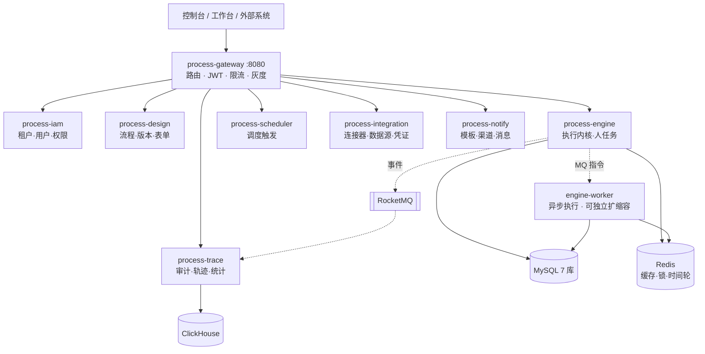

# ProcessEngine 流程编排平台 · 文档中心

一个基于 **Java 21 + Spring Cloud 微服务 + Vue 3** 的通用型流程编排平台，覆盖三类核心场景：
**审批工作流**、**任务/服务编排**、**数据与系统集成**。

执行内核为**自研轻量令牌驱动引擎**，采用 BPMN 风格建模（JSON 为主模型，BPMN 2.0 XML 作为导入导出适配格式）。

---

## 文档地图

建议按顺序阅读：先看基线建立全局认知，再看需求确认范围，最后看设计与落地。

| # | 文档 | 内容 | 主要读者 |
| --- | --- | --- | --- |
| 00 | [设计基线](00-设计基线.md) | **唯一一致性锚点**：术语表、技术选型、8 服务拆分与职责边界、7 库实体清单、全局规范（ID/多租户/响应/错误码/幂等/安全）、非功能指标基线、需求编号规范 | 全体 |
| 01 | [需求规格说明书](01-需求规格说明书.md) | 产品定位、角色画像、端到端业务场景、分域功能需求（FR）、非功能需求（NFR）、范围边界、追溯矩阵、优先级规划 | 产品、业务、测试 |
| 02 | [系统设计方案](02-系统设计方案.md) | 总体架构、关键技术决策（ADR）、**执行引擎内核设计**、人任务/建模/表单/调度/集成/通知/轨迹子系统、安全、高可用与容量、核心时序图、一致性设计、前端总体设计 | 架构师、后端、前端 |
| 03 | [数据库设计](03-数据库设计.md) | 设计约定、分库拓扑、按库 ER 图、全表字段与索引、可执行 DDL、ClickHouse 表设计、典型查询与索引匹配、容量与归档、初始化数据、迁移规范 | 后端、DBA |
| 04 | [API 契约](04-API契约.md) | 通用约定（鉴权/响应/错误码/分页/幂等）、各服务完整接口清单、实时推送契约、MQ 消息契约、端到端交互示例、内部 Feign 契约、权限码清单 | 前后端、集成方、测试 |
| 05 | [迭代计划与项目骨架](05-迭代计划与项目骨架.md) | 团队与协作、里程碑计划、迭代 WBS、依赖与关键路径、后端 Maven 多模块骨架、前端 pnpm Monorepo 骨架、本地开发环境、CI/CD 与质量门禁、测试策略、风险与上线清单 | 技术负责人、全体 |

---

## 30 秒了解架构

**三条设计主线**：

1. **令牌驱动**——流程实例是一张图，`Token` 是执行指针；引擎不断取出活跃令牌交给节点行为执行，遇到等待态就停、被唤醒就继续。所有唤醒最终都收敛到一条统一的「推进指令」，便于排查。
2. **不用分布式事务**——跨服务一致性 = 本地事务 + Outbox + 幂等消费 + 补偿 + 三层对账。**Redis 不是正确性依赖**，它挂了引擎降级但不数据错乱。
3. **引擎语义可单测**——`engine-core` 对 Web 与 ORM 零依赖，持久化通过仓储接口反转，节点行为通过 SPI 注册。新增节点类型不改内核代码。

---

## 核心能力一览

| 能力域 | 要点 |
| --- | --- |
| 流程建模 | X6 自研设计器；草稿/发布/下线/回滚；发布即固化；JSON 与 BPMN 2.0 双向转换；结构化校验（结构/图语义/跨服务引用三级） |
| 执行引擎 | 令牌驱动；排他/并行/包容/事件网关；子流程与调用活动；多实例；定时器与事件订阅；失败重试与故障人工干预；Saga 补偿；版本绑定与实例迁移 |
| 人任务 | 9 种候选人策略；会签/或签/比例签/顺序签；前加签/后加签；转办/委托/撤回/驳回；超时策略与催办；批量审批 |
| 表单 | Schema 驱动设计器与渲染器；30+ 字段类型；字段级可见/只读/权限表达式；版本与节点绑定；三处复用同一渲染器 |
| 调度 | Redis 时间轮 + DB 持久化；多副本抢占；misfire 与并发策略；与引擎定时器共用底座 |
| 集成 | HTTP/SQL/MQ/脚本/gRPC/Bean 连接器；数据源与凭证加密；在线调试；熔断限流；域名白名单与 SQL 只读约束 |
| 通知 | 事件与订阅分离；站内信/邮件/短信/钉钉/企微/飞书；聚合发送；分级重试与降级 |
| 可观测 | 全链路 traceId；节点级执行轨迹与回放；流程图活动高亮与耗时热力；8 类告警规则 |

---

## 技术栈速查

**后端**：Java 21 · Spring Boot 3.3 · Spring Cloud 2023.0 · Spring Cloud Alibaba + Nacos · Gateway · OpenFeign · Sentinel · MyBatis-Plus · MySQL 8.0 · Redis 7.2 + Redisson · RocketMQ 5.3 · ClickHouse · MinIO · Aviator · GraalVM JS · OpenTelemetry

**前端**：Vue 3.4 · TypeScript 5.5 · Vite 5.4 · Pinia · Vue Router 4 · Element Plus 2.8 · AntV X6 2 · ECharts 5 · Monaco Editor · pnpm Monorepo（Vitest + Playwright）

> 完整版本基线与「明确不引入」清单见 [设计基线第 2 节](00-设计基线.md#2-技术选型冻结)。

---

## 项目状态

| 阶段 | 状态 |
| --- | --- |
| 需求与设计文档 | ✅ 已完成（v1.0） |
| 工程骨架搭建 | ⏳ 待启动（方案见 05 文档） |
| 数据库 DDL 落地 | ⏳ 待启动（脚本规划见 03 文档） |

## 下一步

1. **评审设计文档**，重点确认：引擎节点类型全集（基线 5.1）、服务拆分边界（基线 3）、非功能指标（基线 7）。
2. 评审通过后按 [05-迭代计划](05-迭代计划与项目骨架.md) 的 M0 里程碑搭建工程骨架（后端 Maven 多模块 + 前端 pnpm Monorepo + docker-compose 本地环境）。
3. 同步创建 `docs/sql/` 下的 Flyway 迁移脚本，把 [03-数据库设计](03-数据库设计.md) 中的 DDL 落地为可执行迁移。

## 文档维护约定

- 本文档体系以 `00-设计基线.md` 为**唯一一致性锚点**。任何设计变更先改基线，再同步下游文档，并在基线第 10 节变更日志中登记。
- 禁止在文档中引入基线未定义的服务、组件或表（如确需新增，必须显式标注并说明理由）。
- 文档中的接口路径、表名、字段名、枚举值必须与实际代码一致；接口契约以 [04-API 契约](04-API契约.md) 为准并纳入 CI 校验。

### 跨文档权威顺序（口径冲突时的裁决依据）

| 优先级 | 文档 | 权威范围 |
| --- | --- | --- |
| 1 | [00-设计基线](00-设计基线.md) | 术语、技术选型、服务边界、实体清单、全局规范、枚举、公共列 |
| 2 | [04-API 契约](04-API契约.md) | 接口路径与字段、**错误码注册表**、**MQ Topic 命名与消息体**、权限码 |
| 3 | [03-数据库设计](03-数据库设计.md) | 表结构、字段类型、索引、DDL、分区与归档 |
| 4 | [05-迭代计划与项目骨架](05-迭代计划与项目骨架.md) | **里程碑编号与时间窗**、目录结构、工期、质量门禁 |
| 5 | [02-系统设计方案](02-系统设计方案.md) | 架构与运行机制、时序、实现细节 |
| 6 | [01-需求规格说明书](01-需求规格说明书.md) | 需求编号、优先级（P0/P1/P2）判定、验收标准 |

基线未规定的事项以 02 文档为准，并须在基线变更日志中登记。

### 已登记的跨文档修正（生成后校验发现）

| # | 问题 | 处理 |
| --- | --- | --- |
| 1 | 需求文档「8 个 SPI」与「4 组 22 类节点」与基线不符（实为 10 个 SPI、5 组 26 类节点） | 已更正 |
| 2 | 大对象外置阈值不一致（需求 32KB ↔ 设计 64KB） | 统一为 64KB |
| 3 | 里程碑编号撞车（需求 M1~M4 ↔ 迭代计划 M0~M7） | 统一为 M0~M7，需求 10.4 节改为首版范围对照表 |
| 4 | 里程碑时间窗漂移（迭代计划收尾时重构了 5 个里程碑的时间窗） | 需求 10.4 节时间窗已同步 |
| 5 | MQ Topic 命名不一致（设计文档 13 个 Topic 名 ↔ 契约 30 个） | 以契约为准，设计文档 20.2 节改为「核心链路 + 指向契约完整清单」 |
| 6 | 异步节点回调机制不一致（设计文档用 MQ ↔ 契约用内部接口） | 以契约为准，改为 `POST /api/engine/v1/internal/nodes/callback` |
| 7 | 错误码统计错误（契约声称 183 条，分域明细相加 308，实际表行数 337） | 逐域重核，更正为 **339 条**（含补充的 2 个码） |
| 8 | 需求文档 4 处错误码误用（指向完全不同的语义） | 已改为 `IAM_30011` / `IAM_30006` / `IAM_30001` / `DESIGN_30001` |
| 9 | 数据库文档引用了不存在的错误码 `TASK_30012` | 已在契约中补充该码（候选人超限，409） |
| 10 | `version_lock` 列名适配未登记到基线 | 已作为基线 v1.0.2 规则写入 6.5 节并登记变更日志 |
